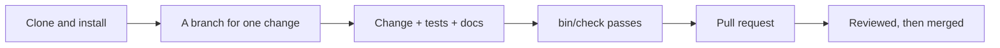

# Contributing to Intakt

Thank you for looking. Intakt is built mostly by its own loop: AI agents build tasks from the issues, other AI agents review them, and the owner approves what only a person may. People are welcome to contribute too: report a bug, suggest a feature, improve the docs, or send a pull request.

## Before you start

- **Read the design** in [`docs/design/`](docs/design/README.md): it is the authority on what Intakt does and why. If your change disagrees with it, propose the design change first (an issue or a pull request against the design).
- **Read [`AGENTS.md`](AGENTS.md)**: despite its name, it is the code standard for everyone, people and agents alike.
- **Plain-words overviews** are in [`docs/guide/`](docs/guide/README.md).

## Reporting a bug or suggesting a feature

Open an issue. The guide [writing a good task](docs/guide/writing-a-good-task.md) shows what makes an issue easy to act on: what should be different, how to tell it is done, and the evidence that shows it. A bug report with the smallest steps that reproduce it is the most useful thing you can send.

## Working on the code

1. **Set up:** PHP at the version of `config.platform.php` in `composer.json` with the extensions its `require` lists, and `config/gates/php/check.ini` for its ini settings, Composer, git, and for the full `bin/check` gitleaks (at the version `bin/check` pins) and the Linux tools `unshare`, `setsid` and `ip`: the full list with versions is in [requirements](docs/architecture/requirements.md). On a system other than Linux, use the development container once it exists (plan task T35). Then `composer install`; `php bin/instance 3>&1 >/dev/null` checks that Intakt boots. `bin/check` checks this profile through its first gate, `environment`, and fails it, naming each difference, when the running PHP differs; it does not load the ini settings itself, so add `config/gates/php` after the directories PHP already scans: `PHP_INI_SCAN_DIR=":$(pwd)/config/gates/php" bin/check` (see [the user guide](docs/user/README.md#the-php-profile-and-the-environment-gate)).
2. **One change per branch and pull request**, small enough to review in one go.
3. **Tests with every change:** a test that would fail without it, named as a sentence (`testAnEmptyFindingsListIsRefused`), with the coverage attributes `AGENTS.md` asks for.
4. **Docs in the same change:** a user-visible change updates `docs/user/` and `docs/architecture/`; a change to something a guide describes updates the guide in `docs/guide/`; a change that starts using a Symfony or Symfony AI feature updates its row of `docs/highlights.md` through a new fragment in [`docs/highlights.d/`](docs/highlights.d/), never by editing or committing the page itself (`bin/highlights` builds it, and git ignores it).
5. **Run `bin/check`** before every commit. It runs every gate CI runs: tests, static analysis, code style and Intakt's own rules.
6. **Commits:** [Conventional Commits](https://www.conventionalcommits.org/) (`feat(review): ...`, `fix(probe): ...`), at most 100 characters, in US English.

## Protected files

Some files are the project's rules: the gates in `config/gates/`, `bin/check`, `bin/instance`, `bin/probe`, `.github/`, `AGENTS.md` and the PHPUnit configs. A change to them gets extra review, and anything that weakens a check needs the owner's approval ([why](docs/guide/why-the-ai-cant-wreck-your-project.md)). Never weaken a gate to make a change pass; fix the change, or argue the gate in its own pull request.

## Dependencies

A dependency change is decided by the build loop's composer policy, as `AGENTS.md` says:
- **Routine:** a new `symfony/` or `doctrine/` package from that vendor's own repository, resolved to an upstream release tag, with no binaries, no Composer plugin and no autoloaded files or class maps.
- **Waits for the owner:** a package from any other vendor, and any change to Composer's own settings (scripts, plugins, repositories, config). A justification in the pull request (a recent release, real use on Packagist, no open security advisory) helps the owner decide; it does not replace the approval.

## A bug in Symfony AI or another dependency

Intakt uses the Symfony AI beta hard on purpose. If you find a bug in a dependency, don't work around it silently: add the smallest reproduction under `upstream/` (see the existing ones) and say so in the pull request. The owner decides whether it is reported upstream.

## Code of conduct

Be kind and assume good intent. Critique code, not people.
