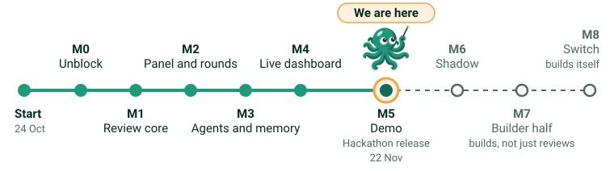

<h1 align="center">
  <picture>
    <source media="(prefers-color-scheme: dark)" srcset="docs/assets/intakt-lockup-dark.svg">
    
  </picture>
</h1>

[](https://github.com/shinyredapples/intakt/actions/workflows/ci.yml)

Your coding agent says it is done. Intakt tells you whether to believe it.

AI code review by a panel from different AI labs. Every finding must quote the code it is about, and a judge makes one list to fix. Start a review from the dashboard, or let your own agent run the loop over MCP until the verdict is clean.

<!-- VIDEO THUMBNAIL: put the linked thumbnail of the demo video here once it is uploaded (#3142). -->

<!-- HERO: replaced by a capture from the video tag after 11:00 -->
<picture>
  <source media="(prefers-color-scheme: dark)" srcset="docs/assets/dashboard-review-dark.png">
  
</picture>

## Five-minute start

```
git clone https://github.com/shinyredapples/intakt.git && cd intakt
docker compose up -d --wait
```

No key? Open http://localhost:7781/demo (or **See a real review** on http://localhost:7781/setup) and press **Play the demo run**: the recording of a real review of the sample change plays onto the dashboard without calling any model ([details](docs/user/README.md#playing-the-demo-run-in-the-dashboard)).

With your agent: the clone's `.mcp.json` connects Claude Code. The review is live, so it needs a key first (see *With a key* below). Run `export INTAKT_MCP_TOKEN=<token from the line intakt:sample:show prints>`, start `claude` in the clone, approve the `intakt` MCP server when Claude Code asks, install the [skill](skills/intakt-review/README.md) and say *intakt review the demo* ([details](docs/user/mcp.md)).

With a key: on http://localhost:7781/setup, under **Use your own project**, paste one provider key or Hugging Face token in **Add a key here**, run `docker compose restart intakt`, then press **Start the first review** ([Hugging Face details](docs/user/README.md#running-the-demo-on-a-hugging-face-token)). Or from the terminal: `docker compose exec intakt php bin/console intakt:demo` prints the verdict ([read it](docs/user/README.md#reading-a-verdict)). Calls are billed to the key's owner. The [demo walkthrough](docs/guide/demo-walkthrough.md) retells the run in plain words; [the review flow](docs/architecture/review-flow.md) draws it inside.

Without Docker or a key: `composer install`, then `bin/check` runs the quality gates every change passes (one JSON line per gate), `bin/check --journeys` the user journeys ([what they cover](docs/guide/checking-the-whole-product.md)) and `bin/console about` boots the app on SQLite.

## Measured

- **Review bench:** a panel on Claude and GPT caught all 5 planted defects in each of 3 runs (15 of 15, measured 2026-11-21); on low-cost open models it caught 11 of 15.
- **Timed run:** on an older 4-core desktop, a warm `docker compose up -d --wait` took 13.5 s and the demo review 42 s to its verdict (medians of ten runs, 2026-11-17).

How each was measured, the full tables and how to run the bench yourself: [docs/bench.md](docs/bench.md).

## Found and fixed upstream

Building Intakt led to 12 fixes (11 pull requests) merged upstream in Symfony, Symfony AI and Doctrine, with more open or reported. Every reproduction and its upstream status: [`upstream/`](upstream/README.md#found-and-fixed-upstream).

## The team

<p align="center">
  <picture>
    <source media="(prefers-color-scheme: dark)" srcset="docs/assets/team-dark.webp" width="760" height="116">
    
  </picture>
  <br>
  The octopus conducts: Tech lead, Developer, Code reviewer, Judge, Security engineer, Designer, AI engineer and Maintainer, in that order.
</p>

## Status

<p align="center">
  <picture>
    <source media="(prefers-color-scheme: dark)" srcset="docs/assets/roadmap-dark.svg" width="420" height="245">
    
  </picture>
</p>

**Works today:** the review loop and its foundation. A reviewer panel of any size, at least one reviewer (`config/intakt.yaml`) reviews a branch of a local repository (`intakt:review`, the dashboard button or the MCP tool `start_review`), a judge sorts the findings into the act list, and the dashboard shows each round live; the demo runs it on a sample repository with `docker compose up`. Under it, a Symfony 8.2 (8.2.0-BETA2, a beta until 8.2.0 is released) app on PHP 8.5.12 or later with SQLite, Symfony AI 1.0.0-BETA1 (Platform, Agent, Store, AI Bundle) and the MCP Bundle installed, the module layout with plugin contracts, the Anthropic, OpenAI and OpenAI-compatible providers with keys from the environment or Symfony secrets (a provider without its key is switched off with a message), and `bin/check`, which runs every quality gate CI runs: coding standards, PHPStan at max (with the service ids and parameter types of the compiled container), Rector, module boundaries, PHPUnit 13, `composer audit`, gitleaks on files and history, commit subjects, long dashes, the `docs/highlights.md` table lint, a row there for every `upstream/` reproduction and the service container lint.

**Planned:** reviewing a pull request on GitHub and posting the result there, rounds started by the loop itself, the catch-up review after a substitute, and everything outside the review loop, in the order of [the plan](docs/plan.md). The aim is that you give Intakt a spec, and AI agents turn it into small tasks, build each one and merge what passes review, spending only the budget you give them, asking you only when a person is needed, and acting as Intakt's own forge identity, never as you.

## Documentation

- [For judges](docs/judges.md): from clone to a played review in a few minutes, and the code behind each promise.
- [Intakt in plain words](docs/guide/README.md): friendly guides with diagrams, from the big picture to troubleshooting.
- [User guide](docs/user/README.md) for owners and [technical pages](docs/architecture/README.md) for how it works and how it is built; [design](docs/design/README.md): what Intakt does and why.
- [The hackathon](docs/hackathon.md): the first release, what was planned, achieved and comes next; [video](docs/video.md), [spec](docs/spec.md), [plan](docs/plan.md).
- [Showcase](docs/showcase/README.md), [journey](docs/journey.md) and [highlights](https://shinyredapples.github.io/intakt/) (built from [`docs/highlights.d/`](docs/highlights.d/)): this repository built by an AI loop, in figures.
- [Contributing](CONTRIBUTING.md) (and [how your issue or pull request is handled](CONTRIBUTING.md#how-your-issue-or-pull-request-is-handled)), [AGENTS.md](AGENTS.md), [why the AI can't wreck your project](docs/guide/why-the-ai-cant-wreck-your-project.md) and [releases](https://github.com/shinyredapples/intakt/releases) ([how a release is cut](docs/releasing.md)).

## License

MIT, see [LICENSE](LICENSE) and [NOTICE](NOTICE).
