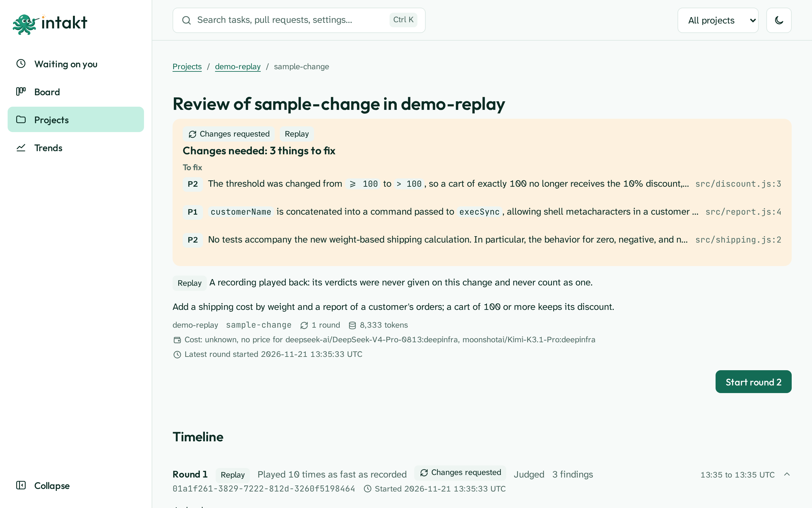

<h1 align="center">
  <picture>
    <source media="(prefers-color-scheme: dark)" srcset="docs/assets/intakt-lockup-dark.svg">
    
  </picture>
</h1>

Intakt gives you one verdict on a change that you can trust: a panel of reviewers on models of different makers reviews it, and a judge checks every finding against the task before it reaches the act list. Finding ids survive every round, enforced in code, so the goalposts never move; every figure is labelled measured, counted or estimated; and any agent runs the whole review loop through the MCP server.

PHP 8.5, Symfony AI · [Status](#status): what works today and what is planned · [Guides](docs/guide/README.md) · [Showcase](docs/showcase/README.md) · [Releases](https://github.com/shinyredapples/intakt/releases)

## Five-minute start

The demo reviews a sample change with two reviewers; the [timed run](#timed-run) says how long the start and a review take:

```
git clone https://github.com/shinyredapples/intakt.git && cd intakt
cp .env.dist .env.local   # add a provider API key or a Hugging Face token, and the two secrets
docker compose up         # Intakt, its database and a sample repository
```

Calls are billed to the key's or token's owner; `HF_TOKEN` alone puts the two reviewers on two makers ([Hugging Face details](docs/user/README.md#running-the-demo-on-a-hugging-face-token)). Once the dashboard answers, the start prints the review command between two lines of `=` (it begins with `docker compose exec intakt`), then an MCP line. Leave it running (its log may keep scrolling) and, from a second terminal in the repository folder, take a path:

| Path | Command | What you see |
| --- | --- | --- |
| Console | the printed `intakt:review` | the verdict and act list, exit 0, 10 or 11 ([how to read it](docs/user/README.md#reading-a-verdict)) |
| Dashboard | `http://localhost:7781` | each round live, the judge's call on every finding ([details](docs/user/README.md#the-demo-with-docker-compose)) |
| MCP | the printed `claude mcp add`, then the [`intakt-review` skill](skills/intakt-review/README.md) | say "intakt review the demo": your agent runs the loop, fixes inside the container, reports ([details](docs/user/mcp.md)) |

<details>
<summary>Screenshot: the dashboard's review page for the sample change</summary>



</details>

The [demo walkthrough](docs/guide/demo-walkthrough.md) tells the same path in plain words; [the review flow](docs/architecture/review-flow.md) draws how a review runs inside.

### Timed run

Tested platforms: the whole path ran on x86-64 Linux, in two sets of runs: the three runs of 2026-11-15 in the table below, and, apart from them, an earlier run on 2026-11-13 on a four-core host, which took 202 s to a running install. On arm64 Linux, the `image-arm64` CI workflow builds and first-starts the image on every push to main and prints both timings; no arm64 run is recorded here yet. Docker Desktop on Apple Silicon runs the arm64 image.

The times below are measured: three runs of this path on 2026-11-15, each from a clean clone with only `HF_TOKEN` and the two secrets in `.env.local` (note `.env.local`, not `.env`: `compose.yaml` reads `.env.local`). Cloning and filling in `.env.local` come first and are not timed, because they depend on your network and your typing.

| Step | Command | Time (measured) |
| --- | --- | --- |
| Start, cold | `docker compose up` on a machine without the image, until the log prints the review command | about 175 s |
| Start, warm | `docker compose up` again, with the image already built | 5 to 6 s |
| Review | the printed `docker compose exec intakt php bin/console intakt:review sample-change ...`, in a second terminal | 8 to 25 s per review |

What works without Docker or a provider key:

```
composer install
bin/check            # the quality gates every change passes (not the journeys), one JSON line per gate
bin/check --journeys # the user journeys, each on a fresh install, run separately
bin/console about    # the app boots on SQLite
```

What the journeys cover and how to run one: [Checking the whole product](docs/guide/checking-the-whole-product.md).

## The first release: the review loop

Built for the [Symfony AI & MCP Hackathon](docs/spec.md) (deadline 2026-11-22):

- Point Intakt at a change, a branch of a local repository. A configurable panel of reviewers, each a provider, a model tier and a prompt through Symfony AI's Platform, returns structured JSON verdicts.
- Findings keep their ids across rounds, so reviewers cannot move the goalposts. A judge step tells the builder what to act on.
- Agents start reviews and read findings through an MCP server.
- A small live dashboard shows each round as it streams.
- Every figure says what kind it is: token counts the provider reported are `measured`, rounds and findings from the ledger are `counted`, and a cost from your price list is `estimated`, with the date of the prices. Figures of different kinds are never added into one total.
- `docker compose up` with a sample repository and your API keys (or a Hugging Face token) runs it in five minutes.

## Status

**Works today:** the review loop and its foundation. A reviewer panel of any size, at least one reviewer (`config/intakt.yaml`) reviews a branch of a local repository (`intakt:review`, the dashboard button or the MCP tool `start_review`), a judge sorts the findings into the act list, and the dashboard shows each round live; the demo runs it on a sample repository with `docker compose up`. Under it, a Symfony 8.2 (8.2.0-BETA2) app on PHP 8.5.12 or later with SQLite, Symfony AI 1.0.0-BETA1 (Platform, Agent, Store, AI Bundle) and the MCP Bundle installed, the module layout with plugin contracts, the Anthropic, OpenAI and OpenAI-compatible providers with keys from the environment or Symfony secrets (a provider without its key is switched off with a message), and `bin/check`, which runs every quality gate CI runs: coding standards, PHPStan at max (with the service ids and parameter types of the compiled container), Rector, module boundaries, PHPUnit 13, `composer audit`, gitleaks on files and history, commit subjects, long dashes, the `docs/highlights.md` table lint, a row there for every `upstream/` reproduction and the service container lint.

**Planned:** reviewing a pull request on GitHub and posting the result there, rounds started by the loop itself, the catch-up review after a substitute, and everything outside the review loop, in the order of [the plan](docs/plan.md). The aim is that you give Intakt a spec, and AI agents turn it into small tasks, build each one and merge what passes review, spending only the budget you give them, asking you only when a person is needed, and acting as Intakt's own forge identity, never as you.

## How it is built

- **PHP 8.5 and Symfony 8.2 (beta)**, with the latest stable tools, and Symfony AI used for every model call, agent and memory, on purpose, to find the beta's bugs early.
- **FrankenPHP worker mode** for the dashboard and the MCP server, with Mercure built in for live updates; Messenger consumers and the Scheduler (the watcher tick every minute, started in the image by its own consumer; usage probes, deadlines and the weekly cleanup are planned) run beside it. The local API stays planned.
- **Steering by labels** (planned) on your forge: `intakt` to take a task, then `priority:`, `class:`, `model:`, `plan:` and `review:`; Intakt mirrors progress in `status:`.
- **No public resource API in v1.** The interfaces are the dashboard, the CLI, an optional forge webhook endpoint (forge changes are polled by default) and the MCP server.

## Documentation

- [Intakt in plain words](docs/guide/README.md): friendly guides with diagrams, from the big picture to troubleshooting.
- [Contributing](CONTRIBUTING.md): reporting bugs, suggesting features, sending pull requests.
- [User guide](docs/user/README.md): for owners running Intakt.
- [Technical pages](docs/architecture/README.md): how it works, the gates, the module layout.
- [Design](docs/design/README.md): what Intakt does and why.
- [Releases](https://github.com/shinyredapples/intakt/releases): tagged versions and their notes; [how a release is cut](docs/releasing.md).
- [Why the AI can't wreck your project](docs/guide/why-the-ai-cant-wreck-your-project.md): the safety design in plain words.
- [Showcase](docs/showcase/README.md): this repository built by an AI loop, in figures and examples.
- [Highlights](https://shinyredapples.github.io/intakt/): every Symfony and Symfony AI feature Intakt uses or plans, with its status, published from main (built from [`docs/highlights.d/`](docs/highlights.d/)).
- [Journey](docs/journey.md): how Intakt got from an empty repository to the demo, with its milestones, decisions, capacity, CI, token use (measured) and issue flow (counted).
- [Spec](docs/spec.md) and [plan](docs/plan.md) of the first release.
- [AGENTS.md](AGENTS.md): the rules for anyone, person or agent, changing the code.

## License

MIT, see [LICENSE](LICENSE) and [NOTICE](NOTICE).
