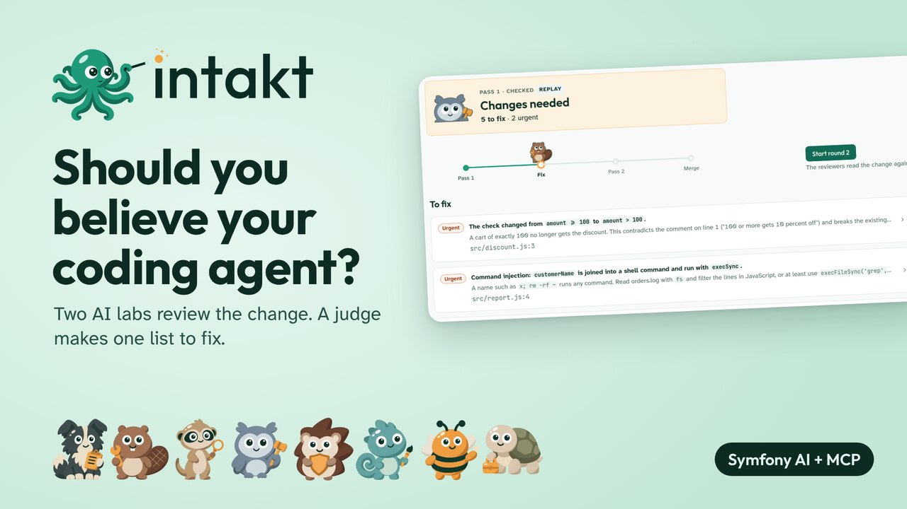

> **Judging the Symfony AI & MCP Hackathon?** Use the tested submission, release [v0.4.1](https://github.com/shinyredapples/intakt/releases/tag/v0.4.1): the first install under [Five-minute start](#five-minute-start).

<h1 align="center">
  <picture>
    <source media="(prefers-color-scheme: dark)" srcset="docs/assets/intakt-lockup-dark.svg">
    
  </picture>
</h1>

[](https://github.com/shinyredapples/intakt/actions/workflows/ci.yml)

Your coding agent says it is done. Intakt tells you whether to believe it.

AI code review by a panel from different AI labs. A finding whose quoted code is not in the change is dropped, and a judge makes one list to fix. Start a review from the dashboard, or let your own agent run the loop over MCP until the verdict is clean.

[](https://youtu.be/-8v0nflAQBk)

<picture>
  <source media="(prefers-color-scheme: dark)" srcset="docs/assets/dashboard-review-dark.png">
  
</picture>

## Five-minute start

The hackathon submission, tested on both paths (release v0.4.1):

```
git clone --branch v0.4.1 https://github.com/shinyredapples/intakt.git && cd intakt
docker compose up -d --wait
```

The latest, with everything built after the deadline (main):

```
git clone https://github.com/shinyredapples/intakt.git && cd intakt
docker compose up -d --wait
```

No key? Open http://localhost:7781/demo (or **See a real review** on http://localhost:7781/setup) and press **Play the demo run**: the recording of a real review of the sample change plays onto the dashboard without calling any model ([details](docs/reference/user-manual.md#playing-the-demo-run-in-the-dashboard)). The dashboard has no login, so it answers only `http://localhost:7781` on the machine that runs it; from another device, open an SSH tunnel first ([how](docs/user/08-when-something-goes-wrong.md#the-dashboard-says-open-the-dashboard-on-localhost)).

With your agent: the clone's `.mcp.json` connects Claude Code. The review is live, so it needs a key first (see *With a key* below). Run `docker compose exec intakt php bin/console intakt:sample:show /app/var/data/sample-repository`. It prints, among other lines, `Connect an MCP client: claude mcp add --transport http intakt http://localhost:7781/mcp/owner --header "Authorization: Bearer <token>"`. Run `export INTAKT_MCP_TOKEN=<token>` with the token after `Bearer` in that line (or run the printed `claude mcp add` line instead), then start `claude` in the clone, approve the `intakt` MCP server when Claude Code asks, install the [skill](skills/intakt-review/README.md) and say *intakt review the demo* ([details](docs/reference/mcp.md)).

With a key: on http://localhost:7781/setup, under **Use your own project**, paste one provider key or Hugging Face token in **Add a key here**, press **Keep the key**, run `docker compose restart intakt`, then press **Start the first review** ([Hugging Face details](docs/reference/user-manual.md#running-the-demo-on-a-hugging-face-token)). Or from the terminal: `docker compose exec intakt php bin/console intakt:demo` prints the verdict ([read it](docs/reference/user-manual.md#reading-a-verdict)). Calls are billed to the key's owner. The [demo walkthrough](docs/guide/demo-walkthrough.md) retells the run in plain words; [the review flow](docs/architecture/review-flow.md) draws it inside.

Without Docker or a key: `composer install`, then `bin/check` runs the quality gates every change passes (one JSON line per gate; with `--reuse`, an unchanged tree that passed reuses that pass and runs only the audit again), `bin/check --journeys` the user journeys ([what they cover](docs/guide/checking-the-whole-product.md)) and `bin/console about` boots the app on SQLite.

## Measured

- **Review bench:** a panel on Claude and GPT caught all 5 planted defects in each of 3 runs (15 of 15, measured 2026-11-21); on low-cost open models it caught 11 of 15.
- **Timed run:** on an older 4-core desktop, a warm `docker compose up -d --wait` took 13.5 s and the demo review 42 s to its verdict (medians of ten runs, 2026-11-17).

How each was measured, the full tables and how to run the bench yourself: [docs/bench.md](docs/bench.md).

## Found and fixed upstream

Building Intakt led to 12 fixes (11 pull requests) merged upstream in Symfony, Symfony AI and Doctrine, with more open or reported. Every reproduction and its upstream status: [`upstream/`](upstream/README.md#found-and-fixed-upstream).

## The team

<p align="center">
  <picture>
    <source media="(prefers-color-scheme: dark)" srcset="docs/assets/team-dark.webp" width="760" height="116">
    
  </picture>
  <br>
  The octopus conducts: Tech lead, Developer, Code reviewer, Judge, Security engineer, Designer, AI engineer and Maintainer, in that order.
</p>

## Status

<p align="center">
  <picture>
    <source media="(prefers-color-scheme: dark)" srcset="docs/assets/roadmap-dark.svg" width="420" height="245">
    
  </picture>
</p>

**Works today:** the review loop. A panel of reviewers from different AI labs reviews a branch, a judge makes one list to fix, and the dashboard shows each round live.

**Next:** reviewing pull requests on GitHub, then Intakt building tasks as well as reviewing them ([the plan](docs/plan.md)).

## Documentation

- [For judges](docs/judges.md): from clone to a played review in a few minutes, and the code behind each promise.
- [Intakt in plain words](docs/guide/README.md): friendly guides with diagrams, from the big picture to troubleshooting.
- [User guide](docs/user/README.md): a developer's day with Intakt in nine short chapters; the [complete reference](docs/reference/user-manual.md) for owners and [technical pages](docs/architecture/README.md) for how it works and how it is built; [design](docs/design/README.md): what Intakt does and why.
- [The hackathon](docs/hackathon.md): the first release, what was planned, achieved and comes next; [video](docs/video.md), [spec](docs/spec.md), [plan](docs/plan.md).
- [Showcase](docs/showcase/README.md), [journey](docs/journey.md) and [highlights](https://shinyredapples.github.io/intakt/highlights/) (built from [`docs/highlights.d/`](docs/highlights.d/)): this repository built by an AI loop, in figures.
- [Contributing](CONTRIBUTING.md) (and [how your issue or pull request is handled](CONTRIBUTING.md#how-your-issue-or-pull-request-is-handled)), [AGENTS.md](AGENTS.md), [why the AI can't wreck your project](docs/guide/why-the-ai-cant-wreck-your-project.md) and [releases](https://github.com/shinyredapples/intakt/releases) ([how a release is cut](docs/releasing.md)).

## License

MIT, see [LICENSE](LICENSE) and [NOTICE](NOTICE).
