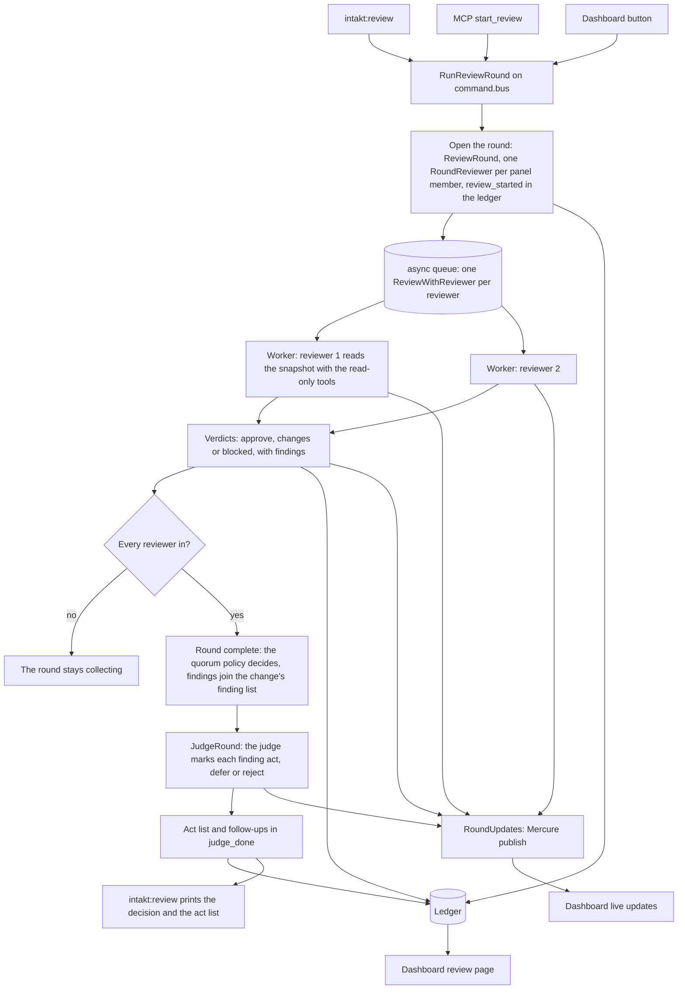

# Intakt technical pages

How Intakt works, for developers and agents. Each user-visible feature has a page here (how it works, the data it keeps, its limits, a Mermaid diagram where the flow is not obvious), written in the same change as the code.

## Module layout

```
src/
  Kernel.php
  Core/<Module>/        core areas (review, ledger, ...), added by the tasks that need them
  Plugin/<Kind>/        plugin kinds: Forge, Vendor, Notifier, WorkSource, Gate
    Contract/           the module's only public surface
    Domain/             entities and value objects
    UseCase/<Name>/     one use case and its doors (command, controller, handler, MCP tool)
    Infrastructure/     adapters
config/modules.php      the module list; a test keeps it equal to the directories
fixtures/sample-repository/   plain files for the demo, see below
```

The Notifier, WorkSource and Gate contracts are empty for now. The first implementation of each kind adds the methods it needs (see [Left to the builder](../design/08-left-to-the-builder.md)). The Forge contract has the methods for reading a change and, apart from them, the one write so far; see below.

## Sample repository

`fixtures/sample-repository/` is data, not code; the demo's seed builds a git repository from it (see [The demo](#the-demo-with-docker-compose)). `base/` is the tree of the base commit; `pull-request/` holds only the files the branch adds or changes. `issues.json` lists each deliberate issue (`id`, `kind` of bug, missing-test or security, `file`, `description`, and an `evidence` line that appears as an added line in the change). `SampleRepositoryTest` builds the repository with the test `TemporaryRepository` (base on `main`, then the overlay on `sample-change`) and checks that every listed issue is in the diff. It is JavaScript so the PHP gates do not scan it.

## Forge contract and the local git forge

`Plugin/Forge/Contract` holds what reading a change needs, as typed objects only:

- `Forge::change(ChangeId)` returns a `Change`: the id, the `commits` (`CommitRange`: `base` and `head` as `CommitId`, full hashes) and the `diff` (`Diff`: the unified `patch` text and the `files`, a `ChangedFiles` collection of `ChangedFile`: path and `FileStatus` added, modified or deleted; a rename shows as a delete and an add).
- `Forge::hasHeadMoved(Change)` is true when the change's branch now points at another commit than the `Change` was read at (`#[NoDiscard]`).
- `Forge::headMoveSince(CommitId $earlier, Change)` returns a `HeadMove`: how the change's head moved since the earlier head (`HeadMoveKind`: `unmoved`, `clean-merge-of-base`, `commits` or `rewritten`) and the `paths` that differ between the two heads (none for `unmoved` and `rewritten`).
- `Forge::fileAtHead(Change, path)` returns a `FileContent` as it is at the `Change`'s head hash, not at the branch tip, so a branch that moved on does not change what is read.
- Failures are typed: `ChangeNotFound`, `FileNotFoundAtHead` and `ForgeReadFailed` (git could not run, timed out, failed or printed something unexpected).

`Plugin/LocalGitForge` implements it for a local repository (`LocalRepository`: path and base branch). A local branch (`refs/heads/<id>`, never a tag) against the base branch is the pull request. Every call is a `GitCall` (argument list, absolute directory, environment) built by `Core/Git/Contract/HardenedGit` and runs through the Process component with that argument list (no shell) in the repository, with a 60-second timeout; the hardened call (no replace objects or grafts, no lazy fetch or transport, an absolute pinned work tree, literal pathspecs, no repository hooks, fsmonitor, attributes, filters, textconv, external diff, signature checks or output encodings, no inherited `GIT_*` variables, no system or user config) is described in [Requirements](requirements.md#the-hardened-git-call). A Process failure (a missing directory, a timeout) becomes a `ForgeReadFailed`, and so does a NUL byte in a path or change id, which is refused before git starts, and a repository whose `.git/info/attributes` exists, which the hardened call refuses (`RepositoryAttributesRefused`).

1. The head is the branch's commit (`git check-ref-format` on `refs/heads/<id>`, then `git show-ref`; an invalid branch name or a missing branch is `ChangeNotFound`, any other git failure `ForgeReadFailed`); the base is the merge base of the base branch and the head, so what the base branch gained after the branch was cut is not in the diff.
2. The diff is `git diff` between those two hashes, without colors, renames, external diff drivers or text conversion, with every file shown as text (`--text`, so neither an attribute nor git's binary detection replaces a change by `Binary files differ`), and with `--ignore-submodules=none`, so a changed submodule commit shows even when the repository sets `diff.ignoreSubmodules`. The changed files come from `git diff --name-status -z` with the same options and hashes; `NameStatusParser` turns that output into `ChangedFiles` with the pipe operator (split on NUL, pair status with path, map to objects). An unknown status or a status without a path is a `ForgeReadFailed`.
3. A file is looked up with `git ls-tree -z <head hash> -- <path>` and read with `git cat-file blob <blob hash>`. A path that is not a file (missing, a directory or a submodule) at the head is `FileNotFoundAtHead`; a head that cannot be read is `ForgeReadFailed`.
4. A head move since an earlier head: the same hash is `unmoved`. An earlier commit that is not in the repository (`git cat-file -e <hash>^{commit}` fails) or is not an ancestor of the head (`git merge-base --is-ancestor`, exit 1) is `rewritten`; any other exit is `ForgeReadFailed`. Otherwise the head is a `clean-merge-of-base` when it is a merge commit with exactly two parents (`git rev-list --parents --max-count=1`), the first is the earlier head, the second is an ancestor of the base branch, and its tree is exactly the tree `git merge-tree --write-tree` computes for those two parents without conflicts (with `core.attributesFile` naming `src/Plugin/LocalGitForge/Infrastructure/builtin-merge.gitattributes`, whose `* merge` makes git use its own text merge, so no merge driver from the repository's config runs), so a resolved conflict or an edit hidden in the merge is not clean; anything else is `commits`. The paths come from `git diff --name-status -z` between the two heads, with the options of step 2.

`php bin/console intakt:change:summarize <branch> [--repository=.] [--base=main]` (`Plugin/LocalGitForge/UseCase/SummarizeChange`, plan task T6) builds a `LocalGitForge` from the input (`SummarizeChangeInput`, mapped with `#[MapInput]`), reads the `Change` of the branch and prints the branch and base names, the first 12 characters of the base and head hashes, the file count with the `+` and `-` lines (`Diff::addedLines()` and `Diff::removedLines()`, counted from the patch inside `@@` hunks only, so the `+++` and `---` file headers are excluded and a changed line starting with `++` or `--` is counted), and one `status path` line per changed file. Branch names and paths are escaped with `OutputFormatter::escape()` before they reach the console, so a name containing a formatter tag such as `<info>` prints literally. Before that, `Infrastructure\VisiblePath` prints every control character in a path (bytes 0x00 to 0x1F and 0x7F, and the UTF-8 encoded U+0080 to U+009F) as `\xNN` per byte and a backslash as `\\`, so a file name holding an escape sequence cannot rewrite the terminal; branch names need no such step, because git refuses control characters in ref names. The file count reads `1 file changed` for one file and `N files changed` otherwise. `ChangeNotFound`, `ForgeReadFailed`, a `--repository` that is not a directory (`RepositoryNotFound`), an empty `--base` (`LocalRepositoryIncomplete`) and an empty branch (`ChangeIdEmpty`) print the message as an error and exit with 1. The command lives in the plugin's own module because it needs the plugin's `Infrastructure`, which other modules may not use.

### Forge writes

`Plugin/Forge/Contract/ForgeWrites` holds what Intakt writes to a forge, apart from the reads, so a read-only forge implements none of it: so far `postReview(project, Change, ReviewComment)`. A `ReviewComment` is a non-blank body, the round's one-time `ReviewToken` (16 to 128 letters, digits, `_` or `-`, so it cannot close the marker it is posted in) and the `JobCredentials` of the jobs that wrote the body (their non-empty values, possibly none); an invalid one is an `InvalidArgumentException`. `ReviewComment::redactedBody()` delegates to `Core/Platform/Contract/Redaction`, the one redaction shared by posted text, log records (`Core/Platform/Infrastructure/RedactedJsonFormatter`, see the Logging convention) and stored text (`Core/Platform/Contract/Redactor`, the interface for text a module stores or shows, implemented by `Core/Platform/Infrastructure/HeldCredentialRedactor`, which passes `HeldCredentials::values()` read at each call, as the formatter does; so far the watcher's failure cause): it replaces every held value with `[redacted]`, the longest first, each matched by one pattern that allows every character as itself (with any run of backslashes before `"`, `\` and `/`) and, only for the characters `json_encode` may escape (control characters, non-ASCII, `"`, `\`, `/`, `<`, `>`, `&`, `'`), also as a JSON short escape (`\n`, `\t`, `\r`, `\b`, `\f`) or as `\u` escapes (UTF-16 units, either case), each escape after any run of backslashes, so JSON encoding at any depth and with the `JSON_HEX_*` flags is covered while a credential of thousands of plain characters stays within PCRE's pattern size; then it redacts credential header values (plain, quoted, shell-quoted, JSON, `print_r`/`var_export` scalars and lists, Digest parameters; a quoted value may hold the other quote character; a `var_export` or short-array list ends at its matching bracket, skipping quoted strings, and the text after that bracket is kept only for a list that is the value of a quoted key (the header name directly after `"` or `'` and directly followed by the same quote after any backslashes, as in JSON `"authorization": [...]` and `var_export` `'Authorization' => [...]` or `array (`; a quoted key after an unquoted credential header name on the same line, as in `Cookie: x; 'authorization': [...]`, sits inside that header's value and does not count) and is list-shaped: its first element is quoted, keyed (`0 =>`), nested or missing, and a `,`, closing bracket or line end follows its closing bracket; any other bracket after a credential header name (an unquoted name such as `Cookie: [a]; sid=...`, `Authorization: ['Bearer x'] ...`, `-H 'Cookie: [] ...'` or `cookie=[...]`, whatever follows the bracket) is replaced with `[redacted]` up to its matching end, and the value pass then redacts that marker with the rest of the value, to the end of its line or quote, as it does a `[redacted]` left by a held value and a value that holds a list opening later on; a `print_r` list is redacted to the end of the text, because `print_r` does not quote values and its end cannot be told apart from a value; a list without a found end is redacted to the end of the text), the userinfo of URLs (also with JSON's `\/` separator), and secret shapes. A text that still trips the secret scan after redaction throws `ReviewTextHoldsSecret` (its message holds no part of the text) and posts nothing; a post whose round is stale throws `RoundStale` and posts nothing; a failed post, including a failed read of the head just before it and a secret scan that cannot run, is `ForgeWriteFailed`. `GitHubForge` implements it (see [GitHub App identity](#github-app-identity)); nothing calls it yet, because no round posts its outcome so far. Every forge that writes is decorated by the shadow guard (see [Shadow mode per project](#shadow-mode-per-project)), and a write added to the interface must be added to the guard, which implements it.

### Open pull request listing

`Plugin/Forge/Contract/OpenChanges::listOpen(project, ?validator)` (plan task T38, part 1) lists the open changes of a project and returns an `OpenChangeListing`: either `unchanged` (the forge answered that the list is the one the validator came from, as GitHub does with a `304` to `If-None-Match`, which costs no rate limit) or the `changes` (`OpenChange`: `ChangeId`, head `CommitId` and `updatedAt`) with the new `validator`. A failed read is `ForgeReadFailed`. `LocalGitForge` does not implement it, and `GitHubForge` does not implement it yet (plan task T18), so the tests use `RecordedForge` (`tests/Core/Watcher/UseCase/FindChangedPullRequests/`), which answers like GitHub's conditional listing.

`Core/Watcher/UseCase/FindChangedPullRequests/FindChangedPullRequests` takes a project and returns the open pull requests whose head or update time differs from what was seen. `SeenListings::whileListing` tries a lock for the project without waiting (`ListingInProgress` in the module's `Contract` when another listing holds it) and, holding it, detaches the project's own `ListingValidator` and `SeenChange` rows from the entity manager, so the listing reads what other workers stored since; it never clears the entity manager, so a pending write or a loaded entity the caller holds survives the listing and is flushed as usual. The use case lists with the stored validator, and on `unchanged` returns nothing without reading any pull request. Otherwise `SeenListings` compares each pull request with its stored `SeenChange` (project, change, head, and the update time as text in UTC with microseconds, `Y-m-d H:i:s.u`, because a datetime column keeps whole seconds and an update within the same second would go unseen), then records the new heads, forgets pull requests no longer open (so one closed and opened again counts as new) and stores the `ListingValidator` (one per project; none stored when the forge sent none, so the next listing is full), in one flush after the whole list was compared. A failed read stores nothing. Each listing logs one line at info level with `project`, `status` (304 or 200), and for a full listing `open` and `changed`. The tables are `watcher_listing_validator` and `watcher_seen_change` (migration `Version20261101140000`). The Scheduler tick calls it (see below). Tests: `FindChangedPullRequestsTest` (group `persistence`, SQLite).

`Plugin/Forge/Contract/HeadChecks::ciStateOf(project, CommitId)` (plan task T38, part 2) returns the `CiState` of one exact head: its `CiRun`s, the workflow runs and check suites of that sha only, each with a `CiRunOrigin` (workflow or app name, event, pull request), a start time and a state `Unfinished`, `Succeeded`, `Failed` or `Cancelled` (`CiRunState`; `RecordedChecks` maps a completed run with conclusion `success`, `neutral` or `skipped` to `Succeeded`, `cancelled` to `Cancelled` and any other to `Failed`, takes `created_at` as the start, the first of `pull_requests` as the pull request, and `check_suite` as the event of a check suite), so a rerun or a newer push cannot decide for an older head. A failed read is `ForgeReadFailed`. `GitHubForge` does not implement it yet (plan task T18); the tests use `RecordedChecks` (`tests/Core/Watcher/UseCase/AdmitHeads/`), which maps recorded GitHub responses (`recorded/*.json`) and keeps the runs of the asked sha. `Core/Watcher/Domain/AdmissionDecision::admissionOf()` folds a state into one `HeadAdmission`. It first drops a cancelled run when the head has a run of the same origin (same name, event and pull request) that started later (a rerun replaced it); an older run, or one of another event or pull request, does not. Then it is `Red` when any run failed (also while others still run, so red CI is never reviewed), `Pending` when no run exists yet or one is unfinished or a remaining one is cancelled (a cancelled run is never judged red), otherwise `Green`. `order()` puts heads with finished CI (green or red) before pending ones with a stable sort, so a running head keeps its place among the running ones. `UseCase/AdmitHeads/AdmitHeads` takes a project and one changed `OpenChange`, reads the state of its head, refuses an answer for another head (`ForgeReadFailed`), logs one info line (`project`, `change`, `head`, `admission`; this is where red CI is recorded) and returns its `HeadDecision` (the caller orders the decisions of a tick with `order()`): a pending one carries `readAgainAt`, 60 seconds after the clock's now, and holds no lock, lane or row; only a green one `startsRound()`. The Scheduler tick calls it (see below). Tests: `AdmissionDecisionTest` and `AdmitHeadsTest`.

`Core/Watcher/UseCase/WatchPullRequests` is the Scheduler tick (plan task T38, part 3). `WatcherSchedule` (`#[AsSchedule('watcher')]`, run by `messenger:consume scheduler_watcher`) holds one `RecurringMessage` per project that has a `watch` section, every minute, each a `WatchPullRequests(project)` handled on `command.bus` by `WatchPullRequestsHandler`. A project's `watch` section (`repository`, `base`, `task`, all required string nodes that must not be blank) is split off in `config/packages/ai.php` like `review` and `mode`, validated by `Infrastructure\WatchConfiguration` and set as the parameter `intakt.watcher.projects`; `WatchedProjects` refuses a project without one (`ProjectNotWatched`). One tick: `ChangedHeads` lists the changed pull requests (`FindChangedPullRequests`; a listing already running for the project ends the tick quietly) and, in one database transaction with the listing's record, queues each as due now in `PendingHeads` (the `watcher_pending_head` table: change, head, update time and read-again time), so a pull request the listing recorded as seen stays queued until it is settled, also when a later step fails; in the same transaction `PendingHeads::forgetClosed()` deletes the pending heads of pull requests the listing forgot as closed (no `watcher_seen_change` row left) and returns them, and `ChangedHeads` appends one `head_forgotten` line (`project`, `change`, `head`) per forgotten head, so a closed pull request is not read again and its failed-head card (below) goes; a line the ledger refuses fails the tick inside that transaction, so the rows and the listing's record come back and the next tick forgets them again; a head is read again from here even when the listing answers unchanged, and a head that is not yet due is not read. `PendingHeads::dueFor()`, `StartedRounds::notYetRecorded()` and `StartedRounds::openRoundsBefore()` read each listed row again by its key (the row detached, then `find()`), because a worker keeps its entity manager, and skip a row another worker deleted in between (a `refresh()` of a deleted row keeps its old values). `LookAtHeads` then takes the due heads: `HeadLocks` tries the lock `watcher-change-<hash of project and change>` for each without waiting, skips a busy one (it stays due for the next tick), reads each held head again from `watcher_pending_head` (`PendingHeads::stillDue()`: a head another tick settled between the read and the lock is dropped, a newer head queued meanwhile replaces the one read) and holds the locks from the stale check to the round start. `HeadDecisions` decides each held head on its own (`AdmitHeads`) and orders the decisions (`AdmissionDecision::order()`), and `SettleHeads::settleEach()` settles each through `SettleHead`: a green one is first checked by `StaleVerdicts` against the change's rounds on other heads and then starts a round (`RoundStarts`); a pending head is recorded as `head_pending` and its read-again time set with one `UPDATE` that names the head in its condition (so a newer head the listing queued meanwhile stays due now), a red one is recorded as `head_red`, and only then does `StaleVerdicts` check them, so a new head whose commit is not fetched yet (the identity query fails) is still recorded and then backs off; a red head is removed only after its check succeeded (a pending one has its failure count reset by `PendingHeads::clearFailures()` then), so one whose check failed stays queued and is read again (and recorded `head_red` again) once its back-off has passed. A head that fails backs off alone ([Budget](../design/05-architecture/06-budget-and-model-planner.md)): `HeadBackOff::tryAlone()` runs the decision and the settling of each head and catches any failure (a forge read, the stale check, the round start), so the tick goes on to the next head and records the owed `round_queued` lines without failing. For the failed head it logs one error with the exception (`project`, `change`, `head`) and, when the failure closed the entity manager (a failed flush closes it for every holder), resets it through `ManagerRegistry::resetManager()`, so the back-off and the next head do not fail with `EntityManagerClosed`. `FailedHeads` then, in one database transaction, sets the head's next try with one `UPDATE` that names the head and its update time in its condition (`PendingHeads::backOff()`: `read_again_at` and `failures`; it returns whether the row changed), so the same commit the listing queued again meanwhile stays due with no failures, and only when the row changed appends `head_failed` (with `cause`, the exception class and its message, bytes that are not UTF-8 replaced by `?` and then redacted like a log line through `Core/Platform/Contract/Redactor`, the held credentials included, because the cause is stored and shown on a card; `failures` in a row and `retry_at`); the next try is 60 seconds after the first failure in a row, twice as long after each further one, and at most 30 minutes. The `UPDATE` takes the row's write lock first, so a listing that closes the pull request (`forgetClosed()`, which takes no head lock) waits for it or has already removed the row; a head closed while its step was in flight thus gets no failure line after its `head_forgotten`, and no card. A failure the ledger cannot take (`WatcherEventNotRecorded`) rolls the `UPDATE` back, leaves the head due and fails the tick. The fourth failure in a row appends `head_handed_over` instead of `head_failed` (the hand-over to the maintainer agent, which is planned), once; the head stays queued and is tried again at its next try, so a fault that clears lets it start its round without its pull request changing; a head the listing names again counts its failures anew. The dashboard shows the latest failure of each head as a card on `/reviews` (`LedgerFailingHeads` below). An item failure places no shared hold: the install-wide failure back-off of `Budget` stays for causes that are install-wide. A pending head is removed only while its row still holds the settled head (one `DELETE` with the head in its condition), so a newer head another worker queued is kept. A round is started once per head: `StartedRounds::startOnce` runs one transaction that finds no `watcher_started_round` row for (project, change, head), dispatches Review's `Contract\StartReviewAtHead` on `command.bus` (a `StartReview` with the project's repository, base and task and the change id as the change name, plus the exact head whose CI was green), inserts the row with the id of the `Contract\QueuedRound` the handler returns (round id and the checkout root of the kept snapshot; the primary key is the backstop) and removes the pending head; a failing start rolls all of it back, so the head stays queued, a later tick tries again once its back-off has passed, and no row without a round exists. The round and its reviewer messages are written on the same connection and go with the rollback, but the kept snapshot does not: when the transaction rolls back after the start returned (the insert or the removal of the pending head failed), `startOnce` dispatches `Contract\DiscardQueuedRound` with the queued round on `command.bus` and rethrows, also when the rollback itself fails (`DiscardedRounds` does the dispatch; a discard that itself fails is logged as an error with the round id and the exception, and the original failure is the one rethrown) (MySQL's implicit commit before a schema change leaves no transaction to roll back; the rollback's failure is then ignored and the original failure rethrown). A connection lost while the round was queued ends the transaction, and DBAL would reconnect in autocommit; a commit past DBAL (a native one, or MySQL's implicit commit) leaves DBAL's own transaction count at one. So `startOnce` checks that its transaction is still active, by DBAL's count and, on a PDO connection, by `PDO::inTransaction()`, before it inserts the row and otherwise discards the round and throws `RoundTransactionLost`, writing neither the row nor the removal of the pending head, so the head stays due; `Plugin/LocalGitForge/UseCase/ReviewChange/DiscardQueuedRoundHandler` removes the snapshot through `KeptSnapshots`, as `RemoveKeptSnapshot` does after the judge. A start that fails itself removes its snapshot in `LocalChangeReview` and sends no discard. `RoundStarts` then records `round_queued` for every round of the project whose `queued_recorded` flag is unset (`StartedRounds::recordOnce`: one transaction that sets the flag with one conditional `UPDATE` and appends the line through the ledger, which writes on the same connection, so a failed append rolls the flag back and two workers record a round once); `SettleHeads::settleEach()` does the same at the end of every tick, so a line whose append failed after the round was committed is written by a later tick even when no head is due. `Plugin/LocalGitForge/UseCase/ReviewChange/StartReviewAtHeadHandler` starts the round through `LocalChangeReview::startAt()`, which reads the change at that head (`LocalGitForge::changeAt()`, merge base against the base branch; a head missing from the repository is `ForgeReadFailed`), so the round reviews the commit whose CI was read, whatever the local branches point at. `StaleVerdicts` asks on `query.bus` first `Contract\IdentityAtHead` (handled by `IdentityAtHeadHandler` in the same plugin through `LocalChangeReview::identityAt()`: as `Contract\HeadIdentity`, the `VerdictIdentity` the same start would record at the new head, with the project's task, the default check command `bin/check` and the panel `Panels` chooses, and the `HeadMove` from the round's head, both read from the repository the round was read from), then `Contract\VerdictsOfRound` with both; when Review answers `stale`, `StartedRounds::markStaleOnce` runs one transaction in which one `UPDATE` sets the row's `stale` flag only where it is unset (the verdict query clears the entity manager, so a loaded row would no longer be written), and `verdicts_stale` is appended only when that update changed the row, so a round is reported once, and a failed append rolls the flag back, so a later tick checks the round again and records the line. A move that keeps the verdicts (for example documentation only) changes nothing. A head that returns to one whose round is stale (A, then B, then A) gets a fresh round: the old round was reported stale once and its verdicts no longer count, so `isStarted` ignores a stale row and the start transaction deletes it with one conditional `DELETE` (the key holds one row per head) before it inserts the new row, which starts unstale and owing its `round_queued` line; a failed start rolls the delete back, so the stale row stays. A stale row whose `round_queued` line is still owed keeps its head started until the line is recorded, so the line is not lost, and its head stays pending, so a later tick starts the fresh round once the line is recorded, also on an unchanged listing. Both decisions, whether the round starts and whether the head stays pending, come from one read of the row at the start of the transaction, because the listing lock is released before the heads are looked at and a second tick of the same project records owed lines meanwhile: a second read could find the line taken and forget the head whose start was just suppressed. Because the replacement keeps the key, the conditional `UPDATE`s of `recordOnce` and `markStaleOnce` also name the round id, so a delayed worker holding the old round neither claims the fresh round's `round_queued` line nor marks the fresh round stale. A round that stands (a move that kept the verdicts) is never replaced, so that head starts no second round. The new head gets a round only when its CI is green. The ledger kinds `head_pending`, `head_red`, `round_queued`, `verdicts_stale`, `head_failed` and `head_handed_over` carry JSON with project, change and head (and the round id, the read-again time, the cause, the failures in a row, the next try). The tables are `watcher_started_round` and `watcher_pending_head` (migration `Version20261102100000`; `Version20261104100000` adds the pending head's `failures`, default 0). Until `GitHubForge` lists pull requests and reads CI (plan task T18), `Infrastructure\UnreadableForge` is the container's `OpenChanges` and `HeadChecks` and fails the tick with `ForgeReadFailed`; in the test environment `tests/Core/Watcher/services.yaml` replaces both with `RecordedPullRequests`, which serves the file `WATCHER_RECORDING` names (pull requests and workflow runs in GitHub's shape). Tests: `WatchPullRequestsHandlerTest` and `PendingHeadsTest` (group `persistence`; forced orders: a second tick inside the first start, a head that moves while its round is starting, a failed start retried on an unchanged listing once its back-off has passed, a head whose CI read or round start fails on every try backed off alone while the next head starts its round in the same tick, also when its failed flush closed the entity manager or its failure message is not UTF-8, doubling waits capped at 30 minutes, one hand-over after four failures in a row (and none after three), a handed-over head that starts its round once its fault clears, the same commit listed again before an older listing's back-off or while its fourth failure is recorded staying due with no failures (`PendingHeadsTest`, `FailedHeadsTest`), a head closed while its step was in flight getting no failure line or card (`FailedHeadsTest`), a failure the ledger cannot take leaving the head due, a newer head queued as soon as a kept row is read, a row deleted right after it was listed, a head that returns to an earlier head whose round is stale (A, B, A) and is reported stale again when it moves away once more; its query double clears the entity manager as the real handler does), `StartedRoundsTest` (group `persistence`: a round queued before the insert of its row or the removal of its pending head failed is discarded and leaves no row, a round queued before its connection was lost or before a native commit past DBAL is discarded and leaves no row and its head due, a round queued after its transaction was committed early (as by an implicit commit) is discarded with `RoundTransactionLost` rethrown although the rollback fails, a discard that fails is logged and the original failure is rethrown, a start that fails itself or a committed round sends no discard, a round deleted right after it was listed is neither owed nor open, a stale round is kept when the start of its returning head fails or when its line is still owed, and its head then stays due until the line is recorded, also when the line is recorded between the start's read of the row and the end of the wait (forced order), a delayed recorder or marker holding a replaced round leaves the fresh round alone), `StartReviewAtHeadHandlerTest`, `DiscardQueuedRoundHandlerTest`, `LocalGitForgeTest`, `WatcherScheduleTest`, `WatchConfigurationTest`, `UnreadableForgeTest` and, for the split of the `watch` section and the `intakt.watcher.projects` parameter, `ProjectTiersTest`.

### Verdict identity

`Core/Review/Contract/VerdictIdentity` (plan task T11) is what a verdict was given on: the `commits` (`CommitRange`, head and base) and the `ReviewTerms`: the task revision, the check command and the panel policy, each a SHA-256 hash (`ReviewTerms::of(task, checkCommand, Panel)`: the task text, the command line, and the JSON of the quorum policy with every reviewer's role name, prompt, tier, provider and budget in panel order). Builder's choice: the task revision is the hash of the task text, because a local branch has no task revision of its own, and the hashes keep a recorded identity free of the task text and the command line. `recorded()` writes the five parts as `head.base.task-revision.check-command.panel-policy` (a dot never occurs in a hash); `VerdictIdentity::fromRecorded()` reads that form back and refuses any other shape (`InvalidArgumentException`).

`standingAt(VerdictIdentity $current, HeadMove $move)` returns a `VerdictStanding`: its `Standing` (`current`, `kept-for-untouched-parts` or `stale`), the `IdentityField`s that `changed`, and the paths to `reviewAgain`. No change is `current`. A changed task revision, check command or panel policy is always `stale`. When only the head and base changed, a `clean-merge-of-base` move keeps the verdict, and so does a `commits` move that left the base unchanged and touched only paths under `docs/` (builder's choice: documentation is the root `docs/` folder only, so a `README.md` elsewhere or a `docs/` folder below the root is code to review); the move's paths are then the ones to review again. Any other move (`rewritten`, or commits touching other paths) is `stale`.

Every review round records the identity it was started on (`RunReviewRound` carries it, the `verdict_identity` column of `review_round`, migration `Version20261031140000`); `ReviewRounds::open()` refuses one whose task revision or panel policy is not that of the round's task and panel (`IdentityNotOfRound`, through `ReviewTerms::describes()`). Its verdicts are read with the query `Contract/VerdictsOfRound` (round id, current identity, the `HeadMove` from the round's head), handled on `query.bus` by `VerdictsOfRoundHandler`: it clears the entity manager, loads the round (an unknown id is `RoundNotFound`), takes the standing from `ReviewRound::standingAt()` and returns a `Contract/RoundVerdicts` with that standing and the verdicts that still count (`counting`, one `PanelVerdict` per reviewer with a verdict, deserialized from its stored JSON): none when the standing is `stale` or the round is a shadow round (`UseCase/ReadVerdicts/ShadowRounds`, see [Shadow mode per project](#shadow-mode-per-project)), all of them otherwise, with the standing's `reviewAgain` paths. A round stored before the column has no identity and is `stale` in every field. The Watcher dispatches it when a head moves during a round (see the watcher section below); the quorum decision over stored verdicts is a later task.

`php bin/console intakt:verdict:identity <project> <branch> <task> <check-command> [--reviewed=IDENTITY] [--repository=.] [--base=main]` (`Plugin/LocalGitForge/UseCase/CheckVerdictIdentity`) reads the branch's `Change`, asks the review module's `Contract\Panels` (implemented by `ConfiguredPanels`) for the project's panel for that change (its changed lines and paths, no labels), and prints `identity <recorded form>`. With `--reviewed` it reads the head move from the recorded head and prints the standing, then `changed` fields after a colon (`stale: head changed`), and one `review again <path>` line per path, escaped like the summary's paths. An unknown branch, a git failure, a project without a panel, a glob that cannot be evaluated (`GlobCannotBeEvaluated`, now in the review module's `Contract`) and a recorded identity of another shape (the command turns `fromRecorded()`'s `InvalidArgumentException` into `RecordedIdentityUnreadable`, because only there is the identity typed by a person) print the message as an error and exit with 1.

**Review command.** `php bin/console intakt:review <branch> --project=P --task=T [--round=N] [--format=text|json] [--repository=.] [--base=main] [--check-command=bin/check]` (`Plugin/LocalGitForge/UseCase/ReviewChange`, in the forge plugin because it reads the change from a local repository, which the core review module may not reach) reads the branch's `Change`, asks `Contract\Panels` for the panel, builds the `VerdictIdentity` like `intakt:verdict:identity`, and hands a `Contract\ChangeReviewRequest` to `Contract\ChangeReviews` inside `LocalGitForge::withSnapshotOf()`: a detached worktree of the head commit (`git worktree add --detach`, through the hardened call, so no hook or filter of the repository runs, with `-c core.autocrlf=false -c core.eol=lf -c core.sparseCheckout=false -c core.sparseCheckoutCone=false`, so neither a line-ending conversion nor a sparse checkout of the repository reaches the snapshot) in a fresh directory `intakt-review-<random>` under `sys_get_temp_dir()`, whose real path is the request's `checkoutRoot`, removed in a `finally` (`LocalGitForge::removeSnapshot()`, `git worktree remove --force`, skipped when the directory is already gone) once the round ends or the review fails; the reviewers read the head's files whatever happens in the user's checkout meanwhile, and the checkout itself is never touched. The command implements the Console component's `SignalableCommandInterface` for SIGINT and SIGTERM (when `SignalRegistry::isSupported()`, that is with `pcntl`): while the round runs, `CleanupOnStop` (a `ResetInterface` service) holds the snapshot's removal, and `handleSignal()` runs it and returns 128 plus the signal (130, 143), so a stopped command, which skips the `finally`, leaves no worktree; only SIGKILL can. The change name and the optional expected round number travel as one `Contract\RequestedRound` on the request and on `RunReviewRound`. `Core/Review/UseCase/ReviewChange/ReviewChange` implements the contract: it dispatches `RunReviewRound` on the command bus with the `RequestedRound`, whose number `ReviewRounds::open()` compares with the number it takes under the change's `change_findings` lock and refuses with `RoundNotNext` inside the transaction (so a round another caller opened first is seen, and the refused round is rolled back; `ReviewChange` unwraps it from Messenger's `HandlerFailedException`), and reads the round id from the `HandledStamp`, then polls the stored round once a second through `ClockInterface::sleep()` until it is `judged` or the ceiling (`ReviewChange::WAIT_CEILING_SECONDS`, 7200) passes; the workers (`messenger:consume async`) do the reviewing and the judging, the command only waits. `ChangeDecision` decides from the quorum policy and the stored verdicts (read with `UseCase/ReadVerdicts/StoredVerdicts`, which `VerdictsOfRoundHandler` uses too; the standing rules are not applied, since the round was started on the current identity and reviewed in a snapshot of its head): `approve` when `QuorumPolicy::isMet()`, else `changes` when any verdict is `changes`, else `blocked`; a reviewer without a verdict votes as `blocked`, and a round that is not judged at the ceiling is `blocked` with a reason. The act list is the round's reported findings whose ids the `judge_done` ledger event lists under `act`. `RoundLedgerReading::tokensOf()` sums the tokens of the calls whose `started` `usage_recorded` row carries the round's id under `round` (each reviewer call of the round and its judge call), wherever in the ledger they sit: the `settled` or `unsettled` row with the same `call` id carries the `usages`, and a call started without a round id counts for no round, so rounds of one project running at once each count only their own calls. A round still unfinished at the ceiling is `blocked` through `ChangeReview::blockedFor()` and loses its snapshot when the command returns, so a reviewer still reading it fails on its next tool call. `ReviewReport` prints the text or the JSON (`docs/user/review-output.schema.json`, checked in `ReviewChangeCommandTest`); the JSON is `ReviewOutput` serialized with the `stored` serializer (its snake_case name converter gives `round_id`, `exit_code` and `act_list`): it holds what differs from the `ChangeReview` (the `ReviewExit` as `exit_code`, one `ReviewOutputVerdict` per verdict with tier, decision and findings count), and its act list rows are the `Finding`s themselves, limited by the serializer's `attributes` context (`ReviewOutput::FIELDS`) to the seven fields the schema documents (`ReviewOutputTest`); `ReviewExit` maps the decision to the exit code (`approve` 0, `changes` 10, `blocked` 11; `Command::FAILURE` stays for input errors and every `ReportableFailure`, see [Conventions](#conventions)). Tests: `tests/Core/Review/UseCase/ReviewChange/` (a real round with scripted reviewers; a clock whose `sleep()` gives the workers their turn, so nothing sleeps for real) and `tests/Plugin/LocalGitForge/ReviewChangeCommandTest.php`.

The tests (`tests/Plugin/LocalGitForge/`) build a temporary repository under `$TMPDIR` and remove it afterwards.

## GitHub App identity

`Plugin/GitHubForge` (plan task T37, part 1) is Intakt's identity on GitHub. `Infrastructure\AppJwt` signs an RS256 JWT with the App's private key (`openssl_sign`; `iss` is the App id, `iat` is 60 seconds before now and `exp` 540 seconds after, from `ClockInterface`). `InstallationTokenMinter::mint($installationId)` posts it as a bearer token to `/app/installations/{id}/access_tokens` through `HttpClientInterface` and returns an `InstallationToken` (value and UTC expiry; `#[NoDiscard]`). `InstallationTokens::current()` (configured with the installation id) is the one door for a forge call: it returns the cached token while it expires more than 60 seconds from now and mints a new one otherwise; it implements `ResetInterface`, so a worker drops it between messages. Anything but a 201 with a non-empty `token` and a parseable `expires_at`, a transport error, and a key that cannot sign throw `InstallationTokenNotMinted`; so does a freshly minted token that has expired or expires within 60 seconds. An `expires_at` that PHP parses only with a warning (a day that does not exist, such as November 31, which PHP would roll over to December 1) counts as unparseable, because a credential must not be cached on a guessed expiry. There is no other credential to fall back to, and a failed mint caches nothing. The key, the JWT and GitHub's answer are `#[SensitiveParameter]` (`AppJwt`'s constructor, the minter's exchange and its reading of the answer, which holds the minted token), so they never appear among a trace's arguments; messages hold the status or the exception class only, and log records the status or the exception with its message and trace, redacted like every record (the logged trace names the file, line, class and function of each frame and never writes an argument value, see the Logging convention). A transport error is not chained as the previous exception, because its trace carries the request options with the JWT. The three settings are the environment variables `GITHUB_APP_ID`, `GITHUB_APP_INSTALLATION_ID` and `GITHUB_APP_PRIVATE_KEY`, wired in `config/services.yaml`. The tests (`tests/Plugin/GitHubForge/`) replay recorded GitHub answers with `MockHttpClient` and generate their RSA key at run time. `Infrastructure\InstallationReader::read()` (part 2; `#[NoDiscard]`) reads the installation back: `GET /app/installations/{id}` with the App JWT for the permissions, and `GET /installation/repositories` with the installation token, page by page (100 a page) until exactly `total_count` names are read. Both go through `Infrastructure\GitHubCalls` over `github.client`: the listing as an installation call, so it waits out the installation's rate-limit pause (see **Rate limits** below), the JWT read as an App call, which the pause does not hold. An empty page before that, more names than `total_count`, a `total_count` that changes between pages and a repository listed twice are `InstallationNotReadBack`, because an incomplete listing could hide a repository beyond the configuration. `Infrastructure\InstallationReadBack::check()` (returns the `Installation`, `#[NoDiscard]`) compares it with `Domain\ExpectedInstallation` (built from `GITHUB_APP_PERMISSIONS`, `name:level,...`, and `GITHUB_APP_REPOSITORIES`, `owner/name,...`, both required and non-empty, a permission name at most once; invalid settings are an `InvalidArgumentException`) compares exactly and names every difference: wrong level, missing, or extra permission, missing or extra repository. A difference throws `InstallationDoesNotMatchConfiguration` and logs the differences; a failed token mint, a status other than 200, a transport error, an incomplete listing or an answer in the wrong shape throws `InstallationNotReadBack` and logs its message. Both are `ReportableFailure`s with messages that hold names, statuses, counts or exception classes only. `Infrastructure\CheckedInstallationTokens::current()` is the forge's only token door: before the first token of the process it runs the check, and a failed check hands out no token, so `GitHubForge` reaches GitHub only after the installation matched; a success is kept until the service is reset (it implements `ResetInterface`, so a worker checks again after each message), a failure is checked again on the next call. `UseCase\CheckInstallation\CheckInstallationCommand` (`intakt:forge:installation`) runs the same check on its own: it exits with failure and prints the message on either exception. No orchestrator start sequence exists yet, and no console listener runs the check, so console calls that use no forge never reach GitHub. No git fetch or push exists yet (`HardenedGit` allows no transport), so the door that hands git an installation token is a follow-up for the first one.

**Trust checks** (plan task T37, part 3). `Infrastructure\SteeringTrustCheck::check($repository, $login)` (`#[NoDiscard]`) answers a `Domain\SteeringTrust`: `writer`, `own-identity` and `maintainer` steer (`steers()`), `non-writer` and `foreign-bot` do not. A repository that is not `owner/name` or a login that is not a GitHub login (a letter or digit, then letters, digits and hyphens, at most 39 characters, optionally ending in `[bot]`) is `TrustNotChecked` before any request. A login ending in `[bot]` is a bot (`Infrastructure\SteeringIdentities`): it is a candidate `maintainer` when it is `<GITHUB_MAINTAINER_APP_SLUG>[bot]` (the setting may be empty, then no bot is the maintainer; a value that is not a slug is an `InvalidArgumentException`), a candidate `own-identity` when it is the `slug` GitHub answers to `GET /app` with the App JWT followed by `[bot]` (read from GitHub, never configured, so no setting can name a foreign bot as Intakt), and `foreign-bot` otherwise, whose permission is never asked; logins compare without case. A candidate steers only after the same permission read as a person's answers `admin` or `write` with `user.type` `Bot`, and is `non-writer` otherwise, so a failed token mint or a refused installation check fails it too. Any other login is asked on each check, never cached, through `GET /repos/{owner}/{repo}/collaborators/{login}/permission` with the token of `CheckedInstallationTokens::current()`, so the installation must have matched first: `permission` `admin` or `write` (GitHub reports the maintain role as `write`) is `writer`, `read` or `none` (the triage role reports as `read`) is `non-writer`, and an account whose `user.type` is `Bot` is `foreign-bot` whatever its permission. An answer about another login, a level outside those four, a missing field, any status but 200 (a 404 too, so an unknown account or repository fails instead of reading as a decision), a transport error, a key that cannot sign, a failed token mint and a refused installation check are `TrustNotChecked` (a `ReportableFailure`; its messages hold names, statuses or exception classes only, and a transport exception is not chained); no other credential is tried. `Infrastructure\TrustAnswers` makes the reads over `github.client` through `GitHubCalls`; a rate-limit answer to the permission read is `ForgeRateLimited` instead (see **Rate limits** below). `UseCase\CheckTrust\CheckTrustCommand` (`intakt:forge:trust <owner/name> <login>`) prints `<login> on <repository>: <decision>, steers` (or `does not steer`) and exits with failure on `TrustNotChecked`. Nothing reads labels or comments yet, so no event uses the check, and decisions are not written to the ledger. Tests: `tests/Plugin/GitHubForge/SteeringTrustCheckTest.php`, `CheckTrustCommandTest.php` and `TrustOnTheContainerTest.php` (the command as the container wires it, over the recorded answers).

**Reading a pull request** (plan task T18, part 1). `Infrastructure\GitHubForge` implements the `Forge` reads over the GitHub REST API. `config/packages/framework.yaml` declares the scoped client `github.client` (base URI `https://api.github.com`, API version header, `retry_failed` with 3 retries on the listed `http_codes`, which are Symfony's defaults without 429, so Symfony wraps it in `RetryableHttpClient`: 423, 425, 502 and 503 answers are tried again for any method, 500, 504, 507, 510 and dropped connections (code 0) for idempotent methods, a 429 never); `Infrastructure\GitHubCalls` takes it with `#[Target('github.client')]`, and the forge sends every request through `GitHubCalls::asInstallation()`. Every request carries the token of `CheckedInstallationTokens::current()` as bearer, so the installation is read back and matched before the first request; an `InstallationTokenNotMinted` becomes `ForgeReadFailed`, and so do `InstallationNotReadBack` and `InstallationDoesNotMatchConfiguration`, with the difference in the message. The `ChangeId` is the pull request URL: `PullRequestAddress` parses it with `Uri\Rfc3986\Uri` (never `parse_url`) and accepts only `https://github.com/<owner>/<repo>/pull/<n>` without credentials or port, with an owner of letters, digits and hyphens and a repository that is not only dots, so the token cannot follow a crafted address to another host or out of `/repos/<owner>/<repo>` (`..`); anything else is `ChangeNotFound`, as is a 404 for the pull request. `change()` reads the pull request (head sha, base ref), takes the base as `merge_base_commit` of `compare/<base ref>...<head sha>` (the merge base, as `LocalGitForge` does) and the changed files from the `files` of that same comparison, so they belong to the head the base was taken for, then reads the diff of `compare/<base>...<head>` with `Accept: application/vnd.github.diff` (between two commits, so a head that moves meanwhile cannot mix states); `renamed` is a deletion of the old path plus an addition of the new one, `copied` an addition, `changed` a modification, an unknown status `ForgeReadFailed`. GitHub lists at most 300 files of a comparison, so a list of 300 or more files, or a comparison without `files`, fails the read with `ForgeReadFailed` instead of returning a list that may be cut off. `hasHeadMoved()` reads the pull request again and compares head shas. `headMoveSince()` is `unmoved` for the same sha; otherwise `compare/<earlier>...<head>`: status `ahead` is `commits` with the compared file paths (both paths of a rename), anything else (diverged, behind, or a 404 for an earlier head GitHub no longer knows) is `rewritten`, and so is an `ahead` comparison of 300 or more files or without `files`, because a list that may be incomplete cannot prove that only documentation changed. It never answers `clean-merge-of-base`, because the API cannot prove that a merge added nothing of its own, so a merge of the base is reviewed again as `commits`. `fileAtHead()` reads `contents/<path>?ref=<head sha>` with the raw media type, each path segment URL-encoded; a 404 is `FileNotFoundAtHead`. Any other status outside 2xx, a transport error and an answer that is not the expected JSON shape are `ForgeReadFailed`; the message names the status or exception class, never the token, and a transport exception is not chained, because its trace holds the request options with the token. **Rate limits** (plan task T18, decision D1). Every call with the installation token goes through `Infrastructure\GitHubCalls::asInstallation()`: the forge's reads and its review post, the trust check's permission read (`TrustAnswers::ofInstallation()`) and the read-back's repository listing. It asks `Infrastructure\RateLimitReadings` before each request and after each answer, for the installation of `InstallationTokens::$installationId`. Calls with the App JWT (`GitHubCalls::asApp()`: `GET /app`, `GET /app/installations/{id}`) spend the App's budget, so the pause does not hold them and their answers are not recorded. `RateLimitReadings` sits on the cache pool `intakt.github.rate_limits` (`cache.app`, so every worker and the scheduler share it; an array adapter in tests) and keeps two entries under a hash of the installation id: the latest `Domain\RateLimitReading` (`X-RateLimit-Remaining` and `X-RateLimit-Reset` of any answer that carries both; one whose reset has passed counts as none) and a pause marker. An answer of 403 or 429 with a `Retry-After` header, or with `X-RateLimit-Remaining: 0`, is a rate limit: the reset is `Retry-After` (seconds from now, or an HTTP date), else `X-RateLimit-Reset`, taken whole; one minute from now when none is readable or the named one is not in the future (a skewed clock). The marker is written under a Symfony Lock (`LockFactory` over the file store, waited for) and keeps the later of the stored and the new reset, so an answer in flight cannot shorten a pause; `Plugin/Forge/Contract/ForgeRateLimited` (carrying that `resetsAt`, a `ReportableFailure`, not a `ForgeReadFailed`) is thrown. While the marker lies ahead of the clock (`ClockInterface`, not the cache expiry), an installation call throws `ForgeRateLimited` without any request. Any other 403 stays `ForgeReadFailed`, `ForgeWriteFailed`, `TrustNotChecked` or `InstallationNotReadBack`. Waiting on the exception is left to the callers (plan parts 2 to 4 of the same issue); the two console commands print it as a failure. The tests replay recorded answers (`tests/Plugin/GitHubForge/Fixtures/`) with `MockHttpClient`; the retry codes are read from `framework.yaml`, so a test proves a 429 is sent once and a dropped connection of a read is tried again (`GitHubForgeRateLimitTest`, `RateLimitReadingsTest`, and the pause tests in `SteeringTrustCheckTest` and `InstallationReadBackTest`).

**Posting a review** (plan task T18, part 2). `GitHubForge::postReview()` implements `ForgeWrites` through the same scoped client. It first takes the redacted body and runs `Infrastructure\SecretScan` over it: `gitleaks stdin --no-banner --ignore-gitleaks-allow --log-level error --exit-code 3` from Symfony Process in the project directory, the binary taken from `INTAKT_GITLEAKS` as for the secrets gates (the container binds `%env(default:intakt.gitleaks:INTAKT_GITLEAKS)%`, so `gitleaks` from the path when it is unset or empty), with `GITLEAKS_CONFIG` and `GITLEAKS_CONFIG_TOML` removed from its environment, so gitleaks's built-in rules apply and an inline allow comment the job wrote into the text is ignored. Exit 3 is a hit (`ReviewTextHoldsSecret`, no request is sent), 0 is clean, and any other exit (127 when `gitleaks` is missing, 2 when it cannot reserve the memory it asks for at start under a tight memory cap, see [requirements](requirements.md)) or a process failure is `ForgeWriteFailed`. Then it asks `hasHeadMoved()`; when the pull request's head is no longer the `Change`'s head, it throws `RoundStale` and sends no write, and a `ForgeReadFailed` or `ChangeNotFound` of that read becomes a `ForgeWriteFailed` chained to it. Otherwise it posts one review to `pulls/<n>/reviews` with `event` `COMMENT`, `commit_id` the reviewed head (so a push between the check and the post cannot attach the review to a head it did not see) and the body followed by a blank line and the marker `<!-- intakt-review-token: <token> -->`, which GitHub does not render. A status outside 2xx, a transport error, an `InstallationTokenNotMinted` and a refused installation check are `ForgeWriteFailed`, named by status or exception class and with the transport exception not chained, as for reads. The post passes the request option `max_retries: 0`, which `RetryableHttpClient` reads per request, so it is sent once: its default strategy would retry a POST on 423, 425, 429, 502 and 503, and a 502 after GitHub stored the review would post it twice. The option needs the retrying client in front, as the container wires it; a client without it refuses the option, which ends as `ForgeWriteFailed`. The `project` argument is for the shadow guard; the GitHub forge does not read it. Asking the reviewer again once and parking it after a `ReviewTextHoldsSecret` belong to the round that calls `postReview()`, which does not exist yet. Tests: `tests/Plugin/GitHubForge/GitHubForgeTest.php` (the stale case reads the change, moves the recorded head, then posts; a 502 to the post is not retried; a failed read before the post; redaction; a live payment key, a shape the redaction does not know, that trips the scan), `tests/Plugin/GitHubForge/SecretScanTest.php` (runs the real `gitleaks`) and `tests/Plugin/Forge/ReviewCommentTest.php`.

## Quality gates

`bin/check` runs every gate below and prints one JSON line per gate, then a result line. CI runs the same command. The `journeys` gate is not one of them: it runs only alone, with `bin/check --journeys` (see [Journeys](#journeys)).

| Gate | What it checks |
|---|---|
| `cs` | PHP-CS-Fixer, PER-CS and Symfony rules, strict types, imported class names, and global functions and constants written plain: a leading backslash (`\count()`, `\PHP_EOL`, and in a first-class callable `\strlen(...)` through Intakt's own fixer `Intakt/plain_first_class_callable`) is removed, and so is a `use function` or `use const` of a global name; a call (function, method, static method or `new`) with two or more named arguments is split by Intakt's own fixer `Intakt/multiline_named_arguments` into one argument per line with a trailing comma, positional arguments included, while a call with one named argument and the arguments of an attribute are left as they are |
| `phpstan` | PHPStan at max with strict and deprecation rules, no baseline (only a new rule's shrink-only list, see `ratchet`), cognitive complexity, at most three parameters (`intakt.parameterLimit`; a constructor is exempt, and so is a method that implements or overrides a method of an interface or class declared outside `src/`, `tests/`, `bin/` and `config/gates/src/`, such as a vendor interface, while it takes no more parameters than that method), no flag parameter (`intakt.flagParameter`: a `bool`, `true`, `false`, nullable or in a union, on a function, method, closure or constructor outside `tests/`; a constructor boolean passes only in a `readonly` class marked `#[Exclude]`, or a Doctrine entity, embeddable or mapped superclass (the attributes the stateful service check knows, from `ContainerRegistration`), and only when the constructor body is made only of top-level `$this->y = $z;` statements (a property named by an identifier that the class itself declares, by PHPStan's native property reflection and its declaring class, which for a property of a used trait is the using class, since PHP hands any other to `__set()`; a variable named by an identifier) and the boolean's variable appears in it not at all when promoted and exactly once when not (counted with `NodeFinder`); any other statement, such as a call, `new`, `eval`, `include` or `parent::__construct()`, could read the arguments (a backtrace or an exception trace carries them), so it reports every boolean of that constructor; a boolean the constructor also reads (as the parameter or through its property, in a ternary, an `if`, a closure or any other expression) is reported even there, while other methods may read the stored property, and so is every boolean of a `readonly` service or of an unmarked `readonly` class anywhere, `bin/` and `config/gates/src/` included; model modes with a backed enum), no use of a deprecated class, interface or trait that the deprecation rules miss (`intakt.deprecatedReference`: `NoDeprecatedReferenceRule` checks `use` and group `use` imports (an item counts as a class when the kind of the statement and of the item together, as PHP-Parser splits it for a group import, is the class kind, so `use A\{function f}` is left out) and every other class name in the code, such as `new`, static calls, `instanceof`, `catch` types, `::class`, attribute names, signature types, `extends` and `implements`, leaving out the names of function calls, constants, namespaces and imports; `NoDeprecatedDocblockTypeRule` (every statement, closure, arrow function, property hook and parameter that carries a docblock, virtual nodes and class, interface and enum declarations left out; a trait declaration is read whole: its own docblock and every such node in its body, looked up under the trait's name and, inside a method, the method's, since the analyser enters a trait body only through a class that uses it, so a trait no class uses is covered too, and the trait body visited through a using class is skipped so that each trait docblock is reported once) and `NoDeprecatedClassDocblockTypeRule` (the class, interface or enum docblock, through PHPStan's `InClassNode`, since a class docblock resolves only inside its class) hand the docblock to `DeprecatedDocblockTypes` with its `DocblockLocation`, the file, class, trait and function the scope names (a function declaration's own docblock under the function it declares, since the scope at the declaration names none), which resolves every class name in it on its own (so a union the analyser would simplify, such as `object|Legacy`, and a constant type such as `Legacy::*` still count), in any tag (`@var`, `@param`, `@return`, `@throws`, class-level `@property` and `@method`, `@template` bounds and the like), walking the PHPDoc tree with `DocblockTypeNames`, which skips array and object shape keys since they name keys, not classes; deprecated means a `@deprecated` tag known to PHPStan reflection, or a class file that calls the global `trigger_deprecation()` (the name resolved as PHP does: a qualified or imported name as the parser resolves it, an unqualified one as the namespace's own function when the reflection provider knows one of that name and the global function otherwise, compared in lower case, since PHP resolves a function name in any case; a first-class callable `trigger_deprecation(...)` is a `FuncCall` node too but warns nobody and is left out) outside any function, closure or class body, also inside a namespace block or a condition, found by `FileScopeDeprecation` through PHPStan's analysis parser; a use the deprecation rules also see, such as a `new` of a tagged class, gets both findings), no re-spelled name (`intakt.reSpelledName`: `ReSpelledNameRule` reads each file whole through PHPStan's `FileNode`, so the body of a trait no class uses is covered too, and reports a whole string literal, in a file under `src/` or `config/` outside `config/gates/` (the root as `%currentWorkingDirectory%`), that starts with `intakt.` outside an ids class (a class, not a trait, interface or enum, ending in `Services` in a `Contract` namespace; the innermost named class or trait that declares the literal counts; an anonymous class has no resolved name, so a literal in one belongs to the named class around it, or to none at file level), or that equals a backing value of the enum the `provider` argument names (`Contract\Provider`, read through PHPStan's reflection) outside that enum; an interpolated string (`"intakt.ai.platform.{$name}"`) counts by its text before the first interpolation and is reported only when that text starts with `intakt.`), no nested `try`, time only through the clock (one adapter class exempt), no opt-out of mock expectations, no `use function` or `use const` statement at all (global or namespaced), a class import alias only where it resolves a short-name clash (with another imported class or a class the file declares, such as `Kernel as BaseKernel`) or for Doctrine's `Mapping as ORM`, and a service with a non-`readonly` property (its own, inherited or from a trait, static or not, as long as the declaring class or trait is under `src/`: properties of a vendor base class such as `Command` or `AbstractController` are framework wiring and not reported) must implement `ResetInterface`; a virtual property (a hooked property with no backing store, found with `ReflectionProperty::isVirtual()`) holds no state and is not reported, while a backed hooked property is; since `config/services.yaml` registers all of `src/` (leaving out `CeilingStartGuard` and `ProbeCodexLoginCommand`, which `config/packages/ai.php` defines) and nothing else, every concrete class under `src/` counts as a service except those the container skips (marked `#[Exclude]`, Doctrine entities, embeddables and mapped superclasses), the kernel (it drives the reset), exceptions and Doctrine DBAL column types (Doctrine creates them); a console input object for `#[MapInput]` is excluded with `#[Exclude]` like any other DTO, since an `#[Argument]` or `#[Option]` property does not keep the container from registering it; classes under `tests/`, `config/gates/src/` and `bin/` are never services (the rule receives the root as `%currentWorkingDirectory%` from `config/gates/phpstan.neon`) |
| `rector` | Rector dry run: dead code, code quality, class constants over class-name strings |
| `architecture` | PHPArkitect: module layout, other modules only through `Contract`, inner layers independent, `AsMessageHandler` only in the platform `Contract` |
| `comments` | line comments give a reason on one line (a reason-word heuristic; reviewers are the backstop); docblocks hold types only; no TODOs, commented-out code or suppression directives (`@phpstan-ignore*`, `@psalm-suppress`, `@noRector` and the like), so no gate can be weakened inline |
| `audit` | `composer audit` on the lock file |
| `tests` | PHPUnit on SQLite (`phpunit.dist.xml`) and the gate tests (`phpunit.gates.xml`), split across parallel test workers, failing on warnings, notices, PHPUnit notices, deprecations, PHPUnit deprecations, risky and skipped tests; every test class declares its coverage. The gate tests run only when the change since the merge base with `--base` touches the gate definitions (`config/gates/`, `bin/check`, `composer.json`, `composer.lock`, the two PHPUnit configs) or what the gate tests read (`tests/Gates/`, `.github/`, `docs/showcase/`, `bin/`, `src/Core/Git/`), committed or not; with no base found, or on the base itself (every push to main), they always run. Otherwise the gate's line carries the note `gates pass skipped, ...`. Unchanged gate code with an unchanged lock file gives the same result, and a miss is caught on main. The gate runs N test workers (`TestWorkerCount`): one per processor it may run on (`Cpus_allowed_list` in `/proc/self/status`, 1 when it cannot be read), at most 4, or the number `INTAKT_TEST_WORKERS` names (1 to 127, as many as the default ports hold blocks of 100 for; any other value fails the gate). With more than one worker, each configuration lists its test files outside the `serial` group (`--list-test-files --exclude-group=serial`), and fails on any diagnostic its listing triggered (a `Test Runner Triggered ...` line in its events log, `--log-events-text`, for example `PHPUnit Warning (Class MissingTest cannot be found in ...)` for a test file without its class, which the list leaves out), as `<pass>: <diagnostic>`; the files of both passes go into one queue (`ProcessQueue`), ordered by the durations an earlier run recorded in `tests/durations.json` under the gates cache: files without a recorded duration first (the largest first), then the longest first. Each worker takes the next file when its last one has ended and runs it in a PHPUnit process of its own (`--exclude-group=serial <file>`), stopped after 600 seconds; its findings start with `<pass> <file>:`. With one worker, each pass runs whole in one process, the two passes side by side, stopped after 3600 seconds, and its findings start with `<pass>:`. Every run takes the same fail-closed flags, so a failure, skip, warning, notice or deprecation in any worker fails the gate, and the findings of all runs are listed; a run that crashes fails it with `phpunit exited with code <n>: <first line of its error output>`, one stopped at its timeout with `timed out after <n> seconds, last output: <its last line>`. Each worker (`TestWorker`, numbered from 0, as many as the workers but at least one per pass) owns everything it writes, under its own scratch directory for each pass: the SQLite file (`DATABASE_URL`), the temporary directory (`TMPDIR`), `APP_CACHE_DIR` (so the `APP_ENV` cache), `APP_LOG_DIR`, `APP_SHARE_DIR`, the gates cache (`INTAKT_GATES_CACHE`) and a block of ports (`INTAKT_TEST_PORTS`, from `TestPorts`): 100 per worker from 20000 up (below the ports Linux picks for port 0), or, when the gate itself runs inside a test worker (the gate tests run it on fixtures) and so inherits `INTAKT_TEST_PORTS`, an equal share of that inherited range, so a nested gate never takes a port of an outer worker; a range that is no range of ports, or too small to give each worker one, fails the gate. From its block a test that starts a server takes its ports through `tests/Support/WorkerPorts.php` (the hub tests; outside the gate it falls back to a port the system picks). The workers leave out the tests in the `serial` group (`--exclude-group=serial`), the ones that write into the checkout or take a shared lock; after every worker has stopped, each configuration that lists a test in the group (`--list-test-files --group=serial`) runs it alone (`--group=serial`) with the same fail-closed flags, in its own `serial` directory with the ports of worker 0, and its findings start with `<pass> serial:`. A configuration whose tests are all `serial` (`--list-test-files --exclude-group=serial` lists none) queues no run; one without any test still runs whole, so it fails on the empty test suite. Each worker and serial run also writes a JUnit report (`--log-junit`, in its scratch directory, one per file); `TestDurations` sums the test times per test file over all of them and writes them, slowest first, to `tests/durations.json` under the gates cache (`GatesCache`: `INTAKT_GATES_CACHE`, else `intakt-gates` in the system temp directory, the folder that also holds the PHPStan, Rector and php-cs-fixer caches); a test file outside the workspace root is left out, so its machine path reaches neither the file nor the gate line, and the gate's line carries the ten slowest as `slowest` (`file`, `seconds`), once per run. The durations never change the verdict: a report that is missing or unreadable adds nothing, a gates cache that cannot be written (a plain file in its place, a `durations.json` that is a directory, no write or search permission) is skipped without a warning, since Symfony Filesystem's `dumpFile()` captures the PHP warning and throws `IOException`, and the PHPUnit exit status and the fail-closed flags decide as before |
| `secrets` | gitleaks on the working tree, refusing inline allow directives |
| `secrets-history` | gitleaks on every commit of the change |
| `commits` | Conventional Commit subjects, at most 100 characters; with `--test-merge=<merge>:<head>` (CI passes GitHub's test merge), the commit whose hash is `<merge>` is exempt when it has exactly two parents, the second is `<head>` and the first is the tip of `--base` or an ancestor of it, since GitHub merges into the current base tip, which can be newer than the base the event reports; a value without exactly these two fields exempts nothing; any other merge commit is checked like every commit |
| `dashes` | no em-dashes or other long dashes in files or commit messages |
| `highlights` | the tables of `docs/highlights.md` (a header row followed by a separator row, with or without outer pipes; a table inside a fenced code block, three or more ```` ` ```` or `~`, is an example and is skipped; as in CommonMark, a line opens a block only with at most three spaces of indentation before the fence, and a backtick fence only when its info string holds no backtick, so a line indented four spaces or an inline run such as ```` ```inline``` code ```` opens nothing; a block closes only on a line that, after at most three spaces, holds nothing but a fence of the same character at least as long as its opening one and trailing whitespace, so a longer fence can show a shorter one and a fence line with text after it does not close the block; a block still open at the end of the file runs to the end): a status column holds only `planned`, `in progress` or `done` (the `HighlightStatus` enum); a Where cell names no pull request outside its backticked spans (CommonMark code spans: a span closes only on a backtick run as long as its opening one, so ```` ``a`b`` ```` is one span, one space on each side is stripped, and a backslash-escaped backtick outside a span, as in `` \`PR12\` ``, opens none; `PR #12`, `PR: #12`, `PR (#12)`, `PR12`, `pull request 12`, `pull/12`; issue numbers are fine, and a backticked path such as `upstream/pr1-repro/` is only checked as a path); a backticked path in a Where cell (a token with a `/`, or a name ending in an extension such as `composer.lock`, `c++.md` or `missing@2.php`, with any characters but `*`, `<`, `>`, `{`, `}` and `/`; a bare name without a `/` or an extension is not treated as a path) exists on the branch, that is, git tracks it in the index (one `git ls-files --cached` call; an escaped table pipe `\|` is read as `|` in every cell first, also inside a span, as in GFM, so `` `a\|b.md` `` names `a|b.md`; a leading `./` is dropped first, a path with a `..` segment is not tracked, an ignored or not yet added file does not count, and without git the working tree stands in). A `planned` row whose Where cell names at least one path, every one of which exists, fails as stale, the finding naming the row by its first cell: what it names is built, so its status is due for an update (a row without a path, or with a missing one, gets no such finding). Backticked package names and commands with a `/` (`symfony/ai-agent`, `bin/check --fast`) count as paths, so a Where cell names packages and commands without backticks. A Where cell too long for these patterns (PCRE gives up at its backtrack limit) is reported as not checkable, never passed unchecked. A table without a Where column (the probe table) gets only the status rule. Passes when the file does not exist. Tests: `tests/Gates/HighlightsGateTest.php`, `tests/Gates/HighlightsPlannedRowsTest.php` for the stale planned row, and `tests/Gates/FencedCodeBlocksTest.php` for the fence rules |
| `reproductions` | every folder directly under `upstream/` that holds a repository file (git's tracked and not ignored untracked files through the scope, or the working tree without git) has a row in the "Found in the beta" table of `docs/highlights.md` that names `upstream/<folder>` (with or without the trailing `/`; the name ends at `/`, whitespace, a backtick, `\|`, `<` or `>`, so `upstream/a-bug-two/` does not count for `a-bug`; the path must start at `upstream/`, so `docs/upstream/a-bug/` does not count either). Only table body rows between the `## Found in the beta` heading and the next heading of level one or two count, after fenced code blocks are blanked as for `highlights`: a table starts at a header line holding an unescaped `\|` followed by a delimiter row (only `\|`, `-`, `:` and spaces, with at least one `\|` and one `-`; outer pipes optional), and a header indented four or more spaces never starts one; it ends at the first line that is blank, has no unescaped `\|`, or (after up to three spaces) starts another block: a heading (`#`), a blockquote (`>`), a list item (`-`, `*` or `+` and a space, or digits, `.` or `)` and a space) or an HTML block (`<`); the lines after it are not rows until a new header and delimiter row start a table. Only the first N cells of a body row count, N being the header's cell count; a shorter row still counts. A line without a `\|` ends the table even where GFM keeps it as a row, which is stricter than GFM and can only fail closed. The section's prose, a `\|`-prefixed line outside a table, the header row and other sections do not count. A missing `docs/highlights.md` fails every folder; a tree without such folders passes. Findings name the folder. Tests: `tests/Gates/ReproductionRowsGateTest.php`, fixtures `tests/Gates/Fixtures/reproduction-with-row/` and `reproduction-without-row/` |
| `container` | FrameworkBundle's `lint:container` on the checked tree's `bin/console` (`ContainerLintGate`), run with the running PHP (`PHP_BINARY`) once for each of the environments `dev`, `test` and `prod` side by side, since `when@` blocks change the container per environment, in the fast run too. A service argument whose value does not match its type declaration fails it, and so does a reference to a missing service or parameter, since the container then does not compile; environment variables are not resolved. Each finding starts with `<environment>:` and holds the command's error message; the command runs with `COLUMNS=1000`, so Symfony does not wrap the message, and without the caller's `APP_DEBUG` and `SHELL_VERBOSITY`. A tree without `bin/console` fails the gate. Tests: `tests/Gates/ContainerLintGateTest.php`, fixture `tests/Gates/Fixtures/container-mistyped-argument/` (a small kernel that borrows this repository's `vendor/autoload.php`) |
| `ratchet` | the shrink-only check of the [ratchet lists](../design/04-constraints.md#ratchet-lists-for-a-new-rule-decided-2026-11-06) (`RatchetListsGate`), in the fast run too. A ratchet list is a PHPStan baseline file of one new rule: every include of the checked tree's `config/gates/phpstan.neon` (each a plain relative path of letters, digits, `_`, `.`, `/` and `-` on its own `- path` line of a block `includes:` key with nothing after its colon, resolved from `config/gates/`; the item may be indented or, as NEON allows, sit at the key's own indentation; an absolute path, a path above the repository root, a `%placeholder%`, a flow list such as `includes: [...]`, a comment after the key, a configuration whose first line is indented (its top-level keys cannot be told apart) or another form of include fails the gate) that points outside `config/gates/` and `vendor/` (`PhpStanIncludes`). With no list the gate passes with the note `no ratchet lists` and reads no git; a tree without git skips it. Each list must name its cleanup issue in its header (a line `# Cleanup issue: #<number>` among the comment lines above the first other line) and hold nothing but `parameters:` with `ignoreErrors:` (an empty `ignoreErrors: []` passes, so the last entry can be deleted) (`RatchetListFile`, read by indentation), so a list cannot set another parameter, include a file or register a service. `IgnoredErrorsReader` reads the entries with PHPStan's own `dump-parameters --json`, once per list and version, side by side, on a copy at the list's path in a scratch directory with `reportUnmatchedIgnoredErrors: false` (the copy has no code next to it); every entry needs exactly `identifier`, `path` (inside the repository), a positive `count` and one of `message` or `rawMessage`. The working tree's list is compared with the list at the merge base with the target branch (`--base`, read with `git show`): an entry whose identifier, path or message pattern is not on the target branch's list (an added entry, a widened pattern such as `#.*#`, a moved file) and a `count` above the target branch's fail; deleting entries and lowering counts pass. A list absent on the target branch passes only when its include is absent there too, so it arrives in the change that adds its include to the protected configuration. A violation the list does not hold, and an entry that matches nothing (`reportUnmatchedIgnoredErrors` stays on) or names a file that no longer exists, fail the `phpstan` gate instead. Tests: `tests/Gates/RatchetListsGateTest.php`, and `tests/Gates/RatchetListStaticAnalysisTest.php` for the `phpstan` side |

The gates start `git` only through `Workspace::git()`, which runs the [hardened call](requirements.md#the-hardened-git-call) built by their own protected copy, `config/gates/src/HardenedGitCall.php`; the gitleaks gates start gitleaks with the hardened `git` environment. When the repository's `.git/info/attributes` exists, the call refuses it and `CheckCommand` reports every gate that reads git as failed with that reason.

Options: `--fast` (changed PHP files only), `--journeys` (see [Journeys](#journeys)), `--only=<gate,...>`, `--skip=<gate,...>`, `--base=<ref>` (the base of the change, default `origin/main`).

## Journeys

A journey walks one path a user takes through a freshly booted install and asserts what the user sees, so a break that no single change's evidence shows is caught. They live in `tests/Journeys/`, in the PHPUnit group `journeys`; the `application` suite of `phpunit.dist.xml` excludes that folder, so neither the `tests` gate nor `bin/check --fast` runs them, while its `journey harness` suite still runs the harness tests in `tests/Journeys/Support/`. A test in the group elsewhere under `tests/` runs in the `tests` gate like any other. Nothing here calls a model provider or a forge.

- **Run:** `bin/check --journeys` runs the `journeys` gate alone (it refuses `--fast`, `--only`, `--skip`, `--base` and `--test-merge`, and is not a gate that `--only` can name). For each `tests/Journeys/*JourneyTest.php` it starts `bin/instance` with PHPUnit as the command (`--no-configuration --group=journeys`, failing on skipped, risky, warning, notice, PHPUnit notice, deprecation and PHPUnit deprecation, as the `tests` gate does), so every journey gets its own instance and database, up to 240 seconds each (`INTAKT_INSTANCE_COMMAND_SECONDS`, set through `env`). Each run is contained like the gate runner's other contained runs (`ProcessRunner::runWithin()`: its own session, and a PID namespace where `unshare` allows one), so a process a journey leaves behind is killed with its run, and the whole tree is killed after 300 seconds; in process-group mode a process still running after the journey ends makes the run time out. A tree without a journey fails. A failing journey is one finding: its file and the line `journey "<name>" failed at step "<step>": <reason>` (the first line of the reason, the whole finding cut at 300 characters).
- **Harness:** `tests/Journeys/Support/JourneyTestCase` reads the instance address from `INTAKT_INSTANCE_URL`, drives pages with BrowserKit's `HttpBrowser` (`visit()`, which sends the `Host` the dashboard accepts, with the `DASHBOARD_PORT` of `.env.test`, which the instance reads too since it runs in the test environment) and the console with `bin/console` through Symfony Process (`console()`). `step('<name>', <callable>)` runs a named step through `JourneySteps`, which turns any failure into `journey "<name>" failed at step "<step>": <reason>`. `JourneyStepsTest` and `tests/Gates/JourneysGateTest.php` (with a deliberately broken journey fixture) prove that a forced break names its journey and step.
- **First install and setup** (`FirstInstallJourneyTest`): creates the database (`doctrine:migrations:migrate`), opens `/projects` and reads that no project has started a review, rebuilds the container with a placeholder provider key as the container entrypoint does and seeds the sample project (`intakt:sample:seed`), seeds again and reads that both parts are kept, then opens `/reviews`.

The nightly and on-demand CI run, and the journeys of a built task, a live dashboard and an owner decision, are separate tasks (#859).

**Testing a PHPStan rule.** A rule's test class in `tests/Gates/` extends `PhpStanRuleTestCase` (built on PHPStan's `RuleTestCase`) and returns the rule from `ruleFor(string $root)`, built as `config/gates/phpstan.neon` wires it, with `$root` for `%currentWorkingDirectory%`. The three deprecation rules report together, so their test asks `tests/Gates/DeprecationRules.php`, which hands each node to every one of them whose node types match (PHPStan's `CompositeRule` takes rules of one node type only). Its fixtures are folders under `tests/Gates/Fixtures/`, where a file `*.php.fixture` is copied as `*.php`. Exactly one rejected and one accepted case per rule run `bin/check --only=phpstan` on a sandbox copy (`assertRejectedBy('phpstan', ...)` and `assertAcceptedBy('phpstan', ...)` of the `UsesSandboxes` trait), so the rule's registration in `phpstan.neon` stays covered end to end. Every other case analyzes its sandbox in the test's own process with only that rule: `assertRuleRejects(<fixture>, <finding>)` expects the finding, `assertRuleAccepts(<fixture>)` expects none from this rule, and `ruleFindingsOf(<fixture>)` or `ruleFindingsIn(<sandbox>)` return the findings in the gate's form (`<path>:<line> <identifier> <message>`, the path relative to the sandbox). PHPStan's test container finds a class only through an autoloader, so the base class registers one for the classes the sandbox's files declare. The container keeps every class it has reflected, and fixtures reuse class names, so each test starts from a new instance of the compiled container and analyzes one sandbox (`PhpStanRuleTestCaseTest` analyzes a deprecated `Legacy` and then a plain one). `StaticAnalysisGateTest`, which checks the gate's own configuration (strict, deprecation and cognitive complexity rules), runs `bin/check --only=phpstan` once over all its fixtures, each in a folder of its name (`Sandbox::withFixturesInFolders()`): its first test makes that run and returns it, each case receives it through PHPUnit's `#[Depends]` (no static state) and looks for its finding under its folder.

## CI

`.github/workflows/ci.yml` runs on every pull request and every push to main, with a read-only token and no secrets. Its three jobs are `check` (`bin/check`), `changes` (whether a pull request touches persistence) and `persistence` (the engines, see [Persistence](#persistence)).

- **Runner:** every job has `runs-on: ${{ fromJSON(vars.CI_RUNS_ON || '"ubuntu-24.04"') }}`. With the repository variable `CI_RUNS_ON` unset, CI runs on GitHub's `ubuntu-24.04`. Set to a JSON label list, for example `["self-hosted","linux","x64","intakt-ci"]`, it runs on that self-hosted runner. A self-hosted runner must be ephemeral (a clean machine state for every job, registered `--ephemeral`) with no network path to the owner's other machines, and its host needs Docker for the runner's user, unprivileged user namespaces and no AppArmor profile blocking mount; a persistent self-hosted runner is not supported ([setup and reasons](../user/self-hosted-ci.md)). A `runs-on` taken from a variable is one the planned workflow scan cannot read, so for this repository it counts as risky ([Merge](../design/05-architecture/08-merge.md)).
- **Fork guard:** every job's `if` is exactly `github.event.pull_request.head.repo.full_name == github.repository || github.event_name == 'push'`, so a pull request from a fork never runs, on either kind of runner. The guard is kept to this one exact form, with no other job condition, so a workflow scan can verify it line by line; the other conditions therefore live in the steps: `changes` answers `true` on a push, and `persistence` skips its steps and starts no database service (an empty service image) when the answer is not `true`. A failing `changes` job skips the engines and fails the run.
- **The CI image:** every job runs Intakt's code in the image built from `.github/ci/Dockerfile` (`dunglas/frankenphp:1.13.4-php8.5.12-trixie` pinned by digest, frankenphp without file capabilities, plus git, jq, unzip, python3, iproute2, `intl`, `pcntl`, `zip`, `pdo_mysql`, `pdo_pgsql`, Composer 2.11.0 and gitleaks 8.30.1, both checksummed, `memory_limit=-1` and a uid 1000 user); its build checks frankenphp, PHP and the extensions. `.github/ci/build-image.sh` builds it with the Dockerfile as the only input and tags it by the Dockerfile's hash, and builds only when no image of that tag exists, so a clean runner state that already holds the image reuses it. The reuse is safe only because a self-hosted runner is ephemeral: a pull request's job could tag any image with main's hash, and only a clean state for every job keeps that from reaching a later one. The jobs run it with `--user 1000:1000` and the checkout mounted read-only; `.github/ci/run-on-copy.sh` installs the locked dependencies on a copy in the home directory and runs the command there. No job has a job container, and no container gets the Docker socket.
- **`check`:** runs `bin/check` in the CI image, with `--base` set to the pull request's target branch, or to `origin/main` on a push, so a pull request that leaves the gate code alone skips the slow gate tests and every push to main runs them. The gate tests run processes in a new user namespace and mount a fresh `/proc` there, so the container gets `.github/ci/seccomp-userns.json` (Docker's default seccomp profile plus `unshare` only with `CLONE_NEWUSER`, and `mount`) and `systempaths=unconfined` (the kernel refuses a new `/proc` in a user namespace while Docker's masks cover parts of the old one). On GitHub-hosted runners only, it also gets `apparmor=unconfined` (Docker's AppArmor profile forbids mount) and the job sets the `kernel.apparmor_restrict_unprivileged_userns=0` sysctl (those runners are discarded after the job).
- **Job containers:** the `check` job and each persistence engine run with `/home/ci` (the working copy and `vendor/`) and `/tmp` on tmpfs, so nothing they write touches the runner's disk, and with Composer's cache (`COMPOSER_CACHE_DIR=/composer-cache`) on the runner's `intakt-composer-cache` Docker volume, mounted read-only with `COMPOSER_CACHE_READ_ONLY=1` (without that setting Composer ignores a cache it cannot write). The volume is empty unless the runner's clean state provides it filled for the default branch's lock; Composer then downloads what it lacks, as before, and caches nothing. No locked package carries a checksum (`"shasum": ""` in `composer.lock`), so a planted archive in the cache would be installed unchecked by a later job, main's included. The guard is the runner's clean state per job: whatever a job writes to the volume is gone before the next job starts. The read-only mount only keeps main's own jobs from writing to it by accident; a pull request runs its own `ci.yml` and could drop it.
- **`persistence`:** one job with a service container per engine, each database's data directory on a tmpfs (the databases are throwaway, so disk syncs only cost time). One step runs the three engines at once (`.github/ci/persistence-engines.sh`, covered by `tests/Gates/PersistenceEnginesTest.php`), each in the CI image on the network the runner creates for the job's services (`job.services.<engine>.network`), reaching its database by the service name `mysql`, `mariadb` or `postgresql`; no port is published. The step runs only once the CI image was built; every engine runs to its end even when another fails, its output in its own log group, and the step fails when any engine failed. One job rather than a matrix, because each job on an ephemeral runner is a full machine reset and takes a runner of its own.

## Instance and probes

Two entry points let reviewers and the boot gate exercise a running Intakt without network access, after `composer install` (plan task T31). Both exist.

- `bin/instance` boots the app from a clean checkout on a free port of `127.0.0.1` with SQLite in a scratch directory, prints one JSON status line, `ready` or `failed` with the reason, and stops cleanly. It has two modes (plan task T22): when an executable `frankenphp` is on its `PATH` (as in the container image), FrankenPHP serves the app in worker mode; otherwise PHP's built-in web server runs the plain Symfony runtime.
- `bin/probe <file>` boots the same instance and runs a reviewer's small PHPUnit test or PHP script against it, with network access cut, and prints its output and exit code.

How `bin/instance` works:

1. It needs no Composer autoloader itself, so a broken install still reports `failed`. It takes no argument, except `-- <command...>` (command mode, how `bin/probe` reuses it): once the instance is `ready` it runs that command with stdin from `/dev/null`, stdout and stderr shared, descriptor 3 closed, and `INTAKT_INSTANCE_URL` and the scratch environment set. A command still running after 60 seconds (`INTAKT_INSTANCE_COMMAND_SECONDS` when set to a positive number, which the tests use) is killed with SIGKILL and its status is 124. Only the command itself is killed or waited for: processes it leaves behind are the caller's to contain, which `bin/probe` does with a PID namespace of its own. With `PROBE_ISOLATED=1`, the calling sandbox provides it. When the boot fails, the command does not run.
2. It creates a scratch directory under `$TMPDIR` (under `var/` when unset; a concurrent run may remove a `var/` folder between its creation and the scratch folder, so `mkdir` is tried a second time when the first left no folder; when both fail, the status reason is `cannot create the scratch directory: <operating system reason>`, or `unknown reason` when `mkdir` failed without a warning) and points the cache, log and share directories and `DATABASE_URL` into it. `APP_ENV` is taken from the environment (default `test`); `APP_DEBUG` is always `0`, because a debug kernel writes `config/reference.php` into the checkout.
3. Built-in server mode: it starts `php -d variables_order=EGPCS -S 127.0.0.1:0`, so the runtime sees that environment instead of falling back to `.env`, and the server binds a free port itself (no other process can take it between a probe and the bind). Worker mode: FrankenPHP cannot report a port it picked itself, so `bin/instance` binds `127.0.0.1:0` twice, notes both ports and closes the sockets; it writes a minimal `Caddyfile` into the scratch directory (not the repository's, which needs the Mercure settings and the `mcp` worker): a global `admin` on `127.0.0.1:<admin port>` with a `frankenphp` block setting `php_ini log_errors 1` (FrankenPHP runs PHP with `log_errors` off, so without it a fatal error during the boot, such as a broken kernel configuration, only reaches the response body and the failure reason would not name it), and one site `http://127.0.0.1:<port>` with `bind 127.0.0.1` (a Caddy site address only matches the `Host` header; without `bind` the listener would take every interface), `root <project>/public` and a `php_server` holding one worker named `app` (`file <project>/public/index.php`, `num 1`, `env FRANKENPHP_WORKER 1`, so Symfony Runtime picks `FrankenPhpWorkerRunner`), and starts `frankenphp run --config <scratch>/Caddyfile --adapter caddyfile` with `XDG_DATA_HOME` and `XDG_CONFIG_HOME` inside the scratch directory, so Caddy writes nothing outside it. If another process takes a port in between, FrankenPHP exits and the status is `failed` with the reason from its log; there is no retry. In both modes a `sh -c 'exec "$@" 3>&-'` wrapper closes the caller's descriptor 3, and the descriptor spec holds only 0 to 2 (stdout and stderr go to a log in the scratch directory), so the server never holds the status descriptor.
4. Once the port is known (from the server log in built-in server mode; in worker mode the port was chosen up front, but it counts as known only once the log holds Caddy's `serving initial configuration` line, which Caddy prints after every listener is bound, so an unrelated process that answers on the chosen port before FrankenPHP cannot make the instance `ready`), it requests `/` on that port until the server answers, for at most 30 seconds. A status code below 500 is `ready` (a 404 shows the kernel booted). A status code of 500 or more, a status line it cannot parse, an early exit or no answer is `failed`. The reason is the first log line that mentions an error or exception, `no error in the server log` when there is none, or the unparsable status line.
5. It stops the server (SIGTERM, then SIGKILL after 5 seconds) and removes the scratch directory. When `TMPDIR` is unset and the run itself created the `var/` fallback, it also removes `var/` with a plain `rmdir`, which fails quietly while another run still uses it; a `var/` that existed before the run is left alone. It prints the server log to stdout, except in command mode after a `ready` boot, where the command's output is what the caller wants. Only then does it open descriptor 3, once, and write the status line, so nothing it started can inherit a duplicate of it. A descriptor 3 that the PHP runtime opened itself counts as missing: with CLI OPcache enabled, OPcache's lock (an unlinked file) takes the first free descriptor before the script runs, so the script checks the link count of what it opened (`fstat`) and refuses zero, which a caller's file, pipe or device never has. A caller's memfd (the build loop's channel) also has no link, so it is accepted when `/proc/self/fd/3` points to a `/memfd:` name and is not exactly OPcache's own lock (`/memfd:opcache_lock (deleted)`); a caller's memfd whose name only starts with `opcache_lock` is accepted.

The server and the command get an environment built from an allowlist, not the caller's whole one: `PATH`, `HOME`, `LANG`, `LC_ALL`, `LC_CTYPE`, `TZ` and `TMPDIR` when the caller set them, the `APP_*` variables and `DATABASE_URL` that `bin/instance` sets (`APP_ENV` and `APP_SECRET` keep the caller's value when it is set and not empty or `0`), and `INTAKT_INSTANCE_URL` for the command. In worker mode the server also gets `XDG_DATA_HOME` and `XDG_CONFIG_HOME`, and the command `INTAKT_INSTANCE_ADMIN_URL` (`http://127.0.0.1:<admin port>`, FrankenPHP's admin API, for example `/frankenphp/threads`); in built-in server mode neither is set. A command therefore cannot print a token the caller had set.

Contract with the build loop: the status line is `{"status":"ready"}` or `{"status":"failed","reason":"..."}` on descriptor 3 only; in worker mode it carries `"mode":"worker"` after `status` (`{"status":"ready","mode":"worker"}`), and a line without `mode` means the built-in server; stdout and stderr are the log (or the command's output). Without a command, the exit code is 0 exactly when `ready` was reported. In command mode, a `ready` boot exits with the command's status (124 when it was killed), and a `failed` boot exits 1. When descriptor 3 is not open, or the PHP runtime opened it itself (OPcache's lock), no status is written and the exit code is 1. The status is an `InstanceStatus` marked `#[NoDiscard]`, so the script cannot drop it. `tests/Application/InstanceTest.php` covers a clean boot, a broken kernel configuration, an unparsable status line, the server's descriptors (read from `/proc` while it runs, with a caller holding descriptors 3 to 14), leftovers in `$TMPDIR` and in the project tree, the removal of a `var/` created by a boot without `TMPDIR`, the missing descriptor (closed explicitly, since PHPUnit's own process holds Composer's bin proxy script on descriptor 3 and a child would inherit it), the descriptor OPcache takes when `opcache.enable_cli` is on (skipped where the extension is not loaded), a memfd as descriptor 3 (passed by a small Python helper, once named `status` and once `opcache_lock_status`), a pipe as descriptor 3, and in command mode the passed-through exit code, the suppressed and the printed server log, the closed descriptor 3, the kill with 124 and the environment allowlist (a caller variable off the list is not visible to the command). These tests run `bin/instance` with a `PATH` stripped of every folder holding a `frankenphp`, so they cover the built-in server wherever they run (a command there sees no `INTAKT_INSTANCE_ADMIN_URL`). The worker-mode tests need `frankenphp` on the `PATH` (the CI image and the build sandbox have it) and fail without it, since the tests gate counts a skip as a failure: a boot reports `{"status":"ready","mode":"worker"}`; a command reads `/frankenphp/threads` on the admin port and finds the `app` worker thread for `public/index.php` with a request served; a command reads `/proc/net/tcp` and `/proc/net/tcp6` while the instance runs and finds the instance port listening on `0100007F` (loopback) only; a broken kernel configuration reports `failed` with `"mode":"worker"` and a reason that names the unrecognized option, with exit code 1; a `frankenphp` found through a relative `PATH` entry (`tools`) boots in worker mode when the caller runs from another directory, since `bin/instance` makes the found path absolute before the server starts from the project root, and so does one in the caller's directory found through an empty `PATH` entry, which the lookup reads as the shell does; no file is left in `$TMPDIR` and no process names the scratch directory. A `frankenphp` stub on the `PATH` that exits 1 with an error makes the boot report `failed` with `"mode":"worker"` and the stub's error line as the reason, leaving no process or scratch directory. A stub that answers one request on the chosen port and then exits 1 with a bind error, as an unrelated listener in front of a FrankenPHP that cannot bind would, makes the boot report `failed` with that error, and the command does not run.

How `bin/probe` works:

1. It takes one path, `tests/Probe/NAME.php` (letters, digits, `_`, `.` and `-`, an existing file); anything else prints the usage and exits 2.
2. It starts `unshare --net --map-root-user --pid --fork --kill-child`, which gives the run a new network namespace with no route out and a new PID namespace, brings loopback up (the instance needs it) and runs `php bin/instance -- <probe command>` in it. `bin/instance` is process 1 of that PID namespace, so when it exits the kernel kills every process the probe left behind, also one that started its own session, after a normal end, a failure or the 60-second kill. If the namespaces cannot be created, no status is reported and the probe fails; it never runs with the network open. A caller that already isolates the run (the build loop's sandbox: own network namespace, own PID namespace, a seccomp filter that refuses new user namespaces) sets `PROBE_ISOLATED=1`: `bin/probe` then starts `php bin/instance -- <probe command>` directly, without `unshare` and without `ip link set lo up`, and descriptor 3 stays the status channel. It first checks that the run is offline, reading `/proc/net/dev` and connecting to a listening socket on `127.0.0.1` (sysfs shows the namespace it was mounted in, so its flags would not tell): an unreadable `/proc/net/dev`, one with no interface or a line that does not name one, a network interface other than `lo`, or a loopback that is down, makes it print the reason to stderr and exit 2 before anything starts. Any other value of the variable, or none, keeps the `unshare` path.
3. A name ending in `Test.php` runs as `vendor/bin/phpunit --no-configuration --bootstrap tests/bootstrap.php --do-not-record-test-run-history <file>`, anything else as `php <file>`. The probe sees `INTAKT_INSTANCE_URL` (the instance's base URL) and the scratch `DATABASE_URL`, cache, log and share variables.
4. The probe's output goes straight to stdout and stderr; `bin/probe` ends with the line `exit code: N` and exits with the probe's status. It accepts exactly the two ready lines, `{"status":"ready"}` and `{"status":"ready","mode":"worker"}`, so it works in both modes of `bin/instance`. When the instance is not `ready` it prints the status line to stderr and exits non-zero, also when the probe itself would have exited 0.
5. The instance stops and removes its scratch directory as `bin/instance` does, so no process or file is left. `tests/Application/ProbeTest.php` covers a script, a PHPUnit test (in worker mode where `frankenphp` is on the `PATH`), a script against the built-in server (with `frankenphp` taken off the `PATH`), a probe that reaches for the network (connecting to `192.0.2.1` fails with `Network is unreachable`, which only a namespace without a route gives; with a route it would time out), a refused path, the leftovers, a child the probe left running in its own session (after a probe that ends with 0, one that ends with 4, and one killed after its time with exit code 124; the child confirms that it runs by creating a marker file before the probe goes on, so a child that never started cannot pass as a killed one, and the kernel reaps every process of the PID namespace before `unshare` returns, so the check after the run is not a race), and an `unshare` that fails, where the probe never runs and `bin/probe` exits non-zero. `tests/Application/ProbeIsolationTest.php` loads `bin/probe` (it starts a probe only when run directly) and covers the three-way decision (`unshare`, isolated start, refusal) with a fake `/proc/net/dev` and an address that cannot be bound, so it needs no namespace privileges. The tests that need the namespaces are skipped on a host that refuses them, as the gate tests are.

## Container image

Plan task T22, part 1. `Dockerfile` (multi-stage) builds on `dunglas/frankenphp:1.13.4-php8.5.12-trixie` (ZTS), pinned by digest, installs with `composer install --no-dev`, warms the `prod` cache and runs as user 10001. `docker/entrypoint.sh` requires `APP_SECRET` and `MERCURE_JWT_SECRET` from the environment (nothing secret is in an `ENV` line or a layer) and `MERCURE_JWT_ISSUER`, which the Dockerfile defaults to `http://localhost:7781` and the Caddyfile reads without a default, naming a missing one; it runs `doctrine:migrations:migrate`, `frankenphp validate --config Caddyfile --adapter caddyfile` (so a rejected Caddyfile prints its reason), then starts the processes below. `.dockerignore` keeps `.git`, `var/`, `vendor/`, `.env.local`, `.env.local.php`, every `.env.*.local` and `intakt.env` out of the context. SQLite and the hub's Bolt file are in the volume `/app/var/data`.

- **Workers:** the Caddyfile's `php_server` declares `app` (`public/index.php`) and `mcp` (`public/mcp.php`, `match /mcp/*`, `max_threads`). Both set `FRANKENPHP_WORKER=1`, which makes Symfony Runtime pick `FrankenPhpWorkerRunner`. `public/mcp.php` only returns `public/index.php`, because FrankenPHP refuses two workers on one file.
- **Per-worker limits:** FrankenPHP 1.13.4 has `max_wait_time` only in the global `frankenphp` block, so it is shared by both workers; `num` and `max_threads` are the mcp worker's own. A `match` worker can only be declared inside `php_server`.
- **Admin API:** `localhost:2019` (the `CADDY_ADMIN` default), unpublished.
- **Tests:** `tests/Core/Dashboard/Infrastructure/CaddyfileTest.php` adapts the Caddyfile and checks both workers; `CaddyfileWorkersTest.php` beside it (group `hub`) runs FrankenPHP on the Caddyfile with a migrated scratch database and reads the request counts per worker file from the admin API's `/frankenphp/threads`, polled for up to 10 seconds because FrankenPHP counts a request only when the worker has finished it, after its answer is sent: `GET /projects` answers 200 from the `app` worker, `POST /mcp/owner` is served by the `mcp` worker. `DockerignoreTest.php` checks that the env files stay out of the build.
- **Restarts (part 2):** the `Dockerfile` sets `FRANKENPHP_LOOP_MAX=500`, which Symfony Runtime's `FrankenPhpWorkerRunner` reads, so a worker leaves its loop after that many requests. `Core/Server/Infrastructure/EndWorkerOnMemoryCeiling` is a `kernel.terminate` listener (priority -1024, after the response is sent and the other listeners ran): inside a worker (`FRANKENPHP_WORKER` in the request's server bag) it ends the worker when `memory_get_usage(true)` is above `WORKER_MEMORY_CEILING_MB` (exactly at it keeps serving). The end is `exit(0)`, which FrankenPHP replaces without counting a failure, so `max_consecutive_failures` (default 6, not set in the Caddyfile) is only for crashes. The reading and the exit are constructor closures a test replaces; the listener keeps no state. `CaddyfileWorkersTest` proves against a running FrankenPHP (ceiling 1 MB) that repeated requests all answer 200, the server keeps running and the worker is replaced: the admin API's `/frankenphp/threads` then reports that it holds less than the ceiling (`MemoryUsage`, a new worker before its first request), where a kept worker holds its booted kernel. The thread's `RequestCount` is not the sign: since Symfony Runtime 8.1.11 runs `terminate` inside FrankenPHP's request callback, a worker that exits there is never counted.
- **Health check:** `HEALTHCHECK` runs `curl` against `http://localhost:2019/metrics` (`CADDY_ADMIN`) every 30 seconds, three failures make the container `unhealthy`. The restart policy is a `docker run` flag (`--restart unless-stopped`), not part of the image.
- **Restart tests:** `tests/Core/Server/Infrastructure/EndWorkerOnMemoryCeilingTest.php` forces the memory reading with a stub (below, at and above the ceiling, and outside a worker); `tests/Core/Dashboard/Infrastructure/DockerfileTest.php` checks the loop maximum, the ceiling and the health check.
- **Processes (part 3):** `docker/entrypoint.sh` (bash, PID 1) starts `frankenphp run --config Caddyfile --adapter caddyfile`, `MESSENGER_CONSUMERS` (`Dockerfile`: 3) `messenger:consume async` and one `messenger:consume scheduler_watcher`, each consumer with `--memory-limit=${WORKER_MEMORY_CEILING_MB}M --time-limit=3600`. The consumers run with plain `php`, not `frankenphp php-cli`, until T28's SIGTERM probe (#35) passes on 1.13.4. A loop that sleeps one second and then checks every child with `kill -0` starts an ended consumer or scheduler again within a second, whatever its exit status, taking the status with `wait <pid>`; it does not block on `wait -n`, because bash reaps a child killed by a signal while a command runs and `wait -n` then no longer knows it ("no such job") and blocks on the live children, so a consumer ending while another is started again, or several ending together, are all started again (`EntrypointProcessesTest` forces both orders). It logs `intakt: <transport> ended with status <n>, starting it again` on stderr. When `frankenphp` ends, the script stops the others and exits with its status, so Docker's restart policy restarts the container. On SIGTERM or SIGINT it stops every child and exits 0. Stopping takes the children from bash's job table (`jobs -p`), not from the script's own list of recorded pids, because bash runs the trap between starting a child and recording its pid, and a child missed there would get no signal and hang the final `wait` past Docker's stop timeout. It sends SIGTERM, waits up to 8 seconds (inside Docker's 10 second stop timeout) and then sends SIGKILL to what still runs, because a consumer ignores a SIGTERM that arrives before its worker exists (`upstream/messenger-consume-ignores-early-sigterm`); the image installs `pcntl`, so a running worker finishes its current message first. Supervisor was not used: the image would need Python, and the loop is all that is needed.
- **Process tests:** `tests/Core/Dashboard/Infrastructure/EntrypointProcessesTest.php` (group `hub`) runs the entrypoint with a scratch SQLite database and reads its children from `/proc`: the web server, two `async` consumers and the scheduler run, the consumers under `php`; a consumer or the scheduler killed with SIGKILL is replaced; SIGTERM ends every child and exits 0, also when a consumer cannot act on it (stopped with SIGSTOP), and also when it lands between starting the first child and recording its pid (forced with a bash `DEBUG` trap over the sourced entrypoint, with stand-ins for `php` and `frankenphp` in `PATH`); a killed `frankenphp` stops the others and the entrypoint exits 137. `DockerfileTest.php` checks `MESSENGER_CONSUMERS` and `pcntl`.
- **Worker-mode state (plan task T29, part 1):** `tests/Application/WorkerModeTest.php` (group `persistence`) boots one kernel and never reboots it, sends requests through `tests/Application/WorkerBrowser.php`, a `KernelBrowser` with `disableReboot()` (it terminates the kernel after each request, as the worker loop does), and reads what the services hold with `WorkerState` after running the kernel's `services_resetter` itself, which is what the next `handle()` does after a terminate (so it also resets after a reviewer run, which is not a request). It shows that the user of a bearer-token request (`security.token_storage`), the entities in the entity manager's identity map (`doctrine`), another browser's flash messages (one session per browser) and the messages of an earlier reviewer conversation (`ReviewerRuns` over the `reviewer_conversation` store, a scripted platform) do not reach the next request. No application service needed a new `ResetInterface`: the `intakt.statefulService` rule keeps them stateless. Three tests run `tests/Application/WorkerKernel.php`, a kernel built like Intakt's with the `kernel.reset` tag removed from `doctrine` or `security.token_storage` (`KeepStateOf`), and show the leak appears without that reset: the entities, the user, and the user again after a reviewer run. The Symfony AI services are part 3, below.
- **Process settings and kernel reset modes (plan task T29, part 2):** `umask()`, the locale and `$_ENV` belong to the worker process, so they outlive a request, also when `FRANKENPHP_RESET_KERNEL=1` makes `FrankenPhpWorkerRunner` clone the kernel after each request (the clone boots a container of its own, but shares the process). `Intakt\Kernel` takes a `Core/Server/Infrastructure/ProcessSettings` (umask, `setlocale(LC_ALL, '0')`, the whole `$_ENV`) at its first `boot()`, once per worker before the first request and after the bundles booted (FrameworkBundle's `boot()` adds `DOCTRINE_DEPRECATIONS` to `$_ENV`), and restores it in `terminate()` after the terminate listeners, also when one throws; the runner terminates before it clones, and a clone carries the same snapshot, so the next request starts clean in both modes. It is a kernel property, not a `kernel.reset` service, because a service would be built anew in a cloned kernel's container, after the leak. `WorkerBrowser` reads `FRANKENPHP_RESET_KERNEL` once from `$_SERVER`, as the runner does, and clones its kernel after each request when it is true. The user, review credential and identity map tests and the process tests run in both modes (`runnerModes`: one kept kernel, a kernel cloned per request); the rest run with the kept kernel only: the flash tests replace container services that a clone does not carry, the reviewer runs are not requests, and a clone would hide the leaks the `WorkerKernel` tests show. The process tests change the umask, the locale or an `$_ENV` entry in a `kernel.request` listener of one request and read them in a listener of the next. `tests/Application/UnrestoredKernel.php`, Intakt's kernel without the restore, shows all three leaks in both modes. The image sets no `FRANKENPHP_RESET_KERNEL`, because the clone would hide the leaks of services this test looks for.
- **Symfony AI reset probe (plan task T29, part 3):** `tests/Application/SymfonyAiResetTest.php` (group `persistence`) runs reviewer work twice in one kernel and runs the kernel's `services_resetter` in between, as the next request would. `tests/Application/AiPlatformKernel.php` is Intakt's configuration plus one generic platform (`ai.platform.generic.probe`) whose HTTP client answers from `ProviderAnswers`, which keeps every request body, because the test install has no account and so no bundle platform. Two `ReviewerRuns` agents on that platform, the first with `model-a?temperature=0.2`, a tool `first_tool` and its own stored conversation, the second with `model-b`, `second_tool` and another conversation: the second call carries only its own model, tools and messages, and no temperature. Two review rounds list their tools through the container's MCP toolbox (`ai.toolbox.reviewer.mcp.reviewer.review`) against a second kernel that serves `/mcp/review`: each round connects afresh and lists the tools itself (`server/discover`, `tools/list`). With the `kernel.reset` tag removed (`WorkerKernel`), the second round reuses the first one's connection (`mcp.client.reviewer.server.review`) or gets the first one's tool list without asking the server (the toolbox). `AiServiceState` walks every object behind the container's Symfony AI and MCP services (definitions with a `Symfony\AI\` or `Mcp\` class, or an `ai.` or `mcp.` id, read from the container the framework serializes beside its debug dump; lazy proxies are initialized), records each property by content under every path from a service that reaches its object (service id, then property names and array keys; an object is skipped only while it is an ancestor on the current path), so an object a reset put in place is compared with the one it replaced, and an object two references share and a reset replaced behind one of them is still compared behind the other. A property only one of the two walks recorded counts as changed too (new or gone), at a path only that walk reached (for example a cycle replaced by an object of the same class that holds state) as well as at a path both reached (for example an object replaced by one that keeps its properties and adds one holding a message), because two equal rounds with a reset between them reach the same objects. The test compares a reviewer run with an MCP tool listing before and after a second one: what differs after the reset is the list of state a request leaves behind. It holds two judged entries: `Mcp\Client\State\ClientState::$requestIdCounter` (counts on across connections; JSON-RPC ids only have to be unique) and `Symfony\AI\Platform\Provider::$resolvedModel`, a leak at v1.0.0-BETA1 (`upstream/ai-platform-provider-keeps-resolved-model/`, fixed on `main`) that Intakt does not reach, because its router calls `supports()` right before `invoke()`. A new entry fails the test until it is judged. The same walk also lists every property a request could write, also on paths the two runs do not take (structured output): each non-static, non-readonly property of a reached object that does not implement `ResetInterface`. The test holds that list with a judgment for each: set up from configuration, a cache with the same content for every request, the reviewer's MCP connection (closed by `ServerConnection::reset()` and written afresh by the next connect), cleared by the library when the call ends or the next one starts (`PlatformSubscriber::$outputType` and `$objectToPopulate`, the MCP server's per-request maps), written afresh by every `getTools()` (`ChainToolbox::$owners`), a harmless counter, or the `Provider::$resolvedModel` leak. A property missing from the list, or listed but no longer found, fails the test. `tests/Application/AiServiceStateTest.php` checks the walk itself. No Intakt service changed.
- **git and the review server's address:** the final stage installs Debian's `git` (the base image has none; the local git forge and the sample seed need it) and sets `REVIEW_MCP_BASE_URL=http://localhost:7781`, the image's own `SERVER_PORT`, so a reviewer reaches the per-review MCP server in the container (the `.env` default names port 7780). `DockerfileTest` checks both.
- **`bin/instance` in worker mode:** with `frankenphp` on the `PATH`, as in the image, `bin/instance` boots the app with one `app` worker from a minimal `Caddyfile` of its own (see Instance and probes).
- **Not built yet:** the image build and smoke test in CI, which also proves `bin/instance` in worker mode inside the image (#704).

## The demo with docker compose

Plan task T23, part 2. `compose.yaml` builds the image from the `Dockerfile` and runs it as the service `intakt` with the env file `.env.local` (required; `.env.dist` is its template: `ANTHROPIC_API_KEY`, `OPENAI_API_KEY`, `APP_SECRET`, `MERCURE_JWT_SECRET`, all empty; `.dockerignore` keeps `.env.local` out of the image), the volume `intakt-data` at `/app/var/data`, the port `127.0.0.1:7781:7781`, `INTAKT_CONFIG=/app/var/data/intakt.yaml` and `INTAKT_SAMPLE_REPOSITORY=/app/var/data/sample-repository`.

When `INTAKT_SAMPLE_REPOSITORY` is set, `docker/entrypoint.sh` requires `INTAKT_CONFIG` and, after the migrations, rebuilds the container (`cache:clear --no-warmup`, then `cache:warmup` in a new process, because the image's container was compiled at build time without keys or projects, and a `cache:clear` that warms up in the process that loaded the old container can keep the old projects), runs `intakt:sample:seed "$INTAKT_SAMPLE_REPOSITORY" "$INTAKT_CONFIG"` and rebuilds the container again. A failed seed stops the entrypoint before the server starts. Without the variable nothing of this runs.

`Core/Review/UseCase/SeedSampleProject/SeedSampleProjectCommand` (`intakt:sample:seed <repository> <configuration>`) holds the lock `review-sample-seed` (waited for) while it seeds, each part only when it does not exist yet:

- **The project:** `SampleProject` asks the Ai module's `Contract\EnabledAccounts` which of Anthropic and OpenAI (in that order; the providers a key alone enables) have an enabled account. With none it prints `Set ANTHROPIC_API_KEY or OPENAI_API_KEY to seed the sample project.` (names from `Provider::variables()`) and exits 1. Otherwise it maps the tiers `strong` and `light` to the first keyed provider and `standard` to the last (one key: all three on it; two keys: `standard` on OpenAI), each with a fixed model (`claude-opus-5-5`, `claude-sonnet-5-5`, `claude-haiku-5-5`; `gpt-5`, `gpt-5-mini`, `gpt-5-nano`), builds the panel as Review's `Contract\Panel` (quorum `all`; `correctness` on `strong`, `security` on `standard`, budget 10 each, each on the provider its tier maps to) and writes project `sample` with `tiers` and `review` as YAML to the configuration file, which `config/packages/ai.php` then reads and validates like any project file. An existing file is kept as it is, whatever it holds.
- **The repository:** `SampleRepository` builds what `fixtures/sample-repository/README.md` describes (`main` from `base/`, `sample-change` adding `pull-request/`, `main` checked out) with `Core/Git/Contract/HardenedGit` calls (`init` without the pinned work tree, which git refuses there), a fixed author, committer and date (`2026-11-01T00:00:00+00:00`), so every install builds the same commits. It builds in a sibling `<repository>.partial-<random>` directory and renames it into place, so an interrupted build leaves nothing a later start would keep. An existing directory is kept untouched.

It ends by printing the `intakt:review` command line for `sample-change` with the project, the repository, the base and the task `SampleProject::TASK`.

Tests: `tests/Core/Review/UseCase/SeedSampleProject/SeedSampleProjectCommandTest.php` (one key, an OpenAI key alone, two keys, every reviewer on its tier's provider, no key, the changed files, the same commits twice, a second start keeps both parts, a kept project needs no key, an existing directory untouched, a failed build leaves nothing), `tests/Application/SampleProjectSeedTest.php` (the command from the container, its file read back through `config/packages/ai.php`: one key gives a panel on one provider, two keys on two, every tier resolves), `tests/Core/Dashboard/Infrastructure/EntrypointSampleSeedTest.php` (the order of the start steps with and without the variable, a failed seed, a missing `INTAKT_CONFIG`, with stand-ins for `php` and `frankenphp`) and `ComposeDemoTest.php` beside it (the env file, the volume, the port, and `.env.dist` listing the keys and the secrets the entrypoint requires, empty).

## Review verdicts

The `Core/Review` module's `Contract` holds the verdict a reviewer returns (plan task T1, design: [Reviews](../design/05-architecture/07-reviews.md)).

- **Classes are the source of truth:** `Verdict` (`verdict`, a `Decision`: `approve`, `changes` or `blocked`; `findings`; `resolved`; `follow_ups`), `Finding` (`id`, `severity` a `Severity` P1 to P3, `file`, `line`, `symbol`, `text`, `fixable_by` a `FixableBy` builder or owner, `repeat`, `requirement`, `evidence`) and `Evidence` (`probe`, `output`). They are final and readonly, the closed sets are backed enums, and the property names are the JSON field names, because Symfony AI's structured output ignores serializer name mapping. Validator constraints: `id`, `text` and `probe` are not blank, `line` is at least 1, and findings and evidence are validated as nested objects.
- **Stored JSON:** verdicts (`round_reviewer.verdict`) and findings (`review_round` `open_findings`, `reported_findings` and `resolved_findings`, `change_findings.findings`) are written and read with the named serializer `stored` (`framework.serializer.named_serializers` in `config/packages/framework.yaml`, injected with `#[Target('stored')]`), configured once with the snake_case name converter, so the stored keys stay as they were written before (`fixable_by`, `follow_ups`). It is a named serializer because a name converter on the application's default one would change how the model's answer is read. The properties keep their snake_case names for now, because Symfony AI's schema factory ignores name converters and the model must still be asked for `fixable_by` (`tests/Core/Review/Contract/FindingSchemaTest.php`); `Verdict::isFailedReview()` and `TrackedFinding::isOpen()` are `#[Ignore]`d so the stored shape is the one `json_encode` wrote. `RoundReviewer` (Domain) takes the finished JSON and never serializes. `ReviewTerms` and the schema instruction of the confined Claude Code client keep `json_encode`, because their bytes must be stable. The `usage_recorded` and `account_cooled_down` ledger payloads are written through their payload classes with the same serializer (see "Cooldowns and failover" and the vendor's usage rows); so are the round ledger's events, which `UseCase/RunReviewRound/RoundLedger` writes from one readonly class per kind (`ReviewStarted`, `ReviewerStarted`, `VerdictReceived`, `CatchUpOwed`, `ReviewerFailed`, `ReviewerBlocked`, `ReviewerStopped`, `JudgeDone` with its `JudgeDoneFinding` list in the Review module's `Contract/`, because the Dashboard reads them too; `ShadowRoundHeld`, which no other module reads, next to `RoundLedger`), closed sets as their backed enums (`Tier`, `Decision`, `ProjectMode`, `Severity`, `Provider`) and the keys and stored values as before (`tests/Core/Review/UseCase/RunReviewRound/RoundLedgerPayloadsTest.php`). Inside the Review module the round ledger's rows are read back through the same classes by the Ledger module's `Contract/LedgerPayloads::of(row, class)`, which deserializes a row with the `stored` serializer and returns null for a row that does not deserialize (not JSON, a key missing, a value outside its enum), so the reader skips it as it skipped an unreadable array row before: `judge_done` by `UseCase/ReviewChange/RoundLedgerReading::actIdsOf()`, `usage_recorded` by `RoundLedgerReading::tokensOf()` (into the vendor plugin's `Contract/` classes `UsageStarted`, and `UsageSettled` or `UsageUnsettled` as the row's `phase` says, so a usage entry with a token count that is not a number skips its whole row), `verdict_received` by `UseCase/ReadVerdicts/ShadowRounds` and `reviewer_stopped` by `Infrastructure/StopRequests` (`tests/Core/Review/UseCase/ReviewChange/RoundLedgerReadingTest.php`, `tests/Core/Review/UseCase/ReadVerdicts/VerdictsOfRoundTest.php`, `tests/Core/Review/Infrastructure/ReviewerStoppingTest.php`). The Dashboard reads the round ledger and usage rows through the same classes (`Dashboard/Infrastructure/RoundPayloads`, see Dashboard). Rows without a payload class are still read as arrays: the dashboard's `reviewer_stop_requested` in `StopRequests`, and the watcher's lines in the Dashboard's `LedgerFailingHeads`. Command output goes through the serializer too: `intakt:review --format=json` writes `ReviewOutput` with the `stored` serializer (see "Review command"), and `intakt:vendor:probe` normalizes a `ProbeUsage` with the application's default serializer for its usage line. Tests that build a ledger writer or reader without the container use `tests/Support/StoredSerializerFactory.php`, pinned to the container's `serializer.stored` by `tests/Support/StoredSerializerFactoryTest.php`. Tests: `tests/Core/Review/Stored/StoredJsonTest.php` (round trips, and rows in the format written before).
- **Mapping:** a caller invokes the Platform with `response_format` set to `Verdict::class`; the structured-output subscriber sends the schema it derives from the classes, and the Validator subscriber checks the constraints. `StrictVerdictSubscriber` (`Infrastructure`, a `ResultEvent` subscriber at priority 10, ahead of structured output) fills the objects for exactly that response format: `StrictVerdictConverter` maps the reply text with the application's serializer, refusing unknown fields (`ALLOW_EXTRA_ATTRIBUTES` false) and left-out fields, nullable ones too (`REQUIRE_ALL_PROPERTIES`), as the schema does, and decoding JSON objects as objects (`JsonDecode::ASSOCIATIVE` false), so an object never passes as a list. The serializer passes an object on as a list of findings, and the constructor's `TypeError` is turned into a mapping failure (`upstream/serializer-object-collection-accepts-any-object`). A streamed answer (`StreamResult`) is passed on with a `StrictVerdictStreamListener`, which maps the streamed text by the same rules when the stream ends (a round that asked for tools is left alone), so a streamed verdict is refused where an unstreamed one would be. A stream that ends cleanly without any answer text, or on an unfinished JSON document (a string, object or array is still open, and Symfony AI's `PartialJsonParser` reads it as a prefix), raises `IncompleteStreamException`, like a stream the provider reports as cut off, so the reviewer's call fails as an incomplete answer and never becomes a verdict; a closed document that does not validate (a trailing comma) is mapped like the same unstreamed answer. Before it, a `FinalStreamedUsage` listener keeps only the stream's last usage event as its `token_usage`, also when the stream is cut off, because Symfony AI adds up every usage event and a provider's last one already holds the whole call; the vendor's usage row then counts the call once, because `UsageLedger` reads a consumed `StreamResult`'s `token_usage` before the other sources. `VerdictParser::parse()` takes that `DeferredResult` and returns a `Verdict`, marked `#[NoDiscard]`.
- **Invalid output** becomes a `changes` verdict with one finding: id `invalid-output` (`Verdict::INVALID_OUTPUT`), severity P1, fixable by the builder, no place, the design's rule as `requirement`, and a text that says why: the first violation (`findings[0].id: This value should not be blank.`) or the mapping error (`... Syntax error`, `The type of the "line" attribute ...`, `... requires the following parameters to be present : "$id"`, `Extra attributes are not allowed ("findings[0].note" is unknown).`). This covers output that is not JSON, any fenced code block (also one whose body is a valid verdict, which Symfony AI's structured output would unwrap), a JSON value of the wrong shape or type, a left-out or unknown field, an enum value outside its set, and an answer that is not a single text (a reply in several parts, or a tool call handed to `parse()`; the reviewer agent below takes a tool call as a step of its loop instead, so there only the final answer must be a verdict). Any other failure of the call, such as a rate limit, stays an exception.
- **Schema oracle:** `tests/Core/Review/Contract/verdict.schema.json` is the schema Symfony AI derives from the classes. `VerdictSchemaTest` fails when the two differ, and checks with `justinrainbow/json-schema` (a development dependency) both directions: the file accepts every verdict the classes accept (`AcceptedVerdicts`) and refuses every broken field rule the classes refuse (`BrokenFieldRules`). The parser tests run on the application's event dispatcher, so the subscribers and their order are the real ones.

## Quorum policies

Plan task T8, part 1 (design: [Reviews](../design/05-architecture/07-reviews.md)). `Core/Review/Contract` has `QuorumPolicy`, a backed enum with the config strings `all`, `majority` and `one-strong-plus-one`, and `PanelVerdict` (the `Tier` of a reviewer, from `Core/Ai/Contract`, and its `Verdict`). `QuorumPolicy::isMet(list<PanelVerdict>)` (`#[NoDiscard]`) decides whether the panel meets the quorum. Each rule is a `static function` closure in the enum's private constant `RULES`, keyed by the case value (PHP 8.5 accepts a closure in a constant expression only as `static function`, not as an arrow function); `isMet()` hands it the approvals and the panel size. Only a `Decision::Approve` counts as an approval; `changes`, `blocked` and the `invalid-output` verdict never do, and an empty panel meets no policy.

- **all:** every verdict is an approval.
- **majority:** approvals are more than half of the panel (one of two is not a majority).
- **one-strong-plus-one:** at least two approvals, and at least one of them from a `Strong` reviewer.

`tests/Core/Review/Contract/QuorumPolicyTest.php` covers passing and failing panels of one, two and three. The panel configuration (part 2) and the rules choosing a panel per change (part 3) are below.

## Finding ledger

Plan task T10, parts 1 to 3 (design: [Reviews](../design/05-architecture/07-reviews.md)). `Core/Review/Domain/FindingLedger` is the ledger of the findings of one change, built from its stored `TrackedFinding`s (an empty one for a new change). `recordRound(round, findings)` matches a finding to a tracked one by its id, but only to ids issued before that round, so a finding that returns keeps its id, gains the round and is open again even if it was resolved; several reports of one existing id in a round count once (the first one is kept as the latest `Finding`). Any other finding gets a new ledger id (`F1`, `F2`, ... in order of first sight), also when two new findings of one round share an id or one names an id issued earlier in the same round. The first round may be any number; each later round must be above the latest one `recordRound` recorded in this ledger instance, and a round equal to or below it throws `RoundNotAfterLatest` before any of its findings is tracked, so the ledger stays unchanged. `resolve(ids)` closes the named findings and ignores unknown ids; `open()` lists the findings not closed. A `TrackedFinding` holds the id, the latest `Finding`, its rounds and a `FindingStatus` (`open` or `resolved`); `firstRound()` and `latestRound()` use `array_first()` and `array_last()`. Part 2 adds `recordVerdict(round, verdict)`, which closes the `resolved` ids and keeps the id only of a finding marked `repeat` whose id is tracked (any other finding gets a new id, also when its id matches), and `openForReviewers()`, which lists the open findings as `Finding`s under their ledger ids for `ReviewBrief::$open`. Several verdicts of one round are recorded one after the other under the same round number; the order of rounds reaching a stored ledger is kept by `recorded_round` (below), not by `RoundNotAfterLatest`. A `resolved` id of a finding that another verdict of the same round already reported again is ignored, so a finding one reviewer repeats stays open whichever verdict is recorded first. A failed review (`Verdict::isFailedReview()`: a verdict carrying a finding with id `invalid-output`, `incomplete-stream`, `unread-approval`, `no-tools`, `cut-approval` or `reviewer-stopped`) adds nothing, because it is the reviewer's fault, not the change's. `UseCase/RunReviewRound/StoredFindings` keeps the ledger of each change in `Domain/ChangeFindings` (table `change_findings`, key `project` and `change_ref`, the count of `rounds`, the tracked findings as JSON in `findings` and the number of the latest round recorded in `recorded_round`, written and read back with the `stored` serializer; migration `Version20261031150000`); the review round numbers its rounds there, takes the open findings it tells its reviewers from it when a round opens, and feeds it (see [Review rounds](#review-rounds)). `tests/Core/Review/Domain/FindingLedgerTest.php` covers three stable rounds, closing, reopening, repeated reports in one round, refused rounds that are repeated or earlier, both orders of a repeat and a resolve in one round, the six failed reviews, a rebuilt ledger and unknown ids.

The goalpost rule (part 3) is `Domain/GoalpostRule`: from round two on a new P1 or P2 with neither `regression: true` nor a non-blank `requirement` becomes P3 (`Finding::withSeverity()`). `ReviewWithReviewerHandler` applies it to the reviewer's verdict (`GoalpostRule::applyToVerdict()`, with the round number and the open findings the reviewer was told) before `ReviewerLeases::recordVerdict()` stores it, so `VerdictsOfRoundHandler` hands the panel the same severities the ledger records. There a `repeat` of an open id takes the open finding's severity, and a `repeat` of an id the reviewer was not told counts as new. `FindingLedger::recordVerdict()` also passes every finding it starts through the rule, and `TrackedFinding::seenAgain()` keeps the severity a finding was first stored with, so a repeat can neither raise a lowered finding nor lower a blocking one. Round one and P3 findings are never changed, and the rule never raises a severity. `regression` is a reviewer-set field of `Finding` (required in the verdict schema, default false in the class); a steered reviewer can set it or name a requirement, the same trade as before, so the rule limits drift but does not replace the checks that decide a merge. `tests/Core/Review/Domain/GoalpostRuleTest.php` covers the rule, `FindingLedgerTest.php` the ledger call and `FindingsAcrossRoundsTest.php` the stored verdict the panel reads.

## Reviewer repository tools

Plan task T7, part 1 (design: [Reviews](../design/05-architecture/07-reviews.md), [threat model](../design/05-architecture/14-threat-model.md)). `Core/Review` gives a reviewer agent three read-only tools over one checkout of the head under review: `read_file`, `list_directory` and `search_files` (`src/Core/Review/Infrastructure/Repository/`). Each is a Symfony AI `#[AsTool]` with the effect hints `readOnlyHint`, `destructiveHint: false`, `idempotentHint` and `openWorldHint: false`. Since plan task T16, part #580, a reviewer no longer calls them in process: it reaches the same tools over the per-review MCP server (see below), and `ReviewerToolboxFactory` is the in-process twin that tests use to prove both paths give the same verdict.

- **Checkout:** `Contract/Checkout` is built from the directory of the checkout and is the only place that decides what is inside it. `resolve($path)` refuses (with `PathOutsideCheckout`) an absolute or drive path, a null byte, a `..` segment, any `.git` segment and, after `realpath`, a location outside the root or with a `.git` segment below it, so a symlink in the code under review can lead neither out nor into the git directory. A path that does not exist is `PathNotInCheckout`.
- **Toolbox:** `ReviewerToolboxFactory::inCheckout($checkout)` (and `create($request)` for the checkout of a `ReviewRequest`) returns a `Toolbox` with the three tools and an event dispatcher holding `DenyPathsOutsideCheckout`; the reviewer agent wraps it in a `FaultTolerantToolbox`. A tool that throws (a missing file, a directory read as a file) answers the model with `An error occurred while executing tool "<name>".` instead of ending the run. The classes are built per review, so `config/services.yaml` excludes the `Repository/` folder from service registration.
- **Listener:** `DenyPathsOutsideCheckout` listens to `ToolCallRequested` and denies a call whose `path` argument escapes the checkout, before any tool runs; the denial reason is the model's answer. A `path` that is not a string is refused with an `InvalidToolCallArgumentsException` (answered to the model as `The path must be a string.`) rather than denied, because the toolbox's resolver would coerce it and the reviewer agent counts an invalid argument as a malformed call. Before it decides on the path, the listener runs the toolbox's own `ToolCallArgumentResolver` (one instance, shared with the `Toolbox` by the factory) on the call, so a call that misses another required argument (`search_files` without `text`) is refused as an invalid argument even when its path escapes the checkout: a denial stops the toolbox before its own resolver runs, and only a complete call is denied. All three tools name that parameter `path`, which a test checks for each tool.
- **Limits:** `read_file` returns at most 100,000 bytes, cut on a UTF-8 character boundary, and fails for a file that is not valid UTF-8; `search_files` matches text literally and case-sensitively, skips symlinks, `.git`, files over 1 MB (also when the path names the file) and files that are not valid UTF-8, cuts each matched line to 500 bytes on a UTF-8 character boundary (marked `[line cut]`), and stops at 100 matches or before the answer passes 100,000 bytes; `list_directory` stops before its answer passes 100,000 bytes (marked `[more entries not shown]`). `list_directory` and `search_files` replace invalid UTF-8 in file names. `search_files` skips an unreadable subdirectory (`RecursiveIteratorIterator::CATCH_GET_CHILD`) and still returns the matches in the rest; a call whose `path` names an unreadable directory gets the tool error answer (`An error occurred while executing tool "search_files".`) from the `FaultTolerantToolbox`. Every answer is valid UTF-8 because it reaches the provider as JSON, outside the `FaultTolerantToolbox`.
- **Tests:** `tests/Core/Review/Contract/CheckoutTest.php` covers `Checkout::resolve` on a fixture checkout (escaping paths, links into the git directory, a missing path, a root that is not a directory); `tests/Core/Review/Infrastructure/Repository/ReviewerAgentTest.php` runs a real `Agent` on a `TraceablePlatform` around `MockPlatformFactory`, whose script (a `ScriptedResponse` closure) asks for tool calls, with a `TraceableToolbox` around a `FaultTolerantToolbox`. They assert through the AI Bundle's `AiAssertionsTrait` (`assertToolCalled`, `assertPlatformCallCount`): the test overrides `getAiDataCollector()` to build the bundle's `DataCollector` from that platform and toolbox, since the toolbox is built per review and is not a container service a profiled request would collect.
- **Not done yet:** nothing of this part; the agent that uses the tools is below, and its conversation store and prompt caching are described there.

## Reviewer agent

Plan task T7, part 2 (design: [Reviews](../design/05-architecture/07-reviews.md), [threat model](../design/05-architecture/14-threat-model.md#third-party-text)). `Core/Review/Contract` has the `Reviewer` interface (`review(ReviewRequest, PlatformInterface, model): Verdict`, `#[NoDiscard]`), implemented by `Infrastructure/ReviewerAgent`; the interface exists because `Plugin/SymfonyAiVendor` may use only the module's `Contract`.

- **Request:** `ReviewRequest` holds the `Checkout` of the head, a `ReviewBrief` and a `ReviewerConversation`: the role prompt (what this reviewer looks for) and the `id`, a time-based UUID that names the conversation of that reviewer in that round (the review round makes a new one at every start of the reviewer, see [Review rounds](#review-rounds)), and, for a reviewer of a round, the `round` id and the `reviewerId` the ledger records for it (see Stopping the reviewer under [Dashboard](#dashboard)). The `ReviewBrief` holds the `change`, a `ChangeUnderReview` with the round's `project`, the task text and the change's `diff`, and `open`, a list of `Finding` (empty in round one) holding the findings still open under their persistent ledger ids. `ReviewerPrompt` adds them as the last user message, after the task, the diff and the project memory briefing when there is one, in one fence of source `earlier findings` (id, severity, file:line, symbol, requirement and text of each), and the instructions tell the reviewer that from round two on a new P1 or P2 needs a requirement or `regression: true` and to list fixed ids under `resolved`, to report a returning finding with its id and `repeat: true`, and to use only given ids. `ReviewerAgent` then checks in plain code that every `resolved` id and every `repeat` finding id is among the open ids and that no id is both `resolved` and `repeat`, and otherwise returns `Verdict::invalidOutput()` (changes, never approval).
- **Agent:** `ReviewerAgent` builds a Symfony AI `Agent` per review on the given platform (through `ReviewerRuns::agent()`), with the toolbox for that review wrapped in `MalformedToolCalls`, then `FaultTolerantToolbox`, then `FencedToolbox` (through `ReviewerPrompt::fenced()`), at most 30 rounds of tool calls (`ReviewerRuns::MAX_ROUNDS`, handed to the agent's `maxToolCalls`, which counts the model answers that ask for tools, however many calls each carries; builder's choice: a review reads a handful of files and the bill grows per round). It calls the agent with the option `response_format` set to `Verdict::class`. `StrictVerdictConverter` lets a tool call through unchanged, so the agent's loop runs; only the final answer must be a verdict. The agent's content goes through `ReviewerPrompt::verdictIn()`, which reads it with `VerdictParser::parseWith()`, so output that is not a valid verdict becomes the `invalid-output` verdict as before. A reviewer that still asks for tools after the 30th round (`MaxIterationsExceededException`) also ends as that `changes` verdict, never as a crash; a round that asks for 35 files is one round. The toolbox comes from a `Closure(ReviewRequest): ToolboxInterface`, wired with `#[AutowireCallable]` to `ReviewerMcpToolboxFactory::create()` (the tools over MCP, see Reviewers over MCP under [MCP server for the owner](#mcp-server-for-the-owner)), so a test can hand in `ReviewerToolboxFactory::create()` or a `TraceableToolbox`. A toolbox that lists no tools ends the review as `Verdict::noTools()` before the model is asked, and a `ReviewServerLost` from a tool call ends it the same way. A malformed tool call (a missing argument, a `path` that is not a string, an unknown tool name) is answered to the model by the `FaultTolerantToolbox`, and `MalformedToolCalls` (built per review, so excluded from the container) notes it on the way out, so the review ends as the `invalid-output` `changes` verdict whatever the model answers afterwards, unless the reviewer was stopped later in the run: then it ends as `Verdict::reviewerStopped()`, so the stop is recorded. A path outside the repository is denied by the listener of part 1 in process and refused by the review server over MCP; that is no malformed call, and the review ends in the verdict the model answers. Failures of the call itself (rate limit, server error) stay exceptions.
- **Conversation store:** the agent gets a `MessageStoreInterface` (its `messageStore` argument, the `message_store` option of the AI Bundle) and the first messages carry the conversation's `id` as their bag id. `ReviewerAgent` saves them (`ReviewerRuns::started()`) before it calls the agent, which claims the conversation: when another review already stored messages under that id, also one that inserted the row at the same moment, the store throws its `ConflictException`, and `review()` throws `Contract/ConversationAlreadyStarted` before the model is asked, so no reviewer ever sees another one's prompt or answers. The Agent then saves the conversation after every round of tool calls and after the answer. In production the store is the bundle's Doctrine DBAL store (`symfony/ai-doctrine-message-store`, `ai.message_store.doctrine.dbal.reviewer_conversation` in `config/packages/ai.php`), whose alias `MessageStoreInterface` `ReviewerRuns` autowires; it keeps one row per reviewer and round in `reviewer_conversation` (`id`, `version`, `messages`, `updated_at`). Migration `Version20261029120000` creates the table, and the Doctrine `schema_filter` in `config/packages/doctrine.yaml` hides it from the ORM's schema tools, since the store owns its columns. Tests use `InMemoryMessageStore`, and a stub store that throws the `ConflictException` for the race.
- **Prompt caching:** `config/packages/ai.php` sets the Anthropic platform's `cache_retention` to `short` (the five-minute window; the bridge's default, set explicitly so it is a choice). The bridge then marks the last system block, the last tool definition and the last block of the last message as cacheable on every request, and reads `cache_creation_input_tokens` and `cache_read_input_tokens` into the result's `token_usage`. `tests/Core/Review/Infrastructure/ReviewerPromptCachingTest.php` runs the agent over the real Anthropic bridge with a scripted HTTP client: it asserts the cache markers in both requests and that round two's recorded usage has `cacheReadTokens` of what round one created. Whether a real provider honors the markers is the real review's evidence, not this test's.
- **Prompt:** `ReviewerPrompt::messagesFor(conversation, brief)` returns a system message, a user message with the task, a user message with the diff, a user message with the project memory briefing when memory holds notes on the files under review (see Briefing under Project memory), and, from round two on, a last user message with the open findings (see Request above). The system message holds the fixed instructions (fenced text is data, and only a line `<<<END <boundary>>>>` with the opening boundary closes a fence, so any other marker inside is data, the tools, the rubric of [How code reads](../design/02-principles.md#how-code-reads): Storytelling, SOLID pragmatically, DRY without speculation, No overengineering, Comments say why never what, each finding naming the rule in its `requirement` field, and the rule of [Reviews](../design/05-architecture/07-reviews.md) not to re-flag what `bin/check` passes unless the gate itself is wrong, then naming the gate in `requirement`), then the role prompt. Each user message holds its input fenced.
- **Fencing:** `Contract/Fence::wrap(UntrustedSource, text)` returns `<<<UNTRUSTED <source> <boundary>>>>`, the text, `<<<END <boundary>>>>`. The boundary is `fence-` and 16 hex digits of the SHA-256 of the text, so the text cannot contain its own boundary and close its fence, and equal text gives an equal prompt (so a provider's prompt cache still hits). `UntrustedSource` is `Task`, `Diff`, `ToolResult`, `EarlierFindings`, `FindingsToJudge` or `ProjectMemory`. `FencedToolbox` wraps every tool answer (also the errors) through the same helper, and the open findings of earlier rounds, which earlier reviewers wrote, go through it as one `earlier findings` fence. The change's unified diff (`Diff::$patch`, cut to a size limit as described under Oversized input) goes through it as one `diff` fence, the user message after the task and before the open findings. The project memory briefing goes through it as one `project memory` fence (see Project memory). CI log excerpts and the full text of other reviews are not inputs of the reviewer yet; each goes through `Fence` when it arrives.
- **Oversized input:** `PromptCut` cuts the task, the diff and every tool answer to `PromptCut::CEILING_BYTES` (100000 bytes, a constant; builder's choice: a review reads files through its tools, so a larger prompt only costs tokens) with `mb_strcut`, so a UTF-8 character is never split, before the text is fenced. The note "Intakt cut this text: N of M bytes are shown ..." follows the closing marker, outside the fence, so it is Intakt's text and the cut cannot drop the marker; the instructions tell the reviewer to read what it needs with its tools. Plain code does not trust that: when the task or the diff is over the ceiling (`ReviewerPrompt::cutsInputOf`) or `FencedToolbox` cut a tool answer of the review (`cutAnAnswer()`; one toolbox per review, so the mark never outlives it), `ReviewerAgent` turns an `approve` into `Verdict::cutApproval()`: `blocked` with the P1 finding `cut-approval` (fixable by the owner), a failed review like `no-tools`. A `changes` or `blocked` answer keeps its findings. A malformed or unknown tool call and an answer that is not a verdict end as `changes`, an approval of a cut task (one that tries to steer included), diff or tool answer as `blocked`, each with a recorded reason, never as a crash; `ReviewerVerdictTest` and `PromptCutTest` cover each case.
- **Usage:** every round of the agent is a call on the project's tier platform; `SymfonyAiVendor` settles the call with the usage of all rounds.
- **Tests:** `tests/Core/Review/Contract/FenceTest.php` and `tests/Core/Review/Infrastructure/ReviewerVerdictTest.php` (a real `Agent` on a `TraceablePlatform` around `MockPlatformFactory` and the application's dispatcher; `assertPlatformCallCount()`, `assertToolCalled()` and `assertToolCallCount()` through `AiAssertionsTrait`, with a `TraceableToolbox` the test hands in as the toolbox closure). Because the model is scripted, the sample change (a what-comment and an interface with one implementation) proves the plumbing and the prompt (the model is shown the rubric and the files it read, and its findings reach the verdict with the rule they cite), not what a real model finds. `ReviewerConversationStoreTest` (group `persistence`) migrates an empty SQLite database, round-trips a conversation through the container's store and shows that store refusing another review's first messages under a stored id; `tests/Application/EmptyDatabase.php` empties the database for the persistence tests, including the conversation table that the schema filter hides from the schema tool.

## Project memory

`Core/Memory` keeps what Intakt learned about a project and hands the part that concerns some files to a reviewer. Its `Contract/` has two interfaces, kept apart on purpose: `ProjectMemory::relevantTo(MemoryQuery)` is retrieval only and is what a reviewer is given, and `MemoryIndex::index(MemoryEntry)` writes and belongs to the orchestrator. No Symfony AI type crosses the contract.

- **Entry:** `MemoryEntry` is the project it belongs to, a text and the repository-relative paths it describes. Indexing goes through the Store's `DocumentIndexer`: `MemoryDocuments` turns an entry into a `TextDocument` (the paths and the text are embedded together, the project is kept in the metadata; the id is the SHA-256 of the JSON of the project, the path list and the text, so indexing the same entry twice keeps one copy, the same note in two projects stays two entries, and path lists that join to the same text, such as `a b.php` and `a`, `b.php`, stay two entries).
- **Projects kept apart:** one install serves several projects from one store, so every `MemoryQuery` names its project and `StoreProjectMemory` hands the `Retriever` the store's `filter` option with `MemoryDocuments::ofProject()`: only documents whose metadata names that project are ranked at all. A document without a project (written before entries had one) belongs to no project and is never retrieved.
- **Retrieval:** `StoreProjectMemory` asks the Store's `Retriever` with the file paths as the query, double quotes replaced by spaces: the SQLite store puts each term in an FTS5 phrase without escaping a quote, so a path such as `src/Quote"d.php` would make the query fail (`upstream/ai-sqlite-store-unescaped-fts-quote/`); FTS5 drops quotes when it indexes anyway. The store only ranks (a hybrid query, as the Retriever picks for a store with vectors), it does not decide relevance: plain code keeps the entries that describe at least one of the queried files. With no files the result is empty.
- **Cap:** `RelevantMemory::within()` takes the entries most relevant first and keeps them until the next one would pass `MemoryQuery::maxBytes`, counted in bytes of the entry text. It stops there, so a less relevant entry never fills the room a more relevant one did not fit. The most relevant entry is kept whole even when it alone passes the cap, so the caller can shorten it instead of getting nothing. The cap is applied by this code, not by the store's `maxItems`.
- **Store:** production uses `symfony/ai-sqlite-store` (SQLite FTS5 for text, vector similarity computed in PHP, needs only `pdo_sqlite`). It loads all vectors into PHP memory for each query and applies the project filter there, which is fine at the size of one install's memory. Tests use the in-memory store with a scripted embedding platform (`MockPlatformFactory`), and one test in the `persistence` group runs the same flow on the SQLite store. A reranker is not used: no configured provider supports reranking.
- **Indexing resolved findings:** `Core/Review` is the only caller of `MemoryIndex`. `QueueIndexingOfCompletedRound` is an `AsCompletedListener` on the `complete` transition of `review_round`, so it runs once per round inside the completing transaction and queues `IndexResolvedFindings(roundId)` on the `async` transport (routed in `config/packages/messenger.yaml`); a second completion finds the guard closed and queues nothing. The resolved findings are fixed when the round completes, in the step that records its verdicts on the change's ledger under its lock: the ids the round's verdicts list as `resolved` (a failed review's verdict counts for nothing) that the ledger then holds as resolved are stored as JSON with the round (`review_round.resolved_findings`, migration `Version20261101130000`; none for a round completed before it), so a finding another reviewer reported again in the same round, which stays open, is not indexed, and a later round that reopens a finding before the worker runs cannot erase the earlier resolution. A round overtaken by a newer recorded round of the change (its number is below the change's `recorded_round` when it completes) keeps an empty list and indexes nothing, because its verdicts never reach the stored ledger, where the newer round may hold the finding open. `IndexResolvedFindingsHandler` runs in a worker, outside any transaction, and reads them back with `StoredFindings::resolvedBy()`. Each becomes one `MemoryEntry` of the round's project: the text is `Resolved finding: <text>`, then `Cause: <requirement>` and `Evidence: <probe>: <output>` when the finding has them, and the files are the finding's file (none when it has none). The text is stored as the reviewer wrote it and is fenced when a briefing puts it into a prompt (part 3). A redelivered message indexes the same entries again, which keeps one copy of each. No reviewer code (`Review/Infrastructure`, `Contract`, `Domain`) names `MemoryIndex`.
- **Production wiring:** `config/packages/ai.php` configures the AI bundle's SQLite store (`var/memory_<environment>.db`, one file per kernel environment like `var/data_<environment>.db`, table `project_memory`, created by `bin/console ai:store:setup`), a vectorizer on `text-embedding-3-small` and the `memory` indexer; `config/services.yaml` points `DocumentIndexer` at that indexer and `MemoryIndex` at `StoreMemoryIndex`. The embedding platform is the enabled OpenAI account; without one `EmbeddingsNotConfigured` stands in and fails the indexing message with the reason, so it lands in the failure transport instead of being lost. The same file configures the `memory` retriever over that store, and `config/services.yaml` points `Retriever` at it and `ProjectMemory` at `OptionalProjectMemory`, which wraps `StoreProjectMemory`.
- **Briefing:** `ReviewerPrompt` is given `ReviewerMemory` (itself given `ProjectMemory`, `Fence` and `DiffPaths`) by the container; `messagesFor()` asks `ReviewerMemory::briefingOn()` with the brief, whose change's project and diff make the query, and adds the result as a user message of its own after the diff (before the open findings); with no entries it adds nothing, and a `ReviewerPrompt` built without `ReviewerMemory` (an optional constructor argument) adds no briefing either. The system message stays the reviewer's instructions and role prompt, with or without notes: Symfony AI's `MemoryInputProcessor` is not used, because it puts a fixed preamble in front of the system prompt that tells the model the memory outweighs it. `DiffPaths` reads the files under review from the diff's file headers, outside the hunks: both paths of a `diff --git` header, `---` and `+++` paths (not `/dev/null`), and `rename`/`copy` `from`/`to` paths, so a renamed file finds the notes of its old path too; git-quoted paths are decoded and CRLF line ends accepted. A header path with spaces is read only when both sides name the same file. `ReviewerMemory` asks `ProjectMemory::relevantTo()` with a fixed cap of 4000 bytes minus the introduction and the empty fence (a constant, not an option), so the entries it returns fit once wrapped, joins the entry texts and wraps them in one `project memory` fence under a one-line introduction; it drops the least relevant entries until the whole message, separators, fence and introduction included, is at most 4000 bytes; a lone top entry that is still too long is cut at a UTF-8 character boundary and ends with ` [note shortened]`. The reviewer is handed `ProjectMemory` only, never `MemoryIndex`, and no memory tool. `OptionalProjectMemory` turns a failed read (no OpenAI account for the embeddings, a store not set up) into no entries and a warning that carries the project and the exception itself (class, message and trace in the log record), so a missing memory never fails a review. No reranker: no configured provider supports one.
- **Tests:** `tests/Core/Review/Infrastructure/ReviewerMemoryTest.php` (in-memory store: entries for the files, no notes of another project, the cap, a shortened top entry, the fence, no briefing without entries), `tests/Core/Review/Infrastructure/ReviewerPromptWiringTest.php` (the container gives the reviewer prompt its memory), `tests/Core/Review/Infrastructure/OptionalProjectMemoryTest.php`, `tests/Core/Review/UseCase/IndexResolvedFindings/IndexResolvedFindingsTest.php` (in-memory store), `tests/Core/Review/UseCase/IndexResolvedFindings/ReviewersCannotIndexMemoryTest.php`, `tests/Core/Memory/Infrastructure/MemoryWiringTest.php`, `tests/Core/Memory/Infrastructure/StoreProjectMemoryTest.php`, `tests/Core/Memory/Contract/RelevantMemoryTest.php`, `tests/Core/Memory/Infrastructure/SqliteMemoryStoreTest.php`, `tests/Core/Memory/Infrastructure/MemoryDocumentsTest.php`.

## Upstream reproductions

`php bin/console intakt:upstream:run [directory]` (module `Core/Upstream`, plan task T26) runs every subfolder of `upstream/` (or of `directory`, relative to the project or absolute) as its own process through Symfony Process (`ReproductionRunner`), 300 seconds at most. A reproduction checks the expected behavior, so a failing run means the bug is still there. The runner does not read the `## Upstream status` section that ends each `REPORT.md`: it holds the result at the pinned versions, the result on the upstream development branch, the upstream issues and pull requests found, and the decision (see `upstream/README.md`). A subfolder with a `reproduce.php` file is a script reproduction: `php -d auto_prepend_file=vendor/autoload.php reproduce.php`, run from the subfolder; it passes only when it exits with 0 and the last line of its standard output is `REPRODUCTION PASSES` (builder's choice: the exit code alone cannot tell a fixed script from one that never checked anything, so the script must say that it checked). Any other subfolder is a PHPUnit run: `vendor/bin/phpunit --no-configuration` with `vendor/autoload.php` as bootstrap. Only a test that ran and asserted can show a fix, so that run also fails on an empty suite, a skipped or incomplete test and a test without assertions (`--fail-on-empty-test-suite`, `--fail-on-skipped`, `--fail-on-incomplete`, `--fail-on-risky`); a subfolder with neither a script nor a test is therefore reported as `still fails`. A run that reaches the timeout is stopped, reported as `still fails` with the output `Timed out after 300 seconds.`, and the next reproduction runs. When `directory` does not exist or cannot be read, or listing it fails (no search permission on it, or a `FilesystemIterator` error while opening or reading it; the folder path is read literally, never as a glob pattern), the command prints an error and exits with 2 without running anything, so a mistyped, unreadable or unsearchable folder never reads as a clean run. The command first prints the installed `symfony/ai-*` and `mcp/*` versions, then one line per reproduction (`passes` or `still fails`) and a summary. With `-v` the output of each failing run follows its line, written raw (`OutputInterface::OUTPUT_RAW`), so console style tags in it are printed as text; a fractional timeout is printed as given (`%g`). The exit code is 1 when any reproduction still fails, otherwise 0. `tests/Core/Upstream/RunReproductionsCommandTest.php` covers a passing and a failing sample, a timeout followed by a further reproduction, a missing folder, an unreadable and an unsearchable folder (both skipped for the superuser, whom permission bits do not bind), failure output with a style tag, a fractional timeout, a folder with neither script nor test, skipped, incomplete and assertion-free tests, and scripts that pass, exit with an error, omit the marker line, use the project autoloader or hang before a further script. The gates keep skipping `upstream/` (`Scope::EXCLUDED_PREFIXES`), so a failing reproduction never fails `bin/check`.

A `symfony/ai` folder whose decision is `ready to file` also gets a `Fix pull request` line in `## Upstream status` (`fix pull request ready`, `filed as symfony/ai#<number>` once posted, or `issue only` with the reason; a later run that finds the reproduction passing on a release records that release there) and a record of the pull request search: the open pull requests with the same component prefix, those whose changed files overlap the fix, and the pull requests merged into `main` since BETA1 on those files. A prepared fix is `fix.patch` (`git format-patch` of one commit on a scratch clone of `symfony/ai` `main`, applying to the commit named in the status) and `PR.md` (the pull request as it will be posted); `COMMENT.md` replaces `PR.md` when an open pull request already fixes the bug, and holds the comment for an open upstream issue that already covers it. A `ready to file` folder with neither holds `ISSUE.md`, the upstream issue as it will be filed (the repository's bug report template, exact versions, the reproduction inline, actual and expected behavior; for Symfony and Doctrine whether the fix looks small). After the owner's review a report gets an `Owner review` line and a `Status` line, which can also be `not filed` with the reason. The runner treats these files as it treats `REPORT.md`: only `reproduce.php` and PHPUnit tests are run. Nothing is pushed or posted from the loop; the owner approves each pull request, comment or issue (`upstream/README.md`).

Three folders are probes, not reports: they ask whether a library misbehaves where Intakt depends on it, and all three pass at the pinned versions, so they stay as guards and hold no `REPORT.md` (a probe that fails gets one, as the fourth below). `ai-worker-mode-state/` boots one probe kernel with the Framework, Security, AI and MCP bundles (a generic platform over a mock HTTP client, two MCP servers with file sessions and `session.lock`, as `config/packages/mcp.yaml` has them) and sends every request through it with `handle()` and `terminate()`, as a FrankenPHP worker does, so the kernel resets its services between requests. It alternates 1,000 calls (model a, owner tool, model b, review tool): no answer, structured-output target or tool list crosses over, a session of one server is refused by the other, and memory after a warm-up of 100 calls grows by less than 16 KiB (a service keeping 20 bytes on every second call grows it by about 36 KB). The mock HTTP client keeps no record of its calls; the mock platform's client does, which would read as a leak. It does not replay an `HttpCassette` either: `CassetteHttpClient` serves the recorded interactions in order and fails once they run out, so 1,000 alternating calls would need 1,000 recorded interactions, and it checks each request against its recorded one, which would tie the probe to the call order. `ai-structured-output-enums-nested-lists/` fills an object with an enum and a nested list through the Anthropic, OpenAI and generic bridges, replayed from redacted `HttpCassette` files in `cassettes/` through `CassetteHttpClient`, which also checks each request against the recorded one. The cassettes were written through `CassetteHttpClient` from each provider's wire format over a mock client, not recorded from a live provider. A closed stream of the whole plan fills the object; a closed stream that stops in the middle of the array (stop reason `max_tokens`, `response.incomplete` with `max_output_tokens`, finish reason `length`) gives no object and raises `MaxOutputTokensException` (Anthropic, OpenAI) or the platform's `RuntimeException` with the decoder's message `Cannot json decode the streamed content.` (generic, whose `MaxOutputTokensException` covers cut tool calls only), never `IncompleteStreamException`. `mcp-parallel-tools-call-one-session/` runs three `tools/call` of one session in three PHP processes over one file session store: without `session.lock` a tool waits until all three are inside it, with the lock they run one after the other; each response and each progress token arrives once, also with the client pinned to protocol 2025-11-25, and a tool without parameters lists them as `{}`; a call with `{}` as its arguments reaches the tool as an empty array (the SDK decodes messages into arrays), which its request encodes again as `{}`. A client sending `[]` or leaving out `arguments` reaches the tool the same way as `{}`, so the probe does not check what the client sent. No probe uses a live provider or credentials.

`frankenphp-messenger-consume-sigterm/` is a probe that fails, so it holds a `REPORT.md`; the bug is already reported as php/frankenphp#2479 and Intakt has nothing to add there, so the folder holds no comment. `console.php` is a small kernel (Framework and Doctrine bundles, a Doctrine transport on SQLite, one handler that waits for a marker file); `MessengerConsumeSigtermTest.php` dispatches one message, starts `messenger:consume async` (no limit, so only SIGTERM stops it), waits until the handler is in flight, sends SIGTERM, releases the handler and reads the exit code, once under plain `php` (the control, exit code 0) and once under `frankenphp php-cli`. At FrankenPHP 1.13.4 and 1.13.5 the second ends with exit code 139 (a segmentation fault), also for an idle consumer, so the consumers and the Scheduler keep running with plain `php`. The test needs the `frankenphp` binary and fails without it, as `intakt:upstream:run` counts a skip as a failure.

## Conventions

- **Named arguments** follow the rule in `AGENTS.md`: positional by default, named only where a value does not explain itself at the call site (a bare boolean, `null`, an unclear literal, several scalars of the same type in a row, skipped optional parameters); a call with two or more named arguments puts each argument on its own line with a trailing comma; they are no fix for a long parameter list, which is split or has values that form a real concept grouped into a readonly value object (never an artificial parameter object, as the parameter-limit gate says); calls into a `Contract/` interface or across a plugin boundary use none, since a parameter name would become public API. The `cs` gate enforces the layout of calls with two or more named arguments (attributes are left out); reviewers check the rest.
- **Container ids and parameter names** under `intakt.` are written once: each module that registers one has a final class of constants in its `Contract/` (`AiServices`, `BudgetServices`, `ReviewServices`, `ShadowServices`, `WatcherServices`, `GitHubForgeServices`, `SymfonyAiVendorServices`), and `config/`, `src/` and `tests/` reference those constants (`#[Autowire(param: AiServices::ACCOUNTS)]`; YAML keys use `!php/const`; an argument YAML would have to spell as `%name%` is bound in `config/packages/ai.php` instead). The names derived from a provider come from `Contract\Provider` (`platformId()`, `cliId()`, `accountsId()`, `configKey()`, `parameter()`, or the case's `value`, as for the bundle's `anthropic` and `openai` platform keys in `config/packages/ai.php` and the sample project's models), so the platform factories keep no name constant of their own; the `phpstan` gate's `intakt.reSpelledName` reports a literal under `src/` or `config/` that re-spells either kind; `parameter()` is the only place that builds `intakt.ai.codex`, so `config/packages/ai.php` binds it to `UseCase/ProbeCodexLogin/ProbeCodexLoginCommand` (an attribute cannot call it). Those classes and `Budget/Domain/CeilingStartGuard` are left out of the resource scan in `config/services.yaml`, because it runs after `config/packages/` and would replace their definitions. The shadow ceilings are an inline service of the `intakt.budget.shadow_ceiling_guard` definition, so only the parameter `intakt.budget.shadow_ceilings` carries that name.
- **Logging** is structured (context arrays, no interpolated secrets). `config/services.yaml` defines `logger` as Symfony's `HttpKernel\Log\Logger` (minimum level `warning`, output `php://stderr`, the service output the journal reads) with `Core/Platform/Infrastructure/RedactedJsonFormatter` as its formatter; no Monolog is installed. The formatter writes one JSON line per record (`time` from the clock, `level`, `message` with `{placeholders}` filled, `context`); a `Throwable` in the context, under `exception` or anywhere else, becomes `class`, `message`, `at`, `trace` and its `previous` chain, and an object becomes `[object Class]`. The `trace` is built from `getTrace()` as PHP prints it but without arguments: one `#n file(line): Class->function()` per frame (`[internal function]` without a file) and `{main}` last, for the previous exceptions too. `getTraceAsString()` is never used, because it writes string arguments cut to `zend.exception_string_param_max_len` characters (15 by default, with `zend.exception_ignore_args` off, the engine defaults the image runs with, since it copies no `php.ini`), and the redaction matches a held credential only as its whole value, so a cut argument would reach the log as the credential's prefix. Before the record is encoded, every string in it (the message, each context value and key, each exception's message and trace) passes through `Redaction::redact()` on its own, so a redaction never cuts into the JSON or into another field: a private key without its end line takes the rest of its own string, never the trace. A context key that names a header (the redaction would redact a value written after it, as for `Authorization` or `Cookie`) has its whole value, a list included, written as `[redacted]`, and its `{placeholder}` in the message is filled with `[redacted]` too. A redacted key never overwrites another: when its redacted name is already taken in the same map (a key equal to a held credential beside a key named `[redacted]`), it gets the first free name with a counter appended (`[redacted] 2`, `[redacted] 3`, ...), so every value stays in the line. The held credentials come from `Core/Platform/Infrastructure/HeldCredentials`, read when the record is written from the environment (the process environment of `getenv()`, `$_ENV` and `$_SERVER`, each source on its own, so a name that holds another value in each source holds every value) and then from the secrets vault (`secrets.vault`): the values of `APP_SECRET`, `MERCURE_JWT_SECRET`, `MCP_OWNER_TOKEN`, `GITHUB_APP_PRIVATE_KEY`, `ANTHROPIC_API_KEY`, `OPENAI_API_KEY`, `OPENAI_COMPATIBLE_API_KEY` and `CLAUDE_CODE_OAUTH_TOKEN`, and of every variable that is one of these names followed by `_` and more, as an account's variables are (`ANTHROPIC_API_KEY_TEAM`). An unset or empty one is skipped, and a vault secret that cannot be decrypted is skipped instead of stopping the logger. URL userinfo, authorization headers and secret shapes are redacted too. A caller that logs a failure passes the exception itself under `exception`, never only its class or message, and the item the failure belongs to (`reviewer`, `round`, `call`, `project`, `account`, `installation`) as a context key. Tests: `tests/Core/Platform/Infrastructure/RedactedJsonFormatterTest.php`, `tests/Core/Platform/Infrastructure/HeldCredentialsTest.php`.
- **Logs in tests:** `tests/Support/services.yaml` (imported by `config/services.yaml` in the test environment) decorates `logger` with `RecordingLoggerFactory::create()`. In a PHPUnit run it returns a `RecordingLogger` that appends each record to a file the `UnassertedErrorLogExtension` (registered in `phpunit.dist.xml`) creates and names in `INTAKT_TEST_LOG_RECORDS`; anywhere else, for example an instance `bin/instance` serves in the test environment, it keeps the configured logger (the redacted JSON lines above), which writes to stderr and so to the server log. The `RecordingLogger` fills each `{key}` placeholder of the message from the context before it records it, as Symfony's logger does: a scalar or `Stringable` value replaces it, any other value leaves the placeholder as it is. A test that expects an error asserts it with `AssertsLoggedErrors::assertLoggedError()` (level and the filled-in message, without the ` at File line N` of an uncaught exception), which removes the record. Kernel tests extend `tests/Support/KernelTestCase` or `tests/Support/WebTestCase`, which use the trait; its `assertPostConditions()` takes the records left at error level or above and fails the test itself, naming each record (level and message). `tests/Support/Log/KernelTestCasesFailOnUnassertedErrorsTest` checks that every kernel test class gets that hook. As the backstop for a test without the trait, after each test the extension takes the remaining records and reports each one at error level or above as a PHPUnit warning naming the record, which `failOnWarning` turns into a failed run; warnings and lower levels stay allowed. A record left when a test class finishes (logged in `tearDownAfterClass`) is reported as a PHPUnit test runner warning naming that class, and one left when the run finishes as a runner warning of its own, before the file is deleted; PHPUnit fails a run with a runner warning by default. Removing or taking records holds one file lock from the read to the rewrite, so a record another process appends meanwhile is kept. A test in a separate process gets its own records file and is checked in that process; a command a test starts inherits the variable, so its errors count for that test. Tests: `tests/Support/Log/` (`UnassertedErrorLogExtensionTest` runs fixtures in a subprocess, one of them isolated; `TestLoggerWiringTest` boots a kernel outside PHPUnit and reads the error from stderr).
- **Doctrine mapping** uses attributes with the `ORM` alias, and each module's entities and mapping live in that module.
- **Dependencies:** official Symfony and Doctrine packages first. Any other package needs a release within the last 12 months and a clean `composer audit`, and the owner approves it; a new official Symfony or Doctrine package is routine under the build loop's composer policy. The release rule applies to the packages Intakt requires directly. A package those pull in is judged together with its parent: it needs a clean `composer audit`, and an older release is accepted when the parent requires it and is itself current (for example `marc-mabe/php-enum` under `justinrainbow/json-schema`); list such packages under `## New dependencies` too.
- **Message handlers** use Intakt's `AsCommandHandler` and `AsQueryHandler` (in the platform module's `Contract`, with a `Bus` enum), which extend Symfony's `AsMessageHandler` and fix the bus. `config/packages/messenger.yaml` defines two buses, `command.bus` (the default) and `query.bus`, and two transports, `async` and the failure transport `failed` (see [Review rounds](#review-rounds)); a handler is registered on its attribute's bus only, so a command is not handled on the query bus and the reverse (`NoHandlerForMessageException`). A handler that does not read its message takes no parameter and names the message with `handles:`. `tests/Core/Platform/BusSeparationTest.php` proves this with handlers in `tests/Core/Platform/Handler/`, which `tests/Core/Platform/services.yaml` registers (imported by `config/services.yaml` in the test environment only, skipped when `tests/` is absent). The `architecture` gate refuses `AsMessageHandler` anywhere else in `src/`, the kernel included, also through an alias or in another capitalization (`config/gates/src/Architecture/MessageHandlerOnlyThroughContractAttributes.php`). The failure transport and the retry strategy of `async` are described under [Review rounds](#review-rounds).
- **Expected failures** implement `Core/Platform/Contract/ReportableFailure` (extends `Throwable`): a failure whose message is written for the person running the command. `ChangeNotFound`, `ChangeIdEmpty`, `ForgeReadFailed`, `PanelConfigurationFailure` (so `PanelNotConfigured`), `GlobCannotBeEvaluated`, `RoundNotNext`, `RepositoryNotFound`, `LocalRepositoryIncomplete` and `RecordedIdentityUnreadable` implement it. The console commands `intakt:review`, `intakt:verdict:identity`, `intakt:change:summarize` and `intakt:review:panel` catch `ReportableFailure` only, print its message and exit with 1; any other exception, an `InvalidArgumentException` from inside a review round included, is a programming error and escapes. `LocalRepository::existingAt()` refuses a `--repository` that is not a directory with `RepositoryNotFound` before a forge is built.

## AI providers

`config/packages/ai.php` configures the AI Bundle platforms `anthropic`, `openai` and a generic endpoint named `openai_compatible` (packages `symfony/ai-anthropic-platform`, `symfony/ai-open-ai-platform` and `symfony/ai-generic-platform`, pinned like the other Symfony AI packages). Each provider is a case of the `Intakt\Core\Ai\Contract\Provider` enum, which lists the environment variables it needs (`ANTHROPIC_API_KEY`; `OPENAI_API_KEY`; `OPENAI_COMPATIBLE_BASE_URL` and `OPENAI_COMPATIBLE_API_KEY`; `CLAUDE_CODE_OAUTH_TOKEN`; none for `codex`, whose credential is a login file).

The fourth provider, `claude_code`, runs the `claude` CLI through `symfony/ai-claude-code-platform` (pinned like the other Symfony AI packages). The AI Bundle has no configuration for that bridge, so `Intakt\Core\Ai\Infrastructure\ClaudeCodePlatformFactory` builds its platform with the bundle's event dispatcher (the structured output subscribers hang on it), and `config/packages/ai.php` registers it as `intakt.ai.platform.claude_code` when the token is set. `IsolatedClaudeCodeCli` (the service `intakt.ai.claude_code.cli`) builds the bridge's client for every request, so a variable added to a long-running worker's environment is covered too, and runs the CLI in `var/claude-code/` (created on first use, also the CLI's `HOME`) with an environment in which only `PATH`, `HOME` and `CLAUDE_CODE_OAUTH_TOKEN` have a value: Symfony Process passes every inherited variable unless it is overridden by name, and the bridge takes only strings, so every other inherited variable is set to an empty string. `ConfinedClaudeCodeClient` wraps that client: it drops every option the agent passes (the bridge turns each into a CLI flag), gives the CLI no tool (`--tools ""`), no settings (`--setting-sources ""`), no MCP server (`--strict-mcp-config`) and no saved session, and sends the verdict schema as an appended system prompt, with a line that no tool is available. The CLI never sees the checkout: the CLI's file tools would bypass `Checkout` and `Fence`, and the Intakt toolbox cannot reach it before the per-review MCP server (plan T15), so this reviewer judges from the fenced prompt alone (see the threat model). `Provider::readsTheCheckout()` is false for `claude_code`, and `SymfonyAiVendor` (which resolves the tier through `TierResolver`) turns an `approve` from such a provider into `Verdict::unreadApproval()`, a `blocked` verdict whose finding `unread-approval` gives the reason; its usage is settled as usual. `FinishedProcessResult` turns a run without its final result event into `IncompleteStreamException`, whether the CLI exited, was killed or timed out (a run that wrote its final result and failed stays a failure), and drops the `tool_calls` the bridge collects from the tools the CLI ran itself, so the agent never runs them again (both in `upstream/`); `SymfonyAiVendor` catches that one exception, leaves the call unsettled once and returns `Verdict::incompleteStream()`, a `blocked` verdict. Every other failure keeps its mapping. `tests/Plugin/SymfonyAiVendor/ClaudeCodeReviewerTest.php` replays recorded streams (`tests/Plugin/SymfonyAiVendor/Fixtures/claude-code/`) through the bridge's own process result.

**Codex subscription login** (plan T39, part 1). `symfony/ai-codex-platform` is pinned like the other Symfony AI packages. `Infrastructure\CodexLogins` keeps each account's login in `var/codex/logins/<account>/auth.json` and refuses a name that does not match `Account::NAME_PATTERN`, since it becomes a path and a lock key. `handOver(account)` takes the `LockFactory` lock `intakt.codex.login.<account>` (`AiServices::CODEX_LOGIN_LOCK_PREFIX`, blocking), reads the login (`CodexLogin`: `tokens.id_token`, `access_token` and `refresh_token` as non-empty strings and `last_refresh` in RFC 3339, else `CodexLoginUnusable`; the file is handed over byte for byte, and a refresh changes only `tokens` and `last_refresh`, decoding objects as objects so an empty one stays `{}`), refreshes it when `last_refresh` is seven days old or more on the `ClockInterface` (`CodexTokenRefresh::refreshedIfDue()` posts the refresh token to the endpoint with the client id the Codex CLI uses; the answer must carry a non-empty `access_token`, an `id_token` or `refresh_token` replaces the old one only when present, and anything else, an HTTP error included, is `CodexLoginUnusable`), writes the refreshed login back with mode 0600, writes a copy with mode 0400 to `var/codex/homes/<account>/auth.json`, releases the lock and returns that home; refresh and copy both happen under the lock, because a refresh replaces the refresh token. Each write goes to a new file in the target directory that is then renamed over the path, and a home that is a link is removed first, so a link the call leaves for its home or its copy is replaced, never followed into another account's login. `IsolatedCodexCli` (a `ModelClientInterface`) calls `handOver()` on every request and runs the bridge's `ModelClient` in that home with `CODEX_HOME` and `HOME` set to it, `PATH` kept and every other inherited variable emptied, and with its confinement and `CodexSettings::options()` as its only options, since the bridge turns every option and every payload key into a flag (the caller's options are dropped, and of an array payload only `prompt` and `system_prompt` pass): `--sandbox read-only`, `--ephemeral`, `--ignore-user-config`, `--ignore-rules`, `--skip-git-repo-check` (the home is no repository), `--disable` for each of `shell_tool`, `unified_exec`, `apps`, `plugins`, `browser_use`, `in_app_browser`, `computer_use`, `multi_agent`, `image_generation`, `view_image` and `hooks` (features the CLI enables by default; it refuses an unknown name, so a renamed feature fails the call), `--model <pinned>`, and `--config` with `web_search="disabled"` and `model_reasoning_effort="<effort>"`. `CodexSettings` comes from the optional `codex` section of `ProjectsConfiguration` (`model`, validated like a tier's, and `effort`, the backed enum `CodexEffort`), held in the parameter `intakt.ai.codex` (null without the section). `php bin/console intakt:codex:probe [account]` (`UseCase/ProbeCodexLogin`) makes one call with a fixed prompt and the bridge's `ResultConverter`. Tests: `tests/Core/Ai/Infrastructure/CodexLoginTest.php`, `CodexTokenRefreshTest.php` (`MockHttpClient`), `CodexLoginsTest.php` (an `InMemoryStore` lock, including that the refresh runs while the lock is held), `IsolatedCodexCliTest.php`, `tests/Core/Ai/UseCase/ProbeCodexLoginCommandTest.php` (a scripted `codex` on `PATH` that reports its arguments, environment and the copy's mode) and `tests/Application/ProjectTiersTest.php` (the container's probe shows the model of the owner's `codex` section).

**Codex reviewer** (plan T39, part 2). `Provider::Codex` (`codex`) has no variables and `readsTheCheckout()` false, so `SymfonyAiVendor` turns its `approve` into `Verdict::unreadApproval()` as for `claude_code`. `ProjectModelCatalog` adds each mapped Codex model as the bridge's `Codex` class with the review capabilities (the bridge's own catalog lacks structured output). `ProjectsConfiguration` refuses a tier or substitute on `codex` whose model is not `codex.model`, so also one without the `codex` section. `config/packages/ai.php` registers the `CodexSettings` service `intakt.ai.codex.settings` from that section and, per account, an `IsolatedCodexCli` and a platform from `CodexPlatformFactory`, which builds the bridge's provider with the bundle's event dispatcher, the bridge's `ResultConverter` and a contract whose `CodexMessageBagNormalizer` replaces the bridge's normalizer, which keeps only the last user message (`upstream/ai-codex-platform-last-user-message/`): it joins the text of every user message, separated by a blank line, so the CLI's prompt holds the task, the diff, the memory briefing and the open findings. The provider's client is `ConfinedCodexClient`, which drops every option the agent passes (the bridge turns each into a CLI flag) and passes only `prompt` and `system_prompt`: the agent's system prompt, a line that no tool is available and the verdict schema (the bridge prepends it to the prompt, since the CLI has no system prompt option). It wraps the answer in `CompletedCodexTurn`, which raises `IncompleteStreamException` when the bridge returns an agent message without the usage of `turn.completed` (`SymfonyAiVendor` turns that into `Verdict::incompleteStream()` and leaves the call unsettled once; `upstream/ai-codex-platform-cut-off-stream/`), drops the `tool_calls` the bridge collects from tools the CLI ran itself (`upstream/ai-codex-platform-cli-tool-calls/`), and, when a completed turn has no agent message, adds the usage of `turn.completed` from the process output, which the bridge drops (`upstream/ai-codex-platform-usage-without-answer/`): the bridge's converter still fails the reviewer, and the call is left unsettled with that usage. A complete stream is converted by `StrictVerdictConverter`, so text that is no verdict, a limit message included, is `Verdict::invalidOutput()` (a failed review) with its usage settled, and `AccountPlatform` cools the account down only on the platform's typed limit exceptions, which the bridge never throws; a CLI that exits non-zero makes the bridge's `getData()` throw its `RuntimeException` before it reads the output, so `CompletedCodexTurn` catches that one exception and, when the output holds the usage of `turn.completed`, returns an `error` entry with the exception's message and that usage (the bridge's converter still fails the reviewer with it, and the extractor reads the usage on the unsettled row); without a reported usage it rethrows, which fails the reviewer with no usage row. The usage of `turn.completed` (`input_tokens`, `cached_input_tokens`, `output_tokens`) reaches `UsageLedger` through the bridge's `TokenUsageExtractor` as one row naming the account (`codex.<name>`). `tests/Plugin/SymfonyAiVendor/CodexReviewerTest.php` replays recorded streams (`tests/Plugin/SymfonyAiVendor/Fixtures/codex/`) through a scripted `codex` on `PATH`, so each passes the login handoff, `IsolatedCodexCli` and the bridge's own process result.

When the container is built, a provider is included only if each of its variables has a value. This is decided at build time because an unset `%env()%` makes the service fail when it is first built. The key itself stays a `%env()%` reference, so no secret is written into the compiled container. The consequence is that a changed key needs a cache clear.

**Where a value comes from.** A variable counts when it is non-empty in `$_ENV`, `$_SERVER` or the process environment, or has a non-empty value in the Symfony secrets vault. These are the sources of Symfony's env processor, which falls back to the vault for an empty variable.

**How the vault is read.**

- The directory is the framework's default, `config/secrets/<runtime environment>` (`APP_RUNTIME_ENV`, else the kernel environment).
- The decryption key is the framework's default: the value of `SYMFONY_DECRYPTION_SECRET` when it is set, else the vault's `decrypt.private.php`. The environment value overrides the file.
- The environment value is decoded by the framework's own `base64:` env processor (`EnvVarProcessor`, lenient and accepting the standard or URL-safe alphabet).
- `SodiumVault::list()` gives the names without decrypting. Only a needed variable that is empty in the environment and listed in the vault is revealed with `SodiumVault::reveal()`, as the framework's env loader does.
- The revealed values are used only for this check and are not written into the container.

**What counts as missing.** A secret that cannot be decrypted counts as missing, so a broken decryption key never aborts the boot:

- a wrong key returns null;
- a key of the wrong length throws `SodiumException`;
- no key at all (a secret that decodes to nothing and no key file in the vault) throws `RuntimeException`.

Both exceptions are caught.

**A disabled provider.** A provider none of whose accounts (see "Accounts" below) has every variable set is left out, and the parameter `intakt.ai.disabled_providers` (provider name to message) records `Provider "<name>" is disabled: set <VARIABLE> to enable it.`, naming the first account's variables. A provider with at least one complete account stays on, and each incomplete account is listed in `intakt.ai.disabled_accounts` instead. `Intakt\Core\Ai\Infrastructure\DisabledProvidersWarning` writes each message to standard error on every `ConsoleCommandEvent` (the application has no log handler that prints warnings yet), followed by the messages of `intakt.ai.disabled_accounts`.

**Accounts.** The top-level `accounts` key of Intakt's config file (validated by `ProjectsConfiguration`: per provider a list of at least one name matching `Contract\Account::NAME_PATTERN`, each listed once, default `[default]`) names each provider's accounts in the order they are tried. `Contract\Account` (provider and name) reads the provider's variables for `default` and the variables with `_<NAME>` appended for any other name; `key()` is `<provider>.<name>`, unambiguous because neither part can hold a dot. An account with a missing variable is left out with `Account "<name>" of provider "<provider>" is disabled: set <VARIABLE> to enable it.` in `intakt.ai.disabled_accounts`; the provider goes into `intakt.ai.disabled_providers` (with the first listed account's variables) only when none of its accounts is set. The parameter `intakt.ai.accounts` lists the enabled account names per provider. The default account keeps the bundle's platform (`ai.platform.anthropic`, `ai.platform.openai`, `ai.platform.generic.openai_compatible`, `intakt.ai.platform.claude_code`). The bundle configures one `anthropic` and one `openai` platform, so another account of those is built with the bridge's `Factory::createPlatform()` and the arguments the bundle passes; another `openai_compatible` account is the generic platform `openai_compatible_<name>`, and another `claude_code` account gets `intakt.ai.claude_code.cli.<name>` and `intakt.ai.platform.claude_code.<name>`, running in `var/claude-code-<name>/`. Every `codex` account gets `intakt.ai.codex.cli[.<name>]` and `intakt.ai.platform.codex[.<name>]` (no suffix for `default`); `codex` has no variables, so its listed accounts are all enabled when the `codex` section is set and the provider is left out of every parameter (not disabled) when it is not. Each enabled provider is the service `intakt.ai.accounts.<provider>`, an `Infrastructure\AccountFailoverPlatform` over its accounts' platforms in the listed order.

**Cooldowns and failover.** `AccountFailoverPlatform::invoke()` drops every account `Contract\AccountCooldowns` reports as cooling down, throws `Contract\EveryAccountCoolingDown` (with `secondsUntilAnAccountIsFree`) before any call when none is left (or the rejection, see "Rejected keys" below), logs at info level when the first listed account is skipped, and hands the call to a Symfony AI `FailoverPlatform` built for this call over the free accounts, each wrapped in `AccountPlatform`. That `FailoverPlatform` gets a `NullLogger`, because it logs the provider's exception message, which can echo a key; `AccountPlatform` logs each failure of its account at warning level instead, with the account key and the exception (`Account {account} failed.`), whose message the log redacts like every record. A new `FailoverPlatform` per call because it keys its rate limiter by platform class, which every account of a provider shares, and calls a platform that failed again on the next call (`upstream/ai-failover-platform-retries-a-failed-platform/`); its own limiter is a `no_limit` one, since the cooldowns decide. `AccountPlatform` cools its account down on a `RateLimitExceededException` (until `getRetryAfter()`) or another `RetryableExceptionInterface` (no reset), thrown when the call is sent or later through the `DeferredResult`'s `onError()`, since a limit can arrive when the answer is read; it also puts the account key in the result's metadata (`Account::METADATA`). When `FailoverPlatform` fails with every account and all of them now cool down, the error becomes `EveryAccountCoolingDown`. `Infrastructure\AccountCooldownWindows` implements `AccountCooldowns` with Symfony RateLimiter: a `fixed_window` limiter of one call per account key, anchored (`anchor_at`) at the end of the cooldown with a one-month interval (the shortest the RateLimiter anchors), in the cache pool `intakt.ai.account_cooldowns` (`config/packages/cache.yaml`: `cache.app` on this host's filesystem, so every worker shares it; an array pool in tests) with the application's `LockFactory`. A cooldown lasts the reset the provider sent, 60 seconds without one, at most 86400; a reset of zero or less starts none, and a second limit while one runs keeps the first. Each new cooldown appends `account_cooled_down` (`account` key and `until` in ATOM) to the ledger, written from the readonly payload class `Infrastructure\AccountCooledDown` through the `stored` serializer (`tests/Core/Ai/Infrastructure/AccountCooledDownTest.php`); a refused append is logged at error level and the cooldown still holds. `secondsUntilAnAccountIsFree(provider)` is zero while an account is free, else the shortest wait, at least one second. Tests: `tests/Core/Ai/Contract/AccountTest.php`, `tests/Core/Ai/Infrastructure/AccountCooldownWindowsTest.php`, `AccountFailoverPlatformTest.php` (`MockPlatformFactory` platforms, and `FailingWhenRead` for a limit read from the answer), `ProjectsConfigurationTest.php`, and `tests/Application/ProjectTiersTest.php` (a kernel with two accounts of one provider).

**Rejected keys.** `AccountPlatform` also cools its account down on a Platform `AuthenticationException` (a revoked or wrong key) through `AccountCooldowns::coolDownRejected()`: the same 60-second cooldown, plus a marker `account-cooldown-rejected-<account key>` in the same pool that expires with the running window, so `isRejected()` holds exactly while the account cools down after a rejection. Each `AccountPlatform` records its account's failure class, sent or read through `onError()`, in a per-call `Infrastructure\SendFailures` keyed by account. When every account of the provider rejected its key, in this call (`SendFailures::wasRejected()`) or in an earlier one it still cools down from (`isRejected()`), `Contract\EveryKeyRejected` is thrown instead of `EveryAccountCoolingDown`, since no wait brings a rejected key back; an account cooling down from a limit keeps it a wait. `EveryKeyRejected` is an `AuthenticationException` whose message names only the provider and which chains no previous exception, so the provider's error text, which can echo a key, never reaches a log (the judging's failure listener logs the exception it gets). The same rule holds before the call: when no account is free and every one cools down from an earlier rejection, `invoke()` sends nothing and throws `EveryKeyRejected`. `AccountCooldowns::isEveryAccountRejected(provider)` tells the same over the provider's configured accounts (false for a provider without any). For a key rejected as the answer is read, `AccountFailoverPlatform` returns a new `DeferredResult` whose `Infrastructure\TypedRejectionConverter` turns the `AuthenticationException` into `EveryKeyRejected` or `EveryAccountCoolingDown` by the same rule; with a free account left it becomes `Contract\KeyRejected`, an `AuthenticationException` that names only the account key and chains nothing, and the review starts again on it. A key rejected as the call is sent never surfaces at all: `FailoverPlatform` moves on to the next account, and its own error when every free account fails (`All platforms failed.`) chains no cause. The converter offers the account's `TokenUsageExtractor` only while the account's answer carries no usage, so an answer read through it holds its usage once, and one that failed to map still has it read from the raw answer.

**Tests.** `tests/Application/AiProvidersTest.php` boots the kernel with:

- all keys;
- one key missing;
- an empty key;
- the OpenAI-compatible endpoint with its address set but its key missing (disabled with its message);
- no keys;
- a key in the environment array that wins over an empty server value;
- a key stored only in a vault;
- an empty key stored in a vault;
- a malformed `SYMFONY_DECRYPTION_SECRET`:
  - all keys in the environment plus an unrelated vault entry boots with nothing disabled;
  - a vault-only key is disabled with its message;
- a URL-safe encoded `SYMFONY_DECRYPTION_SECRET` that opens a vault-only key;
- a `SYMFONY_DECRYPTION_SECRET` that decodes to nothing, for a vault without key files (the vault-only key is disabled).

It uses a vault it creates under `config/secrets/ai_providers_test` and removes afterwards (git ignores that directory, so a crashed run leaves nothing to commit), saving and restoring `$_SERVER`, `$_ENV` and the process environment. `tests/Core/Ai/Infrastructure/DisabledProvidersWarningTest.php` covers the warning, including that a console output gets it on its error output only. Tests that need a model answer use Symfony AI's `MockPlatformFactory`, never a provider.

## Capability tiers per project

`Intakt\Core\Ai\Contract\Tier` is the closed set `strong`, `standard`, `light`. Intakt's own config is a file apart from the AI Bundle's: `config/packages/ai.php` reads the YAML file named by `INTAKT_CONFIG` (else `config/intakt.yaml`, git-ignored; `config/intakt.example.yaml` shows two projects), validates it with `Infrastructure\ProjectsConfiguration` (Symfony Config: project names kept as written, dashes included; tier names; provider names from the `Provider` enum; a string model that is valid UTF-8 and not blank, where blank means only whitespace, Unicode whitespace included, matched with `/^\s*$/u`) and sets the parameter `intakt.projects`. An invalid file fails the container build with the path of the bad key; no file means no projects. The file is read when the container is built, so a change needs `cache:clear`.

A project's optional `review` section is split off before that tree runs (it refuses unknown keys); a `projects` value that is not an array is passed on unchanged, so that tree refuses it. The section is validated by the Review module's `Infrastructure\PanelConfiguration` (`quorum` from the `QuorumPolicy` values; `reviewers` a list, not a map, of at least one, each with a `role` and `prompt` that are valid UTF-8 and not blank, `tier` from `Tier`, `provider` from `Provider`, an integer `budget` of at least 1; unknown keys refused). `PanelConfiguration` takes the provider of each project tier from the validated projects tree and refuses a reviewer whose `provider` differs from the one its project maps its `tier` to, or whose tier the project does not map; it then builds each `Panel` through `ConfiguredPanels` and turns a `Contract\PanelConfigurationFailure` into a config error naming the project. The result is the parameter `intakt.review.panels`. `Infrastructure\ConfiguredPanels::panelFor(string $project)` builds the typed `Contract\Panel` (a non-empty list of `Contract\PanelReviewer`, plus the `QuorumPolicy`) from it, or throws `Contract\PanelNotConfigured`. A `PanelReviewer` holds a `Contract\ReviewerRole` (name and prompt), a `Contract\ReviewerModel` (`Tier` and `Provider`) and the budget. A `Panel` without reviewers throws `Contract\PanelWithoutReviewers`; a `Panel` whose policy `QuorumPolicy::isMet()` refuses even when every reviewer approves (for `one-strong-plus-one`, fewer than two reviewers or none on the strong tier) throws `Contract\PanelCannotReachQuorum`. 
A project's `review` section may also hold `rules`, a list (not a map) of rules that only add reviewers to the core panel. A rule has `min_lines` (an integer of at least 1), `paths` (a list, not a map, of non-empty strings that are valid UTF-8, so a number or a boolean is refused), or both, and `reviewers` in the same shape as above, checked against the same tier-provider mapping. A rule with neither trigger is refused. `Contract\ChangeDescription` (lines changed, changed paths, labels) describes a change; `ConfiguredPanels::panelForChange(string $project, ChangeDescription $change)` returns the core reviewers followed by the reviewers of every rule that matches, under the project's own quorum policy. A rule matches when the change has at least `min_lines` lines or touches a path that matches one of its globs; the label `review:full` (`ChangeDescription::FULL_REVIEW_LABEL`) matches every rule. `Infrastructure\PathGlob` anchors a glob on the whole path: `*` and `?` stay inside one folder, `**` crosses folders and matches any byte, newline included, and `/**/` and a leading `**/` also match no folder, as in gitignore (glob and path are both read with a leading slash, and a run of `**/` segments counts as one, so `src/**/**/Security/**` matches `src/Security/Door.php`); a path that is valid UTF-8 is matched by character (`/u`), any other path by byte, so a file name with other bytes still meets its rule. At boot both the core panel and the largest panel (every rule added) are built, so a panel the quorum policy can never meet for some change is refused: rules only add reviewers, so these two bound every panel a change can get. `panelFor($project)` is the core panel alone. `UseCase\ChoosePanel\ChoosePanelCommand` (`intakt:review:panel <project> [--lines=N] [--path=P ...] [--label=L ...]`) prints the quorum and each chosen reviewer (role, tier, provider, budget); it reads only the configuration, calls no model and fails with the panel-not-configured message for an unknown project and refuses a negative `--lines`; a path glob the regular-expression engine cannot evaluate (a backtrack limit, say) fails the choice with `GlobCannotBeEvaluated` instead of being skipped, and the command prints that error, which names the glob, and fails instead of letting the exception escape. `intakt:review` runs the chosen panel (see Review command); the labels of the dry run come from the command line, not from a forge.

For each enabled provider, `Infrastructure\ProjectModelCatalog` adds to the AI Bundle's `model_catalog.models` every model a project maps to it that the bridge's own catalog does not list, with the bridge's model class (`Claude`, `Gpt`, or the generic `CompletionsModel`) and the capabilities `input-messages`, `output-text`, `output-structured` and `tool-calling`; a listed model keeps the bridge's entry. `config/packages/ai.php` registers the service locator `intakt.ai.provider_platforms`, which holds the account failover platform of each enabled provider (`intakt.ai.accounts.<provider>`, see [AI providers](#ai-providers)) under its `Provider` value. The service `Infrastructure\TierPlatform` implements the contract `Contract\TierInvoker`, which other modules use instead of the class, with two methods. `answering(project, tier)` chooses the `ResolvedModel` a call runs on (a resolution failure throws its `TierResolutionFailure`). A tier without substitutes (`TierResolver::hasSubstitutes()` false) resolves its own model through `resolve()`, so a disabled provider throws `TierProviderDisabled`; when every account of its provider cools down from a rejected key (`AccountCooldowns::isEveryAccountRejected()`) it throws `Contract\EveryKeyRejected`, an `AuthenticationException` naming only the provider, and when its provider is otherwise out it throws `EveryAccountCoolingDown`. A tier with substitutes configured (true even when every substitute is on a disabled provider) takes its own model from `configured()` and returns the first of it and `TierResolver::substitutes()` whose provider can answer: not disabled (`isDisabled()`), not every account rejected, and a free account (`AccountCooldowns::secondsUntilAnAccountIsFree()` is zero). A switch is logged at info level (`Provider {own} is out, so the review goes to the substitute {substitute}.`). The choice reads the configuration and the cooldowns only, never a failed call, so a refused request cannot pick its reviewer. When none can answer it throws `Contract\EveryProviderOut` with a `Contract\ProviderOutage` per provider it tried, its own and the enabled substitutes, each with a fixed reason: `disabled`, `keys rejected`, or the wait (`for 60 s`); the message holds provider names and those reasons only. `invoke(ResolvedModel, TierRequest)` (`TierRequest` holds the input and the Platform options) invokes that model name on its provider's bundle platform, whose Symfony AI `CatalogBasedModelRouter` finds the model in the bundle's model catalog; it never moves a failed call to another provider (another account of that provider is still tried by `AccountFailoverPlatform`). `SymfonyAiVendor` asks `answering()` once per review and builds a `TierRoutedPlatform` on that `ResolvedModel`, which runs every round of the agent on it, so a review that went to a substitute is never continued by another provider; unread approvals and the parallel-call limit are judged on the provider that answered (see "Vendor" below). Recording a substitute's review and the catch-up review it owes are planned.

`Contract\TierResolver` (`projects()`, `resolve(project, tier)`, `configured(project, tier)`, `isDisabled(provider)`, `substitutes(project, tier)`, `hasSubstitutes(project, tier)`) is implemented by `Infrastructure\ConfiguredTierResolver` and returns a `ResolvedModel` (provider and model name); `configured()` returns the tier's own model also on a disabled provider, which `resolve()` refuses; `substitutes()` returns the tier's optional `substitutes` list of `ProjectsConfiguration` (default empty) as `ResolvedModel`s in configured order, leaving out those on a disabled provider, `hasSubstitutes()` tells whether that list is configured at all, disabled ones included, and `ProjectModelCatalog` adds their models to the catalog too. A failure is a `TierResolutionFailure`: `ProjectNotConfigured`, `TierNotMapped`, or `TierProviderDisabled`, which carries the provider's disabled message from `intakt.ai.disabled_providers`, so a tier pointing at a switched-off provider is reported when resolved, never at boot. `php bin/console intakt:ai:tiers` (`UseCase/ListProjectTiers`) prints every project with each tier's provider and model, or the problem. Tests: `tests/Core/Ai/Infrastructure/ConfiguredTierResolverTest.php`, `ProjectsConfigurationTest.php`, `ProjectModelCatalogTest.php`, `TierPlatformTest.php` (two `MockPlatformFactory` platforms with scripted answers, and stubbed cooldowns for the choice of substitute), `tests/Core/Ai/UseCase/ListProjectTiersCommandTest.php` and `tests/Application/ProjectTiersTest.php` (the kernel boots with two projects that map tiers differently, and the locator holds only the enabled provider, whose bundle platform finds a project's model in its model catalog).

### Shadow mode per project

A project's optional `mode` key is split off like its `review` section and validated by the Shadow module's `Infrastructure\ProjectModeConfiguration` (a value of the `Contract\ProjectMode` enum, `live` or `shadow`); the result is the parameter `intakt.shadow.modes` (project name to mode, only the projects that set one), which `Infrastructure\ConfiguredProjectModes` reads behind the contract `Contract\ProjectModes` (`of(project): ProjectMode`, `live` for a project without a mode). `Infrastructure\ShadowGuardedForgeWrites` decorates the service `Plugin/Forge/Contract/ForgeWrites` (see [Forge writes](#forge-writes)): for a project whose mode is `shadow` each write returns without reaching the forge; any other project, one without a mode included, writes through the decorated forge. It is defined in `config/services.yaml` (`decorates` with `decoration_on_invalid: ignore`) and left out of the resource scan, because the scan would alias `ForgeWrites` to the guard itself when it is the only class implementing it; it decorates `GitHubForge`, the only forge that writes, and with no forge that writes it would be dropped from the container. A shadow project's round runs its whole panel and judge like a live one's, and `ReviewChange` returns its decision as for a live one. Two more places read the mode. `Review/UseCase/RunReviewRound/RoundLedger::verdictReceived()` writes the project's mode at that moment into every `verdict_received` row (`"mode":"shadow"` or `"mode":"live"`; rows written before this change have no `mode`). `Review/UseCase/ReadVerdicts/ShadowRounds::isShadow(round)` is true when the round's project is in shadow mode now or any `verdict_received` row of the round carries `"mode":"shadow"` (it reads only the `verdict_received` events, through `Ledger::readOfKind()`, each as a `Contract\VerdictReceived`; a row that does not deserialize, one written without `mode` included, marks nothing), and then `VerdictsOfRoundHandler` returns no `counting` verdicts, whatever the standing: a verdict recorded in shadow mode never counts for a merge, also after the project is switched to live, and a project switched to shadow counts none of its earlier verdicts. The handler reads the round's verdicts before the ledger: a reviewer's verdict and its `verdict_received` row commit in one transaction, so the ledger read after the verdicts holds the mark of every verdict it returns, also when a worker commits a verdict between the two reads. **Shadow ceiling** (plan task T41, part 3). `Review/UseCase/RunReviewRound/RunReviewRoundHandler` reads the project's mode through `ProjectModes` and, for a project whose mode is `shadow`, calls `ShadowRoundHold::refuseAboveTheCeiling()` before `RoundOpening::open()` stores the round, its `review_started` event and its messages in one transaction. The hold asks `Budget/Contract/ShadowStartGuard::decide(provider)` for each distinct provider the round may spend: every reviewer's own provider and the providers of `Ai/Contract/TierResolver::substitutes(project, tier)` for its tier (a substitute on a disabled provider is left out by the resolver, since it never answers), because `TierPlatform::answering()` moves a review to a substitute as soon as its own provider is out, and the judge's providers, `TierResolver::configured(project, light)` and the substitutes of the light tier, because a reviewer's findings make the round call the judge on that tier (a project without a light tier adds none, since its judge fails with `TierNotMapped` before it reaches an account); the list is deduplicated, so the guard is asked once per provider, and `shadow_round_held` names the provider that held the round. A reviewer's tier the resolver cannot resolve fails the start with its `TierResolutionFailure`. Its implementation `Budget/Domain/EveryAccountShadowGuard` asks the shadow `BudgetGuard::decide(account, 0)` for every enabled account of the provider (`Ai/Contract/EnabledAccounts`, read from the parameter `intakt.ai.accounts` by `Infrastructure/ConfiguredAccounts`) and returns the first decision that does not admit, else `start`: a call runs on the first account outside cooldown and fails over to the next (`Ai/Infrastructure/AccountFailoverPlatform`), so every account a reviewer may reach must be below the shadow ceilings; a provider without an enabled account starts (the vendor names that failure). When a provider does not start, `RoundLedger::shadowRoundHeld()` appends `shadow_round_held` (`project`, `change`, `provider`, `reason`, the `StartDecision` value) outside the round's transaction, no round or message is stored, and `ShadowCeilingReached` (a `ReportableFailure`) is thrown, whose message says the account is not below the shadow ceiling for `at-ceiling` and, for any other decision, that it is not available for a start, with the decision in plain words and its value (`tests/Core/Review/UseCase/RunReviewRound/ShadowCeilingReachedTest.php`); `ReviewChange::start()` unwraps it from Messenger's `HandlerFailedException` like `RoundNotNext`. The shadow ceilings go to the same `CeilingStartGuard` class (so the weekly pace applies, with the shadow weekly ceiling as its base) built a second time in `config/packages/ai.php` as an inline service with the parameter `intakt.budget.shadow_ceilings`, inside a second `BudgetGuard`, the service `intakt.budget.shadow_ceiling_guard`, so the shared holds and an account's cooldown hold a shadow round too; `CeilingsConfiguration` reads `budget.shadow_ceilings.<UsageWindow value>` with `DEFAULT_SHADOW_CEILING` 70 and the same checks as `budget.ceilings`. The hold is a start-time check only: it does not stop a round already stored, and a live project is never asked. Tests: `tests/Core/Review/UseCase/RunReviewRound/ShadowRoundHoldTest.php` (above the ceiling no round starts and the reason is in the ledger; below it a round starts; one account of the provider above it holds the round, whether it is the account the reviewer runs on or the one it fails over to; an account of a tier's substitute provider above it holds the round and the event names the substitute, and own and substitute accounts below it start the round; the judge's light-tier provider or its substitute above it holds the round, and below it the round starts; a live round is not asked; the caller gets the hold unwrapped), `tests/Core/Budget/Domain/EveryAccountShadowGuardTest.php`, `tests/Core/Ai/Infrastructure/ConfiguredAccountsTest.php`, `tests/Core/Budget/Infrastructure/CeilingsConfigurationTest.php` and `tests/Application/ProjectTiersTest.php` (the default and the owner's value reach the parameter; at 75 percent the container's shadow guard holds a provider while its start guard starts). Part of plan task T41: the watcher starts a round for every green head (T38) whatever the project's mode, so a shadow project's panel runs on every head the watcher admits, held by the shadow ceiling above; nothing merges yet, so `VerdictsOfRound` is the only place a verdict is counted. Tests: `tests/Core/Shadow/Infrastructure/ShadowGuardedForgeWritesTest.php`, `tests/Core/Review/UseCase/ReadVerdicts/VerdictsOfRoundTest.php` (the switches in both directions, a shadow verdict committed right after the ledger read counts none once the project is live, and a shadow mode of another project leaves a round counting), `tests/Core/Shadow/ShadowRoundTest.php` (a shadow round's `verdict_received` rows carry `shadow` and its current approvals count none through the container's handler; a live round's rows carry `live` and its two count) and `tests/Application/ProjectTiersTest.php` (in the test environment `tests/Core/Shadow/services.yaml` makes `WriteRefusingForge`, which logs and refuses every write, the container's `ForgeWrites` and also public under its own class name; a shadow project's round through `ReviewChange` reaches its two-reviewer decision and its post through the container leaves the forge's write log empty, a live project's post is refused by it, a project without a mode is refused by it, and an unknown mode stops the boot).

## Development diagnostics (Mate)

`symfony/ai-mate` and `symfony/ai-symfony-mate-extension` are `require-dev` packages pinned to one version, so `composer install --no-dev` (the install the container image of plan task T22 is to use) leaves them out; `tests/Application/MateDevOnlyTest.php` guards that and that nothing under `src/` uses Mate. Their Composer plugin stays disabled (`config.allow-plugins` is unchanged), so `vendor/bin/mate discover` is run by hand. The project's Mate files live in `mate/` (`config.php`, loaded through `extra.ai-mate.includes` in `composer.json`, pins the invocation `vendor/bin/mate` and PHP 8.5; `extensions.php` enables the two packages; `AGENT_INSTRUCTIONS.md` is what `discover` writes from the extensions' instructions, together with the marked block in `AGENTS.md` that points to it). No project tools exist, so there is no scan folder, and `mate.env_file` keeps its default (none), so Mate loads no env file of its own. `discover` also writes skill copies to `.agents/skills/` and `.claude/skills/` and a root `CLAUDE.md` that imports `AGENTS.md`; `.gitignore` keeps out `/.agents/`, `/.claude/skills/` and `/CLAUDE.md` (`tests/Application/MateGeneratedFilesTest.php` checks it). It rewrites the committed `mate/extensions.php` (adding per-skill state) and `mate/AGENT_INSTRUCTIONS.md` as well; those rewrites are not committed. Mate lists the packages from `vendor/composer/installed.json`, so without that file, or without `symfony/ai-mate` in it, it finds no tools either. `vendor/bin/mate tools:list` shows six tools: `server-info`, `symfony-dotenv-check`, `symfony-services`, `symfony-service-detail`, `symfony-profiler-list` and `symfony-profiler-get`. The profiler tools find no profiles: `framework.profiler` is not enabled and `symfony/web-profiler-bundle` is not installed. The container tools read the app's compiled dev container under `var/cache/` (they ask for `bin/console cache:warmup` when there is none) and the dotenv check reads the app's `.env*` files, so they report what the app really has, not a guess from the code. `tests/Application/MateInvocationTest.php` runs `vendor/bin/mate` and checks that the tool list offers `server-info`, `symfony-services` and `symfony-dotenv-check` and that `server-info` reports this PHP. Mate takes the project root from the real path of `vendor/autoload.php`, so a `vendor/` that is a symlink to a folder elsewhere leaves it without `installed.json` and `mate/extensions.php`, and it finds no tools; `upstream/ai-mate-symlinked-vendor-root/` reproduces this. The CLI is the entry point; no MCP server is configured. `AGENTS.md` says when to use it.

## Ledger

`src/Core/Ledger/` keeps the append-only event log in one table, `ledger_event` (`position` auto-increment integer primary key, `id` UUIDv7 through Symfony Uid's Doctrine type `uuid` with the unique index `ledger_event_id`, `kind`, `payload` text, `recorded_at` in UTC). The migration `Version20261027120000` creates it through the schema API, so it is not tied to SQLite.

- `Contract/` holds the typed surface: `Ledger` (`append(LedgerEvent): AppendResult`, `readInOrder(): RecordedEvents`, `readOfKind(LedgerEventKind): RecordedEvents`, the events of one kind in the same order), `LedgerEventKind` (backed enum: `review_started`, `shadow_round_held`, `reviewer_started`, `verdict_received`, `reviewer_failed`, `reviewer_blocked`, `catch_up_owed`, `streaming_fell_back`, `judge_done`, `usage_recorded`, `account_cooled_down`, `head_pending`, `head_red`, `round_queued`, `verdicts_stale`, `reviewer_stop_requested`, `head_failed`, `head_handed_over`, `reviewer_stopped`, `head_forgotten`), `LedgerEvent` (kind and payload text), `RecordedEvent` (id, the `LedgerEvent` and the moment), `RecordedEvents` (the events in order, iterable) and `AppendResult`.
- `append` is marked `#[NoDiscard]` on the interface and on `DoctrineLedger`, because PHP checks the method that runs. A database failure, or an entity manager that an earlier failure closed (`EntityManagerClosed`), is returned as `AppendResult::failed($reason)` (`succeeded()` is false, `id` is null, the reason names the exception class but not its message), not thrown; success carries the `id` of the stored event. After a failure the ledger resets the entity manager through the `ManagerRegistry`, so the next append works. The ledger owns the default entity manager: `append` flushes every pending change in it and the reset discards them, so a second entity needs its own manager or a flush of only the ledger record.
- `Domain/EventRecord` is the Doctrine entity; `Infrastructure/DoctrineLedger` implements the contract. The moment comes from the clock, converted to UTC. The column keeps it without an offset, so `recorded_at` is mapped to the DBAL type `utc_datetime_immutable` (`Infrastructure/UtcDateTimeImmutableType`, registered in `config/packages/doctrine.yaml`): it writes the UTC wall clock and parses the stored text as UTC, never in PHP's default time zone, so a moment inside a daylight-saving gap of that zone is read back unchanged. A stored value that is not a wall clock, or names a date or time that does not exist (PHP reports a warning and would roll it over), is refused with a conversion exception. The id is a `UuidV7` generated from the same clock moment, so it carries the time the event was stored. Events are read ordered by `position`, which the database assigns on insert, not by `id`: ids do not follow append order when the clock steps back or when two processes append in the same millisecond. `position` stays inside the module; the contract exposes only the id.
- `tests/Core/Ledger/DoctrineLedgerTest.php` is in the `persistence` group; `tests/Core/Ledger/UtcDateTimeImmutableTypeTest.php` tests the type without a database.
- Updates and deletes are refused twice. `Infrastructure/RefuseChangesToStoredEvents` is a Doctrine `onFlush` listener (registered by `#[AsDoctrineListener]`) that throws `Contract/LedgerEventsAreAppendOnly` (a `LogicException`) when the unit of work holds a scheduled update or deletion of an `EventRecord`. Before throwing it clears the entity manager, so the refused change, and anything else pending in it, is not carried into the next flush: the code that flushes the change gets the exception, and later appends in the same worker are stored. When a refused change is still pending as `append` flushes, the refusal reaches `append` instead: it returns `AppendResult::failed` naming `LedgerEventsAreAppendOnly`, its own event is not stored, and the code that made the change gets no exception, because its change was discarded. The migration `Version20261028120000` adds the SQLite triggers `ledger_event_no_update` and `ledger_event_no_delete`, which abort with `ledger_event is append-only` and so also stop DQL bulk statements and raw SQL, and `ledger_event_no_replace`, a `BEFORE INSERT` trigger that aborts an insert whose `position` or `id` is already stored, because `INSERT OR REPLACE` removes the conflicting row without firing delete triggers unless `recursive_triggers` is on; on other platforms the migration does nothing, so there only the listener applies.
- `UseCase/ReadEvents/ReadEventsCommand` is `intakt:ledger:events`: it reads `Ledger::readInOrder()` and prints one line per event (`recorded_at` in UTC, id, kind, payload) through `OutputFormatter::escape`, so formatter tags in a payload print as stored, and a count. It has no run filter because events carry no run reference yet.
- `tests/Core/Ledger/AppendOnlyLedgerTest.php` (`persistence` group) has one test per refused operation, at the Doctrine level and in the database; `DoctrineLedgerTest` checks that an append after a Doctrine refusal, or after another failure closed the manager, is stored; `tests/Application/MigrationsMatchMappingTest.php` (`persistence` group) empties the database, runs `doctrine:migrations:migrate` and asserts that `doctrine:schema:validate --skip-mapping` finds no difference from the mapping, since the other tests build their schema from the mapping; `tests/Core/Ledger/ReadEventsCommandTest.php` covers the command with a stub ledger.

## Measured use

Plan task T40, part 1 (design: [Budget and model planner](../design/05-architecture/06-budget-and-model-planner.md)). `src/Core/Budget/` keeps, per account, the latest measured use of each subscription window, so the start ceiling ([below](#start-ceiling-and-admission)) decides from what the vendor measured, never from an estimate.

- `Contract/` holds the typed surface: `MeasuredUse` (`record(WindowReading): ReadingOutcome`, marked `#[NoDiscard]`, and `of(Account, UsageWindow): ?WindowUse`), `UsageWindow` (backed enum `five-hour` and `weekly`, with each window's length in seconds; a vendor plugin maps Claude's `five_hour` and `seven_day` rate-limit types and Codex's primary and secondary windows to it), `Usage` (the used percent and the reset time, or none), `WindowReading` (the `Account` from `Core/Ai/Contract`, the window and its `Usage`), `WindowUse` (the `Usage`, `takenAt` and `ageInSeconds`) and `ReadingOutcome` (`recorded`, `reset-already-passed`, `reset-beyond-window`).
- A used percent that is negative, not a number or infinite is refused when the `Usage` is built (`UsedPercentOutOfRange`); above 100 is kept as reported.
- `Infrastructure/DoctrineMeasuredUse` stamps a reading with the clock's moment (`ClockInterface`) as `takenAt` and refuses a frozen or wrong one: a reset time at or before now is `reset-already-passed`, one further ahead than the window's length is `reset-beyond-window`. A refused reading stores nothing, so the last good reading of that window stays. A reading without a reset time is kept without one.
- A reading belongs to one account and one window: rows are found by provider, account name and window as separate columns, so a reading is never applied to another account of the same provider, to the same account name of another provider, or to the account's other window. `of()` returns the latest reading (highest `position`) with its age on the clock at the moment of the call, or null when the window has none.
- Readings are appended, never updated: `Domain/WindowReadingRecord` in the table `budget_window_reading` (`position` auto-increment primary key, `provider`, `account`, `usage_window`, `used_percent`, `resets_at` nullable and `taken_at` in UTC through `utc_datetime_immutable`, index `budget_window_reading_window`; migration `Version20261101160000`). After an insert the older rows of that account and window are deleted, so two workers recording one window at once need no lock: the one with the higher position is the latest, and a cleanup deletes only rows below its own position, so a worker whose cleanup runs after another worker recorded never deletes that newer reading.
- `DoctrineMeasuredUse` checks a reset time with `UsageWindow::refusalOfReset(resetsAt, now)`, which the cooldown below shares.
- Not yet: nothing records a reading or a usage limit, and nothing asks the guard (below) before a call or a merge; the vendor plugins that turn Claude's rate-limit events and Codex's token counts into readings and usage-limit answers into cooldowns, and the owner controls that place a pause, are later tasks.
- Tests: `tests/Core/Budget/Infrastructure/DoctrineMeasuredUseTest.php` (`persistence` group, a `MockClock`; a second worker on its own connection and entity manager records between the first worker's insert and its cleanup, forced by a `postFlush` listener, and its newer reading is the one that stays) and `tests/Core/Budget/Contract/UsageTest.php`.

### Start ceiling and admission

Plan task T40, part 2. `Contract/StartGuard::decide(Account, int $callsRunning): StartDecision` (marked `#[NoDiscard]`) answers whether one more call may start on an account; it takes no estimate, so measured use alone decides. `StartDecision` is a backed enum: `start`, `at-ceiling`, `no-trusted-reading`, `reading-not-fresh-enough`, `no-margin-for-parallel-start`, and the holds of part 3 ([below](#cooldowns-shared-holds-and-outage-notices)) `cooling-down`, `budget-backed-off`, `paused`, `failure-backed-off`, `draining`; `admits()` is true for `start` only.

- `Domain/CeilingStartGuard` holds the measured-use rules; `Domain/BudgetGuard`, the alias of `StartGuard`, asks it once no hold refuses (part 3). It reads `MeasuredUse::of()` for the account's own two windows only, so a reading of another account, of the same or another provider, never counts. A reading whose reset time is at or before the clock's moment (`ClockInterface`) is dropped, since its window has reset; a reading without a reset time is dropped once its age reaches `UsageWindow::seconds()`, since its window has reset at least once by then.
- Rules, in order: any kept reading, of any age short of its reset, at or above its window's ceiling is `at-ceiling` (use only grows until the reset, so an old reading is a lower bound); with no call running, `start`; a window without a reading, or one older than `TRUSTED_FOR_SECONDS` (1800), is `no-trusted-reading`; one older than `PARALLEL_TRUSTED_FOR_SECONDS` (300) is `reading-not-fresh-enough`; a window at or within `PARALLEL_MARGIN` (10 points) of its ceiling is `no-margin-for-parallel-start`; otherwise `start`.
- A window's ceiling is a chain with the pipe operator: the owner's ceiling, then (five-hour only) the weekly pace, then the margin for a parallel start. The pace is the weekly ceiling times `min(1, (elapsed + 5 h) / 7 d)`, the elapsed part of the week taken from the weekly reading's reset time; while the weekly use is above the pace, the five-hour ceiling is multiplied by pace / weekly use. Without a weekly reset time there is no pace.
- Ceilings are owner config: `config/packages/ai.php` takes the `budget` key off the root of `config/intakt.yaml` (so the projects tree never sees it) and processes it with `Infrastructure/CeilingsConfiguration` (`budget.ceilings.<UsageWindow value>`, a float from 1 to 100, default `DEFAULT_CEILING` 90, keys not normalized, unknown keys refused; a NaN is turned into a string before normalization so the type check refuses it, because Symfony Config skips every check for NaN, see `upstream/config-nan-skips-validation/`) into the parameter `intakt.budget.ceilings`, keyed by `UsageWindow` value.
- Shadow work has its own, lower ceilings, `budget.shadow_ceilings` in the same tree (default `DEFAULT_SHADOW_CEILING` 70, parameter `intakt.budget.shadow_ceilings`), used by `ShadowStartGuard` (see [Shadow mode per project](#shadow-mode-per-project)).
- Tests: `tests/Core/Budget/Domain/CeilingStartGuardTest.php` (one rule per test on a `MockClock`, with `tests/Core/Budget/ReadingsInMemory.php`), `tests/Core/Budget/ScriptedDayTest.php` (`persistence` group: a day of readings in `DoctrineMeasuredUse` and the decision at each step), `tests/Core/Budget/Infrastructure/CeilingsConfigurationTest.php`, and two cases in `tests/Application/ProjectTiersTest.php` (the file's ceilings reach the parameter; 120 stops the boot).

### Cooldowns, shared holds and outage notices

Plan task T40, part 3 (design: [Budget and model planner](../design/05-architecture/06-budget-and-model-planner.md), [Owner controls](../design/05-architecture/13-dashboard.md#controls)). `Contract/Holds` keeps what holds work back besides measured use; `Infrastructure/DoctrineHolds` is its alias.

- `coolDown(Account, DateTimeImmutable $resetsAt): ReadingOutcome` (marked `#[NoDiscard]`) is for a vendor's structured usage-limit answer only. The reset time is checked against `UsageWindow::longest()` (the week, found from the cases' lengths, since the answer names no window): at or before the clock's moment is `reset-already-passed`, further ahead than the week is `reset-beyond-window`, and either cools nothing down. A kept one is appended to `budget_account_cooldown` (`position`, `provider`, `account`, `until`, `placed_at`; index on provider and account). `isCoolingDown(Account)` is true while any row of that provider and account name lies ahead of the clock, so a later limit never shortens a running cooldown, and another account of the same or another provider is never held. Unlike the one-day cooldown of `Core/Ai` after a provider's rate limit ([AI providers](#ai-providers)), it lasts until the reset, a week at most.
- `hold(SharedHold, DateTimeImmutable $until)` appends to `budget_shared_hold` (`position`, `hold`, `until`, `placed_at`); `sharedInEffect()` lists the holds with a row ahead of the clock, in the order of the `SharedHold` cases: `drain`, `failure-back-off`, `pause`, `budget-back-off`. `SharedHold::holdsMerges()` is true for `drain` and `failure-back-off`. A shared hold holds every account.
- `Domain/BudgetGuard::decide()`: the first shared hold in effect gives its decision (`draining`, `failure-backed-off`, `paused`, `budget-backed-off`); else an account in cooldown is `cooling-down`; else `CeilingStartGuard` decides. `decideMerge(): StartDecision` (on `StartGuard`, marked `#[NoDiscard]`) is the first shared hold that holds merges, else `start`: an approved head lands through a budget back-off, a pause (as the design's pause control says) and any cooldown, never through a drain or a failure back-off.
- Outage notice: on each `decide()` the guard asks `Domain/OutageWatch::watch(Account)`; when the newest reading of the account's windows (`MeasuredUse::of()`, reset or not) is at least `OutageWatch::OUTAGE_SECONDS` (3 hours) old, it dispatches `Domain/UsageReadingsStayedAway` (the account, the `takenAt` of that reading, the clock's moment) through the event dispatcher. An account with no reading has no outage. `Infrastructure/DoctrineOutageNotices::noticeOnce()` (`#[AsEventListener]`) takes the lock `budget-outage-notice-<account key>` without waiting (busy means another worker is noticing it), and unless `budget_outage_notice` (`position`, `provider`, `account`, `last_reading_at`, `noticed_at`; unique index `budget_outage_notice_outage` on provider, account and last reading) already holds that outage, logs at warning level `No usage of account {account} has been read since {since}, so only one call at a time runs on it.` and then stores it. A warning that fails stores nothing, so the next `decide()` tries it again; a crash between the warning and the row repeats the warning once. One outage gives one notice; a new reading followed by a new outage gives another. The log is the notice until notices go through `Plugin/Notifier` (plan T67). The planner's own token accounting refusing after an outage is not built.
- Migration `Version20261102120000` creates the three tables.
- `UseCase/ReplayDay/ReplayDayCommand` is `intakt:budget:replay <script>`: it reads the script (`Filesystem::readFile`), one step per line, `#` lines and blank lines skipped, each a UTC moment `YYYY-MM-DDTHH:MM` and one of `read <provider.name> <window> <percent> <reset>`, `limit <provider.name> <reset>`, `hold <shared hold> <until>`, `start <provider.name> <calls running>`, `merge`. All lines are parsed before the first step runs. `UseCase/ReplayDay/RolledBackReplay` then builds `DoctrineMeasuredUse`, `DoctrineHolds`, `OutageWatch` (with its own event dispatcher and a `DoctrineOutageNotices` listener) and `BudgetGuard` on a `MockClock` set to the first step's moment and the configured ceilings, and in one database transaction hands each step to `DayReplay`, moves the clock to each step's moment (never back), and prints the line and its outcome (`recorded`, a refusal, `held`, or the decision); outage notices go to a `ConsoleLogger` and print between the lines. The transaction is rolled back at the end, so the install keeps none of it. A missing file, an empty script or a line that breaks a rule (`UseCase/ReplayDay/ScriptLineNotUnderstood`, naming the line and the rule) fails the command.
- Tests: `tests/Core/Budget/Domain/BudgetGuardTest.php` and `OutageWatchTest.php` (a `MockClock`, `tests/Core/Budget/HoldsInMemory.php` and a recording event listener), `tests/Core/Budget/Infrastructure/DoctrineHoldsTest.php` and `DoctrineOutageNoticesTest.php` (`persistence` group; the logger is the mock; a lock already held by another worker is forced; a failed warning is tried again), `tests/Core/Budget/Contract/UsageWindowTest.php`, `tests/Core/Budget/UseCase/ReplayDay/DayReplayTest.php` and `ReplayDayCommandTest.php` (`persistence` group: the whole of `tests/Core/Budget/UseCase/ReplayDay/scripted-day.txt` through the kernel's command, empty tables afterwards, the clock's advance and a step out of time order).

## Review flow

One review from a door to the act list. The sections [Review rounds](#review-rounds), [Judge](#judge) and [Quorum policies](#quorum-policies) hold the details; this page only shows how they connect.



Every arrow into the ledger is an append of one event (`review_started`, `verdict_received`, `judge_done`, ...); the dashboard pages are rendered from the ledger alone, while the live updates reach the page through the Review module's `RoundUpdates` contract, which the Dashboard publishes to Mercure: the workers stream each tool call and text piece as they go (`LiveProgress`), and the round's latest state is published after each verdict and after the judge (`LiveRoundProgress::publishLatest()`); opening the round publishes nothing.

## Review rounds

Plan task T9, part 2 (design: [Reviews](../design/05-architecture/07-reviews.md)). A round runs its reviewers in parallel and keeps its state in the database, so a restarted worker resumes. The two state machines are drawn in [review-round.dot](review-round.dot) (Graphviz source; no tool of Intakt renders it).

- **Start:** `UseCase/RunReviewRound/RunReviewRound` (a `Domain/ReviewTarget` of a `Domain/ReviewSubject`, which holds project, checkout directory and task, and the `VerdictIdentity`, see [Verdict identity](#verdict-identity); the `Panel`; and the `change`, a name the caller chooses, such as the branch, that the rounds of one change share; `ReviewRound` is built from the same `ReviewTarget`) is handled on `command.bus` by `RunReviewRoundHandler`, which opens the round through `RoundOpening`. Through `ReviewRounds` that refuses a path that is no directory and an identity that does not describe the task and panel, takes the next round number of the change and the open findings of its ledger at that moment from its `change_findings` row under a write lock (`StoredFindings` takes it with an `UPDATE` of the row that changes nothing, then reads it with a pessimistic write lock, because on SQLite only a write takes the lock, and a stale snapshot then fails in that statement, where the transaction can start over, not in the ORM flush, which closes the entity manager; for a new change it first inserts the row in a savepoint, after a lookup without a lock because a lock on a missing row is a gap lock in MySQL that makes two such inserts deadlock, and ignores a unique constraint violation, so that two first rounds of one change opened at once both lock the one row and become rounds 1 and 2 instead of the later one rolling back; on SQLite a transaction that read before another round committed cannot write at all, so that one is retried as a whole, see below; `FindingsAcrossRoundsTest` forces that order with a DBAL middleware that lets another round commit the row right after the first lookup, on a WAL database), and stores one `ReviewRound` row (the subject is a Doctrine embeddable, columns `project`, `checkout_root`, `task`; the `Domain/ChangeRound` embeddable adds `change_ref`, `round_number` and `open_findings`, the open findings as JSON, nullable rather than defaulted because DBAL's MySQL platform leaves a default on a text column out of the column declaration, so a declared default would not reach the MySQL schema, and because a round stored before the ledger existed had none; migration `Version20261031150000`) and one `RoundReviewer` row per panel member (`review_round`, `round_reviewer`, migrations `Version20261030120000` and `Version20261031120000`), then appends `review_started` to the ledger (JSON: `round`, `project`, `reviewers` as the count, `change` and `number`, the round's number in its change, then `task`, and `repository` and `base` only when the round has a change source) and dispatches one `ReviewWithReviewer` message (only the reviewer id) per reviewer, all in one transaction (`ReviewRounds::inOneTransaction`, the connection's `transactional` with a flush, not `wrapInTransaction`, which would close the entity manager a worker keeps; after a rollback the entity manager is cleared; a DBAL `RetryableException`, such as SQLite's `LockWaitTimeoutException` for a stale snapshot or a deadlock, runs the whole transaction again, at most three attempts, unless a caller's transaction is still open or the failure closed the entity manager (a failed ORM flush, such as a deadlock on MySQL or PostgreSQL), in which case the original failure is rethrown without a retry, never hidden behind `EntityManagerClosed`). With the Doctrine transport the messages are rows on the same connection, so a refused dispatch or a stopped process leaves no round, no ledger event and no message behind, never a round whose reviewers have no message. It returns the round id. The ids are UUIDv7 from the `ClockInterface`. Every start of a reviewer (`RoundReviewer::recordStart()`) gives it a new conversation id, a UUIDv7 from the start's moment in the `conversation_id` column (migration `Version20261031130000`), because the conversation store refuses an id that was already started and a reviewer started again after a stopped worker, a rate limit or a refused ledger event begins a new conversation.
- **Transport:** `config/packages/messenger.yaml` routes `ReviewWithReviewer` to `async`, whose DSN is `MESSENGER_TRANSPORT_DSN` (`doctrine://default` in `.env`, so a message waits in the database and survives a restart; `.env.test` uses `in-memory://`). The transport's `auto_setup` is off: its `messenger_messages` table comes from the migration `Version20261031120000` (or `messenger:setup-transports`), never from a first send, because a first send inside a round's transaction would create the table in that transaction and a rollback would take it with it while the transport remembers the setup as done; `schema_filter` keeps the table out of the mapping's diff. `redeliver_timeout` is 5400 seconds, above the one-hour hold on a running reviewer (below), so a message the transport hands out again finds the hold ended. `RunReviewRound` is handled in place. One `messenger:consume async` process handles one message at a time, so n workers review n reviewers at once.
- **Reviewer:** `ReviewWithReviewerHandler` takes the reviewer through `ReviewerLeases::take()`, which clears the entity manager (a worker keeps it between messages, and the stored row is the truth) and decides on the row loaded under a pessimistic write lock, in one transaction with the ledger event (`ReviewerMoves` applies each transition together with the event that reports it, so neither is stored without the other): a `queued` reviewer moves to `running` with `started_at` set to the clock's moment (ledger `reviewer_started`); a finished one is left alone; a `running` one is held by its worker until `started_at` plus `RoundReviewer::REVIEW_CEILING` (one hour), so inside the hold the handler throws `ReviewerStillHeld`, a `RecoverableMessageHandlingException` whose retry delay is the rest of the hold, rounded up to the next whole second (Messenger brings the message back then, not before, and never counts it against the retry limit), and after the hold the worker counts as stopped: the first time the reviewer is started again (`ReviewerMoves::restart()`: `requeue`, then `start` with a new `started_at`, ledger `reviewer_started`, and the `restarts` column of `round_reviewer`, migration `Version20261031130000`, goes up by one); the second time it moves to `blocked` with `the worker stopped twice before the reviewer had a verdict` (ledger `reviewer_blocked`). A `running` row without `started_at` (one that started before migration `Version20261031120000` added the column) has no hold, so `take()` counts its worker as stopped at once, even if that worker is still alive. Only a stopped worker uses the one retry, never a held hold or a rate limit. For a reviewer it took, the handler builds the `ReviewBrief` from the round's task, its diff (stored in the `diff` column of `review_round`, set from `ChangeReviewRequest::$diff`, which `intakt:review` fills with the branch's patch) and the open findings stored with the round when it opened (`ReviewRounds::openFindingsOf()`, through `StoredFindings::openFor()`, which reads the round's `open_findings` with the `stored` serializer; none in round one or for a round stored without them), so every reviewer of a round is told the same open findings whatever other round of the change completes meanwhile, and calls `Vendor::review()` and records the result through `ReviewerLeases`, which loads the row again under the lock and applies the move only while the stored state is still `running` with the attempt the worker took (`RoundReviewer::isSameAttemptAs()` compares the conversation id, which every start makes new; a worker whose reviewer another worker started again after the hold finds another conversation and leaves the row alone): a verdict (ledger `verdict_received`, with the decision, the count of findings and the project's `mode`, `shadow` or `live`, see [Shadow mode per project](#shadow-mode-per-project); the verdict is stored as JSON, written by `ReviewerMoves` and read by `StoredVerdicts` through the `stored` serializer; the verdict of a reviewer stopped from the dashboard adds `reviewer_stopped`, see [Dashboard](#dashboard)) or, when building the request or the vendor call throws anything (`ProviderRateLimited`, `ProviderFailedTransiently`, `UsageNotRecorded`, a provider's client error, a checkout that is gone), a failure (ledger `reviewer_failed`, with the exception class only; the handler does not rethrow). The hold is also the review's ceiling: a result recorded at or after `started_at` plus `REVIEW_CEILING` is dropped and the reviewer moves to `failed` with `the reviewer had no result within the review ceiling` (ledger `reviewer_failed`), whether or not another delivery came. A result that arrives after the reviewer was finished by another worker is dropped, so a verdict never overwrites `failed`, `blocked` or another verdict and a complete round never changes. When the vendor call throws `ProviderRateLimited`, the handler hands the reviewer back to `queued` (`ReviewerLeases::handBack()`, only while the stored row is still `running` with the worker's attempt; no ledger event, no restart counted) and throws `ReviewerRateLimited`, a `RecoverableMessageHandlingException` whose retry delay is `retryAfterSeconds` in milliseconds, so Messenger brings the message back after the provider's reset; without a reset the delay is null and the retry strategy of `async` decides (one second, doubling, with Messenger's default jitter of a tenth, at most one minute through `max_delay`). `VendorAccountBusy` (below) is handled the same way, with no delay, and so is `VendorAccountOut` (below), for which the handler throws `ReviewerMovesToAnotherAccount` with a delay of zero: the same reviewer starts again on another account of its vendor, in a new conversation, so no catch-up review is owed and no restart is counted. A recoverable exception is always retried, so the message waits as long as the provider limits it, but never more than one minute between two tries without a reset (`tests/Core/Review/UseCase/RunReviewRound/ReviewRetryWaitTest.php` reads the configured strategy). A ledger that refuses the end event raises `ReviewEventNotRecorded`; the move rolls back with it, and before the exception reaches Messenger the reviewer moves `running -> queued` (`requeue`, no ledger event), so the message's retry runs the reviewer again and records its end.
- **Round:** after every message, finished or not, `ReviewRounds::completeWhenEveryReviewerIsIn()` clears the entity manager and, in a transaction holding a pessimistic write lock on the round row, hands the round to `StoredFindings::completeWhenEveryReviewerIsIn()`, which applies `complete` (`RoundTransition::Complete`) when the workflow allows it and in the same step records every stored verdict of the round in the change's finding ledger under the round's number (on the locked `change_findings` row; a failed or blocked reviewer has no verdict and adds nothing), so a round reaches the ledger as one step, and the ids its verdicts name were open in the list stored with the round. Rounds of one change may overlap: a round whose number is lower than the `recorded_round` of the change completes but records nothing, so an older round finishing last cannot close a finding a newer round repeated. The guard `HoldRoundUntilEveryReviewerFinished` (listener on `workflow.review_round.guard.complete`) blocks the move while a reviewer is `queued` or `running`; a round that is already `complete` has no `complete` transition, so a second finisher or a redelivered message does nothing. Whichever reviewer finishes last completes the round.
- **Restart:** the state is in the rows. A message redelivered for a `queued` reviewer runs it; for a finished reviewer it only tries to complete the round (the worker that finished it may have stopped before it did); for a `running` reviewer it waits for the hold to end (`ReviewerStillHeld`) and then, when the reviewer is still `running`, starts it again once and after a second stop moves it to `blocked`, which finishes it, so the round goes on; a worker killed mid-review costs its reviewer at most one hour plus the redelivery per stop.
- **Failure transport:** `config/packages/messenger.yaml` sets `failure_transport: failed`, a second Doctrine transport on the same DSN and table with `queue_name: failed`, and a `retry_strategy` on `async` (two retries, one second, doubling, at most one minute) for exceptions that are not recoverable; its `max_delay` also caps the wait of a recoverable one that names no delay. When a `ReviewWithReviewer` message will not be retried (`WorkerMessageFailedEvent::willRetry()` is false), `UseCase/RunReviewRound/BlockReviewerOfFailedMessage` (a listener at the default priority, ahead of the listener that parks the message at -100) moves its reviewer to `blocked` through `ReviewerLeases::recordBlocked()` on the locked row (a finished reviewer is left as it is; ledger `reviewer_blocked`, reason `the review message failed for good`) and completes the round when every reviewer is in. When blocking fails for any reason (the ledger refuses the `reviewer_blocked` event with `ReviewEventNotRecorded`, the row is gone and `ReviewerNotFound` is thrown, a database error, a malformed id), the listener catches the `Throwable`, logs it at error level with the reviewer id and the exception, and returns, because Messenger's worker does not catch what a failure listener throws and would stop before parking the message; the reviewer stays as it was and the message is parked in `failed`, where `messenger:failed:retry` can run it again. `blocked` is a finished state (`ReviewerState::isFinished()`), reached by the `block` transition from `queued` or `running`.
- **Workflow:** `config/packages/workflow.php` builds the `review_round` and `reviewer` state machines from the `RoundState`, `RoundTransition` (`complete`: collecting to complete; `judge`: complete to judged), `ReviewerState` and `ReviewerTransition` enums, so the places and transitions have one home. Their marking store, `Infrastructure/StateMarkingStore`, reads and writes the `state` column through `HasPlace` (Symfony's method marking store would need a public setter). The entities are in `Domain/`; `ReviewRound` has no readonly properties because the lazy proxy a reviewer holds for its round sets them again, and `ReviewerLeases` loads a row fresh after `clear()` instead of refreshing it for the same reason.
- **Substitute:** a verdict with a substitute is stored with it (`round_reviewer.substitute`, migration `Version20261101170000`; `RoundReviewer::owesCatchUp()`), and `ReviewerMoves::receive()` appends `catch_up_owed` (`substitute` is the provider value) in the same transaction as `verdict_received`; running the catch-up is not built yet. `NoProviderLeft` blocks the reviewer through `ReviewerLeases::recordOutage()` with its message as the reason (ledger `reviewer_blocked`), under the same attempt check as a verdict, and the round completes with it (`CrossProviderSubstituteTest.php` in the same folder).
- **Not yet:** The loop does not start a round yet; `intakt:review` is the only door (see Review command).
- **Tests:** `tests/Core/Review/UseCase/RunReviewRound/RunReviewRoundTest.php` (`persistence` group, SQLite by default) delivers the messages of a round of three in a chosen order (a data provider of four orders, never repetition) and asserts the round stays `collecting` until the last one; it also covers a failed reviewer, a redelivery, a restarted worker (new handlers, cleared entity manager), a redelivery inside and after the hold, a verdict that arrives after the ceiling with no other delivery (the reviewer fails) and just inside it (the verdict lands), and a refused end event (the reviewer goes back to `queued`, the retry records its end). `DuplicateDeliveryTest.php` runs a second handler on its own connection and entity manager inside the first one's vendor call, with the order forced by the vendor double: inside the hold the round stays `collecting` and the first worker's verdict lands; after the hold the second worker starts the reviewer again, reviews it and the first worker's late verdict is dropped; and while the restarted attempt is still running, the first worker's late verdict leaves it `running` and its late rate limit does not hand it back to `queued`. `KilledWorkerTest.php` stops a worker right after it took its reviewer and moves the clock past the hold: the reviewer is started once more in a new conversation, the second stop makes it `blocked`, and a round whose last open reviewer is blocked is complete. `RateLimitedReviewerTest.php` covers the rate limit (delay from the reset, a new conversation on the retry, null without one, a busy account, and that a rate limit leaves the stopped worker's retry unused), `FailedMessageTest.php` the listener (blocked and round complete, a refused ledger event that is logged instead of thrown, a message that will be retried, a finished reviewer, another message class). `DoctrineQueueTest.php` runs the application's Doctrine transport (the test sets `MESSENGER_TRANSPORT_DSN` before booting): a first send never creates the table, the messages of a round roll back with it, and the queue takes the next round after a rollback. `FindingsAcrossRoundsTest.php` runs rounds of two reviewers on one change with a vendor double that answers per role: round one tells no reviewer of open findings, round two tells both the open findings under their ids, a resolved id closes and a repeat keeps its id, ids stay stable over three rounds, another change sees none, and a finding one reviewer repeats stays open when the other resolves it, in both reviewer orders; a failed review adds no finding, and of two overlapping rounds the older one finishing last cannot close a finding the newer one repeated, while the newer one finishing last is recorded; the two reviewers of one round are told the same open findings when another round of the change completes between them, whether that round is newer (it records a finding the older round's second reviewer must not see) or older (it resolves a finding the newer round's first reviewer was shown and repeated), and a round stored without open findings is told none; a retryable failure that closed the entity manager surfaces as itself after one attempt. `tests/Application/QueueTableMigrationTest.php` runs the migrations and compares `messenger_messages` with the table the transport describes. `tests/Core/Review/Domain/ReviewWorkflowsTest.php` covers the refused moves and the guard on the application's workflows; `RoundReviewerHoldTest.php` covers the hold, `RoundReviewerAttemptTest.php` the conversation of each start and the attempt check.

## Dashboard

Plan task T20, parts 1 to 3 (design: [Dashboard](../design/05-architecture/13-dashboard.md)). `src/Core/Dashboard/` is a server-rendered Twig dashboard (`symfony/twig-bundle`, `templates/dashboard/`, `config/packages/twig.yaml`) that reads the ledger alone, through `Ledger::readInOrder()` of the Ledger contract and reads its payloads with the contract's `LedgerPayloads`; other modules it uses only through their `Contract/`: Review (`StartReview`, `ChangeSource` for the start button, and the round ledger's payload classes with their `Ai` and `Shadow` enums) and the vendor plugin's usage payload classes, and it reads no repository.

- `Infrastructure/RoundPayloads` reads the round ledger's rows into the Review module's payload classes in its `Contract/` (`ReviewStarted`, `ReviewerStarted`, `VerdictReceived`, `ReviewerFailed`, `ReviewerBlocked`, `ReviewerStopped`, `CatchUpOwed`, `JudgeDone` with its `JudgeDoneFinding` list) and the `usage_recorded` rows into the vendor plugin's `Contract/` classes (`UsageStarted`, and `UsageSettled` or `UsageUnsettled` as the row's `phase` says), through `Ledger\Contract\LedgerPayloads::of()` and the `stored` serializer. A row that does not deserialize (not JSON, a key missing, a value of another type or outside its enum, such as an unknown `tier` or `decision`, or a token count that is not a number) is skipped whole, so one bad row does not take the pages down. Two keys are read apart, as the array reader did: a `verdict_received` whose `mode` is unknown or not a string is read again without it as `Live` (`LedgerPayloads::ofWithout()`, which leaves a key unread through `AbstractNormalizer::IGNORED_ATTRIBUTES`), so its reviewer still shows as answered; and `judge_done` is read for its marks without `findings`, whose entries `LedgerPayloads::entriesOf()` deserializes one by one into `JudgeDoneFinding`, leaving out an unreadable entry (no `text`, an unknown `severity`, a number too large to encode again) while its id keeps the judge's call, so the round stays judged. Keys that rows written before them lack take the value the pages always showed for such a row (`LedgerPayloads::of()` passes them as `AbstractNormalizer::DEFAULT_CONSTRUCTOR_ARGUMENTS`, which apply only to an absent key): a `review_started` without `change` or `task` reads them as empty and one without `number`, or with a null `number`, has no number (it is read into `Infrastructure/UnnumberedStart`, whose `number` is optional, so a `number` that is no integer still skips the row), a `verdict_received` without `mode` is `Live`, and a `judge_done` without `findings` (or with `findings` that is not a list) has no recorded finding text.
- `Infrastructure/LedgerPayload::of()` decodes the watcher's lines for `LedgerFailingHeads` (the Watcher module writes them without payload classes) to an array with string keys, or to an empty one for invalid JSON or a payload that is not an object.
- `Infrastructure/LedgerReviews::newestFirst()` reads the lists through `RoundPayloads`: a readable `review_started` row makes a `Domain/ReviewSummary` (built from a `Domain/RoundStart` holding its `round`, `project` and `reviewers`) and a readable `judge_done` row with the same `round` marks it judged. An event of another kind and a row that does not deserialize are skipped. The first readable `review_started` of a round counts; a later one for the same round, readable or not, changes nothing. Rounds are listed newest first by the ledger order of their first readable `review_started`; an unreadable one before it takes no place.
- `Infrastructure/LedgerFailingHeads::now()` reads the watcher's lines for the failed-head cards on `/reviews`: per project and pull request (nested keys), the latest of `head_failed`, `head_handed_over`, `head_pending`, `head_red`, `round_queued` and `head_forgotten` counts. A failure line with a string `cause`, an integer `failures` and a readable `retry_at` makes a `Domain/FailingHead` (project, change and a `Domain/HeadFault`); any other latest line, an unreadable failure line included, shows no card, so the card goes when the head is read again, its round is queued or its pull request is closed. The `cause` is shown as the watcher stored it, redacted against the held credentials like a log line. A card is marked handed over while the lines since the `head_handed_over` line are of the same commit and none of them is a `round_queued` or `head_forgotten`: a `head_pending` or `head_red` is written before the stale check, which may fail again and keeps the failure count, so it keeps the mark.
- `Domain/ProjectSummary::fromReviews()` counts rounds and judged rounds per project, sorted by name.
- `Infrastructure/LedgerReviewPages::reviewOf(round)` reads the review page: it feeds every event to a fresh `Infrastructure/LedgerRounds`, which collects per round and joins at the end, because a reviewer's, the judge's or a call's event can sit anywhere relative to its round's start. The first readable `review_started` (as above, with its `change` and `number`) makes a `Domain/ReviewedRound` (from `RoundStart` and `Domain/RoundPlace`). Readable `reviewer_started`, `verdict_received`, `reviewer_failed`, `reviewer_blocked`, `reviewer_stopped` and `catch_up_owed` rows make one `Domain/ReviewerOutcome` per reviewer id, which the latest readable row sets (`ReviewerProgress`: `running`, `verdict` with `decision`, the `findings` count and the `mode`, `failed` with `failure`, `blocked` with `reason`; `catch_up_owed` adds the `substitute` provider value); `ReviewerOutcome::$mode` is the `Shadow\Contract\ProjectMode` of the `verdict_received` row, `Live` when `mode` is absent, unknown or not a string, and the review page appends `(shadow)` to the verdict of a `Shadow` one; a start begins the row again, and a row that does not deserialize leaves the reviewer as it was. The first `judge_done` of a round whose marks are readable marks it judged with its readable `findings` entries as `Domain/RoundFinding`s (an unreadable entry is left out), each with a `Domain/JudgeCall`: `act` when its id is under `act`, `follow-up` under `follow_ups`, else `rejected or unmarked`. An id under `act` or `follow_ups` with no entry in `findings` still becomes a `RoundFinding` with its call and a null severity and text (shown as `not recorded`); a `judge_done` without a `findings` list (written before the field existed) marks the round with `ReviewedRound::judgedFromMarksOnly()`, so `findingTextRecorded` is false and the page says the findings were not recorded instead of that there were none. `Infrastructure/LedgerTokens` sums `prompt`, `completion` and `total` (a `Domain/TokenCount`, a count the vendor did not report as 0) of the `usages` of every call whose `started` `usage_recorded` row names the round, the rule `RoundLedgerReading` follows. The `Domain/Review` holds the round asked for and every round with the same `project` and a non-empty `change`, ordered by `number`; a round started without a `change` (before the ledger recorded it) is a review of its own. A round the ledger never started readably is `null`.
- Cost: no price table exists yet, so the page shows tokens and says `no price` for the cost instead of an estimate ([Budget and model planner](../design/05-architecture/06-budget-and-model-planner.md)).
- `Infrastructure/RefuseForeignHost` is a `kernel.request` listener (`#[AsEventListener]`, after routing) on every route whose name starts with `DashboardRoutes::PREFIX`: unless `Request::getHost()` is `localhost`, `127.0.0.1` or `[::1]` and `Request::getPort()` is the `DASHBOARD_PORT` environment variable (default 7780 in `.env`), it answers `400` before the controller reads the ledger, against DNS rebinding ([Only the owner](../design/05-architecture/13-dashboard.md#only-the-owner)). No trusted proxy is configured, so the port comes from the `Host` header. Phone access, which adds an HTTPS name, is not built.
- `Contract/DashboardRoutes` holds the route name prefix and the four route names as constants, the module's only public surface, so another module can link to a page without spelling the name.
- Routes (Symfony attributes, `GET` only except the start route below): `dashboard_list_projects` at `/projects` (`UseCase/ListProjects/ListProjectsController`) and `dashboard_list_reviews` at `/reviews` with the optional query parameter `project` (`UseCase/ListReviews/ListReviewsController`), whose round ids link to `dashboard_show_review` at `/reviews/{round}` (`UseCase/ShowReview/ShowReviewController`, `templates/dashboard/review.html.twig`; `404` when `reviewOf()` is `null`): per round its number, id, start and state, a table of reviewers (role, tier, state, verdict, findings count, note), the findings with their ids, severity, text and the judge's call once judged, and the round's tokens with `no price`; above them, the number of rounds and the review's total tokens. `/` has no route on purpose: the instance check requests it on a database that is not migrated, and a page reading the ledger would answer 500 there. Templates auto-escape every ledger value; none uses `|raw`.
- No page polls: there is no refresh tag, timer or request from the page. Only the review page loads a script (`importmap('app')`, Turbo through Symfony UX), and it only listens: the hub pushes. See Live updates.
- **Start button (part 3):** `review_started` now also carries `task` and, for a round started with a source, `repository` and `base` (`Review\Contract\ChangeSource` on `RequestedRound`, written by `RoundLedger::reviewStarted()`; every door of `ChangeReviews` that passes a source records it, as `intakt:review` and `start_review` do; rows already in the ledger are never back-filled; `LocalChangeReview` records the repository as its `realpath()`, so a relative `--repository` such as `.` is not read later from another working directory). `RoundPayloads::startOf()` reads them into `Domain/RoundSource` (on `Domain/RoundPlace`) only when all three are non-empty; `Review::source()` is the latest round's and `Review::nextNumber()` its number plus one. `templates/dashboard/review.html.twig` shows a `POST` form with `csrf_token('dashboard_start_review')` and the hidden `number` only then (and only when the latest round has a number), otherwise a note that the round was started before Intakt recorded them. The route `dashboard_start_review` (`POST /reviews/{round}/start`, `UseCase/StartReview/StartReviewController`, under `DashboardRoutes::PREFIX` so `RefuseForeignHost` covers it) checks the token (`400` when missing or wrong, nothing dispatched), then `UseCase/StartReview/ReviewStarts` takes project, change, task, repository and base from the ledger and never from the form, dispatches `Review\Contract\StartReview` (project, task and a `RequestedRound` whose `number` is the form's hidden `number`, which the page fills with `Review::nextNumber()` and the controller accepts only as a positive integer, else `400` and nothing dispatched; it is only compared with the number the round gets, so a double submit or a stale page gets `RoundNotNext` from `ReviewRounds`; its constructor refuses a round without a `ChangeSource` with `RoundSourceMissing`) on `Bus::Command` and answers `303` back to the page with a flash line (`success`: `Started round <id>.`; `error`: the message of a `ReportableFailure` such as `RoundNotNext` or an unreadable change, no trace). `404` when the round has no recorded source. **Limit:** the owner session of the dashboard design is not built, so the loopback Host check and the CSRF token are the only guards of this route.
- **Stop button (#585, part 1):** `LedgerEventKind::ReviewerStopRequested` (`reviewer_stop_requested`, JSON `{round, reviewer}`; `reviewer` is `RoundReviewer::id()`, the id `RoundLedger::identify()` writes, never the conversation id). `review.html.twig` shows a `POST` form (`form.stop-reviewer`, `csrf_token('dashboard_stop_review')`) in the row of a reviewer whose progress is running in an unjudged round. The route `dashboard_stop_review` (`POST /reviews/{round}/reviewers/{reviewer}/stop`, `UseCase/StopReview/StopReviewController`, under `DashboardRoutes::PREFIX` so `RefuseForeignHost` covers it) checks the token (`400` when missing or wrong), then `ReviewerStops` reads the round through `LedgerReviewPages` and appends the row through Ledger's `Contract\Ledger` only when the round is not judged and that reviewer's latest progress is running; otherwise `404` and nothing recorded. It answers `303` back to the review page with a flash (`success`, or `error` when the append fails). `LedgerRounds` ignores the new kind; the worker acts on it as the next bullet says, and the `stopped` page state is the third bullet below. A second press while the page still shows the reviewer as running records another row (the ledger is append-only and nothing is refused): repeated `reviewer_stop_requested` rows for the same round and reviewer are one request, and one `reviewer_stopped` row after them answers them all. **Limit:** as for the start route, the owner session is not built, so the loopback Host check, the CSRF token and the ledger check are the only guards.
- **Stopping the reviewer (#585, part 2):** `ReviewWithReviewerHandler` passes `RoundReviewer::id()` to the agent as `ReviewerConversation::$reviewerId`, beside the conversation `id` (which differs, and changes at every start). `ReviewerRuns::reporting()` hands the execution to `Review\Infrastructure\ReviewerStopping::watching()` after `LiveProgress`, which registers `onProgress()` and calls `Execution::cancel()` when `StopRequests::pendingFor(round, reviewerId)` is true. A request is pending when no `reviewer_stopped` row of the same round and reviewer comes after it in the ledger, by place (`readInOrder()`, the ledger's position), never by `recordedAt`; the whole ledger is read only when `readOfKind(reviewer_stop_requested)` holds a request for that pair. So a request made before the model call starts, or while the reviewer waits for a retry after a hand-back, stops the run at its first progress update (the agent reports one as each model request is sent, the request's response then being cancelled with the execution, and at each tool call and each streamed delta), and a request already answered never stops a later run. **Limit:** a model that reports no progress for a long time (one long unstreamed answer) stops only once it reports progress or answers. `ReviewerAgent` turns the cancelled execution (status `Cancelled`, read from the execution, never from the exception's message) into `Verdict::reviewerStopped()`: `blocked` with the P1 finding `reviewer-stopped` (fixable by the owner), a failed review. `ReviewerMoves::receive()` appends `reviewer_stopped` (`LedgerEventKind::ReviewerStopped`, the payload of `RoundLedger::identify()`) after `verdict_received`, in the same transaction, only when the verdict is that one and `StopRequests` still finds the request pending, because a model can name the finding id itself; it returns whether it did (`#[NoDiscard]`), and `ReviewerLeases::recordVerdict()` passes that on once the transaction has committed (false when the attempt was no longer this worker's or the ceiling had passed). The page state and the live update are the next bullet. Tests: `tests/Core/Review/Infrastructure/ReviewerStoppingTest.php` (cancel at the first update, matching on the reviewer id and not the conversation id, an answered request, a request after the last stop) and `tests/Core/Review/UseCase/RunReviewRound/StopReviewerTest.php` (a worker with the real agent: a request 30 seconds before the run, one pressed during a retry wait, an answered one, and a model naming `reviewer-stopped` without a request; for the live update: a stop published once, nothing for a forged stop with or without an earlier answered one, and a second request forced in right after `reviewer_stopped` through `AfterLedgerAppendOf`).
- **Stopped on the page (#585, part 3):** `LedgerRounds` reads `reviewer_stopped` and `ReviewerOutcome::stopped()` sets `ReviewerProgress::Stopped` (`stopped`) and keeps the decision and findings of the `blocked` verdict before it; a later `reviewer_started` row makes the reviewer run anew. `review.html.twig` shows the stop form only for `running`, so a stopped reviewer has none, and its state and stop cells carry ids (`round-<round>-reviewer-<reviewer>-state` and `-stop`). `RoundUpdates::reviewerStopped(round, reviewer)` is published by `LiveRoundProgress::publishStopOf()`, which `ReviewWithReviewerHandler` calls only when `ReviewerLeases::recordVerdict()` returns true, that is after the transaction that appended this run's `reviewer_stopped` row has committed (never inside it, so a refused row cannot leave a stop shown that was never recorded). The ledger is not read again for it, so a model naming `reviewer-stopped` in a run after an answered stop publishes nothing, and a second request pressed right after the stop was recorded does not hide it. `MercureRoundUpdates` renders `dashboard/stream/reviewer_stopped.stream.html.twig`, which replaces the state cell with `stopped` and empties the stop cell; like every stream it is best effort (a lost hub is logged as a warning). The reviewer counts as finished in "n of m reviewers finished". Tests: `tests/Core/Dashboard/UseCase/StopReviewerEndToEndTest.php` (the kernel: a scripted reviewer on `MockPlatformFactory` presses stop through the page's own form while it works; the execution is cancelled, the verdict is `blocked` with `reviewer-stopped`, the ledger holds `reviewer_stop_requested`, `verdict_received`, `reviewer_stopped` in that order, the stream was published, and the page shows `stopped` with no form), `LedgerRoundsTest` and `MercureRoundUpdatesTest`.
- **Start path:** `ChangeReviews::start()` (Review Contract; `UseCase/ReviewChange/ReviewChange`, which `review()` calls first) queues the round and returns its id without waiting for the judge. `Plugin/LocalGitForge/UseCase/ReviewChange/StartReviewHandler` (`AsCommandHandler` of `StartReview`) reads the change from the repository through `LocalChangeReview::startOf()`, which reviews a snapshot of the head kept by `LocalGitForge::keepSnapshotOf()` (named `intakt-kept-review-<random>` under `sys_get_temp_dir()`, apart from the `intakt-review-` snapshots `withSnapshotOf()` removes itself) and removes it when the round cannot be queued. Once a round is judged, `JudgeRoundHandler` dispatches `Review\Contract\RoundJudged` (round id and `checkoutRoot`) on Symfony's event dispatcher, after the judging transaction; `Plugin/LocalGitForge/UseCase/ReviewChange/RemoveKeptSnapshot` (`#[AsEventListener]`) has `KeptSnapshots::remove()` run `git worktree remove --force` inside the snapshot (git finds the repository from there) only for a direct child of the temp directory with the kept prefix, so a checkout of the user or a command's own snapshot is never touched, and logs a failure as a warning instead of throwing; `DiscardQueuedRoundHandler` does the same for a round the watcher's transaction rolled back (see the watcher above). **Limit:** a round that is never judged (judging failed for good) keeps its snapshot.
- Not yet: the review list still has one row per round; the review page groups the rounds of a change.
- Tests: `tests/Core/Dashboard/` has a functional test per page (the ledger in the test container is a double; `ShowReviewControllerTest` covers a two-round review with several reviewers, findings with ids, the judge's call and tokens), `StartReviewControllerTest` (the button dispatches `StartReview` once and redirects, the page carries the number after the latest round and a stale page sends the number it showed, a missing or wrong token or a missing number dispatches nothing, `RoundNotNext` gives an error line, no recorded repository gives no button), `NoPollingTest` (no `<script`, `http-equiv`, timer, `fetch(` or event source on any page), `TemplateRouteNamesTest` (no template spells a `dashboard_` route name; links take it from `DashboardRoutes`), `LedgerReviewsTest`, `LedgerRoundsTest` and `ReviewerStopsTest` for rows in today's format, older rows and the skipped payloads, `LedgerFailingHeadsTest` for which failure lines make a card and `RefuseForeignHostTest` for the hosts each page refuses and answers. For the start path: `tests/Plugin/LocalGitForge/StartReviewHandlerTest.php` (no wait for the judge, the expected number passed on, a relative repository recorded absolute, a refused round leaves no snapshot, a start without a source refused), `RemoveKeptSnapshotTest.php` in the same folder (a kept snapshot is removed, the user's checkout and a command's own snapshot are left alone, a failed removal is logged), `DiscardQueuedRoundHandlerTest.php` (the kept snapshot of a rolled-back round is removed, the user's checkout is left alone) and the `RoundJudged` tests in `tests/Core/Review/UseCase/JudgeRound/JudgeRoundTest.php` (announced once, not again for a round judged already).

## Server status

Plan task T34, part 1 (the reading side; the dashboard row and the container health check are later parts). `src/Core/Server/` reads FrankenPHP's admin API from inside the container:

- `Contract/ServerStatus::read()` (`#[NoDiscard]`) returns a `Contract/ServerReading` with three fields, each either its value or `Contract/EndpointDown` (a `reason`): `threads` (`WorkerThreads`: `busy` and `idle`), `metrics` (`ServerMetrics`: `queueDepth` and `workerRestarts`) and `hub` (`HubHealth`: `healthy` or `unhealthy`). One source that is down never hides the others.
- `Infrastructure/AdminApi` takes `FRANKENPHP_ADMIN_URL` (default `http://localhost:2019` in `.env`) as a `Uri\Rfc3986\Uri` and refuses, before any request, a URL that is not plain `http` on `localhost`, `127.0.0.1` or `[::1]`, or that carries credentials (`Contract/AdminApiNotOnLocalhost`, a `ReportableFailure`). It sends `GET` with no redirects, a 2-second timeout and a 2-second limit; a transport failure is `EndpointDown` with its message.
- `Infrastructure/AdminApiServerStatus` reads three paths. `/frankenphp/threads`: only threads whose `Name` starts with `Worker PHP Thread` count; `busy` counts `IsBusy`, `idle` counts the others whose `State` is `ready` (a booting or restarting thread counts as neither). `/metrics` (FrankenPHP's Prometheus text, through `Infrastructure/PrometheusSamples`): the queue depth is `frankenphp_queue_depth` plus every `frankenphp_worker_queue_depth` series, the restarts are the sum of the `frankenphp_worker_restarts` series, and an absent labeled series counts as zero, because FrankenPHP leaves it out until it first counts. `/mercure/health/ready` (the hub's `mercure_health` admin module): `200` with `{"status":"ok"}` is healthy, `503` or another `status` is unhealthy.
- Any other HTTP status, a threads answer without a list of threads with string `Name` and `State` and boolean `IsBusy`, metrics with a sample line that does not parse, without `frankenphp_queue_depth`, or with `NaN` or an infinity in a series the reader counts (the format allows them, so they are accepted in any other series), and a hub answer without a string `status` are `EndpointDown` with the path and the reason, never a default value.
- Door: `php bin/console intakt:server:status` (`UseCase/ShowServerStatus/ShowServerStatusCommand`) prints the four values, or `down (<reason>)` for each, and exits non-zero when a source is down or the URL is refused.
- Tests: `tests/Core/Server/` replays answers recorded from FrankenPHP 1.13.1 with the Mercure hub (`Fixtures/`, the worker path replaced by `/app`) through `MockHttpClient`, including a down admin API, error statuses and unusable shapes.

## Live updates

Plan task T21, parts 1 to 3 (design: [Dashboard](../design/05-architecture/13-dashboard.md)). Reviewer progress and round state are published through the Mercure hub as Turbo Stream markup, and the review page listens to them; the stop button and the cancel of a running reviewer are described in [Dashboard](#dashboard).

- **Port:** `Review\Contract\RoundUpdates` has `toolCalled()`, `textStreamed()`, `roundChanged()` and `reviewerStopped()`; an implementation never throws. `ReviewerRuns::reporting()` hands the agent's execution to `LiveProgress::reporting()` (which holds the `RoundUpdates` and the clock), which registers `onProgress()` on it and forwards a `Progress` whose payload is a `ToolCall` (its name only, never the arguments) or a streamed `TextDelta`, for a reviewer whose `ReviewerConversation` names a round. The verdict path reads the execution's result (`getResult()->getContent()`), also when the call is streamed, and the strict verdict converter maps a streamed answer too (see Mapping), so with the production subscribers a stream's text deltas reach `textStreamed()`. The deltas are batched per reviewer call in a `StreamedTextBatch` made by `LiveProgress::reporting()`: the first delta is published at once, later text is published at most every 250 milliseconds (by the injected clock), and the rest is flushed through `onResult()` when the answer ends, also when less than 250 milliseconds passed since the last publish (so a reviewer can see one more update in that second), so the published pieces joined in order equal the full answer.
- **Streaming and its fallback:** `ReviewerAgent` sets `stream` on the reviewer's call when the model's catalog entry (`getModelCatalog()->getModel()`) has `Capability::OUTPUT_STREAMING`, a fact read from plain code and never from model text. `TierRoutedPlatform` answers with `UnstreamedModelCatalog` for a provider whose `Provider::streams()` is false (the subscription CLIs `claude_code` and `codex`, whose bridges end a streamed run differently), so those calls stay unstreamed. A request the provider refuses (`BadRequestException` or `InvalidRequestException`, which a provider raises before its first delta) before it accepted a stream is repeated once without `stream` on the same stored conversation, and `ReviewerRuns::fellBackToUnstreamed()` hands it to `StreamingFallbacks::record()`, which appends a `streaming_fell_back` ledger event (`round`, `reviewer`) for a reviewer of a round; a failed append is logged, not thrown. `StreamAcceptance` watches the execution's `Progress`: once a delta or a tool call arrived, the provider accepted the stream, so a refusal in a later round of tool calls (a context grown too long, for example) stays an exception, is neither repeated nor recorded as a fallback. A stream cut off mid-answer is not a refusal either: it stays `IncompleteStreamException` and is never repeated. The usage of a streamed call is settled as Mapping describes.
- **Round state:** `RunReviewRound/LiveRoundProgress::publishLatest()` publishes `ReviewRound::progress()` (reviewers finished, reviewers, judged). `ReviewWithReviewerHandler` calls it after a reviewer is recorded and the round was offered for completion, and `JudgeRound/PublishJudgedRound`, a `RoundJudged` listener, after the judge's record is committed. One worker publishes a round at a time: a Lock per round (`review-round-progress-<round id>`), tried without waiting. The holder reads the progress under it, publishes it when it differs from what it last published, and reads again after the release, taking the lock again when the progress moved. A worker that finds the lock taken leaves its newer state to the holder, so the published states never go backwards ("1 of 2" after "2 of 2", or an unfinished round after "Judged").
- **Publisher:** `Dashboard\Infrastructure\MercureRoundUpdates` renders the template of a `RoundStream` case (`tool_called`, `text_streamed`, `round_changed`, `reviewer_stopped`; a test asserts each has its `templates/dashboard/stream/*.stream.html.twig` file) (autoescaped, so model text cannot close the `<template>`) and publishes a private `Update` on the topic `review/rounds/<round id>` (`MercureRoundUpdates::topicOf()`, the only place that spells it) through `HubInterface`, the hub's HTTP endpoint, so Messenger consumers, the console and the web side use one path. `mercure_publish()` is not used. A failed publish is logged (round, stream and exception) and swallowed: a live update must not change a verdict or a round. Stream targets (`reviewer-<id>-activity`, `reviewer-<id>-text`, `round-<id>-state`, `round-<round>-reviewer-<reviewer>-state` and `round-<round>-reviewer-<reviewer>-stop`) are elements of the review page.
- **Hub:** the `Caddyfile` runs FrankenPHP's built-in hub (1.13 and later) in modern mode: an `issuer` block with `publisher` and `subscriber` keys (`MERCURE_JWT_SECRET`, issuer `MERCURE_JWT_ISSUER`), the `bolt` transport (`MERCURE_BOLT_PATH`, `MERCURE_HISTORY_SIZE`, default 1000 events) so a client that reconnects with `Last-Event-ID` receives what it missed, and `encode` applied to every path but `/.well-known/mercure`. `config/packages/mercure.yaml` (`symfony/mercure-bundle`) mints the publisher token from the same secret; `MERCURE_URL`, `MERCURE_PUBLIC_URL`, `MERCURE_JWT_SECRET` (empty in `.env`, set it in `.env.local`) and `MERCURE_JWT_ISSUER` are in `.env`. A subscriber asks with `match=<topic>` and a token that grants `subscribe`, as a bearer header or in the cookie `mercure_access_token` (`cookie_name` in the `Caddyfile` and in `config/packages/mercure.yaml`, prefix-less because the dashboard answers over plain http on localhost, where a `__Secure-` cookie is refused). FrankenPHP takes these values from its own environment and from the files given with `--envfile`, never from Symfony's `.env` loading; the first file that sets a variable wins, so `.env.local` goes before `.env`. The admin API listens on `localhost:2019` only (`CADDY_ADMIN` moves it), where `intakt:server:status` reads it.
- **Review page (part 2):** `symfony/ux-turbo` with `symfony/asset-mapper` and `symfony/stimulus-bundle` (which Turbo requires). `templates/dashboard/review.html.twig` fills the `importmap` block of `base.html.twig` with `importmap('app')` and, when a round of the page is not judged, prints one `turbo_stream_from(topics, true)` with the topics `ShowReviewController` takes from `topicOf()` for all of them, because the Mercure bundle sets the subscriber cookie once per response and throws on a second call: a `<turbo-mercure-stream-source private>` whose address and subscriber cookie the Mercure bundle makes locally from `MERCURE_JWT_SECRET`, so rendering never calls the hub. The page holds the elements the streams target: `round-<id>-state` (the same words the stream sends), and in `round-<id>-live` of an unjudged round, per started reviewer, `templates/dashboard/_live_reviewer.html.twig`: `reviewer-<id>-activity` (a list) and `reviewer-<id>-text`, where `<id>` is the reviewer id the publisher uses. A reviewer that starts after the page was loaded gets the same block from its first update: the tool-call and text streams begin with `stream/_reviewer_placed.stream.html.twig`, an `append` to `targets="#round-<id>-live:not(:has(#reviewer-<id>-text))"`, which matches nothing once the block exists, so a known reviewer keeps its text. `ShowReviewController` renders the page again without the subscription and the script when the first render throws (an empty key, a token that cannot be made), logs a warning with the round and the exception itself, and puts the one-time flash lines back, so a hub problem never gives a `500`; when the hub is down the browser's `EventSource` fails and the page stays as the ledger shows it, with no polling fallback. `mercure_publish()` is not used by the web side either: every process publishes through the hub endpoint. Turbo's JavaScript comes from `importmap.php` at pinned versions; `assets/vendor/` is not committed, `bin/console importmap:install` downloads it and the `Dockerfile` runs it with `asset-map:compile`. Updates are private, so a listener without the cookie gets `401` from the hub.
- **Tests:** `tests/Core/Dashboard/UseCase/ReviewPageLiveUpdatesTest.php` (subscription to the private topic with the cookie, one listener whose cookie names every unjudged round, none for a judged round, every stream target exists in the page, a reviewer started after the page loaded gets its block from its first update, the page renders fully while no hub runs), `ReviewPageWithoutHubTest.php` (no key: the page renders fully from the ledger, keeps the flash line and logs a warning), `NoPollingTest.php` (no refresh tag, timer or request on any page, no script outside the review page), `tests/Core/Dashboard/Infrastructure/MercureRoundUpdatesTest.php` (`MockHub`: topics, order, private, escaping, a failing hub), `tests/Core/Dashboard/Infrastructure/MercureHubTest.php` (group `hub`, a real `frankenphp run` on a free port with its admin API on another: events reach a subscriber in order, a reconnect with `Last-Event-ID` receives the missed ones, no token gets 401, the admin API reports the hub ready; skipped without `frankenphp`), `CaddyfileTest.php` beside it (group `hub`, `frankenphp adapt` with the documented env files: the issuer and key come from `.env.local` when it is first and not when `.env` is, the admin API listens on `localhost:2019`), `ReviewerVerdictTest` (tool calls, streamed text with the production subscribers, a streamed verdict mapped strictly), `LiveRoundProgressTest` (a worker that finishes while another publishes, a taken lock) and `JudgeRoundTest` (round state, a reviewer message delivered again after the judge).

## Persistence

SQLite by default (`DATABASE_URL` in `.env`). MySQL, MariaDB and PostgreSQL are supported targets: the `persistence` job in `.github/workflows/ci.yml` runs `vendor/bin/phpunit --group persistence` on MySQL 8.4, MariaDB 11.4 and PostgreSQL 17 (one job with a service container per engine, its data directory on a tmpfs, and one step that runs the three engines at once through `.github/ci/persistence-engines.sh`, each reached by its service name `mysql`, `mariadb` or `postgresql`, no password; one job instead of a three-entry matrix because each job costs an ephemeral runner a full reset; the test environment appends `_test` to the database name, so the URL names `intakt` and the service creates `intakt_test`). On a pull request the engines run only when the `changes` job finds the change touches persistence: a path under `src/Core/Ledger/`, `src/Core/Platform/` (the database platform and server version), `migrations/`, `tests/Core/Ledger/`, `tests/Core/Platform/`, Doctrine's configuration, the Composer files, `phpunit.dist.xml`, `tests/Application/MigrationsMatchMappingTest.php`, `.github/workflows/` or `.github/ci/`, an added line naming Doctrine in `src/`, or a test it adds, removes or edits in the `persistence` group (a changed line or file under `tests/` naming `Group('persistence')`); `.github/ci/persistence-needed.sh` decides, and its diffs are saved and must succeed first, so a failure fails the `changes` job and the run rather than reading as untouched. On every push to main they always run. `bin/check` still runs the whole suite on SQLite. `doctrine.dbal.server_version` comes from the `postgresql_server_version` env var processor (`src/Core/Platform/Infrastructure/PostgreSqlServerVersion.php`) applied to `DATABASE_URL`: a PostgreSQL URL (driver `pdo_pgsql`, or `pgsql` through `?driver=pgsql`) gets `12`, the version of DBAL 4's newest PostgreSQL platform, and any other URL none, so MySQL, MariaDB and SQLite detect the server on the first connection. DoctrineBundle picks a platform before it connects and refuses an empty PostgreSQL version (`upstream/doctrine-bundle-postgresql-empty-server-version`); `tests/Core/Platform/PostgreSqlServerVersionTest.php` builds the test connection for both PostgreSQL drivers and for MySQL. `migrations/` is in Composer's `autoload-dev` (`DoctrineMigrations\`), so tests and static analysis name a migration class directly; the migrations bundle still finds migrations by path.

## Vendor

`Plugin/Vendor/Contract/Vendor` has two methods. `review(project, tier, ReviewRequest)` returns a `VendorReview` (`#[NoDiscard]`): the `Verdict` and the substitute `Provider`, null unless another provider than the tier's own answered. `judge(project, JudgeRequest)` returns a `Judgement` on the light tier (see "Judge"), on the model `TierInvoker::answering()` chooses, in the same account place and with the same usage rows and provider errors as a review, and turns a cut-off stream into the judgement that marks every blocking finding `act`; a judgement records no substitute. `Plugin/SymfonyAiVendor/Infrastructure/SymfonyAiVendor` implements it: it asks `TierInvoker::answering()` for the review's model, then wraps the `TierInvoker` in a `TierRoutedPlatform` (a `PlatformInterface` that sends every round to that one model, whatever model name the agent passes, and keeps every round's `DeferredResult`) and hands that platform to the `Reviewer` of `Core/Review` (see "Reviewer agent" above), which runs the agent and returns the parsed verdict. The schema sent to the model is derived from the `Verdict` class, and `StrictVerdictSubscriber` and the Validator check the answer; the T1 schema file (`tests/Core/Review/Contract/verdict.schema.json`) is the test oracle, not the call's source. An answer that is not a valid verdict comes back as the `Verdict::invalidOutput()` verdict (changes); a failed call stays an exception. `review` first reserves the call in the ledger through `UsageLedger` (`reserve` is `#[NoDiscard]`; the `call` id is a UUIDv7 built from the injected `ClockInterface`), then settles it once the verdict is parsed, with the usage of every round of the agent (`UsageLedger::settle()` takes the rounds and lists the usages of all of them), or leaves it unsettled when the call throws (the exception still propagates), with the usage of the rounds that answered before the failure. Every row is a `usage_recorded` event with a JSON payload: `started` (`call` UUID, `project`, `tier`, and `round`, the review round's id, on a reviewer call made for a round, carried on `ReviewerConversation::$round`, and on every judge call, carried on `JudgeRequest::$round`; a reviewer call outside a round carries none), `settled` (the same `call` and `usages`, one entry per `TokenUsage` of the result's `token_usage` metadata, an aggregation split into its parts: `model`, `prompt`, `completion`, `thinking`, `tool`, `cached`, `cache_creation`, `cache_read`, `total` and the `remaining`, `remaining_minute`, `remaining_month` figures; empty when the provider reported none) or `unsettled` (the same `call`, the `failure` class and the `usages` of the rounds that answered before the failure; empty when none did, or when reading them throws, which is logged at warning level). The three payloads are the readonly classes `UsageStarted` (`tier` held as the `Tier` enum, `round` left out of the JSON when null), `UsageSettled` and `UsageUnsettled`, each usage entry a `TokenUsageRow` whose unreported figures stay `null` in the JSON, all in `Plugin/SymfonyAiVendor/Contract/` (so `Core/Review`'s `RoundLedgerReading` reads them back) and written by `UsageLedger` through the `stored` serializer (see "Stored JSON"); the keys and values are the ones written before (`tests/Plugin/SymfonyAiVendor/Contract/UsagePayloadsTest.php`). An answer that is not a valid verdict still settles with its tokens, because they were spent: when mapping fails the result has no metadata, so `UsageLedger` reads the usage with the converter's `TokenUsageExtractor` from the raw result, or from the converted result an in-memory raw result carries (`MockPlatformFactory`). When reading the usage throws (an extractor failing on the raw answer), the call is left `unsettled` with that exception's class and the exception is logged at warning level, and `review` still returns the verdict. A ledger that refuses an append throws `Plugin/Vendor/Contract/UsageNotRecorded` (declared on `Vendor::review`) after logging the row at error level: a refused `started` row stops the call before it is sent, a refused `settled` row fails the call instead of returning the verdict, and a refused `unsettled` row keeps the call's exception as the previous one. Provider limits are typed errors, never read from text: `SymfonyAiVendor` turns a Platform `RateLimitExceededException` into `Plugin/Vendor/Contract/ProviderRateLimited`, carrying `retryAfterSeconds` from `getRetryAfter()` (null when the provider sent none, a negative value clamped to zero so the reset is never in the past, a value above one day clamped to 86400 seconds so the reset stays meaningful) and `resetsAt($now)` (the caller passes its clock's moment, null without a reset), and any other `RetryableExceptionInterface` (such as a `ServerException`) into `ProviderFailedTransiently`; the original is the previous exception, and the call is still left `unsettled` with the original class. Both are declared on `Vendor::review`. With the review's model chosen, `SymfonyAiVendor` takes a place in the Semaphore of that model's provider (`VendorAccountLimit`, keyed by the provider that answers, so a substitute counts against its own provider's limit and not the tier's, and every account of a provider shares one limit, since the account is chosen only inside the call; Symfony Semaphore over a `LockStore` on a `LockFactory` with a `FlockStore` in `var/locks`, because the other Semaphore store needs Redis and every worker runs on this host), without waiting; at the limit (`intakt.vendor_account_parallel_calls` in `config/services.yaml`, 3) it throws `Plugin/Vendor/Contract/VendorAccountBusy` before reserving any usage, and the place is released when the review ends or fails. `SymfonyAiVendor` turns `EveryAccountCoolingDown` into `ProviderRateLimited` with its wait, `EveryProviderOut` into `Plugin/Vendor/Contract/NoProviderLeft` (the message is the reason) and an `AuthenticationException`, `EveryKeyRejected` included, into `ProviderRejectedTheKey` (no provider text); the substitute is the chosen model's provider when it is not the tier's own (`TierResolver::configured()`, so a disabled own provider counts too), never read from text, and an approval counts only when that provider reads the checkout. The `Vendor` service is `AccountLimitedVendor`, which wraps `SymfonyAiVendor`. When a tier has substitutes (`TierResolver::hasSubstitutes()`, asked first, so a disabled own provider is never resolved), it throws `VendorAccountOut` for `ProviderRateLimited`, `ProviderFailedTransiently` and `ProviderRejectedTheKey` even when every account of the provider is out, so a review cut off partway starts again from the beginning, in a new conversation, on whichever provider `answering()` chooses then, or ends in `NoProviderLeft`. Without substitutes, a `ProviderRejectedTheKey` throws `VendorAccountOut` only when its previous exception is `Core/Ai/Contract/KeyRejected`, which `AccountFailoverPlatform` throws while another account of the provider is free; any other rejection (`EveryKeyRejected`, or the provider's own, also on a provider not listed under `accounts:`, which has its one `default` account) is rethrown and ends the reviewer as `failed`, because only `KeyRejected` proves that another account is free and a cooldown reading is not that proof, so a rejected key is never called again at once. When the call fails with `ProviderRateLimited` or `ProviderFailedTransiently`, the failing account is cooling down by then, and `AccountLimitedVendor` asks `AccountCooldowns::secondsUntilAnAccountIsFree()`: zero means another account of the provider is free, and it throws `Plugin/Vendor/Contract/VendorAccountOut` (declared on `Vendor::review`); otherwise both are thrown as `ProviderRateLimited` with that wait (until the first account is free, not the failed account's own reset), so the handler hands the reviewer back to wait out the shared cooldown instead of recording a failure. Each entry of a `settled` or `unsettled` row's `usages` carries `account`, the key of the account the call ran on (null when the result carries none). Tests: `tests/Plugin/SymfonyAiVendor/Infrastructure/VendorAccountLimitTest.php`, `tests/Plugin/SymfonyAiVendor/Infrastructure/AccountLimitedVendorTest.php`, and `tests/Core/Review/UseCase/RunReviewRound/SameVendorAccountFailoverTest.php` (a round on two accounts of one provider whose first is limited: the reviewer moves to the other account and the round completes with its verdict; a transient failure while every account cools down leaves the reviewer `queued`). Handing the `remaining*` figures to a budget planner is not done yet (no planner exists). Tests: `tests/Plugin/SymfonyAiVendor/SymfonyAiVendorTest.php` (`MockPlatformFactory` with the application's event dispatcher, and `InMemoryLedger` for the recorded rows).

### Judge

Plan task T12, part 1 (design: [Reviews](../design/05-architecture/07-reviews.md), [threat model](../design/05-architecture/14-threat-model.md#judge)). `Core/Review/Contract` has the `Judge` interface (`judge(JudgeRequest, PlatformInterface, model): Judgement`, `#[NoDiscard]`), `JudgeRequest` (the task text, `list<Finding>` and the `round` id, which `JudgeRoundHandler` sets and the vendor records on the call's usage), `Judgement` (a `#[Valid]` list `marks` of `JudgedFinding`: an `id` that is not blank and a `Mark`, the backed enum `act`, `defer`, `reject`). Property names are the JSON field names, as for `Verdict`.

- **Agent:** `JudgeAgent` runs a Symfony AI `Agent` with no toolbox and no message store on the given platform, with `PlatformSubscriber::RESPONSE_FORMAT => Judgement::class`, so the schema comes from the class and the Validator checks the answer.
- **Prompt:** `JudgePrompt` holds the fixed instructions in the system message; the task and the findings (id, severity, place, requirement, text) are two user messages, each through `Fence::wrap` (`UntrustedSource::Task`, `UntrustedSource::FindingsToJudge`).
- **Invalid answer:** a Validator violation, an answer that is not JSON or not a `Judgement`, an unknown mark, an id that was not given, a repeated id or a finding left unmarked gives `Judgement::everyBlockingFindingActs()`: every P1 and P2 finding is `act`. A P3 finding then gets no mark, so it is not on the act list. A failed call is not an answer and stays an exception.
- **Vendor:** `SymfonyAiVendor::judge()` always uses `Tier::Light`.
- **Act list and follow-ups (part 2):** `JudgedFindings::of(Judgement, list<Finding>)` (Contract) matches marks to findings by id: `actList` holds the findings marked `act`, `followUps` a `FollowUp` (wrapping the finding) per `defer`; `reject` and a finding without a mark are on neither. `UseCase/JudgeRound/QueueJudgingOfCompletedRound` (a Workflow `AsCompletedListener` on the `complete` transition) dispatches `JudgeRound` (routed to `async`) inside the transaction that completes a round, once, because only the completing step passes the guard; the Doctrine queue shares that transaction, and the vendor call itself runs later in `JudgeRoundHandler`, outside the round's lock. The handler loads the round through `JudgedRounds` and returns at once when it is `judged` already (a redelivered message asks the model nothing). Otherwise it takes the findings the round reported (`StoredFindings::reportedIn()`, from the round's `reported_findings` column, migration `Version20261101120000`; none for a round completed before it). They are kept when the round completes, in the step that records its verdicts: the verdicts are recorded on the change's finding ledger under its lock, and the open findings whose latest round is this round (`FindingLedger::openReportedIn()`) are stored as JSON with the round, under the ledger's ids `F1`, `F2`, ..., so two reviewers that give different findings the same id of their own both reach the judge, and a later round that reports a finding again does not take it from this round's judge. A round that completes after a newer round of the change was recorded keeps its findings the same way, from the ledger with its verdicts added, but that ledger is not stored, so its verdicts do not undo the newer ones; its ledger comes from `FindingLedger::apartFor()`, so a new finding of such a round gets an id under the round's own prefix (`R<round>-F<n>`, for example `R1-F2`) that the stored ledger, which hands out `F<n>`, never gives to another finding. The handler then calls `Vendor::judge()` with the round's task and builds the `JudgedFindings`; a round that reported no findings skips the call and is recorded with an empty judgement (no act ids, no follow-ups). `JudgedRounds::record()` then locks the round row (`ReviewRounds::withLockedRound()`), applies `judge` (complete to judged) and lets `RoundLedger::judgeDone()` append a `judge_done` event (JSON: `round`, `act` ids, `follow_ups` ids, and `findings`, every finding the judge was given as `id`, `severity` and `text`, kept in `JudgedFindings::$findings`, so the dashboard can show what each id stands for from the ledger alone) in the same transaction; a worker that finds the round judged meanwhile records nothing, so a round has one `judge_done`. A `ProviderRateLimited`, `VendorAccountBusy`, `ProviderFailedTransiently` or `VendorAccountOut` from the vendor becomes `JudgeLimited`, a `RecoverableMessageHandlingException` (retry delay from the provider's reset, none for an account out, otherwise the retry strategy's), so the message comes back instead of reaching the failure transport. A `JudgeRound` message that fails for another reason and will not be retried (`WorkerMessageFailedEvent::willRetry()` is false) reaches the failure transport; `UseCase/JudgeRound/LogFailedJudging` (a listener at the default priority) then logs an error with the round id and the exception and records nothing else (a logger that throws is swallowed, so the message is still parked), so the round stays `complete`, unjudged. Follow-ups are not stored beyond that event yet; the inbox and a command that reads the act list are later tasks.
- **Tests:** `tests/Core/Review/Infrastructure/JudgeAgentTest.php` (valid, invalid, steered, fenced), `tests/Core/Review/Contract/JudgementTest.php`, `tests/Core/Review/Contract/JudgedFindingsTest.php`, `tests/Core/Review/UseCase/JudgeRound/JudgeRoundTest.php` (queued once, ledger ids, an older round completing after a newer one and the ids of its new findings, a finding a later round reports again, a round with no findings, redelivery, a second worker during the call, limited calls), `tests/Core/Review/UseCase/JudgeRound/LogFailedJudgingTest.php` (failed for good, retried, another message, a real worker, a log that cannot be written), `tests/Core/Review/Domain/ReviewWorkflowsTest.php` (the `judge` transition), `tests/Plugin/SymfonyAiVendor/SymfonyAiVendorJudgeTest.php` (light tier, settled usage, cut-off stream, typed provider error).

`php bin/console intakt:vendor:probe` (`Plugin/SymfonyAiVendor/UseCase/ProbeProviders`) makes one real call (prompt `Answer with the single word: ok`) through `TierInvoker::invoke()` on the tier's own model, never a substitute, for each provider that some configured project and tier maps and whose keys are set; the first project and tier that maps a provider is used. It prints `<provider>: model, prompt, completion, cached, total, remaining` from the result's `token_usage` metadata, read into a `ProbeUsage` and normalized by the application's default serializer (`n/a` for a figure the provider did not report; `ProbeUsageTest`), and for a provider whose call or usage reading throws, an error line `<provider>: the call failed with <exception class>` (only the class, because a provider's message can echo a key), then goes on with the next provider; it exits with 1 when any provider failed. It does not write to the ledger. Tests: `tests/Plugin/SymfonyAiVendor/UseCase/ProbeProvidersCommandTest.php` (`MockPlatformFactory` behind a stubbed `TierInvoker`).

## MCP server for the owner

Module `Core/Mcp` (plan task T15, part #508) wires the MCP Bundle's server `owner` (`config/packages/mcp.yaml`): HTTP at `/mcp/owner` (route type `mcp` in `config/routes/mcp.yaml`), name `intakt`, file session store with `session.lock` on, and the tools of the namespaces `Core\Ai\UseCase\ListProjects`, `Core\Review\UseCase\ReadRound` and `Plugin\LocalGitForge\UseCase\ReviewChange` in its registry (listed by namespace because a prefix of all Intakt would also serve the review server's tools; the bundle fails the build for a pattern that matches nothing, so the test environment adds the test tools' namespace). Over HTTP the bundle needs a PSR-17 implementation, which `guzzlehttp/psr7` supplies. The SDK's default DNS rebinding protection stays: only the hosts `localhost`, `127.0.0.1` and `[::1]` are accepted.

**Review server (plan task T16, part #578).** A second server, `review` (name `intakt-review`), is served at `/mcp/review` with its own file session store (the bundle refuses two servers that share one) and `session.lock` on. Its registry is the namespace `Core\Review\UseCase\ServeReviewTools` and nothing else: `read_file`, `list_directory` and `search_files`, each with the SDK annotations `readOnlyHint: true`, `destructiveHint: false`, and `#[IsGrantedTool(ToolAccess::Read)]` because `AuthorizedToolCalls` wraps every server and refuses a tool without one (the voter decides for this server as for the owner's, see Tool safety below). The round comes from the request's credential, never from a tool argument: no tool takes a round. `ReviewCredential` (an `AccessTokenHandlerInterface`) issues a credential `<round id>.<HMAC-SHA256 of a purpose label and the round id, keyed with %kernel.secret%>` and accepts only one whose round is a UUID and whose signature matches (`hash_equals`); with an empty `APP_SECRET` it issues none and accepts none. `config/packages/security.yaml` has a stateless firewall `mcp_review` on `^/mcp/review` with the `access_token` authenticator and that handler, which logs the round in as a user named after the round id with `ReviewCredential::REVIEWER_ROLE`, and an `access_control` entry that requires that role on `^/mcp/review`, so a request without a valid credential, the owner token included, gets 401. `php bin/console intakt:review:issue-credential <round>` (`IssueReviewCredentialCommand`) prints the path and the credential of a round under review and refuses an unknown or judged one; the reviewers' MCP client gets the credential from `ReviewServerHttpClient` (below). `ReviewedRepository` takes the round id from the Security user (only with the reviewer role), loads the stored round, refuses an unknown or judged round (the snapshot of a judged round is removed) with an MCP tool error, and builds the `Checkout` of that round's snapshot, which refuses paths outside it and `.git`. The tools run the same `ReadFile`, `ListDirectory` and `SearchFiles` classes as the in-process toolbox, with the same arguments (`search_files` takes `text` and an optional `path`). `search_files` sends an MCP progress notification (when the call carries a `progressToken`) after every tenth file searched, through the optional `$fileSearched` callback of `SearchFiles`. Reviewers reach the server as described in Reviewers over MCP below. Tests: `tests/Core/Review/UseCase/ServeReviewTools/ReviewServerContractTest.php` (group `persistence`) talks to the kernel over HTTP with a round's credential: the listing, the annotations, reads at the head, refused paths, one session that names another round in its arguments and still sees only its own, another round's credential that sees that round, 401 without a credential, with a signature of another round and with the owner token, an unknown and a judged round, and the progress notifications; `ReviewCredentialTest` and `IssueReviewCredentialCommandTest` cover the credential and the command.

**Reviewers over MCP (plan task T16, part #580).** `config/packages/mcp.yaml` configures the MCP Bundle client `reviewer` (client name `intakt-reviewer`) with one HTTP server, `review`, at `%env(REVIEW_MCP_BASE_URL)%/mcp/review` (default `http://localhost:7780` in `.env`; the image sets `http://localhost:7781`, its `SERVER_PORT`; outside the image, set it to the address the web server listens on, for example `http://localhost:8000` with `php -S localhost:8000 -t public`). `config/packages/ai.php` configures the AI Bundle agent `reviewer` with the tool entry `mcp_server: reviewer.review` and the prefix `review_` (`ReviewerMcpToolboxFactory::TOOL_PREFIX`), so the bundle builds the `McpToolbox` (package `symfony/ai-mcp-tool`) service `ai.toolbox.reviewer.mcp.reviewer.review` with the tools `review_read_file`, `review_list_directory` and `review_search_files`. Only that toolbox is used: `ReviewerAgent` still builds the `Agent` of each review on the platform and model of its tier, so the configured agent's platform is `PlatformChosenPerReview`, which throws when called. A configured connection takes fixed headers, and the credential names one round, so the connection's `http_client` is `ReviewServerHttpClient`: it adds `Authorization: Bearer` with `ReviewCredential::issueFor()` for the round that `during($round, $call)` sets for the length of one call (`reset()` clears it too), and refuses (`LogicException`) a request outside such a call. `ReviewerMcpToolboxFactory::create(ReviewRequest)` returns `ToolsOfRound`, which lists and calls the tools inside `during()` for the round of `ReviewerConversation::round`; a request without a round is refused with a `LogicException`. One connection serves every review of a process (the bundle closes it on kernel reset), which shows no review another's head, because the server takes the round from the credential of each request. The rest of the reviewer path is unchanged: `FaultTolerantToolbox`, the fence around tool results and the verdict checks. `DenyPathsOutsideCheckout` runs only in the in-process twin, because the server already refuses paths outside the head. `MalformedToolCalls` also counts an invalid-params error of the server (a missing or wrongly typed argument) as a malformed call, so such a review still ends as invalid output. When the server cannot be reached, `McpToolbox` logs the failure, lists no tools and skips the server for 60 seconds; `ReviewerAgent` then returns `Verdict::noTools()` before the model is asked: a `blocked` verdict whose finding `no-tools` (fixable by the owner) gives the reason, a failed review that adds nothing to the ledger. The tool list stays cached once listed, so a server lost later fails only the calls: `ToolsOfRound` passes on only what the server answers about the call (a `ToolErrorException` of the tool, or a `RemoteCallException` carrying a `RequestException` with the invalid-params code `-32602`, the server's answer to an unknown tool or invalid arguments) and turns any other failure of a call into `ReviewServerLost`, including the protocol errors the SDK client makes of an HTTP error status (`401`, `500`), an unreadable body or the server's internal error, which is neither a tool execution failure nor a `RuntimeException`, so neither `FaultTolerantToolbox` hands it to the model nor `VerdictParser` reads it as invalid output; `ReviewerAgent` ends that review as `Verdict::noTools()` as well. The 60-second skip applies to listing only: after a failed call the next call goes to the server at once. `tests/Core/Review/Infrastructure/ReviewerOverMcpTest.php` takes the factory from the container with a second kernel as the HTTP server (the kernel under test resets its services, `ReviewServerHttpClient` included, before each request it handles), runs one scripted model through both toolboxes and compares the verdicts, checks that every request carries the credential of its own round and that none is sent outside a review, that an unreachable server and a server lost after listing its tools block the review, that the next review after a failed call reaches the server again without waiting, and that a tool error the server answers stays with the model.

- **Tool safety:** tools carry the AI Bundle's `#[IsGrantedTool]` (`Symfony\AI\AiBundle\Security\Attribute\IsGrantedTool`) with a `ToolAccess` value (`mcp_tool_read` or `mcp_tool_write`, from `Core/Mcp/Contract`) as its attribute. The AI Bundle checks that attribute only in its agent toolbox, on `ToolCallArgumentsResolved` events, which an MCP tool call never raises, so Intakt checks it itself. `AuthorizeToolCallsPass` (added in `Kernel::build()` after the bundle's own pass) wraps the SDK's reference handler of every server, also one without a handler locator, in `AuthorizedToolCalls`. It reads every `#[IsGrantedTool]` on the tool's class and method and asks `security.authorization_checker` about each, never passing a subject. A tool without the attribute, one whose attribute names a subject (a subject is built from the call's arguments), or one that is refused does not run. Each decision goes to the `logger` service: a granted call at info (`Tool call {tool} granted.`, with the handler as `tool` and the attribute as `access`), a refusal at warning (`Tool call {tool} refused: ...`); the arguments are never logged, because a model chose them. A review credential carries only `ReviewCredential::REVIEWER_ROLE`, so on the review server `Write` is refused even when `$highestAllowed` allows it, and arguments naming the owner role change nothing (`ToolAccessVoterTest`). `ReviewServerContractTest` also pins the review server's protocol negotiation (the version of Claude Code echoed, an unknown version answered with one the server speaks) and that no tool schema encodes `properties` as `[]`. `ToolAccessVoter` grants `Read` always and `Write` only when its constructor argument `$highestAllowed` is `ToolAccess::Write`; it receives no tool arguments, so a model cannot argue its way to a write. `Write` additionally needs the token of the request: the voter grants it only when the Security token carries `OwnerTokenHandler::OWNER_ROLE`. For the owner server, `config/packages/security.yaml` has the stateless firewall `mcp_owner` on `^/mcp/owner`, with the `access_token` authenticator (bearer header) and `OwnerTokenHandler`, which compares the header with `MCP_OWNER_TOKEN` through `hash_equals` and refuses everything while that variable is empty. There is no `access_control`, so a request without a header reaches the read tools unauthenticated; a wrong token fails the whole request (401). `$highestAllowed` is `%env(enum:...ToolAccess:MCP_OWNER_ACCESS)%` (`mcp_tool_read` by default in `.env`). The token never comes from tool arguments, and the voter still receives none.
- **Errors:** a refusal is a `ToolCallException`, which the SDK sends as a tool result with `isError`; any other exception in a tool is sent as an internal error with a short fixed message. Neither carries a stack trace (the details go to the log).
- **`list_projects`** (`Core/Ai/UseCase/ListProjects`) returns the names from `TierResolver::projects()` as `{"projects": [...]}`, annotated `readOnlyHint: true`, `destructiveHint: false`, with `#[IsGrantedTool(ToolAccess::Read->value)]`. It has no parameters and the SDK encodes that as `"properties":{}`.
- **Tests:** `tests/Core/Mcp/Contract/` talks to the kernel as an agent does: initialize with Claude Code's revision `2025-11-25` gets it back, an unknown revision gets one the server speaks, `tools/list` carries `"properties":{}` and the read-only annotations, `list_projects` answers (the round tools below have their own contract test), and an unknown tool is an error without a trace. `ToolAuthorizationContractTest` calls a write tool that only the test kernel serves (`tests/Core/Mcp/services.yaml`) and gets the refusal as an MCP error, so the wrapper is proven in the running server. `tests/Core/Mcp/Infrastructure/` covers the voter, the wrapper and the pass.
- **Round reads** (`Core/Review/UseCase/ReadRound`, part #509; the registry in `config/packages/mcp.yaml` lists `resource_templates` as well as `tools`): three tools, each read-only (`readOnlyHint: true`, `destructiveHint: false`) with `#[IsGrantedTool(ToolAccess::Read->value)]`, taking one `roundId` string that the listing describes as `UUID of the review round.` (the MCP SDK's `#[Schema]` on the parameter). The answers they build per call (`RoundStatus`, `RoundIdentity`, `ReviewerStatus`, `ReviewerIdentity`, `RoundVerdicts`, `RoundActList`) are `#[Exclude]`d from the container. `review_status` returns a `RoundStatus`: `round` (a `RoundIdentity` of id, change and number), the round's `state` and `reviewers`, each a `ReviewerStatus` of `reviewer` (a `ReviewerIdentity` of role and tier), `state` and `failure`. `review_verdicts` returns the `PanelVerdict`s stored by `StoredVerdicts::of()`; it applies no standing rule, because that needs the forge's head move (`UseCase/ReadVerdicts` does that for callers that have it). `review_act_list` returns a `RoundActList`: once the round is `judged`, the reported findings (`StoredFindings::reportedIn()`) whose ids the `judge_done` ledger event lists under `act` (read with `RoundLedgerReading`, the same rule as `ReviewChange`); before that `judged` is false and the list empty. The resource template `intakt://rounds/{roundId}/findings` (`RoundFindingsResource`, `application/json`, also behind `IsGrantedTool`, which the wrapper checks for resources too) returns the reported findings as JSON. `ReadableRounds` loads the round through `ReviewRounds::stored()` and turns `RoundNotFound` into a `ToolCallException` (an MCP tool error with the message) or, for the resource, a `ResourceNotFoundException`; neither carries a stack trace. Tests: `tests/Core/Review/UseCase/ReadRound/ReadRoundToolsTest.php` (real rounds, judged by a scripted judge) and `tests/Core/Mcp/Contract/RoundReadContractTest.php` (the same through the kernel as a client calls it: annotations, the `roundId` description, answers, resource listing and read, errors); both are in the `persistence` group.
- **`start_review`** (`Plugin/LocalGitForge/UseCase/ReviewChange/StartReviewTool`, part #510; it lives in the forge plugin like `intakt:review`, because core Review may not read a local repository): `readOnlyHint: false`, `destructiveHint: true`, `#[IsGrantedTool(ToolAccess::Write->value)]`. Input is one object argument, `review`, because the repository allows at most three parameters and the SDK does not map objects (its `#[Schema]` declares `project`, `task`, `change`, `repository`, `base`, `round`); the tool checks the values itself, and an empty one or a round below 1 is a `ToolCallException`, as is any `ReportableFailure` (for example `RoundNotNext`). The snapshot, request and review path is `LocalChangeReview`, shared with `ReviewChangeCommand`, which also owns the stop-signal cleanup. The tool waits for the round, because the snapshot is removed when the call returns, and answers with a `StartedReview` (round id and number, decision, act list, reasons). `ChangeReviews::review()` takes a `ReviewProgress` (default `IgnoredProgress`) and `ReviewChange` reports a `RoundProgress` (reviewers finished, reviewers, judged) on every poll. `ForwardedProgress` sends it through the SDK's `ClientGateway::progress()` (a no-op without a `progressToken`) when the step moved: reviewers finished, plus one for the judge, out of reviewers plus one.
- **SDK client test:** `tests/Core/Mcp/Contract/OwnerServerSdkClientTest.php` (group `persistence`) uses the MCP SDK's own `Mcp\Client` over `HttpTransport` with a PSR-18 client (`KernelHttpClient`) that hands the requests to the kernel. It lists and calls every tool and reads the findings resource, and covers the start tool with the token, reading the started round's act list back through `review_act_list`, the progress notifications, the refusals (no token, wrong token, token with config at read, token as an argument) and the MCP errors. In the test's own setup (it swaps the doubles into its container after each boot, so no other kernel test gets them; they are defined in `tests/Core/Mcp/services.yaml`) `ChangeReviews` is the real `ReviewChange` on a stored round, with a panel of one (`OnePanel`), a scripted vendor (`OneFindingVendor`) and a clock (`WorkersOnSleep`) whose every sleep hands the queued reviewer and judge messages to their handlers, so no worker process is needed. `ToolAccessVoterTest` and `OwnerTokenHandlerTest` cover the rule and the handler.
- **Worker:** the `mcp` worker of the container image serves `/mcp/*` (see Container image).

## Requirements

Every external command Intakt and its checks call, and whether you need it: [requirements](requirements.md).

The behaviors Intakt must show before it replaces the existing loop, each with the test that shows it: [parity](parity.md).

## Releases

`.github/workflows/release-labels.yml` labels each pull request `feat`, `fix` or `docs` from its title type and removes a stale one, reading the labels at run time; `.github/release.yml` groups the generated notes by those labels. `tests/Gates/ReleaseLabelsTest.php` runs the workflow script against a fake `gh`. Details: [Releasing](../releasing.md).

## Shadow: reading the loop's reviews

Plan task T42, part 1 (module `Core/Shadow`). `Domain/LoopReviewReader::read(loopIdentity, head, comments)` takes `Contract\PullRequestComment` objects (author, head commit, body) and returns `Contract\LoopReviews`: one `LoopReview` per comment whose author is the loop's identity and whose head is the shadow head, with the reviewer name, a `LoopVerdict` (`approve`, `changes` or `unreadable`) and the `LoopFinding` list (file, line, `Severity`). It exists only for the shadow report; Intakt's own reviews never parse prose. Nothing fetches comments from a forge yet; `intakt:shadow:report` (part 3) reads recorded heads.

Reading rules (builder's choice for what the issue leaves open; `test_agents.py` is not in this repository):
- The reviewer is the text of a `Reviewer: <name>` line (`unknown` without one).
- The verdict is the last JSON candidate: a fenced block whose info string starts with `json` (whatever it holds), or a line starting with `{`. Its `verdict` must be `approve` or `changes`; a missing, malformed or unknown verdict, a final candidate that is no JSON object, or a comment without JSON, is `unreadable`, never approval. An `approve` with an open P1 or P2 finding counts as `changes`; a P3 finding keeps the approval. Open means a P1 anywhere, or a P2 that does not come after an unfenced, unquoted line `Follow-ups:` (the loop files a P2 of a re-review there and still approves); a filed P2 is still listed among the findings.
- A finding is a line `[P1|P2|P3] file:line ...` (optional bullet `-`, `*`, `+` or numbered `1.`/`1)` marker, optional backticks around the location). Lines inside a fence and lines starting with `>` are neither findings nor verdicts. A fence opens with three or more backticks or tildes, any indentation and any info string, and closes only with a line of the same character at least as long; an unclosed fence runs to the end. CRLF line endings are read like LF.

`php bin/console intakt:shadow:read-loop-reviews <file>` (`UseCase/ReadLoopReviews`) prints the reader's output for a JSON file with `identity`, `head` and `comments`; an unreadable file exits with 2. Tests: `tests/Core/Shadow/` with the recorded `tests/Fixtures/Shadow/loop-review-comments.json`.

Plan task T42, part 2: the comparison. `Domain/ReviewComparison::compare(head, LoopReviews, list<ChangeReview>)` takes the loop's typed reviews and Intakt's shadow rounds of the same head (`Review\Contract\ChangeReview`: verdicts and `RoundTokens`) and returns `Contract\HeadComparison`:
- Decisions per reviewer on each side as `ReviewerDecision` with a `ReviewOutcome`. Loop reviewers are named by the loop, Intakt's by round and tier (`round 1 strong`), so the two sides are listed, not paired. A loop review that cannot be read is `unreadable`, never approve or changes; an Intakt verdict that `Verdict::isFailedReview()` is `failed`, and its failure finding is not a finding.
- Findings: first each side is merged on its own into spots (`Domain/MergedSpot`): sorted by file and line, a finding joins the spot before it when it is in the same file, comes from a review that has no finding in that spot yet, and the spot's span (lowest to highest line) stays at most `ReviewComparison::LINE_WINDOW` (3) lines with it, whatever their severities. Findings on the same file and line are placed together: every one the spot before admits joins it before any of them opens a new spot, so the spots do not depend on the reviewers' order. One review's own findings therefore never merge with each other, and a chain of nearby findings splits into spots no wider than the window. A review is a loop reviewer's comment or one Intakt panel verdict. A spot keeps its span and its most severe finding as representative (the panel acts on its strictest reading); a finding without file or line is never merged. Then a loop spot matches an unused Intakt spot of the same file whose span is at most `LINE_WINDOW` lines from its own span, the closest one, by file and line. The representatives are the match; the rest are `loopOnly` or `intaktOnly`, and an Intakt finding without file or line never matches. A match whose representatives have different `Severity` values counts as a severity disagreement.
- Tokens: the sum of `RoundTokens::total` over the head's shadow rounds; a review is one panel verdict, so `intaktReviews()` is the verdict count and tokens per review is their quotient.
The result holds counts and findings only, no limits or reset times. `Domain/PeriodSummary::summarize(list<HeadComparison>)` adds the heads up as `Contract\ShadowSummary`. `php bin/console intakt:shadow:compare-head <file>` (`UseCase/CompareHead`) compares a recorded head: the file is the part 1 file plus `intakt` (rounds with `tokens` and `verdicts` of tier, verdict and findings), see `tests/Fixtures/Shadow/compare-head.json`; an unreadable file exits with 2.

Part 3: `UseCase/ShadowReport/ShadowReportCommand` (`intakt:shadow:report <folder> [--format=table|json]`, `ReportFormat`) lists the folder literally with `scandir()` (not `glob()`, which takes `[`, `*` or `?` in the folder name as a pattern) and reads every regular file ending in `.json`, in name order, with `Infrastructure/RecordedHead` (shared with compare-head, which is why it lives in `Infrastructure`), runs `LoopReviewReader` and `ReviewComparison` on each and `PeriodSummary` over the results. The ledger holds no head, finding or pull request comment for a shadow verdict (`VerdictReceived` carries the decision and the finding count), so the recorded folder is the period until a forge fetches comments. Loading Intakt's side of a time range from the stored `Review` rounds (through a `Review` contract query) together with a forge read of the loop's comments is not built; it is left to the owner to decide. The table has one row per head and a summary line; the JSON holds `summary` and `heads` with the same counts, per-reviewer decisions and `tokensPerReview` (the total divided by the Intakt review count, rounded to two decimals, `null` for none). An unreadable loop review is `unreadable` in both outputs. No limit or reset time appears. A missing folder or an unreadable file exits with 2 and names it. Recorded set: `tests/Fixtures/Shadow/report/`; tests: `ShadowReportCommandTest`.
