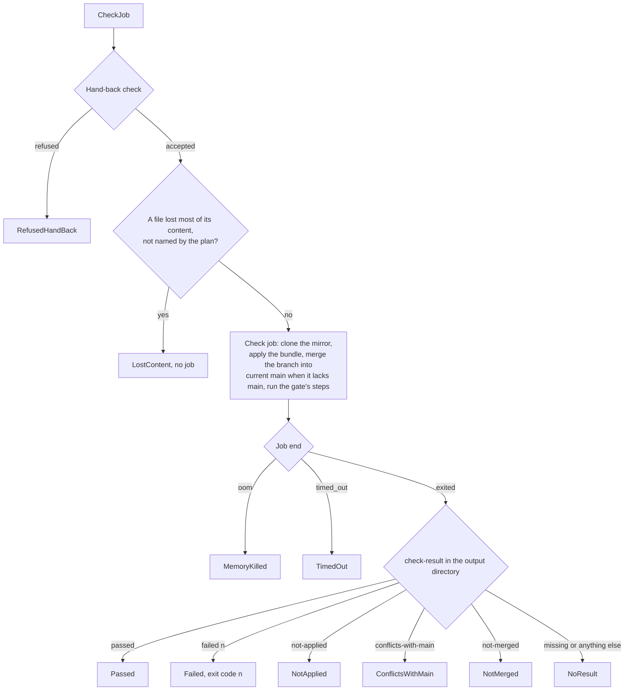

# Check job

The pre-push check (plan task T51, first part) runs the project's check command on what a build handed back, in a [job container](job-containers.md) of its own, after the [hand-back checks](hand-back.md) and before anything is pushed. The builder's own run of the checks is never trusted. The pull request text check (every Evidence item referenced, the body cap, the send-back once) is the second part of T51 and is not built.

`php bin/console intakt:check:run <repository> <branch> <bundle> <image> [--check-command=<command>] [--rewritten=<path> ...] [--merge-main]` (`RunCheckJobCommand`) calls `UseCase/RunCheckJob/RunCheckJob::run(CheckJob)` (marked `#[NoDiscard]`) in `Core/HandBack`. `RunCheckJob` implements `Contract/CheckJobs`, the entry point for other modules, which the container aliases as its only implementation; `CheckJob`, `CheckJobOutcome` and `CheckVerdict` live in `Contract/` beside it. [`intakt:build:task`](build-task.md) calls it through `CheckJobs` as its pre-push check step; the push (T53) does not call it yet.

## The steps

1. `CheckHandBack::check()` runs first with the same `HandBack` ([Hand-back checks](hand-back.md)), secret scan included; `intakt:check:run` takes no `--credential-env`, so its `HandBack` carries an empty `JobCredentials` and redacts nothing. A refusal is returned as it is and no job starts. An accepted bundle leaves its objects in the repository, which the next step reads.
2. `LostContentCheck::of()` compares each file the accepted head changed with the merge base of main and the head (`symbolic-ref --quiet HEAD`, `merge-base`, `diff --raw -z -M --no-abbrev`, `cat-file -s` and, only when the sizes allow a loss (`LostContent::couldBeLost()`), `cat-file blob`), so a file main shrank after the branch started is not the change's loss, and a moved file is followed instead of read as removed. An added file and a former submodule entry (old mode `160000`) are skipped; a file a submodule replaced (new mode `160000`) counts as emptied. `Domain/LostContent::in()` holds the rule: a file that keeps under a fifth of its bytes (`LostContent::FRACTION`) and loses more than 50 lines (`MAX_LINES_LOST`; a last line without its line break counts) has lost its content; a removed file counts as emptied. A file the task's plan names as removed or rewritten (`CheckJob::$namedByThePlan`, the `--rewritten` option, matched exactly against the old or the new path) may lose its content. A named path covers one file. A named path that existed at the merge base names the file that was there, so a file the branch moved onto it is not covered. A named path the branch created (the branch's diff adds it, or moves or copies a file onto it) names the file there at the head, and also covers the one path that file had at the merge base: the renames and additions of each commit on the branch's first-parent line (`log --raw -z -M --no-abbrev --first-parent --diff-merges=first-parent --format=%H <base>..<head>`, read commit by commit, a merge of main diffed against its first parent so a path it adds is seen) are followed back from the head, and the path is replaced only in a commit that moved a file onto it; a commit that adds the path (status `A`) ends the walk with no merge-base path, because the file there was created on the branch, while a commit that only changes the content in place does not end it. So a file moved and then rewritten below git's similarity threshold, which the branch's diff shows as removed under its old path, is covered by its new path, while a file that only passed through a named path and ended under another path is reported under that path. Any other loss ends the check as `LostContent` with each file's path and line counts, before a job starts. Plan approval is not built, so the paths come from the caller.
3. The job (`JobRunner::run()`) gets:
   - the image given, as the project's job image ([Job images](job-images.md));
   - two read-only inputs, the repository at `/input/mirror` and the bundle at `/input/handback.bundle` (both resolved with `realpath`);
   - the command `/bin/sh -c <docker/job/check.sh> intakt-check /input/mirror /input/handback.bundle <branch> -- <step> ...`, the script's text read from the project folder for each job, and the steps from the `Gate` plugin;
   - an allowlist of the gate's registry hosts (`JobEgress::to()`), or no network (`JobEgress::none()`) for a gate that names none;
   - the limits 4 GiB of memory, 2 CPUs and 1800 seconds, and the job id `check-<first 40 characters of the head>`, so a second check of the same head while one runs is refused as already running.
4. The verdict is read from the job's output directory only (`JobResult::$output`), never from the container's exit code or log: `check-result` must be exactly `passed`, `not-applied`, `conflicts-with-main`, `not-merged` or `failed <1 to 3 digits, not starting with 0>`, followed by one line break; anything else, or no file, is `NoResult`. A job the engine stopped for memory or time is `MemoryKilled` or `TimedOut` whatever its output says. An output the runner refuses (`JobOutputRefused`: a link, too many files, too many bytes) is `NoResult`. `check.log` becomes the outcome's log.

`CheckJobOutcome` holds the `CheckVerdict` (a backed enum whose `reason()` is fixed text), the exit code of a failed step, the lost files and the log; `passed()` is true for `Passed` only. The code under test runs in the same job and can write its output directory, so a result it rewrites is believed; a result channel the code under test cannot rewrite is plan task T78 ([the plan](../plan.md)).

## In the container

`docker/job/check.sh` (POSIX `sh`, with `git`, `env`, `sed` and `grep`) runs as the job's command after the [start check](job-containers.md#start-check). Each git command of the script itself (the clone, fetch, checkout, `rev-parse`, `merge-base`, reset, merge and the conflict test's `diff`) runs through its function `own_git`, which, in a subshell, unsets every exported `GIT_*` variable (among them `GIT_CONFIG_COUNT`, `GIT_CONFIG_PARAMETERS` and `GIT_TEMPLATE_DIR`), sets `GIT_CONFIG_NOSYSTEM=1`, `GIT_CONFIG_GLOBAL=/dev/null` and `GIT_ATTR_NOSYSTEM=1`, and passes `-c core.attributesFile=/dev/null`, because git reads the user's attributes file even with `GIT_CONFIG_GLOBAL` set. It reads the variables' names from `env` with `sed` under `LC_ALL=C`, because in a UTF-8 locale `sed`'s pattern stops at a byte of a value that is no text and would leave it on the name, which `unset` refuses. The clone, the only command of the script that creates a repository, is made with `--template=`, because git otherwise copies the default template folder of the image's git (its `info/attributes`, `config` and `hooks`) into the clone, and `own_git` does not shut out the clone's own files. So no setting of the image or the job's environment (a merge option such as `-s ours`, `-X theirs`, `--no-commit` or `--gpg-sign`, signature verification, a hook path, a merge attribute) changes what the check runs on, as CI's test merge reads none of them either; the repository's own `.gitattributes` (for example `merge=union`) still applies, as it does in CI. The steps run with the job's environment unchanged, because they are the project's checks, not the merge:

1. `git clone --template= --quiet --no-hardlinks` of the mirror into `$TMPDIR/clone` (`/work/clone`), a fresh clone from a read-only mount that holds nothing of a git template (no `info/attributes`, no `hooks`), then `git rev-parse --verify --quiet HEAD`, the commit of current main (the mirror's `HEAD`, also a detached one); a mirror whose `HEAD` names no commit has no main to merge. The job reads the mirror as it is: `intakt:check:run` does not update it, while `intakt:build:task` updates it right before its pre-push check ([Build task](build-task.md));
2. `git fetch --quiet --update-head-ok <bundle> +refs/heads/<branch>:refs/heads/<branch>` and `git checkout --quiet --force <branch>`, which applies the bundle. The bundle's commits keep their attribution lines; the head the hand-back check accepted has the same tree.
3. `git merge-base --is-ancestor <main> HEAD`: when the branch already holds current main (also a branch with no commits of its own), the steps run on its head as it is. Otherwise the branch is merged into current main as CI merges a pull request, because CI runs on that merge, and a change can fail only together with commits main gained after the branch last merged it: `git rev-parse --verify HEAD` keeps the branch's head, `git reset --quiet --hard <main>` puts the checked-out branch on main, and `LC_ALL=C git -c core.hooksPath=/dev/null -c commit.gpgSign=false -c user.name=intakt-check -c user.email=check@intakt.invalid merge --no-ff --commit --no-squash --no-edit -m 'chore(check): merge the branch into current main' <head>` merges the head into it, with git's output kept for the conflict test below and copied to the log. `--commit` and `--no-squash` are given because git applies the merge options of a configuration (`branch.<name>.mergeOptions`) before the command line's, and the clone's own configuration, which the isolation above does not shut out, could otherwise end a clean merge without its merge commit. After a merge that exits with 0 the script confirms the commit: `git rev-parse --verify --quiet HEAD^1` must be current main and `HEAD^2` the branch's head; otherwise it logs `the merge left no merge commit of <main> and <head>` and the merge counts as failed, so no step runs on main alone. No git hook runs in this merge (`core.hooksPath=/dev/null`) and its commit is not signed (`commit.gpgSign=false`), as CI's merge has neither. `LC_ALL=C` keeps git's messages in English, because the conflict test reads them. So main is the first parent, as in CI's merge, and a merge driver that orders the two sides (such as `merge=union`) gives the file CI checks. The identity is given on the command line, because the clone and `HOME` hold no git config; the subject follows Conventional Commits, because `bin/check`'s commit-subject gate reads every commit from main to `HEAD`, this merge included. The merge commit stays in the job's clone: the pushed head is the accepted head, and the [push](branch-push.md) checks its own merge with main. A merge that fails ends the check before any step. It is a conflict only when git itself reports one: the index has unmerged paths (`git diff --name-only --diff-filter=U` prints a path), or the merge's output has a line starting with `CONFLICT (`, which also catches a conflict that leaves no unmerged path (`CONFLICT (directory rename split)`, when main renamed a directory to two places while the branch added a file to it). Every other failed merge is `not-merged`: git refused it (for example `refusing to merge unrelated histories` for a branch with no history in common with main), its commit failed, it exited with 0 without leaving the merge commit, or anything else. The script does not read git's `MERGE_HEAD` state, because a clean merge whose commit fails leaves it too.
4. Each step with `sh -c` in the clone, its standard input closed, in order; the first that exits with a status other than 0 ends the check.

It writes `check.log` (git's messages when the bundle cannot be applied; otherwise `$ git merge <head> into <main>` and git's merge output when it merged, then `$ <step>` and the step's output for each step) and `check-result` (`passed`, `failed <status>`, `not-applied` when the clone, the fetch or the checkout failed, `conflicts-with-main` when the merge with current main failed with unmerged paths or a `CONFLICT (` line, or `not-merged` when it failed otherwise; in the last three no step runs) into `$INTAKT_JOB_OUTPUT`. `CheckVerdict::ConflictsWithMain` gives the fixed reason `the branch conflicts with current main, so the check ran no step` and `CheckVerdict::NotMerged` gives `git refused to merge the branch with current main without a conflict, so the check ran no step`; the conflicting paths and git's messages are only in the log. `HOME` and `TMPDIR` are the job's own tmpfs work area, so Composer's cache and every other cache start empty.

## The gate plugin

`Plugin/Gate/Contract/Gate`:

- `checkSteps(?string $configuredCommand): non-empty-list<string>`: the shell steps the check job runs.
- `registryHosts(): list<string>`: the hosts the steps fetch dependencies from.

`Plugin/PhpGate/Infrastructure/PhpGate` is the only implementation, so the container autowires it. Without a configured command (null, or only white space) its steps are `composer install --no-interaction --no-progress` and `bin/check --fast` (`Plugin/PhpGate/Contract/PhpGateSteps::INSTALL` and `CHECK`); a configured command (`--check-command`) is the only step, and installs what it needs itself. Its hosts are `repo.packagist.org`, `api.github.com` and `codeload.github.com`. The files a gate protects are not part of the contract yet.

## The console door

The command prints `lost <path>: <lines before> lines to <lines after>` per lost file, then the last 40 lines of the log (escaped for the console), then `passed` and exits with 0, or `failed: <reason>` (with ` (exit code <n>)` for a failed step) in an error block and exits with 1. A refused bundle prints `refused: <reason>`; an `InvalidArgumentException` or a `ReportableFailure` (for example `DockerEngineFailed` without a Docker socket) prints its message; both exit with 1.

The tests run the real `docker/job/check.sh` with `sh -c` on a temporary mirror and bundle (`tests/Core/HandBack/CheckScriptTest.php`: among others a branch that already holds main, one with no commits of its own and a mirror whose `HEAD` names no commit, all checked on their own head; a branch behind a main that moved, checked on its merge into main with main as the first parent, the check's identity and a Conventional Commits subject; a `merge=union` file holding what the merge of the branch into main holds; a mirror whose `HEAD` is detached at a main that moved, checked on the merge with that main; a conflict with main that runs no step, also a file the branch changed and main deleted and a split directory rename that leaves no unmerged path; git settings in the job's environment that have no effect on the merge: `branch.task.mergeOptions` set to `--no-commit`, `--squash`, `-s ours` or `--gpg-sign` with `gpg.program=false`, `commit.gpgSign=true` with `gpg.program=false`, and `merge.verifySignatures=true` (also for a task branch named `MERGE_HEAD`), each still ending `passed` on the merge commit with main and the head as parents, a refusing `pre-merge-commit` hook, which the merge does not run, and `-X theirs`, `-X ours` or `-s ours` (also through `GIT_CONFIG_PARAMETERS` or a `.gitconfig` in `HOME`) and a `merge=union` rule in the user's attributes file on a conflicting branch, which still ends `conflicts-with-main`; the steps still reading the job's git settings; a branch with no history in common with main, which leaves `not-merged` and runs no step; and a `git` that ends the merge before its commit and exits with 0, which leaves `not-merged` and runs no step) and `RunCheckJob` with a stubbed `JobRunner` (`RunCheckJobTest`), because the build sandbox has no Docker daemon. No check job has run against a live engine yet.
