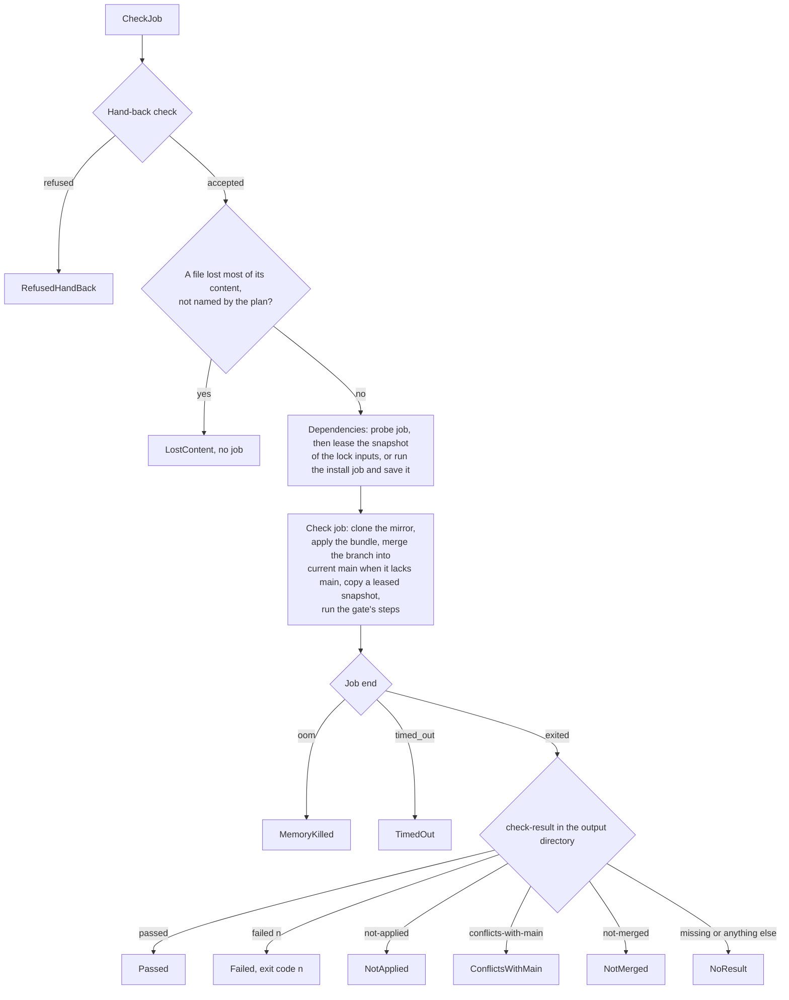

# Check job

The pre-push check (plan task T51, first part) runs the project's check command on what a build handed back, in a [job container](job-containers.md) of its own, after the [hand-back checks](hand-back.md) and before anything is pushed. The builder's own run of the checks is never trusted. The pull request text check (every Evidence item referenced, the body cap, the send-back once) is the second part of T51 and is not built.

`php bin/console intakt:check:run <repository> <branch> <bundle> <image> [--check-command=<command>] [--rewritten=<path> ...] [--merge-main]` (`RunCheckJobCommand`) calls `UseCase/RunCheckJob/RunCheckJob::run(CheckJob)` (marked `#[NoDiscard]`) in `Core/HandBack`. `RunCheckJob` implements `Contract/CheckJobs`, the entry point for other modules, which the container aliases as its only implementation; `CheckJob`, `CheckJobOutcome` and `CheckVerdict` live in `Contract/` beside it. [`intakt:build:task`](build-task.md) calls it through `CheckJobs` as its pre-push check step; the push (T53) does not call it yet.

## The steps

1. `CheckHandBack::check()` runs first with the same `HandBack` ([Hand-back checks](hand-back.md)), secret scan included; `intakt:check:run` takes no `--credential-env`, so its `HandBack` carries an empty `JobCredentials` and redacts nothing. A refusal is returned as it is and no job starts. An accepted bundle leaves its objects in the repository, which the next step reads.
2. `LostContentCheck::of()` compares each file the accepted head changed with the merge base of main and the head (`symbolic-ref --quiet HEAD`, `merge-base`, `diff --raw -z -M --no-abbrev`, `cat-file -s` and, only when the sizes allow a loss (`LostContent::couldBeLost()`), `cat-file blob`), so a file main shrank after the branch started is not the change's loss, and a moved file is followed instead of read as removed. An added file and a former submodule entry (old mode `160000`) are skipped; a file a submodule replaced (new mode `160000`) counts as emptied. `Domain/LostContent::in()` holds the rule: a file that keeps under a fifth of its bytes (`LostContent::FRACTION`) and loses more than 50 lines (`MAX_LINES_LOST`; a last line without its line break counts) has lost its content; a removed file counts as emptied. A file the task's plan names as removed or rewritten (`CheckJob::$namedByThePlan`, a `Git\Contract\Paths`, the `--rewritten` option, matched exactly against the old or the new path) may lose its content. A named path covers one file. A named path that existed at the merge base names the file that was there, so a file the branch moved onto it is not covered. A named path the branch created (the branch's diff adds it, or moves or copies a file onto it) names the file there at the head, and also covers the one path that file had at the merge base: the renames and additions of each commit on the branch's first-parent line (`log --raw -z -M --no-abbrev --first-parent --diff-merges=first-parent --format=%H <base>..<head>`, read commit by commit, a merge of main diffed against its first parent so a path it adds is seen) are followed back from the head, and the path is replaced only in a commit that moved a file onto it; a commit that adds the path (status `A`) ends the walk with no merge-base path, because the file there was created on the branch, while a commit that only changes the content in place does not end it. So a file moved and then rewritten below git's similarity threshold, which the branch's diff shows as removed under its old path, is covered by its new path, while a file that only passed through a named path and ended under another path is reported under that path. Any other loss ends the check as `LostContent` with each file's path and line counts, before a job starts. Plan approval is not built, so the paths come from the caller.
3. `CheckDependencies::leaseFor()` looks for a trusted install of the tree's lock inputs ([The dependency snapshots of a check](#the-dependency-snapshots-of-a-check)) and returns a `CheckSnapshot` (the `DependencySnapshotLease`, the gate's `DependencyStep` and each lock file's `CheckedLockFile`, its blob and bytes) or null. `RunCheckJob` holds the lease until `JobRunner::run()` of the check job returns or throws, and releases it in a `finally`.
4. The job (`JobRunner::run()`) gets:
   - the image given, as the project's job image ([Job images](job-images.md));
   - two read-only inputs, the repository at `/input/mirror` and the bundle at `/input/handback.bundle` (both resolved with `realpath`), and with a lease a third, the leased snapshot's folder at `/input/dependencies` (`RunCheckJob::DEPENDENCIES`), never the store itself;
   - the command `/bin/sh -c <docker/job/check.sh> intakt-check /input/mirror /input/handback.bundle <branch> [--dependencies /input/dependencies <check install> <generate> <lock file> <blob> ...] -- <step> ...`, the script's text read from the project folder for each job, and the steps from the `Gate` plugin (unchanged with a lease: `DependencyStep::$checkInstall` and `$generate` tell the script which step to swap once it copied the snapshot, and each lock file follows with the blob the key was made of, `CheckSnapshot::lockFileArguments()`);
   - an allowlist of the gate's registry hosts (`JobEgress::to()`), or no network (`JobEgress::none()`) for a gate that names none;
   - the limits 4 GiB of memory, 2 CPUs and 1800 seconds, and the job id `check-<first 40 characters of the head>`, so a second check of the same head while one runs is refused as already running.
5. The verdict is read from the job's output directory only (`JobResult::$output`), never from the container's exit code or log: `check-result` must be exactly `passed`, `not-applied`, `conflicts-with-main`, `not-merged` or `failed <1 to 3 digits, not starting with 0>`, followed by one line break; anything else, or no file, is `NoResult`. A job the engine stopped for memory or time is `MemoryKilled` or `TimedOut` whatever its output says. An output the runner refuses (`JobOutputRefused`: a link, too many files, too many bytes) is `NoResult`. `check.log` becomes the outcome's log.

`CheckJobOutcome` holds the `CheckVerdict` (a backed enum whose `reason()` is fixed text), the exit code of a failed step, the lost files and the log; `passed()` is true for `Passed` only. The code under test runs in the same job and can write its output directory, so a result it rewrites is believed; a result channel the code under test cannot rewrite is plan task T78 ([the plan](../plan.md)).

## In the container

`docker/job/check.sh` (POSIX `sh`, with `git`, `env`, `sed` and `grep`, and `cp`, `chmod` and `rm` for a leased snapshot) runs as the job's command after the [start check](job-containers.md#start-check). Each git command of the script itself (the clone, fetch, checkout, `rev-parse`, `merge-base`, reset, merge, the conflict test's `diff` and the lock files' `hash-object`) runs through its function `own_git`, which, in a subshell, unsets every exported `GIT_*` variable (among them `GIT_CONFIG_COUNT`, `GIT_CONFIG_PARAMETERS` and `GIT_TEMPLATE_DIR`), sets `GIT_CONFIG_NOSYSTEM=1`, `GIT_CONFIG_GLOBAL=/dev/null` and `GIT_ATTR_NOSYSTEM=1`, and passes `-c core.attributesFile=/dev/null`, because git reads the user's attributes file even with `GIT_CONFIG_GLOBAL` set. It reads the variables' names from `env` with `sed` under `LC_ALL=C`, because in a UTF-8 locale `sed`'s pattern stops at a byte of a value that is no text and would leave it on the name, which `unset` refuses. The clone, the only command of the script that creates a repository, is made with `--template=`, because git otherwise copies the default template folder of the image's git (its `info/attributes`, `config` and `hooks`) into the clone, and `own_git` does not shut out the clone's own files. So no setting of the image or the job's environment (a merge option such as `-s ours`, `-X theirs`, `--no-commit` or `--gpg-sign`, signature verification, a hook path, a merge attribute) changes what the check runs on, as CI's test merge reads none of them either; the repository's own `.gitattributes` (for example `merge=union`) still applies, as it does in CI. The steps run with the job's environment unchanged, because they are the project's checks, not the merge:

1. `git -c safe.directory=<mirror> clone --template= --quiet --no-hardlinks --upload-pack='git -c safe.directory="$INTAKT_MIRROR" upload-pack'` of the mirror into `$TMPDIR/clone` (`/work/clone`), a fresh clone from a read-only mount that holds nothing of a git template (no `info/attributes`, no `hooks`). Git (since 2.45.1 for the clone itself) refuses a local repository another user owns, and the job's user need not own the mounted mirror, so the mirror's path, and only that path, is named in `safe.directory`: never `*`, and the exception is passed on the command line only, never written to a git configuration file. The `upload-pack` that serves a local clone gets it as well, because git drops the clone's `-c` settings (`GIT_CONFIG_PARAMETERS`) before it starts it; the path reaches it through the variable `INTAKT_MIRROR`, set only for the clone, so the shell that runs `upload-pack` never parses the path. Then `git rev-parse --verify --quiet HEAD`, the commit of current main (the mirror's `HEAD`, also a detached one); a mirror whose `HEAD` names no commit has no main to merge. The job reads the mirror as it is: `intakt:check:run` does not update it, while `intakt:build:task` updates it right before its pre-push check ([Build task](build-task.md));
2. `git fetch --quiet --update-head-ok <bundle> +refs/heads/<branch>:refs/heads/<branch>` and `git checkout --quiet --force <branch>`, which applies the bundle. The bundle's commits keep their attribution lines; the head the hand-back check accepted has the same tree.
3. `git merge-base --is-ancestor <main> HEAD`: when the branch already holds current main (also a branch with no commits of its own), the steps run on its head as it is. Otherwise the branch is merged into current main as CI merges a pull request, because CI runs on that merge, and a change can fail only together with commits main gained after the branch last merged it: `git rev-parse --verify HEAD` keeps the branch's head, `git reset --quiet --hard <main>` puts the checked-out branch on main, and `LC_ALL=C git -c core.hooksPath=/dev/null -c commit.gpgSign=false -c user.name=intakt-check -c user.email=check@intakt.invalid merge --no-ff --commit --no-squash --no-edit -m 'chore(check): merge the branch into current main' <head>` merges the head into it, with git's output kept for the conflict test below and copied to the log. `--commit` and `--no-squash` are given because git applies the merge options of a configuration (`branch.<name>.mergeOptions`) before the command line's, and the clone's own configuration, which the isolation above does not shut out, could otherwise end a clean merge without its merge commit. After a merge that exits with 0 the script confirms the commit: `git rev-parse --verify --quiet HEAD^1` must be current main and `HEAD^2` the branch's head; otherwise it logs `the merge left no merge commit of <main> and <head>` and the merge counts as failed, so no step runs on main alone. No git hook runs in this merge (`core.hooksPath=/dev/null`) and its commit is not signed (`commit.gpgSign=false`), as CI's merge has neither. `LC_ALL=C` keeps git's messages in English, because the conflict test reads them. So main is the first parent, as in CI's merge, and a merge driver that orders the two sides (such as `merge=union`) gives the file CI checks. The identity is given on the command line, because the clone and `HOME` hold no git config; the subject follows Conventional Commits, because `bin/check`'s commit-subject gate reads every commit from main to `HEAD`, this merge included. The merge commit stays in the job's clone: the pushed head is the accepted head, and the [push](branch-push.md) checks its own merge with main. A merge that fails ends the check before any step. It is a conflict only when git itself reports one: the index has unmerged paths (`git diff --name-only --diff-filter=U` prints a path), or the merge's output has a line starting with `CONFLICT (`, which also catches a conflict that leaves no unmerged path (`CONFLICT (directory rename split)`, when main renamed a directory to two places while the branch added a file to it). Every other failed merge is `not-merged`: git refused it (for example `refusing to merge unrelated histories` for a branch with no history in common with main), its commit failed, it exited with 0 without leaving the merge commit, or anything else. The script does not read git's `MERGE_HEAD` state, because a clean merge whose commit fails leaves it too.
4. With `--dependencies <folder>`, the snapshot is copied into the clone before the first step, after three checks on the tree the merge left. Each lock file must be a plain file (no link) whose bytes, hashed with `git hash-object --no-filters`, are the blob passed for it, because main can move between the lease and the clone and change what the install depends on (for Composer the `vendor-dir` in `composer.json`), and a checkout filter could change the bytes; a mismatch, a missing blob or no lock file at all logs `the merged tree does not hold the lock files the snapshot was made for, so the check installs its dependencies itself` and copies nothing. When any top-level entry of the snapshot (hidden ones included) already exists in the clone, for example a committed `vendor/`, the script logs `the tree already holds <name>, so the check installs its dependencies itself` and copies nothing. Otherwise it logs `$ copy the dependency snapshot <folder>`, runs `cp -R <folder>/. <clone>/` and `chmod -R u+w` on each copied entry, because the snapshot's entries are read-only. A copy or `chmod` that fails logs `the dependency snapshot could not be copied, so the check installs its dependencies itself` and removes every copied entry, because a partial copy could name packages as installed that are not there. The entries are taken straight from the snapshot's glob for each of these steps, never from a list split on line breaks, so a name that holds a line break is one name.
5. Each step with `sh -c` in the clone, its standard input closed, in order; the first that exits with a status other than 0 ends the check. Only when the snapshot was copied, a step equal to the passed check install runs the passed generate step in its place, which finds every locked package in place and makes the files that depend on this check's own tree; for the PHP gate both are `composer install --no-interaction --no-progress`, which makes the autoload, runtime and `installed.php` files. A check that did not copy the snapshot runs the gate's install as it is.

It writes `check.log` (git's messages when the bundle cannot be applied; otherwise `$ git merge <head> into <main>` and git's merge output when it merged, then `$ <step>` and the step's output for each step) and `check-result` (`passed`, `failed <status>`, `not-applied` when the clone, the fetch or the checkout failed, `conflicts-with-main` when the merge with current main failed with unmerged paths or a `CONFLICT (` line, or `not-merged` when it failed otherwise; in the last three no step runs) into `$INTAKT_JOB_OUTPUT`. `CheckVerdict::ConflictsWithMain` gives the fixed reason `the branch conflicts with current main, so the check ran no step` and `CheckVerdict::NotMerged` gives `git refused to merge the branch with current main without a conflict, so the check ran no step`; the conflicting paths and git's messages are only in the log. `HOME` and `TMPDIR` are the job's own tmpfs work area, so Composer's cache and every other cache start empty; only a leased snapshot, copied as above, brings installed packages in.

## The gate plugin

`Plugin/Gate/Contract/Gate`:

- `checkSteps(?string $configuredCommand): non-empty-list<string>`: the shell steps the check job runs.
- `registryHosts(): list<string>`: the hosts the steps fetch dependencies from.
- `dependencyStep(?string $configuredCommand): ?DependencyStep`: the dependency step of a check, or null when the gate names no lock inputs, so the check installs every time. `Plugin/Gate/Contract/DependencyStep` holds `lockFiles` (the files the locked install depends on), `platformProbe` (a command that prints the platform version inside the job image), `install` (the install of the locked packages in a clean environment, with scripts and plugins off), `generate` (the command that makes the files that depend on the tree, run on the check's own tree after the install) and `checkInstall` (the install among `checkSteps()` that a check which copied a snapshot runs `generate` in place of).

`Plugin/PhpGate/Infrastructure/PhpGate` is the only implementation, so the container autowires it. Without a configured command (null, or only white space) its steps are `composer install --no-interaction --no-progress` and `bin/check --fast` (`Plugin/PhpGate/Contract/PhpGateSteps::INSTALL` and `CHECK`); a configured command (`--check-command`) is the only step, and installs what it needs itself. Its hosts are `repo.packagist.org`, `api.github.com` and `codeload.github.com`. The files a gate protects are not part of the contract yet.

Its dependency step, without a configured command, is the Composer one: the lock files `composer.json` and `composer.lock`, the probe `php -r 'echo PHP_VERSION;'`, the install `composer install --no-interaction --no-progress --no-scripts --no-plugins --no-autoloader` (`PhpGateSteps::LOCKED_INSTALL`) and the generation `composer install --no-interaction --no-progress` (`PhpGateSteps::GENERATE`, the same command as the gate's own install step, `PhpGateSteps::INSTALL`, which is its `checkInstall`). Before Composer runs, the install runs a `php -r` guard (`PhpGateSteps::LOCK_GUARD`) that exits 1 with a message on standard error when `composer.lock` is missing (Composer would otherwise resolve the dependencies and write a new lock file), or when `composer.json` has a `config.lock` key set to anything other than `true`, an explicit `null` included (`false` disables the lock: Composer ignores `composer.lock` and resolves the dependencies anew); a missing key counts as `true`. The install then records the SHA-256 hash of `composer.lock`, runs Composer, and ends, whatever Composer's exit code and also when the caller's shell runs with `set -e`, with a second `php -r` call that exits 1 with a message on standard error when the file's hash differs afterwards or the file is gone; when the hash is unchanged the install exits with Composer's own code if Composer failed and otherwise runs the source guard below. Composer treats a lock file without a `packages` key (for example `{}`) as absent, resolves the dependencies and rewrites the lock, and that is not an install from the lock. A head the install fails for has no reusable install and installs every time. The guard then applies the trust rule to the lock and to the vendor folder that `composer config vendor-dir` reports. Composer's answer reaches the guard byte for byte: the command substitution runs `composer config vendor-dir && printf x`, because a substitution drops every trailing newline, and a folder whose name ends in a newline would otherwise be looked for in another folder. The guard takes the answer only when it ends in a newline followed by `x`, strips exactly those two bytes and looks for `composer/installed.json` in the rest; an answer without them (Composer failed, so `printf x` did not run) is refused with the vendor-folder line below. The answer is passed after `--`, so a folder whose name starts with a dash reaches the guard as its argument and not as an option of `php`. It exits `PhpGateSteps::REFUSED` (78, a status Composer's own failures do not use, so the caller reads it as "install every time" and not as a failed check) with one line on standard error that names the package, file or script, and refuses: a vendor folder answer from `composer config` that lacks that ending or names an empty folder (checked first, so a `composer.json` Composer cannot read gets this line); a `composer.json` that cannot be read or is not valid JSON; a vendor folder that already holds `composer/installed.json`; a root `pre-package-install`, `post-package-install`, `pre-package-update` or `post-package-update` script; a lock file that is not valid JSON or has no usable `packages` and `packages-dev` lists; and, for every locked package of either list, a `dist` or `source` of type `path` (compared lowercased, as Composer lowercases a downloader type, so `Path` is refused too), `mirrors` in either, an address that is not a known remote one (`https://` or `http://` for a `dist`; those plus `ssh://`, `git://`, `git+ssh://` and `svn://` for a `source`; `user@host:path` only for a `git` source, its type compared lowercased as Composer does; everything else, local paths, `file://` and `compress.zlib://` included, is refused), a `source.reference` that is not a full lowercase commit id, a `dist.shasum` that is neither empty nor 40 lowercase hex digits, an archive without a checksum unless its `https` URL ends in its own locked commit id (the entry's `dist.reference`), and a `composer-plugin` or `composer-installer` type (compared lowercased, as Composer does) other than `symfony/runtime`. Package names in the line are JSON-escaped, so no character of a name can break it into two lines. A refused address is never printed, because a URL can hold credentials: the line names the package and whether its `dist` or `source` url was refused. After Composer, the install runs a second `php -r` guard (`PhpGateSteps::SOURCE_GUARD`), only when the lock hash is unchanged and Composer exited with 0; with a failed Composer run the install exits with Composer's own code and never reaches it. It reads the lock and the vendor folder the same way as the lock guard, then the vendor folder's `composer/installed.json`, which this install wrote (the lock guard refuses one that was already there). For every package that file records with `installation-source` `source` (a package installed from a `dist` has no checkout and is skipped), it finds the checkout at the `install-path` Composer recorded, relative to `<vendor folder>/composer/`: Composer clones to the package name as written in the lock, mixed case included, plus the package's `target-dir` when it has one, so a path built from the lowercased name would miss the checkout. It then runs `git --git-dir=<that path>/.git rev-parse --verify HEAD` without a shell, in an environment without any inherited `GIT_` variable and with `GIT_CONFIG_NOSYSTEM=1`, `GIT_CONFIG_GLOBAL=/dev/null`, `GIT_NO_REPLACE_OBJECTS=1` and `-c core.graftsFile=/dev/null`. It exits `PhpGateSteps::REFUSED` with one line on standard error that names the package or file, and refuses: a vendor folder answer from `composer config` without the ending above; a `composer.lock` or `installed.json` that cannot be read or is not valid JSON; a lock without usable `packages` and `packages-dev` lists, or an `installed.json` without a `packages` list; a locked package name that is not `vendor/name` in letters, digits, `_`, `.` and `-` (compared lowercased); a package installed from source that the lock names without a `source.reference`, or not at all; a package installed from a source whose locked type is not `git` (its commit cannot be read with git); an `install-path` that is not `../` followed by plain folder names (one that is absolute or holds a `.` or `..` part would leave the vendor folder); a checkout without a `.git`; a `.git` that is a link; a `.git` that is not a directory; a `.git/commondir` file (git follows it even with an explicit `--git-dir`, so a symbolic `HEAD` could resolve in another repository, and a checkout Composer clones never has that file); a `git` that fails to read the `HEAD`; and a `HEAD` that is not the locked `source.reference`. The guard trusts the checkout's `.git` folder as `git clone` wrote it: it removes what the environment can inject and refuses redirections a fresh clone never contains, and further git internals are out of scope unless the locked install itself (Composer with scripts and plugins off) produces them. An install that passes both guards can be kept in [the dependency snapshot store](#the-dependency-snapshot-store). A remote host that serves the same commit URL is trusted as much as a fresh install trusts it: if it served other bytes for that URL, a fresh install would install them too, so reuse adds nothing a builder could exploit. The generation runs on the populated `vendor/` folder, so it downloads nothing unless a plugin moves a package (below); it writes `vendor/autoload.php`, `vendor/composer/platform_check.php` when Composer has platform requirements to check (not when `config.platform-check` is `false` or nothing is required), `vendor/composer/installed.php` (whose root package reference is the checked head, not the head that made the install) and, through symfony/runtime's Composer plugin, `vendor/autoload_runtime.php`. The generation has scripts and plugins on, so it runs every plugin the tree allows and the checked tree's own Composer scripts for the events it raises (for example `post-autoload-dump`); only the install has them off. The split flow differs from a fresh install in two ways, both because the locked install has scripts and plugins off and the generation finds every package already installed. The root package's package events (`pre-package-install`, `post-package-install`, `pre-package-update` and `post-package-update`) never run, and neither do plugin listeners on those events (for example a plugin that patches packages after install). An installer plugin that chooses where a package goes (for example `composer/installers`) does not act during the install, so its packages land in `vendor/`, and the generation may then install them again at the plugin's path, which can download. A tree that defines scripts for these events, or locks such plugins, is refused by the guard above. The manifest is a lock input because its platform config and autoload rules change what an install from the same lock file holds. With a configured command it returns null, as for a language without support, and the check installs every time. The check uses the step as described in [The dependency snapshots of a check](#the-dependency-snapshots-of-a-check).

## The dependency snapshots of a check

`UseCase/RunCheckJob/CheckDependencies::leaseFor(CheckJob, string $repository, string $head)` (#2622, part 3 of #1203) returns null, so the check installs every time as before, unless every step below succeeds:

1. `Gate::dependencyStep()` names a step (null for a configured command, or for a gate without support).
2. `CheckedLockFiles::of()` reads the bytes of each lock file of the tree the check job installs in, from the mirror: the head's files when the head holds current main (the mirror's `HEAD`, `merge-base --is-ancestor`) or the mirror has no main; otherwise the job checks the merge with main, so the head's file is taken only where main's is the same blob, and any lock file that differs from main's gives null. A lock file that is missing, or is not a plain file (`ls-tree` mode `100644` or `100755`; a link would make the job read a file the commit does not hold), gives null. Each file's blob is kept with its bytes, because the mirror's main can move between this read and the job's clone: the check script then finds other lock files in the merged tree and copies nothing ([In the container](#in-the-container)).
3. `DependencyJobs::platformIn()` runs a probe job `probe-<first 40 characters of the head>` in the check's image, with no network, 256 MiB, 2 CPUs and 60 seconds, whose command runs `DependencyStep::$platformProbe` into the output file `platform`. A job that does not exit with 0, an output the runner refuses, or a platform that is not 1 to 64 printable ASCII characters without white space gives null.
4. `LockInputs` (the files and the platform) gives the key `DependencySnapshotKey::ofLockInputs()`. A `DependencySnapshots::lease()` hit is returned as it is: no install job runs.
5. On a miss, `DependencyJobs::installed()` runs the install job and saves its result; then `leaseFor()` leases the new snapshot, so the check copies it like any hit. It first takes the key's install lock (a Symfony Lock `intakt-dependency-install-<key>` on the application's `FlockStore`, without waiting); when another check holds it, that check installs and saves the same key, so this one returns false without touching the folder and its check installs itself. Holding the lock until the folder is removed, the job folder is `var/dependency-installs/<key>/` (removed first, and removed again after the job, also when the job throws): `lock/` holds exactly the lock file bytes the key was made of, and `kept/` is the job's kept folder. The job `install-<first 40 characters of the key>` runs in the check's image with the check's limits (4 GiB, 2 CPUs, 1800 seconds) and the gate's registry hosts, and its command is `/bin/sh -c <docker/job/install.sh> intakt-install /input/lock <platform probe> <install> <lock file> ...`, `lock/` mounted read-only at `/input/lock`. The script runs the probe into `platform`, copies the lock files to `$TMPDIR/install`, runs `DependencyStep::$install` there (for the PHP gate the lock guard, the locked install with scripts and plugins off and the source guard), and only when it exits with 0 removes the lock files, runs `chmod -R u+rwX` (an archive can hold a folder without permissions) and copies the rest into `$INTAKT_JOB_KEPT`. It writes `install-result`: `installed`, `failed <status>` (78, `PhpGateSteps::REFUSED`, for a refusal), `no-platform`, `not-prepared` or `not-kept`, and `install.log`. The install is saved with `DependencySnapshots::save()` only when the job exited with 0, `install-result` is exactly `installed`, and its `platform` equals the probed one (the image may have changed between the two jobs). An install job refused as already running or with an output the runner refuses is not saved, and a save the store refuses with an `IOException` (for example a link out of the install) is not kept either; in each case the check installs itself.

The trust rule stays as in part 1 and 2: the install job gets only the lock files, never the clone or the bundle, so no file of the checked tree other than its lock inputs and no step a builder wrote runs before the save, and what is saved is the install of exactly the bytes the key names. Only the orchestrator's process writes the store; the install job writes only its own kept folder, which the orchestrator copies, read-only, into the store. A check job gets one snapshot's folder as a read-only bind and works on a writable copy, and the generated files (for Composer the autoload and runtime files and `installed.php`) are made by the gate's generate step from the check's own tree, with that tree's plugins and scripts, after the copy. Nothing the check job writes reaches the store.

Each check without a configured command whose tree has its lock files therefore starts one probe job more than before; a hit saves the whole dependency download, and a miss runs the install once in the install job instead of in the check.

## The dependency snapshot store

`Infrastructure/DependencySnapshots` in `Core/HandBack` keeps trusted installs (#2931, part of #2621). It is owned by Intakt's runner and written only by the orchestrator's own process: a build job gets no mount of it, and a check job is to reach a snapshot only as a read-only bind of that one snapshot's folder. The folder is the parameter `intakt.hand_back.dependency_snapshots_directory` (`HandBackServices::DEPENDENCY_SNAPSHOTS_DIRECTORY`, `var/dependency-snapshots` in `config/services.yaml`), made mode 0700 on every save and lease. A snapshot's key is `Domain/DependencySnapshotKey::ofLockInputs()`: the SHA-256 of the platform version and each lock input file's path and bytes (sorted by path), each part length-prefixed, so a changed lock input gives another key and no part can borrow bytes from the next.

- `save(DependencySnapshotKey, string $install)` takes the store lock, removes a leftover `.incoming`, and, when the key is not there yet, copies the install into `.incoming` (`Filesystem::mirror()`; `Infrastructure/DependencySnapshotLinks` resolves each link in the original install with `realpath()`, so a target that climbs out through another link is followed as the kernel follows it, refuses the save with an `IOException` when the result is missing or not under `realpath()` of the install, and otherwise rewrites the link to the relative path of that result, so it still works once the install is gone), makes every entry read-only (folders and files with any execute bit 0555, other files 0444, links untouched because `chmod` would follow them) and renames `.incoming` to the key with PHP's native `rename()`. Every `chmod()` is checked: the first failure throws an `IOException`, so the snapshot is never renamed to its key. A `rename()` that returns false throws an `IOException` too and moves nothing else; a failed publication leaves only `.incoming`, which the next save removes. So no folder under a key ever holds a partial or writable copy.
- `lease(DependencySnapshotKey)` takes the store lock and, when the key is there, takes the snapshot's shared pin without waiting and returns a `DependencySnapshotLease` (the folder and `release()`), or null for a miss. `RunCheckJob` holds the lease as long as the check job runs, because a released pin lets an eviction remove the folder.
- The store lock is one exclusive Symfony Lock per save or lease (key `intakt-dependency-snapshots`, on the application's `FlockStore` in `var/locks`), waited for. A pin is a shared read lock (`acquireRead()`) on a `FlockStore` in the store's own `.pins/<key>/`.
- Every save and every lease trims the store, never the snapshot being saved or leased. The bound is a least recently used one: the parameter `intakt.hand_back.dependency_snapshot_count` (`HandBackServices::DEPENDENCY_SNAPSHOT_COUNT`, 10 in `config/services.yaml`; below 1 is refused with `DependencySnapshotCountRefused::belowOne()`). The order of use is the JSON list `.uses` (`DependencySnapshotUses`, an order and no times, so no clock is read; a damaged file or one that is no list of names counts as nothing recorded), rewritten through a `.uses<random>` file and a rename after each save and each lease that hits; a snapshot the list does not name counts as the least recently used. Past the count, the trim walks from the least recently used snapshot and evicts each one whose pin it can take exclusively without waiting; a leased one is skipped. A finished install is still published when no room can be made, so while snapshots are leased the store holds at most the count or the active leases plus one, whichever is larger. Each trim also repairs what an interrupted eviction or write left behind: before it evicts it removes every leftover `.evicting-<key>` folder, and after it removes every `.pins/<name>/` folder whose snapshot folder is absent (`DependencySnapshotPins`, taking that pin exclusively without waiting and skipping it when busy, which is safe because a lease exists only for a present snapshot) and every regular file other than `.uses` whose name starts with `.uses` (`DependencySnapshotUses`), the temporary file `Filesystem::dumpFile()` leaves when a crash stops it before its rename.
- An eviction, under the store lock and while it holds the exclusive pin, first renames the snapshot's folder to `.evicting-<key>` with PHP's native `rename()`, then removes that folder and the `.pins/<key>/` folder. A `rename()` that returns false throws an `IOException` and moves nothing else: the snapshot stays whole under its key with its `.pins/<key>/`, counts as not evicted, and the save or lease fails. So a snapshot is either complete or absent under its key, and a removal stopped half-way leaves only a `.evicting-<key>` folder, which no lease mounts and the next save or lease removes.

The tests (`tests/Core/HandBack/Infrastructure/DependencySnapshotsTest.php`, on a real `FlockStore` in a temporary folder) check a lease of a saved snapshot and a miss; that the store folder is 0700 and no entry of a snapshot has a write bit; that the least recently used snapshot goes past the count; that a save or a lease by a store with a count of 1 keeps its own snapshot, the least recently used one, and evicts the others; that an install is still published while every other snapshot is leased, and the store shrinks back once the leases are released; that an evicted snapshot takes its pin folder with it, while a pin held outside the store keeps the snapshot and its pin folder; that a `rename()` that fails (an override in the store's namespace) leaves no folder under the key and only `.incoming`, which the next save removes; that a `chmod()` that fails on one entry ends the save with no folder under the key; that a link out of the install (absolute, climbing above it, or climbing out through another link) or a dangling link refuses the save, while a link through another link that stays inside is kept as its resolved relative path; that a damaged `.uses` or one that is no list of names counts as nothing recorded; that an orphan pin folder is gone after the next save or lease while a held one and the pin folder of a present snapshot are kept, so a count-1 store keeps at most two pin folders; that a half-removed snapshot under `.evicting-<key>` is never leased and is removed by the next save or lease; that an eviction `rename()` that fails keeps every snapshot whole with its pin folder; that a removal stopped half-way (a `Symfony\Component\Filesystem\iterator_to_array()` defined in a separate process by `SnapshotRemovalThatStops`, which the test checks actually ran) leaves no folder under the key; and that a leftover `.uses<random>` file is gone after the next save and the next lease while `.uses` stays. `DependencySnapshotKeyTest` checks the key, `DependencySnapshotCountConfigTest` the default count.

## The console door

The command prints `lost <path>: <lines before> lines to <lines after>` per lost file, then the last 40 lines of the log (escaped for the console), then `passed` and exits with 0, or `failed: <reason>` (with ` (exit code <n>)` for a failed step) in an error block and exits with 1. A refused bundle prints `refused: <reason>`; a `ReportableFailure` (for example `DockerEngineFailed` without a Docker socket, or `HandBackBranchRefused` for a branch that is main itself) or a `JobRefused` prints its message; both exit with 1. Any other exception, an `InvalidArgumentException` included, is left to the console as a programming error.

The tests run the real `docker/job/check.sh` with `sh -c` on a temporary mirror and bundle (`tests/Core/HandBack/CheckScriptTest.php`: among others a branch that already holds main, one with no commits of its own and a mirror whose `HEAD` names no commit, all checked on their own head; a branch behind a main that moved, checked on its merge into main with main as the first parent, the check's identity and a Conventional Commits subject; a `merge=union` file holding what the merge of the branch into main holds; a mirror whose `HEAD` is detached at a main that moved, checked on the merge with that main; a conflict with main that runs no step, also a file the branch changed and main deleted and a split directory rename that leaves no unmerged path; git settings in the job's environment that have no effect on the merge: `branch.task.mergeOptions` set to `--no-commit`, `--squash`, `-s ours` or `--gpg-sign` with `gpg.program=false`, `commit.gpgSign=true` with `gpg.program=false`, and `merge.verifySignatures=true` (also for a task branch named `MERGE_HEAD`), each still ending `passed` on the merge commit with main and the head as parents, a refusing `pre-merge-commit` hook, which the merge does not run, and `-X theirs`, `-X ours` or `-s ours` (also through `GIT_CONFIG_PARAMETERS` or a `.gitconfig` in `HOME`) and a `merge=union` rule in the user's attributes file on a conflicting branch, which still ends `conflicts-with-main`; the steps still reading the job's git settings; a mirror owned by another user (a `git` in front of the real one sets `GIT_TEST_ASSUME_DIFFERENT_OWNER=1` for the clone, because a test cannot hand the mirror to another user), still cloned and ending `passed`, while a step that reads the mirror as another user's is still refused, so the exception stays with the clone; a branch with no history in common with main, which leaves `not-merged` and runs no step; and a `git` that ends the merge before its commit and exits with 0, which leaves `not-merged` and runs no step) and `RunCheckJob` with a stubbed `JobRunner` (`RunCheckJobTest`), because the build sandbox has no Docker daemon. `CheckScriptTest` also checks that a mounted read-only snapshot is copied writable into the clone before the first step (hidden entries included), that a tree which already holds a top-level entry of the snapshot gets none of it, also when the entry's name holds a line break, that an entry named with a line break is still made writable, that a snapshot made for a `composer.lock` main changed since, a lock file passed without its blob and no lock file at all copy nothing, that a copied snapshot runs the generate step in place of the check install while an uncopied one runs the install, and that a check without a snapshot has no `vendor/`. `DependencyJobsTest` checks that a second install of the same key while the first runs starts no job and leaves the first install whole and saved, that another key installs meanwhile, and that the key installs again once the first ended. `InstallScriptTest` runs `docker/job/install.sh` with `sh -c`: a successful install is kept without its lock files, a refused one (status 78) keeps nothing, a folder left without permissions is kept owner-writable, a failing probe runs no install, and the install works on a copy of the mounted lock files. `RunCheckJobDependenciesTest` (a stubbed `JobRunner` that answers the probe, install and check jobs, and a real store in a temporary folder) checks that a miss runs the install job on exactly the lock files and saves the install under the key, that the check then mounts the snapshot read-only and passes `--dependencies` with the check install, the generate step and each lock file's blob (also for a gate whose generate step differs from its install), that a hit runs no install job, that a changed `composer.lock` misses and installs again, that a refused install, an install on another platform than the probed one, an install with a link out of it and a probe without a usable platform save nothing and the check installs itself, that a configured command and a tree without a lock file run only the check job, that a branch behind main is keyed on main's lock files when they are the head's and runs no probe when both changed them, and that the pin is held during the check job and released after it, also when it throws. No check job has run against a live engine yet.
