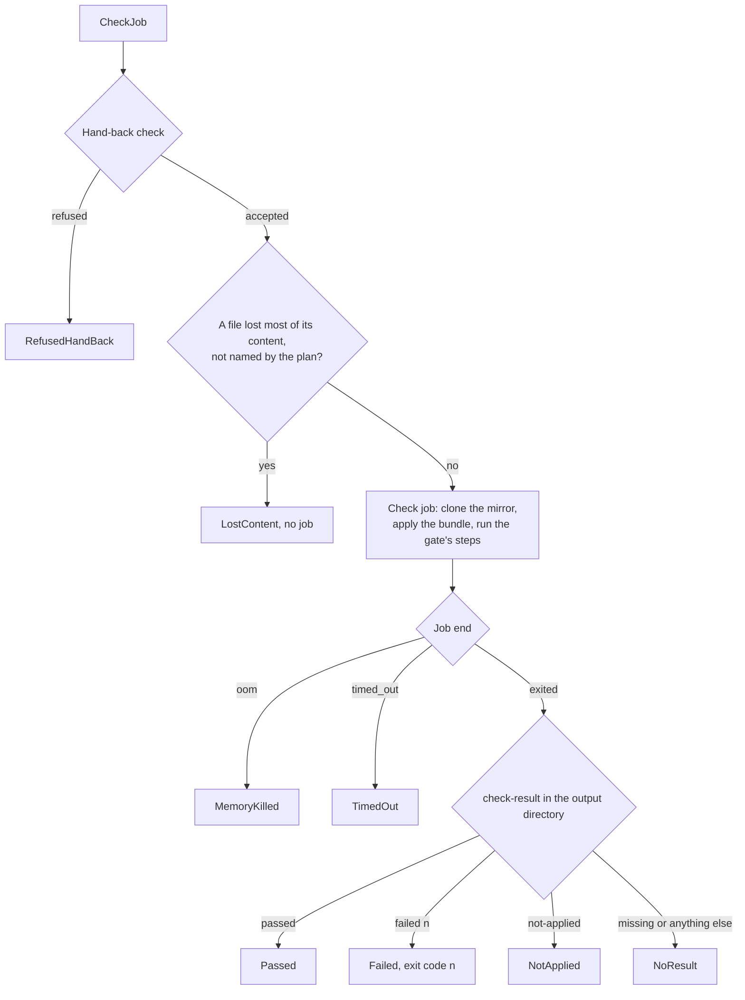

# Check job

The pre-push check (plan task T51, first part) runs the project's check command on what a build handed back, in a [job container](job-containers.md) of its own, after the [hand-back checks](hand-back.md) and before anything is pushed. The builder's own run of the checks is never trusted. The pull request text check (every Evidence item referenced, the body cap, the send-back once) is the second part of T51 and is not built.

`php bin/console intakt:check:run <repository> <branch> <bundle> <image> [--check-command=<command>] [--rewritten=<path> ...] [--merge-main]` (`RunCheckJobCommand`) calls `UseCase/RunCheckJob/RunCheckJob::run(CheckJob)` (marked `#[NoDiscard]`) in `Core/HandBack`. Nothing calls it from another module yet: the push (T53) and the build lane (T56) will.

## The steps

1. `CheckHandBack::check()` runs first with the same `HandBack` ([Hand-back checks](hand-back.md)); a refusal is returned as it is and no job starts. An accepted bundle leaves its objects in the repository, which the next step reads.
2. `LostContentCheck::of()` compares each file the accepted head changed with the merge base of main and the head (`symbolic-ref --quiet HEAD`, `merge-base`, `diff --raw -z -M --no-abbrev`, `cat-file blob`), so a file main shrank after the branch started is not the change's loss, and a moved file is followed instead of read as removed. An added file and a former submodule entry (old mode `160000`) are skipped; a file a submodule replaced (new mode `160000`) counts as emptied. `Domain/LostContent::in()` holds the rule: a file that keeps under a fifth of its bytes (`LostContent::FRACTION`) and loses more than 50 lines (`MAX_LINES_LOST`; a last line without its line break counts) has lost its content; a removed file counts as emptied. A file the task's plan names as removed or rewritten (`CheckJob::$namedByThePlan`, the `--rewritten` option, matched exactly against the old or the new path) may lose its content. A named path also covers the paths the file had earlier on the branch: the renames of each commit (`log --raw -z -M --no-abbrev --format= <base>..<head>`) are followed back, so a file moved and then rewritten below git's similarity threshold, which the branch's diff shows as removed under its old path, is covered by its new path. Any other loss ends the check as `LostContent` with each file's path and line counts, before a job starts. Plan approval is not built, so the paths come from the caller.
3. The job (`JobRunner::run()`) gets:
   - the image given, as the project's job image ([Job images](job-images.md));
   - two read-only inputs, the repository at `/input/mirror` and the bundle at `/input/handback.bundle` (both resolved with `realpath`);
   - the command `/bin/sh -c <docker/job/check.sh> intakt-check /input/mirror /input/handback.bundle <branch> -- <step> ...`, the script's text read from the project folder for each job, and the steps from the `Gate` plugin;
   - an allowlist of the gate's registry hosts (`JobEgress::to()`), or no network (`JobEgress::none()`) for a gate that names none;
   - the limits 4 GiB of memory, 2 CPUs and 1800 seconds, and the job id `check-<first 40 characters of the head>`, so a second check of the same head while one runs is refused as already running.
4. The verdict is read from the job's output directory only (`JobResult::$output`), never from the container's exit code or log: `check-result` must be exactly `passed`, `not-applied` or `failed <1 to 3 digits, not starting with 0>`, followed by one line break; anything else, or no file, is `NoResult`. A job the engine stopped for memory or time is `MemoryKilled` or `TimedOut` whatever its output says. An output the runner refuses (`JobOutputRefused`: a link, too many files, too many bytes) is `NoResult`. `check.log` becomes the outcome's log.

`CheckJobOutcome` holds the `CheckVerdict` (a backed enum whose `reason()` is fixed text), the exit code of a failed step, the lost files and the log; `passed()` is true for `Passed` only. The code under test runs in the same job and can write its output directory, so a result it rewrites is believed; a result channel the code under test cannot rewrite is plan task T78 ([the plan](../plan.md)).

## In the container

`docker/job/check.sh` (POSIX `sh`, with `git`) runs as the job's command after the [start check](job-containers.md#start-check):

1. `git clone --quiet --no-hardlinks` of the mirror into `$TMPDIR/clone` (`/work/clone`), a fresh clone from a read-only mount;
2. `git fetch --quiet --update-head-ok <bundle> +refs/heads/<branch>:refs/heads/<branch>` and `git checkout --quiet --force <branch>`, which applies the bundle. The bundle's commits keep their attribution lines; the head the hand-back check accepted has the same tree.
3. Each step with `sh -c` in the clone, its standard input closed, in order; the first that exits with a status other than 0 ends the check.

It writes `check.log` (git's messages when the bundle cannot be applied, otherwise `$ <step>` and the step's output for each step) and `check-result` (`passed`, `failed <status>`, or `not-applied` when the clone, the fetch or the checkout failed, in which case no step runs) into `$INTAKT_JOB_OUTPUT`. `HOME` and `TMPDIR` are the job's own tmpfs work area, so Composer's cache and every other cache start empty.

## The gate plugin

`Plugin/Gate/Contract/Gate`:

- `checkSteps(?string $configuredCommand): non-empty-list<string>`: the shell steps the check job runs.
- `registryHosts(): list<string>`: the hosts the steps fetch dependencies from.

`Plugin/PhpGate/Infrastructure/PhpGate` is the only implementation, so the container autowires it. Without a configured command (null, or only white space) its steps are `composer install --no-interaction --no-progress` and `bin/check --fast` (`Plugin/PhpGate/Contract/PhpGateSteps::INSTALL` and `CHECK`); a configured command (`--check-command`) is the only step, and installs what it needs itself. Its hosts are `repo.packagist.org`, `api.github.com` and `codeload.github.com`. The files a gate protects are not part of the contract yet.

## The console door

The command prints `lost <path>: <lines before> lines to <lines after>` per lost file, then the last 40 lines of the log (escaped for the console), then `passed` and exits with 0, or `failed: <reason>` (with ` (exit code <n>)` for a failed step) in an error block and exits with 1. A refused bundle prints `refused: <reason>`; an `InvalidArgumentException` or a `ReportableFailure` (for example `DockerEngineFailed` without a Docker socket) prints its message; both exit with 1.

The tests run the real `docker/job/check.sh` with `sh -c` on a temporary mirror and bundle (`tests/Core/HandBack/CheckScriptTest.php`) and `RunCheckJob` with a stubbed `JobRunner` (`RunCheckJobTest`), because the build sandbox has no Docker daemon. No check job has run against a live engine yet.
