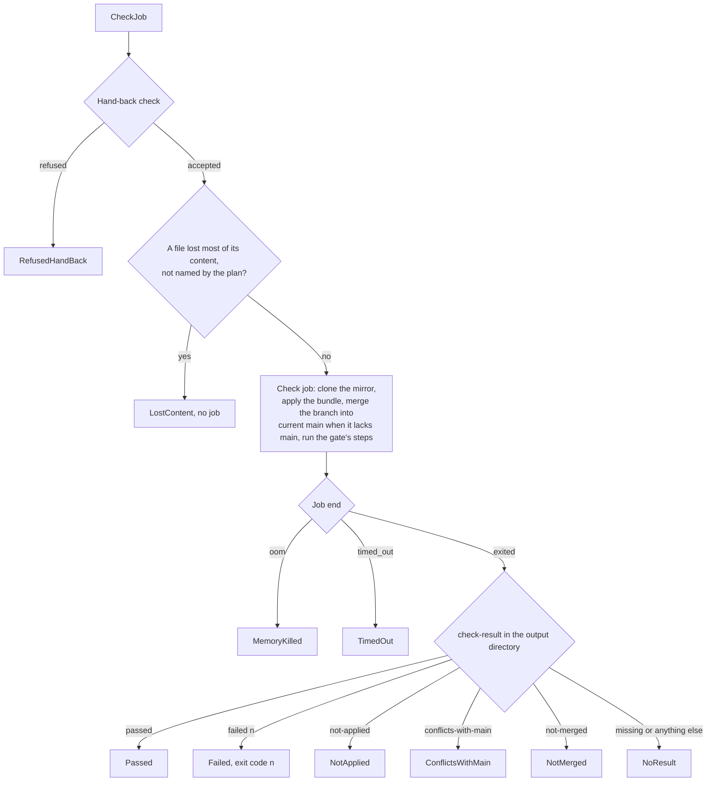

# Check job

The pre-push check (plan task T51, first part) runs the project's check command on what a build handed back, in a [job container](job-containers.md) of its own, after the [hand-back checks](hand-back.md) and before anything is pushed. The builder's own run of the checks is never trusted. The pull request text check (every Evidence item referenced, the body cap, the send-back once) is the second part of T51 and is not built.

`php bin/console intakt:check:run <repository> <branch> <bundle> <image> [--check-command=<command>] [--rewritten=<path> ...] [--merge-main]` (`RunCheckJobCommand`) calls `UseCase/RunCheckJob/RunCheckJob::run(CheckJob)` (marked `#[NoDiscard]`) in `Core/HandBack`. `RunCheckJob` implements `Contract/CheckJobs`, the entry point for other modules, which the container aliases as its only implementation; `CheckJob`, `CheckJobOutcome` and `CheckVerdict` live in `Contract/` beside it. [`intakt:build:task`](build-task.md) calls it through `CheckJobs` as its pre-push check step; the push (T53) does not call it yet.

## The steps

1. `CheckHandBack::check()` runs first with the same `HandBack` ([Hand-back checks](hand-back.md)), secret scan included; `intakt:check:run` takes no `--credential-env`, so its `HandBack` carries an empty `JobCredentials` and redacts nothing. A refusal is returned as it is and no job starts. An accepted bundle leaves its objects in the repository, which the next step reads.
2. `LostContentCheck::of()` compares each file the accepted head changed with the merge base of main and the head (`symbolic-ref --quiet HEAD`, `merge-base`, `diff --raw -z -M --no-abbrev`, `cat-file -s` and, only when the sizes allow a loss (`LostContent::couldBeLost()`), `cat-file blob`), so a file main shrank after the branch started is not the change's loss, and a moved file is followed instead of read as removed. An added file and a former submodule entry (old mode `160000`) are skipped; a file a submodule replaced (new mode `160000`) counts as emptied. `Domain/LostContent::in()` holds the rule: a file that keeps under a fifth of its bytes (`LostContent::FRACTION`) and loses more than 50 lines (`MAX_LINES_LOST`; a last line without its line break counts) has lost its content; a removed file counts as emptied. A file the task's plan names as removed or rewritten (`CheckJob::$namedByThePlan`, the `--rewritten` option, matched exactly against the old or the new path) may lose its content. A named path covers one file. A named path that existed at the merge base names the file that was there, so a file the branch moved onto it is not covered. A named path the branch created (the branch's diff adds it, or moves or copies a file onto it) names the file there at the head, and also covers the one path that file had at the merge base: the renames and additions of each commit on the branch's first-parent line (`log --raw -z -M --no-abbrev --first-parent --diff-merges=first-parent --format=%H <base>..<head>`, read commit by commit, a merge of main diffed against its first parent so a path it adds is seen) are followed back from the head, and the path is replaced only in a commit that moved a file onto it; a commit that adds the path (status `A`) ends the walk with no merge-base path, because the file there was created on the branch, while a commit that only changes the content in place does not end it. So a file moved and then rewritten below git's similarity threshold, which the branch's diff shows as removed under its old path, is covered by its new path, while a file that only passed through a named path and ended under another path is reported under that path. Any other loss ends the check as `LostContent` with each file's path and line counts, before a job starts. Plan approval is not built, so the paths come from the caller.
3. The job (`JobRunner::run()`) gets:
   - the image given, as the project's job image ([Job images](job-images.md));
   - two read-only inputs, the repository at `/input/mirror` and the bundle at `/input/handback.bundle` (both resolved with `realpath`);
   - the command `/bin/sh -c <docker/job/check.sh> intakt-check /input/mirror /input/handback.bundle <branch> -- <step> ...`, the script's text read from the project folder for each job, and the steps from the `Gate` plugin;
   - an allowlist of the gate's registry hosts (`JobEgress::to()`), or no network (`JobEgress::none()`) for a gate that names none;
   - the limits 4 GiB of memory, 2 CPUs and 1800 seconds, and the job id `check-<first 40 characters of the head>`, so a second check of the same head while one runs is refused as already running.
4. The verdict is read from the job's output directory only (`JobResult::$output`), never from the container's exit code or log: `check-result` must be exactly `passed`, `not-applied`, `conflicts-with-main`, `not-merged` or `failed <1 to 3 digits, not starting with 0>`, followed by one line break; anything else, or no file, is `NoResult`. A job the engine stopped for memory or time is `MemoryKilled` or `TimedOut` whatever its output says. An output the runner refuses (`JobOutputRefused`: a link, too many files, too many bytes) is `NoResult`. `check.log` becomes the outcome's log.

`CheckJobOutcome` holds the `CheckVerdict` (a backed enum whose `reason()` is fixed text), the exit code of a failed step, the lost files and the log; `passed()` is true for `Passed` only. The code under test runs in the same job and can write its output directory, so a result it rewrites is believed; a result channel the code under test cannot rewrite is plan task T78 ([the plan](../plan.md)).

## In the container

`docker/job/check.sh` (POSIX `sh`, with `git`, `env`, `sed` and `grep`) runs as the job's command after the [start check](job-containers.md#start-check). Each git command of the script itself (the clone, fetch, checkout, `rev-parse`, `merge-base`, reset, merge and the conflict test's `diff`) runs through its function `own_git`, which, in a subshell, unsets every exported `GIT_*` variable (among them `GIT_CONFIG_COUNT`, `GIT_CONFIG_PARAMETERS` and `GIT_TEMPLATE_DIR`), sets `GIT_CONFIG_NOSYSTEM=1`, `GIT_CONFIG_GLOBAL=/dev/null` and `GIT_ATTR_NOSYSTEM=1`, and passes `-c core.attributesFile=/dev/null`, because git reads the user's attributes file even with `GIT_CONFIG_GLOBAL` set. It reads the variables' names from `env` with `sed` under `LC_ALL=C`, because in a UTF-8 locale `sed`'s pattern stops at a byte of a value that is no text and would leave it on the name, which `unset` refuses. The clone, the only command of the script that creates a repository, is made with `--template=`, because git otherwise copies the default template folder of the image's git (its `info/attributes`, `config` and `hooks`) into the clone, and `own_git` does not shut out the clone's own files. So no setting of the image or the job's environment (a merge option such as `-s ours`, `-X theirs`, `--no-commit` or `--gpg-sign`, signature verification, a hook path, a merge attribute) changes what the check runs on, as CI's test merge reads none of them either; the repository's own `.gitattributes` (for example `merge=union`) still applies, as it does in CI. The steps run with the job's environment unchanged, because they are the project's checks, not the merge:

1. `git -c safe.directory=<mirror> clone --template= --quiet --no-hardlinks --upload-pack='git -c safe.directory="$INTAKT_MIRROR" upload-pack'` of the mirror into `$TMPDIR/clone` (`/work/clone`), a fresh clone from a read-only mount that holds nothing of a git template (no `info/attributes`, no `hooks`). Git (since 2.45.1 for the clone itself) refuses a local repository another user owns, and the job's user need not own the mounted mirror, so the mirror's path, and only that path, is named in `safe.directory`: never `*`, and the exception is passed on the command line only, never written to a git configuration file. The `upload-pack` that serves a local clone gets it as well, because git drops the clone's `-c` settings (`GIT_CONFIG_PARAMETERS`) before it starts it; the path reaches it through the variable `INTAKT_MIRROR`, set only for the clone, so the shell that runs `upload-pack` never parses the path. Then `git rev-parse --verify --quiet HEAD`, the commit of current main (the mirror's `HEAD`, also a detached one); a mirror whose `HEAD` names no commit has no main to merge. The job reads the mirror as it is: `intakt:check:run` does not update it, while `intakt:build:task` updates it right before its pre-push check ([Build task](build-task.md));
2. `git fetch --quiet --update-head-ok <bundle> +refs/heads/<branch>:refs/heads/<branch>` and `git checkout --quiet --force <branch>`, which applies the bundle. The bundle's commits keep their attribution lines; the head the hand-back check accepted has the same tree.
3. `git merge-base --is-ancestor <main> HEAD`: when the branch already holds current main (also a branch with no commits of its own), the steps run on its head as it is. Otherwise the branch is merged into current main as CI merges a pull request, because CI runs on that merge, and a change can fail only together with commits main gained after the branch last merged it: `git rev-parse --verify HEAD` keeps the branch's head, `git reset --quiet --hard <main>` puts the checked-out branch on main, and `LC_ALL=C git -c core.hooksPath=/dev/null -c commit.gpgSign=false -c user.name=intakt-check -c user.email=check@intakt.invalid merge --no-ff --commit --no-squash --no-edit -m 'chore(check): merge the branch into current main' <head>` merges the head into it, with git's output kept for the conflict test below and copied to the log. `--commit` and `--no-squash` are given because git applies the merge options of a configuration (`branch.<name>.mergeOptions`) before the command line's, and the clone's own configuration, which the isolation above does not shut out, could otherwise end a clean merge without its merge commit. After a merge that exits with 0 the script confirms the commit: `git rev-parse --verify --quiet HEAD^1` must be current main and `HEAD^2` the branch's head; otherwise it logs `the merge left no merge commit of <main> and <head>` and the merge counts as failed, so no step runs on main alone. No git hook runs in this merge (`core.hooksPath=/dev/null`) and its commit is not signed (`commit.gpgSign=false`), as CI's merge has neither. `LC_ALL=C` keeps git's messages in English, because the conflict test reads them. So main is the first parent, as in CI's merge, and a merge driver that orders the two sides (such as `merge=union`) gives the file CI checks. The identity is given on the command line, because the clone and `HOME` hold no git config; the subject follows Conventional Commits, because `bin/check`'s commit-subject gate reads every commit from main to `HEAD`, this merge included. The merge commit stays in the job's clone: the pushed head is the accepted head, and the [push](branch-push.md) checks its own merge with main. A merge that fails ends the check before any step. It is a conflict only when git itself reports one: the index has unmerged paths (`git diff --name-only --diff-filter=U` prints a path), or the merge's output has a line starting with `CONFLICT (`, which also catches a conflict that leaves no unmerged path (`CONFLICT (directory rename split)`, when main renamed a directory to two places while the branch added a file to it). Every other failed merge is `not-merged`: git refused it (for example `refusing to merge unrelated histories` for a branch with no history in common with main), its commit failed, it exited with 0 without leaving the merge commit, or anything else. The script does not read git's `MERGE_HEAD` state, because a clean merge whose commit fails leaves it too.
4. Each step with `sh -c` in the clone, its standard input closed, in order; the first that exits with a status other than 0 ends the check.

It writes `check.log` (git's messages when the bundle cannot be applied; otherwise `$ git merge <head> into <main>` and git's merge output when it merged, then `$ <step>` and the step's output for each step) and `check-result` (`passed`, `failed <status>`, `not-applied` when the clone, the fetch or the checkout failed, `conflicts-with-main` when the merge with current main failed with unmerged paths or a `CONFLICT (` line, or `not-merged` when it failed otherwise; in the last three no step runs) into `$INTAKT_JOB_OUTPUT`. `CheckVerdict::ConflictsWithMain` gives the fixed reason `the branch conflicts with current main, so the check ran no step` and `CheckVerdict::NotMerged` gives `git refused to merge the branch with current main without a conflict, so the check ran no step`; the conflicting paths and git's messages are only in the log. `HOME` and `TMPDIR` are the job's own tmpfs work area, so Composer's cache and every other cache start empty.

## The gate plugin

`Plugin/Gate/Contract/Gate`:

- `checkSteps(?string $configuredCommand): non-empty-list<string>`: the shell steps the check job runs.
- `registryHosts(): list<string>`: the hosts the steps fetch dependencies from.
- `dependencyStep(?string $configuredCommand): ?DependencyStep`: the dependency step of a check, or null when the gate names no lock inputs, so the check installs every time. `Plugin/Gate/Contract/DependencyStep` holds `lockFiles` (the files the locked install depends on), `platformProbe` (a command that prints the platform version inside the job image), `install` (the install of the locked packages in a clean environment, with scripts and plugins off) and `generate` (the command that makes the files that depend on the tree, run on the check's own tree after the install).

`Plugin/PhpGate/Infrastructure/PhpGate` is the only implementation, so the container autowires it. Without a configured command (null, or only white space) its steps are `composer install --no-interaction --no-progress` and `bin/check --fast` (`Plugin/PhpGate/Contract/PhpGateSteps::INSTALL` and `CHECK`); a configured command (`--check-command`) is the only step, and installs what it needs itself. Its hosts are `repo.packagist.org`, `api.github.com` and `codeload.github.com`. The files a gate protects are not part of the contract yet.

Its dependency step, without a configured command, is the Composer one: the lock files `composer.json` and `composer.lock`, the probe `php -r 'echo PHP_VERSION;'`, the install `composer install --no-interaction --no-progress --no-scripts --no-plugins --no-autoloader` (`PhpGateSteps::LOCKED_INSTALL`) and the generation `composer install --no-interaction --no-progress` (`PhpGateSteps::GENERATE`, the same command as the gate's own install step). Before Composer runs, the install runs a `php -r` guard (`PhpGateSteps::LOCK_GUARD`), the trust rule's first half: it refuses a head whose lock inputs do not pin what gets installed, so two heads with the same lock inputs could install different code. It refuses when:

- `composer.lock` is missing (Composer would otherwise resolve the dependencies and write a new lock file);
- `composer.json` sets `config.lock` to anything other than `true`, an explicit `null` included (`false` disables the lock: Composer ignores `composer.lock` and resolves the dependencies anew); a missing key counts as `true`;
- `composer.json` defines a `pre-package-install`, `post-package-install`, `pre-package-update` or `post-package-update` script: the split flow never runs them (below), so such a head installs every time;
- a locked package (in `packages` or `packages-dev`) comes from a `path` repository;
- a locked package's `dist` or `source` has `mirrors`: Composer may download from a mirror first, and the guard does not check mirror URLs;
- a locked package has the type `composer-plugin` (or the legacy `composer-installer`, which Composer installs as a plugin too) and is not `symfony/runtime`; the type is compared without regard to letter case (`COMPOSER-PLUGIN` is refused too), because Composer lowercases it when it loads the lock: the install runs with `--no-plugins`, so a plugin that acts while packages are installed (for example `composer/installers`) would give a different install from a fresh one; `symfony/runtime`'s work is redone by the generation;
- a `dist` URL or a `source` URL is local: a relative path, an absolute path, a `file://` URL or a stream wrapper such as `compress.zlib:///path/package.zip`, also with a checksum, because its bytes come from the tree or the filesystem and the lock inputs do not name them. Only known remote schemes count as remote: a `dist` URL must start with `https://` or `http://`, a `source` URL with `https://`, `http://`, `ssh://`, `git://`, `git+ssh://` or `svn://` (schemes in lower case); the `user@host:path` form counts as remote only for a `source` of type `git`, because Composer reads a `dist` URL of that form, such as `fixture@archive:package.zip`, as a path in the tree. Everything else is refused as a local URL;
- a `dist` has a `shasum` that is neither empty nor 40 lowercase hex characters (Composer skips a falsy checksum such as `"0"`);
- a `dist` with a URL has an empty or missing `shasum`, unless its URL is `https`, has no query or fragment and ends in `/` and 40 lowercase hex characters that are the `dist`'s own `reference` (the form of the GitHub archives Packagist locks; a URL that names a branch or tag can serve other contents later, also when the package's `source` is pinned, because Composer installs the archive by default); with a `shasum`, Composer fails the install of an archive that changed;
- a `source` has a `reference` that is not 40 or 64 lowercase hex characters (a branch or tag name can move).

A remote host that serves the same commit URL is trusted as much as a fresh install trusts it: if it served other bytes for that URL, a fresh install would install them too, so reuse adds nothing a builder could exploit. The install then records the SHA-256 hash of `composer.lock`, runs Composer, and ends, whatever Composer's exit code and also when the caller's shell runs with `set -e`, with a second `php -r` call that exits 1 with a message on standard error when the file's hash differs afterwards or the file is gone; with the hash unchanged, a failed Composer run ends the install with Composer's own exit status, and a successful one goes on to the source guard below. Composer treats a lock file without a `packages` key (for example `{}`) as absent, resolves the dependencies and rewrites the lock, and that is not an install from the lock. When Composer and the comparison passed, the install ends with the trust rule's second half, a `php -r` guard after Composer (`PhpGateSteps::SOURCE_GUARD`): a hex `reference` is not yet proof of a commit id, because the lock entry does not say which hash format the repository uses, and git reads 64 hex characters in a SHA-1 repository, or 40 in a SHA-256 one, as a branch name. The guard reads `composer/installed.json` in the vendor folder (asked from Composer with `composer config --no-interaction --no-plugins --absolute vendor-dir`, its standard error dropped so a Composer warning adds no second line to a refusal; when that call fails and names no folder, the guard refuses with its own line, `Composer could not name the vendor folder`, instead of looking for `/composer/installed.json`), and for every package whose `installation-source` is `source` it compares `git --git-dir=<folder>/.git --work-tree=<folder> rev-parse --verify --quiet HEAD` of the package's install folder with the `source.reference` in `composer.lock`. Git runs with every inherited `GIT_*` variable removed and `GIT_CONFIG_NOSYSTEM=1`, `GIT_CONFIG_GLOBAL=/dev/null`, `GIT_NO_REPLACE_OBJECTS=1`, `GIT_NO_LAZY_FETCH=1`, an empty `GIT_ALLOW_PROTOCOL`, `GIT_GRAFT_FILE=/dev/null` and `GIT_ATTR_NOSYSTEM=1`, so an inherited `GIT_DIR` cannot point it at another repository. It refuses unless the two are the same string (a branch never resolves to its own name), and also when the folder's `.git` is not a directory (a `.git` file or a symbolic link could lead to another repository), when `.git/commondir` exists (git follows it even with an explicit `--git-dir`, so a symbolic `HEAD` could resolve in another repository, and a checkout Composer clones never has one), the locked source is not a git one or `installed.json` is missing. The guard trusts the checkout's `.git` folder as `git clone` wrote it: it removes what the environment can inject (inherited `GIT_*` variables, system and global configuration, replace objects, grafts) and refuses the redirections a fresh clone never contains (a `.git` that is not a directory or is a link, a `commondir` file); further git internals are out of scope, because the locked install (Composer with scripts and plugins off) does not produce them.

Each refusal of either guard writes one line on standard error that names the package (or the file or script). The lock guard runs before Composer validates the lock, so it names a package whose name is not a valid Composer name as `The package named <name as JSON>`, with every character outside ASCII escaped as `\u` and four hex digits (U+0085 and U+2028 included), which keeps a line break in the name on the same line. It exits with `PhpGateSteps::REFUSED` (78), a status Composer's own failures do not use, while a failed install exits with Composer's own code or with 1 from the lock comparison. That is how the check flow of part 3 of #1203 tells them apart: a refusal means the head has no reusable install and installs every time, never a failed check. A head the install fails for has no reusable install either. The generation runs on the populated `vendor/` folder, so it downloads nothing unless a plugin moves a package (below); it writes `vendor/autoload.php`, `vendor/composer/platform_check.php` when Composer has platform requirements to check (not when `config.platform-check` is `false` or nothing is required), `vendor/composer/installed.php` (whose root package reference is the checked head, not the head that made the install) and, through symfony/runtime's Composer plugin, `vendor/autoload_runtime.php`. The generation has scripts and plugins on, so it runs every plugin the tree allows and the checked tree's own Composer scripts for the events it raises (for example `post-autoload-dump`); only the install has them off. The split flow differs from a fresh install in two ways, both because the locked install has scripts and plugins off and the generation finds every package already installed. The root package's package events (`pre-package-install`, `post-package-install`, `pre-package-update` and `post-package-update`) never run, and neither do plugin listeners on those events (for example a plugin that patches packages after install). An installer plugin that chooses where a package goes (for example `composer/installers`) does not act during the install, so its packages land in `vendor/`, and the generation may then install them again at the plugin's path, which can download. So the lock guard refuses a tree that defines scripts for these events, and every locked Composer plugin but `symfony/runtime`. The manifest is a lock input because its platform config and autoload rules change what an install from the same lock file holds. With a configured command it returns null, as for a language without support. No check uses the dependency step yet: the check job still runs `checkSteps()` with an empty Composer cache, and reusing one install for heads that share the lock inputs needs the snapshot store that part 2 of #2621 adds, and the check flow of part 3 of #1203.

## The console door

The command prints `lost <path>: <lines before> lines to <lines after>` per lost file, then the last 40 lines of the log (escaped for the console), then `passed` and exits with 0, or `failed: <reason>` (with ` (exit code <n>)` for a failed step) in an error block and exits with 1. A refused bundle prints `refused: <reason>`; an `InvalidArgumentException` or a `ReportableFailure` (for example `DockerEngineFailed` without a Docker socket) prints its message; both exit with 1.

The tests run the real `docker/job/check.sh` with `sh -c` on a temporary mirror and bundle (`tests/Core/HandBack/CheckScriptTest.php`: among others a branch that already holds main, one with no commits of its own and a mirror whose `HEAD` names no commit, all checked on their own head; a branch behind a main that moved, checked on its merge into main with main as the first parent, the check's identity and a Conventional Commits subject; a `merge=union` file holding what the merge of the branch into main holds; a mirror whose `HEAD` is detached at a main that moved, checked on the merge with that main; a conflict with main that runs no step, also a file the branch changed and main deleted and a split directory rename that leaves no unmerged path; git settings in the job's environment that have no effect on the merge: `branch.task.mergeOptions` set to `--no-commit`, `--squash`, `-s ours` or `--gpg-sign` with `gpg.program=false`, `commit.gpgSign=true` with `gpg.program=false`, and `merge.verifySignatures=true` (also for a task branch named `MERGE_HEAD`), each still ending `passed` on the merge commit with main and the head as parents, a refusing `pre-merge-commit` hook, which the merge does not run, and `-X theirs`, `-X ours` or `-s ours` (also through `GIT_CONFIG_PARAMETERS` or a `.gitconfig` in `HOME`) and a `merge=union` rule in the user's attributes file on a conflicting branch, which still ends `conflicts-with-main`; the steps still reading the job's git settings; a mirror owned by another user (a `git` in front of the real one sets `GIT_TEST_ASSUME_DIFFERENT_OWNER=1` for the clone, because a test cannot hand the mirror to another user), still cloned and ending `passed`, while a step that reads the mirror as another user's is still refused, so the exception stays with the clone; a branch with no history in common with main, which leaves `not-merged` and runs no step; and a `git` that ends the merge before its commit and exits with 0, which leaves `not-merged` and runs no step) and `RunCheckJob` with a stubbed `JobRunner` (`RunCheckJobTest`), because the build sandbox has no Docker daemon. No check job has run against a live engine yet.
