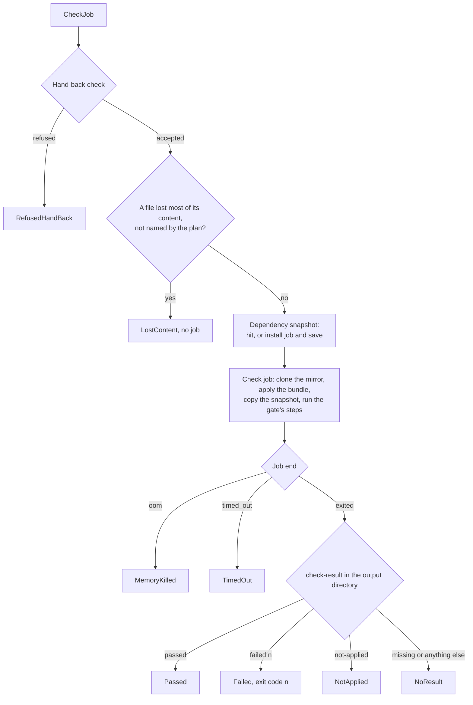

# Check job

The pre-push check (plan task T51, first part) runs the project's check command on what a build handed back, in a [job container](job-containers.md) of its own, after the [hand-back checks](hand-back.md) and before anything is pushed. The builder's own run of the checks is never trusted. The pull request text check (every Evidence item referenced, the body cap, the send-back once) is the second part of T51 and is not built.

`php bin/console intakt:check:run <repository> <branch> <bundle> <image> [--check-command=<command>] [--rewritten=<path> ...] [--merge-main]` (`RunCheckJobCommand`) calls `UseCase/RunCheckJob/RunCheckJob::run(CheckJob)` (marked `#[NoDiscard]`) in `Core/HandBack`. `RunCheckJob` implements `Contract/CheckJobs`, the entry point for other modules, which the container aliases as its only implementation; `CheckJob`, `CheckJobOutcome` and `CheckVerdict` live in `Contract/` beside it. [`intakt:build:task`](build-task.md) calls it through `CheckJobs` as its pre-push check step; the push (T53) does not call it yet.

## The steps

1. `CheckHandBack::check()` runs first with the same `HandBack` ([Hand-back checks](hand-back.md)), secret scan included; `intakt:check:run` takes no `--credential-env`, so its `HandBack` carries an empty `JobCredentials` and redacts nothing. A refusal is returned as it is and no job starts. An accepted bundle leaves its objects in the repository, which the next step reads.
2. `LostContentCheck::of()` compares each file the accepted head changed with the merge base of main and the head (`symbolic-ref --quiet HEAD`, `merge-base`, `diff --raw -z -M --no-abbrev`, `cat-file -s` and, only when the sizes allow a loss (`LostContent::couldBeLost()`), `cat-file blob`), so a file main shrank after the branch started is not the change's loss, and a moved file is followed instead of read as removed. An added file and a former submodule entry (old mode `160000`) are skipped; a file a submodule replaced (new mode `160000`) counts as emptied. `Domain/LostContent::in()` holds the rule: a file that keeps under a fifth of its bytes (`LostContent::FRACTION`) and loses more than 50 lines (`MAX_LINES_LOST`; a last line without its line break counts) has lost its content; a removed file counts as emptied. A file the task's plan names as removed or rewritten (`CheckJob::$namedByThePlan`, the `--rewritten` option, matched exactly against the old or the new path) may lose its content. A named path covers one file. A named path that existed at the merge base names the file that was there, so a file the branch moved onto it is not covered. A named path the branch created (the branch's diff adds it, or moves or copies a file onto it) names the file there at the head, and also covers the one path that file had at the merge base: the renames and additions of each commit on the branch's first-parent line (`log --raw -z -M --no-abbrev --first-parent --diff-merges=first-parent --format=%H <base>..<head>`, read commit by commit, a merge of main diffed against its first parent so a path it adds is seen) are followed back from the head, and the path is replaced only in a commit that moved a file onto it; a commit that adds the path (status `A`) ends the walk with no merge-base path, because the file there was created on the branch, while a commit that only changes the content in place does not end it. So a file moved and then rewritten below git's similarity threshold, which the branch's diff shows as removed under its old path, is covered by its new path, while a file that only passed through a named path and ended under another path is reported under that path. Any other loss ends the check as `LostContent` with each file's path and line counts, before a job starts. Plan approval is not built, so the paths come from the caller.
3. `JobImages::idOf()` (the `Core/Job` contract, `EngineJobImages` asks the engine for `images/<name>/json` and accepts only an `Id` of the form `sha256:<64 hex>`) resolves the image given to its ID, so a tag rebuilt meanwhile changes neither the snapshot's key nor the image of the install job or the check job. Then `DependencySnapshots::of()` finds or makes the [dependency snapshot](#dependency-snapshots) for the accepted head and that ID; it gives none when the gate names no dependency install or the head lacks one of its lock files. `RunCheckJob` holds the snapshot until the job ended and then releases it.
4. The job (`JobRunner::run()`) gets:
   - the image's ID, resolved from the project's job image ([Job images](job-images.md));
   - two read-only inputs, the repository at `/input/mirror` and the bundle at `/input/handback.bundle` (both resolved with `realpath`), and a third, the snapshot at `/input/dependencies`, when there is one;
   - the command `/bin/sh -c <docker/job/check.sh> intakt-check /input/mirror /input/handback.bundle <branch> [/input/dependencies <folder>] -- <step> ...`, the script's text read from the project folder for each job, the folder the gate's install names (`vendor` for PHP), and the steps from the `Gate` plugin;
   - an allowlist of the gate's registry hosts (`JobEgress::to()`), or no network (`JobEgress::none()`) for a gate that names none;
   - the limits 4 GiB of memory, 2 CPUs and 1800 seconds, and the job id `check-<first 40 characters of the head>`, so a second check of the same head while one runs is refused as already running.
5. The verdict is read from the job's output directory only (`JobResult::$output`), never from the container's exit code or log: `check-result` must be exactly `passed`, `not-applied` or `failed <1 to 3 digits, not starting with 0>`, followed by one line break; anything else, or no file, is `NoResult`. A job the engine stopped for memory or time is `MemoryKilled` or `TimedOut` whatever its output says. An output the runner refuses (`JobOutputRefused`: a link, too many files, too many bytes) is `NoResult`. `check.log` becomes the outcome's log.

`CheckJobOutcome` holds the `CheckVerdict` (a backed enum whose `reason()` is fixed text), the exit code of a failed step, the lost files and the log; `passed()` is true for `Passed` only. The code under test runs in the same job and can write its output directory, so a result it rewrites is believed; a result channel the code under test cannot rewrite is plan task T78 ([the plan](../plan.md)).

## In the container

`docker/job/check.sh` (POSIX `sh`, with `git`) runs as the job's command after the [start check](job-containers.md#start-check):

1. `git clone --quiet --no-hardlinks` of the mirror into `$TMPDIR/clone` (`/work/clone`), a fresh clone from a read-only mount;
2. `git fetch --quiet --update-head-ok <bundle> +refs/heads/<branch>:refs/heads/<branch>` and `git checkout --quiet --force <branch>`, which applies the bundle. The bundle's commits keep their attribution lines; the head the hand-back check accepted has the same tree.
3. When a snapshot is given (the optional fourth and fifth arguments before `--`, the snapshot and its folder), `cp -R <snapshot>/<folder> <clone>/<folder>` (its parent made with `mkdir -p`), so the clone gets the snapshot's `vendor/` as its own writable copy and the mounted snapshot stays as it is. Only that folder is copied, and only when the head leaves its path free: when anything (a tracked file, a directory or a link) stands at `<clone>/<folder>`, or a parent of a nested folder (`tools` for `tools/vendor`) is a file or a link in the clone (a link also when it points to a directory, so the copy never lands where the head points it), nothing is copied and the steps install as before, so the snapshot never replaces a file of the change under check.
4. Each step with `sh -c` in the clone, its standard input closed, in order; the first that exits with a status other than 0 ends the check.

It writes `check.log` (git's messages when the bundle cannot be applied, otherwise `$ <step>` and the step's output for each step) and `check-result` (`passed`, `failed <status>`, or `not-applied` when the clone, the fetch, the checkout or the snapshot's copy failed, in which case no step runs) into `$INTAKT_JOB_OUTPUT`. `HOME` and `TMPDIR` are the job's own tmpfs work area, so Composer's cache and every other cache start empty; with a snapshot, `composer install` finds every locked package installed and only writes the autoloader and the runtime files (`vendor/composer/installed.php` among them) from the check's own tree.

## Dependency snapshots

`UseCase/RunCheckJob/DependencySnapshots` keeps one installed dependency folder per lock file in `var/dependencies/`, so checks of heads that share main's lock file do not install from an empty cache each time.

- **Key.** `DependencySource::key()`: the SHA-256 of the gate's install command, its installed folder, the job image's ID and each lock file's path and contents at the accepted head (`git cat-file -t` must answer `blob`, then `cat-file blob`, in the mirror), each part length-prefixed. The image's ID is in the key because the image fixes the PHP version, and an ID, unlike a tag, never names a rebuilt image. A head without one of the lock files gets no snapshot.
- **Lock.** Each key has one Symfony Lock, `dependency-snapshot-<key>` (no expiry, never waited for): a check holds it shared from the hit or the save until its job ended (`DependencySnapshot::release()`), and a check holds it exclusive while it saves the entry or evicts it. So no check is handed an entry that is half saved or being removed, and no entry is removed while a check binds or copies it.
- **Hit.** The shared lock is taken and the entry `var/dependencies/<key>` is a real directory: its time is set to the clock's now (`touch`) and the check mounts it. No install runs. Before that the store evicts as a save does (below), counting the entry hit and never removing it, so entries that stayed over the count while checks held them go with the next hit, also when no save follows. When the shared lock is busy (another check saves or evicts the entry), the check gets no snapshot and installs as before.
- **Miss.** The store lets the shared lock go and takes the exclusive one. When another check holds the key, this check gets no snapshot and installs as before. Under the lock it looks for the entry again (another check may have saved it meanwhile), then removes whatever stands at the entry or its staging path (a crash's leftover), and `DependencyInstallJob` runs the job `dependencies-<first 40 characters of the key>` in the same image: the lock files alone, written to `<key>.staging/lock` and mounted read-only at `/input/lock`, `<key>.staging/kept` as the job's [kept directory](job-containers.md) at `/kept`, the gate's registry hosts as its allowlist, 2 GiB, 2 CPUs and 900 seconds, and the command `/bin/sh -c <docker/job/install-dependencies.sh> intakt-install-dependencies /input/lock /kept <folder> -- <install command>`. The script copies the lock files into `$TMPDIR/project`, runs the command there with `sh -c` (log in `install.log`), copies the folder to the same path under `/kept` (`tools/vendor` to `/kept/tools/vendor`) and writes `install-result` (`installed`). Only an exited job whose `install-result` is exactly `installed` and a line break, with the folder in the kept directory as a real directory, is saved; anything else (a failed install, a timeout, a refused output or start) saves nothing and the check installs as before. The staging folder is removed afterwards, also when the job throws.
- **Save.** Every directory and executable file of the kept folder is set to `0755`, every other file to `0644`, links untouched (they are never followed), then it is renamed to `var/dependencies/<key>` (`0755`), the lock goes back to shared, the entry is touched, and the store evicts: it removes every `<key>.staging` folder whose key it can lock exclusively (an install still running holds it), and the least recently used entries beyond `HandBackServices::KEPT_DEPENDENCY_SNAPSHOTS` (`intakt.hand_back.kept_dependency_snapshots`, 10 by default in `config/services.yaml`; less than 1 is refused), counting the entry just saved and never removing it. An entry a check still holds is skipped, so the store can briefly hold more entries than the count; the next hit or save after their checks ended removes them.
- **Trust rule.** Only the runner writes the store: the install job sees no builder tree and runs no package code, and its only writable mount in the store is its own `<key>.staging/kept`; the entries are writable by the runner's user alone, a check job gets its entry only as a read-only mount, and a build job never gets it. All jobs run as the orchestrator's user, so the read-only mount, not the file modes, is what keeps a check from writing the store.

For PHP, `PhpGate::dependencyInstall()` names `composer.json` and `composer.lock`, the command `composer install --no-interaction --no-progress --no-scripts --no-plugins --no-autoloader` (`PhpGateSteps::CLEAN_INSTALL`) and the folder `vendor`.

## The gate plugin

`Plugin/Gate/Contract/Gate`:

- `checkSteps(?string $configuredCommand): non-empty-list<string>`: the shell steps the check job runs.
- `registryHosts(): list<string>`: the hosts the steps fetch dependencies from.
- `dependencyInstall(): ?DependencyInstall`: the lock files, the install command and the installed folder of a [dependency snapshot](#dependency-snapshots), or null for a language that installs on every check. `Contract/DependencyInstall` refuses a lock file or folder that is empty, absolute, not canonical or outside the project.

`Plugin/PhpGate/Infrastructure/PhpGate` is the only implementation, so the container autowires it. Without a configured command (null, or only white space) its steps are `composer install --no-interaction --no-progress` and `bin/check --fast` (`Plugin/PhpGate/Contract/PhpGateSteps::INSTALL` and `CHECK`); a configured command (`--check-command`) is the only step, and installs what it needs itself; a dependency snapshot is copied into the clone before it all the same. Its hosts are `repo.packagist.org`, `api.github.com` and `codeload.github.com`. The files a gate protects are not part of the contract yet.

## The console door

The command prints `lost <path>: <lines before> lines to <lines after>` per lost file, then the last 40 lines of the log (escaped for the console), then `passed` and exits with 0, or `failed: <reason>` (with ` (exit code <n>)` for a failed step) in an error block and exits with 1. A refused bundle prints `refused: <reason>`; an `InvalidArgumentException` or a `ReportableFailure` (for example `DockerEngineFailed` without a Docker socket) prints its message; both exit with 1.

The tests run the real `docker/job/check.sh` and `docker/job/install-dependencies.sh` with `sh -c` on temporary folders (`tests/Core/HandBack/CheckScriptTest.php`, `InstallDependenciesScriptTest.php`) and `RunCheckJob` and `DependencySnapshots` with a stubbed `JobRunner` (`RunCheckJobTest`, `DependencySnapshotsTest`), because the build sandbox has no Docker daemon. `RunCheckJobTest` feeds the specs of the install job and the check job through `JobContainerDefinition` to show which mounts in the store are writable. No check job or install job has run against a live engine yet.
