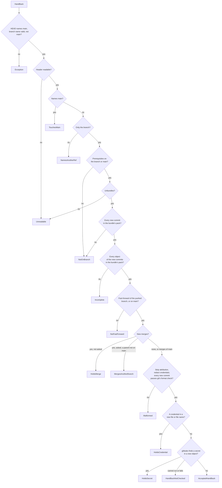
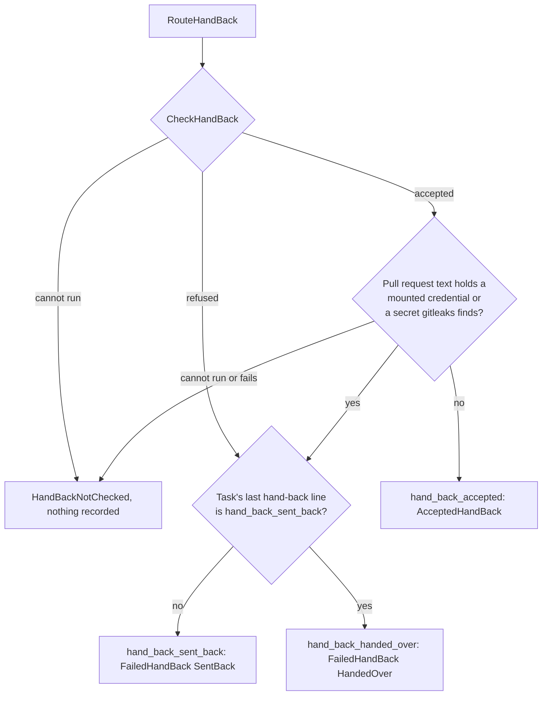

# Hand-back checks

A build that ends with a change hands back a git bundle and the pull request text (one that ends with a question hands back no bundle, see [Build job](build-job.md)). The module `Core/HandBack` (plan task T50) checks that bundle before anything trusts it, strips attribution from its commits, redacts the credentials mounted into the build job from them, runs the secret scan over everything the bundle adds and over the pull request text, and sends a failure back to the builder once before it hands the task over.

`php bin/console intakt:hand-back:check <repository> <branch> <bundle> <pull-request-text> [--merge-main] [--credential-env=<variable>]...` (`CheckHandBackCommand`) calls `RouteHandBack` ([The round](#the-round)); `<pull-request-text>` is a file, and one that cannot be read (`Filesystem::readFile()` throws an `IOException`) is a `PullRequestTextUnreadable` naming its path. Each `--credential-env` names an environment variable (read from `$_SERVER`, then `getenv()`) whose value is a credential mounted into the build job; the value never goes on the command line, which the process list shows. An unset or empty one is a `CredentialVariableUnset`. The command prints `accepted <head>`, `base <commit>` (`base none` when the branch was not pushed yet) and `rewritten <count>` and exits with 0; a failure prints `refused, sent back to the builder: <reason>` or `refused, handed over: <reason>` in an error block and exits with 1; a `ReportableFailure` (those two, `HandBackBranchRefused` for a branch that is main itself or a name git does not accept, `HandBackNotChecked`, `HandBackRoundNotRecorded`) prints its message and exits with 1, while any other exception, an `InvalidArgumentException` included, is left to the console as a programming error. The [check job](check-job.md) (`intakt:check:run`) runs `CheckHandBack` first in the same module, without the pull request text and without the round; [`intakt:build:task`](build-task.md) (T56) calls the check from the Build module through `HandBackChecks`, and the signed push takes the `AcceptedHandBack` of a check as its input ([Branch push](branch-push.md)).

## Contract

`src/Core/HandBack/Contract/`:

- `HandBack`: the repository (a bare repository whose `HEAD` names main, such as the project's [mirror](mirror.md)), the task's branch, the bundle's path, `mergeOfMainAsked` and `mountedCredentials`, the values of the credentials mounted into the build job as a `JobCredentials` (`Plugin/Forge/Contract`, the type a review comment carries for the same reason; no value is empty).
- `AcceptedHandBack` (`base`, the pushed branch's commit or null before the first push, `head`, `rewrittenCommits`) and `RefusedHandBack` (a `HandBackRefusal`) are the two results of a check.
- `HandBackRefusal` is a backed enum; `reason()` is fixed text per case, so a reason never holds a value from the refused bundle or text. `TextHoldsCredential` and `TextHoldsSecret` are the refusals of the pull request text.
- `HandBackChecks`: the entry point of the check for other modules, `check(HandBack): AcceptedHandBack|RefusedHandBack` (marked `#[NoDiscard]`), implemented by `CheckHandBack`, which the container aliases as its only implementation.
- `HandBackNotChecked` (a `ReportableFailure`) is thrown when the repository cannot be read or the secret scan cannot run or fails; its message names the repository and the git subcommand or the scan, never git's or gitleaks's own output, which may quote the bundle.

The check itself, `CheckHandBack::check(HandBack)`, and the round, `RouteHandBack::route(HandBack, string $pullRequestText)` (both marked `#[NoDiscard]`), live in `src/Core/HandBack/UseCase/CheckHandBack/`, not in the Contract. The build task (T56) calls the check through `HandBackChecks` in the Contract; the round has no such entry point, so only the module's own door calls it. The push (T53) needs none, because it takes the result of the check, an `AcceptedHandBack`, as its input.

## The checks, in order

1. The repository path is resolved to an absolute one (`realpath`), because git runs inside the repository; a path that is no folder is `HandBackNotChecked`. Main is the branch the repository's `HEAD` names (`symbolic-ref --quiet HEAD`, under `refs/heads/`); otherwise `HandBackNotChecked`. The branch must pass `check-ref-format --branch` with the name itself as the answer, and must not be main; otherwise `InvalidArgumentException`.
2. The pushed branch is `refs/heads/<branch>` in the repository; when the repository does not hold it yet, the build started from some commit of main in the [build clone](build-clone.md), and main may have moved since.
3. `BundleFile` reads at most `BundleFile::HEADER_LIMIT` (1 MiB) plus one byte, and the header must end (an empty line) within the limit. `BundleHeader::parse()` in `Domain/` reads it by `gitformat-bundle(5)`: the v2 or v3 signature, in v3 only the `@object-format=sha1` or `sha256` capability (a `@filter` bundle leaves objects out and is refused), prerequisites `-<id>[ <comment>]` and references `<id> <ref>`, with ids in lowercase hex of the format's length and no ref named twice. Anything else is `Unreadable`. Intakt reads the header itself, because git prints prerequisites only as prose; every id it passes to git has passed that pattern.
4. A ref equal to main is `TouchesMain`; any set of refs other than the branch alone is `NamesAnotherRef`.
5. Every prerequisite must be an ancestor of the pushed branch or of main (`merge-base --is-ancestor`, which also fails for a commit the repository does not hold); otherwise `NotOnBranch`.
6. `IncomingObjects` opens a quarantine, `objects/incoming-<random>` in the repository, as git's own receive-pack does. From here every git call runs with `GIT_OBJECT_DIRECTORY` set to it and the repository's `objects` as the alternate (`GIT_ALTERNATE_OBJECT_DIRECTORIES`, quoted, so a colon in the path is no separator). `git bundle unbundle <absolute path>` writes the bundle's pack into the quarantine and no ref; a failure is `Unreadable`. Only an accepted check moves the quarantine's files into `objects` (each pack's index last); the quarantine is removed after every check, so a refused bundle leaves no object behind.
7. The header's prerequisites are the bundle's own word, and the repository also holds other tasks' branches, so only objects the bundle's pack holds count as shipped. They are the first objects of the unbundled pack by offset (`show-index`), as many as the pack's own header counts, because unbundling a thin pack appends the objects its deltas build on, which may come from any branch. Every commit the head reaches beyond the pushed branch and main (`rev-list <head> --not [<pushed>] <main>`) must be shipped, otherwise `NotOnBranch`; this refuses a bundle that leaves out a prerequisite on another branch, or names another branch's tip without shipping it. Every commit, tree and file the head reaches beyond them (`rev-list --objects`) must be there and shipped, because unbundling checks no connectivity; otherwise `Incomplete`.
8. The head (the branch's id in the bundle) must be a commit (`cat-file -t`). With a pushed branch it must descend from it; before the first push it may start on any commit of main, so a move of main while the build ran refuses nothing, but no new commit may be a root (`rev-list --max-parents=0 <head> --not <main>` is empty), which also refuses a history of its own merged with main. Otherwise `NotFastForward`.
9. New commits are `rev-list <head> --not [<pushed>] <main>`: main's commits are never new, so a merge of main brings them in unchanged. A new merge commit is `HoldsMerge` unless a merge of main was asked; then each parent after the first must be on main, otherwise `MergesAnotherBranch`. The first parent is the branch's side, as `git merge main` on the branch writes it.
10. `StrippedCommits` walks the new commits oldest first (`--reverse --topo-order`). `AttributionLines::strippedFrom()` removes every line that is a `Co-authored-by:` trailer or starts with `Generated with`, `Generated by` or `Generated-by:` (any case, after any marks that are not letters or digits), byte-wise so a message in another encoding is read too; then runs of blank lines collapse to one and trailing white space goes. The collapsed blank line and the final newline use one line ending, judged from the endings the kept lines had in the message, so a Windows message does not come back with mixed endings and a removed trailer's ending does not count: `\r\n` when a kept line was ended by `\r\n`, else `\n` when a kept line was ended by `\n`. When no kept line had an ending (a single line without a final newline is left), the whole message decides: `\r\n` when it contains one, else `\n`. A message that loses no line is kept byte for byte. A commit whose message or parents changed is written again (`hash-object -t commit -w --stdin`) with its parents mapped to the rewritten ones and without `gpgsig` or `gpgsig-sha256` headers, since the orchestrator signs before the push; a commit with nothing to change keeps its id and signature. `rewrittenCommits` counts the commits that got a new id. Every new commit passes git's own format check, because unbundling checks none: a rewritten one when it is written, an unchanged one by hashing it again without writing (`hash-object -t commit --stdin`). A commit that fails it (for example one with no author) is `Malformed`, with or without attribution. In the same pass each mounted credential's value is replaced by `Redaction::MARKER` (`[redacted]`) in the message and in every header line but `tree` and `parent` (author, committer and the rest), by `strtr()`, which tries the longest value first, so a credential that contains another is redacted whole; a commit that changes this way is written again like a stripped one and counts in `rewrittenCommits`.
11. `BundleSecretScan` reads every object the accepted head reaches beyond the pushed branch and main (`rev-list --objects`, then `cat-file --batch`): the stripped and redacted commits, which are what a push sends, and every tree and file that neither the pushed branch nor main holds, so a file a later commit deletes is read too, and so is a merge's own resolution. A mounted credential's value anywhere in that text (byte-wise) is `HoldsCredential`: the commits were redacted already, so it is in a file or a file name, which is the build's work and is not rewritten.
12. The same text goes to `gitleaks stdin --no-banner --ignore-gitleaks-allow --redact --log-level error --exit-code 3` (Symfony Process, in the repository, at most 600 seconds), the binary taken from `INTAKT_GITLEAKS` (the container binds `%env(default:intakt.gitleaks:INTAKT_GITLEAKS)%` through `PlatformServices::GITLEAKS`, the parameter the GitHub forge's scan uses too), with `GITLEAKS_CONFIG` and `GITLEAKS_CONFIG_TOML` removed, so only the built-in rules apply. There is no allow-list: the objects come on standard input, so a `.gitleaks.toml` or `.gitleaksignore` the build committed is never a file gitleaks reads, and its inline allow comments are ignored. Exit 3 is `HoldsSecret`, 0 passes; any other exit (127 when the scanner is missing) or a process failure, a timeout included, is `HandBackNotChecked`, so a check without a scanner never accepts a bundle. gitleaks's output is never read.

Every git call is built by `HardenedGit::callInBareRepository()` (`--git-dir=<repository> --bare`, no work tree), through `RepositoryGit` (`withObjectsIn()` adds the quarantine). The check writes objects only, and only for an accepted bundle, so a mirror update in between loses nothing; the commits as the bundle shipped them stay beside the rewritten ones, named by no ref; the returned `base` lets the push name the branch state it was checked against (null: the branch must not exist yet).

## The round

13. `RouteHandBack` runs the check above. A refused bundle is a failure of the round with its refusal.
14. For an accepted bundle, `BundleSecretScan::refusalOfText()` reads the pull request text: a mounted credential's value in it (byte-wise) is `TextHoldsCredential`, and the same `gitleaks stdin` call as in step 12 finding a secret in it is `TextHoldsSecret`; a scan that cannot run or fails is `HandBackNotChecked`. The text is refused, not redacted, because the builder wrote it and can write it again without the value. The bundle's objects are already moved into the repository then, named by no ref, as in step 6.
15. `HandBackRoutes` writes one ledger line per round, under a lock per task (Symfony Lock, the `FlockStore` the container configures; the key is `intakt-hand-back-` and the SHA-256 of the JSON list of the resolved repository path and the branch), held from the read to the append, so two rounds of one task never both read the same last line. A task is the resolved repository path and the branch. A failure reads the lines of the three kinds below that mention the task's branch, in ledger order (`Ledger::readOfKindsMentioning()`, the branch as stored in JSON, then each line decoded and matched on repository and branch), never the whole ledger: when the last is `hand_back_sent_back`, the failure is `hand_back_handed_over` (`HandBackRoute::HandedOver`), otherwise `hand_back_sent_back` (`HandBackRoute::SentBack`), so a failure is sent back once and the second in a row is handed over; an accepted hand-back (`hand_back_accepted`) or a hand-over starts the count again. A failure line holds `repository`, `branch`, `refusal` (the case's value) and `reason`; an accepted line `repository`, `branch`, `base` and `head`. No line holds text from the bundle or the pull request text; the accepted line's `head` is the checked head's commit id. An append the ledger does not take is `HandBackRoundNotRecorded` (a `ReportableFailure`), because an unrecorded failure would be sent back again; a ledger read that fails (for example a missing `ledger_event` table) is the same failure, with the read's message, and records nothing. The [pull request text round](check-job.md#the-pull-request-text-round) keeps a count of its own, with its own kinds and lock, so neither round's lines count in the other.
16. `FailedHandBack` carries the `HandBackRefusal` and the `HandBackRoute`; its `reason()` is the refusal's fixed text, which is what goes back to the builder. Nothing sends it to a builder or the maintainer agent yet: the build lane (T56) and the maintainer agent will act on the route.
