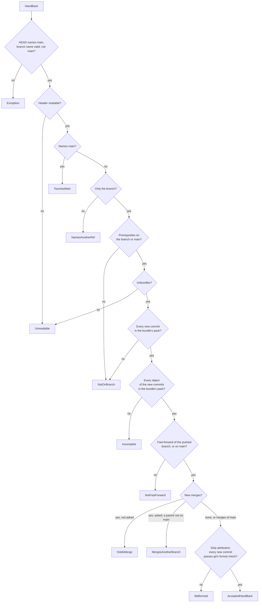

# Hand-back checks

A build hands back a git bundle. The module `Core/HandBack` (plan task T50, first part) checks that bundle before anything trusts it, and strips attribution from its commits. The secret scan, the redaction of mounted credentials, the send-back once and the hand-over on a second failure are later parts of T50 and are not built.

`php bin/console intakt:hand-back:check <repository> <branch> <bundle> [--merge-main]` (`CheckHandBackCommand`) calls the use case. It prints `accepted <head>`, `base <commit>` (`base none` when the branch was not pushed yet) and `rewritten <count>` and exits with 0; a refusal prints `refused: <reason>` in an error block and exits with 1; an `InvalidArgumentException` or a `ReportableFailure` (`HandBackNotChecked`) prints its message and exits with 1. Nothing calls the use case from another module yet: the build lane (T56) will, and the signed push takes its `AcceptedHandBack` ([Branch push](branch-push.md)).

## Contract

`src/Core/HandBack/Contract/`:

- `HandBack`: the repository (a bare repository whose `HEAD` names main, such as the project's [mirror](mirror.md)), the task's branch, the bundle's path and `mergeOfMainAsked`.
- `AcceptedHandBack` (`base`, the pushed branch's commit or null before the first push, `head`, `rewrittenCommits`) and `RefusedHandBack` (a `HandBackRefusal`) are the two results of a check.
- `HandBackRefusal` is a backed enum; `reason()` is fixed text per case, so a reason never holds a value from the refused bundle.
- `HandBackNotChecked` (a `ReportableFailure`) is thrown when the repository cannot be read; its message names the repository and the git subcommand, never git's own output, which may quote the bundle.

The check itself, `CheckHandBack::check(HandBack)` (marked `#[NoDiscard]`), lives in `src/Core/HandBack/UseCase/CheckHandBack/`, not in the Contract, so only the module's own console door calls it. The build lane (T56) needs an entry point in the Contract first; the push (T53) did not need one, because it takes the result of the check, an `AcceptedHandBack`, as its input.

## The checks, in order

1. The repository path is resolved to an absolute one (`realpath`), because git runs inside the repository; a path that is no folder is `HandBackNotChecked`. Main is the branch the repository's `HEAD` names (`symbolic-ref --quiet HEAD`, under `refs/heads/`); otherwise `HandBackNotChecked`. The branch must pass `check-ref-format --branch` with the name itself as the answer, and must not be main; otherwise `InvalidArgumentException`.
2. The pushed branch is `refs/heads/<branch>` in the repository; when the repository does not hold it yet, the build started from some commit of main in the [build clone](build-clone.md), and main may have moved since.
3. `BundleFile` reads at most `BundleFile::HEADER_LIMIT` (1 MiB) plus one byte, and the header must end (an empty line) within the limit. `BundleHeader::parse()` in `Domain/` reads it by `gitformat-bundle(5)`: the v2 or v3 signature, in v3 only the `@object-format=sha1` or `sha256` capability (a `@filter` bundle leaves objects out and is refused), prerequisites `-<id>[ <comment>]` and references `<id> <ref>`, with ids in lowercase hex of the format's length and no ref named twice. Anything else is `Unreadable`. Intakt reads the header itself, because git prints prerequisites only as prose; every id it passes to git has passed that pattern.
4. A ref equal to main is `TouchesMain`; any set of refs other than the branch alone is `NamesAnotherRef`.
5. Every prerequisite must be an ancestor of the pushed branch or of main (`merge-base --is-ancestor`, which also fails for a commit the repository does not hold); otherwise `NotOnBranch`.
6. `IncomingObjects` opens a quarantine, `objects/incoming-<random>` in the repository, as git's own receive-pack does. From here every git call runs with `GIT_OBJECT_DIRECTORY` set to it and the repository's `objects` as the alternate (`GIT_ALTERNATE_OBJECT_DIRECTORIES`, quoted, so a colon in the path is no separator). `git bundle unbundle <absolute path>` writes the bundle's pack into the quarantine and no ref; a failure is `Unreadable`. Only an accepted check moves the quarantine's files into `objects` (each pack's index last); the quarantine is removed after every check, so a refused bundle leaves no object behind.
7. The header's prerequisites are the bundle's own word, and the repository also holds other tasks' branches, so only objects the bundle's pack holds count as shipped. They are the first objects of the unbundled pack by offset (`show-index`), as many as the pack's own header counts, because unbundling a thin pack appends the objects its deltas build on, which may come from any branch. Every commit the head reaches beyond the pushed branch and main (`rev-list <head> --not [<pushed>] <main>`) must be shipped, otherwise `NotOnBranch`; this refuses a bundle that leaves out a prerequisite on another branch, or names another branch's tip without shipping it. Every commit, tree and file the head reaches beyond them (`rev-list --objects`) must be there and shipped, because unbundling checks no connectivity; otherwise `Incomplete`.
8. The head (the branch's id in the bundle) must be a commit (`cat-file -t`). With a pushed branch it must descend from it; before the first push it may start on any commit of main, so a move of main while the build ran refuses nothing, but no new commit may be a root (`rev-list --max-parents=0 <head> --not <main>` is empty), which also refuses a history of its own merged with main. Otherwise `NotFastForward`.
9. New commits are `rev-list <head> --not [<pushed>] <main>`: main's commits are never new, so a merge of main brings them in unchanged. A new merge commit is `HoldsMerge` unless a merge of main was asked; then each parent after the first must be on main, otherwise `MergesAnotherBranch`. The first parent is the branch's side, as `git merge main` on the branch writes it.
10. `StrippedCommits` walks the new commits oldest first (`--reverse --topo-order`). `AttributionLines::strippedFrom()` removes every line that is a `Co-authored-by:` trailer or starts with `Generated with`, `Generated by` or `Generated-by:` (any case, after any marks that are not letters or digits), byte-wise so a message in another encoding is read too; then runs of blank lines collapse to one and trailing white space goes. A message that loses no line is kept byte for byte. A commit whose message or parents changed is written again (`hash-object -t commit -w --stdin`) with its parents mapped to the rewritten ones and without `gpgsig` or `gpgsig-sha256` headers, since the orchestrator signs before the push; a commit with nothing to change keeps its id and signature. `rewrittenCommits` counts the commits that got a new id. Every new commit passes git's own format check, because unbundling checks none: a rewritten one when it is written, an unchanged one by hashing it again without writing (`hash-object -t commit --stdin`). A commit that fails it (for example one with no author) is `Malformed`, with or without attribution.

Every git call is built by `HardenedGit` with `--git-dir=<repository>` and `GIT_WORK_TREE` unset, through `RepositoryGit` (`withObjectsIn()` adds the quarantine). The check writes objects only, and only for an accepted bundle, so a mirror update in between loses nothing; the returned `base` lets the push name the branch state it was checked against (null: the branch must not exist yet).
