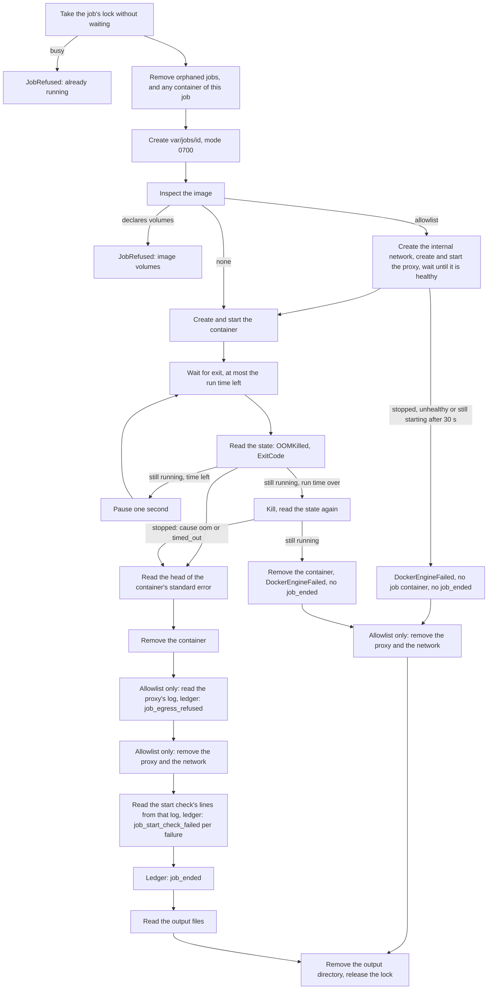

# Job containers

`Core/Job` runs each job (a build, a check, a review) in a fresh container through the Docker Engine API (plan task T44). The review flow starts a [review job](review-job.md) through `ReviewJob` for each reviewer on an install whose `INTAKT_CONTAINER_ENGINE` names an engine ([Review flow](review-flow.md#where-a-reviewer-runs)); without one, as on the `docker compose` demo, reviewers run in the app's own process and no lane starts a job. `intakt:check:run` runs a [check job](check-job.md) through it and `intakt:build:run` a [build job](build-job.md). Part 2 added the egress allowlist with a per-job proxy ([Egress](#egress)); part 3 added the [start check](#start-check) and its reduced mode. How this differs from the build loop that developed Intakt is in [Differences from the earlier loop](differences-from-the-earlier-loop.md).

## Surface

- `Contract/JobRunner::run(JobSpec): JobResult`, implemented by `Infrastructure/ContainerJobRunner`.
- `JobSpec`: a `JobId`, the image, the command, a list of `JobInput` (a host path mounted read-only at a container path), `JobLimits` (memory in bytes, CPUs, run time in seconds), a `JobEgress` and, optionally, a `JobKeptFolder` (`JobSpec::$kept`: an absolute host folder the caller makes and removes, mounted writable at `/kept`, so a job can hand back more than its output directory may hold; the runner neither makes nor removes it, and the dependency install job (`DependencyJobs`) is the job that uses one). It has no environment field, so nothing the orchestrator holds (forge token, signing key, API keys) can be passed to a job.
- `JobEgress`: `JobEgress::none()` (no network at all, for probe jobs and a check job whose gate names no registry) or `JobEgress::to(list<string>)`, the exact host names the job may reach (each kept once). A check job passes its gate's registry hosts ([Check job](check-job.md)), a build job its vendor's API and the gate's registry hosts ([Build job](build-job.md)), and a review job its vendor's host alone ([Review job](review-job.md)).
- `JobResult`: a `JobEnd` (the `JobCause` and the exit code) and the `JobOutput` (the files the job left in its output directory, by name). What the start check found is in the ledger only (`job_start_check_failed`, see [Start check](#start-check)).
- Refusals: `JobRefused` for a job id that is not 1 to 63 of `a-z`, `0-9`, `.`, `_`, `-` starting with a letter or digit, for a limit of zero or less, for an input whose host path is relative or whose container path is relative, `/`, or on or under `/work`, `/output` or `/kept` (after `..` is resolved), for a kept folder whose host path is relative, for an empty allowlist, for an allowlisted host that is not a lowercase host name of at most 253 characters with labels of 1 to 63 of `a-z`, `0-9`, `-` (not starting or ending with `-`) and a top-level domain of 2 to 63 letters (so no address, wildcard, leading or trailing dot, port, space or line break), for a job id that is already running, and for an image that declares volumes. `DockerEngineFailed` when the socket is missing, the engine does not answer, refuses a call (with the engine's message) or answers a body this client cannot read (a proxy log whose frames do not add up included). `JobOutputRefused` for an output entry that is a link, a folder or anything else but a plain file, or that cannot be read, for an output of more than 1000 entries, and for an output of more than 16 MiB in total (`JobOutputDirectories::MAX_FILES`, `MAX_BYTES`). `JobEventNotRecorded` when the ledger refuses the job's end.

## The container

`Infrastructure/JobContainerDefinition::of()` builds the create request and returns it with its start check's mark as a `JobContainerRequest`:

| Setting | Value | Why |
|---|---|---|
| `ReadonlyRootfs` | `true` | nothing outside the work area, the output directory and a kept folder can be written |
| `Tmpfs` | `/work` (`rw,nosuid,nodev`) | the work area, gone with the container |
| `Entrypoint` | `/bin/sh -c <docker/job/start-check.sh> intakt-start-check <mark>`, the script's text read from the project folder for each job, and a mark of 32 hex digits from `random_bytes()`, new for every run | the [start check](#start-check) runs before the job's command in any image with a POSIX shell; the image's own entrypoint is not used |
| `Cmd` | the inputs' container paths, `--`, then the job's command | the start check checks each input, then runs the command with `exec` |
| `Env` | `HOME=/work`, `TMPDIR=/work`, `INTAKT_JOB_ID=<id>`, `INTAKT_JOB_OUTPUT=/output` only, with a kept folder `INTAKT_JOB_KEPT=/kept`, and with an allowlist `INTAKT_JOB_EGRESS=<hosts, space-separated>` and `HTTP_PROXY`, `HTTPS_PROXY`, `http_proxy`, `https_proxy` set to `http://egress-proxy:3128` | a wiped home and own caches per job, no credential |
| `WorkingDir` | `/work` | |
| `Mounts` | each input as a read-only bind, then the job's own output directory as a writable bind at `/output`, and, only for a job with a kept folder, that folder as the one other writable bind at `/kept`; the output limits of `JobOutputDirectories` apply to `/output` only | |
| `User` | the orchestrator's uid and gid | the job can write its output directory, which only that user can read, and never runs as root |
| `Memory`, `MemorySwap` | the job's limit, both equal | a runaway job is killed at its own limit instead of swapping |
| `NanoCpus` | CPUs times 10^9, rounded; `JobLimits` refuses a value that is not finite, rounds to less than 1 or does not fit a PHP integer | 0 would turn the engine's CPU limit off |
| `NetworkMode`, `NetworkDisabled` | `none`, `true` for `JobEgress::none()`; with an allowlist the job's own internal network `intakt-job-<id>`, `false` | no network at all, or one whose only way out is the job's proxy |
| `CapDrop`, `SecurityOpt` | `ALL`, `no-new-privileges` | |
| `LogConfig` | `json-file`, `mode=blocking`, `max-size=10m`, `max-file=3` | the engine can read the start check's lines back and drops none of them, whatever log driver and mode the daemon defaults to; `10m` is the per-file rotation threshold and `3` the number of files kept, so a chatty job cannot fill the daemon's disk (a write can cross the threshold before rotation, so about 30 MB is the aim, not a strict maximum); a job that writes past it rotates the check's lines away, which counts as a failure |
| `Labels` | `intakt.job=<id>` | finds the job's containers after a crash |

The container is named `intakt-job-<id>`. Before it is created, the image is inspected (`GET /images/<name>/json`, the name URL-encoded into the path) and a job whose image declares volumes (`Config.Volumes`) is refused with `JobRefused`: a volume the image declares stays writable under `ReadonlyRootfs`, so the job could write outside its work area and output directory. An absent or `null` `Config.Volumes` means none.

## A run



- The cause is `oom` when the engine reports `State.OOMKilled`, `timed_out` when the container still ran after the run time, and `exited` otherwise. A container still running after the run time is killed, and its state is read once more after up to 10 more seconds: a memory kill found then (the job hit its limit in the last pause, and the kill was answered 409) is recorded as `oom`, any other stopped state as `timed_out`, both with the exit code from that state. A container that still runs after the kill and those 10 seconds fails the run with `DockerEngineFailed`: no exit code and no `job_ended` are recorded, and the container is still removed. The ledger gets `job_ended` with `job`, `cause` and `exit_code`.
- The run time is measured with the `ClockInterface` from the start. After each wait the state is read, and only a state that says the container no longer runs records an end: the wait's own answer never does, because the engine sends the 200 header before the wait ends and reports a wait that failed on its side (a daemon shutdown, a cancelled wait) as `{"StatusCode":-1,"Error":{...}}` while the job still runs. `DockerEngine::waitForExit()` answers true only for a 200 whose body holds an integer `StatusCode` and no `Error`; an `Error`, an empty or unreadable body, a broken connection and the deadline count as no answer. A container that still runs after a wait, with time left, is waited for again one second later, for the time left; only a container that still runs when the run time is over is killed.
- The container is removed (`DELETE /containers/<id>?force=true&v=true`, so the anonymous volumes it may own go with it) whatever happened after it was created, also when a later call fails. The output directory is removed after it was read, also when reading it fails.
- The output directory is `var/jobs/<id>` under the project folder. A directory of the same id left from an earlier run is removed before the job starts. No other job's output directory is mounted into a job, so a job cannot read another job's output.
- The output is read with bounds checked before anything is allocated, because the job's memory limit does not cover what it writes to the host bind mount and the orchestrator holds the output in memory: the entries are counted as they are listed and refused past 1000, and each file's size is added before it is read and the output refused once the total exceeds 16 MiB. A link in the output directory is refused rather than followed, because the job wrote it and could point it at a file of the orchestrator.
- Before an output directory is removed (after the run, or by the sweep), every folder under it that is not a link is set to mode 0700, because a job can leave a folder without any permission, which would otherwise stop its own cleanup and every later sweep. Links are never touched: `chmod` would follow one to the file it points at.

## Egress

A job with `JobEgress::none()` (a probe job, or a check job whose gate names no registry) gets `NetworkMode` `none` and no proxy. A job with an allowlist gets two things of its own, both labeled `intakt.job=<id>` (`Infrastructure/EgressProxy::open()`):

- **An internal network** `intakt-job-<id>` (`POST /networks/create` with `Internal: true`, `EnableIPv6: false` and the bridge option `com.docker.network.bridge.inhibit_ipv4`), which the engine gives no route out, and which no other job is on. With `inhibit_ipv4` the host gets no address on the network's bridge, so a job cannot reach a service on the host through the gateway address past its proxy; the proxy and the job still reach each other on the bridge.
- **A proxy container** `intakt-egress-<id>` from the image in the container parameter `JobServices::EGRESS_PROXY_IMAGE` (`intakt-egress-proxy`, built from `docker/egress-proxy/` on the engine's host: Debian's Squid, run as its `proxy` user), on the engine's default `bridge` network and on the job's network under the alias `egress-proxy` (`NetworkingConfig.EndpointsConfig`, two networks at create, which needs Engine API 1.44). It runs with a read-only root, a tmpfs at `/run/squid`, 256 MiB of memory without swap, no capabilities and `no-new-privileges`. It is started before the job's container, and that container is created only once the proxy is healthy: its health check (`bash -c 'exec 3<>/dev/tcp/127.0.0.1/3128'`, every 250 ms during a 30-second start period, which needs Engine API 1.44) passes once Squid accepts connections. `EgressProxy::open()` reads `State.Health.Status` through `DockerEngine::health()` every 250 ms, measured with the `ClockInterface`; a proxy that stopped, is `unhealthy` or still `starting` after 30 seconds fails the run with `DockerEngineFailed::proxyNotReady()` (no job container, no `job_ended`), and a state without a health status with `DockerEngineFailed::unexpected()`. The proxy and the network are removed in both cases.

The proxy is the job's only way out. `Infrastructure/EgressProxyDefinition::squidConfigOf()` writes its whole Squid config, which reaches the container in `INTAKT_EGRESS_SQUID_CONF`; `docker/egress-proxy/entrypoint.sh` (copied into the image with `COPY --chmod=0755`, so it stays executable whatever mode the checkout gave it) writes it to `/run/squid/squid.conf` and runs `squid -N`. The config allows exactly one thing, a `CONNECT` to port 443 of a host on the allowlist (`dstdomain -n`, so an address in a request is never looked up to match a name), and ends with `http_access deny all`: a plain HTTP request, another port, an address or any other host is refused with 403. The image holds no allowlist of its own.

Only refused requests are logged (`access_log none` for the allowed tunnels and for the health check's connections from `localhost`, then Squid's native format on standard output). After the job's container is removed, `EgressProxy::recordRefusals()` reads the proxy's last 1000 log lines (`GET /containers/<name>/logs?stdout=true&tail=1000`, the engine's 8-byte frame headers removed by `EngineAnswer::demultiplexed()`), and `Infrastructure/EgressLog` picks the `TCP_DENIED` lines, for example:

```
1762855200.123      0 192.0.2.3 TCP_DENIED/403 3924 CONNECT outside.example:443 - HIER_NONE/- text/html
```

Each distinct refusal (method and target, a target of printable ASCII, cut to 255 bytes) becomes one `job_egress_refused` event (`job`, `method`, `target`) before `job_ended`, at most 20 per job (`EgressLog::MAX_REFUSALS`). Then the proxy and the network are removed by name (`DELETE /containers/intakt-egress-<id>?force=true&v=true`, `DELETE /networks/intakt-job-<id>`, 404 accepted), also when the run failed, so a run that failed half-way through creating them leaves nothing behind.

A container on an internal network gets no DNS answers for outside names from Docker Engine 25.0.5 on (the fix for CVE-2024-29018); an older engine forwards them, so a job could send data out in DNS queries. The proxy image and entrypoint have not yet run against a real engine; they are first checked live when jobs run on a host with a Docker daemon.

## Start check

Every job checks at start that what it was told it can do works, and runs in a reduced mode that says so otherwise. `docker/job/start-check.sh` (POSIX `sh`, using only shell built-ins, `rm` and `curl`) is the container's entrypoint. It takes the run's mark as its first argument, first turns the shell's `allexport` option off with `set +a` (so an image whose `sh` is bash and whose environment sets `SHELLOPTS=allexport` does not export the script's variables), then unsets `intakt_mark` (so a variable of that name the image exports cannot carry the mark into the job's environment), keeps the mark in that shell variable without exporting it, and shifts it off, so the job's command sees it neither in its arguments nor in its environment. It then runs these checks in order, each one logged to standard error as `intakt-start-check <mark>: <check>: ok` or `intakt-start-check <mark>: <check>: <reason>`:

| Check | What it does | Failure reasons |
|---|---|---|
| `output` | writes a probe file into `INTAKT_JOB_OUTPUT` (`/output`), reads it back and removes it | `cannot write a probe file in <dir>`, `the probe file in <dir> read back differs` |
| `work` | the same in `TMPDIR` (`/work`) | the same |
| `input` | for each input path before `--`: it exists, is readable and, for a folder, can be entered | `<path> is missing`, `<path> is not readable` |
| `egress` | for each host in `INTAKT_JOB_EGRESS`: `curl --silent --output /dev/null --max-time 10 https://<host>/` through the job's proxy; any HTTP answer passes | `<host> is not reachable through the proxy (curl exit <n>)`, `curl is missing, so <host> cannot be checked` |

It writes nothing else: no report file is left in the output directory. It then logs `intakt-start-check <mark>: full mode`, or, when a check failed, exports `INTAKT_REDUCED_MODE` (the failed checks' names, each once, space-separated, for example `output input egress`) and logs `intakt-start-check <mark>: reduced mode: <names>`. A job that runs in its reduced mode therefore finds out from its own environment. Then it runs the job's command with `exec`; without a command (no `--`) it logs `no command to run` and exits with 64. For example, with an unwritable output directory, an unreadable input and a proxy that lets nothing through (the mark shortened here):

```
intakt-start-check 3f9c…: output: cannot write a probe file in /output
intakt-start-check 3f9c…: work: ok
intakt-start-check 3f9c…: input: /input/repository: ok
intakt-start-check 3f9c…: input: /input/memory is not readable
intakt-start-check 3f9c…: egress: api.vendor.example is not reachable through the proxy (curl exit 7)
intakt-start-check 3f9c…: reduced mode: output input egress
```

The result is read from the container's own log, which the job cannot rewrite. After the job has stopped and before its container is removed, `Infrastructure/DockerEngine::standardErrorHead()` reads its standard error (`GET /containers/<id>/logs?stderr=true`, no `tail`), and keeps for parsing at most the first 64 KiB of the engine's answer (`StartCheckLog::MAX_BYTES`, frame headers included); it stops reading once that much has arrived, so a chunk that crosses the limit may still be received, but the bytes past it are dropped, and a frame the limit cuts keeps what arrived of it. `Infrastructure/StartCheckLog::failuresIn()` then takes only the complete lines that start with `intakt-start-check <mark>: ` for this run's mark, up to the first `full mode` or `reduced mode: <names>` line. The script logs that line before it runs the job's command with `exec`, so everything the job prints after it (a forged `full mode` line included) is ignored, and the job, which starts only after it, cannot change the lines before it. The job never learns the mark, so a line it prints cannot carry it: if the engine dropped the script's own lines (the job's explicit logging configuration, `max-size` and `max-file`, rotates the `json-file` log while the job floods its standard error, and rotation can remove the start-check lines), the head holds no marked mode line and the check reads as failed, never as passed. The run records one `job_start_check_failed` event (`job`, `check`, `reason`) per failure before `job_ended`, at most 20 per job (`StartCheckLog::MAX_FAILURES`):

- each `<check>: <reason>` line before the mode line whose reason is not `ok` (and does not end in `: ok`, as `input: <path>: ok` and `egress: <host>: ok` do) is a failure of that check, its reason cut to at most 255 bytes, never inside a character;
- a line that is not `output`, `work`, `input` or `egress`, a colon and a space and a reason of valid UTF-8 without control characters (so `/input/café` passes) is a `log` failure naming the line's number in the log;
- a log without a marked mode line (empty, cut before it, a check that never ran, or the check's lines rotated away) is a `log` failure (`no mode line in the first 65536 bytes of the log: the check did not finish, did not run, or its lines were rotated away`), never a pass;
- a mode line that does not name exactly the checks that failed before it (`full mode` after a failure, or `reduced mode:` with other names) is a `log` failure as well.

An engine that refuses the log call fails the run with `DockerEngineFailed`, as any other refused call does. A missing `docker/job/start-check.sh` fails the run with Symfony Filesystem's `IOException` before the job's container is created.

## After a crash

Each run holds a lock named after its job (`intakt-job-<id>`, Symfony Lock on the shared `FlockStore`, without expiry) from before its container is created until it is removed. A file lock ends with its process, so a job whose lock is free has no living orchestrator process.

`Infrastructure/OrphanedJobs::removeAll()` lists the containers labeled `intakt.job` (`GET /containers/json` with a label filter), tries each job's lock without waiting, and for each free lock removes the container and its output directory and records `job_container_removed` (`job`, `container`); a job's proxy carries the same label and goes the same way. It then lists the networks labeled `intakt.job` (`GET /networks` with a label filter) and removes each one whose lock is free, recording `job_network_removed` (`job`, `network`), after the containers, because the engine removes no network a container still uses. Last, it removes every `var/jobs/<id>` directory whose lock is free. A busy lock is skipped: that job is still running. A label that is not a valid job id is ignored, since Intakt did not write it.

Every run calls it before it starts its own container, so the next job cleans up after a crash. The run passes its own job id (`removeAll(JobId)`): since it holds that job's lock and has not created its container yet, every container and network labeled with that id is a crashed run's and is removed without the lock (`job_container_removed` and `job_network_removed` as well); otherwise the engine would refuse the names `intakt-job-<id>` and `intakt-egress-<id>` with 409 Conflict and a retry of that job would fail. `php bin/console intakt:job:sweep` runs it on demand and lists the containers it removed (the networks it removed are in the ledger only).

## The engine client

`Infrastructure/DockerEngine` talks to the Engine API version 1.44 (Docker Engine 25 or later; 25.0.5 or later for a job with an allowlist, see [Egress](#egress)) over the Unix socket in the container parameter `JobServices::DOCKER_SOCKET` (`/var/run/docker.sock`, set in `config/services.yaml`), through Symfony HttpClient with `bindto` set to the socket, which the curl client uses as its Unix socket. A missing socket fails at once with its path, because the curl client would otherwise read `bindto` as a network interface. The orchestrator runs Docker inside its own container, so the paths it mounts are paths the engine sees. The same client builds job images (`POST /build`, see [Job images](job-images.md#the-build)).

Tests run against `tests/Core/Job/FakeDockerEngine.php`, a `MockHttpClient` callback that answers the same calls (the image inspection, the networks, the framed proxy log and the job's framed standard error included, each only for the streams the call asks for) and plays a job by writing into the output directory the create request mounts, because the build sandbox has no Docker daemon; unless a test sets the job's standard error, it answers a passed start check (`intakt-start-check <mark>: full mode`, with the mark the create request carries in place of `FakeContainerLogs::CHECK`, so a test tells the script's lines from lines the job forges). No test has run against a live engine yet. `tests/Core/Job/EgressProxyTest.php` checks the proxy's Squid config and reads refusals from lines in Squid's native log format. `tests/Core/Job/StartCheckScriptTest.php` runs the real `docker/job/start-check.sh` with `sh -c` as the entrypoint does, on temporary folders and a stand-in `curl`, `tests/Core/Job/StartCheckLogTest.php` reads well-formed, cut, forged, unmarked and malformed logs, and `tests/Core/Job/ForgedStartCheckOnSqliteTest.php` shows a forged pass stored as the failure in the install's SQLite ledger.
