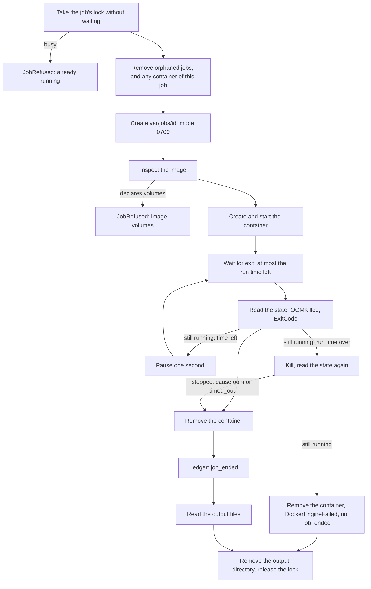

# Job containers

`Core/Job` runs each job (a build, a check, a review) in a fresh container through the Docker Engine API (plan task T44, part 1 of 3). No lane starts a job through it yet: the build, check and review jobs that call it arrive with their own tasks. The egress allowlist with a per-job proxy is part 2; the start check, the reduced mode and `differences-from-the-existing-loop.md` are part 3.

## Surface

- `Contract/JobRunner::run(JobSpec): JobResult`, implemented by `Infrastructure/ContainerJobRunner`.
- `JobSpec`: a `JobId`, the image, the command, a list of `JobInput` (a host path mounted read-only at a container path) and `JobLimits` (memory in bytes, CPUs, run time in seconds). It has no environment field, so nothing the orchestrator holds (forge token, signing key, API keys) can be passed to a job.
- `JobResult`: a `JobEnd` (the `JobCause` and the exit code) and the `JobOutput` (the files the job left in its output directory, by name).
- Refusals: `JobRefused` for a job id that is not 1 to 63 of `a-z`, `0-9`, `.`, `_`, `-` starting with a letter or digit, for a limit of zero or less, for an input whose host path is relative or whose container path is relative, `/`, or on or under `/work` or `/output` (after `..` is resolved), for a job id that is already running, and for an image that declares volumes. `DockerEngineFailed` when the socket is missing, the engine does not answer, refuses a call (with the engine's message) or answers a body this client cannot read. `JobOutputRefused` for an output entry that is a link, a folder or anything else but a plain file, or that cannot be read, for an output of more than 1000 entries, and for an output of more than 16 MiB in total (`JobOutputDirectories::MAX_FILES`, `MAX_BYTES`). `JobEventNotRecorded` when the ledger refuses the job's end.

## The container

`Infrastructure/JobContainerDefinition` builds the create request:

| Setting | Value | Why |
|---|---|---|
| `ReadonlyRootfs` | `true` | nothing outside the work area and the output directory can be written |
| `Tmpfs` | `/work` (`rw,nosuid,nodev`) | the work area, gone with the container |
| `Env` | `HOME=/work`, `TMPDIR=/work`, `INTAKT_JOB_ID=<id>` only | a wiped home and own caches per job, no credential |
| `WorkingDir` | `/work` | |
| `Mounts` | each input as a read-only bind, then the job's own output directory as the only writable bind at `/output` | |
| `User` | the orchestrator's uid and gid | the job can write its output directory, which only that user can read, and never runs as root |
| `Memory`, `MemorySwap` | the job's limit, both equal | a runaway job is killed at its own limit instead of swapping |
| `NanoCpus` | CPUs times 10^9, rounded; `JobLimits` refuses a value that is not finite, rounds to less than 1 or does not fit a PHP integer | 0 would turn the engine's CPU limit off |
| `NetworkMode`, `NetworkDisabled` | `none`, `true` | no network until part 2 adds the per-job proxy |
| `CapDrop`, `SecurityOpt` | `ALL`, `no-new-privileges` | |
| `Labels` | `intakt.job=<id>` | finds the job's containers after a crash |

The container is named `intakt-job-<id>`. Before it is created, the image is inspected (`GET /images/<name>/json`, the name URL-encoded into the path) and a job whose image declares volumes (`Config.Volumes`) is refused with `JobRefused`: a volume the image declares stays writable under `ReadonlyRootfs`, so the job could write outside its work area and output directory. An absent or `null` `Config.Volumes` means none.

## A run

- The cause is `oom` when the engine reports `State.OOMKilled`, `timed_out` when the container still ran after the run time, and `exited` otherwise. A container still running after the run time is killed, and its state is read once more after up to 10 more seconds: a memory kill found then (the job hit its limit in the last pause, and the kill was answered 409) is recorded as `oom`, any other stopped state as `timed_out`, both with the exit code from that state. A container that still runs after the kill and those 10 seconds fails the run with `DockerEngineFailed`: no exit code and no `job_ended` are recorded, and the container is still removed. The ledger gets `job_ended` with `job`, `cause` and `exit_code`.
- The run time is measured with the `ClockInterface` from the start. After each wait the state is read, and only a state that says the container no longer runs records an end: the wait's own answer never does, because the engine sends the 200 header before the wait ends and reports a wait that failed on its side (a daemon shutdown, a cancelled wait) as `{"StatusCode":-1,"Error":{...}}` while the job still runs. `DockerEngine::waitForExit()` answers true only for a 200 whose body holds an integer `StatusCode` and no `Error`; an `Error`, an empty or unreadable body, a broken connection and the deadline count as no answer. A container that still runs after a wait, with time left, is waited for again one second later, for the time left; only a container that still runs when the run time is over is killed.
- The container is removed (`DELETE /containers/<id>?force=true&v=true`, so the anonymous volumes it may own go with it) whatever happened after it was created, also when a later call fails. The output directory is removed after it was read, also when reading it fails.
- The output directory is `var/jobs/<id>` under the project folder. A directory of the same id left from an earlier run is removed before the job starts. No other job's output directory is mounted into a job, so a job cannot read another job's output.
- The output is read with bounds checked before anything is allocated, because the job's memory limit does not cover what it writes to the host bind mount and the orchestrator holds the output in memory: the entries are counted as they are listed and refused past 1000, and each file's size is added before it is read and the output refused once the total exceeds 16 MiB. A link in the output directory is refused rather than followed, because the job wrote it and could point it at a file of the orchestrator.
- Before an output directory is removed (after the run, or by the sweep), every folder under it that is not a link is set to mode 0700, because a job can leave a folder without any permission, which would otherwise stop its own cleanup and every later sweep. Links are never touched: `chmod` would follow one to the file it points at.

## After a crash

Each run holds a lock named after its job (`intakt-job-<id>`, Symfony Lock on the shared `FlockStore`, without expiry) from before its container is created until it is removed. A file lock ends with its process, so a job whose lock is free has no living orchestrator process.

`Infrastructure/OrphanedJobs::removeAll()` lists the containers labeled `intakt.job` (`GET /containers/json` with a label filter), tries each job's lock without waiting, and for each free lock removes the container and its output directory and records `job_container_removed` (`job`, `container`). It then removes every `var/jobs/<id>` directory whose lock is free. A busy lock is skipped: that job is still running. A label that is not a valid job id is ignored, since Intakt did not write it.

Every run calls it before it starts its own container, so the next job cleans up after a crash. The run passes its own job id (`removeAll(JobId)`): since it holds that job's lock and has not created its container yet, every container labeled with that id is a crashed run's and is removed without the lock (`job_container_removed` as well); otherwise the engine would refuse the name `intakt-job-<id>` with 409 Conflict and a retry of that job would fail. `php bin/console intakt:job:sweep` runs it on demand and lists what it removed.

## The engine client

`Infrastructure/DockerEngine` talks to the Engine API version 1.44 (Docker Engine 25 or later) over the Unix socket in the container parameter `JobServices::DOCKER_SOCKET` (`/var/run/docker.sock`, set in `config/services.yaml`), through Symfony HttpClient with `bindto` set to the socket, which the curl client uses as its Unix socket. A missing socket fails at once with its path, because the curl client would otherwise read `bindto` as a network interface. The orchestrator runs Docker inside its own container, so the paths it mounts are paths the engine sees.

Tests run against `tests/Core/Job/FakeDockerEngine.php`, a `MockHttpClient` callback that answers the same calls (the image inspection included) and plays a job by writing into the output directory the create request mounts, because the build sandbox has no Docker daemon. No test has run against a live engine yet.
