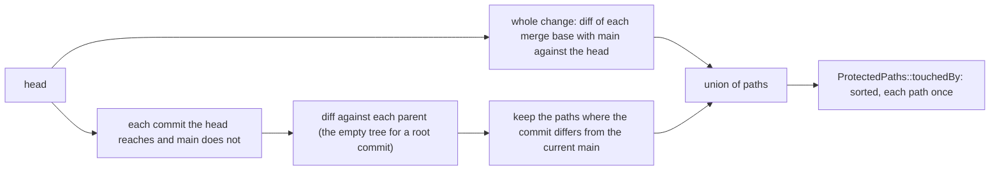

# Protected paths of a head

Which protected paths a head touches (plan task T54, design: [Merge](../design/05-architecture/08-merge.md)). `ListProtectedChanges` in `src/Core/Git/UseCase/ListProtectedChanges/` answers it for a repository whose `HEAD` names main (the project's bare mirror), a head given as a full commit id of either object format, and a project's `ProtectedPaths`; `php bin/console intakt:protected:list <project> <head>` runs it on the project's mirror. Other modules ask through `Contract/ProtectedHeads::of(project, head)`, implemented by `UseCase/ListProtectedChanges/ProtectedHeadsOfMirrors`, which the command uses too (`checked()`, which throws the refusals); `of()` answers a refused project name, head or list entry as `ProtectedChanges::unreadable()` (`Contract/ProtectedChanges`), so a refusal counts as protected. Its one caller is the owner ask on an approved head of a pull request handed to Intakt ([Pull requests handed to Intakt](handed-to-intakt.md#intakts-review-counts)); it reads the mirror as it stands and does not update it, so a head the mirror does not hold yet is unreadable and asks the owner. Nothing parks or merges on the answer yet: that is T62 and T64.

## The list is owner config

Each project's list is the key `projects.<name>.protected_paths` of the owner's config file (`config/intakt.yaml`, or the file `INTAKT_CONFIG` names), never a file of the repository, so a change cannot edit the list that judges it. `config/packages/ai.php` takes the key off each project and processes it with `Infrastructure/ProtectedPathsConfiguration` into the parameter `intakt.git.protected_paths` (`GitServices::PROTECTED_PATHS`), keyed by project, with an entry only for a project that has the key; the command uses an empty list for a project without one. The configuration validates every entry by building `Domain/ProtectedPaths`, so a malformed entry fails at boot with the rule the check applies: an entry is relative, has no empty, `.` or `..` part and at most one trailing slash. An entry covers the path it names and every path below it, compared byte for byte (case included). `.gitmodules` at the root and every submodule entry (mode `160000` on either side of a diff record) count as protected without an entry. The owner-only list and the approval rules of the design are not built: they arrive with the approval task that reads them.

## What counts as the change

`ChangedPaths` reads, all through `HardenedGit::callInBareRepository()` (`--git-dir=<repository> --bare`, no work tree):

- main from `symbolic-ref --quiet HEAD`, which must name a branch under `refs/heads/`, resolved once to a commit id with `rev-parse --verify --quiet <branch>^{commit}` (unreadable when the branch names no commit); every later call names that id, never the branch, so a main that moves while the check runs (a mirror update) is compared against the same commit throughout;
- that the head is a commit (`cat-file -t`), so an annotated tag's id is refused;
- that the history is complete (`rev-parse --is-shallow-repository` prints `false`), because a shallow history lacks the commits that would show a protected change undone later;
- the whole change: `merge-base --all <main> <head>`, and for each base `diff-tree -r -z --raw --no-renames --ignore-submodules=none <base> <head>`. Every base of a criss-cross history counts, so no choice of one hides a change. Without a common ancestor (`merge-base` exits with 1 and prints nothing), the base is the empty tree (`hash-object -t tree --stdin`, which names it in the repository's object format), so every path of the head counts;
- each commit: `rev-list --parents <head> --not <main>`, the commits the head reaches and main does not, a merge's second parents included, and for each one the same `diff-tree` against each of its parents, a root commit against the empty tree. Of those paths, a commit keeps only the ones where `diff-tree <main> <commit>` shows it differs from the current main: a path it holds exactly as main does adds nothing to main, so a merge of main does not list what main added, while a crafted merge that reverts a file to an old main still differs and is listed, even when a later merge puts the file back.

The whole change catches a crafted merge (first parent the branch, second an old main commit) that reverts or deletes a protected file, which a list of the branch's own commits never shows; the per-commit lists catch a protected change that a later commit undoes, which leaves no trace in the whole change. `--no-renames` lists both sides of a move, so a file moved out of a protected folder is listed under its old path; `--ignore-submodules=none` beats a `diff.ignoreSubmodules` or `submodule.<name>.ignore` of the repository; `-z` hands every path over as it is, newlines included.

## Unreadable counts as protected

`Domain/ChangedPath::listFrom()` parses the raw records (two modes, two object ids, one status letter of `ADMTUX`, then one path) and refuses anything else with `ChangeNotRead`. A failed git call, a malformed record, a missing or non-folder repository, a `HEAD` that names no branch, a main branch that names no commit, a head that is not a commit, a shallow history, a missing object and an `info/attributes` file (`RepositoryAttributesRefused`) all end in `ProtectedChanges::unreadable()` with the reason; `touchesProtectedPaths()` is then true. A head that is not a full commit id is refused with `CommitNameRefused`, since a ref name could move while the check runs.

## The command

`intakt:protected:list <project> <head>` resolves the mirror with `Mirrors::pathOf()` and prints `protected <path>` per path, `unreadable <reason>` when the change could not be read, and `touches protected paths: yes|no`; it exits with 0 for any completed check and with 1 for a refused head or project name. Control characters and backslashes in a path are printed escaped (`addcslashes`), so a file name with a newline cannot forge a line.
