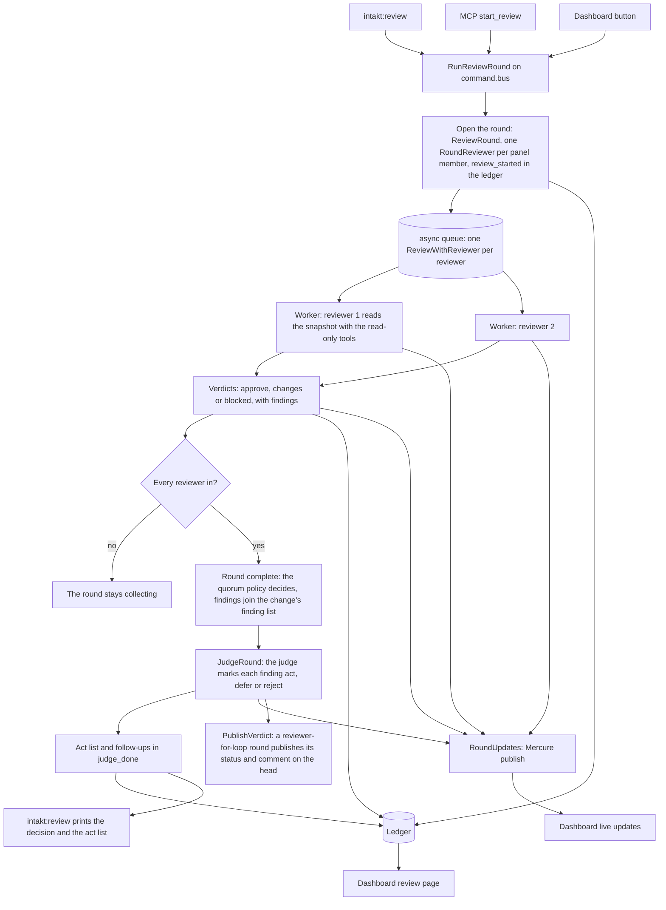

## Review flow

One review from a door to the act list. The pages [Review rounds](review-rounds.md), [Judge](vendor.md#judge) and [Quorum policies](quorum-policies.md) hold the details; this page only shows how they connect.

A head the watcher finds reaches `RunReviewRound` only after its CI is green and `BootGate` admits it: `SettleHead` boots it with main's harness first, and a head that fails to boot while main boots goes back like red CI. The gate admits the head without a boot pass when main fails or crashes, when main's commit cannot be read, when the head's boot crashes, or when the gate itself throws, so a broken gate never stops the review ([Boot step](boot-step.md#the-gate-before-a-round-part-1-of-the-watcher-side)).

A built head reaches this flow only after its hand-back round ([Hand-back checks](hand-back.md#the-round)): `intakt:hand-back:check` checks the bundle and the pull request text, and a refusal goes back to the builder once with its fixed reason (`hand_back_sent_back`) and hands the task over the second time in a row (`hand_back_handed_over`), so no review is spent on it. Today nothing connects the two: the build lane (T56) will run the round, push an accepted head and send the reason to the builder or the hand-over to the maintainer agent.

Every arrow into the ledger is an append of one event (`review_started`, `verdict_received`, `judge_done`, ...); the dashboard pages are rendered from the ledger (apart from the forge budget on `/reviews`, which comes from the forge's recorded readings, see [Dashboard](dashboard.md)), while the live updates reach the page through the Review module's `RoundUpdates` contract, which the Dashboard publishes to Mercure: the workers stream each tool call and text piece as they go (`LiveProgress`), and the round's latest state is published after each verdict and after the judge (`LiveRoundProgress::publishLatest()`); opening the round publishes nothing.

Each call a reviewer makes goes out with the output limit of the reviewer's tier (`max_output` in the project's tier mapping, set by `TierPlatform`), so a full verdict fits; see [Capability tiers](capability-tiers.md). A review the provider stops at that limit (`MaxOutputTokensException`) is run once more by `SymfonyAiVendor` with twice the limit (twice `Tier::defaultMaxOutput()` when the mapping carries none), in a new conversation, because the stored one refuses a second start under its id; the stopped call is left unsettled and the retry reserves its own usage row. A second stop reaches `ReviewWithReviewerHandler` as the exception, which records `reviewer_failed` with `MaxOutputTokensException` as its failure. Tests: `tests/Core/Review/UseCase/RunReviewRound/OutputLimitRetryTest.php` and `tests/Plugin/SymfonyAiVendor/SymfonyAiVendorTest.php`. `ReviewChange` turns the recorded class into plain words through `Review\Contract\FailureInWords` (the output limit reads "stopped at its output limit", an unknown class "failed with an unexpected error"), so the round's `reasons` hold `<role> reviewer failed, <words>` and the console prints it as a `reason:` line; no class name reaches the console. A reviewer without a verdict still votes as blocked in `Review\Contract\ChangeDecision`, so a failed reviewer never helps a quorum: beside a reviewer asking for changes the round is `changes`, beside an approval it is `blocked` (`ReviewChangeTest`). The dashboard's review page uses the same two classes: the failed reviewer's note is the same words, and a judged round shows the outcome `ChangeDecision` gives for the `quorum` recorded on `review_started`, over all the round's reviewers, a failed or unstarted one voting as blocked, beside how many failed; `tests/Core/Dashboard/UseCase/FailedReviewerPageTest.php` runs a round through `ReviewChange` with a reviewer stopped at the limit and finds the console's decision on the page (see [Dashboard](dashboard.md)).
