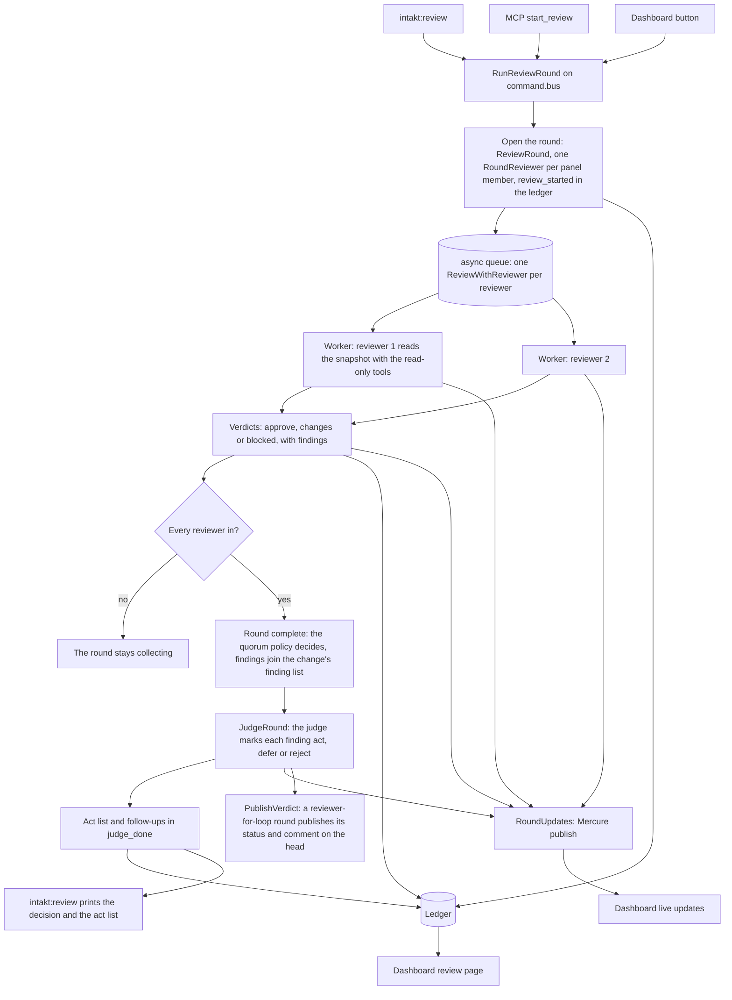

## Review flow

One review from a door to the act list. The pages [Review rounds](review-rounds.md), [Judge](vendor.md#judge) and [Quorum policies](quorum-policies.md) hold the details; this page only shows how they connect.

A built head reaches this flow only after its hand-back round ([Hand-back checks](hand-back.md#the-round)): `intakt:hand-back:check` checks the bundle and the pull request text, and a refusal goes back to the builder once with its fixed reason (`hand_back_sent_back`) and hands the task over the second time in a row (`hand_back_handed_over`), so no review is spent on it. Today nothing connects the two: the build lane (T56) will run the round, push an accepted head and send the reason to the builder or the hand-over to the maintainer agent.

Every arrow into the ledger is an append of one event (`review_started`, `verdict_received`, `judge_done`, ...); the dashboard pages are rendered from the ledger (apart from the forge budget on `/reviews`, which comes from the forge's recorded readings, see [Dashboard](dashboard.md)), while the live updates reach the page through the Review module's `RoundUpdates` contract, which the Dashboard publishes to Mercure: the workers stream each tool call and text piece as they go (`LiveProgress`), and the round's latest state is published after each verdict and after the judge (`LiveRoundProgress::publishLatest()`); opening the round publishes nothing.

**One entry per place in the act list.** The judge's act ids name findings; `StoredFindings::actListOf()` turns them into the act list with `Domain\OnePerPlace` (the rule of `Finding::$merged`, see [Review verdicts](review-verdicts.md)), so `ReviewChange` (the console and JSON output), `VerdictForTheLoop` (the verdict the loop reads) and `RoundActListTool` (the MCP tool) all hold the same list. Reported findings at one file and line, both marked `act`, become one entry: the highest severity, the text of the first reviewer in panel order, and the ids of the others in `merged`. A finding the judge marked `defer` or `reject` never joins an entry, so two findings at one place with different calls stay apart, and findings at different lines or files stay apart; a finding without a place is never merged. The ids and their persistence across rounds are unchanged, and `judge_done` still records the judge's act ids as marked under `act`. The text output of `intakt:review` (`ReviewReport::asLines()`) prints a merged entry's ids joined with `+` in the id slot (`F1+F2 P1 src/Cart.php:12: ...`), and each `act_list` row of its JSON (`ReviewOutput::FIELDS`) carries `merged`, the list of the other ids (empty for an entry that merged nothing). `RoundLedger::judgeDone()` applies `OnePerPlace` to the judged findings, so the `findings` of `judge_done` hold each act entry as the act list holds it (its higher severity and its `merged` ids on `JudgeDoneFinding::$merged`) beside the findings it merged, each as reported; the review page shows the entry as one row named by the joined ids and no row for a finding it merged (see [Dashboard](dashboard.md)). Tests: `ReviewChangeTest` (one entry naming both ids, different judge calls, different lines), `OnePerPlaceTest`, `ReviewReportTest` (the joined ids), `ReviewOutputTest` (the `merged` field), `RoundLedgerPayloadsTest` (the recorded entry) and `tests/Core/Dashboard/UseCase/MergedActEntryPageTest.php`, which runs one round through `ReviewChange` with two reviewers reporting one place and finds the same entry in the text output, the JSON and on the page.

Each call a reviewer makes goes out with the output limit of the reviewer's tier (`max_output` in the project's tier mapping, set by `TierPlatform`), so a full verdict fits; see [Capability tiers](capability-tiers.md). A review the provider stops at that limit (`MaxOutputTokensException`) is run once more by `SymfonyAiVendor` with twice the limit (twice `Tier::defaultMaxOutput()` when the mapping carries none), in a new conversation, because the stored one refuses a second start under its id; the stopped call is left unsettled and the retry reserves its own usage row. A second stop reaches `ReviewWithReviewerHandler` as the exception, which records `reviewer_failed` with `MaxOutputTokensException` as its failure. Tests: `tests/Core/Review/UseCase/RunReviewRound/OutputLimitRetryTest.php` and `tests/Plugin/SymfonyAiVendor/SymfonyAiVendorTest.php`. A verdict that asks for changes names at least one finding: a `changes` verdict with none is not a valid verdict, so `SymfonyAiVendor` settles its call, throws `Review\Contract\ChangesWithoutFindings` and runs the review once more at the same limit in a new conversation; a second such verdict reaches `ReviewWithReviewerHandler` as that exception and is recorded as `reviewer_failed`, so it never reaches the judge as a rejection that names nothing (`tests/Core/Review/UseCase/RunReviewRound/ChangesWithoutFindingsRetryTest.php`; an approval without findings and a `changes` verdict with one are not asked again). A reviewer call whose stream ends before its answer is complete (`IncompleteStreamException` without a previous `RetryableExceptionInterface`) is left unsettled and run once more by `SymfonyAiVendor` without streaming, in a new conversation, on a `TierRoutedPlatform` that answers with `UnstreamedModelCatalog`, so `ReviewerAgent` sends no `stream`; the retry reserves its own usage row. A second cut keeps the first cut's reason and ends the reviewer as `Verdict::incompleteStream()` (blocked), as before the retry; any other failure of the retry follows the rule of that failure (a rate limit or a server error reaches `AccountLimitedVendor` as `ProviderRateLimited` or `ProviderFailedTransiently`). A transient error or a limit after the first answer delta, which `StreamedAnswer` turns into an `IncompleteStreamException` with the provider's exception as the previous one, is not retried: the account has cooled down by then, so the reviewer ends blocked at once, as before the retry rule. A provider whose `Provider::streams()` is false (the subscription CLIs) never streams, so its cut is not retried (`tests/Core/Review/UseCase/RunReviewRound/CutStreamRetryTest.php` and `tests/Plugin/SymfonyAiVendor/SymfonyAiVendorTest.php`). `ReviewChange` turns the recorded class into plain words through `Review\Contract\FailureInWords` (the output limit reads "stopped at its output limit", a `changes` verdict without findings "asked for changes without naming a finding", an unknown class "failed with an unexpected error"), so the round's `reasons` hold `<role> reviewer failed, <words>` and the console prints it as a `reason:` line; no class name reaches the console. A reviewer without a verdict still votes as blocked in `Review\Contract\ChangeDecision`, so a failed reviewer never helps a quorum: beside a reviewer asking for changes the round is `changes`, beside an approval it is `blocked` (`ReviewChangeTest`). The dashboard's review page uses the same two classes: the failed reviewer's note is the same words, and a judged round shows the outcome `ChangeDecision` gives for the `quorum` recorded on `review_started`, over all the round's reviewers, a failed or unstarted one voting as blocked, beside how many failed; `tests/Core/Dashboard/UseCase/FailedReviewerPageTest.php` runs a round through `ReviewChange` with a reviewer stopped at the limit and finds the console's decision on the page (see [Dashboard](dashboard.md)).

## A round marked stale

`Review/Contract/MarkVerdictsStale(roundId)`, handled on the command bus by `MarkVerdictsStaleHandler`, marks a round whose head was refused after the round started (it no longer boots): it sets the round's `verdicts_stale` column (migration `Version20261113110000`) under the round's row lock, because a reviewer's worker may store a verdict on the same row, and dispatches `PublishVerdict` again after every mark, also one already made, so an approval already on the forge is replaced. An unknown round is `RoundNotFound`. `ReviewRound::standingAt()` then answers `stale` on `head` whatever identity it is asked about, so `VerdictsOfRoundHandler` counts none of the round's verdicts. `VerdictForTheLoop` checks the mark before any vote and publishes `Failure` on the round's head with the description `Intakt withdrew its review: this head does not boot.` and no comment. `PublishVerdictHandler` serializes the publications of one project and change through `ChangePublications`, a lock keyed by both (hashed from a JSON list, so no name can end where another begins) and held from the read of the round's state through the forge write; it is tried without waiting, and a busy change throws `PublicationBusy`, a `RecoverableMessageHandlingException` that Messenger always brings back, so a later publication reads the round only after the holder's write. Under the lock the handler reads the round, publishes, then reads it again until its stale mark no longer changed during the write, because a mark is made without this lock: a mark that committed while the approval was on the way is withdrawn by the same publication, and the publication the mark queued follows it. So the last status written for a commit is the one of its latest judged round with that round's stale state, whatever order the writes interleave in. It drops a publication when `ReviewRounds::judgedAfter()` finds a judged round of the same project and change with a higher round number that reviewed the same head commit, because a forge status belongs to a commit and that later round's status is the one the commit stands at; a later judged round of another head does not drop it, so in the order A, B, A the returning A's withdrawal still replaces A's old `success`. Nothing sends `MarkVerdictsStale` yet: the watcher's `BootGate` decides when a head fails to boot ([Boot step](boot-step.md#the-gate-decision)), but nothing calls it before a round yet. Tests: `tests/Core/Review/UseCase/MarkVerdictsStale/MarkVerdictsStaleTest.php` and `tests/Core/Review/UseCase/PublishVerdict/PublishVerdictTest.php` (`persistence` group; the A, B, A order, a later round of the same head, and the forced order where a later round of the same head is judged, marked stale and withdrawn while the first approval is on the way).
