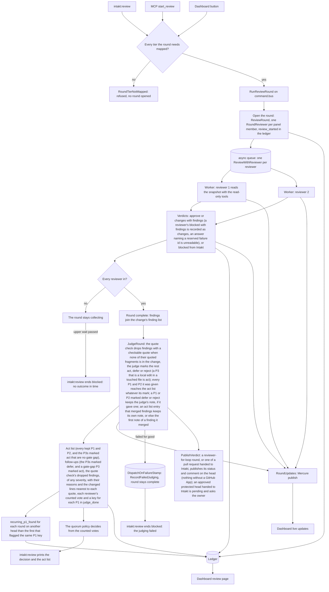

## Review flow

### In short

A review starts from one of three doors: the `intakt:review` command, the MCP `start_review` tool or the dashboard button. Intakt opens a round with one reviewer per panel member and queues each reviewer as its own message, so workers review in parallel. Each reviewer reads the change with read-only tools and returns a verdict. When every reviewer is in, the judge sorts the findings into the act list and follow-ups, and the quorum policy decides the outcome from the counted votes. Every step is an event in the ledger, which the dashboard review page is rendered from.

Worth knowing:

- A round is refused before it opens when a tier it needs is not mapped.
- A finding that quotes code is dropped before judging when none of its quoted code fragments is in the change (the quote check). A finding without a checkable quote, or with at least one quote that is in the change, is kept.
- Every kept P1 and P2 reaches the act list, whatever the judge marked it, a gate gap too.
- A gate-gap P3 never reaches the act list: marked `act` or `defer` it is a follow-up, marked `reject` it is rejected.
- A P1 that recurs on another head gets an escalation review, and its verdict is kept and reused.

The rest of this page is the detailed reference.

One review from a door to the act list. The pages [Review rounds](review-rounds.md), [Judge](vendor.md#judge) and [Quorum policies](quorum-policies.md) hold the details; this page only shows how they connect. The round's states (collecting, complete, judged) are the `review_round` state machine, declared by the Workflow attributes on `src/Core/Review/Infrastructure/ReviewRoundStateMachine.php`; each reviewer's states (queued, running, verdict, failed, blocked) are the `reviewer` state machine, declared the same way on `src/Core/Review/Infrastructure/ReviewerStateMachine.php` ([Review rounds](review-rounds.md)).



A built head reaches this flow only after its hand-back round ([Hand-back checks](hand-back.md#the-round)): `intakt:hand-back:check` checks the bundle and the pull request text, and a refusal goes back to the builder once with its fixed reason (`hand_back_sent_back`) and hands the task over the second time in a row (`hand_back_handed_over`), so no review is spent on it. Today nothing connects the two: the build lane (T56) will run the round, push an accepted head and send the reason to the builder or the hand-over to the maintainer agent. Before a push, `intakt:build:task` updates the project's mirror again, then runs the pre-push [check job](check-job.md) on the head merged into current main whenever main moved since the branch last merged it, with main as the first parent as in CI's merge. Current main is the mirror's `HEAD` when the job clones the mirror: the commit that update fetched, or a newer one when another update of the same mirror ran between that update and the clone. So while main stays at the commit the job cloned, the pre-push check and CI check the same merged tree; main that moves after the clone (while the check runs, or before CI starts) is not in the check, and CI checks the merge with the newer main. A conflict with current main ends the build at that check, and so does a merge that fails without git reporting a conflict, with a reason of its own.

Every arrow into the ledger is an append of one event (`review_started`, `verdict_received`, `judge_done`, ...); the dashboard pages are rendered from the ledger (apart from the forge budget on `/reviews`, which comes from the forge's recorded readings, see [Dashboard](dashboard.md)), while the live updates reach the page through the Review module's `RoundUpdates` contract, which the Dashboard publishes to Mercure: the workers stream each tool call and the narration before it as they go and each reviewer's answer once read, as a typed `ReadAnswer` (verdict, then each finding's severity, file, line and title) or the marker of an answer that could not be read, never as the reviewer's raw text, which the Dashboard never publishes to Mercure (`MercureRoundUpdates::answerRead()` publishes the `answer_read` stream, #2252) (`LiveProgress`, see [Live updates](live-updates.md)), and the round's latest state (`RoundProgress`: reviewers started and finished, both counted from the stored round) is published after each verdict, after a reviewer is handed back to the queue (a rate limit, a busy or exhausted account) and after the judge (`LiveRoundProgress::publishLatest()`); a reviewer a worker takes and starts is announced once its lease is committed, followed by the round's latest state (`LiveRoundProgress::publishStartOf()`, `RoundUpdates::reviewerStarted()`), and the Dashboard publishes the board's headline after each start and each round change (see Board headline in [Live updates](live-updates.md)); opening the round queues `RoundOpened`, whose `PublishRoundStartHandler` publishes the round's latest state from the queue after the round is committed (0 started of N unless a reviewer started first).

**The outcome and the act list agree** (issue #2643, D4 of #1860). A round that ends as `changes` always has a finding of a reviewer voting `changes` on its act list, and no reviewer holds a round at `changes` only for P3 findings the judge deferred or rejected. The votes are counted once, when the judge is done: `JudgedRounds::record()` passes each reviewer's stored verdict through `Domain\CountedVote`, built from the round's reported findings (`StoredFindings::reportedIn()`, under the ledger's ids), the open ids the round's reviewers were shown (`StoredFindings::openFor()`) and the round's `JudgedFindings`, and `RoundLedger::judgeDone()` records the counted decision of each reviewer that gave a verdict under `votes` in `judge_done` (reviewer id to `approve`, `changes` or `blocked`). `ReviewChange` (the console and JSON output), `VerdictForTheLoop` (the verdict the loop reads) and the dashboard's review page (`LedgerRounds`) all count those votes for the quorum through `ChangeDecision`, so the three get one quorum result; the two Review readers read the round's votes once (`RoundLedgerReading::votesOf()`), not once per reviewer. The console and the review page show that result as the outcome. The published verdict differs from it in one case: `LoopReviewComment::verdict()` publishes an approval whose act list holds a P1 as `changes`, so two approvals beside one reviewer's P1 under a majority quorum show `approve` on the console and the page and are published as `changes` naming the P1. A reviewer without a verdict still votes `blocked`, and a reviewer missing from `votes` (a row written before votes were counted) votes as its verdict was given. A `changes` verdict that is a failed review (one of its findings carries a reserved failure id such as `no-tools`, which a model can name itself; `Verdict::isFailedReview()`) counts as `blocked`, because `FindingLedger::recordVerdict()` records none of its findings, so nothing of it can be on the act list; an `approve` or `blocked` verdict keeps its decision. Any other `changes` verdict counts as `changes` when one of its findings is on the act list; as approval, with its findings as follow-ups, when they are all P3 and the judge marked every one `defer` or `reject`, or `act` for a gate gap, which is a follow-up too (`JudgedFindings::$followUps` and `JudgedFindings::$rejected`); and otherwise as `blocked`, so the builder is never sent back with nothing to act on: that is a verdict whose finding the quote check dropped (the judge never saw it, so a dropped P3 never approves and a dropped P2 does not send the round back), whose P3 finding the judge gave no mark (a judge answer that could not be read marks nothing, so it approves nothing) or whose finding matches no reported one, and a `changes` verdict without findings is never approval. A reviewer's finding is matched to the reported findings by id when it is a repeat of an id it was shown, and otherwise by every field the ledger keeps except the id and the `repeat` flag: its severity, file, line, symbol, text, requirement, who can fix it (`fixable_by`), `regression`, `gate_gap` and its evidence (probe and output, compared by value; no evidence matches only no evidence), because the ledger gives a new finding an id of its own and keeps those fields. The change's finding ledger does not keep which reviewer reported which id (the `reviewer_findings_recorded` rows of the event ledger, written when the round completes, are read only by the dashboard's Trends page), so every match counts: a reported finding alike in all those fields that is on the act list keeps a new finding's vote at `changes`, but never a repeat's, while another reviewer's finding of the same text that differs in any of them (another severity, requirement, evidence, `regression` or `gate_gap`) never counts for it. The severity that counts is the ledger's, which a new finding's stored verdict already holds, because `GoalpostRule` is applied before the verdict is stored. Only the counted vote changes: the verdicts `ChangeReview` shows, the stored verdict JSON and each `ReviewerOutcome` keep the reviewer's own decision, a replay, stale verdicts and a missing quorum end as before, and the approvals count in the comment `VerdictForTheLoop` publishes (`N of M reviewers approve`) counts such a reviewer as approving. Because a P3-only `changes` verdict can count as approval, the guards that refuse an approval refuse it too (`Verdict::mayCountAsApproval()`, which judges a reviewer's `blocked` with findings as the `changes` it is recorded as): a subscription CLI that read nothing through the review server gets `unread-approval`, and a reviewer shown cut input gets `cut-approval`. Both guards see the severities the round will store: `ReviewerAgent` applies `GoalpostRule` to the answer, with the round's number (`ReviewBrief::$round`, set by `ReviewWithReviewerHandler`) and the open findings, before its cut-input guard and returns that verdict to `SymfonyAiVendor`, so a `changes` whose P2 the second round lowers to P3 is refused like a P3-only one. Tests: `tests/Core/Review/Domain/CountedVoteTest.php` (both sides of each rule: deferred or rejected P3s approve; a P3 on the act list or a P2 gives `changes`; a dropped P2, a dropped P3, an unmatched P3 or a P3 without a mark gives `blocked`, a dropped finding beside an act one `changes`; a repeat by its shown id only, a repeat of an id not shown by content; a deferred P3 approves beside another reviewer's P2 of the same text, and that P2 still gives `changes`; through a real `FindingLedger`, a deferred P3 approves beside another reviewer's P3 on the act list that differs only in its evidence, or only in `regression`, or only in `gate_gap`, and that one gives `changes`; two findings alike in every field give `changes` when either is on the act list; a `changes` verdict that is a failed review counts as `blocked`, while an approval, a blocked verdict and `changes` without findings count as given), `ReviewChangeTest` with the scripted vendor (P3s all deferred, or rejected, approve with an empty act list while the shown verdict stays `changes`; a P3 marked act, or a P2 beside a deferred P3, gives `changes` with that finding on the act list; a dropped P2 or P3, a P3 the judge left without a mark and a `changes` verdict naming a reserved failure id are `blocked` with an empty act list), `JudgedFindingsTest` (only a P3 marked `reject` is among the rejected), `FindingsAcrossRoundsTest` (every reviewer is told its round's number), `PublishVerdictTest` for a `reviewer-for-loop` project (a deferred P3 is published as `2 of 2 reviewers approve; findings to act on: 0.` with `success`; a P2 beside a deferred P3 is published as changes naming only the P2), `LedgerRoundsTest` (the page counts the recorded vote; an older row without votes decides as given), `RoundLedgerPayloadsTest` and `RoundLedgerReadingTest` (the `votes` written and read back), `VerdictTest`, `SymfonyAiVendorTest` and `ReviewerVerdictTest` (a P3-only `changes` from a blind CLI or on cut input is refused, and so is one whose P2 names no requirement in round 2; a `changes` with a P1, with a P2 that names a requirement, or with that P2 in round 1 is kept).

**One entry per place and per cause in the act list.** The act ids (every P1 and P2 finding the quote check kept, whatever the judge marked, and the P3 findings it marked `act`, gate gaps apart, from `JudgedFindings::of`) name findings; `StoredFindings::actListOf()` turns them into the act list with `Domain\OnePerPlace` (the rule of `Finding::$merged`, see [Review verdicts](review-verdicts.md)), so `ReviewChange` (the console and JSON output), `VerdictForTheLoop` (the verdict the loop reads) and `RoundActListTool` (the MCP tool) all hold the same list. An act list entry can carry one optional note of the judge (`Finding::judgeNote()`, null by default, set with `withJudgeNote()`), the judge's reason for a rejected or deferred P1 or P2: `actListOf()` takes the round's `judge_done` record (`RoundLedgerReading::judgeDoneOf()`, null before the judge has answered, which gives an empty act list) and sets each reported finding's `judge_note` from it (`JudgeDoneFinding::$judgeNote`, already redacted when it was recorded) before `OnePerPlace` groups them, so a P1 or P2 the judge rejected or deferred stays on the act list with its note and one without a judge answer has none; a merged entry keeps its own note, or else the first note of a finding it merged. The `review_act_list` and `start_review` answers show it as `judge_note`, fenced (see Judge note in [Review verdicts](review-verdicts.md)); the text output of `intakt:review` (`ReviewReport::asLines()`) prints it on the line after the entry as `judge: <note>`, escaped like the finding's text, and each `act_list` row of its JSON carries it as `judge_note` (listed in `ReviewOutput::FIELDS`, unfenced, as console output for the owner and not a prompt), only when the entry has one (`ReadRoundToolsTest`, `OnePerPlaceTest`, `RoundLedgerReadingTest`, `ReviewReportTest`, and `tests/Plugin/LocalGitForge/JudgeNoteInReviewOutputTest.php`, which judges a scripted round through `ReviewChange` and prints it). Reported findings at one file and line, both among the act ids, become one entry: the highest severity, the text of the first reviewer in panel order, and the ids of the others in `merged`, each listed once and never the entry's own id (a finding reported twice with one id merges nothing). So do two act findings the judge gives one cause: the judge may name, per finding, `same_cause_as`, the id of another finding it was given with the same cause in the same file (`JudgedFinding::$same_cause_as`, asked for by `JudgePrompt`); `JudgeAgent` treats an answer whose `same_cause_as` names the finding itself or an id it was not given like any invalid answer (every blocking finding acts, no links), `JudgeRoundHandler` keeps only the links whose two findings are in one hunk of one file of the round's diff and at most `CausesInOneHunk::NEARBY_LINES` (five) lines apart (`Domain/CausesInOneHunk` over `Infrastructure/DiffHunks`, read through `JudgedRounds::hunksOf()`; a dropped link leaves the mark and the judge's `note`), `JudgedFindings::of()` keeps the links between findings the judge was given as `sameCause` (finding id to the id it names), `RoundLedger::judgeDone()` records them under `same_cause` in `judge_done` (a row written before reads with none, through the default of `JudgeDone::$sameCause`), `RoundLedgerReading::judgeDoneOf()` reads them back with the rest of the row, and `actListOf()` passes them to `OnePerPlace` for every caller. It groups the act findings by place and by recorded link before it builds any entry, so a finding linked to one entry while it sits at the place of another joins the two into one entry in either panel order. It tries the links in the panel order of the linking finding and applies one only when the joined group stays in one file and at most `CausesInOneHunk::NEARBY_LINES` from its lowest line to its highest; a link that would stretch the group further is ignored, though it stays recorded, so of a chain of links at lines 3, 8 and 13 the finding at line 13 stays an entry of its own with its text (see [Review verdicts](review-verdicts.md)). A P3 the judge marked `defer` or `reject` never joins an entry, so it stays apart from an act finding at its place, while a P1 or P2 the judge marked `reject` still joins; findings at different lines or files stay apart, and a finding without a place is never merged. The ids and their persistence across rounds are unchanged, and `judge_done` records the act ids under `act`. The text output of `intakt:review` (`ReviewReport::asLines()`) prints a merged entry's ids joined with `+` in the id slot (`F1+F2 P1 src/Cart.php:12: ...`), and each `act_list` row of its JSON (`ReviewOutput::FIELDS`) carries `merged`, the list of the other ids (empty for an entry that merged nothing). `RoundLedger::judgeDone()` applies `OnePerPlace` to the judged findings, so the `findings` of `judge_done` hold each act entry as the act list holds it (its higher severity and its `merged` ids on `JudgeDoneFinding::$merged`; each finding also records its `file` and `line`, null in a row written before they were recorded) beside the findings it merged, each as reported; the review page shows the entry as one card named by its own id, with the merged ids as secondary text (`Also reported as F4`), and no card for a finding it merged (see [Dashboard](dashboard.md)). Tests: `ReviewChangeTest` (one entry naming both ids, a rejected P3 apart and a rejected P1 joined at one place, different lines), `OnePerPlaceTest` (also a link into an entry from the place of another, in either panel order, a chain within five lines, and a chain of links past five lines that keeps the far finding apart), `ReviewReportTest` (the joined ids), `ReviewOutputTest` (the `merged` field), `RoundLedgerPayloadsTest` (the recorded entry) and `tests/Core/Dashboard/UseCase/MergedActEntryPageTest.php`, which runs one round through `ReviewChange` with two reviewers reporting one place and finds the same entry in the text output, the JSON and on the page, and one with three, whose page entry (ids, severity, text) equals the one `StoredFindings::actListOf()` returns for the round, and one where the judge links two findings of one change at lines 12 and 14 of one hunk (one entry at the higher severity in the text output, the JSON and on the page) or in two hunks (two entries). The cause links are covered by `JudgeAgentTest` (a kept link, a link to an id not given or to the finding itself), `CausesInOneHunkTest`, `DiffHunksTest`, `JudgeRoundTest` (the recorded entry and `same_cause`, two findings without a link stay two entries, no link across hunks or to a dropped finding, the far finding of a chain of links past five lines kept as its own entry) and `RoundLedgerReadingTest` (read back, none in an older row).

Each call a reviewer makes goes out with the output limit of the reviewer's tier (`max_output` in the project's tier mapping, set by `TierPlatform`), so a full verdict fits; see [Capability tiers](capability-tiers.md). A review the provider stops at that limit (`MaxOutputTokensException`) is run once more by `SymfonyAiVendor` with twice the limit (twice `Tier::defaultMaxOutput()` when the mapping carries none), in a new conversation, because the stored one refuses a second start under its id; the stopped call is left unsettled and the retry reserves its own usage row. A second stop reaches `ReviewWithReviewerHandler` as the exception, which records `reviewer_failed` with `MaxOutputTokensException` as its failure. Tests: `tests/Core/Review/UseCase/RunReviewRound/OutputLimitRetryTest.php` and `tests/Plugin/SymfonyAiVendor/SymfonyAiVendorTest.php`. An answer that cannot be read as a verdict (`VerdictUnreadable`, see [Reviewer agent](reviewer-agent.md)) takes the same retry, except that its call is settled with its tokens; a second one is recorded as `reviewer_failed` with `VerdictUnreadable` as its failure, or with its key-safe reason in words when it has one (`VerdictUnreadable::keySafeInWords()`, below), so it reaches neither the verdicts nor the judge and never counts as `changes` or `approve` (`tests/Core/Review/UseCase/RunReviewRound/UnreadableAnswerTest.php`: a readable retry, a failed reviewer blocking a panel of one, and panels of two under the `all` policy). A verdict that withholds approval names at least one finding: a `changes` or `blocked` verdict with none (`Verdict::withholdsApprovalWithoutFinding()`) is not a valid verdict, so `SymfonyAiVendor` settles its call, throws `Review\Contract\ChangesWithoutFindings` and runs the review once more at the same limit in a new conversation marked `ReviewerConversation::$askedToNameFindings`, for which `ReviewerPrompt` adds `ReviewerPrompt::NAME_FINDINGS_OR_APPROVE` as the last user message (Intakt's own fixed text, so it is not fenced): it says the earlier answer's `findings` list was empty, shows one complete finding object (`ReviewerPrompt::EXAMPLE_FINDING`, with every field the schema asks for) and asks the reviewer to put every problem into `findings` or approve; a second such verdict reaches `ReviewWithReviewerHandler` as that exception and is recorded as `reviewer_failed`, so it never reaches the judge as a rejection that names nothing, and a `blocked` verdict without findings reads as a failed reviewer like a `changes` one instead of as an answered `blocked` with 0 findings (`tests/Core/Review/UseCase/RunReviewRound/ChangesWithoutFindingsRetryTest.php` and `tests/Plugin/SymfonyAiVendor/ReviewerRetryVendorTest.php`, which replays the recorded verdict-only answer `{"verdict":"changes","findings":[],...}` and reads the example finding as a finding; an approval without findings and a `changes` verdict with one are not asked again, and a retry stopped at the output limit fails the reviewer with `MaxOutputTokensException` without a third call at twice the limit). A reviewer call that cannot reach the model endpoint (an HTTP client `TransportExceptionInterface`: a failed DNS lookup, a refused or dropped connection, a timeout) is left unsettled, typed by `SymfonyAiVendor::typed()` as `Plugin\Vendor\Contract\ProviderUnreachable` (the judge's calls are typed the same way) and run once more at the same limit in a new conversation; the retry reserves its own usage row, so it counts against the review's budget like any call, and a second unreachable call reaches `ReviewWithReviewerHandler` as `ProviderUnreachable` and is recorded as `reviewer_failed` (`tests/Plugin/SymfonyAiVendor/ReviewerRetryVendorTest.php`, which also covers the request to name findings). A reviewer call whose stream ends before its answer is complete (`IncompleteStreamException` without a previous `RetryableExceptionInterface`) is left unsettled and run once more by `SymfonyAiVendor` without streaming, in a new conversation, on a `TierRoutedPlatform` that answers with `UnstreamedModelCatalog`, so `ReviewerAgent` sends no `stream`; the retry reserves its own usage row. A second cut keeps the first cut's reason and ends the reviewer as `Verdict::incompleteStream()` (blocked), as before the retry, with the first cut's provider, model, raiser, chunk count and last chunks as the finding's evidence (see [Vendor](vendor.md)); a rate limit or a server error of the retry reaches `AccountLimitedVendor` as `ProviderRateLimited` or `ProviderFailedTransiently`. The retry is not retried in turn, because `retriedOnce()` catches only the first try's failure: a retry stopped at the output limit fails the reviewer at once with `MaxOutputTokensException` (no call at twice the limit), and a retry whose answer is no verdict or a `changes` or `blocked` verdict without findings fails it with `VerdictUnreadable` or `ChangesWithoutFindings` (`CutStreamRetryVendorTest`). Every retry runs in a conversation marked `ReviewerConversation::$askedAgain`, so the live view shows where it starts (see [Live updates](live-updates.md)). A transient error or a limit after the first answer delta, which `StreamedAnswer` turns into an `IncompleteStreamException` with the provider's exception as the previous one, is not retried: the account has cooled down by then, so the reviewer ends blocked at once, as before the retry rule. A provider whose `Provider::streams()` is false (the subscription CLIs) never streams, so its cut is not retried (`tests/Core/Review/UseCase/RunReviewRound/CutStreamRetryTest.php` and `tests/Plugin/SymfonyAiVendor/SymfonyAiVendorTest.php`). `ReviewChange` turns the recorded class into plain words through `Review\Contract\FailureInWords` (the output limit reads "stopped at its output limit", an unreadable answer "the reviewer's answer could not be read as a verdict", a `changes` or `blocked` verdict without findings "gave no approval without naming a finding", an unreachable endpoint "the model endpoint could not be reached", an unknown class "failed with an unexpected error"), so the round's `reasons` hold `<role> reviewer failed, <words>` and the console prints it as a `reason:` line; no class name reaches the console. A reviewer in the `blocked` state (no provider left, a stopped worker, a failed message) is named `<role> reviewer blocked, <reason>` instead, and so is one whose recorded verdict is a `blocked` verdict Intakt gave, with `Verdict::blockedReason()` (the text of its one finding) as the reason, so every blocked reviewer has a `reason:` line (#2758, `ReviewChangeTest`, `BlockedReviewerReasonPageTest`). Only a `VerdictUnreadable` built with `becauseKeySafe()` is recorded as words instead of its class, `the reviewer's answer could not be read as a verdict: <reason>` (cut to the 255 bytes of the `failure` column, ending in `...` when cut, by `RoundReviewer::recordFailure()`), which `FailureInWords` passes through: the reason is Intakt's own wording, as for a malformed tool call, the round limit, ids marked both resolved and repeat (all open ids), finding ids reserved for failed reviews (Intakt's own constants, `Verdict::claimedFailureIds()`), ids that were not open when each has a ledger id's shape (a capital letter and at most 9 digits), and a broken constraint in `VerdictParser` when its path holds only property names and list positions and its message template keeps no placeholder once numbers are filled in. Every other reason (a serializer or JSON message, an unknown field, an id of any other shape) can echo the model's answer, so it stays in the exception's message and the class is recorded (`LongRunTest`, `UnreadableAnswerTest`, `ReviewerVerdictTest`, `VerdictParserTest`, `VerdictUnreadableTest`, `RoundReviewerFailureTest`). A reviewer without a verdict still votes as blocked in `Review\Contract\ChangeDecision`, so a failed reviewer never helps a quorum: beside a reviewer asking for changes the round is `changes`, beside an approval it is `blocked` (`ReviewChangeTest`). The dashboard's review page uses the same two classes: the failed reviewer's note is the same words, and a judged round shows the outcome `ChangeDecision` gives for the `quorum` recorded on `review_started`, over all the round's reviewers, a failed or unstarted one voting as blocked, beside how many failed; `tests/Core/Dashboard/UseCase/FailedReviewerPageTest.php` runs a round through `ReviewChange` with a reviewer stopped at the limit and finds the console's decision on the page (see [Dashboard](dashboard.md)).

An `approve` from a reviewer that does not read the checkout (`claude_code`, `codex`) counts only when its own call shows a read through the round's review server; otherwise `SymfonyAiVendor::readOrRefused()` turns it into `Verdict::unreadApproval()`, a `blocked` verdict. For `claude_code` that means the CLI's stream reports the server `connected` in its `init` event and holds at least one answered call of the server's tools (#1407); the exact events are in [AI providers](ai-providers.md). Tests: `tests/Plugin/SymfonyAiVendor/ClaudeCodeReviewerTest.php`, `CodexReviewerTest.php`.

## The review size limit

A project's `review_size_limit` (characters of diff) is split off in `config/packages/ai.php` like `review_job`, validated by `Infrastructure\ReviewSizeLimitConfiguration` (its own tree: a whole number of at least 1, default `Contract\ReviewSizeLimit::DEFAULT_CHARACTERS`, 200000; anything else stops boot with a message naming the key) and set for every configured project as the parameter `ReviewServices::SIZE_LIMITS`. `Contract\ReviewSizeLimits::for(<project>)` returns it as a `ReviewSizeLimit` value, the default for a project missing from the map. Nothing uses it yet: the size check and the size-limit hand-over still run as before. `ReviewSizeLimitConfigurationTest`, `ReviewSizeLimitsTest` and `tests/Application/WiredReviewSizeLimitTest.php` (the booted container) cover it.

## Quote check

`JudgeRoundHandler` checks each reported finding with `Domain\QuotesInChange::reasonToDrop()` before the `JudgeRequest` is built, and passes only the findings it keeps to the judge and to `JudgedFindings::of()`, so a dropped finding is neither judged, nor on the act list, nor among the `findings` of `judge_done`, and `OnePerPlace` never merges a real finding under it. The change it checks against is `Infrastructure\ChangeText::of()`, reached through `JudgedRounds::changeOf()`: the round's diff and the content of each file `DiffPaths` names in it, read under the round's checkout through `Contract\Checkout` (a file gone from the checkout or a path outside it is skipped, and a checkout that is gone leaves the diff alone). The checked quotes are the inline backtick quotes of `Finding::$text` (single or double backticks; a quote may wrap onto the next line but never runs across a blank line) after fenced blocks are removed (a block opens at a line starting with three or more backticks or tildes, at any indentation by spaces or tabs and after any number of blockquote markers (`>`, each followed by optional spaces or tabs, so `> >` too), so a fix under a list item or in a blockquote counts; after a backtick fence the rest of the opening line holds no backtick, as in Markdown, so a line starting with an inline triple-backtick quote that closes on the same line opens no block, while a tilde fence's line may hold any text; and closes at a line holding only a fence of the same character at least as long, at any indentation and after any blockquote markers too, or at the end of the text; backticks inside a fenced line close nothing; a line may end in LF, CRLF or a lone CR, because the text's line ends are read as LF before the check), leaving out a quote that is a path (holding a slash) or a file name (`name.ext`), a number, or one with no name in it. The quotes are read in two steps. First come the quotes that neither start nor end with white space, so a lone backtick or a lone pair in prose is not paired with a quote's backticks. Then, in the text those quotes leave (each one is replaced by a blank line, so nothing later runs across it), come the double-backtick quotes with white space at one or both edges: the white-space rule holds for single-backtick quotes only, because Markdown pads a double-backtick quote whose code starts or ends with a backtick. Every two neighboring double-backtick runs there are read as one such quote, so a lone pair before a padded quote does not hide it. What is then still left between two runs of backticks (a single-backtick quote with white space at an edge, a quote between runs of three or more backticks or of unequal length, or prose between two lone backticks, which plain code cannot tell apart) is not a checked quote: such a span never drops a finding, and it keeps one when it is found. A quote between runs of two or more backticks that holds shorter backtick runs (``` `` customerName + `suffix` `` ```, or the same between runs of three backticks) is read whole from the text before the first step too, up to the next run of the same length, because the first step cuts it apart at its inner single-backtick quote; a run of the same length in prose may pair with its run, so it is such a span as well. A quote or such a span is found when any of its names occurs in the change as a whole name. A finding is dropped only when it has a checked quote and neither a checked quote nor such a span is found; it is kept when one quote is found, also when another is absent. `Finding::$symbol` is never read: it is place, like file and line, so a finding without a checked quote goes to the judge whatever its symbol. A round whose every finding is dropped is recorded as judged without a judge call. `ReviewRound::reportedFindingsJson()` keeps every finding as reported. The handler keeps the reason `reasonToDrop()` returns (such as `none of its 1 quoted code fragments is in the change`) with the finding as a `Contract\DroppedFinding` (`id`, `severity`, `text`, `file`, `line`, `reason`, `nearest`, `gateGap`), hands the list to `JudgedFindings::of()` as `dropped`, and `RoundLedger::judgeDone()` writes it under `dropped` in the round's `judge_done` event (empty when nothing was dropped; a row written before the key existed reads with none, through the default of `JudgeDone::$dropped`). `nearest` holds, per counted quote, the changed lines that come closest to it, worked out while the change text is still at hand, so no reader of the ledger needs the change: for the first finding it drops, the handler reads the lines the round's diff adds once per round, through `JudgedRounds::addedLinesOf()`: `Infrastructure\DiffAddedLines` gives each added line's file (the new path of a rename) and its number in the changed file, and `Infrastructure\AddedLinesInCheckout` takes each line's text from the file in the round's checkout, read through `Contract\Checkout` as `ChangeText` reads it (`Infrastructure\CheckedOutFile`). Each file is read once, its raw bytes (carriage returns included, so a held credential holding CRLF still matches) are redacted in one call by the platform `Redactor` (credential shapes and the credentials the install holds, because the `judge_done` row is printed and served as it is stored), and the result is split at line feeds; a line is the one at its new-side number, with one trailing carriage return taken off. Redacting the whole file finds a private key by its `BEGIN` line wherever that line is. A file gives no line when it cannot be read from the checkout (gone, not in it, outside it, or the checkout is gone, also when it goes while the lines are read: `AddedLinesInCheckout` catches `CheckoutNotADirectory` instead of checking first), when its path is a symbolic link or lies under one (`CheckedOutFile::contentBehindNoLinkOf()`: the link's target is another file, which the diff may not touch), when it is not a regular file, or when the file it opens is not the one it checked (the path is resolved once, `lstat` must show a regular file, and the file is opened once and read from that handle only when `fstat` gives the same device and inode, so a file swapped for a link between the check and the read gives no line; the quote check's `contentOf()` reads through the same single open), or when its redacted text has another number of lines than the file (a redacted part ran across a line break, as a private key does); lines of other files may then take its place. `Domain\NearestChangedLines::forQuotesOf()` scores each such line by the word parts its names share with the quote's names (split at underscores, digits and case changes, lower-cased, parts of at least 3 letters, whole parts only), on the redacted text with every redaction marker (`Redaction::MARKER`, `[redacted]`) taken out first, so the marker is not counted as a name and a line that only holds a redacted credential does not come close; the stored text keeps the marker. A line comes close when it shares at least half of the quote's parts; the closest come first, lines sharing as many keep their diff order, and at most 3 are kept per quote (`NearLine`: `file`, `line`, `text`), for every counted quote of the finding, a quote the finding repeats only once. A stored text is scrubbed to UTF-8, trimmed and cut to 160 characters only after the redaction, so a credential across the cut is redacted whole and a held credential with bytes that are not UTF-8 still matches; the quote is redacted and scrubbed the same way but kept whole, never cut, because it is the key the dashboard finds the lines by and a cut one would equal another quote's key. A line of a file whose path is not valid UTF-8 (a Git-quoted name with other bytes) is left out, because the row is JSON and a scrubbed path would name another file, and so is a line of a file whose path the redaction changes (a token-shaped part of a file name). A quote with no close line is left out, so `nearest` is empty when nothing comes close; a row written before the key existed reads with none, through the default of `DroppedFinding::$nearest`. Tests: `tests/Core/Review/Domain/NearestChangedLinesTest.php`, `tests/Core/Review/Infrastructure/DiffAddedLinesTest.php`, `tests/Core/Review/Infrastructure/AddedLinesInCheckoutTest.php` (a key body under a `BEGIN` line outside the hunk, a held credential with CRLF on two lines, a file missing from the checkout, a path outside it, an added symbolic link, a file under a linked folder and a checkout that is gone give no line), `tests/Core/Review/Infrastructure/CheckedOutFileSwappedForALinkTest.php` (a file swapped for a link after its resolve or between its check and its open gives no text), and the round trip in `tests/Core/Review/UseCase/RunReviewRound/RoundLedgerPayloadsTest.php`. `RoundLedgerReading::droppedOf()` reads the list back from the round's `judge_done` row, found by the same lookup as `judgeDoneOf()` (none when the judge has not answered), and the MCP tool `review_status` returns it as `dropped` once the round is `judged` (see [MCP server](mcp-server.md)); the review page reads it through `Dashboard\Infrastructure\RoundPayloads::droppedOf()` and shows each drop with its reason (see [Dashboard](dashboard.md)). Another module reads the quotes the check counts through `Contract\CountedQuotes::of()`, which returns a `Contract\QuotesCounted` (ordered, repeats kept) read by `QuotesInChange::countedQuotes()` from a finding's text: the sure and padded quotes, trimmed, in the order the check reads them, without fenced blocks, file names, numbers or unsure spans, so their number is the one in `none of its N quoted code fragments`; no module calls it yet. Tests: `tests/Core/Review/Domain/QuotesInChangeTest.php` (also what `countedQuotes()` returns for a stray backtick, a fenced block, file names and numbers, a padded quote and an unsure span, and that it returns as many quotes as the drop reason names), `tests/Core/Review/Contract/CountedQuotesTest.php`, `tests/Core/Review/Infrastructure/ChangeTextTest.php`, `JudgeRoundTest` (a dropped finding is not asked about and is stored under `dropped` with its reason, a finding without a quote and an absent symbol is asked about and not stored as dropped, a real finding at the dropped one's place is not merged), `RoundLedgerPayloadsTest` (the `dropped` list is written and read back, and an older row reads with none), `RoundLedgerReadingTest` (the drops of the round's row are read with their reasons, an older row reads with none and keeps its act ids, another round's drops are not read) and `ReadRoundToolsTest` (`review_status` of a judged round lists a finding quoting a name absent from the change with its reason, lists none for a finding without a quote and an absent symbol, which is on the act list, and none before the judge answers).

## P1 keys

The first part of plan task T61 (escalation of a recurring P1, issue #2735): `RoundLedger::judgeDone()` gives each P1 finding the round judged a key and records the keys under `p1_keys` in `judge_done`, finding id to key, `null` for a P1 that gets none (a row written before reads with none, through the default of `JudgeDone::$p1Keys`). `RecurringP1s` reads them to find a P1 that recurs on another head (see [A recurring P1](#a-recurring-p1)); the kept verdict is reused for a recurrence (see [A kept escalation verdict](#a-kept-escalation-verdict)), and the escalation review that writes one comes with a later part of T61. A P1 is the severity the finding was reported and judged with, before `OnePerPlace` raises a merged act entry. `Infrastructure\FindingKeys::of()` builds the key from the finding and the round's checkout (`ReviewRound::checkoutRoot()`), and `Domain\FindingKey::of()` hashes, with SHA-256 and length-prefixed parts, the finding's text with white space runs made one space outside backtick spans and double quotes (`normalized()`; single quotes keep no spacing, because a single quote is also an apostrophe) and, sorted by path, each named file's checkout-relative path and SHA-256 content hash. The files a finding names come from its `file` field, taken as written (the line number has its own field, so a `:12` there is part of the name), and from its text: every backtick span read whole as one possible path, a span closing only at a run of as many backticks as opened it (``` ``a`b.md`` ```), without a trailing line number (`:12`, `:12-14`) or full stop (`codeSpansOf()`), and every word between white space outside those spans, with wrapping brackets, quotes and trailing punctuation and a line number taken off (`wordsOf()`). A backslash in a span or word counts as `/`. A candidate counts when each of its `/`-separated parts is a non-empty `FRAGMENT` (any characters but `/` and control characters, matched as Unicode). Each path is resolved through `Contract\Checkout::resolve()`, so a path outside the checkout or into `.git` is never read. A candidate with a `/` is resolved from the checkout root. A candidate without one, with or without a file extension (`B.php`, `Dockerfile`), stands for every file of the checkout with that name (`CheckoutFileNames`, which lists the files and directories of the checkout without `.git`, once for each finding): one such file is hashed, several give no key, none means it is not a file (`e.g.`, `8.5`), unless it starts with the name of a file of the checkout and goes on with a character that is no letter or digit (`B.php::run()`, `B.php#L12`, a span `B.php line 12`), which gives no key (`startsWithAFileName()`). The finding gets no key when the checkout is gone or any directory of it cannot be listed, when no candidate is a regular file of the checkout, when the `file` field is not a regular file of the checkout, when a named file cannot be read or is a link out of the checkout, when a path with a directory and a file extension names no regular file (missing, a directory, outside the checkout), when a path with a directory names nothing while its parent is in the checkout (`fileAtPath()`: `src/B.php::run()`, `src/B.php#L12`, `src/B.php(12)`, `src/B.php:L12`, a span `src/B.php line 12`, a word left by an unclosed backtick, `src/Gone`), because it most likely cites a file there in a form the key cannot read, when a name without a directory is carried by several files, or when a word is the start of a name with a space (`NamesCutAtASpace`), because the rest of that name is another word and an edit of that file would not change the key: a word with a `/` is checked against the directory it points into (`docs/Release` while `docs/` holds `Release Notes.md`, or a directory that cannot be listed), a word without one against the names of the files and directories anywhere in the checkout (`Release` while `docs/` holds `Release Notes.md`). A path with a `/` is skipped only when it names nothing and its parent is not in the checkout (`and/or`), or when it is an existing directory named without a file extension. Last, the closing rule (`NamesOutsideCitations`): a finding that mentions the name of a checkout file anywhere outside a citation the key could read gets no key. Every place the text holds a file's name (any case, no letter or digit right before or after it) must lie inside a citation that resolved to a hashed file, starting where a word starts and ending, after an optional line number, at closing punctuation, white space, a backtick or the end; so `Core/B.php::run()`, `Infra/Dockerfile`, `file=B.php`, `@B.php`, `src/B.php:Intakt\Core\X` and `/src/B.php` give no key without a tokenizer case of their own, and the reading only decides which files are hashed. Tests: `tests/Core/Review/Infrastructure/FindingKeysTest.php` (the key changes when any named file is edited, also for a backticked path with a space with and without a line number, a non-ASCII path in backticks, in plain text and with no directory, a backticked name with characters a plain word does not hold, a backtick inside a double-backtick span, a backslash path, a root file without an extension in backticks or in the `file` field, a bare name without an extension of a file in a directory, a `file` field with a literal `:12`, and a bare name of one file with a line number; no key for no file, a missing path, a `file` field that is no file, a directory with an extension, an unreadable file, a path outside the checkout, a removed checkout, a bare name several files carry, a path that names nothing in a directory of the checkout (the suffix citations above), a bare name that starts with a file's name and goes on, a checkout or directory that cannot be listed, and a plain-text path with a space, also after an existing directory or file of the same first word and for a bare name whose file is in another directory; spacing in backticks and double quotes changes the key and in single quotes does not), `RoundLedgerPayloadsTest` (a key for a P1 naming a file, `null` for one naming none, none for a P2; read back, none in an older row) and `JudgeRoundTest` (the recorded `p1_keys`).

## A recurring P1

The next part of plan task T61 (issue #3077): `JudgedRounds::record()` locks the round row and then the change's `ChangeFindings` row (`StoredFindings::lockChangeOf()`, the lock a completing round takes after its own, so two judgings of one change run in turn and each reads the other's `judge_done`), and after `RoundLedger::judgeDone()` calls `RecordRecurringP1s::of()`, which asks `RecurringP1s::foundWith()` for the recurrences and appends them through `RoundLedger::recurringP1Found()` as `recurring_p1_found` events (`Contract\RecurringP1Found`: `round`, `finding`, `key`, `first_round`) in the same transaction. `foundWith()` reads the change's rounds (`ReviewRounds::ofChange()`, in round-number order; a round stored before identities were recorded names no head and is left out), makes one scan of the `judge_done` events and keeps the rows of those rounds, and takes from each row the places it flags: each act id with a non-null key in `p1_keys` (a P1 that names no regular file gets no key and is judged again; a row written before keys were recorded flags nothing). Only settled rounds are decided: the rounds of the change up to the first one without a `judge_done` that still waits for its judging, because an event is never taken back and an older round judged later could be the first to flag the place. A round waits when it is `complete`, kept its reported findings and its judging has not failed (`RecurringP1s::waiting()`): `FailedJudgings::failedRounds()` names the rounds whose `judging_failed` is in the ledger and the rounds whose `JudgeRound` is parked in the failure transport (`messenger.transport.failed`, listed once per call and in full, not bounded by `FailedJudgings::PARKED_MESSAGES_READ` as the poll of one round is, so a backlog of parked messages never hides a parked judging here; a transport that cannot be listed parks none), read once each, because the change's lock is held. Every other round without a `judge_done` flags nothing and holds up no later round: a `collecting` round, a `complete` round with no reported findings (completed before migration `Version20261101120000`, never queued for judging), a `complete` round whose judging failed or is parked, and a `judged` round without a `judge_done`. A failed or parked judging must not count as waiting, because nothing would ever end that wait. A `collecting` round does not wait either, because it has no end state that would release what it held back, so letting it wait would bring the open-ended hold back. So late collection decides early: when round 1 (head A) is still collecting while round 2 (head B) and round 3 (head A) are judged, round 3 gets an event (its first round is round 2), and when round 1 completes and is judged later, round 2 gets one too (its first round is round 1); the event for round 3 stays, because an event is never taken back, so A, B and A then give two events. When `RecordFailedJudgingHandler` records a failed judging, it decides the rounds the failed round held back in the same transaction; a judging parked because its failure message could not be dispatched releases them at the next judging of the change. For each key a settled round flags, the first round is the lowest-numbered round of the change that flags it, and every settled round flagging it on another head than the first round's head gets one `recurring_p1_found`, unless one for that round and key is recorded already (one scan of the `recurring_p1_found` events). Each call decides every settled round, not only the one judged, so a round judged before an older round of the change gets its event when the older round is judged: rounds on heads A, B and B record two events, judged in order or in reverse, and rounds on heads A, B and A record one, for the round on B, also when judged as round 2, round 3, round 1. A recurring P1 records one event per round that flags it again on another head than the one that first flagged it, so a count of recurrences counts distinct heads, not events. Only an older round whose judging waits holds back the events of every later round. What acts on the events is the reuse of a kept verdict, or else the queued escalation review (below). `lockChangeOf()` locks the existing row without the plain existence read `StoredFindings` does before creating a row, because under MySQL's `REPEATABLE READ` the first plain read fixes the snapshot, and one taken before the wait would hide the other judging's `judge_done`. Tests: `tests/Core/Review/UseCase/JudgeRound/RecurringP1sTest.php` (one event for the same key on a second head, naming the round's finding and the key of its `judge_done`; none on the same head, for a P1 without a key, for another change, for an earlier P1 not on the act list or a row without keys; heads A, B, B in order and in reverse give the same two events; heads A, B, A judged second, third, first give one event, for the round on B; a round judged before an older one that is complete and waiting for its judging finds nothing until the older one is judged, while a legacy complete round without reported findings, a judged round without a `judge_done`, a round whose judging failure is recorded and a round whose judging is parked in the failure transport hold nothing up; recording the failed judging of a waiting round records the recurrence it held back; a collecting round 1 on A with rounds 2 on B and 3 on A judged gives round 3 its event, and judging round 1 later adds round 2's; one scan of `judge_done` per call; three rounds over two heads print the `judge_done` keys and one `recurring_p1_found` through `intakt:ledger:events`), `RoundLedgerPayloadsTest` (the payload as written) and `FailedJudgingsTest` (`failedRounds()` names recorded and parked rounds, none for a transport that cannot be listed).

## A kept escalation verdict

Part 2 of the escalation of a recurring P1 (issue #1767). `Domain\KeptVerdict` is the stored verdict of one finding (table `kept_verdict`, migration `Version20261121100000`): the finding key (column `finding_key`, the primary key, so a finding on unchanged files never holds two verdicts), the `Contract\EscalationOutcome` (`confirmed` or `rejected`), the reasons, the round whose escalation review gave it and when it was kept (UTC, from the clock, in column type `utc_datetime_immutable`, so it reads back in UTC whatever PHP's default zone). `Infrastructure\KeptVerdicts::keep()` inserts one inside the caller's transaction, in a savepoint and without a lookup first, and throws `Domain\VerdictAlreadyKept` when the primary key refuses the insert, also when another writer inserted the key meanwhile; the entity manager stays open. `ofKey()` reads the row through the connection, past Doctrine's identity map (with `recorded_at` converted as `utc_datetime_immutable`), so a lookup always reflects what the database holds, also on the same entity manager after a transaction that read the verdict rolled back. `EscalateRecurringP1Handler` calls `keep()` (see [The escalation review](#the-escalation-review)).

`UseCase\JudgeRound\RecordRecurringP1s::of()` is the one place that records the recurrences of a round, for `JudgedRounds::record()` and for `RecordFailedJudgingHandler`, under the locks both already hold. For each `RecurringP1Found` it appends the `recurring_p1_found` event, then looks the key up with `KeptVerdicts::ofKey()` and, when a verdict is kept, appends `escalation_verdict_reused` in the same transaction (`Contract\EscalationVerdictReused`: `round`, `finding`, `key`, `outcome`, `verdict_round`, the round that gave the verdict). The round itself is judged as usual; the kept verdict is the separate escalation verdict of that finding, and its reuse stands in for asking for an escalation review again. It asks no model. The match is on the exact key, which holds the finding's text and the content of every file it names, so an edit of a named file gives another key and the old verdict is not reused; a finding that names no regular file gets no key, never reaches the lookup and is judged again. Tests: `RecurringP1sTest` (reuse with its outcome and verdict round, the event after `recurring_p1_found` in `intakt:ledger:events`, no kept verdict, another key after an edit, a recurrence under the new key that reuses nothing, no key, the recurrence released by a recorded failed judging), `KeptVerdictsTest` (group `persistence`: found by key, unknown key, UTC time also read back from the database in another default zone, a second verdict for a key refused, a second insert refused as `VerdictAlreadyKept` with the entity manager open, a verdict kept and read in a transaction that rolled back no longer found) and `RoundLedgerPayloadsTest` (the payload as written).

When no verdict is kept for the key, `RecordRecurringP1s` dispatches `EscalateRecurringP1` (`round`, `finding`, `key`) in the same transaction instead (see [The escalation review](#the-escalation-review)).

## The escalation prompt

Part 2a of the escalation of a recurring P1 (issue #3300). `EscalationAgent` calls it (see [The escalation call](#the-escalation-call)).

`Infrastructure\EscalationPrompt::messagesFor()` builds the messages for one `Contract\EscalationRequest` (one `Finding` and the round's diff) through `PromptAssembly`: the fixed instructions (one finding alone, an outcome `confirmed` or `rejected` with reasons, no tools), the finding fenced as `escalated finding` (`Finding::listEntry()`), and the diff fenced as `diff`.

`findingFirst()` splits the diff at its `diff --git` headers and puts first every section whose path (`DiffPaths`) equals a name `FindingKeys::citedIn()` gives, or whose last path part equals it.

`citedIn()` gives the finding's `file` field and every citation of its text, read as for the key (`codeSpansOf()`, `wordsOf()`), without the checkout; a plain word of the text counts only with an extension or a directory, so "check" never matches `bin/check`; a citation written as `./src/Z.php` matches nothing.

The cited sections are always shown whole; the other sections follow and are cut at `PromptCut::CEILING_BYTES` together with them, with the cut note after the fence (`FencedText::omitted()`, which does not point to tools, because the review has none).

When no section matches, or the cited sections alone are over the ceiling, it throws `CitedCodeNotShown` with Intakt's own reason, and no prompt is built.

Tests: `tests/Core/Review/Infrastructure/EscalationPromptTest.php` (the `file` field's section first, a path cited in the text, a bare name, the rest cut while the cited sections stay whole, no cut under the ceiling, cited sections right at the ceiling shown whole, no cited file in the diff, cited sections over the ceiling, both inputs fenced, the instructions and the three messages, the names `citedIn()` gives).

## The escalation call

Issue #3301. `EscalateRecurringP1Handler` calls it (see [The escalation review](#the-escalation-review)).

`Infrastructure\EscalationAgent` is the `Contract\EscalationReviewer`: `review(project, round, EscalationRequest)` returns `EscalationReviewed` or `EscalationFailed`.

It builds the messages with `EscalationPrompt::messagesFor()` and calls `EscalationReviews::escalate()` on the strong tier (see [Vendor](vendor.md#escalation-review)), with no tools.

`EscalationReviewed` holds the `EscalationVerdict` with its reasons passed through `trim()` of the `Platform` `Redactor`'s redaction, so a held credential quoted in them reads `[redacted]`.

`EscalationFailed` holds Intakt's own reason, never the model's text, and no verdict:
- a `CitedCodeNotShown` from the prompt gives its message, and no model is called;
- a strong tier the project maps no model to (`Vendor::mapsAModelTo()`) gives `project "<project>" maps no model to the "strong" tier, which the escalation review needs`, and no model is called;
- an answer that is no escalation verdict gives `EscalationAgent::UNREADABLE`.

A provider error from the call is thrown unchanged by the agent, as the vendor's typed error (see [Vendor](vendor.md#escalation-review)), so the queue tries the escalation again.

`EscalateRecurringP1Handler` records these results as `escalation_reviewed` and `escalation_failed`.

Tests: `tests/Core/Review/Infrastructure/EscalationAgentTest.php` (a confirmed answer, redacted and trimmed reasons, an unreadable answer, an unmapped strong tier and cited code not in the diff without a call, the strong tier, the round and the prompt of the call, a provider error thrown unchanged).

## The escalation review

Issue #3302. `UseCase\EscalateRecurringP1\EscalateRecurringP1Handler` (`#[AsCommandHandler]`) handles `EscalateRecurringP1`, which `config/packages/messenger.yaml` routes to the `async` transport.
`RecordRecurringP1s` queues it in the judging's transaction, so it commits with the recurrence and the strong-tier call holds none of the judging's locks.
The handler takes a Symfony Lock per key (`review-escalation-` and the key's SHA-256) without waiting; when it is held, it throws `EscalationBusy`, a `RecoverableMessageHandlingException`, so Messenger brings the message back later.
The lock has Symfony Lock's default time to live of 300 seconds, so a longer call can overlap a second delivery of the key; the round's lock then decides (see below).
It reads `EscalationsOfChange::recordedFor(round, key)`: when the ledger holds an `escalation_reviewed`, `escalation_verdict_reused` or `escalation_failed` for that round and key, it asks no model and records nothing, so a redelivery, also after a failure, changes nothing.
When a verdict is kept for the key, it records `escalation_verdict_reused` and asks no model.
Otherwise `EscalationRequests::of()` builds the `EscalationRequest` from the one finding the round reported under that id and the round's diff; an id the round did not report records `escalation_failed` with `EscalationRequests::FINDING_GONE`, and no model is asked.
It calls `EscalationReviewer::review()` (the `EscalationAgent`).
An `EscalationFailed` records `escalation_failed` (`Contract\EscalationReviewFailed`: `round`, `finding`, `key`, `reason`, Intakt's own reason) and keeps nothing.
An `EscalationReviewed` is kept with `KeptVerdicts::keep()` under the round's lock (`ReviewRounds::withLockedRound()`), with `escalation_reviewed` (`Contract\EscalationVerdictKept`: `round`, `finding`, `key`, `outcome`, `reasons`, redacted) in the same transaction.
When another round kept a verdict for the key first (`VerdictAlreadyKept`), this round records `escalation_verdict_reused` with that verdict instead, so a key holds one verdict and the answer this round paid for is dropped.
Every write (`escalation_reviewed`, `escalation_verdict_reused`, `escalation_failed`) runs under the round's lock and reads `recordedFor()` again there first, so a second delivery of the same message that settled the round and key while the key's lock had expired leaves them one outcome.
Any other exception from the call is thrown on as `EscalationCallFailed`: its message holds the key, Intakt's words for the failure (`FailureInWords`) and the failure's class, never the provider's message or its chain, so the worker's log and a failed message hold no provider text.
The queue retries it like any other failure (the `async` transport's `max_retries`, two). The handler starts no re-review.
`ProviderRateLimited` and `VendorAccountBusy` become `EscalationLimited::untilFree()`, a `RecoverableMessageHandlingException` with `forceRetry` on: the rate limit's reset is the delay, a busy account names none, so the transport's `max_delay` caps the wait; they are never parked.
`ProviderFailedTransiently` becomes `EscalationLimited::bounded()`, with `forceRetry` off.
`BoundTransientEscalationFailures`, a middleware of `command.bus` (`#[AsMessageMiddleware]`), counts those failures in its own stamp, `TransientEscalationFailures`, because the `RedeliveryStamp` also counts the forced retries.
It asks the `async` transport's retry strategy (injected as `messenger.retry.multiplier_retry_strategy.async`) as if that count were the only retries: below the bound the failure becomes `EscalationLimited::retriedIn()`, forced, with the strategy's delay (about 1 and 2 seconds); at the bound it becomes an `UnrecoverableMessageHandlingException`, so the message is parked.
`RecordRecurringP1s` queues each `EscalateRecurringP1` with a `DispatchOnFailureStamp` (Messenger 8.2) carrying `RecordFailedEscalation` (`round`, `finding`, `key`), routed to `async`.
When the escalation is parked after its retries, for any error, `RecordFailedEscalationHandler` takes the key's lock (`EscalateRecurringP1Handler::lockNameOf()`; held, it throws `EscalationBusy` and comes back), then the round's lock, and records `escalation_failed` with `RecordFailedEscalationHandler::PARKED` only while `recordedFor()` holds nothing for the round and key, then logs an error.
Tests for the limits and failures, in the same file: a busy account and a rate limit retried with `forceRetry` on, a transient failure after forced retries still retried, a busy account after the transient retries ran out still retried, a vendor that keeps failing transiently or rejects the key ending in one `escalation_failed`, and a record that finds the round and key settled or the key's lock held.

`EscalationsOfChange` implements `Contract\ChangeEscalations::outcomeAtLatestHead(project, change)` for the build routing (issue #3287, see [Model choice](model-choice.md)).
It reads the change's rounds in every stored spelling (`ReviewRounds::ofEverySpelling()`, matched by canonical form), takes the latest (the canonical sequence's highest number, else the highest number left under an old spelling) and every round on that round's head.
It reads those rounds again after the ledger; while they changed (a round opened in between), it reads again, at most three times, then throws `Contract\EscalationStillPending`.
A `recurring_p1_found` of those rounds without an `escalation_reviewed`, `escalation_verdict_reused` or `escalation_failed` for its round and key throws `Contract\EscalationStillPending`.
Otherwise the outcome is `confirmed` when any verdict of those rounds confirmed, else the first verdict's outcome, else null (no recurrence, or only failed escalations).
Tests in the same file: queued and not yet handled, confirmed, rejected, failed, another round on the confirmed head, a round on a newer head, and a change without rounds.
Also: a round opened on a newer head during the ledger read (forced with `BeforeEachReadMentioning`), a change moving at every read, the forge's spelling, and rounds left under an old spelling.

Tests: `tests/Core/Review/UseCase/EscalateRecurringP1/EscalateRecurringP1Test.php` (group `persistence`: one escalation queued without a kept verdict and none with one, the finding alone with the round's diff in the call, confirmed and rejected verdicts kept and recorded, an unreadable answer, a finding the round did not report, a finding whose cited code is over the ceiling, a kept verdict reused without a call, a later round reusing at its judging, redeliveries after a review, a failure and a reuse, the race of two rounds forced during the call, a busy key retried, a redelivery after the key's lock expired (a review and a failure), a provider failure without its message in the log or the failed message, and `intakt:ledger:events` showing both outcomes, answered by the application's handler behind a queue worker on a Doctrine queue in SQLite, and a later reuse) and `RoundLedgerPayloadsTest` (both payloads as written).

## One address per pull request

A pull request has one round sequence whatever letter case names it (issue #3238, part 1 of #3191). `Contract\ChangeAddress::canonical()` gives the canonical form of a change address: every address the GitHub forge accepts as a pull request (the checks of `GitHubForge/Infrastructure/PullRequestAddress::of()`: surrounding white space trimmed, `https` on `github.com` in any letter case, no credentials, no port, the path `/<owner>/<repository>/pull/<number>` with an optional trailing slash, any query or fragment) becomes `https://github.com/<owner>/<repository>/pull/<number>` with owner and repository lowercased, because GitHub does not tell owners or repositories apart by letter case (`acme/widgets` and `Acme/Widgets` are one repository) and the forge reads only those three parts, so `.../pull/7#discussion` and `.../pull/7/` are the same pull request; any other change name, such as a local branch, stays as written, because git tells `feat/Widget` and `feat/widget` apart, so they keep two round sequences (on SQLite and PostgreSQL; MySQL and MariaDB compare the address with a case-insensitive collation, so there two addresses that collation folds together, letter case or any other difference it ignores, share one row, as they did before). An address the forge refuses, such as one with a percent-encoded owner or repository, is not a pull-request address to `canonical()`, so it keeps its spelling and a round sequence of its own. `StoredFindings::openRound()` takes the canonical address before it creates or locks the change's `change_findings` row, so two spellings of one pull request lock one row, number one sequence (rounds 1 and 2), share one finding ledger, and the round stores the canonical address in `review_round.change_ref`. `ReviewRounds::judgedAfter()` and `ReviewRounds::ofChange()` compare the address as the round stored it, which is canonical for every round opened since and every round the migration moved, so they read both spellings as one sequence. `ChangePublications::lockOf()` keys the publication lock by `strtolower(ChangeAddress::canonical($change))`: the canonical form first, so an old round that still names its pull request with a fragment, a query or a trailing slash takes the same lock as a round under the canonical address, then lowercased, so a change name that is not a pull request keeps the key without letter case it had (two local branches differing only in letter case share one lock, which only makes them publish in turn). The review page (`/reviews/<round id>`) groups rounds with `ChangeAddress::sameChange()` (`Dashboard/Domain/ReviewedRound::isOfTheSameReviewAs()`), because the ledger is append-only: the `review_started` rows of a pull request's rounds from before the migration keep the spelling they named, and the rounds after it name the canonical one. When two of the grouped rounds have the same number, the spellings were stored apart with a numbering each (a collision the migration leaves, below), so `Dashboard/Infrastructure/LedgerRounds::oneSequenceOf()` keeps only the rounds of the asked round's exact spelling: the new rounds of the canonical row stay one review whose latest round and next number match storage, and a longer old sequence cannot displace them. A legacy review kept apart this way (its spelling differs from its own canonical form) is history only: `LedgerRounds::timelineOf()` gives it `Domain/Timeline::HistoryOnly`, so `Review::nextNumber()` returns null, and its page offers no Start round, because storage numbers every new round of the pull request on the canonical row and would refuse a number counted from the old spelling (`RoundNotNext`); new rounds start from the canonical review, whose page offers the number storage gives.

Rounds stored before the change keep working through a migration, chosen over a lookup without letter case so that opening a round needs only the exact lookup on the row's primary key: `Version20261122100000` reads the spellings of each project's changes in `change_findings` and `review_round` and sets `change_ref` in both tables to `ChangeAddress::canonical()` for every change stored under one spelling only, so only a GitHub pull-request address moves and a local branch keeps its spelling. A change stored under two or more spellings (possible on SQLite and PostgreSQL, which compare the address byte for byte; MySQL and MariaDB compare it with a case-insensitive collation, so there spellings it folds together already shared one row) is left as it is, because each spelling holds a numbering and a finding ledger of its own that cannot be merged without renumbering rounds already published: an old round of such a spelling still finds its own row and its own sequence, and new rounds continue the lowercase row, or start one at round 1 when no old spelling was lowercase. The migration's `down()` changes nothing, because the earlier spelling is not kept anywhere. `ReviewRounds::latestJudgedAt()` (issue #3239, part 2 of #3191) looks the change up in its canonical form and picks, of the judged rounds at the head, the highest round number of the one sequence, as `judgedAfter()` orders them, and never by id, because an id follows a clock that can go back; a round of an old spelling kept apart is looked up only when no round of the one sequence judged that head, so its verdict is not lost, found by the canonical form of its stored address (an alias with a suffix is found, a local branch differing only in case is not), and `judgedAfter()` counts any judged canonical round of the same head as superseding it (`tests/Core/Review/UseCase/RunReviewRound/LatestJudgedRoundTest.php`, `HandedOverRoundLookupTest.php`; the cases with an old spelling stored apart in letter case and the local branch differing only in case are skipped on MySQL and MariaDB). Tests: `tests/Core/Review/Contract/ChangeAddressTest.php` (a pull-request address lowercased; a fragment, a query, a trailing slash, a trailing newline and surrounding spaces dropped; a local branch, another host, an issue address, a path after the number, a repository of only dots, a port, credentials and plain `http` kept as written; the forge reads the same pull request from each accepted form and its canonical form, and refuses every address kept as written), `tests/Core/Review/UseCase/RunReviewRound/RoundsAcrossSpellingsTest.php` (group `persistence`: two spellings numbered 1 and 2, also with a fragment, the round stored under the canonical address, `judgedAfter()` across spellings, `ofChange()` as one sequence, two local branches differing in letter case numbered apart, skipped on MySQL and MariaDB), `tests/Core/Dashboard/Domain/ReviewedRoundTest.php` (two spellings of a pull request in one review, two branches in two) and `tests/Application/ChangeAddressMigrationTest.php` (group `persistence`: a round stored under another spelling continues its numbering after the migration; the review page shows the round before the migration, with its old spelling in the ledger, and the round after it as one review; a local branch keeps its spelling; spellings that would collide keep their rows, the new round continues the canonical one, and the old round's `ofChange()` reads its own sequence; the review page keeps the new canonical round the latest, with next number 3, beside a colliding old spelling of three rounds; the collision cases are skipped on MySQL and MariaDB), `tests/Application/LegacyTimelineNextNumberTest.php` (group `persistence`, skipped on MySQL and MariaDB: a legacy review kept apart offers no next round, beside a lowercase row and when no old spelling was lowercase and storage starts the canonical sequence at round 1), `tests/Core/Dashboard/Domain/ReviewTest.php` (a history-only review offers no next round) and `tests/Core/Review/UseCase/PublishVerdict/PublicationAliasTest.php` (an old alias with a fragment, a query or a trailing slash and the canonical address share one publication lock; two letter cases of a local branch share one; another pull request does not wait).

## Refused before it starts

`ReviewChange::start()`, which `review()` calls too, so the console, the MCP tool and the dashboard button all pass through it, first collects the tiers the round needs: each panel reviewer's `ReviewerModel::$tier` and `Plugin/Vendor/Contract/Vendor::JUDGE_TIER` (the light tier `judge()` calls). For each, in that order, it asks `Vendor::mapsAModelTo(project, tier)`; the first tier answered false throws `Review/Contract/RoundTierNotMapped` (a `ReportableFailure`, declared on `ChangeReviews::start()` and `review()`) with the message `Project "<project>" maps no model to the "<tier>" tier, which this round needs: map a model to it in the project's tiers and review again.`, before `RunReviewRound` is dispatched, so no round is stored, no `review_started` is appended and no reviewer is queued. `intakt:review` prints the message and ends with `Command::FAILURE` (1). The answer covers only the mapping (see [Vendor](vendor.md)): a tier whose provider is disabled passes, and its call fails later as before. Tests: `ReviewChangeTest` (no light tier, no reviewer tier, both mapped) and `tests/Plugin/LocalGitForge/ReviewChangeCommandTest.php` (the message and exit code).

## A judging that failed for good

`ReviewChange::review()` waits on the stored round. `QueueJudgingOfCompletedRound` dispatches `JudgeRound` as an `Envelope` with a `DispatchOnFailureStamp` (Messenger 8.2) carrying `RecordFailedJudging(roundId)`. When that message fails after the `async` transport's retries, Messenger dispatches the stamp's message instead of parking the judging in the failure transport (it parks the judging there only when the stamp's message cannot be dispatched). A `JudgeRound` queued before the stamp existed gets it when a worker receives it: `StampFailureOfEarlierJudging`, a middleware of `command.bus` (`#[AsMessageMiddleware]`, Messenger 8.2) placed ahead of the handler, adds the same stamp to a `JudgeRound` envelope that has none, so the envelope Messenger reports failed carries it. `RecordFailedJudgingHandler` runs under the round's lock and then the change's `ChangeFindings` row lock (`StoredFindings::lockChangeOf()`, taken in the order a judging takes them): if the round is still `complete` and no failure is recorded in the ledger (`FailedJudgings::isRecorded()`; a parked copy of the judging does not count, since it says nothing about the publication), it appends the ledger event `judging_failed` (`JudgingFailed`, the minimal record the status read must keep, part 2 of #1848 builds on it), appends the `recurring_p1_found` events the failed round held back, and the reuse of a kept verdict or the queued escalation review for each (`RecordRecurringP1s::of()`, see [A recurring P1](#a-recurring-p1)) and dispatches `PublishVerdict` in the same transaction (so the publication is queued once, also when a restarted worker gives the judging up again); it logs the failure at error level after that transaction commits, so a log that cannot be written takes nothing back (the error can still fail the `RecordFailedJudging` message after the commit, leaving a parked judging whose retry finds the failure recorded and does no work). The round stays unjudged: `JudgedRounds` asks the model nothing for a round whose failure is recorded and checks the record again under the round's lock before it marks the round judged, so a judging that comes back after a worker restart and succeeds queues no second publication; `JudgeRoundHandler` dispatches `RoundJudged` only when that check let the round be marked judged, so a round left unjudged keeps its kept snapshot. The success path is unchanged: the `judge` transition queues `PublishVerdict` (`QueuePublicationOfJudgedRound`); `ChainStamp` was not used: it dispatches the next message once the handler has returned, outside the judging's transaction, so a worker stopping in between would lose the publication, while the `judge` transition queues it with the judge record. On its next poll `review()` finds the failure through `Review/UseCase/JudgeRound/FailedJudgings` (the ledger event, or a parked judging among the at most `FailedJudgings::PARKED_MESSAGES_READ` (500) messages it lists from the failure transport with `all(500)`, which the Doctrine transport reads in no set order; the messages are read in a bound rather than filtered by class because `PhpSerializer` stores no message type a query could select on, so a parked judging past the bound leaves its round to the upper wait, which ends it as `no outcome in time`; only this poll of one round, `FailedJudgings::hasFailed()`, is bounded, while `failedRounds()` for [A recurring P1](#a-recurring-p1) lists the whole transport, because that wait has no upper end) and ends at once as `blocked` with the reason `the judging failed` and an empty act list, so `intakt:review` exits with 11 instead of waiting for its upper wait (see [No outcome in time](#no-outcome-in-time) and the review command in [Forge contract](forge-contract.md)). Tests: `tests/Core/Review/UseCase/JudgeRound/JudgingPublicationTest.php` (a judging that fails for good records and queues the publication once and is not parked, one still retried does nothing, a restart gives it up again, a restart after the record where the judge then answers, a parked copy of the judging, a log that cannot be written, a judging queued without the stamp, another worker judged meanwhile, a successful judging queues one publication, also after a restart), `ReviewChangeTest` (a parked judging of the round ends the wait after one poll; one of another round leaves it to the upper wait) and `tests/Core/Review/UseCase/JudgeRound/FailedJudgingsTest.php` (group `persistence`, on the Doctrine transports: a parked judging of the round, of another round, another parked message, a judging still queued on `async`, a read that leaves the message in place, a transport that cannot be listed, a poll of one round bounded by `PARKED_MESSAGES_READ`, which on a backlog of 501 parked messages lists 500 and leaves all 501 parked, a parked judging behind 500 parked publications that `failedRounds()` still finds, a parked row that cannot be decoded, which neither breaks the read nor is deleted).

## No outcome in time

`ReviewChange::review()` waits no longer than its upper wait, `UseCase/ReviewChange/UpperWait::secondsFor()` of the request's panel: `RoundReviewer::REVIEW_CEILING_SECONDS` (3600, the hold one reviewer may keep) for each reviewer, added up because one worker runs them one after another, plus `UpperWait::JUDGE_SECONDS` (the same 3600) for the judge's one call, so 10800 for a panel of two. The deadline is set from `ClockInterface::now()` before the first read of the round, and the last read happens at the deadline, so a round judged by then counts. A round that is neither judged nor failed in its judging by then, whatever held it up (no worker, a provider that keeps limiting the calls, a reviewer redelivered again and again), ends as `blocked` through `ChangeReview::blockedFor()` with the reason `no outcome in time` (`RoundEndReasons::NO_OUTCOME_IN_TIME`) and the end `RoundEnds::NoOutcomeInTime` (`ChangeReview::$end`; `RoundEnds`, in the Review contract, is the one set of ends: `judged`, `judging_failed`, `no_outcome_in_time`, and `ReviewChange` words the blocked ones through `RoundEndReasons`), followed by `: the round did not end within <seconds> seconds; if no worker runs, start one with "messenger:consume async", then review again`, and an empty act list, so the command always ends, with exit code 11. Tests: `ReviewChangeTest` (a round that never reports ends at the upper wait with the reason; one the workers finish at the last poll is judged) and `UpperWaitTest` (the sum for a panel).

The dashboard's review page reads a stored round's end through `Contract/RoundEndings::lookup()` (`UseCase/ReviewChange/StoredRoundEndings`, one lookup per ledger read): a round without a judge's call is `JudgingFailed` when `FailedJudgings::recordedTimes()` finds its judging recorded as failed in the ledger (`judging_failed`, which `RecordFailedJudgingHandler` writes when the `DispatchOnFailureStamp` dispatches `RecordFailedJudging` for a judging that fails for good, #2701, part 2 of #1848; the ledger is read once per lookup) or, without a record, `FailedJudgings::parked()` finds it parked in the failure transport (a judging parked before that stamp, or one whose failure message could not be dispatched, so it still counts after an upgrade; only among the `FailedJudgings::PARKED_MESSAGES_READ` (500) parked messages the lookup lists, once, on the first round the ledger holds no record of, so with more parked messages such a round without a record can show `NoOutcomeInTime` instead), and `NoOutcomeInTime` once its start plus `UpperWait::secondsForReviewers()` has passed, with the same `RoundEndReasons` words (see [Dashboard](dashboard.md)). The `RoundEnding` carries `endedAt`: the record's time (the round's first record in `FailedJudgings::recordedTimes()`), `null` for a parked judging without a record, or the end of the upper wait. The status lists such a round under `last_outcomes` with its `end` (see [Status read model](status.md)). Tests: `StoredRoundEndingsTest` (a recorded failure and its time, one of another round, a parked judging without a record, the time of no outcome in time, one ledger read for a recorded and for a parked-only failure, one ledger read and one transport listing for many unjudged rounds, no transport listing when the ledger records every failure).

## A replay

A project whose rounds are a recording played back is flagged as a replay (issue #2091, part 1 of #2083). `Review/Contract/FlagProjectAsReplay(project)`, handled on the command bus by `UseCase/MarkReplay/FlagProjectAsReplayHandler`, stores one row in `review_replay_project` (the project name as primary key; migration `Version20261115100000`); a project already flagged stays flagged and nothing is stored again. The handler inserts the row through the entity manager's DBAL connection without a lookup first, in a savepoint (`Connection::transactional()`), and ignores the `UniqueConstraintViolationException` of a project already flagged, so two flags at the same moment leave one row and neither closes the entity manager (an `INSERT` that ignores a duplicate key has no form MySQL, MariaDB, PostgreSQL and SQLite all accept). Tests: `tests/Core/Review/UseCase/MarkReplay/FlagProjectAsReplayHandlerTest.php` (`persistence` group: a new flag, a project another worker flagged first, the forced order where that row commits after any lookup, another project's flag). `ReviewRounds::open()` sets a new round's `replay` column (same migration, default false) when its project has that row, so a round keeps the mark it opened with: a round opened before its project was flagged stays live. Other modules read the marks on the query bus: `ReplayMarkOfProject(project)` and `ReplayMarkOfRound(roundId)` both answer a `ReplayMark` (`Live` or `Replay`); `ReplayMarkOfRound` reads the round's `replay` column through `ReviewRounds::replayMarkOf()` without clearing the entity manager, because a reviewer's handler reaches it through the board's live update while it still holds its round. An unknown round is `RoundNotFound`, which implements `Review/Contract/UnknownRound` so another module can tell it from other failures inside Messenger's `HandlerFailedException`. A replay never counts as a verdict (issue #2092, part 2 of #2083): each of the three places that count a verdict ([Mode per project](capability-tiers.md#mode-per-project)) reads the round's mark. `VerdictsOfRoundHandler` returns no `counting` verdicts for a round whose mark is `Replay`, with the standing `ReviewRound::standingAt()` gives; `ReviewChange` (`intakt:review`) decides such a round `blocked` without asking `ChangeDecision` and puts `RoundEndReasons::REPLAY` first in its reasons; `VerdictForTheLoop` publishes it as `HeadStatus::Error` with the description `Intakt does not count a replay as a review of this head.` and no comment; it checks the replay mark before the stale mark, so a replay round marked stale keeps that `error`, because a replay was never published as a review and has nothing to withdraw. A round opened before its project was flagged stays live, so its verdicts count. Tests: `tests/Core/Review/UseCase/ReadVerdicts/VerdictsOfRoundTest.php` (a reviewed round of a flagged project counts none; one of a live project beside a flagged one counts both), `tests/Core/Review/UseCase/ReviewChange/ReviewChangeTest.php` (two approvals in a flagged project are `blocked` with the replay reason; beside a flagged project they approve) and `tests/Core/Review/UseCase/PublishVerdict/PublishVerdictTest.php` (an approved round of a flagged `reviewer-for-loop` project publishes only the `error` status). Only `intakt:demo:create` sends `FlagProjectAsReplay`, for the demo project on the compose demo ([The demo recording](demo-recording.md#the-demo-project)). `Review/Contract/UnflagReplayProject(project)`, handled by `UseCase/MarkReplay/UnflagReplayProjectHandler`, deletes the project's `review_replay_project` row, and does nothing for a project that has none; only `intakt:demo:remove` sends it, after the project's replayed ledger rows are removed ([The demo recording](demo-recording.md#removing-the-demo-project)). Tests: `tests/Core/Review/UseCase/MarkReplay/UnflagReplayProjectHandlerTest.php` (`persistence` group: an unflagged project is live, another flagged project stays a replay, a project never flagged stays live). The project's mark is read by the MCP `list_projects` tool ([MCP server](mcp-server.md)) and by the status for each project; the dashboard's board, review page and status read each round's mark with `ReplayMarkOfRound`, and the project's only for a round the Review module never stored (issue #2084, part 2 of #2076; see Replay mark in [Dashboard](dashboard.md) and [Status read model](status.md)). Tests: `tests/Core/Review/UseCase/MarkReplay/ReplayMarksTest.php` (`persistence` group: a project never flagged, a flagged one, another project, a second flag, a round of a flagged and of a live project, a round opened before the flag, an unknown round, and the flag and the project's mark through the container's command and query buses).

## A round marked stale

`Review/Contract/MarkVerdictsStale(roundId)`, handled on the command bus by `MarkVerdictsStaleHandler`, marks a round whose head was refused after the round started (it no longer boots): it sets the round's `verdicts_stale` column (migration `Version20261113110000`) under the round's row lock, because a reviewer's worker may store a verdict on the same row, and dispatches `PublishVerdict` again after every mark, also one already made, so an approval already on the forge is replaced. An unknown round is `RoundNotFound`. `ReviewRound::standingAt()` then answers `stale` on `head` whatever identity it is asked about, so `VerdictsOfRoundHandler` counts none of the round's verdicts. `VerdictForTheLoop` checks the mark before any vote, after the replay mark, and publishes `Failure` on the round's head with the description `Intakt withdrew its review: this head does not boot.` and no comment; a replay round keeps the replay `Error` ([A replay](#a-replay)). `PublishVerdictHandler` serializes the publications of one project and change through `ChangePublications`, a lock keyed by both (hashed from a JSON list, so no name can end where another begins) and held from the read of the round's state through the forge write; it is tried without waiting, and a busy change throws `PublicationBusy`, a `RecoverableMessageHandlingException` that Messenger always brings back, so a later publication reads the round only after the holder's write. Under the lock the handler reads the round, publishes, then reads it again until its stale mark no longer changed during the write, because a mark is made without this lock: a mark that committed while the approval was on the way is withdrawn by the same publication, and the publication the mark queued follows it. So the last status written for a commit is the one of its latest judged round with that round's stale state, whatever order the writes interleave in. It drops a publication when `ReviewRounds::judgedAfter()` finds a judged round of the same project and change with a higher round number that reviewed the same head commit, because a forge status belongs to a commit and that later round's status is the one the commit stands at; a later judged round of another head does not drop it, so in the order A, B, A the returning A's withdrawal still replaces A's old `success`. The watcher's `SettleHead` sends `MarkVerdictsStale` for the round already started on a head that `BootGate` refuses (the head fails to boot while main boots), on every refusal; `BootGate` boots, and so refuses, only a head whose pull request author is trusted ([Boot step](boot-step.md#in-the-watcher)). Tests: `tests/Core/Review/UseCase/MarkVerdictsStale/MarkVerdictsStaleTest.php` and `tests/Core/Review/UseCase/PublishVerdict/PublishVerdictTest.php` (`persistence` group; a stale round of a replay project keeps the replay `error`, the A, B, A order, a later round of the same head, and the forced order where a later round of the same head is judged, marked stale and withdrawn while the first approval is on the way).

## A published verdict

A round records when the forge took its verdict (issue #3899, part 1 of #3879). `PublishVerdictHandler` calls `ReviewRounds::recordPublication()` only after `ForgeWrites::publishVerdict()` returned true for a verdict that is no `HeadStatus::Error`. An `Error` status is still published but carries no verdict, so it is never recorded: the replay `Error` ([A replay](#a-replay)), the `Error` of a blocked decision or of a round that is not judged (`Intakt could not review this head.`), and the `Error` published in place of a review text that holds a secret (`ReviewTextHoldsSecret`). The record sets the round's `published_at` column to the clock's moment, under the round's row lock (migration `Version20261125100000`, nullable, with no backfill). A later write for the same round, such as a stale mark's withdrawal, sets it again. It stays null when the forge took only an `Error` status for the round (a replay, a blocked decision, a secret in the review text), when the round's publication is skipped (a `live` project's pull request not handed to Intakt, or a later judged round of the same head), when the forge refuses it (`false`, `ForgeWriteFailed`), when the change is no pull request (`ChangeNotFound`), and while the publication is still queued. Rounds judged before the migration read as not published.

`Review/Contract/LatestRoundStatus::of(project, change)` reads the status of a change from its latest round (`Infrastructure/StoredLatestRoundStatus`, newest first as `ReviewRounds::ofEverySpelling()` lists them, refreshed from the database so a round the entity manager already holds shows what other workers committed since). A change with no round has none (`null`). A judged round with a `published_at` is `ReviewStatus::WaitingOnYou`. Every other round, whether queued, running, complete or judged but not yet published, is `ReviewStatus::InReview`. `Plugin/Forge/Contract/RoundStatusMirror` reads it for the `status:` label of a pull request, which every watcher tick reconciles, as do two more callers (issue #3945): `RunReviewRound/MirrorOpenedRoundStatusHandler`, which handles the `RoundOpened` message the opening queues on the Doctrine transport, and `PublishVerdictHandler` after `recordPublication()` once `publishVerdict()` returned true. The queued message runs the step only once the outermost transaction committed, also when the watcher opens the round inside its own (`StartedRounds::startOnce()`), and a round that transaction rolls back takes its message with it, so it never leaves a label on a pull request without a round. Both call the non-throwing `reconcile()`, so a label costs neither the round nor its publication anything, and a publication that commits while a queue writer holds the change's lock leaves its label to the next reconcile, which writes only the stored round's status (see [Forge contract](forge-contract.md#the-status-pass-of-each-watcher-tick)). Tests: `tests/Core/Review/UseCase/RunReviewRound/RoundOpeningStatusLabelTest.php` (the handled `RoundOpened` adds `status:in-review`; a round opened inside an enclosing transaction writes no label before it commits, and none when it rolls back), `tests/Core/Review/UseCase/PublishVerdict/PublishVerdictTest.php` (`persistence` group: a published verdict records the clock's time; a refused write, a skipped publication, a local branch, a failed status write and the `Error` status of a replay, of a blocked decision and of a review text that holds a secret leave it null, and the replay and blocked rounds read `in-review`), `tests/Core/Review/Infrastructure/StoredLatestRoundStatusTest.php` (`persistence` group: no round, a queued round, a judged round whose publication has not run, a published one, a publication another worker commits after the reader loaded the round, a new round after a published one, another project) and `tests/Application/ReviewRoundPublicationMigrationTest.php` (null for a round stored before the migration, a round stored without the column, and the way back).
