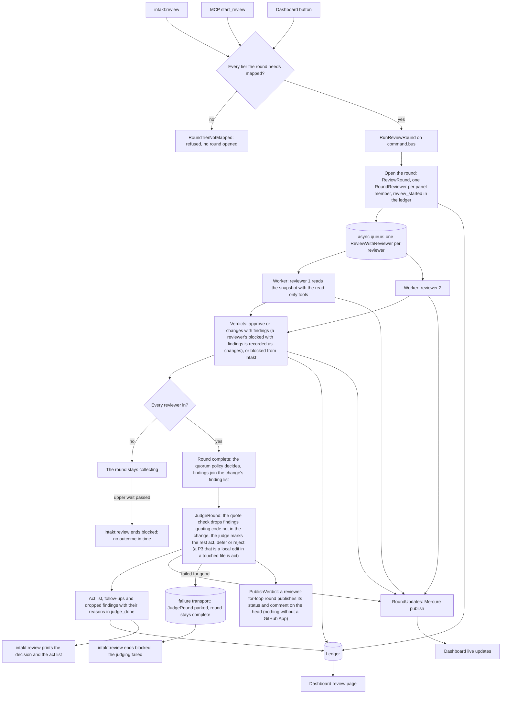

## Review flow

One review from a door to the act list. The pages [Review rounds](review-rounds.md), [Judge](vendor.md#judge) and [Quorum policies](quorum-policies.md) hold the details; this page only shows how they connect.



A built head reaches this flow only after its hand-back round ([Hand-back checks](hand-back.md#the-round)): `intakt:hand-back:check` checks the bundle and the pull request text, and a refusal goes back to the builder once with its fixed reason (`hand_back_sent_back`) and hands the task over the second time in a row (`hand_back_handed_over`), so no review is spent on it. Today nothing connects the two: the build lane (T56) will run the round, push an accepted head and send the reason to the builder or the hand-over to the maintainer agent. Before a push, `intakt:build:task` updates the project's mirror again, then runs the pre-push [check job](check-job.md) on the head merged into current main whenever main moved since the branch last merged it, with main as the first parent as in CI's merge. Current main is the mirror's `HEAD` when the job clones the mirror: the commit that update fetched, or a newer one when another update of the same mirror ran between that update and the clone. So while main stays at the commit the job cloned, the pre-push check and CI check the same merged tree; main that moves after the clone (while the check runs, or before CI starts) is not in the check, and CI checks the merge with the newer main. A conflict with current main ends the build at that check, and so does a merge that fails without git reporting a conflict, with a reason of its own.

Every arrow into the ledger is an append of one event (`review_started`, `verdict_received`, `judge_done`, ...); the dashboard pages are rendered from the ledger (apart from the forge budget on `/reviews`, which comes from the forge's recorded readings, see [Dashboard](dashboard.md)), while the live updates reach the page through the Review module's `RoundUpdates` contract, which the Dashboard publishes to Mercure: the workers stream each tool call and the narration before it as they go and each reviewer's answer once read, as a typed `ReadAnswer` (verdict, then each finding's severity, file, line and title) or the marker of an answer that could not be read, never as the reviewer's raw text, which the Dashboard never publishes to Mercure (`MercureRoundUpdates::answerRead()` publishes the `answer_read` stream, #2252) (`LiveProgress`, see [Live updates](live-updates.md)), and the round's latest state (`RoundProgress`: reviewers started and finished, both counted from the stored round) is published after each verdict, after a reviewer is handed back to the queue (a rate limit, a busy or exhausted account) and after the judge (`LiveRoundProgress::publishLatest()`); a reviewer a worker takes and starts is announced once its lease is committed, followed by the round's latest state (`LiveRoundProgress::publishStartOf()`, `RoundUpdates::reviewerStarted()`), and the Dashboard publishes the board's headline after each start and each round change (see Board headline in [Live updates](live-updates.md)); opening the round queues `RoundOpened`, whose `PublishRoundStartHandler` publishes the round's latest state from the queue after the round is committed (0 started of N unless a reviewer started first).

**One entry per place and per cause in the act list.** The act ids (every P1 and P2 finding the quote check kept, whatever the judge marked, and the P3 findings it marked `act`, from `JudgedFindings::of`) name findings; `StoredFindings::actListOf()` turns them into the act list with `Domain\OnePerPlace` (the rule of `Finding::$merged`, see [Review verdicts](review-verdicts.md)), so `ReviewChange` (the console and JSON output), `VerdictForTheLoop` (the verdict the loop reads) and `RoundActListTool` (the MCP tool) all hold the same list. An act list entry can carry one optional note of the judge (`Finding::judgeNote()`, null by default, set with `withJudgeNote()`), the judge's reason for a rejected or deferred P1 or P2: `actListOf()` takes the round's `judge_done` record (`RoundLedgerReading::judgeDoneOf()`, null before the judge has answered, which gives an empty act list) and sets each reported finding's `judge_note` from it (`JudgeDoneFinding::$judgeNote`, already redacted when it was recorded) before `OnePerPlace` groups them, so a P1 or P2 the judge rejected or deferred stays on the act list with its note and one without a judge answer has none; a merged entry keeps its own note, or else the first note of a finding it merged. The `review_act_list` and `start_review` answers show it as `judge_note`, fenced (see Judge note in [Review verdicts](review-verdicts.md)); the text and JSON output of `intakt:review` do not (`ReadRoundToolsTest`, `OnePerPlaceTest`, `RoundLedgerReadingTest`). Reported findings at one file and line, both among the act ids, become one entry: the highest severity, the text of the first reviewer in panel order, and the ids of the others in `merged`. So do two act findings the judge gives one cause: the judge may name, per finding, `same_cause_as`, the id of another finding it was given with the same cause in the same file (`JudgedFinding::$same_cause_as`, asked for by `JudgePrompt`); `JudgeAgent` treats an answer whose `same_cause_as` names the finding itself or an id it was not given like any invalid answer (every blocking finding acts, no links), `JudgeRoundHandler` keeps only the links whose two findings are in one hunk of one file of the round's diff and at most `CausesInOneHunk::NEARBY_LINES` (five) lines apart (`Domain/CausesInOneHunk` over `Infrastructure/DiffHunks`, read through `JudgedRounds::hunksOf()`; a dropped link leaves the mark and the judge's `note`), `JudgedFindings::of()` keeps the links between findings the judge was given as `sameCause` (finding id to the id it names), `RoundLedger::judgeDone()` records them under `same_cause` in `judge_done` (a row written before reads with none, through the default of `JudgeDone::$sameCause`), `RoundLedgerReading::judgeDoneOf()` reads them back with the rest of the row, and `actListOf()` passes them to `OnePerPlace` for every caller. It groups the act findings by place and by recorded link before it builds any entry, so a finding linked to one entry while it sits at the place of another joins the two into one entry in either panel order. It tries the links in the panel order of the linking finding and applies one only when the joined group stays in one file and at most `CausesInOneHunk::NEARBY_LINES` from its lowest line to its highest; a link that would stretch the group further is ignored, though it stays recorded, so of a chain of links at lines 3, 8 and 13 the finding at line 13 stays an entry of its own with its text (see [Review verdicts](review-verdicts.md)). A P3 the judge marked `defer` or `reject` never joins an entry, so it stays apart from an act finding at its place, while a P1 or P2 the judge marked `reject` still joins; findings at different lines or files stay apart, and a finding without a place is never merged. The ids and their persistence across rounds are unchanged, and `judge_done` records the act ids under `act`. The text output of `intakt:review` (`ReviewReport::asLines()`) prints a merged entry's ids joined with `+` in the id slot (`F1+F2 P1 src/Cart.php:12: ...`), and each `act_list` row of its JSON (`ReviewOutput::FIELDS`) carries `merged`, the list of the other ids (empty for an entry that merged nothing). `RoundLedger::judgeDone()` applies `OnePerPlace` to the judged findings, so the `findings` of `judge_done` hold each act entry as the act list holds it (its higher severity and its `merged` ids on `JudgeDoneFinding::$merged`; each finding also records its `file` and `line`, null in a row written before they were recorded) beside the findings it merged, each as reported; the review page shows the entry as one card named by its own id, with the merged ids as secondary text (`Also reported as F4`), and no card for a finding it merged (see [Dashboard](dashboard.md)). Tests: `ReviewChangeTest` (one entry naming both ids, a rejected P3 apart and a rejected P1 joined at one place, different lines), `OnePerPlaceTest` (also a link into an entry from the place of another, in either panel order, a chain within five lines, and a chain of links past five lines that keeps the far finding apart), `ReviewReportTest` (the joined ids), `ReviewOutputTest` (the `merged` field), `RoundLedgerPayloadsTest` (the recorded entry) and `tests/Core/Dashboard/UseCase/MergedActEntryPageTest.php`, which runs one round through `ReviewChange` with two reviewers reporting one place and finds the same entry in the text output, the JSON and on the page, and one with three, whose page entry (ids, severity, text) equals the one `StoredFindings::actListOf()` returns for the round, and one where the judge links two findings of one change at lines 12 and 14 of one hunk (one entry at the higher severity in the text output, the JSON and on the page) or in two hunks (two entries). The cause links are covered by `JudgeAgentTest` (a kept link, a link to an id not given or to the finding itself), `CausesInOneHunkTest`, `DiffHunksTest`, `JudgeRoundTest` (the recorded entry and `same_cause`, two findings without a link stay two entries, no link across hunks or to a dropped finding, the far finding of a chain of links past five lines kept as its own entry) and `RoundLedgerReadingTest` (read back, none in an older row).

Each call a reviewer makes goes out with the output limit of the reviewer's tier (`max_output` in the project's tier mapping, set by `TierPlatform`), so a full verdict fits; see [Capability tiers](capability-tiers.md). A review the provider stops at that limit (`MaxOutputTokensException`) is run once more by `SymfonyAiVendor` with twice the limit (twice `Tier::defaultMaxOutput()` when the mapping carries none), in a new conversation, because the stored one refuses a second start under its id; the stopped call is left unsettled and the retry reserves its own usage row. A second stop reaches `ReviewWithReviewerHandler` as the exception, which records `reviewer_failed` with `MaxOutputTokensException` as its failure. Tests: `tests/Core/Review/UseCase/RunReviewRound/OutputLimitRetryTest.php` and `tests/Plugin/SymfonyAiVendor/SymfonyAiVendorTest.php`. An answer that cannot be read as a verdict (`VerdictUnreadable`, see [Reviewer agent](reviewer-agent.md)) takes the same retry, except that its call is settled with its tokens; a second one is recorded as `reviewer_failed` with `VerdictUnreadable` as its failure, or with its key-safe reason in words when it has one (`VerdictUnreadable::keySafeInWords()`, below), so it reaches neither the verdicts nor the judge and never counts as `changes` or `approve` (`tests/Core/Review/UseCase/RunReviewRound/UnreadableAnswerTest.php`: a readable retry, a failed reviewer blocking a panel of one, and panels of two under the `all` policy). A verdict that withholds approval names at least one finding: a `changes` or `blocked` verdict with none (`Verdict::withholdsApprovalWithoutFinding()`) is not a valid verdict, so `SymfonyAiVendor` settles its call, throws `Review\Contract\ChangesWithoutFindings` and runs the review once more at the same limit in a new conversation marked `ReviewerConversation::$askedToNameFindings`, for which `ReviewerPrompt` adds `ReviewerPrompt::NAME_FINDINGS_OR_APPROVE` as the last user message (Intakt's own fixed text, so it is not fenced): it says the earlier answer's `findings` list was empty, shows one complete finding object (`ReviewerPrompt::EXAMPLE_FINDING`, with every field the schema asks for) and asks the reviewer to put every problem into `findings` or approve; a second such verdict reaches `ReviewWithReviewerHandler` as that exception and is recorded as `reviewer_failed`, so it never reaches the judge as a rejection that names nothing, and a `blocked` verdict without findings reads as a failed reviewer like a `changes` one instead of as an answered `blocked` with 0 findings (`tests/Core/Review/UseCase/RunReviewRound/ChangesWithoutFindingsRetryTest.php` and `tests/Plugin/SymfonyAiVendor/ReviewerRetryVendorTest.php`, which replays the recorded verdict-only answer `{"verdict":"changes","findings":[],...}` and reads the example finding as a finding; an approval without findings and a `changes` verdict with one are not asked again, and a retry stopped at the output limit fails the reviewer with `MaxOutputTokensException` without a third call at twice the limit). A reviewer call that cannot reach the model endpoint (an HTTP client `TransportExceptionInterface`: a failed DNS lookup, a refused or dropped connection, a timeout) is left unsettled, typed by `SymfonyAiVendor::typed()` as `Plugin\Vendor\Contract\ProviderUnreachable` (the judge's calls are typed the same way) and run once more at the same limit in a new conversation; the retry reserves its own usage row, so it counts against the review's budget like any call, and a second unreachable call reaches `ReviewWithReviewerHandler` as `ProviderUnreachable` and is recorded as `reviewer_failed` (`tests/Plugin/SymfonyAiVendor/ReviewerRetryVendorTest.php`, which also covers the request to name findings). A reviewer call whose stream ends before its answer is complete (`IncompleteStreamException` without a previous `RetryableExceptionInterface`) is left unsettled and run once more by `SymfonyAiVendor` without streaming, in a new conversation, on a `TierRoutedPlatform` that answers with `UnstreamedModelCatalog`, so `ReviewerAgent` sends no `stream`; the retry reserves its own usage row. A second cut keeps the first cut's reason and ends the reviewer as `Verdict::incompleteStream()` (blocked), as before the retry, with the first cut's provider, model, raiser, chunk count and last chunks as the finding's evidence (see [Vendor](vendor.md)); a rate limit or a server error of the retry reaches `AccountLimitedVendor` as `ProviderRateLimited` or `ProviderFailedTransiently`. The retry is not retried in turn, because `retriedOnce()` catches only the first try's failure: a retry stopped at the output limit fails the reviewer at once with `MaxOutputTokensException` (no call at twice the limit), and a retry whose answer is no verdict or a `changes` or `blocked` verdict without findings fails it with `VerdictUnreadable` or `ChangesWithoutFindings` (`CutStreamRetryVendorTest`). Every retry runs in a conversation marked `ReviewerConversation::$askedAgain`, so the live view shows where it starts (see [Live updates](live-updates.md)). A transient error or a limit after the first answer delta, which `StreamedAnswer` turns into an `IncompleteStreamException` with the provider's exception as the previous one, is not retried: the account has cooled down by then, so the reviewer ends blocked at once, as before the retry rule. A provider whose `Provider::streams()` is false (the subscription CLIs) never streams, so its cut is not retried (`tests/Core/Review/UseCase/RunReviewRound/CutStreamRetryTest.php` and `tests/Plugin/SymfonyAiVendor/SymfonyAiVendorTest.php`). `ReviewChange` turns the recorded class into plain words through `Review\Contract\FailureInWords` (the output limit reads "stopped at its output limit", an unreadable answer "the reviewer's answer could not be read as a verdict", a `changes` or `blocked` verdict without findings "gave no approval without naming a finding", an unreachable endpoint "the model endpoint could not be reached", an unknown class "failed with an unexpected error"), so the round's `reasons` hold `<role> reviewer failed, <words>` and the console prints it as a `reason:` line; no class name reaches the console. Only a `VerdictUnreadable` built with `becauseKeySafe()` is recorded as words instead of its class, `the reviewer's answer could not be read as a verdict: <reason>` (cut to the 255 bytes of the `failure` column, ending in `...` when cut, by `RoundReviewer::recordFailure()`), which `FailureInWords` passes through: the reason is Intakt's own wording, as for a malformed tool call, the round limit, ids marked both resolved and repeat (all open ids), finding ids reserved for failed reviews (Intakt's own constants, `Verdict::claimedFailureIds()`), ids that were not open when each has a ledger id's shape (a capital letter and at most 9 digits), and a broken constraint in `VerdictParser` when its path holds only property names and list positions and its message template keeps no placeholder once numbers are filled in. Every other reason (a serializer or JSON message, an unknown field, an id of any other shape) can echo the model's answer, so it stays in the exception's message and the class is recorded (`LongRunTest`, `UnreadableAnswerTest`, `ReviewerVerdictTest`, `VerdictParserTest`, `VerdictUnreadableTest`, `RoundReviewerFailureTest`). A reviewer without a verdict still votes as blocked in `Review\Contract\ChangeDecision`, so a failed reviewer never helps a quorum: beside a reviewer asking for changes the round is `changes`, beside an approval it is `blocked` (`ReviewChangeTest`). The dashboard's review page uses the same two classes: the failed reviewer's note is the same words, and a judged round shows the outcome `ChangeDecision` gives for the `quorum` recorded on `review_started`, over all the round's reviewers, a failed or unstarted one voting as blocked, beside how many failed; `tests/Core/Dashboard/UseCase/FailedReviewerPageTest.php` runs a round through `ReviewChange` with a reviewer stopped at the limit and finds the console's decision on the page (see [Dashboard](dashboard.md)).

An `approve` from a reviewer that does not read the checkout (`claude_code`, `codex`) counts only when its own call shows a read through the round's review server; otherwise `SymfonyAiVendor::readOrRefused()` turns it into `Verdict::unreadApproval()`, a `blocked` verdict. For `claude_code` that means the CLI's stream reports the server `connected` in its `init` event and holds at least one answered call of the server's tools (#1407); the exact events are in [AI providers](ai-providers.md). Tests: `tests/Plugin/SymfonyAiVendor/ClaudeCodeReviewerTest.php`, `CodexReviewerTest.php`.

## Quote check

`JudgeRoundHandler` checks each reported finding with `Domain\QuotesInChange::reasonToDrop()` before the `JudgeRequest` is built, and passes only the findings it keeps to the judge and to `JudgedFindings::of()`, so a dropped finding is neither judged, nor on the act list, nor among the `findings` of `judge_done`, and `OnePerPlace` never merges a real finding under it. The change it checks against is `Infrastructure\ChangeText::of()`, reached through `JudgedRounds::changeOf()`: the round's diff and the content of each file `DiffPaths` names in it, read under the round's checkout through `Contract\Checkout` (a file gone from the checkout or a path outside it is skipped, and a checkout that is gone leaves the diff alone). The checked quotes are the inline backtick quotes of `Finding::$text` (single or double backticks; a quote may wrap onto the next line but never runs across a blank line) after fenced blocks are removed (a block opens at a line starting with three or more backticks or tildes, at any indentation by spaces or tabs and after any number of blockquote markers (`>`, each followed by optional spaces or tabs, so `> >` too), so a fix under a list item or in a blockquote counts; after a backtick fence the rest of the opening line holds no backtick, as in Markdown, so a line starting with an inline triple-backtick quote that closes on the same line opens no block, while a tilde fence's line may hold any text; and closes at a line holding only a fence of the same character at least as long, at any indentation and after any blockquote markers too, or at the end of the text; backticks inside a fenced line close nothing; a line may end in LF, CRLF or a lone CR, because the text's line ends are read as LF before the check), leaving out a quote that is a path (holding a slash) or a file name (`name.ext`), a number, or one with no name in it. The quotes are read in two steps. First come the quotes that neither start nor end with white space, so a lone backtick or a lone pair in prose is not paired with a quote's backticks. Then, in the text those quotes leave (each one is replaced by a blank line, so nothing later runs across it), come the double-backtick quotes with white space at one or both edges: the white-space rule holds for single-backtick quotes only, because Markdown pads a double-backtick quote whose code starts or ends with a backtick. Every two neighboring double-backtick runs there are read as one such quote, so a lone pair before a padded quote does not hide it. What is then still left between two runs of backticks (a single-backtick quote with white space at an edge, a quote between runs of three or more backticks or of unequal length, or prose between two lone backticks, which plain code cannot tell apart) is not a checked quote: such a span never drops a finding, and it keeps one when it is found. A quote between runs of two or more backticks that holds shorter backtick runs (``` `` customerName + `suffix` `` ```, or the same between runs of three backticks) is read whole from the text before the first step too, up to the next run of the same length, because the first step cuts it apart at its inner single-backtick quote; a run of the same length in prose may pair with its run, so it is such a span as well. A quote or such a span is found when any of its names occurs in the change as a whole name. A finding is dropped only when it has a checked quote and neither a checked quote nor such a span is found; it is kept when one quote is found, also when another is absent. `Finding::$symbol` is never read: it is place, like file and line, so a finding without a checked quote goes to the judge whatever its symbol. A round whose every finding is dropped is recorded as judged without a judge call. `ReviewRound::reportedFindingsJson()` keeps every finding as reported. The handler keeps the reason `reasonToDrop()` returns (such as `none of its 1 quoted code fragments is in the change`) with the finding as a `Contract\DroppedFinding` (`id`, `severity`, `text`, `file`, `line`, `reason`), hands the list to `JudgedFindings::of()` as `dropped`, and `RoundLedger::judgeDone()` writes it under `dropped` in the round's `judge_done` event (empty when nothing was dropped; a row written before the key existed reads with none, through the default of `JudgeDone::$dropped`). `RoundLedgerReading::droppedOf()` reads the list back from the round's `judge_done` row, found by the same lookup as `judgeDoneOf()` (none when the judge has not answered), and the MCP tool `review_status` returns it as `dropped` once the round is `judged` (see [MCP server](mcp-server.md)); the review page reads it through `Dashboard\Infrastructure\RoundPayloads::droppedOf()` and shows each drop with its reason (see [Dashboard](dashboard.md)). Tests: `tests/Core/Review/Domain/QuotesInChangeTest.php`, `tests/Core/Review/Infrastructure/ChangeTextTest.php`, `JudgeRoundTest` (a dropped finding is not asked about and is stored under `dropped` with its reason, a finding without a quote and an absent symbol is asked about and not stored as dropped, a real finding at the dropped one's place is not merged), `RoundLedgerPayloadsTest` (the `dropped` list is written and read back, and an older row reads with none), `RoundLedgerReadingTest` (the drops of the round's row are read with their reasons, an older row reads with none and keeps its act ids, another round's drops are not read) and `ReadRoundToolsTest` (`review_status` of a judged round lists a finding quoting a name absent from the change with its reason, lists none for a finding without a quote and an absent symbol, which is on the act list, and none before the judge answers).

## Refused before it starts

`ReviewChange::start()`, which `review()` calls too, so the console, the MCP tool and the dashboard button all pass through it, first collects the tiers the round needs: each panel reviewer's `ReviewerModel::$tier` and `Plugin/Vendor/Contract/Vendor::JUDGE_TIER` (the light tier `judge()` calls). For each, in that order, it asks `Vendor::mapsAModelTo(project, tier)`; the first tier answered false throws `Review/Contract/RoundTierNotMapped` (a `ReportableFailure`, declared on `ChangeReviews::start()` and `review()`) with the message `Project "<project>" maps no model to the "<tier>" tier, which this round needs: map a model to it in the project's tiers and review again.`, before `RunReviewRound` is dispatched, so no round is stored, no `review_started` is appended and no reviewer is queued. `intakt:review` prints the message and ends with `Command::FAILURE` (1). The answer covers only the mapping (see [Vendor](vendor.md)): a tier whose provider is disabled passes, and its call fails later as before. Tests: `ReviewChangeTest` (no light tier, no reviewer tier, both mapped) and `tests/Plugin/LocalGitForge/ReviewChangeCommandTest.php` (the message and exit code).

## A judging that failed for good

`ReviewChange::review()` waits on the stored round. When the `JudgeRound` message of a `complete` round fails after the `async` transport's retries, Messenger parks it in the failure transport and the round stays unjudged; on its next poll `review()` finds the message there through `Review/UseCase/JudgeRound/FailedJudgings` and ends at once as `blocked` with the reason `the judging failed` and an empty act list, so `intakt:review` exits with 11 instead of waiting for its upper wait (see [No outcome in time](#no-outcome-in-time) and the review command in [Forge contract](forge-contract.md)). Tests: `ReviewChangeTest` (a parked judging of the round ends the wait after one poll; one of another round leaves it to the upper wait) and `tests/Core/Review/UseCase/JudgeRound/FailedJudgingsTest.php` (group `persistence`, on the Doctrine transports: a parked judging of the round, of another round, another parked message, a judging still queued on `async`, a read that leaves the message in place, a transport that cannot be listed, a parked row that cannot be decoded, which neither breaks the read nor is deleted).

## No outcome in time

`ReviewChange::review()` waits no longer than its upper wait, `UseCase/ReviewChange/UpperWait::secondsFor()` of the request's panel: `RoundReviewer::REVIEW_CEILING_SECONDS` (3600, the hold one reviewer may keep) for each reviewer, added up because one worker runs them one after another, plus `UpperWait::JUDGE_SECONDS` (the same 3600) for the judge's one call, so 10800 for a panel of two. The deadline is set from `ClockInterface::now()` before the first read of the round, and the last read happens at the deadline, so a round judged by then counts. A round that is neither judged nor failed in its judging by then, whatever held it up (no worker, a provider that keeps limiting the calls, a reviewer redelivered again and again), ends as `blocked` through `ChangeReview::blockedFor()` with the reason `no outcome in time` (`RoundEndReasons::NO_OUTCOME_IN_TIME`) and the end `RoundEnds::NoOutcomeInTime` (`ChangeReview::$end`; `RoundEnds`, in the Review contract, is the one set of ends: `judged`, `judging_failed`, `no_outcome_in_time`, and `ReviewChange` words the blocked ones through `RoundEndReasons`), followed by `: the round did not end within <seconds> seconds; if no worker runs, start one with "messenger:consume async", then review again`, and an empty act list, so the command always ends, with exit code 11. Tests: `ReviewChangeTest` (a round that never reports ends at the upper wait with the reason; one the workers finish at the last poll is judged) and `UpperWaitTest` (the sum for a panel).

The dashboard's review page reads a stored round's end through `Contract/RoundEndings` (`UseCase/ReviewChange/StoredRoundEndings`): a round without a judge's call is `JudgingFailed` when its `JudgeRound` is parked in the failure transport, and `NoOutcomeInTime` once its start plus `UpperWait::secondsForReviewers()` has passed, with the same `RoundEndReasons` words (see [Dashboard](dashboard.md)).

## A replay

A project whose rounds are a recording played back is flagged as a replay (issue #2091, part 1 of #2083). `Review/Contract/FlagProjectAsReplay(project)`, handled on the command bus by `UseCase/MarkReplay/FlagProjectAsReplayHandler`, stores one row in `review_replay_project` (the project name as primary key; migration `Version20261115100000`); a project already flagged stays flagged and nothing is stored again. `ReviewRounds::open()` sets a new round's `replay` column (same migration, default false) when its project has that row, so a round keeps the mark it opened with: a round opened before its project was flagged stays live. Other modules read the marks on the query bus: `ReplayMarkOfProject(project)` and `ReplayMarkOfRound(roundId)` both answer a `ReplayMark` (`Live` or `Replay`); `ReplayMarkOfRound` reads the round's `replay` column through `ReviewRounds::replayMarkOf()` without clearing the entity manager, because a reviewer's handler reaches it through the board's live update while it still holds its round. An unknown round is `RoundNotFound`, which implements `Review/Contract/UnknownRound` so another module can tell it from other failures inside Messenger's `HandlerFailedException`. A replay never counts as a verdict (issue #2092, part 2 of #2083): each of the three places that count a verdict ([Mode per project](capability-tiers.md#mode-per-project)) reads the round's mark. `VerdictsOfRoundHandler` returns no `counting` verdicts for a round whose mark is `Replay`, with the standing `ReviewRound::standingAt()` gives; `ReviewChange` (`intakt:review`) decides such a round `blocked` without asking `ChangeDecision` and puts `RoundEndReasons::REPLAY` first in its reasons; `VerdictForTheLoop` publishes it as `HeadStatus::Error` with the description `Intakt does not count a replay as a review of this head.` and no comment. A round opened before its project was flagged stays live, so its verdicts count. Tests: `tests/Core/Review/UseCase/ReadVerdicts/VerdictsOfRoundTest.php` (a reviewed round of a flagged project counts none; one of a live project beside a flagged one counts both), `tests/Core/Review/UseCase/ReviewChange/ReviewChangeTest.php` (two approvals in a flagged project are `blocked` with the replay reason; beside a flagged project they approve) and `tests/Core/Review/UseCase/PublishVerdict/PublishVerdictTest.php` (an approved round of a flagged `reviewer-for-loop` project publishes only the `error` status). Only `intakt:demo:create` sends `FlagProjectAsReplay`, for the demo project on the compose demo ([The demo recording](demo-recording.md#the-demo-project)). `Review/Contract/UnflagReplayProject(project)`, handled by `UseCase/MarkReplay/UnflagReplayProjectHandler`, deletes the project's `review_replay_project` row, and does nothing for a project that has none; only `intakt:demo:remove` sends it, after the project's replayed ledger rows are removed ([The demo recording](demo-recording.md#removing-the-demo-project)). Tests: `tests/Core/Review/UseCase/MarkReplay/UnflagReplayProjectHandlerTest.php` (`persistence` group: an unflagged project is live, another flagged project stays a replay, a project never flagged stays live). The project's mark is read by the MCP `list_projects` tool ([MCP server](mcp-server.md)) and by the status for each project; the dashboard's board, review page and status read each round's mark with `ReplayMarkOfRound`, and the project's only for a round the Review module never stored (issue #2084, part 2 of #2076; see Replay mark in [Dashboard](dashboard.md) and [Status read model](status.md)). Tests: `tests/Core/Review/UseCase/MarkReplay/ReplayMarksTest.php` (`persistence` group: a project never flagged, a flagged one, another project, a second flag, a round of a flagged and of a live project, a round opened before the flag, an unknown round, and the flag and the project's mark through the container's command and query buses).

## A round marked stale

`Review/Contract/MarkVerdictsStale(roundId)`, handled on the command bus by `MarkVerdictsStaleHandler`, marks a round whose head was refused after the round started (it no longer boots): it sets the round's `verdicts_stale` column (migration `Version20261113110000`) under the round's row lock, because a reviewer's worker may store a verdict on the same row, and dispatches `PublishVerdict` again after every mark, also one already made, so an approval already on the forge is replaced. An unknown round is `RoundNotFound`. `ReviewRound::standingAt()` then answers `stale` on `head` whatever identity it is asked about, so `VerdictsOfRoundHandler` counts none of the round's verdicts. `VerdictForTheLoop` checks the mark before any vote and publishes `Failure` on the round's head with the description `Intakt withdrew its review: this head does not boot.` and no comment. `PublishVerdictHandler` serializes the publications of one project and change through `ChangePublications`, a lock keyed by both (hashed from a JSON list, so no name can end where another begins) and held from the read of the round's state through the forge write; it is tried without waiting, and a busy change throws `PublicationBusy`, a `RecoverableMessageHandlingException` that Messenger always brings back, so a later publication reads the round only after the holder's write. Under the lock the handler reads the round, publishes, then reads it again until its stale mark no longer changed during the write, because a mark is made without this lock: a mark that committed while the approval was on the way is withdrawn by the same publication, and the publication the mark queued follows it. So the last status written for a commit is the one of its latest judged round with that round's stale state, whatever order the writes interleave in. It drops a publication when `ReviewRounds::judgedAfter()` finds a judged round of the same project and change with a higher round number that reviewed the same head commit, because a forge status belongs to a commit and that later round's status is the one the commit stands at; a later judged round of another head does not drop it, so in the order A, B, A the returning A's withdrawal still replaces A's old `success`. The watcher's `SettleHead` sends `MarkVerdictsStale` for the round already started on a head that `BootGate` refuses (the head fails to boot while main boots), on every refusal; `BootGate` boots, and so refuses, only a head whose pull request author is trusted ([Boot step](boot-step.md#in-the-watcher)). Tests: `tests/Core/Review/UseCase/MarkVerdictsStale/MarkVerdictsStaleTest.php` and `tests/Core/Review/UseCase/PublishVerdict/PublishVerdictTest.php` (`persistence` group; the A, B, A order, a later round of the same head, and the forced order where a later round of the same head is judged, marked stale and withdrawn while the first approval is on the way).
