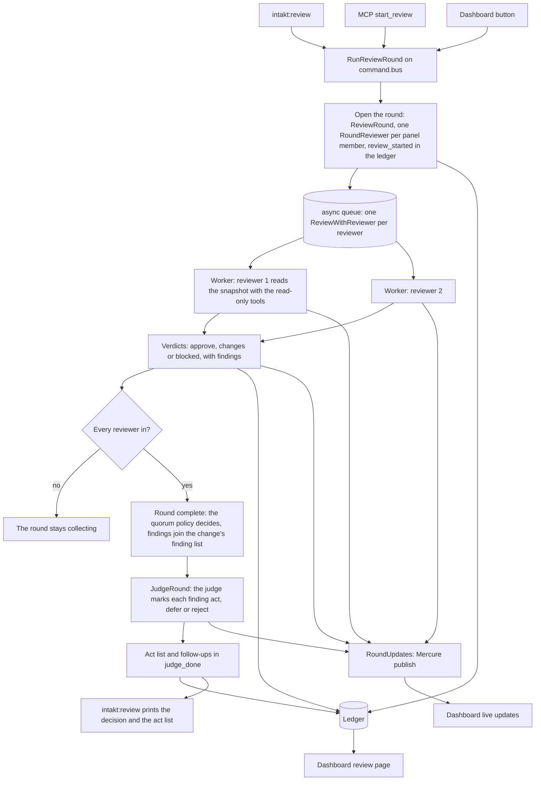

## Review flow

One review from a door to the act list. The pages [Review rounds](review-rounds.md), [Judge](vendor.md#judge) and [Quorum policies](quorum-policies.md) hold the details; this page only shows how they connect.

Every arrow into the ledger is an append of one event (`review_started`, `verdict_received`, `judge_done`, ...); the dashboard pages are rendered from the ledger alone, while the live updates reach the page through the Review module's `RoundUpdates` contract, which the Dashboard publishes to Mercure: the workers stream each tool call and text piece as they go (`LiveProgress`), and the round's latest state is published after each verdict and after the judge (`LiveRoundProgress::publishLatest()`); opening the round publishes nothing.

Each call a reviewer makes goes out with the output limit of the reviewer's tier (`max_output` in the project's tier mapping, set by `TierPlatform`), so a full verdict fits; see [Capability tiers](capability-tiers.md). A review the provider stops at that limit (`MaxOutputTokensException`) is run once more by `SymfonyAiVendor` with twice the limit (twice `Tier::defaultMaxOutput()` when the mapping carries none), in a new conversation, because the stored one refuses a second start under its id; the stopped call is left unsettled and the retry reserves its own usage row. A second stop reaches `ReviewWithReviewerHandler` as the exception, which records `reviewer_failed` with `MaxOutputTokensException` as its failure. Tests: `tests/Core/Review/UseCase/RunReviewRound/OutputLimitRetryTest.php` and `tests/Plugin/SymfonyAiVendor/SymfonyAiVendorTest.php`.
