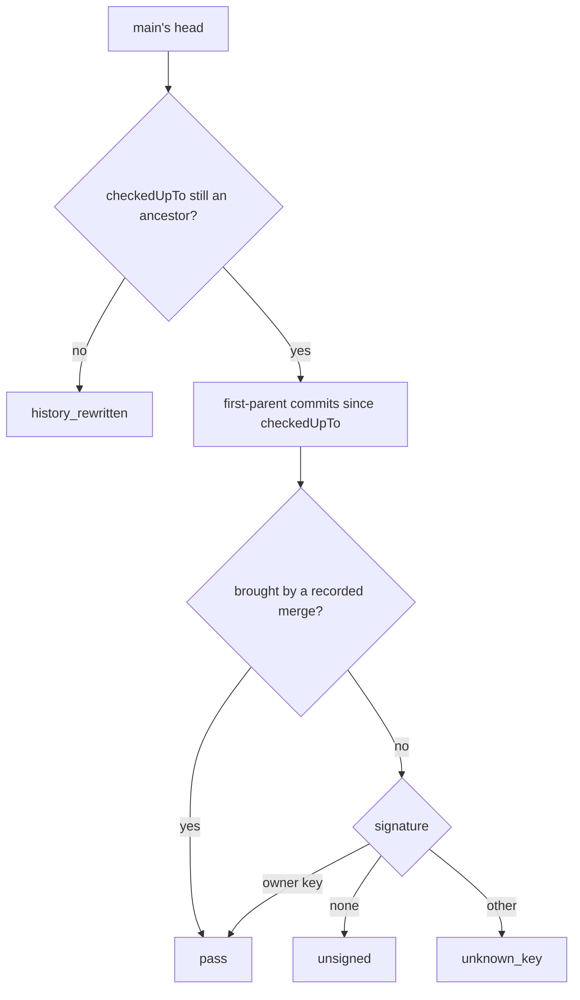

# Watchdog over main

How Intakt classifies the new commits on main (plan task T63, part 1; design: [Overview](../design/05-architecture/01-overview.md)). `CheckMain` in `src/Core/Watchdog/UseCase/CheckMain/` answers it for a repository whose `HEAD` names main (a project's bare mirror); `php bin/console intakt:watchdog:check <repository>` runs it on a mirror or a `.git` folder. It only classifies: the project halt, the owner card and the owner's own push as an info event are later parts of T63, so nothing stops on a violation yet.

## The rules

`CheckMain::of()` takes the repository and a `WatchedMain`: the head of main the last check passed (`checkedUpTo`, null for a main never checked), the merges Intakt recorded (each a `RecordedMerge`: the `base`, the main the merge landed on, and the `head` Intakt merged, both full commit names), and the owner's public keys (`OwnerKeys`). It returns a `MainVerdict` with the head it read and a list of `Violation`s, each a `ViolationKind` and a commit.

| Case | Outcome |
|---|---|
| a recorded merge's `head`, or a commit reachable from that `head` and not from its `base` (`rev-list <head> --not <base>`) | passes, whatever its signature says |
| a commit signed by a registered owner key | passes |
| no signature | `unsigned` |
| a signature by another key, or one that is bad, expired or that git could not check | `unknown_key` (anything that is not clearly the owner's fails closed) |
| `checkedUpTo` is no longer an ancestor of main's head, or the repository no longer has it | one `history_rewritten` violation naming `checkedUpTo`; no commit is judged then |

Only commits on main's first-parent line since `checkedUpTo` are judged (`git log --first-parent`). For a merge commit with main as its first parent, that line holds only the merge, which is the recorded `head`. After a fast-forward (main moves to the task head, or to a merge of main into the task branch), the task branch's own commits sit on that line too; they pass because the recorded merge brought them (they are reachable from its `head` and not from its `base`). An unsigned commit that was on main below the `base` is not covered and is still `unsigned` on a first check, and a commit added above the recorded `head` is judged by its signature. A recorded merge whose commits the repository does not hold is refused with `MainNotRead`. Without `checkedUpTo` the whole first-parent history is judged. A shallow repository (a `shallow` file, as after a `--depth` fetch) is refused with `MainNotRead` before anything is read (`rev-parse --is-shallow-repository` must print `false`), because the walk would end at the cut and a first check would never see the commits below it.

## Signatures

Only SSH signatures are checked. `Infrastructure/MainHistory` asks git for each commit's status (`%G?`) through `HardenedGit`, with `gpg.format=ssh`, `gpg.ssh.program=ssh-keygen` and an allowed-signers file made from the owner's keys for the one call and removed after it (`G` is an owner key, `N` no signature, any other letter is not the owner's). The repository's own config never picks the program: the hardened call ignores it and the options are passed on the command line. `OwnerKeys::of()` keeps only the type and body of each key line and writes `owner namespaces="git" <type> <body>`, so a comment, an option field or a second line in a key cannot widen what the file trusts; anything that is not a public key line is refused. A GPG-signed commit counts as `unknown_key`.

## The command

`intakt:watchdog:check <repository> [--since=<sha>] [--owner-key=<file>]... [--recorded-merge=<base>..<head>]...` prints one `<kind> <commit>` line per violation, the head it read and `main is clean` or `main is violated`. It exits 0 when clean, 1 on a violation and 2 for a refused argument (including a `--recorded-merge` that is not two full commit names joined by `..`) or a repository it could not read. The owner's keys and the recorded merges are options because the places that keep them (the owner's config, the ledger) arrive with the later parts.
