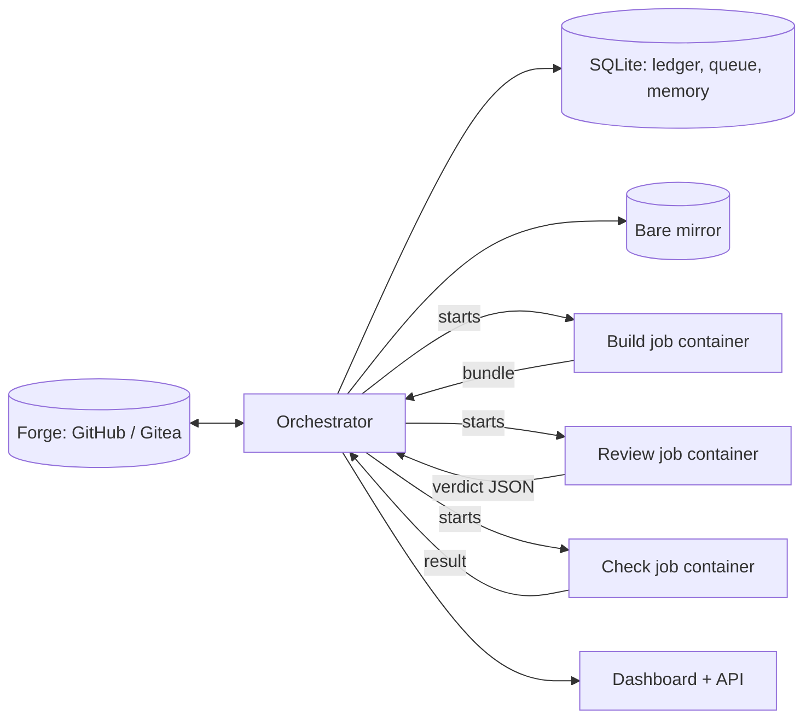

# Intakt design

Intakt runs an autonomous build loop for a software project. It takes tasks (stored as issues) from a forge, has AI agents build them, has other AI agents review them, and merges what passes. Its design comes from running such a loop on a real project: what worked is kept, and what failed shaped the rules below.

Status: decided design (see Decisions); nothing is built yet.

## Terms

- **Spec:** what a project or feature should do, written by the owner or drafted with Intakt in the foundation flow.
- **Plan:** the spec broken into milestones and tasks, with dependencies and what may run in parallel.
- **Task:** one buildable unit of the plan, with acceptance criteria and the evidence its change must show, sized to be built and reviewed. Lanes build tasks, review panels review their changes, routing rules choose their models.
- **Issue** or **ticket:** how a forge or tracker stores a task (a GitHub or Gitea issue, a Jira ticket). Work-source plugins map tasks to them; labels, comments and links are the task's attributes as the forge shows them.

The rest of this document says *issue* where it means the forge object, and *task* for the unit of work.

## Goals

1. **Anyone can run it.** One container image, one command, a first-run wizard. No host scripts, no hand-made users, no systemd units.
2. **Modular.** Forges, AI vendors, gates and work sources are plugins behind small interfaces.
3. **Efficient.** Idle costs nothing: no polling agents, no long-lived model sessions. Each job is one short-lived container.
4. **Uses the capacity it has.** It knows each vendor's limits (subscription windows or API spend), measures what is left, and plans model choice and pace to end each window near its ceiling, not far below it.
5. **Safe by construction.** A builder can never push, sign, merge or read secrets. What it hands back is checked in a clean place before anyone trusts it.
6. **Visible.** A dashboard shows what each lane is doing, what it costs, and what needs a human.

## Non-goals (v1)

- Multi-tenant hosting. One install serves one owner, possibly several projects later.
- Its own model hosting. Vendors are reached through their own CLIs or APIs.
- Replacing CI. The forge's CI stays the authority on whether a change is green.

## Lessons from running a loop

Kept:
- **Lanes.** A review lane and N build slots run independently and chain into each other, instead of one round at a time.
- **Ledger.** An append-only event log (starts, reserves, ends, merges) from which budget, history and recovery are derived.
- **Reviewers from different vendors**, with a substitute when one is out of budget and a later catch-up review.
- **Kept commits.** A build that fails the pre-push check keeps its commits for the next cycle instead of starting over.
- **Pre-push check in a clean place.** The builder's own run of the checks is never trusted.
- **Drain.** Stop admitting work, let in-flight steps finish, then deploy or update.
- **Evidence by construction.** Races are proven with forced-order tests, not repeated runs.

Changed:
- **No prose parsing for decisions.** A loop that parses reviewer prose for findings has to harden that parser again and again (fences, quotes, case, list items, Unicode line breaks). Intakt requires a structured verdict (JSON schema, validated) and treats anything else as "changes requested".
- **Isolation by container, not by home-directory hygiene.** Builders that share a Unix user and a long-lived worktree need every piece of state reset by hand, and every reset (dotfiles, CLAUDE.md, git config, commondir, index, symrefs, Composer cache) was a new denylist item found by review. Intakt gives every job a fresh container from a read-only image, with the repo cloned fresh from the orchestrator's bare mirror. Nothing a job writes survives it except the bundle it hands back.
- **Measured budgets, not estimated ones.** A ledger estimate refused a second builder for hours while the vendor measured 4% use. Intakt asks the vendor (usage probe or API billing) first and uses its own estimates only as a fallback.
- **One process owns state.** Host scripts, container scripts and timers that all touch pause, drain and locks race each other. In Intakt, only the orchestrator writes state; the CLI and dashboard talk to it.
- **A hand-over never stops the loop.** A loop that halted every lane, reviews included, when a hand-over left nothing else to build, left the pull request that resolved it unreviewed for hours. In Intakt a hand-over parks one task; only real faults (a watchdog finding, repeated failures, a crash) stop the loop.
- **Queue state lives in the database, not in labels.** With the queue kept in forge labels, a split that labeled parts `blocked` without `ready` left 18 issues that nothing would ever build. Intakt's queue is a table; forge labels only steer it (as input from people with write access) or mirror it for people (see "Labels").
- **No flat budget per round.** One fixed token figure stopped productive large builds and let stuck small ones burn their allowance. Intakt sizes the allowance from the task and stops on lack of progress (see the planner).
- **Updates fail loud and safe.** An update failed four times on a step that behaved differently in its drained form, left the loop stopped for hours and alerted only after the third failure. Intakt updates roll back on any failure, alert on the first, and run the same way they were tested.
- **One loop change at a time.** Five fixes to the loop itself shipped in one day, two went live together, and a deploy mode that had never run end to end stopped the loop. Intakt rolls out its own changes one at a time and checks each in production (a scripted post-update check, then the next jobs' outcomes) before the next.
- **Quality gates generate their own work.** Most of a busy day's rejected pull requests and follow-up issues came from the project's own gates and gate edge cases, and every new gate made every later build heavier. Intakt treats gate and tooling work as lower priority than the project's own core, and a new gate needs an escaped defect it would have caught.
- **The bot is not the owner.** A loop that posts as the owner's own account cannot tell "approved by the owner" from its own comments. Intakt acts as its own forge identity.
- **Changing identity is one step.** Moving a running loop from the owner's token to its own App took a drain, a recorded switch moment, a config change, a deploy and two host-side patches in one window, and the update resumed the loop on its own before the host side was patched, so the dependent host jobs had to be paused by hand. Intakt has its own identity from setup, and a later change of identity (another App, a rotated key) is one orchestrator command: it drains, records the moment (what the old identity did before it stays the loop's own), switches every component together and resumes only after all of them check out.
- **Setup is tested by running it.** An App creation script failed on its first real use: the program read its input from a stream that was already its own source, and the only test checked the script's text for that very line. Intakt's setup steps have end-to-end tests against a fake forge, and text checks never stand in for running the step.
- **Tests do not read the deployed config.** When a shipped config switched to the App, eight tests broke because they built on it and assumed the old identity. Intakt's test fixtures start from the built-in defaults; one test pins the shipped values.

## Architecture



- **Orchestrator.** One long-running container, PHP and Symfony. It acts as its own forge identity (a GitHub App, or a bot user on Gitea), never as the owner's account, so the owner's approvals and the bot's own comments can always be told apart. It holds that identity's token, the key that signs the branch commits it pushes (merges are made through the forge API, see Decisions), the SQLite database and a bare mirror of each project. It schedules lanes, starts jobs through the Docker or Podman socket, and serves the dashboard and a local API.
- **Jobs.** Short-lived containers from a project-specific image (the project's toolchain plus the vendor CLIs). No forge credentials, no signing key, egress limited to the vendor's API and package registries. Inputs are mounted read-only; the only output is a directory the orchestrator reads after the job exits.
  - *Build job:* clones from the mirror, runs the vendor CLI with the task and feedback, and returns a git bundle plus pull request text.
  - *Check job:* applies the bundle in a fresh clone and runs the project's check command with a fresh dependency cache. Its result gates the push.
  - *Review job:* gets the diff, the task and a read-only checkout, and returns a verdict JSON.
  - Every job checks at start that what it is told it can do works (for example writing a probe file and reading it back, reaching the vendor through its proxy). A failed check is recorded with its reason and the job runs in its reduced mode, saying so, instead of failing silently halfway. Prompts are built per vendor from what that vendor's job can really do, so no reviewer is invited to a tool it does not have.
- **State.** SQLite, written only by the orchestrator. Ledger events, queue, lane state, budgets, memory entries. Nothing of it is published as a branch: the integrity of main comes from the forge's own protection (required status checks from Intakt's identity, signed commits, no force push, no deletion) where the forge offers it, plus a cheap watchdog that main's history was not rewritten. Each merge's provenance is its pull request: the task, the verdicts, the CI run and the statuses on that head.
- **Events, not polling.** The orchestrator reacts to forge webhooks and job exits, with a timed fallback read when a webhook is lost. Each waiting state has a deadline that wakes it, so idle means no work at all.
- **Updates.** A new Intakt version is installed by draining (no new jobs, running ones finish), swapping the image, checking the orchestrator starts and the forge and vendors answer, and resuming. Any failure rolls back to the previous image and resumes; the owner is alerted on the first failure, not after retries. The installer runs in one fixed environment whatever starts it (clean variables, fixed PATH, defined signal handling), because an inherited difference (a restored SIGPIPE that killed a listing piped into an early-exiting match, a sudo variable that made a helper refuse) made the same install pass one way and fail another; its checks read a command's output first and then match it, and print what they read when they fail. Each update carries a scripted post-update check of what it changed (for example a job writing its probe file under the new rules), and the next update waits until that check and the next jobs' outcomes look right.
- **Runners (later).** Jobs run on the orchestrator's host in v1. Later, other machines the owner controls can register as job runners with their own capacity, so one install can spread builds across them; the orchestrator still holds every credential.

## Plugins

Each plugin is a PHP class behind a small interface, shipped in the image, and selected in config.

| Kind | Interface (sketch) | v1 implementations |
|---|---|---|
| Forge | list work, read issue, open or update pull requests, read CI status, merge, comment | GitHub, Gitea |
| Vendor | run build, run review, probe usage, price/limits | Claude Code (subscription or API key), Codex (subscription or API key), one API-only vendor (OpenAI-compatible endpoint) |
| Gate | command plus protected paths | project command (`bin/check`, `make check`, ...) |
| Work source | which tasks are eligible, in what order | forge issues with a label, plus dependencies ("Waits for #n"); see "Work intake" |
| Notifier | deliver a notice (kind, item, link, urgency), report delivery, test | browser push (Web Push over HTTPS, from the dashboard as an installable app), Home Assistant (webhook or mobile app notify), ntfy, generic webhook, email |

Vendor plugins declare their models with a cost class and strengths (build, review, triage), so the planner can choose without vendor-specific code.

**Notifications go through Intakt, never around it.** Every notice (an approval waiting, a question, an escalation, a halt, a failed update) is an event in the orchestrator, delivered by the notifier plugins the owner enabled: none of the loop's parts (jobs, the maintainer agent) send their own pushes. Routing is in the owner's config: which kinds go to which notifiers (for example approvals and halts to the phone, digests by email), quiet hours, and a fallback notifier when the first one fails. Each notice is sent once per item and state change, carries a link to the item on the dashboard or the forge (an approval notice also carries the exact head to approve), and its delivery result is recorded, so a notifier that fails is itself shown on the dashboard. Notices carry no secrets and no approval power: approving stays a forge action by the owner's account. Browser push needs the dashboard served over HTTPS (the wizard offers a certificate from the forge's or a local CA); a notifier's credentials (webhook URL, token) live in the owner's config like other credentials, and every notifier has a "send test" button in the wizard.

## Work intake

How a task (its issue on the forge) becomes a build. Every step is cheap and runs before any build tokens are spent.

1. **Eligible.** Open, labeled for the loop, written by a trusted author, not blocked. Dependencies are `Waits for #n` lines (or the forge's native blocked-by links where it has them). When a task fails for good, the tasks that wait on it are held with the reason, instead of being built on a missing base.
2. **Ready.** A tool-less triage call checks that the task states an observable result, an acceptance condition and a single outcome. A task that does not is parked with one comment listing what is missing; it costs no build.
3. **Sized.** The same call estimates the change in changed lines against a size contract with tiers: small tasks are merged with siblings when that saves a review, large ones must be split, and a band in between gets a plan first. Each part of a split is mergeable on main with its own tests and repeats the decisions that apply to it.
4. **Planned (optional, per project).** The builder writes back what it will do (files, approach, risks) as a comment before it starts. With plan approval on, only an owner approval of that plan starts the build; the approved plan becomes part of the task. Plan approval is adaptive: size sets the starting default (off for small tasks, on for large ones), a rejected change turns it on for the project, and five clean merges turn it off again.
5. **Prioritized.** Every queued task has an explicit priority (owner-set, or inherited: split parts and follow-ups take their original's), and the queue is ordered by it, then by dependencies and age. Process work (fixes to the loop's own flow) can be put ahead of features on purpose, never by accident. Work is also classed as core, feature or tooling (gates, developer tools, docs tooling); by default core comes first and tooling last, and tooling that does not fix an observed failure is not queued without the owner. When several slots are free, the highest-priority ready class gets them first; a lower class only takes a slot that would otherwise sit idle.
6. **Scheduled.** Each plan or size estimate carries a forecast set of files or areas. Tasks whose forecasts overlap are built one after the other when the forecast is confident (forecast against actual overlap is logged to measure that); the rest run in parallel across the build slots. A project can choose a serial mode (one build at a time, in dependency order) for small setups.

A part split from a larger change can name a source: a line `Source: <branch>@<sha>`, honored only from a trusted author. The orchestrator checks that the commit is on that branch and gives the job that one ref, read-only; the builder applies the source's own diff, not whole files.

## Labels

Labels are how people steer tasks from the forge, on any device, without the dashboard. They come in two kinds, and the difference is who writes them:
- **Steering labels** are set by people and read by Intakt. Each family maps to a field in the task's database row; the label is the input, the row is the state.
- **Status labels** are written by Intakt to mirror the row, so the issue list shows where each task stands. A person changing one changes nothing: Intakt puts it back and comments once. The queue never depends on them (see "Queue state lives in the database").

Default families (names are configurable per project; one value per family):

| Family | Values | Effect |
|---|---|---|
| intake | `intakt` | the task is eligible (step 1 of work intake) |
| `priority:` | `urgent`, `high`, `normal`, `low` | queue order; no label means `normal`; split parts and follow-ups inherit it |
| `class:` | `core`, `feature`, `tooling`, `process` | slot allocation by class (step 5); the triage call proposes one when missing |
| `model:` | a capability tier, for example `strong`, `standard`, `light` | the start tier for every build of the task; escalations can still raise it |
| `plan:` | `required`, `skip` | overrides the per-size plan approval default (step 4) |
| `review:` | `full` | the full review panel on every round, even for small diffs |
| `status:` (Intakt only) | `queued`, `building`, `in-review`, `waiting-on-you`, `parked`, `blocked`, `merged` | mirror of the row; exactly one at a time |

Rules:
- **Only people with write access steer.** A steering label counts only when the forge's event history shows it was applied by an account with write access, checked through the permission API (the same rule as answers in comments). A forge role that may label without write access (GitHub's triage role, for example) is ignored, and Intakt says so on the issue.
- **Intakt never applies a steering label itself**, except to copy an original's labels onto its split parts and follow-ups. A maintainer bot that added the owner's merge label to its own pull request had to be refused by hand; in Intakt a label can never stand in for an owner approval, which is always a review or a comment from the owner.
- **Labels name tiers and intents, not vendors or models.** `model:strong` survives a change of vendor or model; the owner's routing maps it (see the planner).
- **Safety rules beat labels, labels beat inference.** Sensitive paths start on the strong tier whatever `model:` says, and a protected-path change needs the owner whatever `review:` says. Under the tightest weekly pacing, a task labeled for a higher tier waits instead of being built on a lower one: the owner asked for that tier explicitly.
- **Changes apply at the next decision.** A new priority reorders the queue at once; a new model tier or plan label applies to the task's next job, not the one running.
- **Two values in one family** (for example `priority:high` and `priority:low`): the one applied last wins, and Intakt removes the other with a comment.
- **Existing projects keep their labels.** A project file can map its own labels onto the families (`P1` to `priority:urgent`, `bug` to `class:core`), and a work-source plugin maps families to native fields where the forge has them (a Jira priority, a GitHub issue type or project field), so a team keeps working the way it does.
- **Setup creates the labels** with colors and descriptions that say what each one does, and never deletes or renames labels it did not create.
- **The dashboard shows and sets them.** A change made there is written to the forge as the owner, so both stay in sync.

## Questions and steering

A build that needs a decision the task does not cover does not guess and does not block a slot:
- It ends with a structured question (one or more choices, with its recommendation), posted as a comment on the issue. The task is parked, and the slot takes the next task.
- The owner answers on the issue, from any device. An answer counts only from a commenter with write access, checked through the forge's permission API on each comment (not from the author association the comment carries).
- The answer is written into the task's description (its issue body) as a decision, and the task goes back into the queue. A fresh job starts with the task as it now reads.
- Steering comments (new instructions on a task in flight) follow the same trust rule and restart the task at most a set number of times, so a comment thread cannot keep a slot busy forever.

## Budget and model planner

For each vendor account Intakt keeps a budget model:
- **Subscription:** rolling windows (for example five hours and weekly), each with a measured used fraction from the vendor's own usage probe, and a reset time.
- **API key:** a monthly or daily spend cap set by the owner, tracked from the vendor's billing or token counts.
- **Overage:** whether the account bills extra usage past its subscription (asked at setup, shown on the dashboard). With overage on, a subscription window behaves like an API key past its limit: every guard below that fails open on a subscription (a missing usage reading, a call already in flight past the ceiling) must fail closed instead, and the owner's spend cap applies.
- **Accounts are a list, not a choice.** Per vendor the owner can enter a subscription login, API keys, or both, equally: personal keys, company or organization keys (with their workspace, spend limits and admin-visible usage), and cloud execution where the vendor offers it (for example Claude Code cloud sessions, which run a job on the vendor's infrastructure instead of a local container). Each account has a role (which jobs it may run), a priority and its own budget model, so a project can say "subscription first, then the company API key when the subscription's window is spent, never more than its spend cap". Falling over to a paid account is a planner decision shown on the dashboard and capped per day and per month; it never happens silently. Symfony AI's Platform provides the API side for every provider it supports; subscription CLIs and cloud sessions are vendor plugins of their own.

The planner runs before each job and picks a model and a pace:
- It sizes the task first (a cheap triage call), then chooses the cheapest model that is fit for that size and role.
- **Auto model choice: the planner decides, a job can ask.** The start model comes from what is known before the job runs: the size estimate and kind of change (docs, a test fix, a new module), whether it touches protected or sensitive paths, earlier failed attempts on the task, and the measured budget and weekly pace. During the run the planner escalates on signals (the same check failing twice, no progress for a set time, a P1 from a reviewer, or a structured upgrade request from the job with its reason) and steps down for mechanical follow-ups (regenerated files, a docs-only rework). A job never picks its own model: left to itself it would pick the strongest one, and a task's text could steer it. Every outcome is recorded per model and size class (cycles to merge, tokens, review rejections), and the planner learns from it which model is enough for which kind of work. A backtest on a loop's first week (150 issues) showed what the start rule should and should not use: the stronger model barely did better on first builds at any size, while it did fix review blockers more often, so the cheaper model starts by default, a blocking finding or a stall escalates the next rework, a round with only minor findings is reworked on the cheaper model, and size alone is a weak trigger (the size estimate barely predicted the real diff). Only sensitive paths, an explicit label and an earlier failed attempt start on the stronger model. Because past data cannot show what the other model would have done, a small random share of starts goes to the other model, so the gain is measured instead of assumed.
- **The routing is the owner's configuration, not code.** Models are named by capability tier per vendor (for example `strong`, `standard`, `light`), and the owner's config maps the tiers to whatever models each account has: an install with one model per vendor collapses the tiers, one with a reasoning model adds a tier. Routing rules are declarative conditions on the facts the planner already has (an issue label such as `model:strong`, kind of change, size estimate, sensitive path patterns, an earlier failed attempt, the previous round's findings, the pacing level), each naming the tier it asks for, with the order and the defaults set per project on top of a global policy. The escalation triggers, the step-down cases, the holdout share and the pacing levels are part of the same policy, so a project can be stricter or cheaper without code changes, and the wizard proposes a policy from the models the logged-in accounts actually offer.
- It spends headroom: when a window will reset with room to spare, it upgrades models (for example Opus over Sonnet for builds) and admits more parallel builds.
- **Measured use decides whether a job starts, estimates only what it runs on.** A start is refused when the vendor's measured use is at its ceiling (for example 90% of the five-hour window), never because the planner's estimate of a big job would not fit: that rule left a large rework waiting forever with the window at 5%, and the estimate-based ledger read a window as full that the vendor measured at 5%. A second parallel start needs a margin below the ceiling and a fresher reading. A share stays reserved for reviews so builds cannot starve them.
- **The week is paced, not only each window.** On or behind the weekly pace, each short window may run to its ceiling; ahead of pace, the short-window ceiling drops, so the week's limit is not spent by day three and the owner's own sessions on the same account are not locked out.
- **No reading is not a free pass.** A usage reading is trusted for a limited age (shorter for a second parallel start). While none is trusted, one build runs at a time; after an outage of a few hours the planner's own token accounting refuses again and the owner is notified once.
- **A job that cannot start for a reason of its own never idles a slot:** the slot takes the next job that fits and says why the first waits.
- It falls back across vendors when one account is out, and records that a catch-up review is owed.

Pacing goal: each window should end near its ceiling. The dashboard shows the forecast, so an owner can see whether capacity is being wasted.

Allowance per task:
- **From its size.** The sizing call puts each task in a size class, and the class (times a factor for the build model) sets its token allowance. A new feature gets more than a small fix from the start.
- **Progress, not spend, ends a build.** A build over its allowance that is still making progress continues. Progress is a commit that changes content (an empty or whitespace-only commit does not count) or a change in which tests fail, compared by test name, not raw output (an output that varies by a word is the same failure). One that makes no progress for a set number of steps ends early, whatever it spent, and keeps its commits.
- **A ceiling as backstop**, a few times the allowance for that model, ends a runaway that the progress signal misses, plus a total per task across continuations, so a build that games the progress signal still reaches the owner. A stop for lack of progress saves the work (commits, a patch) exactly as any other hand-over.
- **Every outcome that is not a merge records its cause** (over allowance without progress, ceiling, deadline, failed checks, protected paths, review cycles, conflict, question), so the allowances and limits can be tuned from data.

Limits and accounting:
- **Only structured signals count as "out of budget":** a vendor's usage-exhausted error or an HTTP 429 with its code, never the model's own text. The reset time is parsed from the vendor's error or headers, and the cooldown is kept per quota account, not per agent, so two agents on one account wait together.
- **Usage is recorded per vendor call** with three states: started, settled, unsettled. Prices are fixed when the call is admitted. A crash in the middle of a call is settled from the vendor's usage later, never billed twice and never lost.

## Reviews

- **The review panel is configured, not fixed:** any number of reviewers, each a role (a model tier from a vendor, a prompt, its probes and its budget), with a quorum policy per project (for example all must approve, a majority, or one strong reviewer plus one other) and rules for which changes get which panel (more reviewers for protected paths or large changes, one for docs). The default is two reviewers from different vendors when both are available; a stand-in reviewer, catch-up reviews and the judge step work with any panel size.
- **A stand-in reviewer only when it saves something.** Replacing the scarcer vendor on an intermediate head with a cheaper reviewer pays off only when that vendor's window is tight and only if the stand-in rejects; when both approve, the scarcer vendor still has the last word on the same head and the stand-in's review was pure cost. Intakt therefore uses a stand-in only when the scarcer vendor's measured use is near its ceiling, never to a head whose last change is a merge of main, and records each superseded stand-in approval so its cost is visible.
- **Reviewers can run code.** Each review job may write small tests or scripts and run them against the exact head in a no-network sandbox, within a per-review budget (files, calls, time), through the same narrow, checked path for every vendor. A finding should carry its probe's output; nothing a probe writes reaches the pull request. On the first day with probes, about a quarter of the reviewer's findings carried that evidence (2% before), and they caught real bugs the builder's tests and CI had passed (an edge value still accepted after a fix, a setting lost after a reconnect), in rounds where the reviewer without probes approved. The verdict schema has an `evidence` field per finding (probe file and output), so the judge step can weigh a demonstrated finding over a read one.
- The verdict is JSON and is validated against a schema; anything else counts as "changes":
  ```json
  {"verdict": "approve" | "changes" | "blocked",
   "findings": [{"id": "F3", "severity": "P1" | "P2" | "P3", "file": "...", "line": 12, "symbol": "...",
                 "text": "...", "fixable_by": "builder" | "owner", "repeat": false, "requirement": "...",
                 "evidence": {"probe": "...", "output": "..."}}],
   "resolved": ["F1", "F2"],
   "follow_ups": ["..."]}
  ```
  `blocked` means the reviewer could not judge the change (a broken environment, a missing product decision). It goes to the owner and does not use up a build cycle. `fixable_by: owner` findings go to the owner the same way.
- **Findings keep their ids across rounds.** A reviewer copies the open ids, lists the fixed ones under `resolved`, and marks a finding that came back as `repeat`. From the second round on, a new blocking finding must be a regression or cite a requirement of the task; anything else is a P3 at most. Reviewers cannot move the goalposts.
- **A judge step** sits between the reviewers and the next build: one cheap call marks each finding act, defer (a follow-up task) or reject, against the task's acceptance criteria and its stated non-goals. The builder only sees what to act on.
- P1 and P2 block. P3s and follow-ups go to a follow-up inbox, not straight to the task list: the next triage call merges each one into an open task it belongs to, queues it with a priority, or lets it expire after a set time. Open follow-ups never pile up unseen.
- **Escalation on recurrence.** The ledger counts, per (file, symbol), how many rounds flagged it. A P1 flagged in the same place in two rounds is built by a stronger model and re-reviewed by the reviewer that raised it; a third time goes to the owner. The same check or test failing in two rounds in a row also goes to the owner, instead of spending the rest of the round.
- **A verdict counts only for what it reviewed.** Each verdict carries an identity: the head commit, the base commit, the task's revision, the check commands and the review policy. If any of them changes, the verdict no longer counts. Two exceptions save review budget: a merge of main into the branch without conflicts, and a change that touches only documentation, keep the verdict for the parts they did not touch; only the touched parts are reviewed again.
- **The forge shows the same review the orchestrator counted.** Each review job gets a one-time token that its posted review must contain; the orchestrator matches the forge review to the verdict it received before counting it.

## Merge

Only the orchestrator merges. Right before merging it:
1. re-reads the task and the pull request, and stops if either is blocked, closed or changed since the verdicts;
2. requires green CI on exactly the head it is about to merge, and waits when CI has not registered that head yet (a head it pushed a moment ago);
3. merges only that head: the forge call names the head commit, so a push in between makes the merge fail instead of riding the earlier approval;
4. reads the result back (the merge commit and its tree) and only then closes the issues and records the merge.

Protected paths (gates, CI config, agent instructions, dependency policy) need the owner's approval:
- **Same flow as any change.** A build that touches protected paths is pushed and opened as a normal pull request, gets CI, its review panel and reworks on its own branch; it is never exported as a patch for someone to re-apply (patches go stale and every rejection meant a rebuild from scratch). When CI and its review panel pass, it parks with "waiting for the owner" and notifies once.
- **Changes to the CI definition are never pushed before the owner approved them.** A forge runs the workflow taken from the pushed commit, so a build that edits it would run its own workflow on the project's runners before anyone looked. Such a change stays local; the owner approves the exact diff and commit first, and only then is it pushed. That request shows the whole change, not only the CI files (an approved one-line workflow edit can run a script nobody was shown), and a change too large to show in full is sent back to be split, never approved from a file list. Approving the push does not approve the merge: the owner is asked again, with the full list of protected changes, when the head is ready to merge.
- **The approval names the head.** It is a normal forge review by the owner's account (possible because the pull request's author is Intakt's identity, not the owner), or a comment `approve <sha>` by it, which no job can write (jobs have no forge credentials) and Intakt's own identity never writes. A new push needs a new approval.
- **The owner is asked only about a head that merges.** Before a protected head is offered for approval it must merge cleanly with main; a real conflict goes back to the builder, not to the owner or the maintainer. While a head waits, main moving costs nothing (no rebuild, review or new notice); a conflict that appears only in generated files is resolved by Intakt itself after the approval (merge main, regenerate the generated files, and let the approval carry when the protected change is byte-identical and the extra commits touch only generated files), and a real conflict withdraws the request once, saying the approval of that head no longer counts. Intakt's own recorded merges stay recognized across hand-backs, so an owner is never asked twice for the same change because of Intakt's bookkeeping.
- **An approval is informed and unforgeable.** The request lists every protected change of that head and says plainly when the change modifies the checks that judged it (green CI then means the head's own gates passed). Only the owner's own account can give it, through a channel no agent of Intakt's can write: Intakt's identity never posts it, and helper agents acting for the owner (summaries, triage) are blocked from it by a post guard, not by an instruction. A clean merge of main into an approved head that leaves its protected changes identical keeps the approval, so a busy main does not mean asking again every hour.
- **Merged without the owner only when a check can prove it.** For gate code, that is purely additive work: a new gate class, its registration, new tests and new fixtures. A no-weakening check runs the existing gate tests, unchanged, against the new code, in its own check container and as its own user, and its result leaves the container through a channel the code under test cannot rewrite. Any change to an existing gate, test or configuration goes to the owner: inserted lines can comment out, short-circuit or exempt existing checks, and a check that runs the candidate's code cannot detect code written to cheat it.

## The maintainer agent

Most hand-overs do not need the owner: a re-queue after a transient failure, a split of an over-size change, a merge conflict, a reviewer misreading, a decision the design documents already make. A maintainer agent takes those first, so the owner sees only what needs a person.
- **It runs as its own identity**, a second, narrower App, never the owner's and never the loop's (one shared bot would make the maintainer's actions count as the loop's own, and let it set the loop's statuses); it runs as a job container that holds only its own credentials, so it cannot reach the orchestrator's forge token or signing key (an empty forge config, a separate git config and tool deny-lists are not enough where it shares a user with them: git and similar tools run commands named in repository config, which the session can write, and anything it launches runs with the same access): it can comment, write maintainer decisions into task descriptions (issue bodies), label, split tasks and resolve conflicts on a branch, but it has no permission to merge, push main, approve, change protections or edit config, and the forge enforces that, not its prompt.
- **Short-lived and narrow:** one session per batch of new items, a fixed tool list, a step limit, and no shell tools that could reach the forge another way.
- **It escalates** money, legal and design questions, anything a second attempt did not resolve, and anything touching protected paths, to the owner's "Waiting on you" column.
- **Everything it does is recorded** in the ledger with the item it acted on, so the dashboard can show what it settled and what it passed on.

## Shared project memory

The goal is a memory that helps every vendor's agents, without letting any one of them poison it.
- **Written only by the orchestrator**, from accepted events: a merged pull request's summary, a review finding that was fixed, a recurring check failure and its cause.
- **Read-only to jobs**, mounted as a short markdown digest per project and role, regenerated after each merge, with a size cap.
- **Reviewed by the owner** in the dashboard: entries can be pinned, edited or deleted.
- **Fresh or flagged.** An entry that explains code records a content hash of the files it describes. When main changes them, the entry is flagged stale in the digest and on the dashboard until a job re-describes it, so no job reads an outdated explanation as fact.
- **Briefing at job start.** Each job starts with a short briefing: what the project is, what is in flight, recent merges and decisions, and the gotchas for the files it will touch.

## Setup

```
docker run -d --name intakt -v intakt:/data -v /var/run/docker.sock:/var/run/docker.sock -p 7780:7780 ghcr.io/shinyredapples/intakt
```

Then open the dashboard. The first-run wizard:
1. asks for the repository URL and detects the forge;
2. creates Intakt's own forge identity: on GitHub a GitHub App through the manifest flow (one confirmation by the owner; Intakt stores the App's private key, never a personal token), owned by the account that owns the repositories (a private App installs only there), installed only on the chosen repositories with the narrowest permissions (including the workflows permission, without which the forge refuses any push that touches CI files, even a merge of main into a branch); on Gitea a bot user with a scoped token. Before anything uses it, the wizard mints a token, reads the installation back and compares its repositories and permissions with the manifest, and offers to copy the private key to the owner's secret store. It then offers the forge's protection for the main branch (required status checks from that identity, signed commits, no force push, no deletion) and says what the owner may still bypass;
3. logs in each vendor (device flow for subscriptions, or an API key);
4. reads the project (see "New and existing projects") to propose the toolchain, job image and check command, and runs the check once; an empty repository goes to the foundation flow instead;
5. proposes defaults (one build slot, at most two built heads waiting for review, so builds cannot outrun reviews, label `intakt`), and writes one config file that the owner can edit later.

Podman works through its Docker-compatible socket. Rootless mode is the default where available.

## New and existing projects

Both are first-class. The difference is where the toolchain, the check command and the gates come from: an existing codebase already has them, while a new project must get them before any feature is built.

### Existing codebases

Detection runs in the wizard and again whenever main changes a manifest. It reports what it found and how sure it is, and the owner confirms or edits each item.

| Source | What it gives |
|---|---|
| Manifests and lock files: composer.json, package.json (npm, pnpm, yarn, bun from the lock file), go.mod, pyproject.toml / requirements / uv.lock / poetry.lock, Cargo.toml, Gemfile, pom.xml / build.gradle, *.csproj, mix.exs | languages, package managers, versions (from `config.platform`, `engines`, `.tool-versions`, `.nvmrc`, `go` directive, `requires-python`, rust-toolchain) |
| `.devcontainer/devcontainer.json`, `Dockerfile`, `compose.yaml` | the job image, used as is when present |
| CI config: `.github/workflows`, `.gitea/workflows`, `.gitlab-ci.yml` | the commands CI already runs, and the services it starts (databases, caches) |
| Task runners: `Makefile`, `justfile`, `Taskfile.yml`, composer and npm `scripts`, `bin/check` | the check command, preferring one that already bundles lint, static analysis and tests |
| Agent instructions: `AGENTS.md`, `CLAUDE.md`, `.cursor/rules`, `CONTRIBUTING.md` | conventions passed to every job; listed as protected paths |

Rules:
- Monorepos get one entry per package root, each with its own toolchain and check; the project check runs them all.
- The check is proven before use: Intakt runs it on main in a check job. If main is red, it says so and does not start building, because no build could pass.
- No tests or no check at all is a finding, not an error. Intakt proposes a minimal check (the project's own linters and test runner, if any) and, optionally, a first task: "add a check command and CI".
- Services the tests need (MySQL, Postgres, Redis, ...) come from the CI config or compose file and run as sidecars of the check job.

### New projects from scratch

An empty repository starts with a foundation phase before any feature work:
1. **Spec.** The owner describes the project (a few sentences or a full spec) and picks a stack, or lets Intakt propose one from the spec.
2. A foundation build creates the skeleton: the manifest and lock file, the formatter, linter, static analysis and test runner, a check command, CI for the chosen forge, `AGENTS.md` with the conventions, and a job image definition.
3. The foundation goes through review like any change, and then to the owner. The gates it creates become protected paths, so the owner approves them once, explicitly. From then on, no builder can weaken them.
4. **Plan.** Intakt turns the spec into a plan: milestones and tasks with dependencies, which the owner edits and approves; the tasks are then created on the forge and the loop starts on them.

Stack templates (for example Symfony, Laravel, Next.js, Go service, Python package) are optional starting points. Without one, the foundation build chooses tools and the owner approves them.

### Dependent services and projects

A project often needs more than itself to build and test: a database, a cache, and often other backends (an auth service, a billing API, a sibling microservice). Intakt supports three ways to provide each dependency, chosen per dependency:

| Mode | What runs | When to use |
|---|---|---|
| **Bundled** (default) | The dependency runs as a sidecar container on a private network created for the job, from its image, its repo (built from its devcontainer, Dockerfile or compose file at a pinned ref), or a registry image. | Anything that can run in a container. Each job gets its own fresh copy, so parallel builds never share state. |
| **External** | Jobs connect to an instance that is already running (a staging backend, a shared dev server). Intakt adds its address to the job's egress allowlist and injects its credentials. | Dependencies that are too heavy or not containerizable, or a shared environment the team already maintains. |
| **Stub** | A mock server generated from the dependency's contract (OpenAPI, gRPC proto, recorded fixtures). | Third-party APIs, or when neither of the others is practical. |

Bundled details:
- **Sources.** Declared in the project config, or detected from `compose.yaml` services, CI service containers, and `*_URL` / `*_HOST` variables in `.env.example`. A dependency that is another Intakt project points at that project, and Intakt reuses its job image.
- **Version.** Each dependency is pinned to a ref: its main (test against the latest), a release tag, or a commit. Following main is the default for projects that Intakt also builds.
- **Data.** An optional seed step per dependency (migrations, fixtures, a SQL dump) runs before the job's tests. Readiness is a health check, not a sleep.
- **Cost.** Images are built once per ref and cached. Sidecars start only for jobs that need them (check and review, and builds whose tests need them), with memory and CPU limits counted in the slot's budget. A warm pool per slot, reset between jobs, is a later optimization.

External details:
- **Isolation is the owner's responsibility,** and the wizard says so. Parallel builds and reviews hit the same instance, so tests must use their own tenant, namespace or prefix, or only read. Intakt passes a per-job id (`INTAKT_JOB_ID`) that tests can use for that.
- **Credentials** are stored in the orchestrator and injected only into the job types the owner allows. By default that is check and review jobs. Build jobs get them only if the owner opts in, because a build job runs model-written code. Test-scoped, low-privilege credentials are recommended.

Projects that change together:
- When several dependent projects are all built by Intakt, a change in one can need a change in another. The loop links tasks across projects ("Waits for billing#12") and builds them in order.
- When a dependency's main moves, dependents re-check against the new version. A dependent that turns red gets a task in its own queue.
- Contract tests are encouraged: they catch a breaking change in the dependency's own loop, before its dependents fail.

### Projects change

A new project grows into an existing one. When main changes a manifest, lock file, devcontainer or CI config, Intakt re-runs detection, rebuilds the job image, and re-proves the check on main before the next build starts. A changed check command or a new language goes to the owner as a protected change.

## Security model

- **Secrets stay in the orchestrator.** The forge token, signing key and vendor API keys never enter a job. Vendor subscription logins are mounted per job as a read-only credential, not a writable config dir.
- **Cached credentials stay private.** Short-lived tokens the orchestrator or the dashboard caches live in a directory only their own user can read, never under a directory a web server serves, and are read with symlink and owner checks.
- **Jobs are disposable.** A fresh container per job, read-only root filesystem, a tmpfs work area, no host mounts beyond its inputs, resource limits, and an egress allowlist.
- **Every job has its own memory limit inside the shared one.** A build or CI job that runs away is killed alone, by its own limit, and recorded with cause `oom`, instead of exhausting a shared limit and taking unrelated jobs with it (one runaway test killed a CI job and a builder together). A job's limit is set from measured peaks, overcommitted on purpose, with the shared limit as the outer bound.
- **Credentials settle before use.** A freshly issued forge token can be refused for a moment (a forge's git endpoint answered "repository not found" for about a second after each App token was minted, and a fetch that triggered the refresh halted the loop every hour): tokens are rotated early, the previous valid token is used until the new one is confirmed, and a first token is probed before use. Transient network failures are retried a few times, keep the tool's own error text (redacted) and fail the job, not the whole loop; only integrity failures halt at once.
- **Test databases for every supported engine.** A project that supports several databases gets an isolated, least-privilege test database per job slot on each engine, reset before each job (data, settings and engine-level objects such as roles' settings and large objects); a database server that is down at an update is skipped with a warning, never a reason to roll the update back.
- **Hand-back is data, not code.** The orchestrator reads a git bundle and a JSON file. It verifies the bundle's commits build on the expected base, re-signs them itself, and refuses changes to protected paths (gates, CI, agent instructions, dependency policy) unless the owner approves.
- **Dependency changes are policy-checked**, per package ecosystem (Composer, npm, Go modules, Python, Cargo, ...), by a plugin that reads the manifest and the lock file:
  - *Routine, merged like any change:* version bumps within the same source; new packages from **trusted vendors** (Composer vendors such as `symfony/` and `doctrine/`, npm scopes such as `@angular/`, Go module path prefixes), resolved from the trusted registries with lock entries that pass the same source checks; and the wiring for a module the same change adds (for example an autoload namespace pointing at that module's own new directory), when it matches the project's module pattern and touches nothing the gates load.
  - *Owner approval through the pull-request flow:* any other new package, a changed or removed source, registry or autoload entry, scripts and install hooks, and every other manifest setting. The pull request lists the new packages and their sources at the top, so the approval is a glance.
  - *Where it is set:* trusted vendors and registries are set **globally** in the owner's config (they hold for every project) and **per project** (added to the global list, or replacing it for a project that needs a stricter set). The module pattern is per project. Like all routing, these live in the owner's config, never in the repository, so a build cannot widen them. A vendor match is exact on the vendor segment (`symfony/` never matches `symfony-evil/`). Trust in a vendor is not trust in a commit either: forges serve a fork's commits through the upstream repository's URLs, so a new package's locked commit must be that of an upstream release tag for its version. The repository's owner must be the vendor exactly (a look-alike account such as `sym-fony` is not `symfony`), the download URL must be the forge's archive of exactly that commit (a lock change that only swaps the URL is checked like a new version), and the same tag check applies to every version bump. Trust in a vendor is not trust in what a package loads: a new package counts as routine only if its own autoloading stays inside its vendor's namespace and runs no code on load (no autoloaded files, no class maps), because the checks and gates load the project's autoloader in-process; a module's own wiring is routine only when a static read of the wired file shows nothing but that module's class.
- **The check runs in its own container** with a fresh dependency cache and no access to the build job's files.
- **Two kinds of config.** The owner's config in the orchestrator holds credentials, vendors, models, prompts, the check commands and the protected paths. A project file in the repository may set delivery policy (labels, size limits, plan approval, serial mode) and nothing else: a key in it that would route credentials, models or prompts makes the project refuse to run until the owner removes it. A change to the check commands is always an owner change.
- **Local setup is opt-in.** Jobs never load the owner's own hooks, settings or keys. A project can opt in to named, read-only pieces of a local setup (for example a hooks directory) for its jobs, after the wizard has shown what that exposes.

## Vendor terms

Some vendors' consumer subscriptions restrict automated or unattended use. Intakt will document, per vendor plugin, which plans its terms allow for this kind of use, show it at setup next to each account, and leave the choice to the owner: subscriptions and API keys are equally configurable, and the wizard never hides one of them. For ChatGPT plans, check OpenAI's sign-in route for third-party apps, which has per-app usage caps; if it applies, those caps are one more budget input for the planner.

## Dashboard

The main view is a board, not a set of lists. Each task in flight is a card, and its column is where it is now:

| Backlog | Ready | Planned | Building | Checking | In review | Waiting on you | Merging | Done |
|---|---|---|---|---|---|---|---|---|

- **Cards** show the task, its size, the slot and model working on it, time in the column, tokens and cost so far, the review round, and a badge for why it waits (budget, overlap, dependency, CI). Parked and blocked tasks sit in their column with the reason on the card.
- **Waiting on you** is the column where a human is the bottleneck: questions, plan approvals, protected-path changes, escalations and halts, oldest first. Every action the loop waits on a person for is a card here, with the exact action (the label to add, the `approve <sha>` text to post, the command to run, the setting to change) and a link: not only the loop's own requests but also protected pull requests opened by the owner or the maintainer agent that need the owner's label, setup and switch-over steps, and dated chores such as revoking a retired credential or renewing a vendor login before it expires (shown early, red near the date). It is the only column that notifies, and only for what needs a person: an item an automatic triage can resolve gets that first try, and appears here (and notifies) only when it escalates or stays unresolved past a grace period. A hand-over parks its card here; it never stops the loop.
- **Opening a card** shows its timeline (plan, builds, checks, verdicts with their findings and ids), the live log of the job running now (tool calls as they happen), and buttons to stop it, continue it, or send it back with a note.
- **Lanes and slots** stay visible as a strip above the board: each slot, its card, and how busy each job runner is.
- **Budgets:** each vendor window, used, reserved, and the forecast at reset.
- **Trends:** tasks created vs completed per day (is the queue growing?), merges per day, review findings per merge, the share of changes made by agents vs people, cycle time per task (from ready to merged, with the time spent waiting, building, in review and waiting on the owner), and the share of builds and reviews spent on tooling vs the project's own work. Cycle time per split part shows whether sizing splits too finely.
- **Map freshness:** how many memory entries are stale.

Updates are pushed to the page from the orchestrator's events; the page never polls. The same events feed the JSON API for the CLI and the notifier plugins (see Plugins).

## v1 scope

- Forges: GitHub, Gitea.
- Vendors: Claude Code and Codex (subscription and API key), one OpenAI-compatible API vendor.
- Runtime: Docker or Podman.
- Dependencies: bundled sidecars (images, compose services, sibling repos) and external instances; stubs later.
- Several projects per install, each new (spec and plan phase) or existing (its tickets or issues are the tasks), with a budget share per project.
- Dashboard and wizard.

## Platform (decided 2026-10-26)

- **PHP and Symfony.** Intakt is built on PHP 8.4 and Symfony: Messenger workers and Scheduler for the lanes and timers (all state in the database, so workers restart freely), the Process component and the Docker Engine API (over its socket, through HttpClient) for jobs, FrankenPHP with Mercure for the live dashboard, and Symfony AI (Platform, Agent, the MCP SDK) for Intakt's own model calls, the API-only vendor and MCP access for agents. Performance is not a constraint: the orchestrator mostly waits on jobs, the forge and git. Intakt uses every Symfony AI component it can, deliberately and early, to find the beta's bugs while they can still be fixed before 1.0: the Platform with several real providers at once (the model catalog, streaming, structured output for verdicts, token usage for the budget, error and rate-limit handling), the Agent for every role (tools, tool effect hints, the message store), the Store for project memory, the AI Bundle for configuration, Mate where it fits, and the MCP Bundle and PHP MCP SDK as both server and client. Edge cases are exercised on purpose (long runs, parallel calls, provider outages, oversized contexts, malformed tool calls). Intakt keeps its own small vendor interface on top, so a provider or the library can still be swapped, and pins exact versions.
- **Upstream bugs are reported, with the owner's OK.** A job that hits a likely Symfony AI or MCP SDK bug writes a minimal reproduction (a failing test or a short script) and a draft report with the exact versions into `upstream/`; the dashboard shows it as a chore, and it is posted to the upstream tracker only after the owner approves that report (and a small, clear fix may go upstream as a pull request the same way). Each new pre-release is run against the collected reproductions to see what was fixed. Plugins are PHP classes behind the same small interfaces.
- **First release: the review loop** as a standalone Symfony app (the Symfony AI & MCP Hackathon entry, with a public sample project and API keys rather than subscriptions).

## Milestones

1. Orchestrator skeleton: SQLite ledger, lanes, one forge (Gitea), one vendor, job containers, check job.
2. Reviews with JSON verdicts, two vendors, budget probes and the planner.
3. GitHub forge, wizard with detection for existing codebases and the foundation flow for new projects, dashboard. Test both paths on real repos: a Symfony monorepo, a Node app, a Go service, and an empty repo.
4. Shared memory.
5. Adoption in stages on a live project that already has a loop or a review process: shadow reviews (Intakt reviews alongside, posts nothing that counts, verdicts compared), then Intakt's verdicts count, then it builds a labeled share of tasks, then full takeover once parity is checked item by item.
6. Public release: docs, license, example project. The name `intakt-runner` is reserved as a private, unconfigured GitHub App in the `shinyredapples` organization for a possible Intakt product App; the plain `intakt` is blocked by an existing account. Each install still creates its own App, named `intakt-<project>`. The docs are published with GitHub Pages from the repository's `docs/` at shinyredapples.com/intakt (the organization site's custom domain), user guide and technical pages side by side.

## Code standards

- **Gates start from the owner's existing PHP gate code** (MIT): code style, PHPStan at max with strict rules and no baseline, Rector, module boundaries (PHPArkitect: modules meet only through their `Contract` namespace), the comment rule, `composer audit`, gitleaks on files and on the change's commits, Conventional Commit subjects and the long-dash check.
- **A lean start.** The first set is style, static analysis, Rector, module boundaries, tests, audit, secrets and commit subjects. The documentation, index and diagram gates come once there are docs to protect. Any later gate needs an escaped defect it would have caught (see Lessons).
- **Modules with contracts.** Each plugin kind (forge, vendor, notifier, work source, gate) and each core area is a module whose `Contract` namespace is its only public surface, listed in one module list.
- **Tasks follow the loop's own conventions from the first task:** acceptance criteria and an Evidence section, `Waits for #n` dependencies, `Source:` lines for split parts, maintainer decisions in the description, the size contract.
- **Portable storage:** SQLite by default, with the persistence tests also run on MySQL, MariaDB and PostgreSQL.
- **Done means exercised on a running install**, with the evidence in the pull request.
- **Releases:** Conventional Commits, release notes generated from commit types, semantic versions, signed tags. Actions pinned to commit SHAs; a fail-closed secret scan before every push.
- **The design becomes a folder** (`docs/design/`: intent, principles, goals and non-goals, constraints, architecture, decisions, design calls open to correction, left to the builder) when the repository is bootstrapped; this file is its source.

## Documentation

Intakt documents itself the way it asks projects to be documented, in the same change as the code:
- **Two audiences.** Every user-visible feature has a plain user guide page (`docs/user/`: what it does, how to set it up, what to do when it goes wrong, for an owner who is not a developer) and a technical page (`docs/architecture/`: how it works, the data it keeps, its limits, with a flow diagram where the flow is not obvious). A task that adds or changes such a feature names both pages in its description, and a review checks they were written or updated.
- **Same change, no drift.** A pull request that changes behavior updates the pages that describe it; a documentation gate fails when code names (commands, config keys, events, routes) referenced by the docs no longer exist, or new public ones are undocumented.
- **Verified claims.** Docs state only what the code does; examples are run (commands with their real output, config that loads), and statements about limits or numbers cite where they come from.
- **Plain style:** US English, short sentences, no filler, no em-dashes.
- **Generated indexes** of modules, commands, config keys and docs pages are kept in the repository for agents and readers, regenerated by a command and checked by the gate.
- **The README** takes a newcomer from `git clone` to a running demo in five minutes and links the user guide and the technical pages; the docs are published as a site from `docs/` at the public release.

## Decisions (2026-10-26)

1. License: MIT.
2. Orchestrator: PHP and Symfony (see Platform).
3. Several projects per install in v1: new projects through a spec and a plan, existing projects through their tickets or issues; a fixed weekly budget share per project, editable on the dashboard, with unused share flowing to the others.
4. Job images: the project's devcontainer or Dockerfile, a generated one, or an owner-supplied prebuilt image.
5. Default protected paths for projects without gates: strict (CI definitions, hook configuration, the check command, agent instructions, dependency manifests, Intakt's own project file).
6. Bundled dependencies that are Intakt projects: tested against their main by default, switchable to their last release per dependency.
7. Plan approval: adaptive (on after a rejected change, off after five clean merges), with size as the starting default.
8. Overlap forecasts: measured (forecast against actual overlap is logged); serialization only at high forecast confidence.
9. Commit signing under the App: merges are created through the forge API, so they are verified as the App and the owner does not vouch for each merge; branch protection can require verified commits.
10. Forges and trackers in v1: GitHub and Gitea; Jira is the first tracker plugin after v1.
11. Spec and plan live in the repository (`docs/spec.md`, `docs/plan.md`), versioned and reviewed; the plan's tasks are created as issues.
12. Vendor accounts: subscriptions, personal and company API keys and cloud sessions, equally configurable per vendor, with priorities, roles and capped paid overflow (see Budget and model planner).
13. One owner per install in v1; collaborators work through the forge's own permissions.
14. Distribution: a Docker image (Intakt is an application, not a library).
15. The name stays Intakt.

## Open questions

1. Shared project memory: should entries expire, or be compacted by a periodic summary job?
2. Vendor terms: which subscription plans allow this kind of automated use, checked per vendor before the public release (see Vendor terms).
