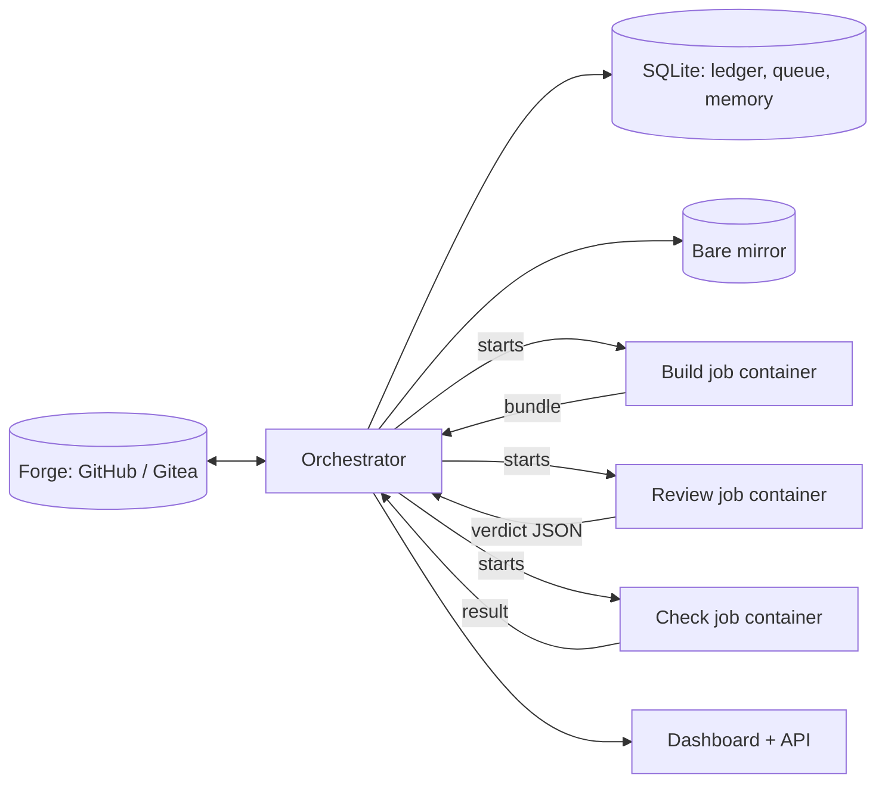

# Architecture overview

- **Orchestrator.** One long-running container, PHP and Symfony. It acts as its own forge identity (a GitHub App, or a bot user on Gitea), never as the owner's account, so the owner's approvals and the bot's own comments can always be told apart. It holds that identity's token, the key that signs the branch commits it pushes (merges are made through the forge API, see Decisions), the SQLite database and a bare mirror of each project. It schedules lanes, starts jobs through the Docker or Podman socket, and serves the dashboard and a local API.
- **Processes.** The orchestrator image runs three kinds of process: FrankenPHP in worker mode for the dashboard, the local API and the MCP server, with Mercure built in; Messenger consumers for lanes and jobs; and the Scheduler for timers and deadlines. All state is in the database, so any of them can restart at any time (see Constraints, a long-lived kernel).
- **Jobs.** Short-lived containers from a project-specific image (the project's toolchain plus the vendor CLIs). No forge credentials, no signing key, egress limited to the vendor's API and package registries. Inputs are mounted read-only; the only output is a directory the orchestrator reads after the job exits.
  - *Build job:* clones from the mirror, runs the vendor CLI with the task and feedback, and returns a git bundle plus pull request text.
  - *Check job:* applies the bundle in a fresh clone and runs the project's check command with a fresh dependency cache. Its result gates the push.
  - *Review job:* gets the diff, the task and a read-only checkout, and returns a verdict JSON.
  - Every job checks at start that what it is told it can do works (for example writing a probe file and reading it back, reaching the vendor through its proxy). A failed check is recorded with its reason and the job runs in its reduced mode, saying so, instead of failing silently halfway. Prompts are built per vendor from what that vendor's job can really do, so no reviewer is invited to a tool it does not have.
- **State.** SQLite, written only by the orchestrator. Ledger events, queue, lane state, budgets, memory entries. Nothing of it is published as a branch: the integrity of main comes from the forge's own protection (required status checks from Intakt's identity, signed commits, no force push, no deletion) where the forge offers it, plus a cheap watchdog that main's history was not rewritten. Each merge's provenance is its pull request: the task, the verdicts, the CI run and the statuses on that head.
- **Events, not polling.** The orchestrator reacts to forge webhooks and job exits, with a timed fallback read when a webhook is lost. Each waiting state has a deadline that wakes it, so idle means no work at all.
- **Updates.** A new Intakt version is installed by draining (no new jobs, running ones finish), swapping the image, checking the orchestrator starts and the forge and vendors answer, and resuming. Any failure rolls back to the previous image and resumes; the owner is alerted on the first failure, not after retries. The installer runs in one fixed environment whatever starts it (clean variables, fixed PATH, defined signal handling), because an inherited difference (a restored SIGPIPE that killed a listing piped into an early-exiting match, a sudo variable that made a helper refuse) made the same install pass one way and fail another; its checks read a command's output first and then match it, and print what they read when they fail. Each update carries a scripted post-update check of what it changed (for example a job writing its probe file under the new rules), and the next update waits until that check and the next jobs' outcomes look right.
- **Runners (later).** Jobs run on the orchestrator's host in v1. Later, other machines the owner controls can register as job runners with their own capacity, so one install can spread builds across them; the orchestrator still holds every credential.
