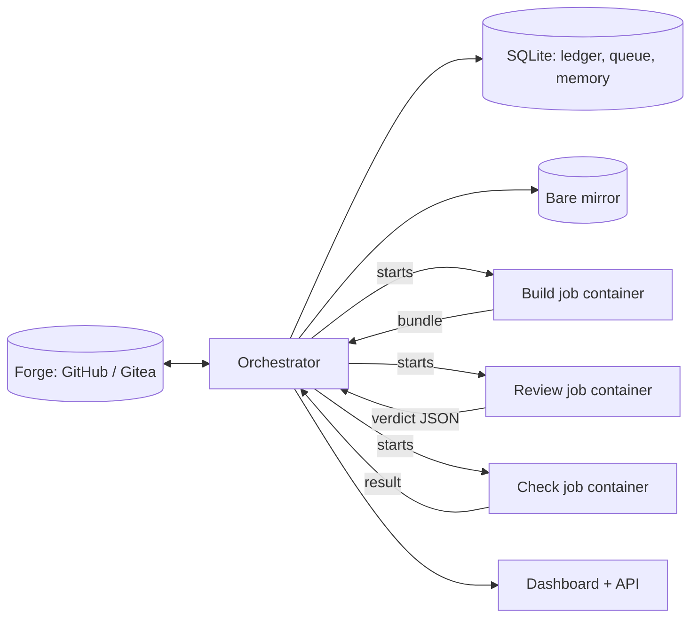

# Architecture overview

## The team

Intakt's model roles carry traditional team titles. There are seven of them, plus the person who owns the project. The id is the lowercase name the role goes by wherever it must be greppable.

| Role | Id | Formerly | What it does |
|---|---|---|---|
| **Product owner** | `owner` | (unchanged) | The person, not a model. Goals, priorities, taste decisions, and the two approval floors (the approval system itself, and secrets and permissions). |
| **Tech lead** | `tech_lead` | the sizer, triage and the planner | Owns the [Definition of Ready](../01-intent.md#definition-of-ready): sizes, splits and plans tasks, checks that their evidence can be produced and names the docs to touch; for a new project, makes the spec ready to plan. |
| **Designer** | `designer` | (new) | Shapes and reviews user-facing work. Active only where a project has a user interface. Its own task designs it. |
| **Developer** | `developer` | the builder | Builds the task. Owns the [Definition of Done](../01-intent.md#definition-of-done) together with the checks. |
| **Code reviewers** | `code_reviewer` | the review panel, with the judge as their verdict step | Review correctness, readability, tests, docs and the framework's use. Specialists are settings of the panel, not roles of their own. |
| **Security engineer** | `security_engineer` | the gatekeeper's security reviewer and attacker (now the penetration tester) | Security across infrastructure, backend and frontend. Its two verdicts, the security review and the penetration test, feed the approval of protected changes. Checks first, the role for what checks cannot judge: reviews per layer, triggered by paths, and a monthly audit ([Reviews](07-reviews.md#the-security-engineer)). |
| **AI engineer** | `ai_engineer` | (new) | Models, prompts, skills, context and tokens; owns model routing, as measured experiments ([planned](06-budget-and-model-planner.md#the-ai-engineer-planned)). |
| **Maintainer** | `maintainer` | the maintainer agent | Hand-overs, conflicts, re-queues, and the weekly flow and quality review ([The Maintainer](09-maintainer-agent.md)). |

Machinery keeps technical names: the orchestrator, the scheduler, the watchdog, the checks (`bin/check` in Intakt itself, the check job for a project) and the dashboard. The approval of protected changes is plain code, not a role: the floors, the mechanical checks and the Security engineer's two verdicts ([Merge](08-merge.md#approving-protected-changes)).

## Machinery

- **Orchestrator.** One long-running container, PHP and Symfony. It acts as its own forge identity (a GitHub App, or a bot user on Gitea), never as the owner's account, so the owner's approvals and the bot's own comments can always be told apart. It holds that identity's token, the key that signs the branch commits it pushes (merges are made through the forge API, see Decisions), the SQLite database and a bare mirror of each project. It schedules lanes, starts jobs through the Docker or Podman socket, and serves the dashboard and a local API.
- **Processes.** The orchestrator image runs three kinds of process: FrankenPHP in worker mode for the dashboard, the local API and the MCP server (the MCP server in its own named worker with its own thread limits, so streamed responses can't starve the dashboard), with Mercure built in; Messenger consumers for lanes and jobs; and the Scheduler for timers and deadlines. All state is in the database, so any of them can restart at any time (see Constraints, a long-lived kernel).
- **Jobs.** Short-lived containers from a project-specific image (the project's toolchain plus the vendor CLIs). No forge credentials, no signing key, egress limited to the vendor's API and package registries. Inputs are mounted read-only; the only output is a directory the orchestrator reads after the job exits.
  - *Build job:* clones from the mirror, runs the vendor CLI with the task and feedback, and returns a git bundle plus pull request text. Before it hands back, the Developer checks the change against the [Definition of Done](../01-intent.md#definition-of-done): it runs the project's fast checks, and it goes through the task's Evidence list, the docs the change touches and the recurring findings of its briefing. A miss is fixed in the same build, not left for the Code reviewers to send back. The docs part is a deterministic report, not only an instruction: from the change's removed and changed lines it takes the names, keys and numbers (commands, options, configuration keys, labels, limits, defaults) and lists every place in the project's docs that still states one of them, and the Developer resolves each hit before hand-back (edits the statement, or names it in the pull request text as checked and still true). The report is plain code with no model call. Measured on this repository, about 40% of blocking findings were docs that still stated what the change replaced, although the Developer was told to search for them. This self-check is cheap and catches the deterministic part of rework (see [Principles](../02-principles.md)); it never replaces the check job, because the Developer's own run is never trusted.
  - *Check job:* applies the bundle in a fresh clone and runs the project's check command with a fresh dependency cache. Its result gates the push.
  - *Review job:* one Code reviewer, or the Security engineer for a protected change; it gets the diff, the task and a read-only checkout, and returns a verdict JSON.
  - Every job checks at start that what it is told it can do works (for example writing a probe file and reading it back, reaching the vendor through its proxy). A failed check is recorded with its reason and the job runs in its reduced mode, saying so, instead of failing silently halfway. Prompts are built per vendor from what that vendor's job can really do, so no reviewer is invited to a tool it does not have.
- **State.** SQLite, written only by the orchestrator. Ledger events, queue, lane state, budgets, memory entries. Nothing of it is published as a branch: the integrity of main comes from the forge's own protection (required status checks from Intakt's identity, signed commits, no force push, no deletion) where the forge offers it, plus a cheap watchdog. Where the forge cannot protect main (a private repository on a plan without branch protection, a forge without rules), the watchdog is the protection: every commit on main must be a merge Intakt recorded or be signed by a key the owner registered as their own. Any other commit, an unsigned or unknown-key commit, or a rewrite of main's history halts the loop with an owner card, since such a commit skipped CI, the reviews and the merge rules. The owner's own push is recorded as an info event and the loop keeps running; only the owner clears a halt, after checking the commit. Each merge's provenance is its pull request: the task, the verdicts, the CI run and the statuses on that head.
- **Internal events, forge polling.** Intakt's own events (job exits, Messenger messages, the dashboard's live updates) are event-driven. Changes on the forge are read by efficient polling ([Merge](08-merge.md#waiting-for-ci)); webhooks are an optional last step for installs with a public endpoint. Each waiting state has a deadline that wakes it, so idle means no work at all beyond a slow check.
- **Updates.** A new Intakt version is installed without stopping the work in progress ([decision 28](../06-decisions.md)): running jobs finish on the version they started with, new jobs take the new version, and the orchestrator is away only for one restart. Jobs already run in their own containers from an image, so a running job shares no tree with the orchestrator and needs no versioned install folders or helper changes to stay on its version.
  - *A job keeps its image to its end (D1).* When a job starts, the image it runs from (by digest), the Intakt release that started it and the version of the job contract it speaks are recorded on the job. The job runs from that image until it exits; an update never swaps or restarts a running job's container. Only a failed update (D6) or a security release ([Threat model](14-threat-model.md#jobs-on-an-older-image-during-an-update)) stops one.
  - *New jobs take the new version (D2).* From the moment the new orchestrator is live (it started and its checks below passed), every job it starts uses the new version's images. A normal update has no drain: admission goes on as before, and the only gap in new work is the restart.
  - *One restart, nothing lost (D3).* The orchestrator stops once and starts on the new image. Job containers are not its child processes, so they carry on: a job writes its output directory and exits as usual, and the container runtime keeps the exit status. On start, the orchestrator lists the job containers through the socket, matches them to the jobs the database holds as running, and takes each up again: a job still running is watched again, and a job that exited during the restart is read as if its exit had just been seen. Queued Messenger messages are kept in the database with the rest of the state, a deadline that passed fires on return, and forge changes are read by the next poll, so anything that happened during the restart is read on return, not lost. The test that proves it forces the order instead of repeating runs: it starts a job, stops the orchestrator, lets the job write its result and exit while the orchestrator is down, starts the orchestrator on the next version, and asserts that the job's result is read and recorded exactly once (one end event in the ledger) and its task moves on as if no restart had happened. A second case keeps the job running across the restart and asserts it is watched again and ends normally.
  - *A versioned job contract, one step of tolerance (D4).* What a job reads (its mounted inputs) and what it hands back (the bundle and pull request text, the verdict JSON, the check result) is a contract with a version number, recorded on the job (D1). Two releases in a row can speak the same contract, so the version alone cannot bound the age: an orchestrator accepts a result only when both hold, the job's recorded release is its own or the release this install was updated from (exactly one update step, whatever the release numbers in between), and the job's contract version is its own or the one before it. A result from a job started two or more update steps back, from an older contract, or one whose release or contract version it cannot read, is not interpreted or guessed at: the job's work is done again on the new version (a build is rebuilt, keeping its commits where the bundle can still be read as a bundle; a check or review runs again), with the reason in the ledger.
  - *A drain is the exception (D5).* A version whose release notes say it needs a drain is installed the old way: no new jobs, running ones finish (work that only waits, for CI or for a person, does not hold it up), then the image is swapped. A release declares this when it changes the job contract by more than D4 allows, or changes how jobs are isolated (container, mounts, network, egress), and its notes give the reason, which the update's record and the dashboard show. Without that declaration an update never drains.
  - *A failed update (D6).* An update fails at two points. Before it is live (the new orchestrator does not start, or the forge or a vendor does not answer), it has started no job. After it is live, it is on trial until its scripted post-update check passed and the first job of each kind it started ended with a result it could accept; a failed post-update check, or such a job failing at its start check or handing back a result the new version cannot read, fails the update. Either failure rolls the orchestrator back to the previous image and resumes, as for every update. Jobs on the older version are not touched and finish as they would have. Jobs the failed version started (only possible on trial) are stopped and their work is done again on the restored version, each recorded in the ledger with the reason.
  - *Rollback keeps live state.* A rollback swaps the image only; it never restores a backup, so nothing recorded after the update (ledger events, merges, job results) is lost. That works because a release only adds to the database layout and the previous release ignores what it does not know ("Add, don't move, on upgrade" in [Principles](../02-principles.md)): the previous orchestrator reads and writes the database the new one migrated. Each release's CI starts the previous release's image on a copy of the database the new release migrated, before the release is published, and a release that fails it is not published. A column or table is removed only by a later release, once the release it would roll back to no longer reads it, so no release needs a restore to roll back, a drain release (D5) included. The owner's own copy of the data stays a recovery for a broken volume, not a step of the rollback.
  - *Shown until done (D7).* The board shows which running jobs are on an older version until none are left ([Dashboard](13-dashboard.md)).

  The new orchestrator is live once it starts and the forge and vendors answer. Any failure rolls back as above; the owner is alerted on the first failure, not after retries. The installer runs in one fixed environment whatever starts it (clean variables, fixed PATH, defined signal handling), because an inherited difference (a restored SIGPIPE that killed a listing piped into an early-exiting match, a sudo variable that made a helper refuse) made the same install pass one way and fail another; its checks read a command's output first and then match it, and print what they read when they fail. Each update carries a scripted post-update check of what it changed (for example a job writing its probe file under the new rules), and the next update waits until that check and the next jobs' outcomes look right. An update starts when the owner picks a version or, with auto-update on, when a new release appears. A version that failed to install is not tried again until a newer one exists or the owner retries it, and a rollback that could not restore every part blocks the next update until a check shows the install whole.
- **Outside liveness check.** Every notice goes through Intakt, so a stopped orchestrator cannot report itself. The Scheduler sends a heartbeat at a fixed interval to a dead-man check outside the install (a hosted check, a home automation, a second machine), which alerts the owner when the beats stop. A beat is sent only when the Messenger consumers, the Scheduler and the Maintainer each finished work or an idle check in the interval, so a hung worker stops it too. The outside check needs no access to Intakt and holds no secret beyond its own address; the wizard offers to set it up, and its test sends one beat.
- **Runners (later).** Jobs run on the orchestrator's host in v1. Later, other machines the owner controls can register as job runners with their own capacity, so one install can spread builds across them; the orchestrator still holds every credential.
