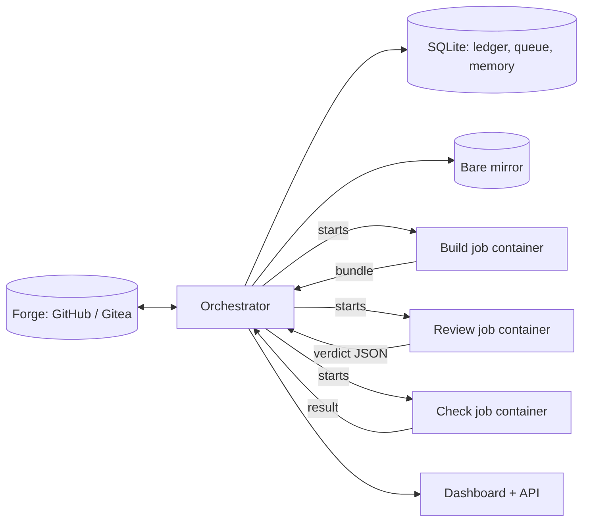

# Architecture overview

## The team

Intakt's model roles carry traditional team titles. There are eight of them, plus the Test engineer, an opt-in ninth that a new project starts without, and the person who owns the project. The id is the lowercase name the role goes by wherever it must be greppable.

| Role | Id | Formerly | What it does |
|---|---|---|---|
| **Product owner** | `owner` | (unchanged) | The person, not a model. Goals, priorities, taste decisions, and the two approval floors (the approval system itself, and secrets and permissions). |
| **Tech lead** | `tech_lead` | the sizer, triage and the planner | Owns the [Definition of Ready](../01-intent.md#definition-of-ready): sizes, splits and plans tasks, checks that they still hold on today's main and that their evidence can be produced, and names the docs to touch; for a new project, makes the spec ready to plan. |
| **Designer** | `designer` | (new) | Shapes and reviews user-facing work. Active only for a project with a user interface, and there only for tasks whose paths or labels touch it, so it costs nothing elsewhere. Before the build it adds to *Ready* the flows, every state, the copy, the three widths and the accessibility needs; its tools are opt-in per project ([planned](07-reviews.md#the-designer-planned)). |
| **Developer** | `developer` | the builder | Builds the task. Owns the [Definition of Done](../01-intent.md#definition-of-done) together with the checks. |
| **Code reviewers** | `code_reviewer` | the review panel, with the judge as their verdict step | Review correctness, readability, tests, docs and the framework's use. Specialists are settings of the panel, not roles of their own. |
| **Technical writer** | `technical_writer` | (new) | Owns the docs people read: reviews the docs part of a change that touches the user guide, the plain-words guides, the README or a page's summary, for its audience, and can send it back like a Code reviewer. Proposes the user guide's structure and the docs gate's limits, which the owner decides. It never judges whether docs are true to the code (the Code reviewers do) and never edits code ([planned](07-reviews.md#the-technical-writer-planned)). |
| **Security engineer** | `security_engineer` | the gatekeeper's security reviewer and attacker (now the penetration tester) | Security across infrastructure, backend and frontend. Its two verdicts, the security review and the penetration test, feed the approval of protected changes. Checks first, the role for what checks cannot judge: reviews per layer, triggered by paths, and a monthly audit ([Reviews](07-reviews.md#the-security-engineer)). |
| **AI engineer** | `ai_engineer` | (new) | Models, prompts, skills, context and tokens, and how agents work (check runs per merged task); owns model routing, as measured experiments ([planned](06-budget-and-model-planner.md#the-ai-engineer-planned)). |
| **Test engineer** (opt-in) | `test_engineer` | (new) | Owns the test suite as a whole: its time, redundant tests, the balance of tests and the CI workflows' speed, through a scheduled audit that files ready tasks and never edits a test ([planned](07-reviews.md#the-test-engineer-planned)). A new project starts without it. |
| **Maintainer** | `maintainer` | the maintainer agent | Hand-overs, conflicts, re-queues, and the weekly flow review, and the monthly backlog sweep, a job of its own; the health of the test suite is the Test engineer's ([The Maintainer](09-maintainer-agent.md)). |

Machinery keeps technical names: the orchestrator, the scheduler, the watchdog, the checks (`bin/check` in Intakt itself, the check job for a project) and the dashboard. The approval of protected changes is plain code, not a role: the floors, the mechanical checks and the Security engineer's two verdicts ([Merge](08-merge.md#approving-protected-changes)).

## Machinery

- **Orchestrator.** One long-running container, PHP and Symfony. It acts as its own forge identity (a GitHub App, or a bot user on Gitea), never as the owner's account, so the owner's approvals and the bot's own comments can always be told apart. It holds that identity's token, the key that signs the branch commits it pushes (merges are made through the forge API, see Decisions), the SQLite database and a bare mirror of each project. It schedules lanes, starts jobs through the Docker or Podman socket, and serves the dashboard and a local API.
- **Processes.** The orchestrator image runs three kinds of process: FrankenPHP in worker mode for the dashboard, the local API and the MCP server (the MCP server in its own named worker with its own thread limits, so streamed responses can't starve the dashboard), with Mercure built in; Messenger consumers for lanes and jobs; and the Scheduler for timers and deadlines. All state is in the database, so any of them can restart at any time (see Constraints, a long-lived kernel). Every recurring job the Scheduler runs (the watcher tick, usage probes, deadlines, the weekly cleanup, the heartbeat, and the Maintainer's backlog sweep) is registered with its purpose, schedule, owning role and expected token cost per run, and is shown on the dashboard's Health page with its last and next run, where the owner can switch it off or on and run it now ([Background jobs](13-dashboard.md#background-jobs), planned). The heartbeat shows there like any other job; switching it off stops the beats to the outside liveness check below, which then alerts the owner that Intakt went quiet, so its row says so.
- **Jobs.** Short-lived containers from a project-specific image (the project's toolchain plus the vendor CLIs). No forge credentials, no signing key, egress limited to the vendor's API and package registries. Inputs are mounted read-only; the only output is a directory the orchestrator reads after the job exits.
  - *Build job:* clones from the mirror, runs the vendor CLI with the task and feedback, and returns a git bundle plus pull request text, or instead a structured question (`QUESTION.json`: a question, its choices and a recommendation), which comes before the bundle: a build that left a valid question hands back no change, whatever commits it made. Before it hands back, the Developer checks the change against the [Definition of Done](../01-intent.md#definition-of-done): it runs the project's fast checks, and it goes through the task's Evidence list, the docs the change touches and the recurring findings of its briefing. A miss is fixed in the same build, not left for the Code reviewers to send back. When the build cannot meet the task's stated outcome, it stops before anything is pushed (planned): the Developer keeps its commits and hands back pull request text titled as blocked that reports what it measured and the cause, and the orchestrator saves that work with the task, pushes nothing, opens no review and sends the task to the owner (or to the Tech lead after a task's first two-failure stop below), so it can be rescoped or split instead of going to the Code reviewers with a change that misses its outcome. The docs part is a deterministic report, not only an instruction: from the change's removed and changed lines it takes the names, keys and numbers (commands, options, configuration keys, labels, limits, defaults) and lists every place in the project's docs that still states one of them, and the Developer resolves each hit before hand-back (edits the statement, or names it in the pull request text as checked and still true). The report is plain code with no model call. Measured on this repository, about 40% of blocking findings were docs that still stated what the change replaced, although the Developer was told to search for them. This self-check is cheap and catches the deterministic part of rework (see [Principles](../02-principles.md)); it never replaces the check job, because the Developer's own run is never trusted.
  - *How a build verifies (planned, plan T49):* three rules for the Developer, built on the verify command of the task's brief ([Choosing work](03-choosing-work.md), step 4). Reason: builders re-ran whole test suites many times per task, and on the loop that builds this repository, measured over merged work only from 2026-11-05 to 11-13, about 57% of tokens went to rework after the first build and review (a later window than the 51% of all tokens in [Principles](../02-principles.md)).
    - *Targeted verify.* While it works, the Developer runs only the brief's verify command and the checks its edits affect. Each wider check then runs once, at the end (this extends #1219): the Developer's fast checks above once before hand-back, the check job's pre-push gates once before the push, and the full check command, tests included, once on the pushed head (the head's check run below); the push only publishes the branch, so that run is this rule's single full run at the end, before review and merge.
    - *Two failures stop the build.* When the verify command fails twice with different causes, the Developer makes no further attempt: it ends the build as blocked with pull request text whose title starts with the fixed form `Blocked: two failures:` and whose body names both causes. The Developer judges the causes, so this is an instruction, like the self-check above. Plain code reads only that title form: the first such stop of a task sends the task back to the Tech lead to plan again, with both causes, instead of to the owner; any later one, and blocked text without the form, goes to the owner by the blocked-output path. The count of these stops is kept in the ledger per task and starts over only when a person sends the task back to building, so a forged or repeated claim costs at most one extra plan and build before the owner sees the task ([Threat model](14-threat-model.md#build-brief)).
    - *Approach note.* Before its first edit the Developer writes what the change must do, the decisions that are not obvious, and why. It hands the note back with the bundle; the task's page on the dashboard shows it, and the Code reviewers get it as [stated intent](07-reviews.md#the-approach-note-is-intent).
  - *Check job:* applies the bundle in a fresh clone and runs the project's pre-push gates with no cache of its own, though it may copy a saved install with the same lock files and platform into that clone: for Intakt its static gates, the gates `bin/check --static-gates` lists as static (they do not run the change's code, so no tests), and for another project the pre-push command it configures (its whole check command when it configures none). Its result gates the push.
  - *The head's check run is the builder's check.* The full check command, tests included, runs on the pushed head, as the independent second run of [CI](06-budget-and-model-planner.md#ci-design-for-later): Intakt's own check container by default, the forge's CI where the project sets it, or both. When more than one is set, each is a required status, and the head's check is green only when all of them are; the reviews and merge pages call them CI. For Intakt's own repository the project setting is the forge's hosted CI; other projects keep the per-project choice and its default. A red run goes back to the builder with the failed gates and their findings, redacted and fenced like any CI excerpt: always from Intakt's check container (a fresh container with no network and no secrets, whose status the orchestrator posts from outside), and from a forge run only when the workflow scan clears the head's runners; a forge run the scan does not clear, or any forge run when the scan fails, goes back with only the count of failed jobs ([Reviews](07-reviews.md), [Threat model](14-threat-model.md#ci-log-excerpts)), and the wait for that run holds no build slot: the build job has ended when the head is pushed, so the slot takes the next task. Neither run is the Developer's own: the check job and the check run both run in a clean place, so the principle that the Developer's own run is never trusted still holds ([Principles](../02-principles.md)). Measured: a build loop running beside Intakt that ran the full `bin/check` on its own machine for three builders at once saturated that machine (load 27.7 on 16 threads) and slowed everything else on it, while the same check on CI's hosted machines took a median of 3.5 minutes.
  - *Review job:* one Code reviewer, or the Security engineer for a protected change; it gets the diff, the task and a read-only checkout, and returns a verdict JSON.
  - *Check slots (planned, #1781):* an install runs at most `check_slots` builder checks at once on its host, whatever the project's language and tools; the checks of one job share one slot. A check is a run of the project's configured check command or test command: the Developer's own runs in a build job, the check job's run, and the head's check run in Intakt's own check container. A check that finds no free slot waits for one; the rest of the build (the agent's reading, editing and thinking) goes on in parallel, and only that command waits.
    - *Why.* Every check sizes itself to the whole machine: a test runner or static analyzer starts a worker per core (`bin/check` runs as many gates at once as there are processors), with no idea that other checks run beside it. Tools with fixed timeouts then fail instead of slowing down, and the failures look like the Developer's mistakes. Measured on a 12-core host with Intakt's own static gates (Rector and PHPStan at once, cold caches), several checks started together:

      | Checks at once | Wall per check | Checks per minute | Result |
      |---|---|---|---|
      | 1 | 19 to 25 s | 2.4 | ok |
      | 2 | 41 s | 2.9 | ok |
      | 3 | 65 s | 2.8 | ok |
      | 5 (tool defaults) | 157 to 189 s | | every Rector run failed: `Child process timed out after 120 seconds` |
      | 5 (Rector capped at 4 workers, #1780) | 115 s | 2.6 | ok, but each check about 5x slower |

      Five checks at once on tool defaults finish later than five one after another, and two at once give the most checks per minute. Capping one tool (#1780) fixes only that tool in Intakt's own repository; the projects Intakt builds bring their own tools, so the limit belongs to the builder, not to any tool's settings. Intakt's own lowering of `bin/check`'s gates at once in a build job ([Build job](../../architecture/build-job.md)) keeps its rule: it sizes one check, check slots limit how many run.
    - *How.* A host-wide counting lock around each check: `check_slots` lock files taken with `flock` (or the platform's equivalent) and freed by the kernel when the process holding one ends. There is no daemon and no queue state that could stall: the lock directory is the whole state, and one lock directory covers every project of the install. Only the orchestrator holds slots, and the lock directory is never mounted into a job. The builder only wraps the project's configured check and test commands, so the limit works for any language and tool and changes no tool's settings:
      - The check job and the head's check run in Intakt's check container take a slot for their run.
      - In a build job, a small slot wrapper from the job image runs the configured check and test commands and asks the orchestrator for a slot through a slot channel of that job only. The job is untrusted, so the orchestrator treats that channel as untrusted input ([Threat model](14-threat-model.md)).
    - *Enforcement.* The job's CPU quota enforces a slot, not the wrapper. Every job runs at a base of 2 CPUs, today's fixed job limit ([Budget and model planner](06-budget-and-model-planner.md)); only while it holds a slot is its quota (`cpu.max`, set from outside the container) raised to the slot's share, the usable processors divided by `check_slots` and never below the base (6 on the measured host, where the default is 2). Memory stays at 4 GiB with and without a slot, and with `check_slots` at 0 every job keeps 2 CPUs and 4 GiB, never raised. The cap counts jobs above the base, not single runs (the checks of one job share its one slot), and when the share is not above the base, the cap is a courtesy among wrapped checks.
      - The wrapper runs inside the job, so it is the job's own cooperation, not a boundary: a check run outside the wrapper, or on a grant the job wrote itself, gets only its job's current quota, like a direct run.
    - *Invariants.* Whatever protocol T95 chooses, it keeps these:
      - At most `check_slots` jobs run above the base at any moment, also when an orchestrator crashes or restarts and while a call to the container engine is still in flight.
      - A lost holder, a job whose orchestrator process ended while the job held a slot, is lowered to the base and never granted a slot again.
      - A check that sizes itself sees the limits it will run under: a check command started with a slot, in a check container too, sizes itself from the slot's share, not from the base.
      - A check whose quota was lowered while it ran, and that fails, is not the Developer's failure: it ends as stalled, and a wrapped check says in its output that its slot was lost.
    - *Ceilings.* The wait for a slot has a ceiling like every wait ([Principles](../02-principles.md)), at which the check ends as stalled, and a slot is held at most for a hold ceiling, at which it is freed and its job lowered to the base. T95 chooses both and records them in `docs/architecture/`.
    - *Protocol.* T95 designs the protocol that keeps these invariants (the slot channel, the grants, recovery after a crash or restart), records it in `docs/architecture/`, and proves every crash and race order it names with a forced-order test.
    - *Default and setting.* `check_slots` is an install setting. By default it is the host's usable processors divided by 6, at least 1, and fewer when memory is short (the memory the install may use divided by what one check needs, which the implementing task sets, at no less than a job's 4 GiB memory limit, and records in `docs/architecture/`). The processors and memory are read the way `bin/check` reads them: the affinity list capped by the CPU quota of the install's own cgroup (`cpu.max`), and the lowest numeric memory limit (`memory.max`, `memory.high`) across the install's own cgroup and every ancestor up to the root, because a parent's limit binds the install as much as its own; `max` or anything unreadable sets no cap, so an own `max` under a parent with a number takes the parent's number. On the 12-core host above the default is 2, the row with the most checks per minute, so a first install needs no setting. A configured value wins; `0` turns the limit off (no slot is taken, and every job keeps today's fixed limit of 2 CPUs and 4 GiB, never raised).
    - *What shows.* A waiting check shows on the board as "waiting for a check slot, N running" ([Dashboard](13-dashboard.md)), and the build's [progress stop](06-budget-and-model-planner.md), which counts steps, does not count a step waiting for a check slot as a step without progress.
  - Every job checks at start that what it is told it can do works (for example writing a probe file and reading it back, reaching the vendor through its proxy). A failed check is recorded with its reason and the job runs in its reduced mode, saying so, instead of failing silently halfway. Prompts are built per vendor from what that vendor's job can really do, so no reviewer is invited to a tool it does not have.
- **State.** SQLite, written only by the orchestrator. Ledger events, queue, lane state, budgets, memory entries. Nothing of it is published as a branch: the integrity of main rests on whether a commit went through a gate, never on who signed it, so commits from contributors, dependency bots and the forge's own merges are normal on main. A cheap watchdog checks how each new commit on main arrived ([Merge](08-merge.md#watching-main)). A commit is accepted when Intakt merged it and recorded the merge, when the forge reports it as part of a pull request merged into main by an account with write access, or when the forge reports it as pushed to main by a person with write access; the last two are info events, and a direct push also shows on the dashboard as "pushed without the gate" while main's CI result on it is watched as for any merge. The watchdog halts the loop with an owner card naming the commit and the reason on a rewrite of main's history, a commit the forge cannot attribute to a merged pull request or to a write-access pusher, a merger or pusher without write access, a direct push by a bot or App account, and a commit Intakt's own identity (its App or the maintainer agent's) pushed or merged that Intakt's record lacks, since Intakt never lands a commit without recording it. Intakt records a merge attempt (the pull request, the head, main's commit it lands on and the identity) before every landing, so a landing whose answer was lost or that the forge reports late is matched to its attempt and stays Intakt's merge, and a commit by Intakt's own identity that an open attempt could still explain (for a forge merge call, its pull request still reported open on that head; for a ref update, main on the attempt's head, whatever the forge reports of the pull request) is held as pending, with no merge meanwhile, and halts only when the forge has not attributed it to the attempt within 10 minutes ([Merge](08-merge.md#watching-main)). Signatures are recorded as the forge reports them and never required, unless the project turns on the opt-in signed-commit setting (off by default). The maintainer decision of 2026-11-13 (#2914) built a signature classifier first (a recorded merge head passes, and so does a commit reachable from it but not from that merge's recorded base, an owner-signed commit passes, an unsigned commit, an unknown key and a rewrite of main's history are violations; [Watchdog over main](../../architecture/watchdog.md)); how it combines with the rules above is unresolved and the owner's to settle. Setup recommends the forge's own branch protection (required status checks from Intakt's identity, no force push, no deletion) where the plan offers it, and the dashboard shows when the watchdog is main's only protection (a private repository on a plan without branch protection, a forge without rules). Only the owner clears a halt, after checking the commit. Each merge's provenance is its pull request: the task, the verdicts, the CI run and the statuses on that head.
- **Internal events, forge polling.** Intakt's own events (job exits, Messenger messages, the dashboard's live updates) are event-driven. Changes on the forge are read by efficient polling ([Merge](08-merge.md#waiting-for-ci)); webhooks are an optional last step for installs with a public endpoint. Each waiting state has a deadline that wakes it, so idle means no work at all beyond a slow check; while an outside event is pending, a lane is re-checked early within seconds, backing off to its normal interval.
- **Updates.** A new Intakt version is installed without stopping the work in progress ([decision 33](../06-decisions.md)). It is installed side by side as a new immutable image, and its [build-path self-check](11-setup.md#the-build-path-self-check) is compared failure by failure with the running version's on the same commit; it then starts on one build slot, the other slots follow once a build on that slot finishes without a stop the [shared-failure canary](06-budget-and-model-planner.md#shared-failure-canary) counts, or after a fixed number of minutes with no failure, and the orchestrator itself switches last, in a cut-over that is its one restart and keeps one writer of the state at a time. A running job finishes on the image it started with, recorded on the job, and new jobs take the new version; job containers carry on through the restart, and the orchestrator reads on return what happened meanwhile. The job contract is versioned, and a result is accepted across exactly one update step; an older job's work is done again, never guessed at. No slot drains in a normal update: only a release that declares it drains, with the reason (a contract change beyond that step, a change of how jobs are isolated, or stored state the old version cannot read). A failure rolls the orchestrator back on the same data, inside a rollback window each release declares and proves, leaves jobs on the older version alone and redoes the failed version's jobs; only a release with stored state the old version cannot read is restored from a copy, and only before the lanes resume. The owner is alerted on the first failure, non-urgent updates wait for the owner's update windows, and the board shows the jobs on an older version until none are left. The whole flow, with D1 to D7 of decision 33, is in [Setup](11-setup.md#updates).
- **Outside liveness check.** Every notice goes through Intakt, so a stopped orchestrator cannot report itself. The Scheduler sends a heartbeat at a fixed interval to a dead-man check outside the install (a hosted check, a home automation, a second machine), which alerts the owner when the beats stop. A beat is sent only when the Messenger consumers, the Scheduler and the Maintainer each finished work or an idle check in the interval, so a hung worker stops it too. The outside check needs no access to Intakt and holds no secret beyond its own address; the wizard offers to set it up, and its test sends one beat.
- **Runners (later).** Jobs run on the orchestrator's host in v1. Later, other machines the owner controls can register as job runners with their own capacity, so one install can spread builds across them; the orchestrator still holds every credential.
