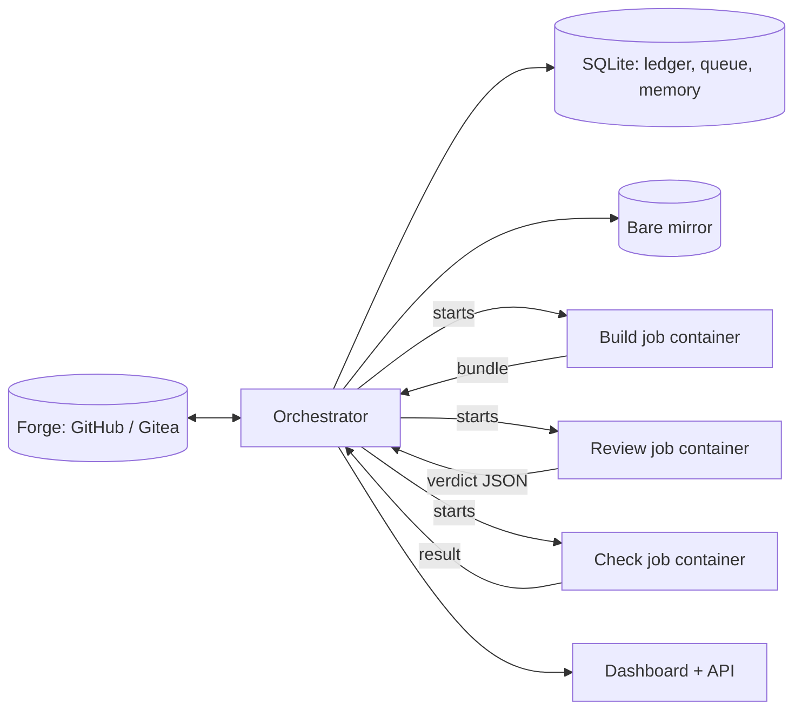

# Architecture overview

## The team

Intakt's model roles carry traditional team titles. There are seven of them, plus the Test engineer, an opt-in eighth that a new project starts without, and the person who owns the project. The id is the lowercase name the role goes by wherever it must be greppable.

| Role | Id | Formerly | What it does |
|---|---|---|---|
| **Product owner** | `owner` | (unchanged) | The person, not a model. Goals, priorities, taste decisions, and the two approval floors (the approval system itself, and secrets and permissions). |
| **Tech lead** | `tech_lead` | the sizer, triage and the planner | Owns the [Definition of Ready](../01-intent.md#definition-of-ready): sizes, splits and plans tasks, checks that they still hold on today's main and that their evidence can be produced, and names the docs to touch; for a new project, makes the spec ready to plan. |
| **Designer** | `designer` | (new) | Shapes and reviews user-facing work. Active only where a project has a user interface. Its own task designs it. |
| **Developer** | `developer` | the builder | Builds the task. Owns the [Definition of Done](../01-intent.md#definition-of-done) together with the checks. |
| **Code reviewers** | `code_reviewer` | the review panel, with the judge as their verdict step | Review correctness, readability, tests, docs and the framework's use. Specialists are settings of the panel, not roles of their own. |
| **Security engineer** | `security_engineer` | the gatekeeper's security reviewer and attacker (now the penetration tester) | Security across infrastructure, backend and frontend. Its two verdicts, the security review and the penetration test, feed the approval of protected changes. Checks first, the role for what checks cannot judge: reviews per layer, triggered by paths, and a monthly audit ([Reviews](07-reviews.md#the-security-engineer)). |
| **AI engineer** | `ai_engineer` | (new) | Models, prompts, skills, context and tokens, and how agents work (check runs per merged task); owns model routing, as measured experiments ([planned](06-budget-and-model-planner.md#the-ai-engineer-planned)). |
| **Test engineer** (opt-in) | `test_engineer` | (new) | Owns the test suite as a whole: its time, redundant tests, the balance of tests and the CI workflows' speed, through a scheduled audit that files ready tasks and never edits a test ([planned](07-reviews.md#the-test-engineer-planned)). A new project starts without it. |
| **Maintainer** | `maintainer` | the maintainer agent | Hand-overs, conflicts, re-queues, and the weekly flow review with its backlog sweep; the health of the test suite is the Test engineer's ([The Maintainer](09-maintainer-agent.md)). |

Machinery keeps technical names: the orchestrator, the scheduler, the watchdog, the checks (`bin/check` in Intakt itself, the check job for a project) and the dashboard. The approval of protected changes is plain code, not a role: the floors, the mechanical checks and the Security engineer's two verdicts ([Merge](08-merge.md#approving-protected-changes)).

## Machinery

- **Orchestrator.** One long-running container, PHP and Symfony. It acts as its own forge identity (a GitHub App, or a bot user on Gitea), never as the owner's account, so the owner's approvals and the bot's own comments can always be told apart. It holds that identity's token, the key that signs the branch commits it pushes (merges are made through the forge API, see Decisions), the SQLite database and a bare mirror of each project. It schedules lanes, starts jobs through the Docker or Podman socket, and serves the dashboard and a local API.
- **Processes.** The orchestrator image runs three kinds of process: FrankenPHP in worker mode for the dashboard, the local API and the MCP server (the MCP server in its own named worker with its own thread limits, so streamed responses can't starve the dashboard), with Mercure built in; Messenger consumers for lanes and jobs; and the Scheduler for timers and deadlines. All state is in the database, so any of them can restart at any time (see Constraints, a long-lived kernel). Every recurring job the Scheduler runs (the watcher tick, usage probes, deadlines, the weekly cleanup, the heartbeat, and the Maintainer's backlog sweep) is registered with its purpose, schedule, owning role and expected token cost per run, and is shown on the dashboard's Health page with its last and next run, where the owner can switch it off or on and run it now ([Background jobs](13-dashboard.md#background-jobs), planned). The heartbeat shows there like any other job; switching it off stops the beats to the outside liveness check below, which then alerts the owner that Intakt went quiet, so its row says so.
- **Jobs.** Short-lived containers from a project-specific image (the project's toolchain plus the vendor CLIs). No forge credentials, no signing key, egress limited to the vendor's API and package registries. Inputs are mounted read-only; the only output is a directory the orchestrator reads after the job exits.
  - *Build job:* clones from the mirror, runs the vendor CLI with the task and feedback, and returns a git bundle plus pull request text. Before it hands back, the Developer checks the change against the [Definition of Done](../01-intent.md#definition-of-done): it runs the project's fast checks, and it goes through the task's Evidence list, the docs the change touches and the recurring findings of its briefing. A miss is fixed in the same build, not left for the Code reviewers to send back. The docs part is a deterministic report, not only an instruction: from the change's removed and changed lines it takes the names, keys and numbers (commands, options, configuration keys, labels, limits, defaults) and lists every place in the project's docs that still states one of them, and the Developer resolves each hit before hand-back (edits the statement, or names it in the pull request text as checked and still true). The report is plain code with no model call. Measured on this repository, about 40% of blocking findings were docs that still stated what the change replaced, although the Developer was told to search for them. This self-check is cheap and catches the deterministic part of rework (see [Principles](../02-principles.md)); it never replaces the check job, because the Developer's own run is never trusted.
  - *Check job:* applies the bundle in a fresh clone and runs the project's pre-push gates with a fresh dependency cache: for Intakt its static gates, the gates `bin/check --static-gates` lists as static (they do not run the change's code, so no tests), and for another project the pre-push command it configures (its whole check command when it configures none). Its result gates the push.
  - *The head's check run is the builder's check.* The full check command, tests included, runs on the pushed head, as the independent second run of [CI](06-budget-and-model-planner.md#ci-design-for-later): Intakt's own check container by default, the forge's CI where the project sets it, or both. When more than one is set, each is a required status, and the head's check is green only when all of them are; the reviews and merge pages call them CI. For Intakt's own repository the project setting is the forge's hosted CI; other projects keep the per-project choice and its default. A red run goes back to the builder with the failed gates and their findings, redacted and fenced like any CI excerpt: always from Intakt's check container (a fresh container with no network and no secrets, whose status the orchestrator posts from outside), and from a forge run only when the workflow scan clears the head's runners; a forge run the scan does not clear, or any forge run when the scan fails, goes back with only the count of failed jobs ([Reviews](07-reviews.md), [Threat model](14-threat-model.md#ci-log-excerpts)), and the wait for that run holds no build slot: the build job has ended when the head is pushed, so the slot takes the next task. Neither run is the Developer's own: the check job and the check run both run in a clean place, so the principle that the Developer's own run is never trusted still holds ([Principles](../02-principles.md)). Measured: a build loop running beside Intakt that ran the full `bin/check` on its own machine for three builders at once saturated that machine (load 27.7 on 16 threads) and slowed everything else on it, while the same check on CI's hosted machines took a median of 3.5 minutes.
  - *Review job:* one Code reviewer, or the Security engineer for a protected change; it gets the diff, the task and a read-only checkout, and returns a verdict JSON.
  - *Check slots (planned, #1781):* an install runs at most `check_slots` builder checks at once on its host, whatever the project's language and tools. A check is a run of the project's configured check command or test command: the Developer's own runs in a build job, the check job's run, and the head's check run in Intakt's own check container. A check that finds no free slot waits for one; the rest of the build (the agent's reading, editing and thinking) goes on in parallel, and only that command waits.
    - *Why.* Every check sizes itself to the whole machine: a test runner or static analyzer starts a worker per core (`bin/check` runs as many gates at once as there are processors), with no idea that other checks run beside it. Tools with fixed timeouts then fail instead of slowing down, and the failures look like the Developer's mistakes. Measured on a 12-core host with Intakt's own static gates (Rector and PHPStan at once, cold caches), several checks started together:

      | Checks at once | Wall per check | Checks per minute | Result |
      |---|---|---|---|
      | 1 | 19 to 25 s | 2.4 | ok |
      | 2 | 41 s | 2.9 | ok |
      | 3 | 65 s | 2.8 | ok |
      | 5 (tool defaults) | 157 to 189 s | | every Rector run failed: `Child process timed out after 120 seconds` |
      | 5 (Rector capped at 4 workers, #1780) | 115 s | 2.6 | ok, but each check about 5x slower |

      Five checks at once finish later than five one after another, and two at once give the most checks per minute. Capping one tool (#1780) fixes only that tool in Intakt's own repository; the projects Intakt builds bring their own tools, so the limit belongs to the builder, not to any tool's settings. Intakt's own lowering of `bin/check`'s gates at once in a build job ([Build job](../../architecture/build-job.md)) keeps its rule: it sizes one check, check slots limit how many run. Which CPU limit that count is sized from is said under *How*.
    - *How.* A host-wide counting lock around each check: `check_slots` lock files in one lock directory of the install, taken with `flock` (or the platform's equivalent) and released by the kernel when the process holding it ends, so a crashed or killed holder frees its slot. There is no daemon and no queue state that could stall, and nothing about slots is in the database or only in a process's memory: the lock directory is the whole state. It holds the lock files, each naming the job that holds it (the name is cleared on a normal release, see the lost-holder rule below), and one first-seen file per waiting job with the time the orchestrator first saw that job ask, by the orchestrator's clock. Only the orchestrator writes either, so a restarted orchestrator reads the directory and carries on. One lock directory covers every project of the install. Only the orchestrator holds slots: the orchestrator process that runs a job takes and releases that job's slot, and the lock directory is never mounted into a job, so no job can open, hold or name a lock file. The builder only wraps the project's configured check and test commands, so the limit works for any language and tool and changes no tool's settings:
      - The check job and the head's check run in Intakt's check container: the orchestrator takes a slot before it starts the container and frees it when the container ends.
      - The Developer's runs in a build job: a small slot wrapper from the job image runs the configured commands. It asks for a slot by creating a request file of its own in a slot channel directory of that job only, one file per wrapped command, and keeps a `flock` on it while its command runs; it waits for the grant, a grant file the orchestrator writes in the same slot channel directory (and removes when it frees the slot), and removes its request file when the command ends. A grant file the job writes itself gains nothing, because the CPU quota below, not the grant file, gives a check a slot's capacity. The channel is a directory an untrusted job writes, so only regular files count as requests: the orchestrator inspects each entry without following links and opens it without blocking, up to a fixed count of entries per job (T94 sets the count and records it in `docs/architecture/`); links, named pipes, devices, directories and entries beyond the count are ignored and removed. The orchestrator never reads a request file's name, content or timestamps (so a job cannot name another job or a count, or backdate its request); it only asks whether the channel holds at least one request file that is locked. A request whose wrapper was killed has lost its lock, so it no longer counts and the orchestrator removes it. A job asks while at least one of its requests counts, and holds at most one slot: two wrapped commands at once (tests in the background, then the check) run under the same slot, the first to end removes only its own request, and the slot is freed when the last one is gone. A freed slot goes to the job that has waited longest, measured from the orchestrator's first-seen file for that job, never from anything the job wrote.
      - Enforcement is the job's CPU quota, not the wrapper. The base quota is today's fixed job limit of 2 CPUs ([Budget and model planner](06-budget-and-model-planner.md)); it stays, so the agent's other work keeps what it has. Only while the orchestrator holds a job's slot does it raise the job's cgroup CPU quota (`cpu.max`, set from outside the container) to the slot's share: the usable processors divided by `check_slots`, rounded down and never below the base (6 on the measured host, where the default is 2). It lowers the quota to the base when it frees the slot. The check job and the head's check run in Intakt's check container hold their slot from start to end, so they start with the slot's share as their CPU limit instead of today's fixed 2 CPUs. The shares of all slots together stay within the usable processors (unless the base lifts them); jobs without a slot add their base on top, as build jobs do today. A configured test runner the Developer starts directly, outside the wrapper, therefore runs within the base quota and never with a slot's capacity, so at most `check_slots` jobs run at a slot's share whatever a job runs. A slot is held at most for the check's hold ceiling (the project's check timeout); at that ceiling the orchestrator frees the slot and lowers the quota, and requests of that job still counting then are first seen anew, behind every job already waiting, so one job cannot keep other projects' checks waiting.
      - Memory does not follow the slot. Every job keeps today's fixed memory limit of 4 GiB with and without a slot, because a memory limit lowered under a running process kills it. A check can therefore use up to 4 GiB, and the per-check memory figure of the default below is never less than a job's memory limit. `bin/check` reads its limits when it starts: a wrapped check sizes itself from the slot's share and 4 GiB, one started outside the wrapper from the base. The gates-at-once count a build job hands its builder ([Budget and model planner](06-budget-and-model-planner.md)) is sized from the slot's share and 4 GiB, the limits a check with a slot runs under. Under 4 GiB `bin/check`'s default is 1 gate at either quota (each gate and test worker gets a 2 GiB share), so the count still hands over nothing, and the share's processors go to the workers each tool starts, which is what the table above measured. Larger memory limits are not part of check slots; they come with T60 as that page says.
      - A lost holder never raises the cap. A slot's lock is freed by the kernel when the orchestrator process holding it ends (a crash, a restart, the cut-over of an update), while the job it was held for keeps running at the raised quota and the lock file still names it. On a normal release the orchestrator therefore first lowers the job to the base quota and clears the lock file's name, and only then releases the lock, so a name is left in a free lock file only by a lost holder. Whoever takes a lock file reads the job it names and lowers that job to the base quota, if it still runs, only when no held lock file names the same job: a job named in a held lock file holds that slot legitimately (it may have taken another lock file since). Then it writes its own job's name and raises that one. At most one job per lock file is ever raised, so no more than `check_slots` jobs run at a slot's share at any moment, also across a restart. At its start the orchestrator takes every lock file it can and lowers each job named in one by the same rule, as well as the jobs named in any lock file beyond a lowered `check_slots`, and then grants again from the requests that still count, in the order of the first-seen files, which outlive the restart. A build job lowered this way gets a slot again in its turn, and the hold ceiling starts again when that slot is granted. A wrapped check that was running when its job was lowered keeps the workers it sized for the slot's share and finishes slower at the base quota; that is not the Developer's failure. A check container lowered this way finishes at the base quota.
      - The wait has a ceiling like every wait ([Principles](../02-principles.md)), which T94 chooses and records in `docs/architecture/`: a check still without a slot at its ceiling ends as stalled, not as the Developer's failure.
    - *Default and setting.* `check_slots` is an install setting. By default it is the host's usable processors divided by 6, at least 1, and fewer when memory is short (the memory the install may use divided by what one check needs, which the implementing task sets, at no less than a job's 4 GiB memory limit, and records in `docs/architecture/`). The processors and memory are read the way `bin/check` reads them: the affinity list capped by the CPU quota of the install's own cgroup (`cpu.max`), and the lowest numeric memory limit (`memory.max`, `memory.high`) across the install's own cgroup and every ancestor up to the root, because a parent's limit binds the install as much as its own; `max` or anything unreadable sets no cap, so an own `max` under a parent with a number takes the parent's number. On the 12-core host above the default is 2, the row with the most checks per minute, so a first install needs no setting. A configured value wins; `0` turns the limit off (no slot is taken, and every job keeps today's fixed limit of 2 CPUs and 4 GiB, never raised).
    - *What shows.* A waiting check shows on the board as "waiting for a check slot, N running" ([Dashboard](13-dashboard.md)), and the build's [progress stop](06-budget-and-model-planner.md), which counts steps, does not count a step waiting for a check slot as a step without progress.
  - Every job checks at start that what it is told it can do works (for example writing a probe file and reading it back, reaching the vendor through its proxy). A failed check is recorded with its reason and the job runs in its reduced mode, saying so, instead of failing silently halfway. Prompts are built per vendor from what that vendor's job can really do, so no reviewer is invited to a tool it does not have.
- **State.** SQLite, written only by the orchestrator. Ledger events, queue, lane state, budgets, memory entries. Nothing of it is published as a branch: the integrity of main comes from the forge's own protection (required status checks from Intakt's identity, signed commits, no force push, no deletion) where the forge offers it, plus a cheap watchdog. Where the forge cannot protect main (a private repository on a plan without branch protection, a forge without rules), the watchdog is the protection: every commit on main must be a merge Intakt recorded or be signed by a key the owner registered as their own. Any other commit, an unsigned or unknown-key commit, or a rewrite of main's history halts the loop with an owner card, since such a commit skipped CI, the reviews and the merge rules. The owner's own push is recorded as an info event and the loop keeps running; only the owner clears a halt, after checking the commit. Each merge's provenance is its pull request: the task, the verdicts, the CI run and the statuses on that head.
- **Internal events, forge polling.** Intakt's own events (job exits, Messenger messages, the dashboard's live updates) are event-driven. Changes on the forge are read by efficient polling ([Merge](08-merge.md#waiting-for-ci)); webhooks are an optional last step for installs with a public endpoint. Each waiting state has a deadline that wakes it, so idle means no work at all beyond a slow check; while an outside event is pending, a lane is re-checked early within seconds, backing off to its normal interval.
- **Updates.** A new Intakt version is installed side by side with the running one, as a new immutable version; its self-check runs while the old version keeps scheduling, and a failure the old version shows on the same commit too, compared failure by failure down to the failing assertion's source location and message, is the project's, not the update's. It then starts on one build slot, the other slots follow once that slot's first build finishes without an environment failure, or after a fixed number of minutes with no failure, and the orchestrator itself switches last, in a cut-over that keeps one writer of the state at a time. Only the slot being switched waits, with a deadline after which its job is checkpointed and resumed on the new version. Only an update that declares stored state the old version cannot read pauses every lane. A failure rolls back, except after such a declared update has resumed the lanes, where it pauses them until a newer release fixes it; the owner is alerted on the first one, and non-urgent updates wait for the owner's update windows. The whole flow is in [Setup](11-setup.md#updates).
- **Outside liveness check.** Every notice goes through Intakt, so a stopped orchestrator cannot report itself. The Scheduler sends a heartbeat at a fixed interval to a dead-man check outside the install (a hosted check, a home automation, a second machine), which alerts the owner when the beats stop. A beat is sent only when the Messenger consumers, the Scheduler and the Maintainer each finished work or an idle check in the interval, so a hung worker stops it too. The outside check needs no access to Intakt and holds no secret beyond its own address; the wizard offers to set it up, and its test sends one beat.
- **Runners (later).** Jobs run on the orchestrator's host in v1. Later, other machines the owner controls can register as job runners with their own capacity, so one install can spread builds across them; the orchestrator still holds every credential.
