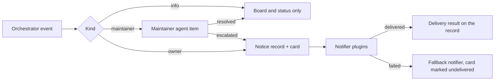

# Dashboard

The main view is a board, not a set of lists. Each task in flight is a card, and its column is where it is now:

| Backlog | Ready | Planned | Building | Checking | In review | Waiting on you | Merging | Done |
|---|---|---|---|---|---|---|---|---|

- **Cards** show the task, its size, the slot and model working on it, time in the column, tokens and cost so far, the review round, and a badge for why it waits (budget, overlap, dependency, CI). Parked and blocked tasks sit in their column with the reason on the card.
- **Waiting on you** is the column where a human is the bottleneck: questions, plan approvals, protected-path changes the orchestrator may not approve itself (each with the reviewers' reasons), escalations and halts, oldest first. Every action the loop waits on a person for is a card here, with the exact action (the label to add, the `approve <sha>` text to post, the command to run, the setting to change) and a link: not only the loop's own requests but also pull requests opened by the owner or the maintainer agent that need the owner's approval of the exact head (an `approve <sha>` comment or a review), asked once they pass CI and review, setup and switch-over steps, and dated chores such as revoking a retired credential or renewing a vendor login before it expires (shown early, red near the date). It is the only column that notifies, and a card and its notice are one event: every card is notified once when it appears (and again only when its required action changes), and no notice is sent without a card, so the column never holds an item the owner was not told about. It holds only what needs a person: an item an automatic triage can resolve gets that first try, and appears here (and notifies) only when it escalates or stays unresolved past a grace period. A hand-over goes to the maintainer agent first and parks its card here only when the maintainer agent escalates it as a decision; it never stops the loop.
- **Opening a card** shows its timeline (plan, builds, checks, verdicts with their findings and ids), the live log of the job running now (tool calls as they happen), and buttons to stop it, continue it, or send it back with a note.
- **Lanes and slots** stay visible as a strip above the board: each slot, its card, and how busy each job runner is.
- **Budgets:** each vendor window, used, reserved, and the forecast at reset, with every owner control in effect on it and until when (see [Owner controls](#owner-controls)).
- **Several projects:** every card, lane and "Waiting on you" item carries its project, and a filter shows one project or all. Each project has a summary card: its weekly share against its actual spend, its harness and boot gate state, whether it is halted and why, and what it is working on now.
- **Shared accounts once:** vendor accounts and the reviewers and builders running on them are one pool for the whole install, so they are shown once, each with the project and task it is working on now, never repeated per project (a per-project copy reads as more reviewers than exist).
- **Infrastructure health:** a failing piece of the loop's own machinery (the sandbox, package installs, the boot gate, a forge token) is shown red on the board with the step, the cause and since when, raised on its first failure and cleared by the first real success, not by a cached one. It goes to the maintainer agent first; it becomes a "Waiting on you" item (and notifies) only when only the owner can fix it (an expired login, a credential, the host) or the maintainer agent escalates it.
- **Trends:** tasks created vs completed per day (is the queue growing?), merges per day, review findings per merge, the share of changes made by agents vs people, cycle time per task (from ready to merged, with the time spent waiting, building, in review and waiting on the owner), and the share of builds and reviews spent on tooling vs the project's own work. Cycle time per split part shows whether sizing splits too finely.
- **Map freshness:** how many memory entries are stale.

Updates are pushed to the page from the orchestrator's events; the page never polls. The same events feed the JSON API for the CLI and the notifier plugins (see Plugins).

## Notices and "Waiting on you"

One rule decides what reaches the owner: an item is a "Waiting on you" card if and only if only the owner can act on it, and every such card is notified. Plain-words version: [alerts and notifications](../../guide/a-tour-of-the-dashboard.md#alerts-and-notifications).

- **Every notice has a kind**, set where the event is raised, never inferred from its text:
  - `owner`: only the owner can give or fix it (an approval, a question only the owner can answer, a credential or login, the host, a halt only the owner may clear). It becomes a card and is notified.
  - `maintainer`: the maintainer agent can act. It becomes an item for that agent, never a card; the agent's escalation is a new `owner` notice with the decision and its options.
  - `info`: nobody needs to act (progress, recoveries, counts, the protected changes the orchestrator approved by class). Shown on the board and in the status, never notified.
- **A card and its notice are one record.** The record holds the project, the item (task, pull request, account, host step), the kind, the required action (for an approval, the exact head) and a key derived from them. A record is notified when it is created and again only when its required action changes, so the same item never notifies twice for the same action.
- **The card follows the reason, not a dismissal.** Each record names the condition that keeps it open (the approval still missing, the login still failing); the orchestrator closes it when the condition is gone, and an owner action that resolves it closes the card at once.
- **Delivery is recorded.** Each attempt stores its notifier and result. A failed delivery tries the fallback notifier and marks the card "not delivered", so a silent phone is visible on the board; delivery is retried with back-off until one notifier confirms.
- **Nothing is lost on a crash.** The record is written before the notice is sent; a restart sends records without a confirmed delivery and never sends a confirmed one again.
- **Not yet the owner's:** a protected change still in review, being fixed, or waiting for CI creates no record. Its record is created when the change has passed review and CI and only the owner's approval remains.
- **Notices carry no secrets and no approval power** (see Plugins): their text is redacted like other outbound text, and approving stays a forge action by the owner's account.

## Owner controls

The owner steers budgets and pauses from an admin area in the dashboard instead of editing config or state files. Plain-words version: [steering budgets and pauses](../../guide/a-tour-of-the-dashboard.md#steering-budgets-and-pauses).

### Only the owner

Intakt has one user, so there are no accounts and no sign-up, but every change must provably come from the owner:
- **Localhost by default.** The dashboard port is published on the host's loopback address only (see [Setup](11-setup.md)). The container cannot see that from inside: behind a published port, Docker and Podman forward the owner's requests from a bridge or gateway address, never from loopback, so no check relies on the source address. The host's port binding keeps other machines out, and the checks below keep out everything else.
- **One owner credential, claimed with proof of the host.** The first start prints a one-time setup code to the container's log (`docker logs intakt`) and nowhere else; the first-run wizard asks for it before anything else, and only then creates the owner secret (shown once, stored only as a password hash) or registers a passkey (WebAuthn). Reading the container's log needs the host's container runtime, so whoever claims the install has the host; a process that only reaches the port cannot. The code works once and is void as soon as an owner credential exists. Every admin action needs a session opened with the credential. A lost secret is reset by a console command on the host, which prints a new setup code, for the same reason.
- **No cross-site requests.** Every admin request also needs a CSRF token of the owner's session and a `Host` header that matches the configured dashboard address (`localhost:7780` by default, the HTTPS name once phone access is on); the session cookie is `SameSite=Strict`. A web page open in the owner's browser therefore cannot change a setting.
- **Jobs cannot reach it.** Job containers run on their own network, which the orchestrator's container does not join, so it has no route to the dashboard port; the admin endpoints refuse anything that is not the owner's session even if it did.
- **Phone access is opt-in:** the owner publishes the port beyond loopback and turns on HTTPS (a secure cookie), with the same secret or passkey. Without it, a request whose `Host` is not the loopback dashboard address is refused.
- **Nothing an agent or a job can reach changes a control.** No MCP tool, JSON API token, forge label or comment, job output or model answer counts as the owner's session; those doors read which controls are in effect, never write them (see [Threat model](14-threat-model.md#agents-over-mcp)).

### Controls

Every control needs an expiry when it is set: a time, or "until the window resets". "Until the window resets" names one vendor window (the account's own for a ceiling or a back-off; the owner picks one for a pause or a share), and the reset time the vendor reported is fixed as the expiry when the control is set, so a vendor that stops reporting cannot extend it. An expired control lapses by itself: the orchestrator records the lapse and the setting returns to its configured value.

| Control | What it changes | Expiry | Where it shows |
|---|---|---|---|
| **Ceiling** | an account's five-hour or weekly ceiling, raised or lowered (see [Budget and model planner](06-budget-and-model-planner.md)); never above the plan limit on an account that bills overage, because past it Intakt's paid cap applies | a time, or until that window resets | the window on the budgets strip, the account, the status |
| **Pause** | a project or the whole install: running jobs finish, nothing new starts, approved heads still merge; resume ends it early | a time, or until a chosen window resets | the project's summary card or a banner across the board, the status |
| **Share** | a project's share of the week (0 starts no new builds for it) | a time, or until a chosen window resets | the project's summary card, the status |
| **Clear a back-off** | ends an account's cooldown or a bench's back-off at once; the next structured failure starts a new one as usual | the cleared back-off's own end, after which there is nothing left to lift | the account or bench, the history |

What is in effect and until when is shown on the board and in the status, and MCP read tools and the JSON API return the same: the control, its scope, and its end as a time the owner chose or as the named window ("until the weekly window resets"). The values behind it (an account's plan limits, the ceilings as numbers, window reset times, credit balances and test results) show only in the admin area, behind the owner's session; the board, the status, MCP tools, JSON API tokens and public surfaces such as the shared usage report or the forge never carry them.

### Accounts

The owner adds, orders and removes vendor accounts in the admin area instead of in config files. The model is vendor-neutral, and each vendor plugin declares which of its parts its accounts support; the admin shows only those fields:
- **Kinds:** a subscription login used through the vendor's CLI (for example Claude Code or Codex), an API key, or both for one vendor.
- **Usage windows:** the windows a subscription has (for example five-hour and weekly), read from the vendor where it reports them, with their reset times.
- **Overage:** whether the account keeps working past its plan limit at paid rates (for example usage credits on a plan). The guards then treat limits as hard, and Intakt's paid cap applies.
- **Credit pools:** prepaid or promotional credit with its balance, expiry and scope, read from the vendor where it exposes them or entered by the owner (for example organization API credits, a cloud-session credit only certain products may spend, or a sponsor's credit for an inference service).
- **Vendor-side blocks:** a limit set at the vendor (an organization spend limit, a tier limit) that blocks an account until a date. It is detected from the vendor's structured error or API, shown as a cause with its end time, and the account is skipped until then; it is never shown as a plain failure.
- **Roles:** what the account may serve (building, reviewing, light work such as triage and sizing) and which tiers or models.

How the planner spends across these is the [order of use](06-budget-and-model-planner.md#order-of-use).

**Billing stays with the vendor.** Intakt never mirrors the vendor's own billing settings (paid usage on or off, the vendor's monthly limit, top-ups, auto-reload), which it cannot change anyway. Each account records only what Intakt needs: whether it bills past its plan limit; Intakt's own cap below the vendor's limit, as a share of the plan and as an amount per period past it; and a link to manage billing at the vendor. The vendor's limit is the hard backstop; Intakt's cap is its share of it.

**Secrets.** A key or token is stored encrypted at rest in Intakt's secret storage (sealed into the Symfony secrets vault). It is never shown again after saving, only a fingerprint (its last four characters), and is never written to logs or the ledger. Where it goes follows the [security model](../04-constraints.md#security-model):
- **An API key never enters a job.** It stays in the orchestrator, which makes that vendor's API calls itself.
- **A subscription login** is mounted read-only into that vendor's jobs only, never into another vendor's job.

The AI providers configured in `config/packages/ai.php` read the vault when the service container is built, so a key saved at runtime would not reach them. Instead, the orchestrator reads an admin-saved account's credential from the vault when it starts a job or sets up that job's model calls, never from the built container. Removing or replacing a credential therefore takes effect for the next job without a restart; a running job keeps its own until it ends.

**Test button.** Each account has a "test" button that makes one minimal call and shows the result and the remaining allowance, in the admin area only.

### History

Every change is a ledger event: who (the owner, by the credential the session was opened with), what, the value before and after, and the expiry. A lapse is an event of its own, by the orchestrator. The dashboard's history lists them, newest first. An account's secret appears in them only as its fingerprint.
