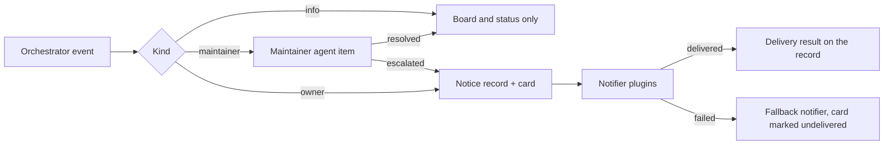

# Dashboard

The main view is a board, not a set of lists. Each task in flight is a card, and its column is where it is now. Waiting on you comes first, because it is the only column that asks something of the reader; the rest follow the order a task moves through:

| Waiting on you | Backlog | Ready | Planned | Building | Checking | In review | Merging | Done |
|---|---|---|---|---|---|---|---|---|

- **Cards** show the task, its size, the slot and model working on it, time in the column, tokens and cost so far, the review round, and a badge for why it waits (budget, overlap, dependency, CI). Parked and blocked tasks sit in their column with the reason on the card.
- **Waiting on you** is the column where a human is the bottleneck: questions, plan approvals, protected-path changes Intakt may not approve on the spot (each naming the floor or check that sent it), escalations and halts, oldest first. Every action the loop waits on a person for is a card here, with the exact action (the label to add, the `approve <sha>` text to post, the command to run, the setting to change) and a link: not only the loop's own requests but also pull requests opened by the owner or the maintainer agent that need the owner's approval of the exact head (an `approve <sha>` comment or a review), asked once they pass CI and review (an owner decision in them, such as a package outside the trusted vendors, is asked when it first appears), setup and switch-over steps, and dated chores such as revoking a retired credential or renewing a vendor login before it expires (shown early, red near the date). It is the only column that notifies, and a card and its notice are one event: every card is notified once when it appears (and again only when its required action changes), and no notice is sent without a card, so the column never holds an item the owner was not told about. It holds only what needs a person: an item an automatic triage can resolve gets that first try, and appears here (and notifies) only when it escalates or stays unresolved past a grace period. A hand-over goes to the maintainer agent first and parks its card here only when the maintainer agent escalates it as a decision; it never stops the loop.
- **Opening a card** shows its timeline (plan, builds, checks, verdicts with their findings and ids), the live log of the job running now (tool calls as they happen), and buttons to stop it, continue it, or send it back with a note. Each button is a state-changing request and passes the same checks as every other (see [Who can act](#who-can-act)); the note reaches the builder's prompt.
- **Hand an item to a person or back** (planned): a control on a card sets or removes `hands-off`, and one on an item Intakt did not create sets `take-over`, written to the forge as the owner ([Labels](04-labels.md#who-drives-an-item)). Until it exists the labels are the control.
- **Lanes and slots** stay visible as a strip above the board: each slot, its card, and how busy each job runner is, with the build-slot time that sat idle because the ready work was blocked (waiting on other tasks), per day, so serial chains that keep slots empty show.
- **Budgets:** each account's windows, used, reserved, and the forecast for the rest of the window, every switch between accounts with its reason, and every owner control in effect on a window and until when (see [Owner controls](#owner-controls)); a window that shows a kept reading (the latest probe brought no usable reading, so the page falls back to the last one) shows when that reading was taken, as the [budget and model planner](06-budget-and-model-planner.md) requires, and that age is not a reset time; the window's reset time itself shows only in the admin area. Next to the subscription windows, the paid spend of the day and of the week (overage and API keys, from the ledger at the billed price) shows per account; a paid account marked unavailable by a billing or credit error shows that cause. The owner's optional cap and the remaining balance are limits and show only in the admin area.
- **Forge budget:** each forge installation's calls used and remaining this hour, from what the forge's answers last reported (showing it calls no forge), and whether the reserve of that budget for essential calls is in force, when routine reads wait; an installation with no reading this hour says so. Built on the review list (`/reviews`) for now, ahead of the board.
- **Several projects:** every card, lane and "Waiting on you" item carries its project, and a filter shows one project or all. Each project has a summary card: its weekly share against its actual spend, its harness and boot gate state, the runtime memory limit its commands run with and where it comes from (the default, the project file or the project's own config, see [Security model](../04-constraints.md#security-model)), whether it is halted and why, and what it is working on now. A memory kill shows as status on the task's card, never as a "Waiting on you" card unless the maintainer agent escalates it.
- **Shared accounts once:** vendor accounts and the reviewers and builders running on them are one pool for the whole install, so they are shown once, each with the project and task it is working on now, never repeated per project (a per-project copy reads as more reviewers than exist). A reviewer whose vendor is out shows the substitute reviewing in its place, and the catch-ups it owes: each one's merged pull request and state (queued, running, approved, filed as a task, failed, given up), with a catch-up that keeps failing marked.
- **Infrastructure health:** a failing piece of the loop's own machinery (the sandbox, package installs, the boot gate, a forge token) is shown red on the board with the step, the cause and since when, raised on its first failure and cleared by the first real success, not by a cached one. It goes to the maintainer agent first; it becomes a "Waiting on you" item (and notifies) only when only the owner can fix it (an expired login, a credential, the host) or the maintainer agent escalates it.
- **Milestones:** each open milestone's forecast, from its critical path ([Choosing work](03-choosing-work.md)), and how many of its queued tasks are follow-ups, so a milestone that keeps refilling with them shows. A stalled chain head shows as a forecast slip with its cause and route ([The maintainer agent](09-maintainer-agent.md)), for example "M5 at risk: #N stalled 3 h, needs the environment, fix in review". It is board status (`info`), and it reaches the owner as a push only when the owner must act (the cause is an owner decision, or the maintainer agent escalates the route), as a "Waiting on you" card like every notice.
- **Trends:** tasks created vs completed per day (is the queue growing?), merges per day, review findings per merge, the share of changes made by agents vs people, cycle time per task (from ready to merged, with the time spent waiting, building, in review and waiting on the owner), and the share of builds and reviews spent on tooling vs the project's own work. Cycle time per split part shows whether sizing splits too finely. For the last 7 days it also shows follow-up tasks filed per merged pull request, polish rounds started and merged, and the follow-up chain rate (follow-ups filed from follow-up pull requests, which [Reviews](07-reviews.md) says should stay at zero for P3 items). The status JSON carries the same figures.
- **Rework, per project:** tokens per merged change (every build, check and review of the change, divided by the changes merged) and the rework share (the share of tokens spent on build cycles after a send-back and their re-reviews), as a trend, so the owner can see whether the self-check before the push and the proposed checks ([Reviews](07-reviews.md)) cut rework.
- **Token measures (planned):** every model call records its cached-read, fresh-input and output tokens, its turns and its largest tool outputs (as size metadata: tool, turn and size, never the output itself). The dashboard shows tokens per merged task by role and model, the cache-read share, and context growth per turn, so the owner and the AI engineer can see whether a build is expensive because of long sessions, large tool outputs or prompt size. Experiments of the AI engineer show per arm next to them, with the quality counter-metric (send-backs, escaped defects, red main). The rules are in [the AI engineer](06-budget-and-model-planner.md#the-ai-engineer-planned).
- **Map freshness:** how many memory entries are stale.

Updates are pushed to the page from the orchestrator's events; the page never polls. The same events feed the JSON API for the CLI and the notifier plugins (see Plugins).

How the dashboard looks is in the [mocks](../mocks/README.md): a static HTML page for each screen, light and dark, desktop and phone, and [DESIGN.md](../mocks/DESIGN.md), the design system they share (tokens, type, components, breakpoints, phone patterns and the glossary of words the pages use). This page says what the dashboard shows; the mocks say how.

## Starting a task

The owner can start new work from the dashboard in plain words (owner decision 2026-11-04, issue #883). The forge issue stays the record: the box only drafts an issue, and once filed it goes through [Choosing work](03-choosing-work.md) like any task, so nothing skips readiness, sizing, reviews, checks or approvals. Plain-words version: [starting a task from the dashboard](../../guide/a-tour-of-the-dashboard.md#starting-a-task-from-the-dashboard).

- **The box** sits in the dashboard header next to the project filter. It takes plain words and a project, and the project is required: the filter's project when one is selected, otherwise the owner picks one; nothing is drafted without it. One submission drafts one task. A text that describes work for several projects becomes one draft per project, each shown separately; a text that names a project other than the chosen one gets a draft that says so and asks which project is meant before it can be approved.
- **The draft** is written by the Tech lead as a job on that project ([Choosing work](03-choosing-work.md#tasks-drafted-from-the-dashboard)): the title, outcome, decisions, acceptance, a size estimate, the milestone and priority it proposes, and any `Waits for` line on open tasks.
- **The draft view** shows the draft with three actions: edit, approve and discard. Edit changes the text that will be filed. Approve files it as an issue on that project's forge with the labels a ready task carries; discard removes it, and nothing was filed. Nothing is filed or queued before approval, and approval files the issue and nothing more: the task is queued only by intake reading it from the forge. A draft whose size estimate says it must be split shows its parts, and approve files them together, each an issue of its own with the `Waits for` lines between them that the draft names.
- **Budget:** the drafting call is charged to the project's weekly share like any job ([Budget and model planner](06-budget-and-model-planner.md)). When the project's share or the pool has no room, the box says so, and a submitted text waits as a pending draft until there is room; it is kept, never dropped.
- **Filing identity:** approval creates the issue and applies its labels under Intakt's own forge identity, the one that files split parts and follow-ups, never the owner's account ([Principles](../02-principles.md)). That identity has write access, so the issue passes intake's author check like any of Intakt's own issues, and the labels are the ones the draft view showed the owner; the approval itself is a ledger event of the dashboard request that made it ([Labels](04-labels.md)).
- **Who can use it:** the box and every action on a draft (submit, edit, approve, discard) are state-changing requests and pass the same `Host` and CSRF checks as a card's buttons, with no login ([Who can act](#who-can-act)). Whoever can open the dashboard can read the box, the pending texts and the drafts, as they can read the board. No JSON API response shows a pending text or a draft, because they hold the owner's words before anyone decided to publish them, and the API's token is held by the CLI and the notifier plugins.
- **Mocks:** the [mocks](../mocks/README.md) do not show the box or the draft view yet; T89 adds those screens.

## Notices and "Waiting on you"

One rule decides what reaches the owner: an item is a "Waiting on you" card if and only if only the owner can act on it, and every such card is notified. Plain-words version: [alerts and notifications](../../guide/a-tour-of-the-dashboard.md#alerts-and-notifications).

- **Every notice has a kind**, set where the event is raised, never inferred from its text:
  - `owner`: only the owner can give or fix it (an approval, a question only the owner can answer, a credential or login, the host, a halt only the owner may clear). It becomes a card and is notified.
  - `maintainer`: the maintainer agent can act. It becomes an item for that agent, never a card; the agent's escalation is a new `owner` notice with the decision and its options.
  - `info`: nobody needs to act (progress, recoveries, counts, the protected changes Intakt approved on the spot). Shown on the board and in the status, never notified.
- **A card and its notice are one record.** The record holds the project, the item (task, pull request, account, host step), the kind, the required action (for an approval, the exact head) and a key derived from them. A record is notified when it is created and again only when its required action changes, so the same item never notifies twice for the same action.
- **The card follows the reason, not a dismissal.** Each record names the condition that keeps it open (the approval still missing, the login still failing); the orchestrator closes it when the condition is gone, and an owner action that resolves it closes the card at once.
- **Delivery is recorded.** Each attempt stores its notifier and result. A failed delivery tries the fallback notifier and marks the card "not delivered", so a silent phone is visible on the board; delivery is retried with back-off until one notifier confirms.
- **Nothing is lost on a crash.** The record is written before the notice is sent; a restart sends records without a confirmed delivery and never sends a confirmed one again.
- **Not yet the owner's:** a protected change still in review, being fixed, or waiting for CI creates no record. Its record is created when the change has passed review and CI and only the owner's approval remains. An owner decision plain code reads from a pushed head (a package outside the trusted vendors, a protected change a floor sends to the owner) is the exception: its record is created on the first head that shows it, keyed by the decision, so a later head that keeps it unchanged notifies nothing new ([Merge](08-merge.md)).
- **Notices carry no secrets and no approval power** (see Plugins): their text is redacted like other outbound text, and approving stays a forge action by the owner's account.

## Owner controls

The owner steers budgets and pauses from an admin area in the dashboard instead of editing config or state files. Plain-words version: [steering budgets and pauses](../../guide/a-tour-of-the-dashboard.md#steering-budgets-and-pauses).

### Who can act

Intakt has one user and no accounts: the dashboard has no login, no owner secret or passkey, no login session and no setup code. Who can act is decided by who can reach the dashboard port: anyone who can open the dashboard can use every button and every setting (owner decision, #926), whether that is the owner, another user on the host, or anyone on a network the owner publishes the port to. The port binding and the job network below decide who can reach the port; the `Host` and CSRF checks decide which requests that reach it are accepted: the `Host` check applies to every dashboard request, reads included, and the CSRF check applies to every write, so a web page on another site can neither read the dashboard through a rebound name nor make a change from the owner's browser. These checks stop browsers, not clients: any program that reaches the port can send the dashboard's `Host`, load a page and use its CSRF token, so keeping the port out of reach is the boundary:
- **Localhost by default.** The dashboard port is published on the host's loopback address only (see [Setup](11-setup.md)), so whoever opens it is on the host. The container cannot see that from inside: behind a published port, Docker and Podman forward the owner's requests from a bridge or gateway address, never from loopback, so no check relies on the source address. The host's port binding keeps other machines out, the job network keeps jobs out, and the `Host` and CSRF checks keep other web pages out.
- **Only the dashboard's own names.** Every dashboard request needs a `Host` header that names the dashboard: one of the configured dashboard names with the configured port, which is the port the owner publishes on the host (default 7780; with `-p 127.0.0.1:8080:7780` the setting is 8080, see [Setup](11-setup.md)). The names are the loopback names `localhost`, `127.0.0.1` and `[::1]`, plus the name the owner adds for phone access (below, planned: today the names are the loopback ones only and no setting adds one), so `localhost:7780`, `127.0.0.1:7780` or `[::1]:7780` by default. Any other `Host` is refused, so a site that rebinds its own name to the host's address reads and changes nothing.
- **No cross-site requests.** Every state-changing request also needs a CSRF check that needs no login. Today the buttons check Symfony's CSRF tokens, kept in the framework's session with the page's flash messages; that session belongs to no login and proves no owner. The target is a check that keeps no state, Symfony's stateless CSRF tokens or a same-origin check of `Origin` and `Sec-Fetch-Site` (planned, T90). A web page open in the owner's browser therefore cannot press a card's button, submit or approve a draft task, or change a setting.
- **Jobs cannot reach it.** A separate network alone is not enough, because a port published on the host is reachable through the host's gateway. So job containers run on an internal network with no route to the host, and their only way out is the egress allowlist, enforced per address and port. The dashboard port is denied on every address of the host (loopback, the bridge gateway, and the address phone access publishes it on) ahead of any allowlist entry, so an external dependency on the same host is reachable on its own port only, and the orchestrator refuses an allowlist entry that names the dashboard's address and port. Every job checks at start that the dashboard port does not answer; if it does, the job does not run and the cause is a card. This network isolation is what keeps jobs out: the `Host` and CSRF checks above are no second layer against a job, because a job that did reach the port could send the dashboard's `Host` and fetch its own CSRF token like any other client.
- **Phone access is opt-in** (planned; no plan task builds it yet, and until then the `Host` check refuses every name but the loopback ones). The owner publishes the port to a network they trust (a VPN, or the home network) and adds the name the phone uses to the dashboard names. Anyone who can reach the port there can act, exactly as on loopback, so a VPN is the recommendation over publishing the port on a shared network. HTTPS is recommended beyond loopback, so the network cannot read or alter the pages and requests, but no cookie or secret depends on it. The JSON API keeps its own token (read-only, as below) for the CLI and the notifier plugins.
- **Nothing an agent or a job can reach changes a control or presses a button.** No MCP tool, JSON API token, forge label or comment, job output or model answer is a dashboard request; those doors read which controls are in effect, never write them (see [Threat model](14-threat-model.md#agents-over-mcp)).

### Controls

Every control carries an expiry. A ceiling, a pause or a share takes one from the owner when it is set: a time, or "until the window resets", which names one vendor window (the account's own for a ceiling; the owner picks one for a pause or a share); the reset time the vendor reported is fixed as the expiry when the control is set, so a vendor that stops reporting cannot extend it. Clearing a back-off lifts a wait that already has an end, so its expiry is that end, fixed when it is cleared, and the owner chooses nothing. An expired control lapses by itself: the orchestrator records the lapse and the setting returns to its configured value.

| Control | What it changes | Expiry | Where it shows |
|---|---|---|---|
| **Ceiling** | an account's five-hour or weekly ceiling, raised or lowered (see [Budget and model planner](06-budget-and-model-planner.md)); never above the plan limit on an account that bills overage, because past it the paid rules apply (Intakt's paid cap, if the owner set one) | a time, or until that window resets | the window on the budgets strip, the account, the status |
| **Pause** | a project or the whole install: running jobs finish, nothing new starts, approved heads still merge; resume ends it early | a time, or until a chosen window resets | the project's summary card or a banner across the board, the status |
| **Share** | a project's share of the week (0 starts no new builds for it) | a time, or until a chosen window resets | the project's summary card, the status |
| **Clear a back-off** | ends an account's cooldown (its back-off after a structured failure, see [Budget and model planner](06-budget-and-model-planner.md)) at once; the next structured failure starts a new one as usual | the cleared cooldown's own end, fixed when it is cleared, after which there is nothing left to lift | the account, the history |

What is in effect and until when is shown on the board and in the status, and MCP read tools and the JSON API return the same: the control, its scope, and its end as a time the owner chose or as the named window ("until the weekly window resets"). A cleared back-off shows there as the account and "until the cleared cooldown would have ended", never with that time, which stays in the admin area like the cooldown's own end. A wait the planner imposes (a spent window, a vendor-side block, a back-off) shows there as its cause and the account or window it concerns, never with its end, because that end is a reset time. The values behind all of this (an account's plan limits, the ceilings as numbers, window reset times, the end times of vendor-side blocks and back-offs, credit balances and test results) show only in the admin area of the dashboard (see [Who can act](#who-can-act)); the board, the status, MCP tools, JSON API tokens and public surfaces such as the shared usage report or the forge never carry them.

### Accounts

The owner adds, orders and removes vendor accounts in the admin area instead of in config files: an account is state in the database like a control, and only its credential goes to the vault (see "Secrets" below). The model is vendor-neutral, and each vendor plugin declares which of its parts its accounts support; the admin shows only those fields:
- **Kinds:** a subscription used through the vendor's CLI (for example Claude Code or Codex), held as the vendor's automation token or, without one, a login (see [Budget and model planner](06-budget-and-model-planner.md)); an API key; or both for one vendor.
- **Usage windows:** the windows a subscription has (for example five-hour and weekly), read from the vendor where it reports them, with their reset times.
- **Overage:** whether the account keeps working past its plan limit at paid rates (for example usage credits on a plan). The guards then treat limits as hard, and Intakt's paid cap applies if the owner set one.
- **Credit pools:** prepaid or promotional credit with its balance, expiry and scope, read from the vendor where it exposes them or entered by the owner (for example organization API credits, a cloud-session credit only certain products may spend, or a sponsor's credit for an inference service).
- **Vendor-side blocks:** a limit set at the vendor (an organization spend limit, a tier limit) that blocks an account until a date. It is detected from the vendor's structured error or API, shown in the admin area as a cause with its end time (the board shows the cause alone), and the account is skipped until then; it is never shown as a plain failure.
- **Billing or credit errors:** a paid account whose balance is gone or whose payment failed has no end date. It is detected from the vendor's structured error, marked unavailable with that cause, skipped, and raised once as a "Waiting on you" card, since only the owner can top it up ([Budget and model planner](06-budget-and-model-planner.md)).
- **Roles:** what the account may serve (building, reviewing, light work such as triage and sizing) and which tiers or models.

How the planner spends across these is the [order of use](06-budget-and-model-planner.md#order-of-use).

**Billing stays with the vendor.** Intakt never mirrors the vendor's own billing settings (paid usage on or off, the vendor's monthly limit, top-ups, auto-reload), which it cannot change anyway. Each account records only what Intakt needs: whether it bills past its plan limit; Intakt's own cap below the vendor's limit, optional, as a share of the plan and as a weekly amount past it (per account, or one for the install); and a link to manage billing at the vendor. The vendor's limit or the account's balance is the hard backstop; Intakt's cap, when set, is its share of it, and with none the balance is the limit.

**Secrets.** A key or token is stored encrypted at rest in Intakt's secret storage: a Symfony secrets vault of its own on the data volume (`/data/secrets`, see [Setup](11-setup.md)), not the image's `config/secrets/<env>`, so it survives an image update and travels with the volume's backup ([Your data](../../guide/your-data.md)). Its decryption key is a file under `/data/keys`, next to the forge App's private key and the signing key and apart from the vault's files, readable by the orchestrator's user only and never mounted into a job. The orchestrator opens the runtime vault with that file's key only and never reads `SYMFONY_DECRYPTION_SECRET` for it: that variable keeps decrypting the image's vault alone, as before, so the two vaults never share a key and setting the variable changes nothing about the runtime vault. A key or token is never shown again after saving, only a fingerprint (its last four characters), and is never written to logs or the ledger. Where it goes follows the [security model](../04-constraints.md#security-model):
- **An API key never enters a job.** It stays in the orchestrator, which makes that vendor's API calls itself.
- **A subscription credential** reaches that vendor's jobs only, never another vendor's job: its automation token passed by the orchestrator, or its login file mounted read-only.

The AI providers configured in `config/packages/ai.php` read the image's vault when the service container is built, so a key saved at runtime would not reach them. Instead, the orchestrator reads an admin-saved account's credential from the runtime vault when it starts a job or sets up that job's model calls, never from the built container. Removing or replacing a credential therefore takes effect for the next job without a restart; a running job keeps its own until it ends.

**Test button.** Each account has a "test" button that makes one minimal call and shows the result and the remaining allowance, in the admin area only.

### History

Every change is a ledger event: its source (the dashboard, or the orchestrator; with no login, a dashboard change names no verified person, see [Who can act](#who-can-act)), what, the value before and after, and the expiry. A lapse is an event of its own, by the orchestrator. The dashboard's history lists them, newest first. An account's secret appears in them only as its fingerprint.
