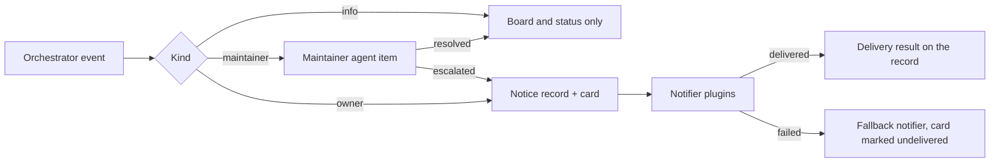

# Dashboard

The main view is a board, not a set of lists. Each task in flight is a card, and its column is where it is now:

| Backlog | Ready | Planned | Building | Checking | In review | Waiting on you | Merging | Done |
|---|---|---|---|---|---|---|---|---|

- **Cards** show the task, its size, the slot and model working on it, time in the column, tokens and cost so far, the review round, and a badge for why it waits (budget, overlap, dependency, CI). Parked and blocked tasks sit in their column with the reason on the card.
- **Waiting on you** is the column where a human is the bottleneck: questions, plan approvals, protected-path changes the orchestrator may not approve itself (each with the reviewers' reasons), escalations and halts, oldest first. Every action the loop waits on a person for is a card here, with the exact action (the label to add, the `approve <sha>` text to post, the command to run, the setting to change) and a link: not only the loop's own requests but also protected pull requests opened by the owner or the maintainer agent that need the owner's label, setup and switch-over steps, and dated chores such as revoking a retired credential or renewing a vendor login before it expires (shown early, red near the date). It is the only column that notifies, and a card and its notice are one event: every card is notified once when it appears (and again only when its required action changes), and no notice is sent without a card, so the column never holds an item the owner was not told about. It holds only what needs a person: an item an automatic triage can resolve gets that first try, and appears here (and notifies) only when it escalates or stays unresolved past a grace period. A hand-over goes to the maintainer agent first and parks its card here only when the maintainer agent escalates it as a decision; it never stops the loop.
- **Opening a card** shows its timeline (plan, builds, checks, verdicts with their findings and ids), the live log of the job running now (tool calls as they happen), and buttons to stop it, continue it, or send it back with a note.
- **Lanes and slots** stay visible as a strip above the board: each slot, its card, and how busy each job runner is.
- **Budgets:** each vendor window, used, reserved, and the forecast at reset.
- **Several projects:** every card, lane and "Waiting on you" item carries its project, and a filter shows one project or all. Each project has a summary card: its weekly share against its actual spend, its harness and boot gate state, whether it is halted and why, and what it is working on now.
- **Shared accounts once:** vendor accounts and the reviewers and builders running on them are one pool for the whole install, so they are shown once, each with the project and task it is working on now, never repeated per project (a per-project copy reads as more reviewers than exist).
- **Infrastructure health:** a failing piece of the loop's own machinery (the sandbox, package installs, the boot gate, a forge token) is shown red on the board with the step, the cause and since when, raised on its first failure and cleared by the first real success, not by a cached one. It goes to the maintainer agent first; it becomes a "Waiting on you" item (and notifies) only when only the owner can fix it (an expired login, a credential, the host) or the maintainer agent escalates it.
- **Trends:** tasks created vs completed per day (is the queue growing?), merges per day, review findings per merge, the share of changes made by agents vs people, cycle time per task (from ready to merged, with the time spent waiting, building, in review and waiting on the owner), and the share of builds and reviews spent on tooling vs the project's own work. Cycle time per split part shows whether sizing splits too finely.
- **Map freshness:** how many memory entries are stale.

Updates are pushed to the page from the orchestrator's events; the page never polls. The same events feed the JSON API for the CLI and the notifier plugins (see Plugins).

## Notices and "Waiting on you"

One rule decides what reaches the owner: an item is a "Waiting on you" card if and only if only the owner can act on it, and every such card is notified. Plain-words version: [alerts and notifications](../../guide/a-tour-of-the-dashboard.md#alerts-and-notifications).

- **Every notice has a kind**, set where the event is raised, never inferred from its text:
  - `owner`: only the owner can give or fix it (an approval, a question only the owner can answer, a credential or login, the host, a halt only the owner may clear). It becomes a card and is notified.
  - `maintainer`: the maintainer agent can act. It becomes an item for that agent, never a card; the agent's escalation is a new `owner` notice with the decision and its options.
  - `info`: nobody needs to act (progress, recoveries, counts, the protected changes the orchestrator approved by class). Shown on the board and in the status, never notified.
- **A card and its notice are one record.** The record holds the project, the item (task, pull request, account, host step), the kind, the required action (for an approval, the exact head) and a key derived from them. A record is notified when it is created and again only when its required action changes, so the same item never notifies twice for the same action.
- **The card follows the reason, not a dismissal.** Each record names the condition that keeps it open (the approval still missing, the login still failing); the orchestrator closes it when the condition is gone, and an owner action that resolves it closes the card at once.
- **Delivery is recorded.** Each attempt stores its notifier and result. A failed delivery tries the fallback notifier and marks the card "not delivered", so a silent phone is visible on the board; delivery is retried with back-off until one notifier confirms.
- **Nothing is lost on a crash.** The record is written before the notice is sent; a restart sends records without a confirmed delivery and never sends a confirmed one again.
- **Not yet the owner's:** a protected change still in review, being fixed, or waiting for CI creates no record. Its record is created when the change has passed review and CI and only the owner's approval remains.
- **Notices carry no secrets and no approval power** (see Plugins): their text is redacted like other outbound text, and approving stays a forge action by the owner's account.
