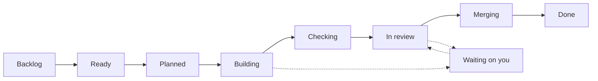
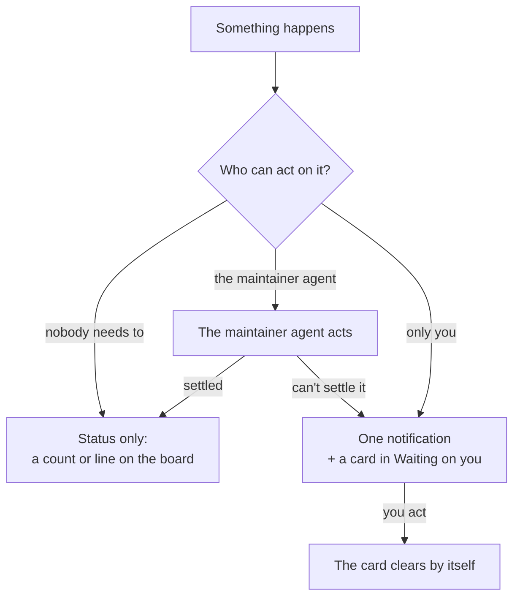

# A tour of the dashboard

The dashboard is a board in your browser that shows everything Intakt is doing, updated live. This page walks through it. Intakt is still being built, so this describes the decided design ([details](../design/05-architecture/13-dashboard.md)).

## What you can open today

Three plain pages are built. They show what Intakt has written down about its reviews, and they never refresh by themselves: reload the page to see news.

- **Projects** (`/projects`): one row per project that has had a review, with how many review rounds it has had and how many of them reached the judge.
- **Reviews** (`/reviews`): one row per review round, newest first, with its project, how many reviewers took part, when it started, and whether it is still running or the judge has decided. Add `?project=name` to the address to show one project only. Click a round to open its review.
- **One review** (`/reviews/` and the round's id): every round of that change, one after the other. For each round you see the reviewers and what each one said (approve, changes or blocked, and how many problems it found, or why it failed), the problems themselves with their short ids (`F1`, `F2`, ...), what the judge decided about each one (fix it now, a follow-up for later, or not acted on), and how many tokens the AI calls of the round used. The cost says "no price" for now, because Intakt has no price list yet and never guesses one. A round reviewed before Intakt started keeping the text of the problems says so, and still shows the ids the judge picked and what it decided about them.

The pages only answer when you open them on the computer Intakt runs on (`localhost` and the dashboard's port, 7780 unless you changed it); any other address gets an error page and none of your data. A change that is reviewed twice shows as two rows on the review list, and both open the same review. A review page has a button that starts the change's next round on its newest commit, using the repository and task Intakt noted when the last round started; for rounds from before it noted them, the page says so instead. Today the button needs no login (the owner login is planned), so only reach the dashboard from the computer itself. The board below is still planned.

## The board (planned)

Every task in flight is a card, and its column says where it is now. Cards move left to right:

| Column | Meaning |
|---|---|
| **Backlog** | written, but not ready yet (unclear, waiting on another task) |
| **Ready** | in the queue, waiting for a free builder |
| **Planned** | the builder wrote a plan that waits for your approval (only when plan approval is on) |
| **Building** | a builder is working on it |
| **Checking** | the checks run on the finished work |
| **In review** | the review panel is reading it |
| **Waiting on you** | only a person can move it on (see below) |
| **Merging** | approved, being merged |
| **Done** | merged |

## A card

Each card shows the task, its size, which builder slot and AI model is on it, how long it has been in its column, the tokens and money spent so far, the review round, and a **badge** saying why it waits, if it waits:

| Badge | Why it waits |
|---|---|
| budget | the AI allowance is near its limit, or the pace says slow down |
| overlap | another task is changing the same files; this one goes next |
| dependency | it `Waits for` another task |
| CI | GitHub hasn't finished the checks yet |
| on hold | it needs something outside the task; it comes back by itself |

**Open a card** to see its whole story: the plan, every build, the checks, each reviewer's verdict and findings, and the live log of the job running now, tool call by tool call. Buttons let you **stop** the job, **continue** it, or **send it back with a note**. The buttons ask for your owner secret or passkey first, like every change on the dashboard ([steering budgets and pauses](#steering-budgets-and-pauses)).

## Waiting on you

This is the only column that needs you. A card here and a notification on your phone are the same thing: each card was sent to you once, and nothing is sent that has no card. Each card says exactly what to do, with a link: the label to add, the text to post, the setting to change. Typical cards:
- a question a builder asked;
- a plan to approve;
- a change to the project's rules that only you may approve;
- a decision the maintainer agent couldn't make, with its options and recommendation;
- a broken part of Intakt itself (red), such as an expired login, with the cause and since when;
- a dated chore, such as renewing an AI token or login before it expires.

Anything Intakt or its maintainer agent can settle never shows up here.

## Alerts and notifications

Every event that might need attention is sorted by one question: who can act on it?

- **Nobody needs to act:** progress, recoveries ("the reviewer works again"), counts and the list of what Intakt approved by itself. These are on the board and in the status, and never notify.
- **The maintainer agent can act:** a stuck task, a broken check, a label in the wrong place, a conflict with main. It gets the item first; you hear about it only if it can't settle it, as a decision with its options and recommendation.
- **Only you can act:** an approval, a question only you can answer, an expired login, a halt only you may clear. You get one notification and a card, at the same moment.
- **Once each:** a notification is sent once per item and change, not again every few minutes. The card stays until the reason is gone, then clears without you dismissing it.
- **Nothing is lost:** every notice is recorded with whether it was delivered. If your phone can't be reached, the card says so and the fallback notifier is tried.
- **Not yet yours:** a change still in review or being fixed doesn't ask you anything. You are asked once it has passed review and CI.

## Around the board

- **Lanes and slots** (a strip above the board): each builder slot and the review lane, and what each is working on right now.
- **Budgets:** each AI account's windows (five-hour and weekly), how much is used and reserved, and the forecast for the rest of the window. When a window resets shows only in the admin area.
- **Projects:** with several projects, each card and item carries its project, a filter shows one or all, and each project has a summary: its share of the week against its actual spend, whether it is paused and why, and what it is working on.
- **Accounts:** the AI accounts and the reviewers and builders on them are shown once, each with what it is doing now.
- **Trends:** tasks created versus finished per day (is the queue growing?), merges per day, review findings per merge, and how long tasks take from ready to merged, split into waiting, building, review and waiting on you.
- **Approved by Intakt:** the protected changes Intakt approved by itself in the last week, one line each with the reviewers' reasons.

## Steering budgets and pauses

The dashboard has an **admin area** where you change how much Intakt may spend and when it works, without editing any file. Only you can change anything on the dashboard:
- On the first start, you type the one-time setup code from `docker logs intakt`, and Intakt creates your **owner secret** (shown once, so keep it in your password manager) or registers a **passkey**. Every change asks for it: the admin area and the buttons on a card alike. Without it, the dashboard shows a login page and changes nothing.
- The dashboard only answers on the computer it runs on, so there you can look at the board without logging in. If you turn on phone access, which needs HTTPS, everything asks for your secret or a passkey, even looking at the board: someone else on the network sees only the login page. A passkey only works on the address it was made on (on the computer itself, open the dashboard as `localhost` to use it), so when you turn on phone access the admin area shows a one-time pairing code, and typing it on your phone's login page makes a passkey for the phone address. Your secret works on both. The secret is one Intakt made up, long and random, and after a few wrong tries the secret login slows down and you get a card, so guessing gets nowhere. Someone guessing wrong on purpose can slow your secret login too, but never lock you out: a dashboard you are already logged into stays open, a passkey is never slowed down, and a command on the computer Intakt runs on lifts the slowdown at once. If you lose your secret or think someone else has it, the same command resets it: your secret, your passkeys and every open login stop working at once, and you set up a new one with a fresh setup code from `docker logs intakt`.
- Another website open in your browser can't press a button or change a setting, and neither can an AI agent, a job, a label or a comment: they can see what is in effect, never change it.

### Every change ends by itself

Raising or lowering a ceiling, pausing and changing a share each ask **until when**: a date and time, or "until the window resets" (for example the next weekly reset of an AI account). Clearing a back-off asks nothing: the wait it lifts already had an end, and that end is when the change runs out. When that moment comes, the change lapses and the normal setting is back, so a forgotten change can't keep spending. The board and the status show every change in effect and when it ends (a cleared back-off only says it lasts until the old wait would have ended); your accounts' limits and reset times show only in the admin area. The history lists every change: who made it, what it was before and after, and until when.

| You can | For example |
|---|---|
| **raise or lower a ceiling** | let an account use more, or less, of its five-hour or weekly allowance |
| **pause and resume** | stop one project, or all of Intakt, for the evening |
| **change a project's share** | give one project most of the week until Friday |
| **clear a back-off** | try an account again at once when you know the problem is over |

### Letting Intakt use the rest of the week

Intakt normally leaves room in each AI account for your own use and spreads the week evenly. If the week is nearly over and you won't need the account yourself:
1. Open the admin area and pick the account.
2. Raise its **weekly ceiling** (up to all of the allowance).
3. Choose **until the window resets**, so it ends with the week.

Intakt then uses what is left until the reset, and goes back to the normal ceiling by itself. On an account that can bill past its plan, the ceiling stops at the plan's limit; anything past it counts against the spending cap you set.

### Pausing

1. Open the admin area and choose **pause**, for one project or the whole install.
2. Choose until when: a time, or until a window resets.

Running jobs finish, nothing new starts, and finished work that is fully approved still merges. **Resume** ends the pause early; otherwise it ends by itself at the time you chose.

### Accounts

You also add, order and remove your AI accounts here. Each account shows only what its AI company supports: a subscription (its long-lived token, or a login where the company has no such token) or an API key, its usage windows, whether it bills past the plan, prepaid credit and when it expires, a block the company has set and when it ends, and which work it may do. Intakt spends prepaid credit that is about to expire first, then your subscriptions, then paid usage up to your cap ([accounts and costs](accounts-and-costs.md)). A saved key is never shown again, only its last four characters. A **test** button checks an account with one tiny call and shows what is left.
