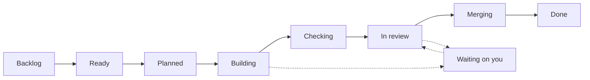

# A tour of the dashboard

The dashboard is a board in your browser that shows everything Intakt is doing, updated live. This page walks through it. Intakt is still being built, so this describes the decided design ([details](../design/05-architecture/13-dashboard.md)).

## The board

Every task in flight is a card, and its column says where it is now. Cards move left to right:

| Column | Meaning |
|---|---|
| **Backlog** | written, but not ready yet (unclear, waiting on another task) |
| **Ready** | in the queue, waiting for a free builder |
| **Planned** | the builder wrote a plan that waits for your approval (only when plan approval is on) |
| **Building** | a builder is working on it |
| **Checking** | the checks run on the finished work |
| **In review** | the review panel is reading it |
| **Waiting on you** | only a person can move it on (see below) |
| **Merging** | approved, being merged |
| **Done** | merged |

## A card

Each card shows the task, its size, which builder slot and AI model is on it, how long it has been in its column, the tokens and money spent so far, the review round, and a **badge** saying why it waits, if it waits:

| Badge | Why it waits |
|---|---|
| budget | the AI allowance is near its limit, or the pace says slow down |
| overlap | another task is changing the same files; this one goes next |
| dependency | it `Waits for` another task |
| CI | GitHub hasn't finished the checks yet |
| on hold | it needs something outside the task; it comes back by itself |

**Open a card** to see its whole story: the plan, every build, the checks, each reviewer's verdict and findings, and the live log of the job running now, tool call by tool call. Buttons let you **stop** the job, **continue** it, or **send it back with a note**.

## Waiting on you

This is the only column that needs you, and the only one that sends notifications to your phone. Each card says exactly what to do, with a link: the label to add, the text to post, the setting to change. Typical cards:
- a question a builder asked;
- a plan to approve;
- a change to the project's rules that only you may approve;
- a decision the maintainer agent couldn't make, with its options and recommendation;
- a broken part of Intakt itself (red), such as an expired login, with the cause and since when;
- a dated chore, such as renewing an AI login before it expires.

Anything Intakt or its maintainer agent can settle never shows up here.

## Around the board

- **Lanes and slots** (a strip above the board): each builder slot and the review lane, and what each is working on right now.
- **Budgets:** each AI account's windows (five-hour and weekly), how much is used and reserved, and the forecast at the next reset.
- **Projects:** with several projects, each card and item carries its project, a filter shows one or all, and each project has a summary: its share of the week against its actual spend, whether it is paused and why, and what it is working on.
- **Accounts:** the AI accounts and the reviewers and builders on them are shown once, each with what it is doing now.
- **Trends:** tasks created versus finished per day (is the queue growing?), merges per day, review findings per merge, and how long tasks take from ready to merged, split into waiting, building, review and waiting on you.
- **The daily summary:** the protected changes Intakt approved by itself, one line each with the reviewers' reasons.
