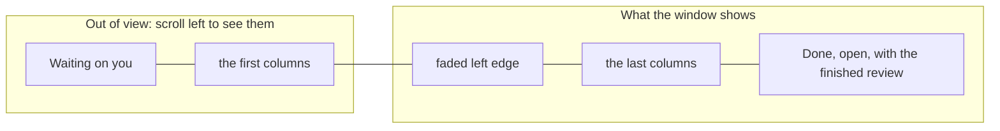
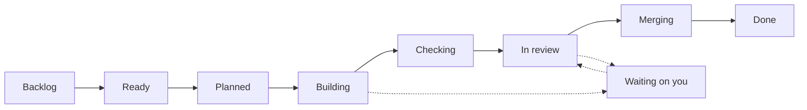
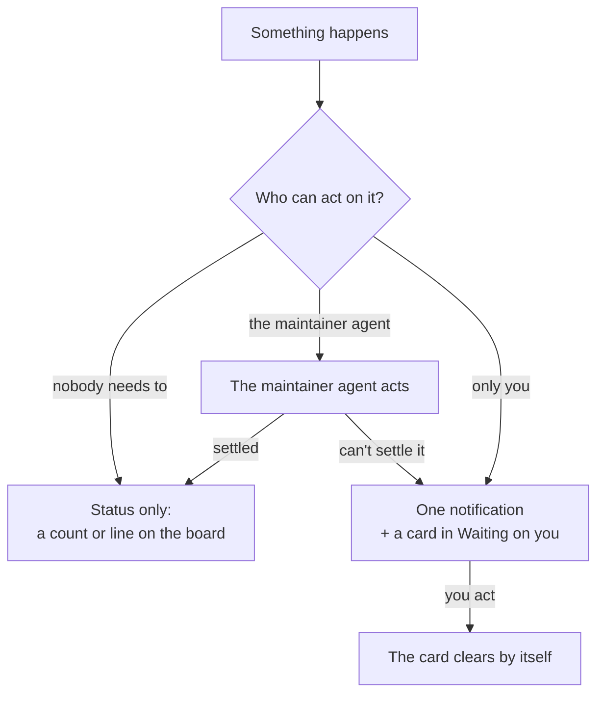

# A tour of the dashboard

The dashboard is a board in your browser that shows everything Intakt is doing, updated live. This page walks through it. Intakt is still being built, so this describes the decided design ([details](../design/05-architecture/13-dashboard.md)).

## What you can open today

Twelve pages are built. They show what Intakt has written down about its reviews, about the tasks you built with `intakt:build:task`, and about the outages that wait for you. Opening the dashboard's address without a page name takes you to the **Board**, except in the demo before any review has run, where it takes you to the first-run page, which opens on the recorded review. On a phone, the same address opens **Waiting on you** instead, because on the go you mostly want what needs you; once at least one review has finished, and nothing needs you, nothing is running (no review and no build) and every card is Done, it opens the newest review instead (an empty board, with no review yet, still opens Waiting on you); the demo's first-run page still comes first, and tapping **Now** in the bar at the bottom still shows the board. The board, the project list, the review list, the review page, the task page and the Waiting on you page listen for news from Intakt through a live connection (the components page does not), and the board shows it: its headline sentence, its status line, Working now and its In review and Done columns update by themselves ([The board](#the-board)). Nothing is shown from it on the other lists yet, so reload a list to see news; the outages on the Waiting on you page also change only on the next load. Only the project filter at the top hears from it: when a project starts its first review, the filter gets the new list of projects, so that project shows up in it without a reload (a review of a project already listed sends nothing; your own choice in the filter stays as it is, or falls back to All projects if that project is no longer listed; the Waiting on you count will update from it later); with the live connection down, a list still shows everything that was written down. The page of a review that is still running updates by itself while the round goes on, also after you open a list in another tab or go back to it from a list, and if the live connection is down it says so (see the frame below) and shows what is written down when you reload.

- **Board** (`/`): every change under review as a card in the column of where it is now, with a count on each column (see [The board](#the-board) below).
- **Status** (`/lanes`): reached from the quiet status line above the board's columns ("Running smoothly · 1 reviewer working" or "Quiet · nobody working"). It repeats that line and shows a card for each reviewer at work, newest review first. Build slots, job runners and budgets are not built yet, so the page does not show them.
- **Waiting on you** (`/waiting`): what only you can act on, oldest first; today the outages of AI accounts whose usage Intakt can no longer read (see [The Waiting on you page](#waiting-on-you) below).
- **See a real review** (`/setup`): the first page to open on a new install, and the board's **Set up Intakt** button leads there until the first review or task has run (after that the button is on the Projects page, and the address still works). Its title is **See a real review**: on the demo, while the recorded review can play, its **Play the demo run** button is the one main button; otherwise one plain line says the install has no recorded review and points to the key field or the card that starts a review, or says that no card can start one yet. Under **Use your own project** come three cards, each marked Done, Missing or Not needed: an AI provider key (you can paste one there while none is set), a project and the first review; the first card with something left to do has an orange ring and the drawing of the role who does it, and a card marked Not needed is skipped. The page shows no command to copy. On the demo, **Start the first review** reviews the sample change and takes you to its live review page; coming back later, **Open the review** takes you there again. You can do it all with the keyboard: Tab moves through the page's links, fields and buttons, and Enter follows a link or presses a button. Connecting a repository, creating the GitHub App and adding an account are not on this page yet: you do them in configuration for now.
- **The demo run** (`/demo`): on the demo, plays a recorded review onto the dashboard without any AI key, with its **Play the demo run** button (the setup page offers it too). While it plays, a bar at the bottom of every page says which stage the review is in, from the change arriving to the round judged with its list of what to fix (a review that comes back for a second round has two more stages), with a link to the review; while the reviewers work, it names them by model and AI lab, such as "Kimi K3.1 (Moonshot AI)" (point at one to see the model's exact id; a model of a lab Intakt does not know shows its id alone); you can pause it or close it in that browser tab until a later round starts, and it closes by itself eight seconds after the last stage. Right after you press Play, the demo page takes you to the review. Out of the box it plays the one real review of the sample change that Intakt ships, by reviewers on Claude and GPT, because the image sets `INTAKT_DEMO_RECORDING` to it; naming another recording in `.env.local` plays that one instead. The shipped review has one round, so its bar stops at the judge's list of what to fix in round 1 ([details](demo-walkthrough.md#playing-back-a-recorded-review)).
- **Projects** (`/projects`): one row per project that has had a review, with a line saying how many review rounds it has had and how many of them reached the judge ("2 review rounds, 1 judged."). Click a project's name to see its reviews. Before any project is listed, the page says so with a **Set up Intakt** button; once a project is listed, a **Set up Intakt** button at the top leads back to the setup page.
- **Trends** (`/trends`): when the install's [bench page](../bench.md#review-bench) has its review bench table, the page opens with the bench result in words (how many planted defects the review panel found on the published bench run, the false alarms in all, "measured" and the date of that run); then tiles of figures, each with a role character, a short caption and a label that explains itself when you point at it or reach it with the Tab key: once a review has run, the review rounds (**Passes**), the P1 and P2 findings the judge kept to fix (**To fix**), the share of the findings kept to fix that only one reviewer of the round reported (**One reviewer only**), the middle time to the judge's verdict and the estimated cost per round. A tile shows only when there is a figure for it. Then up to three charts with short titles: catches by reviewer, checked findings, and, once reviews ran on 3 days, the passes of each day with their estimated cost when there is one; a chart with nothing to count is left out; and at the bottom **Up next**, the review rounds running or waiting to start now, also those the watcher queued that have not started yet (see **Trends** under [Around the board](#around-the-board) below).
- **Reviews** (`/reviews`): one row per review round, newest first, named by the change and the round ("sample-change, round 2"). A round that has ended starts its row with how it ended, in larger type before the name (**Approved**, **Changes requested**, **Blocked** or **Failed**, with its icon). Under the name you see the project, while the round is still running **In progress** with a green dot (an older round judged without a recorded outcome says **Judged**), how many findings the judge looked at once it is judged, how many reviewers took part, and how long ago it started ("2 h ago"; rest the pointer on it to see the exact time). Add `?project=name` to the address to pick that project in the project filter at the top (see below). Click anywhere on a row to open its review. The round's long id is in small type under the row; click it once to select it for copying. Above the rounds, under "Pull requests that failed", a card for each pull request that failed the last time Intakt tried it names it and says whether Intakt is waiting to try again or handed it to the maintainer agent, then why it failed (in red), how many times in a row, and when it is tried next; the card goes away once that pull request moves on or is closed. At the top, "Forge budget this hour" shows, for each GitHub installation, how many calls Intakt has used and has left this hour, and says when the reserve is in force, that is when Intakt holds back its routine reads so the calls it cannot do without still have room.
- **Components** (`/components`): every building block of the dashboard shown twice, in the light and the dark look side by side, with a button to switch the look. It is the place to see what a button, card or banner is meant to look like, and it shows the team's drawings too (a meerkat for the code reviewer, an owl for the judge, a tortoise for the maintainer, a beaver for the developer, a hedgehog for the security engineer, the octopus in four poses); nothing links to it yet, so type its address.
- **One task** (`/tasks/`, the project's name, `/` and the issue number, for example `/tasks/alpha/42`): where a task you built with `intakt:build:task` is, or where it stopped. A line under the title says it plainly: "Stopped at mirror:" and why ("Stopped at push:" when pushing the branch failed, for example because the remote refused it), "Every step passed." once the branch was pushed, or the last step that passed. Below, under "Timeline", each step of the latest try (reading the task, updating the mirror, making the build clone, running the build, checking what the build handed back, running the project's checks on it, pushing the branch) is marked **Passed** or **Failed**, with the time it ended and, for a failed one, the reason (a key or token in it is hidden as `[redacted]`); the steps it never got to say **Not reached**. Building the task again starts a new try, and the page shows only the newest one. Nothing links to the page yet, so type its address, and reload it to see a later step.
- **One review** (`/reviews/` and the round's id): the main view first writes out the task the review checks under the title, then, once the latest round is judged or has ended, the owl's card gives the answer in plain words: "Pass 2 · Checked", then "Approved", "Changes needed" (in amber, because it needs you), "Blocked:" or "Failed:" with the reason, and for a judged pass how many things are left to fix in large type, a bar with one segment per thing, urgent first, with the counts in words under it and a shape for each kind (a triangle for urgent, a dot for should fix, a ring for nice to have), and one meerkat per reviewer labelled with its model's AI lab (or the model's name when the lab is unknown) and marked with a check (approved) or a cross (changes needed), or a dash and its status in words when it gave no verdict, with a line saying whether they agree ("Both say changes needed", or "1 of 2 says ..." when only one gave a verdict), a line that appears only when at least one reviewer gave a verdict; a replayed round's card carries the **Replay** label. Under the card, the path of the change shows the passes so far and the step it is on now. With no round running, the things to fix stand in three groups, **Urgent**, **Should fix** and **Nice to have** (side by side on a wide screen, one under the other on a phone; a group with nothing in it says "None"), one row each: what it is in one sentence and where in the code; tap a row to open it in the **Full record** (see [One review, in two views](#one-review-in-two-views)), which the link at the bottom of the main view opens too. In the Full record, a line with small icons names the project, the change, how many rounds there have been, the tokens and cost of all of them, and when the latest round started. While the latest round is still running, a tinted box, "Now: round 2 in review", says where things stand: what each reviewer is doing, the problems from the last judged round that are still to fix (click one to open it in the Full record), and that the judge has not decided yet. A small meerkat head sits before each reviewer's line and an owl beside the judge's part; the same meerkat sits before each reviewer's name in the live log, and a small owl beside each round's "Findings and the judge's call"; they are only pictures, and the words beside them say everything. The box keeps itself up to date while the page is open: the count of finished reviewers grows, and so does the count of started reviewers in the round in the Full record, both from the same update, so they never disagree, a reviewer that answers stops saying "running" (it shows how it ended as a label with its icon, "Approved", "Changes requested", "Blocked" or "Failed", in the box and in the round's table, where a failed or blocked reviewer also shows its cause in grey in both places, and its stop button goes away; while the page cannot read that yet it says "answered" in grey; the number of problems it found shows after a reload), a stopped reviewer says "stopped", a reviewer that starts after you opened the page gets its own line in the box, named by its role and model ("correctness (Kimi K3)") with "running" or how it ended, and once it answers or is stopped it also gets a row in the table with its role, model, what it said and how many problems it found, and when the judge decides the box gives way to the owl's card and the groups of things to fix, and the round in the Full record shows the problems and what the judge decided about each one, without a reload. In the Full record, the timeline shows every round of that change, one after the other. A round the judge has decided has a one-line heading: first how it ended, as a label with its icon (**Approved**, **Changes requested**, **Blocked** or **Failed**), then the word "Judged" in grey, how many problems it found, and when it started and was judged (an older round with no recorded outcome has no label and says "outcome not recorded") with a small arrow at the end that turns when the round is open; click the heading, or move to it with Tab and press Enter, to open or close the round. The newest round of the review starts open when the judge has decided it, so a finished review shows its verdict and problems straight away; every other decided round starts folded to its line. A round reviewed before Intakt started keeping the problems says "findings not recorded" on that line instead of a number, and how many the judge picked, if any. The running round stays open, headed by its number and "In progress" in grey. For each round you see a table of the reviewers: each one's role and model, with the AI lab behind it when Intakt knows the lab, such as "Kimi K3.1 (Moonshot AI)" (point at it to see the model's exact id; a model of a lab Intakt does not know shows its id alone) (the substitute's model when a reviewer from another company stood in and Intakt knows which model that was, otherwise the model it started on, and an open page switches to it as soon as the substitute answers; a row added while the page is open, the list of reviewers at work and the live log name the model and its AI lab the same way; for a round reviewed before Intakt noted the model, its tier and "model not recorded"), what it said (a green dot and "running" in grey while it works; once it answered, its label with its icon: "Approved" with the check mark, "Changes requested", or "Blocked" with why in grey, such as no provider being left for its tier; "stopped" in grey; or "Failed" in red with why in grey) and how many problems it found ("no answer yet" while it works); the Stop column shows only while one of them can be stopped, the problems themselves with their short ids (`F1`, `F2`, ...), what the judge decided about each one (fix it now, a follow-up for later, or not acted on), and how many tokens the AI calls of the round used. A few small labels say what kind of number you are looking at, and they stay quiet: one after the review's cost in the line under the title, and one at the top of a column in each table of the newest round, not one after every number (the tables of older rounds have none, so the page never has more than three). "Counted" on the reviewers' column of problems means Intakt counted them in its own records; "estimated" on a cost means Intakt worked it out from the prices you set. Every cost on the page that has a figure also names the day of the price list it was worked out from, such as "prices of 2026-11-13" ("price date unknown" when that day was not noted), so you can tell an old estimate from a fresh one. Point at a label and it says where the numbers come from; the labels are not stops when you move through the page with the keyboard. A round the judge never decided ends with the same reason your assistant is told: as **Failed**, with "Failed: the judging failed" under its heading, when the judge could not finish, or as **Blocked**, with "Blocked: no outcome in time", when the round did not end within its time limit (often because no review worker was running; start it and review again). Such a round stops counting as running: the "Now" box, the live log, the Stop button and each reviewer's "Stop this reviewer" button go away. Once the judge is done, the round's heading says its outcome (Approved, Changes requested, Blocked, or Failed when every reviewer failed), worked out by the same rule as the command line. A reviewer that failed says so in plain words, such as "stopped at its output limit", and the round says how many failed: a failed reviewer never counts as an approval, so a panel of two never quietly becomes a panel of one. A reviewer that is still working has a button to stop it: the reviewer ends as blocked, the page marks it as stopped and the button goes away. While the latest round is in review, a **Stop** button at the top of the page stops the whole round the same way: every reviewer working at that moment is asked to stop (one that has not started yet is not, and the judge is not stopped). It asks you to click again first. It stays while the judge works (pressed then, it stops nothing and says so), and it goes away by itself once the judge decides or the round ends. If the round has already ended, even when an open page still shows the button, Intakt refuses the press and stops nothing. The whole page works with the keyboard alone: Tab moves through the "Now" box, its links to the problems (Enter opens the problem in the Full record, with its round open, and stops just below the bar at the top, and on a phone below the Timeline and Live log switch too, so the problem's first line is never hidden; on a phone each link is as tall as a button), the round headings (Enter or Space opens or closes a round, and Escape inside an open round closes it and goes back to its heading), the Timeline and Live log switch on a phone (after it, Tab goes into the chosen side, even a live log that is still empty) and the Stop button, and whatever has the keyboard shows a ring around it. On the switch, Tab stops only at the chosen side; the left and right arrow keys move to the other side (going round from the last to the first), and Home and End go to the first and the last. Enter or Space on Stop asks "Click again to stop the round"; press Enter again to stop, or Escape to take the question back. The page of a running review passes the page check (`bin/ui-check`, described below) on a laptop, a large screen and a phone, in the light and the dark look. The cost is the same figure the command line shows for the round, worked out from the prices in your settings; for a model with no price it says "unknown" and names the model, and it never guesses one. It also says "unknown" when the AI provider did not report how many input tokens a call used, because the output alone would look like the whole cost. A round reviewed before Intakt started keeping the text of the problems says so, and still shows the ids the judge picked and what it decided about them.
  On a phone, a long model name in the Full record's cost wraps onto more lines beside the word "Cost:", which stays whole.
  The review page itself says a few things in plainer words than this guide: "Review pass" for a round, "To fix" for the problems still to fix, "Checked" for judged and "Changes needed" for Changes requested. In the "Now" box and the Full record, point at one of these words, or at its "?", to read what it means; on a row of the things to fix, point at the row to see how serious the problem is (P1, P2 or P3).

As set up by default, the port is published on the computer's IPv4 loopback address only (`127.0.0.1` in `compose.yaml`), so the pages only answer when you open them on the computer Intakt runs on, as `localhost` or `127.0.0.1` with the dashboard's port, 7781 when you run the image (7780 in a development checkout, set in `.env`). The dashboard also accepts the name `[::1]`, but it answers there only if you publish the port on the IPv6 loopback too; a browser that uses any other name gets an error page and none of your data. A change that is reviewed twice shows as two rows on the review list, and both open the same review. A review page has a button that starts the change's next round on its newest commit, using the repository and task Intakt noted when the last round started; for rounds from before it noted them, the page says so instead. Pressing it twice, or on a page that is out of date, starts only one round and tells you so. The copy of your code the reviewers read is deleted once the round is judged. The button needs no login: whoever can open the dashboard can press it, which is why, as set up by default, it only answers on the computer itself. A reviewer that is still working has a "Stop this reviewer" button in its row; pressing it writes down that you asked for a stop (unless another press for the same review is still being handled: then nothing is written down, and the page says so; press again; the same happens on a page you left open when every reviewer has finished meanwhile: you return to the review with a notice and nothing is written down), and the reviewer stops the next time it shows a sign of work (asking the AI, reading a file, writing a bit of its answer), even if you pressed it while the reviewer was still waiting for its turn. An AI that stays silent for a long time stops only once it shows such a sign. "Start round N" and "Stop this reviewer" share one lock per review, whichever round's page you press them on, so two of these presses for one review never run at the same time; the round-wide **Stop** button does not take that lock. A stopped reviewer counts as blocked, not as an approval or a change request: its row changes to "stopped" by itself, without the button, and still says "stopped" after a reload. This button needs no login either. The board below is worked out from the reviews and opens at the dashboard's start address.

Every page sits in the same frame. Down the left side runs the menu: the Intakt logo, which takes you to the start, then one entry for each page that is built. Today that is **Now** (the board), **You** (what waits for you, with a number when something does), **Trends** and, below them, **Projects**, each shown highlighted while you are on it (Projects stays highlighted on a project's list of reviews and on a review page, which also show a trail at the top, such as "Projects / sample / sample-change", whose first parts lead back) (the Status page keeps Now highlighted); Team and Settings join them once their pages exist, and History, which has its page at the address `/history`, joins them with its tabs. **Collapse** at the bottom of the menu shrinks it to a narrow strip of icons, and this browser remembers that until you open it again. Along the top runs a bar with the search field, the project filter and the button for the light or dark look. The search field shows its shortcut, `Ctrl K` (`⌘K` on a Mac). Click it, or press the shortcut on any page, and the search window opens over a darkened page, with the cursor already in it. It shows results in groups (things you can do, review rounds, projects and pages), each naming its project or saying "All projects"; a review round is named by its change and round number, such as "sample-change, round 2", with its long id in small type below it (a click on the id itself selects it for copying and stays in the window; a click anywhere else on the row, the words "Round id" and the space beside the id included, opens the review), and typing that id finds it too; with nothing typed, the five newest review rounds as Recent and the things you can do (today only switching the light or dark look). Type, and the list follows every letter. The first result is highlighted; the up and down arrow keys move the highlight, Enter opens that result (or does it, for switching the look), and Escape closes the window and puts you back where you were. A click on a result works too (the cursor stays in the search field, so the arrow keys still work afterwards), and so does a click beside the window to close it. When nothing matches, the window says so, gives a hint of what to try, such as one of your projects by name, and offers a button that clears the search. You can do all of it without a mouse: Tab moves through the menu and the top bar, Ctrl K opens the search, the arrows and Enter pick a result, and Escape closes it again. While the search window is open, Tab stays inside it, and Enter waits until the results for what you typed have arrived. If you write with an input method that composes text, as for Japanese, Chinese or Korean, Enter and the arrows belong to it while it composes, so Enter confirms your text and does not open a result. The project filter is a list to pick from: **All projects**, then every project that has started a review, sorted by name. Pick one, and the cards on the board, the project list, the review list and the cards of failed pull requests show only that project (the board's counts stay the totals of all projects), and on the review list a project with no review or failed pull request yet says so in one line instead of showing an empty list; pick All projects to see everything again. This browser remembers your pick on every page, and a project picked once that no longer exists falls back to All projects. Clicking a project on the project list picks it too, and you can still pick another one or All projects from there. A project that starts its first review shows up in the list after a reload. A name too long for the bar ends in "…", and pointing at the list shows it in full. On a phone, or in a window narrower than 761 pixels, the frame changes shape: the menu becomes a bar along the bottom of the screen, with a big icon and its name for Now, You and Trends, the number of things waiting sitting on the corner of You's icon, and the top bar holds just the Intakt logo, which takes you to the start, a short **Search** button (it opens the search as a full-screen sheet: the field on top with a **Cancel** button beside it, the results below in rows at least 52 pixels tall, and no key hints; Cancel or a result closes it, and the cursor goes back to the Search button) and the light or dark button. The project filter is left out there, so a phone always shows every project, whatever you picked on a wider screen; widen the window again and your pick is back. A **More** button at the end of the bottom bar opens a small list above the bar with Projects (History, whose page is built, joins it with its Ledger and Trends tabs in a coming change, and Settings once its page exists).

The frame also tells you when a page loses its live connection to Intakt (the board, the project list, the review list and the review page have one when the hub is set up). A plain line appears at the top of the page: "Reconnecting.", the time the connection was lost, a reminder that you are seeing what Intakt knew then, and how many seconds until it tries again. It tries every 5 seconds, and **Try now** tries at once; a try that is still waiting for an answer is given the time it needs instead of being started over. The top bar shows **Offline** beside the light or dark button (a phone shows only the line). The page itself stays as it was, sharp and readable. If the connection is still gone after two minutes, the line turns red and says "Can't reach Intakt." Once the connection is back, the line and the marker go away and the news you missed arrives, as long as the page had received some news before the connection was lost (otherwise reload to see it). The line also says that actions wait until the connection is back: buttons that would change something in Intakt, such as **Stop this reviewer**, are greyed out and cannot be clicked, so you never act on news that may be out of date. Buttons that change nothing in Intakt, like **Try now** or the light or dark button, keep working. A "how long" time, such as "42 min", gets the time the connection was lost beside it ("42 min at 11:12"), so you can tell how old it is (no page shows such a time yet, apart from the components page). Once the connection is back, the buttons work again and the added times go away.

Every page comes in a light and a dark look. Until you choose, it follows your computer's light or dark setting, and it is right from the first moment the page appears, without a flash of the other look. The moon or sun button in the top bar of every page (and the button on the components page) flips the look, and this browser remembers your choice. The colors, sizes and fonts all come from one shared set that every page uses. On top of it sits one shared set of building blocks, so every page looks and behaves the same: buttons, little state labels, counts, cards, rows, inputs, a number stepper, a command with a Copy button, usage bars (a pale one when Intakt only knows the last reading), banners, tabs, short messages at the bottom of the screen, loading, error and empty states. A few of them react to you: a button that does something drastic, like pausing everything, asks you to click again first and calms down after a few seconds if you don't, or at once when you press Escape; a short message such as "All projects paused" offers Undo and goes away by itself after a few seconds, but stays while your mouse or keyboard is on it; on a phone a banner shrinks to one line that opens when you tap it, and on/off switches grow to be easy to tap. Amber shows up only on things that wait for you. How a review ended is said with one of four labels, each with its own icon: "Approved" (the only green one, and the only one with a check mark), "Changes requested", "Blocked" and "Failed" (the only red one); the components page, the review list and, on a review page, the heading of each judged round and each reviewer's row and line in the "Now" box show them, and a judged round's outcome line uses the same words ("Outcome: Changes requested, decided by ..."). When the newest round is approved, a small drawing of the octopus bowing sits beside that line; it only decorates, so the words say the same with or without it. On a review page, words that only say where a round or reviewer stands, such as "Judged", "In progress" or "running", are grey and never have the check mark. A few words Intakt keeps, such as "version" or "weekly share", are underlined with dots and show the same short explanation wherever they appear when you point at them. The components page shows them all, including how a button, card, field or tab looks when your mouse or keyboard is on it, and every field and switch on it has a name a screen reader reads out. The board, the project list, the review list and the review page are built from them too: each starts with its title and a short line about what it shows, projects are rows, failed pull requests are cards, a round's state is a label, the tables have quiet headings (on a phone a wide table scrolls sideways; with a keyboard, Tab to the table and use the arrow keys), an empty list says so in the middle of the page, and **Stop** and **Stop this reviewer** are drastic buttons that ask you to click again first, also on a page without the live connection. The pages still to come will use them as they are built. On a phone the pages take the phone's own width instead of a shrunken desktop page, so the phone sizes apply. The fonts are part of Intakt and come from your own install: the dashboard never asks another website for a font, a style or a script, so it looks the same offline and nobody else learns that you opened it.

## Checking how the pages look

Whoever works on the dashboard can check the listed pages in one go with `bin/ui-check`. It opens these pages (the board, the components page, Projects, Reviews, the first-run page, Status, Trends, Waiting on you, the search window and the page of one review) in a browser without a window, in the light and the dark look, as wide as a laptop (1440), as a large screen (1920) and as a phone (390). For each of them it lists the accessibility problems an automatic checker finds, from critical down to minor, and on the phone width every piece of text smaller than 15 pixels and every button, link or search result less than 44 pixels tall, the smallest sizes the design allows. A link inside a sentence is not counted, since a sentence cannot be made that tall. It also saves a picture of each page in `var/ui-check/`, so you can look at all of them side by side. It passes when there is no serious or critical problem, nothing under those sizes and no page that failed to load. The work on a new page uses it to show the page is ready. It needs the dashboard running with at least one review, and Node.js with Playwright and axe-core installed; [the user guide](../reference/user-manual.md#checking-the-pages-with-the-ui-check) has the commands.

## Walking the dashboard like a person

`bin/journey-check` goes further than looking: it clicks through the dashboard in a browser without a window, the way a person would, and says for each path whether it got through. It finds buttons and text by what they say on screen, never by how they are styled, so a new look keeps working while a renamed button fails, just as it would stop a person. When a path breaks, it names the step and saves a picture of the page in `var/journey-check/`, when it can. Its first path plays the demo run from the start page to the run's verdict and its finding on the review page. [The user guide](../reference/user-manual.md#walking-user-journeys-with-the-journey-check) has the commands.

## The board

The first line under the title tells a newcomer what the page is about in one sentence. On a new install it says "Nothing is running yet. Start the first review.", and clicking it opens the setup page, where the first review starts. Once reviews exist it says which changes the Code reviewers are reviewing now, for example "The Code reviewers are reviewing change 3 of sample.", "A build is running." while a build works on a task and no reviewer runs, or "Nothing is running."; what waits for you is the Needs you card's, never this line's. While a review runs, the words about what the Code reviewers are reviewing are a link: one click opens that review (the first one named, when several run). While the page has its live connection, the line changes by itself when a reviewer starts or a round moves on. On a phone it counts the changes instead of naming them, for example "The Code reviewers are reviewing 3 changes.", so it stays within two lines; the Working now cards below name them, and the linked words open the first change the line names.

Every task in flight is a card, and its column says where it is now. **Waiting on you** is the first column on the left, because it is the only one that needs you to do something. Cards move through the other columns from left to right. The board is the page the dashboard opens on, and **Now** in the menu brings you back to it; **Open the review list** at its top leads to the list of every review round. Today the cards are the changes under review: one card per change, in **In review** while its latest round runs and in **Done** once that round is judged, a review that starts while the board is open shows up as a card in **In review** without a reload, and moves to **Done** when it is judged; once its latest round has ended, a card leads with how it ended (**Approved**, **Changes requested**, **Blocked** or **Failed**, with its icon, above the title); each card shows its project, its round (point at the word for what a round is), its reviewers and its cost, and a click on it opens its review page. Each round of a demo project, a recording played back rather than a real review (the [demo walkthrough](demo-walkthrough.md) shows how to play one), is marked on its own, because one change can have a real round and then a replayed one. A card carries a **Replay** label when the round it shows (its latest) is a replay, and on the review page each replayed round carries the label beside its heading: those verdicts were never given on the change, and Intakt never counts them as one. Only when every round of a review is a replay does the review page also say so under its title. **Waiting on you** stays first and a little wider than the other columns, so it is the first thing you see. The column holds no card yet, so it stays empty. What waits for you today is listed on the Waiting on you page, described below. The board always shows **Waiting on you**, **In review** and **Done**. The other six (**Backlog**, **Ready**, **Planned**, **Building**, **Checking** and **Merging**) belong to parts of Intakt that do not run yet, so while one of them is empty it is left out, and a single line above the columns, with a small **Coming next** label in front, lists them instead: "Backlog, Ready, Planned, Building, Checking and Merging show here once a task is in one of them". The line is only words, nothing to click. As soon as a task is in one of those columns, the board shows that column again in its place the next time it loads, and the line no longer names it. Every empty column on the board says in one line what will show up in it and when, such as "Reviews appear here while a panel reviews a change", on a new install and later. On a new install, before the first review or task, a **Set up Intakt** button at the top opens the setup page, where the first review starts; until then, a tinted block under the title, "Give Intakt its first task", gives the three steps to it, with a drawing of the octopus waiting above them. The block comes back on an open page once the board is empty again, such as after removing the demo's replayed reviews (on a phone the drawing is smaller; the empty reviews list shows it too, and the setup page shows it conducting). Once a review or a task has run and nothing is running now, a drawing of the octopus asleep sits there instead: every card is in **Done**, no review is in progress, and no build is working on a task, because a running build also keeps the octopus awake. When one project rests while another works, picking the resting project at the top shows the sleeping octopus (a phone has no project picker, so it does not show there). It only decorates. A column's count is every card in it, of every project. A busy column shows its first 12 cards and a button under them, such as **Show 28 more**, that shows the rest; when you pick one project at the top, the 12 and the number count only that project's cards. When a review starts or finishes while the board is open, the column it lands in is sent fresh with only its first 12 cards, and the button becomes a link that reloads the board to show the rest. A long title wraps to at most three lines, and a long project name or change number on a card is cut short with "…" (point at it to read it whole). **Done**, and **Backlog** once it is shown, start folded up into a small strip with just their name and count, so the columns in between get the room: click the strip to open the column and see its cards, and **Hide** at its top folds it up again. When nothing is in any other column, as after the demo, **Done** starts open instead and the board starts scrolled over to it, so the finished review is the first thing you see. When the columns do not fit the window, the side that has more columns fades out, so you know to scroll sideways. On a phone they are never folded up. On a wide screen (1700 pixels and up) every page leaves more room at the sides, and the board grows with the window at every width. On a phone the word "Round" on a card is as tall as a button (44 pixels), since you can reach it on its own; the board passes the page check above (`bin/ui-check`) on a laptop, a large screen and a phone, in the light and the dark look.

Right after the demo, on a window too narrow for every column, the board opens like this: scrolled over to the open **Done**, with the left edge faded because the first columns are out of view to the left.

When Intakt could not handle a pull request's newest commit, a red banner above the columns says so, one banner per pull request: which pull request of which project failed, how often in a row and when Intakt tries again (or that it handed the pull request to the maintainer agent), and why, with any password or key in the reason blanked out. **See the failed pull requests** takes you to them on the review list. The banner does not vanish while you watch: it goes away on the next load of the board, once Intakt has read that pull request again. On a phone a banner is one line that opens when you tap it, with or without the live connection; a second tap closes it.

The diagram and the table give the way a task moves through all nine columns; the six in the **Coming next** line show on the board only once a task is in them.

| Column | Meaning |
|---|---|
| **Waiting on you** | only a person can move it on (see below) |
| **Backlog** | written, but not ready yet (unclear, waiting on another task) |
| **Ready** | in the queue, waiting for a free builder |
| **Planned** | the builder wrote a plan that waits for your approval (only when plan approval is on) |
| **Building** | a builder is working on it |
| **Checking** | the checks run on the finished work |
| **In review** | the review panel is reading it |
| **Merging** | approved, being merged |
| **Done** | merged |

## A card

Each card shows the task, its size, which builder slot and AI model is on it, how long it has been in its column, the tokens and money spent so far, the review round, and a **badge** saying why it waits, if it waits:

| Badge | Why it waits |
|---|---|
| budget | the AI allowance is near its limit, or the pace says slow down |
| overlap | another task is changing the same files; this one goes next |
| dependency | it `Waits for` another task |
| CI | GitHub hasn't finished the checks yet |
| on hold | it needs something outside the task; it comes back by itself |

**Open a card** to see its whole story. Today that page is a review's page. It matches the design's drawing of it at a laptop, a large screen and a phone, in the light and the dark look. It keeps working from a reload when the live updates are down. *(Planned: the task's plan, its builds and its checks, and the buttons to **continue** a task or **send it back with a note**; until they work they are left out, not shown greyed out.)*

The main view shows the review's current state, its rounds and **Stop**. Stop sits beside the title. After a second click it asks every reviewer working at that moment to stop. It shows up by itself when a reviewer starts working and goes away by itself once the round is done. On a phone, Stop sits under the review path, on the left half of its row.

**Full record** holds the **Timeline** and the **Live log**. The Timeline lists the rounds, the newest open and older finished ones folded to a line, with each reviewer's outcome and findings. On a phone, each reviewer there takes its own lines, with its **Stop this reviewer** button across the row, and a long note from a reviewer wraps inside the screen. The newest round keeps its **Findings counted** heading in view, so you can still point at "counted" to see where the count comes from.

The Live log shows a running review's tool calls in plain words ("read src/discount.js"), each with what the reviewer said just before it. When a reviewer was asked again, one line says so and the second try's words replace the first's. A reviewer's final answer shows as its verdict and one line per problem, or one line saying it could not be read.

A summary is pinned under the log: tool calls by kind, cost, files read and the round's findings, kept up to date as the reviewers work. Choosing a finding id there opens its round in the Timeline and highlights its entry.

On a wide screen the Timeline and the Live log sit side by side, and on a very wide screen the summary moves beside the log. On a phone, a **Timeline** / **Live log** switch that stays in view as you scroll shows one of the two (the arrow keys, Home and End move between them). A long change name wraps rather than running off the screen, also in the trail at the top.

**Stop** works today. *(Planned: the buttons to **continue** the job or **send it back with a note**.)* Like every change on the dashboard, these buttons ask for no login: whoever can open the dashboard can press them ([steering budgets and pauses](#steering-budgets-and-pauses)).

## Starting a task from the dashboard

*(Planned.)* Next to the project filter at the top sits a **New task** box. Type what you want built in plain words and choose the project (when the filter shows one project, that one is chosen for you; otherwise you pick it). Intakt's Tech lead reads your words and the project, and writes a draft task: a title, what should come out of it, the decisions, how to tell it is done, how big it is, and which milestone, priority and earlier tasks it would wait on.
- **Nothing happens until you approve.** The draft shows up for you to **edit**, **approve** or **discard**. Only approve puts it on the project's forge (GitHub, for example), as an issue with the labels of a task that is ready. From there it is a task like any other: it is checked, built, reviewed and approved the usual way, and the issue is its record.
- **One task per box.** If your words describe work for two projects, you get one draft for each. If they name another project than the one you chose, the draft says so and asks which one you meant.
- **Too big for one go:** the draft shows the parts it should be split into, and approve files them all at once.
- **It costs the project's share.** Writing the draft uses a little of that project's share of the week. When the share or the accounts are used up, the box says so and your draft waits until there is room; it is not thrown away.
- **Whoever can open the dashboard.** Like the buttons on a card, the box asks for no login ([steering budgets and pauses](#steering-budgets-and-pauses)): whoever can open the dashboard can use it and read your words and the drafts. No other website can use it, and an agent or a job can't either as long as it can't reach the dashboard (see the same section for when that holds). Your words are handed to the AI marked as text to read, not as orders. That makes it harder for text you paste from elsewhere to steer the AI, but it is no guarantee: that is why nothing is filed until you have read the draft and approved it yourself.

## Asking a question

*(Planned.)* You wonder why a task is stuck, or where the tokens went this week. Instead of reading the board, the history and the code yourself, you ask the **Ask** panel.

1. Type your question, for example "why is #868 stuck?" or "where do tokens go across projects?".
2. Choose one project, or all projects. The panel shows the most the question may cost before it runs.
3. Read the answer. Every fact in it says which project it is about.
4. If the answer means work, choose **Draft a task**: the [New task box](#starting-a-task-from-the-dashboard) opens with the text filled in, and you go on from there.

- **It only reads.** The AI behind the panel can read a project's code, its history, the board, the plan, the CI results and the costs, and nothing else. It cannot change anything, and its answer is for you to read, never an order to Intakt. It sees a CI log only when that log comes from a run that could not reach any secret, and only after secrets are blanked out; a line that still looks like a secret is dropped from the log.
- **One project at a time.** For a question about all projects, each project is read on its own, and no project's code is opened next to another's. A project whose share of the week is 0 is left out, and the answer names the projects it left out.
- **It costs the project's share.** A question uses a little of its project's share of the week; a question about all projects is split between them. Your questions and answers stay in the panel, per project.
- **Whoever can open the dashboard** can ask and can read every past answer, as with the New task box above, so keep the dashboard where only you can reach it.

## Waiting on you

This is the only column that needs you. Its cards and the notifications on your phone are planned: today no card waits in it, and what waits for you is listed on the Waiting on you page (below). Once they come, a card here and a notification on your phone are the same thing: each card was sent to you once, and nothing is sent that has no card. Each card says exactly what to do, with a link: the label to add, the text to post, the setting to change. Typical cards:
- a question a builder asked;
- a plan to approve;
- a change to the project's rules that only you may approve;
- a decision the maintainer agent couldn't make, with its options and recommendation;
- (planned) a milestone that will miss its date, with three choices: drop some work, move the date, or add capacity;
- a broken part of Intakt itself (red), such as an expired login, with the cause and since when;
- a dated chore, such as renewing an AI token or login before it expires.

Anything Intakt or its maintainer agent can settle never shows up here.

**The Waiting on you page.** **Waiting on you** in the menu opens a page with the octopus waiting at the top and how many things need you, then one card each, oldest first. Today it lists one kind: a usage outage, when Intakt has not been able to read how much of an AI account's limit is used for 3 hours. Each card shows the Maintainer (the tortoise, with its name written beside it), says what is wrong, how long it has waited and what happens meanwhile (at most one call at a time starts on that account, and none while one of its windows stands at its limit, so builds queue), and offers one tap with a line saying what happens next: **Open the provider's status page** (or **See the queue on the board**, for a provider without one). You do not need to do anything else: readings usually come back by themselves, and the card says it leaves when they do. On a wide screen the button sits beside the words; on a narrower one it comes last. Once a newer reading of the account arrives, the item leaves the page the next time it loads (if saving that end fails, the reading is not kept either, so the item stays and the next reading ends it), and it stays off even if that reading is removed later, because Intakt keeps when the outage ended (only an outage that ended before Intakt kept these ends can come back). When nothing waits, the page says **Nothing needs you**. The cards of the other kinds above arrive later, and so does answering an item on the page itself.

Two short panels sit beside the list on a wide screen and under it on a smaller one. **Meanwhile** shows what Intakt is doing while it waits for you: each review running now, with how long it has run and a link to watch it. Building tasks will show there too, later. **You handled today** lists what left the list today, with the time it left. Both panels show what was true when the page loaded; reload the page to see newer changes.

## One review, in two views

The review page keeps to one message. Its main view shows the task, the owl's card with the answer ("Pass 1 · Checked", "Changes needed", "5 to fix" with its urgency bar), the path of the change, the button with a line saying what it does next, and either the "Now" box while a round runs or the things to fix in three groups by how urgent they are (**Urgent**, **Should fix** and **Nice to have**), one row each with what it is and where in the code. When the judge decides while you watch, the "Now" box makes way for the owl's card and the groups without a reload. Tap a row to open that finding in the **Full record**, with its round open; the link at the bottom opens the Full record too. The Full record holds the rest: the line with small icons, the timeline of every round with its tables and findings, and the live log while a round runs. The problems never show twice on one screen.

## Alerts and notifications

Every event that might need attention is sorted by one question: who can act on it. The diagram, the delivery record and the fallback notifier below are planned; today a usage outage only appears on the Waiting on you page.

- **Nobody needs to act:** progress, recoveries ("the reviewer works again"), counts and the list of what Intakt approved by itself. These are on the board and in the status, and never notify. A short GitHub outage is one of these too (planned): that project waits a few minutes and goes on by itself, the other projects keep going, and it does not need you; only GitHub staying unreachable for about half an hour halts that project and notifies you, with the last error.
- **The maintainer agent can act:** a stuck task, a broken check, a label in the wrong place, a conflict with main. It gets the item first; you hear about it only if it can't settle it, as a decision with its options and recommendation.
- **Only you can act:** an approval, a question only you can answer, an expired login, a halt only you may clear. You get one notification and a card, at the same moment (planned; today an outage only shows on the Waiting on you page).
- **Once each:** a notification is sent once per item and change, not again every few minutes. The card stays until the reason is gone, then clears without you dismissing it.
- **Nothing is lost (planned):** every notice is recorded with whether it was delivered. If your phone can't be reached, the card says so and the fallback notifier is tried.
- **Not yet yours:** a change still in review or being fixed doesn't ask you anything. You are asked once it has passed review and CI. (Planned:) The exception is a decision only you can make, such as a new package from an outside company: it is asked as soon as it shows up.

## Around the board

- **Status line** (one quiet line above the board): it says "Running smoothly · 2 reviewers working" (with ", 1 build running" while a build is in flight; builds have no card yet), or "Quiet · nobody working". Choose it to open the **Status** page, which lists one card for each reviewer running now, with its change, project, round and the time it started. Choosing a reviewer's card opens the review page of the round it is working on. A small meerkat head sits before each reviewer's role; it is only a picture, and the words beside it say everything. While no reviewer is working the page says what will show up there: "No reviewer is working right now: reviewers appear here while they review a change". Builder slots, runners and budgets join it later (planned), so there is no idle count yet.
- **Needs you and Working now** (above the board): while something waits on you, an amber **Needs you** card with the octopus says how many decisions wait and since when; choosing it opens Waiting on you. **Working now** shows one card for each change somebody works on right now (a task being built, or a review whose round is still open, from the moment it opens, also before its first reviewer starts; a judged change is in Done instead), with a path of five steps (Plan, Build, Check, Review, Merge): done steps are filled, the current step has an orange ring, and the role doing the work stands on it (the beaver on Build, the meerkat on Review, and the hedgehog beside the meerkat while the security reviewer reads). The path reads like this: Plan is where a task is worked out, Build is where the code is written, Check is where the tests and checks run, Review is where the reviewers read the change, and Merge is where it goes in. Choosing a review's card opens its review page. While nobody is working it is just a line that says what will show up there: "Nobody is working yet: reviewers appear here while they review a change".
- **Server figures** (one quiet row under the columns): how many of the web server's workers are busy and how many are free, how many requests wait, how often a worker was restarted, and whether the live-update service (the hub) is healthy. It is read each time the board loads. When a part cannot be read, its figure says `down` in red with the reason, and the other figures still show; an unhealthy hub says `unhealthy` in red.
- **Budgets:** each AI account's windows (five-hour and weekly), how much is used and reserved, and the forecast for the rest of the window. Planned: next to them, what paid accounts (API keys, overage) spent this day and this week. A window's reset time shows only in the admin area, and so will your optional spending cap and the balance left (planned).
- **Projects:** with several projects, each card, reviewer and failed pull request on the board carries its project's name, never just a color. On a card a long name is cut short with "…" and pointing at it shows it whole. On a computer or large screen the project filter at the top, a list that holds any number of projects, shows one or all; the phone's top bar has no filter yet. The board is checked with six projects, on a laptop, a large screen and a phone. Planned: each project has a summary: its share of the week against its actual spend, whether it is paused and why, and what it is working on.
- **Accounts:** the AI accounts and the reviewers and builders on them are shown once, each with what it is doing now.
- **Trends:** **Trends** in the menu opens a page that starts with tiles, three to a row on a phone, each a big number with a short label; point at the label or reach it with Tab to read what it counts. Above them, shown even before any review when the install's [bench page](../bench.md#review-bench) has its review bench table, is the bench result in words, such as "The review panel found 24 of 30 planted defects", with the false alarms in all, "measured" and the date of that run; there is no **Defects found** tile. Each tile carries a small role character in its corner and a few words saying what it counts. **Passes**, how many review rounds ran; **To fix**, how many P1 and P2 findings the judge put on the act lists (the lists of things to fix; left out while no judged round has the severity of every entry on its act list written down); **One reviewer only**, the share of the findings kept to fix that only one reviewer of the round reported, over the rounds with a full record of who reported what (an entry counts with the findings the judge joined into it; Intakt writes down which reviewer reported which finding when a round completes, so rounds from before it did are left out, and so is the tile while no judged round has that record); **Time to verdict**, the middle time from a round's start to the judge's verdict; and **Cost per pass**, the estimated cost of a round, marked "estimated" as on the review page. A tile with nothing to count yet is left out, never shown as 0. Below the tiles are up to three charts, each with a short title, a chip saying whether its figures are counted or estimated, and, for a screen reader only, a table with the same numbers and a sentence with the numbers (nothing to open on screen). **Catches by reviewer** has one small chart per reviewer (correctness, security, ...) with a bar for each severity, P1, P2 and P3; the solid part of a bar is what no other reviewer of that round reported, as a small legend says. **Checked findings** has one bar each for the findings the judge kept on the act list, merged into another one as a duplicate, deferred to a follow-up issue and rejected. A chart with nothing to count, or only zeros, is left out; the recorded demo review fills both on its own, so you can see them after playing the demo run without a key. A round where the judge's answer could not be read is left out of the judge chart, because Intakt, not the judge, then put every P1 and P2 on the act list and left the P3 findings unmarked. **Passes and cost per day** shows two small charts side by side, passes per day and estimated cost per day, once reviews started on 3 or more days; until then it is left out. With no cost on any day it is titled **Passes per day** and has only the passes. A day with no priced round says "No data" for its cost, never 0. With many days, only some bars carry their number and day name so they stay readable; the tooltip and the screen-reader table still give every day. Move the pointer over a bar, or press Tab to reach it, to see its number. When the recorded demo review was played back, a **Demo review** toggle next to the title is pressed, with a check mark, while the figures include it; press it to count without it, and again to count it back. Before any review it shows the waiting octopus and one button, **Start the first review**, the same as on the setup page. At the bottom, **Up next** lists the review rounds that are going on right now, the same ones the board shows under In review, except a round that ended without the judge's call: the board keeps that one under In review, Up next leaves it out. **In progress** is for a round whose reviewers have started (with which reviewers), **Waiting to start** for a round no reviewer has picked up yet, and after those a round the watcher queued for a pull request that has not started yet ("Pull request 7", "Queued, not started yet"). Each started round is a link to its review page; a queued round has no link, because its review page only exists once it starts, and from then on it is listed with its link. When nothing is going on it says "Nothing running or queued.". It shows what was going on when you opened the page; reload it to see newer rounds. Planned on the same page: tasks created versus finished per day (is the queue growing?), merges per day, review findings per merge, and how long tasks take from ready to merged, split into waiting, building, review and waiting on you; and for the last 7 days, how many follow-up tasks were filed per merged change, how many polish rounds started and merged, and the follow-up chain rate, the share of the follow-ups filed that came from changes that were themselves follow-ups. The status JSON carries the same seven-day figures.
- **History** (open `/history`): what changed and who changed it, newest first. Each row names who, what, the project and the time, shows the value before and after with an arrow only when a value really changed, and shows an expiry when the change has one. A secret shows only as its fingerprint, never its value. The project filter at the top shows one project or all; a reviewer's step counts for the project of its review. Add `?project=` and a project name to the address to open the page with that project chosen in the filter. Today it lists what the ledger holds; the owner's own changes join it later, and live updates are planned.
- **Rework** (planned): per project, how many tokens one merged change costs and how much of them went into fixing changes the reviewers sent back, so you can see whether the checks before review pay off.
- **Background jobs** (planned, a section of the Health page): one row for each job Intakt runs on a schedule, such as the watcher tick or the monthly backlog sweep. Each row says what the job is for, when it last ran and how many tokens that cost, when it runs next, and has an on/off switch and a **Run now** button. Look here for what the jobs spend (it also counts in the budgets), and use Run now when you don't want to wait for the next run; a sweep costs about a million tokens, so it asks no one but you.
- **Designer scores** (planned, for a project with screens): how each screen's look and ease of use was scored over time, each score with the part of the screenshot it points at; a screen that got worse is marked, with the change that did it (the mark itself never stops a merge; only a score that is low becomes a review finding, like any other, and a drop to a score that is still fine raises none); and how often the Designer picked the same version you picked when you chose between two without knowing its choice. A check that could not run says "not run" and why, and a screen scored without a browser shows a gap, never a zero.
- **Quality and health** (planned): next to the speed figures, each week's fixes to recently merged code, changes taken back, times main broke, problems a later review found and bug reports that someone allowed to change the repository confirmed against a merged task (a report nobody with that right confirmed does not count); once a month, whether the code is getting harder to change; each milestone's forecast against its date; and the trials the maintainer agent runs on settings you listed, and the ones that ended, each kept, taken back, or ended because you changed the setting or its limits, or took it off your list (a value a trial chose stays only while the setting is on your list and within your limits; otherwise your own value comes back) ([a weekly look at speed and quality](how-intakt-works.md#a-weekly-look-at-speed-and-quality-planned)).
- **Approved by Intakt:** the protected changes Intakt approved by itself in the last week, one line each naming the change's latest version (its head) and each check that passed.

## Steering budgets and pauses

The dashboard has an **admin area** where you change how much Intakt may spend and when it works, without editing any file. There is no login, password or passkey: whoever can open the dashboard can press every button and change every setting. So what matters is who can reach it:
- As set up by default, the dashboard's port is published on the computer's loopback address only (`127.0.0.1`), so whoever opens it is at that computer: you, or anyone else who uses it. If you publish the port on another address, anyone who can reach that address can act: a browser still has to use one of the dashboard's names, but any other program can send that name itself.
- To use it from your phone (planned), you make it reachable on a network you trust, such as a VPN or your home network, and add the name your phone uses for it. Then anyone who can reach it on that network can act too, so a VPN is the safer choice; never put it on a shared network such as an office or a café. HTTPS is a good idea there as well, but nothing depends on it.
- Another website open in your browser can't press a button or change a setting, and neither can a label, a comment, or an AI agent working through Intakt's own tools for agents: they can see what is in effect, never change it. But any program that reaches the dashboard can act, and that includes an AI agent running on your computer: it can open the dashboard just as you can. A job could act only if it reached the dashboard, like any other program. Jobs are kept off it because they run on a network of their own with a list of the few places they may reach, and as set up by default the dashboard is not one of them (they may only open connections to port 443 of the places on the list). That holds only with the default setup: a dashboard published on port 443 at an address one of those places points to could be reached, until a planned rule blocks the dashboard's port by name.

### Every change ends by itself

Raising or lowering a ceiling, pausing and changing a share each ask **until when**: a date and time, or "until the window resets" (for example the next weekly reset of an AI account). Clearing a back-off asks nothing: the wait it lifts already had an end, and that end is when the change runs out. When that moment comes, the change lapses and the normal setting is back, so a forgotten change can't keep spending. The board and the status show every change in effect and when it ends (a cleared back-off only says it lasts until the old wait would have ended); your accounts' limits and reset times show only in the admin area. The history lists every change: whether it came from the dashboard or from Intakt itself (with no login, it can't say which person pressed the button), what it was before and after, and until when.

| You can | For example |
|---|---|
| **raise or lower a ceiling** | let an account use more, or less, of its five-hour or weekly allowance |
| **pause and resume** | stop one project, or all of Intakt, for the evening |
| **change a project's share** | give one project most of the week until Friday |
| **clear a back-off** | try an account again at once when you know the problem is over |

### Letting Intakt use the rest of the week

Intakt normally leaves room in each AI account for your own use and spreads the week evenly. If the week is nearly over and you won't need the account yourself:
1. Open the admin area and pick the account.
2. Raise its **weekly ceiling** (up to all of the allowance).
3. Choose **until the window resets**, so it ends with the week.

Intakt then uses what is left until the reset, and goes back to the normal ceiling by itself. Planned: on an account that can bill past its plan, the ceiling stops at the plan's limit, and anything past it counts against your spending cap, if you set one.

### Pausing

1. Open the admin area and choose **pause**, for one project or the whole install.
2. Choose until when: a time, or until a window resets.

Running jobs finish, nothing new starts, and finished work that is fully approved still merges. **Resume** ends the pause early; otherwise it ends by itself at the time you chose.

### Accounts

You also add, order and remove your AI accounts here. Each account shows only what its AI company supports: a subscription (its long-lived token, or a login where the company has no such token) or an API key, its usage windows, whether it bills past the plan, prepaid credit and when it expires, a block the company has set and when it ends, and which work it may do. Planned: Intakt spends subscription credit that is about to expire first, then your subscriptions, then paid usage, up to your cap if you set one, otherwise until the balance runs out ([accounts and costs](accounts-and-costs.md)). A saved key is never shown again, only its last four characters. A **test** button checks an account with one tiny call and shows what is left.
