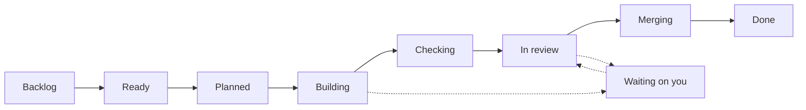
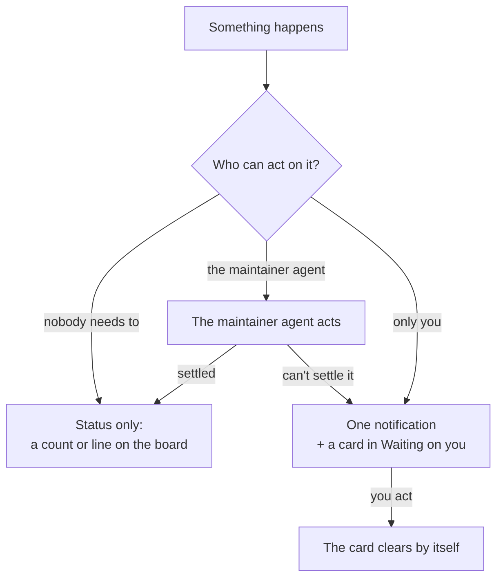

# A tour of the dashboard

The dashboard is a board in your browser that shows everything Intakt is doing, updated live. This page walks through it. Intakt is still being built, so this describes the decided design ([details](../design/05-architecture/13-dashboard.md)).

## What you can open today

Five pages are built. They show what Intakt has written down about its reviews. Opening the dashboard's address without a page name takes you to the **Board**. The board, the project list, the review list and the review page listen for news from Intakt through a live connection (the components page does not), but nothing is shown from it on the lists yet, so reload a list to see news. Only the project filter at the top hears from it: when a project starts its first review, the filter gets the new list of projects, so that project shows up in it without a reload (a review of a project already listed sends nothing; your own choice in the filter stays as it is, or falls back to All projects if that project is no longer listed; the Waiting on you count will update from it later); with the live connection down, a list still shows everything that was written down. The page of a review that is still running updates by itself while the round goes on, also after you open a list in another tab or go back to it from a list, and if the live connection is down it says so (see the frame below) and shows what is written down when you reload.

- **Board** (`/`): every change under review as a card in the column of where it is now, with a count on each column (see [The board](#the-board) below).
- **Projects** (`/projects`): one row per project that has had a review, with a line saying how many review rounds it has had and how many of them reached the judge ("2 review rounds, 1 judged."). Click a project's name to see its reviews.
- **Reviews** (`/reviews`): one row per review round, newest first, with its project, how many reviewers took part, when it started, and a small label saying whether it is still running (**In progress**, with a green dot) or the judge has decided (**Judged**, with a check). Add `?project=name` to the address to pick that project in the project filter at the top (see below). Click a round to open its review. Above the rounds, under "Pull requests that failed", a card for each pull request that failed the last time Intakt tried it names it and says whether Intakt is waiting to try again or handed it to the maintainer agent, then why it failed (in red), how many times in a row, and when it is tried next; the card goes away once that pull request moves on or is closed. At the top, "Forge budget this hour" shows, for each GitHub installation, how many calls Intakt has used and has left this hour, and says when the reserve is in force, that is when Intakt holds back its routine reads so the calls it cannot do without still have room.
- **Components** (`/components`): every building block of the dashboard shown twice, in the light and the dark look side by side, with a button to switch the look. It is the place to see what a button, card or banner is meant to look like; nothing links to it yet, so type its address.
- **One review** (`/reviews/` and the round's id): under the title, a line names the project, the change and when the latest round started. While the latest round is still running, a tinted box, "Now: round 2 in review", says where things stand: what each reviewer is doing, the problems from the last judged round that are still to fix (click one to jump to it below), and that the judge has not decided yet. The box keeps itself up to date while the page is open: the count of finished reviewers grows, a reviewer that answers stops saying "running" (it says "verdict", "failed" or "blocked", in the box and in the round's table, and its stop button goes away), a stopped reviewer says "stopped", a reviewer that starts after you opened the page gets its own line in the box (named by its id until you reload), and when the judge decides the box says so and asks you to reload to see the call. Below it, the timeline shows every round of that change, one after the other. A round the judge has decided is folded to one line (its outcome, how many problems it found, and when it started and was judged); click it to open the round. A round reviewed before Intakt started keeping the problems says "findings not recorded" on that line instead of a number, and how many the judge picked, if any. The running round stays open. Each round is headed by its number and the same running or judged label. For each round you see the reviewers and what each one said (approve, changes or blocked, and how many problems it found, or why it failed), the problems themselves with their short ids (`F1`, `F2`, ...), what the judge decided about each one (fix it now, a follow-up for later, or not acted on), and how many tokens the AI calls of the round used. Once the judge is done, the round says its outcome (approve, changes or blocked), worked out by the same rule as the command line. A reviewer that failed says so in plain words, such as "stopped at its output limit", and the round says how many failed: a failed reviewer never counts as an approval, so a panel of two never quietly becomes a panel of one. A reviewer that is still working has a button to stop it: the reviewer ends as blocked, the page marks it as stopped and the button goes away. While a reviewer of the running round is working, a **Stop** button at the top of the page stops the whole round the same way: every reviewer working at that moment is asked to stop (one that has not started yet is not). It asks you to click again first, and it goes away by itself once every reviewer is done or the judge decides. The cost is the same figure the command line shows for the round, worked out from the prices in your settings; for a model with no price it says "unknown" and names the model, and it never guesses one. It also says "unknown" when the AI provider did not report how many input tokens a call used, because the output alone would look like the whole cost. A round reviewed before Intakt started keeping the text of the problems says so, and still shows the ids the judge picked and what it decided about them.

The pages only answer when you open them on the computer Intakt runs on (`localhost` and the dashboard's port, 7780 unless you changed it); any other address gets an error page and none of your data. A change that is reviewed twice shows as two rows on the review list, and both open the same review. A review page has a button that starts the change's next round on its newest commit, using the repository and task Intakt noted when the last round started; for rounds from before it noted them, the page says so instead. Pressing it twice, or on a page that is out of date, starts only one round and tells you so. The copy of your code the reviewers read is deleted once the round is judged. Today the button needs no login (the owner login is planned), so only reach the dashboard from the computer itself. A reviewer that is still working has a "Stop this reviewer" button in its row; pressing it writes down that you asked for a stop, and the reviewer stops the next time it shows a sign of work (asking the AI, reading a file, writing a bit of its answer), even if you pressed it while the reviewer was still waiting for its turn. An AI that stays silent for a long time stops only once it shows such a sign. A stopped reviewer counts as blocked, not as an approval or a change request: its row changes to "stopped" by itself, without the button, and keeps the verdict "blocked", also after a reload. The button needs no login today either. The board below is worked out from the reviews and opens at the dashboard's start address.

Every page sits in the same frame. Down the left side runs the menu: the Intakt logo, which takes you to the start, then one entry for each page that is built. Today that is **Board** and **Projects**, each shown highlighted while you are on it; Waiting on you (with the number of things that wait for you), Team, History and Settings join them once their pages exist. **Collapse** at the bottom of the menu shrinks it to a narrow strip of icons, and this browser remembers that until you open it again. Along the top runs a bar with the search field, the project filter and the button for the light or dark look. The search field shows its shortcut, `Ctrl K` (`⌘K` on a Mac). Click it, or press the shortcut on any page, and the search window opens over a darkened page, with the cursor already in it. It shows results in groups (things you can do, review rounds, projects and pages), each naming its project or saying "All projects"; with nothing typed, the five newest review rounds as Recent and the things you can do (today only switching the light or dark look). Type, and the list follows every letter. The first result is highlighted; the up and down arrow keys move the highlight, Enter opens that result (or does it, for switching the look), and Escape closes the window and puts you back where you were. A click on a result works too (the cursor stays in the search field, so the arrow keys still work afterwards), and so does a click beside the window to close it. When nothing matches, the window says so, gives a hint of what to try, such as one of your projects by name, and offers a button that clears the search. You can do all of it without a mouse: Tab moves through the menu and the top bar, Ctrl K opens the search, the arrows and Enter pick a result, and Escape closes it again. While the search window is open, Tab stays inside it, and Enter waits until the results for what you typed have arrived. If you write with an input method that composes text, as for Japanese, Chinese or Korean, Enter and the arrows belong to it while it composes, so Enter confirms your text and does not open a result. The project filter is a list to pick from: **All projects**, then every project that has started a review, sorted by name. Pick one, and the cards on the board, the project list, the review list and the cards of failed pull requests show only that project (the board's counts stay the totals of all projects); pick All projects to see everything again. This browser remembers your pick on every page, and a project picked once that no longer exists falls back to All projects. Clicking a project on the project list picks it too, and you can still pick another one or All projects from there. A project that starts its first review shows up in the list after a reload. A name too long for the bar ends in "…", and pointing at the list shows it in full. On a phone, or in a window narrower than 761 pixels, the frame changes shape: the menu becomes a bar along the bottom of the screen, with a big icon and its name for each page (today Board and Projects; Waiting on you and Team join them with their pages), and the top bar holds just the Intakt logo, which takes you to the start, a short **Search** button (it opens the search as a full-screen sheet: the field on top with a **Cancel** button beside it, the results below in rows at least 52 pixels tall, and no key hints; Cancel or a result closes it, and the cursor goes back to the Search button) and the light or dark button. The project filter is left out there, so a phone always shows every project, whatever you picked on a wider screen; widen the window again and your pick is back. History and Settings will sit behind a **More** button at the end of the bottom bar, which opens a small list of them above the bar; since neither page is built yet, More is not shown today.

The frame also tells you when a page loses its live connection to Intakt (the board, the project list, the review list and the review page have one when the hub is set up). A plain line appears at the top of the page: "Reconnecting.", the time the connection was lost, a reminder that you are seeing what Intakt knew then, and how many seconds until it tries again. It tries every 5 seconds, and **Try now** tries at once; a try that is still waiting for an answer is given the time it needs instead of being started over. The top bar shows **Offline** beside the light or dark button (a phone shows only the line). The page itself stays as it was, sharp and readable. If the connection is still gone after two minutes, the line turns red and says "Can't reach Intakt." Once the connection is back, the line and the marker go away and the news you missed arrives, as long as the page had received some news before the connection was lost (otherwise reload to see it). The line also says that actions wait until the connection is back: buttons that would change something in Intakt, such as **Stop this reviewer**, are greyed out and cannot be clicked, so you never act on news that may be out of date. Buttons that change nothing in Intakt, like **Try now** or the light or dark button, keep working. A "how long" time, such as "42 min", gets the time the connection was lost beside it ("42 min at 11:12"), so you can tell how old it is (no page shows such a time yet, apart from the components page). Once the connection is back, the buttons work again and the added times go away.

Every page comes in a light and a dark look. Until you choose, it follows your computer's light or dark setting, and it is right from the first moment the page appears, without a flash of the other look. The moon or sun button in the top bar of every page (and the button on the components page) flips the look, and this browser remembers your choice. The colors, sizes and fonts all come from one shared set that every page uses. On top of it sits one shared set of building blocks, so every page looks and behaves the same: buttons, little state labels, counts, cards, rows, inputs, a number stepper, a command with a Copy button, usage bars (a pale one when Intakt only knows the last reading), banners, tabs, short messages at the bottom of the screen, loading, error and empty states. A few of them react to you: a button that does something drastic, like pausing everything, asks you to click again first and calms down after a few seconds if you don't; a short message such as "All projects paused" offers Undo and goes away by itself after a few seconds, but stays while your mouse or keyboard is on it; on a phone a banner shrinks to one line that opens when you tap it, and on/off switches grow to be easy to tap. Amber shows up only on things that wait for you. A few words Intakt keeps, such as "version" or "weekly share", are underlined with dots and show the same short explanation wherever they appear when you point at them. The components page shows them all, including how a button, card, field or tab looks when your mouse or keyboard is on it, and every field and switch on it has a name a screen reader reads out. The board, the project list, the review list and the review page are built from them too: each starts with its title and a short line about what it shows, projects are rows, failed pull requests are cards, a round's state is a label, the tables have quiet headings (on a phone a wide table scrolls sideways; with a keyboard, Tab to the table and use the arrow keys), an empty list says so in the middle of the page, and **Stop** and **Stop this reviewer** are drastic buttons that ask you to click again first, also on a page without the live connection. The pages still to come will use them as they are built. On a phone the pages take the phone's own width instead of a shrunken desktop page, so the phone sizes apply. The fonts are part of Intakt and come from your own install: the dashboard never asks another website for a font, a style or a script, so it looks the same offline and nobody else learns that you opened it.

## Checking how the pages look

Whoever works on the dashboard can check every page in one go with `bin/ui-check`. It opens each built page (the board, the components page, Projects, Reviews, the search window and the page of one review) in a browser without a window, in the light and the dark look, as wide as a laptop (1440), as a large screen (1920) and as a phone (390). For each of them it lists the accessibility problems an automatic checker finds, from critical down to minor, and on the phone width every piece of text smaller than 15 pixels and every button, link or search result less than 44 pixels tall, the smallest sizes the design allows. A link inside a sentence is not counted, since a sentence cannot be made that tall. It also saves a picture of each page in `var/ui-check/`, so you can look at all of them side by side. It passes when there is no serious or critical problem, nothing under those sizes and no page that failed to load. The work on a new page uses it to show the page is ready. It needs the dashboard running with at least one review, and Node.js with Playwright and axe-core installed; [the user guide](../user/README.md#checking-the-pages-with-the-ui-check) has the commands.

## The board

Every task in flight is a card, and its column says where it is now. **Waiting on you** is the first column on the left, because it is the only one that needs you to do something. Cards move through the other columns from left to right. The board is the page the dashboard opens on, and **Board** in the menu brings you back to it; **Open the review list** at its top leads to the list of every review round. Today the cards are the changes under review: one card per change, in **In review** while its latest round runs and in **Done** once that round is judged, each with its project, its round (point at the word for what a round is), its reviewers and its cost, and a click on it opens its review page. **Waiting on you** stays first and a little wider than the other columns, so it is the first thing you see; Intakt does not yet write down anything that waits for you (planned), so today it says "Nothing needs you". The other columns say "Nothing here" until Intakt takes in and builds tasks itself (planned); a column's count is every card in it, of every project. A busy column shows its first 12 cards and a button under them, such as **Show 28 more**, that shows the rest; when you pick one project at the top, the 12 and the number count only that project's cards. A long title wraps to at most three lines, and a long project name or change number on a card is cut short with "…" (point at it to read it whole). **Backlog** and **Done** start folded up into a small strip with just their name and count, so the columns in between get the room: click the strip to open the column and see its cards, and **Hide** at its top folds it up again. On a phone they are never folded up. On a wide screen (1700 pixels and up) every page leaves more room at the sides, and the board grows with the window at every width. On a phone the word "Round" on a card is as tall as a button (44 pixels), since you can reach it on its own; the board passes the page check above (`bin/ui-check`) on a laptop, a large screen and a phone, in the light and the dark look.

When Intakt could not handle a pull request's newest commit, a red banner above the columns says so, one banner per pull request: which pull request of which project failed, how often in a row and when Intakt tries again (or that it handed the pull request to the maintainer agent), and why, with any password or key in the reason blanked out. **See the failed pull requests** takes you to them on the review list. The banner does not vanish while you watch: it goes away on the next load of the board, once Intakt has read that pull request again. On a phone a banner is one line that opens when you tap it, with or without the live connection; a second tap closes it.

| Column | Meaning |
|---|---|
| **Waiting on you** | only a person can move it on (see below) |
| **Backlog** | written, but not ready yet (unclear, waiting on another task) |
| **Ready** | in the queue, waiting for a free builder |
| **Planned** | the builder wrote a plan that waits for your approval (only when plan approval is on) |
| **Building** | a builder is working on it |
| **Checking** | the checks run on the finished work |
| **In review** | the review panel is reading it |
| **Merging** | approved, being merged |
| **Done** | merged |

## A card

Each card shows the task, its size, which builder slot and AI model is on it, how long it has been in its column, the tokens and money spent so far, the review round, and a **badge** saying why it waits, if it waits:

| Badge | Why it waits |
|---|---|
| budget | the AI allowance is near its limit, or the pace says slow down |
| overlap | another task is changing the same files; this one goes next |
| dependency | it `Waits for` another task |
| CI | GitHub hasn't finished the checks yet |
| on hold | it needs something outside the task; it comes back by itself |

**Open a card** to see its whole story: the plan, every build, the checks, each reviewer's verdict and findings, and the live log of the job running now, tool call by tool call. *(in progress: a review's page already shows its current state and its rounds, the finished ones folded to a line; a running review's page also shows its progress and, in a live log beside the timeline, the reviewers' tool calls and their text as they write it, with a summary pinned under the log (tool calls by kind, cost, files read and the round's findings, kept up to date as the reviewers work; choosing a finding id there opens its round in the timeline and highlights its entry), and keeps working from a reload when the live updates are down; a **Stop** button at the top asks every reviewer working at that moment to stop, after a second click, shows up by itself when a reviewer starts working, and goes away by itself once the round is done; on a phone, Stop sits at the top and a **Timeline** and **Live log** switch that stays in view as you scroll shows one of the two, while on a very wide screen the summary moves beside the log so you see both at once; continue and send back are planned)* Buttons let you **stop** the job, **continue** it, or **send it back with a note**. The buttons ask for your owner secret or passkey first, like every change on the dashboard ([steering budgets and pauses](#steering-budgets-and-pauses)).

## Waiting on you

This is the only column that needs you. A card here and a notification on your phone are the same thing: each card was sent to you once, and nothing is sent that has no card. Each card says exactly what to do, with a link: the label to add, the text to post, the setting to change. Typical cards:
- a question a builder asked;
- a plan to approve;
- a change to the project's rules that only you may approve;
- a decision the maintainer agent couldn't make, with its options and recommendation;
- a broken part of Intakt itself (red), such as an expired login, with the cause and since when;
- a dated chore, such as renewing an AI token or login before it expires.

Anything Intakt or its maintainer agent can settle never shows up here.

## Alerts and notifications

Every event that might need attention is sorted by one question: who can act on it?

- **Nobody needs to act:** progress, recoveries ("the reviewer works again"), counts and the list of what Intakt approved by itself. These are on the board and in the status, and never notify.
- **The maintainer agent can act:** a stuck task, a broken check, a label in the wrong place, a conflict with main. It gets the item first; you hear about it only if it can't settle it, as a decision with its options and recommendation.
- **Only you can act:** an approval, a question only you can answer, an expired login, a halt only you may clear. You get one notification and a card, at the same moment.
- **Once each:** a notification is sent once per item and change, not again every few minutes. The card stays until the reason is gone, then clears without you dismissing it.
- **Nothing is lost:** every notice is recorded with whether it was delivered. If your phone can't be reached, the card says so and the fallback notifier is tried.
- **Not yet yours:** a change still in review or being fixed doesn't ask you anything. You are asked once it has passed review and CI.

## Around the board

- **Lanes and slots** (a strip above the board, called **Who is working**): it says how many are working and opens to one card for each reviewer running now, with its change, project, round and the time it started. The builder slots join it later (planned), so there is no idle count yet.
- **Budgets:** each AI account's windows (five-hour and weekly), how much is used and reserved, and the forecast for the rest of the window. When a window resets shows only in the admin area.
- **Projects:** with several projects, each card and item carries its project, a filter shows one or all, and each project has a summary: its share of the week against its actual spend, whether it is paused and why, and what it is working on.
- **Accounts:** the AI accounts and the reviewers and builders on them are shown once, each with what it is doing now.
- **Trends:** tasks created versus finished per day (is the queue growing?), merges per day, review findings per merge, and how long tasks take from ready to merged, split into waiting, building, review and waiting on you.
- **Rework** (planned): per project, how many tokens one merged change costs and how much of them went into fixing changes the reviewers sent back, so you can see whether the checks before review pay off.
- **Approved by Intakt:** the protected changes Intakt approved by itself in the last week, one line each with the reviewers' reasons.

## Steering budgets and pauses

The dashboard has an **admin area** where you change how much Intakt may spend and when it works, without editing any file. Only you can change anything on the dashboard:
- On the first start, you type the one-time setup code from `docker logs intakt`, and Intakt creates your **owner secret** (shown once, so keep it in your password manager) or registers a **passkey**. Every change asks for it: the admin area and the buttons on a card alike. Without it, the dashboard shows a login page and changes nothing.
- The dashboard only answers on the computer it runs on, so there you can look at the board without logging in. If you turn on phone access, which needs HTTPS, everything asks for your secret or a passkey, even looking at the board: someone else on the network sees only the login page. A passkey only works on the address it was made on (on the computer itself, open the dashboard as `localhost` to use it), so when you turn on phone access the admin area shows a one-time pairing code, and typing it on your phone's login page makes a passkey for the phone address. Your secret works on both. The secret is one Intakt made up, long and random, and after a few wrong tries the secret login slows down and you get a card, so guessing gets nowhere. Someone guessing wrong on purpose can slow your secret login too, but never lock you out: a dashboard you are already logged into stays open, a passkey is never slowed down, and a command on the computer Intakt runs on lifts the slowdown at once. If you lose your secret or think someone else has it, the same command resets it: your secret, your passkeys and every open login stop working at once, and you set up a new one with a fresh setup code from `docker logs intakt`.
- Another website open in your browser can't press a button or change a setting, and neither can an AI agent, a job, a label or a comment: they can see what is in effect, never change it.

### Every change ends by itself

Raising or lowering a ceiling, pausing and changing a share each ask **until when**: a date and time, or "until the window resets" (for example the next weekly reset of an AI account). Clearing a back-off asks nothing: the wait it lifts already had an end, and that end is when the change runs out. When that moment comes, the change lapses and the normal setting is back, so a forgotten change can't keep spending. The board and the status show every change in effect and when it ends (a cleared back-off only says it lasts until the old wait would have ended); your accounts' limits and reset times show only in the admin area. The history lists every change: who made it, what it was before and after, and until when.

| You can | For example |
|---|---|
| **raise or lower a ceiling** | let an account use more, or less, of its five-hour or weekly allowance |
| **pause and resume** | stop one project, or all of Intakt, for the evening |
| **change a project's share** | give one project most of the week until Friday |
| **clear a back-off** | try an account again at once when you know the problem is over |

### Letting Intakt use the rest of the week

Intakt normally leaves room in each AI account for your own use and spreads the week evenly. If the week is nearly over and you won't need the account yourself:
1. Open the admin area and pick the account.
2. Raise its **weekly ceiling** (up to all of the allowance).
3. Choose **until the window resets**, so it ends with the week.

Intakt then uses what is left until the reset, and goes back to the normal ceiling by itself. On an account that can bill past its plan, the ceiling stops at the plan's limit; anything past it counts against the spending cap you set.

### Pausing

1. Open the admin area and choose **pause**, for one project or the whole install.
2. Choose until when: a time, or until a window resets.

Running jobs finish, nothing new starts, and finished work that is fully approved still merges. **Resume** ends the pause early; otherwise it ends by itself at the time you chose.

### Accounts

You also add, order and remove your AI accounts here. Each account shows only what its AI company supports: a subscription (its long-lived token, or a login where the company has no such token) or an API key, its usage windows, whether it bills past the plan, prepaid credit and when it expires, a block the company has set and when it ends, and which work it may do. Intakt spends prepaid credit that is about to expire first, then your subscriptions, then paid usage up to your cap ([accounts and costs](accounts-and-costs.md)). A saved key is never shown again, only its last four characters. A **test** button checks an account with one tiny call and shows what is left.
