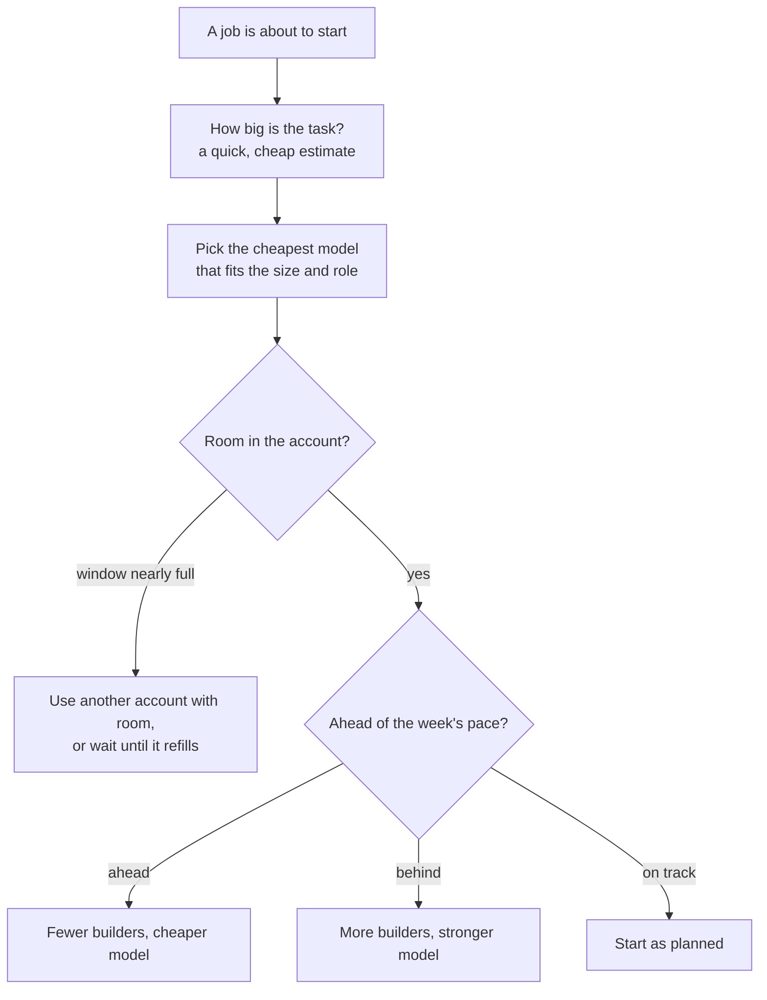

# Accounts and costs

Intakt's agents run on AI models you pay for. This page explains the kinds of accounts it can use, how it decides how much to spend, and how to give it more or less room. Intakt is still being built, so this describes the decided design ([details](../design/05-architecture/06-budget-and-model-planner.md)).

## Kinds of accounts

You can give Intakt any mix of these, per AI company, and it treats them as one pool:

| Kind | How you pay | What Intakt watches |
|---|---|---|
| **Subscription** (for example a Claude or ChatGPT plan) | a flat monthly price with usage allowances | the five-hour and weekly windows, as the company measures them |
| **API key** (personal or company) | per token used | a monthly or daily spending cap that you set |
| **Cloud sessions** (where a company offers them) | usually per use | the same caps, and where each job ran |

If a subscription can bill **overage** (extra usage past its allowance), Intakt asks at setup, treats the account like an API key past the limit, and applies your spending cap. Some companies' terms restrict automated use of consumer plans; Intakt says which plans its terms allow, next to each account.

You can add more than one account of the same kind from the same company, for example two subscriptions. Intakt watches each one separately, and all of them work at the same time (see [every account works at once](#every-account-works-at-once), planned).

For a subscription, Intakt doesn't use the login you sign in with yourself. Where the AI company offers one, it uses a **long-lived token**: a key you create once for that account with the company's own tool (for Claude, `claude setup-token`) and paste into Intakt. It lets Intakt's agents use that subscription without your password or your personal session, and you can revoke it at any time. Where a company has no such token, Intakt keeps that account's login to itself and lends it to each job read-only.

A reviewer can run on a Claude or Codex subscription too; what it can and cannot do is explained in [why the AI can't wreck your project](why-the-ai-cant-wreck-your-project.md#a-reviewer-on-a-claude-or-codex-subscription). What a Codex reviewer used is written down under the account it ran on, once per review.

## How it decides what to spend

- **The right model for the job:** a small docs fix doesn't need the strongest model. Intakt names models by tier (`strong`, `standard`, `light`) and your config maps each tier to a company's model. A task can ask for a tier with a `model:` label.
- **Moving up when it struggles:** if the same check keeps failing or a reviewer keeps finding the same problem, the next attempt gets a stronger model.
- **Measured, not guessed:** whether a job may start depends on the account's measured use, not on Intakt's estimate. A running job is never stopped just because the window is nearly full or the estimate was too low. Three things end it: it makes no progress for a set number of steps (no new content and no change in which tests fail), it reaches a ceiling of a few times its allowance, or the task reaches its total across all its attempts. The last two catch a runaway the progress check misses, on a subscription too. A stopped build keeps its commits, so the next attempt or the maintainer starts from them. On an account that bills overage past the subscription, the guards that are lenient on a subscription turn strict: with no fresh usage reading, nothing new starts, a call already running past the ceiling is not let finish, and your spending cap applies.
- **Why an account can show an old reading (planned):** now and then the AI company's latest answer about an account's use is missing or unusable. Intakt then shows the last good reading together with the time it was taken, so a "100% used" that is hours old, from before the window refilled, is plainly marked as old. If an answer simply leaves out a window, Intakt takes that window as not used yet, because the company leaves out windows that saw no use lately. An answer with no window at all counts as no reading.
- **Spending headroom:** if a window will refill with room to spare, Intakt uses it: stronger models, more builders in parallel.
- **What is spent first:** prepaid credit that is about to expire or can only pay for certain work, while it can; then your subscriptions, within Intakt's share of them; then paid usage (overage or API keys), up to your cap. Among accounts at the same step, the room that refills soonest is used first. When nothing is allowed, work waits and the board says why.
- **Falling back:** when one account is out, work moves to another account that has room. A build moves to whichever account the usual order picks next, from any company: room that refills soonest first, and nothing paid while a subscription still has room. Reviews are the exception: a reviewer stays with its company, its paid accounts too, and only when all of them are out does a reviewer from another company take its place as a substitute (the usual one is owed a catch-up review). The substitute is the first one you listed for that reviewer's tier that has an account with room, in your order. Planned: preferring a company not yet reviewing the same change, even if this means a paid account while another company's subscription has room (with only two companies, it comes from the other reviewer's company, and the change can still merge, protected files included), and making the change wait for you when the security reviewer or the attacker would need a substitute. The dashboard shows each switch.

## Every account works at once

This part is planned, not built yet ([details](../design/05-architecture/06-budget-and-model-planner.md#a-limit-never-loses-work)). Every account you add is used, at the same time, unless you leave an account or a model out. Intakt doesn't use one account until it is empty and only then the next: a job can run on each account at once, so a second subscription never sits idle while the first is nearly full.

- **Room that is about to refill is used first.** An account whose allowance refills in an hour is used before one that refills in four days, because room left unused at a refill is lost. Paid usage still comes only after the subscriptions with room have been used.
- **How many jobs run follows the room.** More room across your accounts means more jobs, up to what the machine, the checks and the reviews can take, so extra builders don't just wait in line.
- **At a limit, nothing is lost.** If a job reaches an account's limit, it stops at a safe point. Its work is saved on its branch, its conversation is kept, and a short note says what is done and what is left. Another account picks it up right away from that note; it doesn't wait for the first account to refill. A build can move to another company's account, and the change of model is written on the task.
- **Reviews stay with their company.** A review that is cut off starts again on another account of the same company. If none has room, the stand-in rules above apply.

You add, order and remove accounts in the dashboard's [admin area](a-tour-of-the-dashboard.md#steering-budgets-and-pauses). Billing stays with the AI company: Intakt keeps only whether an account bills past its plan, its own cap below the company's limit, and a link to the company's billing page.

## Shadow mode: trying Intakt alongside your process

A project can be set to **shadow mode** (`mode: shadow` in its configuration). Intakt then reviews its changes with the whole panel, as it would for real, but nothing it does counts: it never writes to the forge (no review is posted), and its verdicts are marked as shadow ones and never count toward a merge, even after you switch the project back to live. Use it to see how Intakt's reviews compare with the reviews you already have, before you trust it ([details](../user/README.md#shadow-mode)).

Shadow work must never take room your existing work needs on the same accounts. So it has its own, lower **shadow ceiling** that you set (70% of each window unless you change it), and a shadow review starts only while every account it could run on is below it: the accounts of each reviewer's company, of any company that could stand in for one, and of the judge's. If one of them is at or above it, the review is **held**: it doesn't start, and nothing is stored. The same happens while Intakt is paused or draining, backing off, or while one of those accounts cools down.

When a shadow review is held, you see a message that names the project, the company and the reason, for example:

- `The shadow round of project "alpha" was held: an account of provider "anthropic" is not below the shadow ceiling (at-ceiling).`
- `The shadow round of project "alpha" was held: an account of provider "anthropic" is not available for a start, because Intakt is paused (paused).`

The same reason is written in the ledger, Intakt's record of events (`php bin/console intakt:ledger:events` shows it). Until Intakt records how much of each window is used, the shadow ceiling holds nothing back. A project in live mode is never held by it.

## Reviewer for the loop: Intakt's review takes a reviewer's place

If an existing loop already builds and merges a project, you can set the project to **reviewer-for-loop mode** (`mode: reviewer-for-loop` in its configuration). Intakt then reviews each new head of the loop's pull requests with its whole panel, in place of the loop's own Claude reviewer, and its verdicts count. Because Intakt takes a reviewer's place instead of adding one, the shadow ceiling does not hold these reviews back. Intakt still writes nothing to the forge in this mode: it never merges, pushes, labels or approves anything; the loop keeps doing that as before. Posting Intakt's review on the pull request comes later. To go back, switch the loop to its own Claude reviewer again ([details](../user/README.md#reviewer-for-loop-mode)).

## Several projects on one install

Each project gets a **share** of the week, for example 70% and 30%. A project with nothing to build lends its share to the others; when it has work again, it goes first until it has caught up. A share of 0 pauses the project: once a running job finishes, nothing is built or reviewed for it, not even its open pull requests. Its work waits and carries on when you raise the share again.

## Where the money goes, and how to spend less

The dashboard shows the cost of every job, every task and every project, and where it went: building, reviewing, checks, retries. You give Intakt the price of each model in its settings; a review from the command line and the dashboard's review page both show what a round's model calls cost, the same figure on both, and when a model has no price, the cost says unknown instead of a guess. The dashboard's cost views for a job, a task and a project are planned.

What costs the most is **repeating work**: a task built three times because it was unclear, or reviewed again because it waited too long. Intakt avoids that on its own (short descriptions and reviews, no repeat reviews of unchanged work, holds instead of retries, pausing the builders when reviews fall behind). The biggest saving you control is [writing clear tasks](writing-a-good-task.md).

## The smallest setup

With one account, a second reviewer from another company is not possible, and a second review of every change by the same company would double the review cost in the same time window. So Intakt starts with one builder and one reviewer. Only changes to protected files, security-relevant changes and large changes get a second review, by another model of the same company; docs-only and tests-only changes get one. It also splits big tasks earlier, because redoing a big change is where the money goes. This is planned, not built yet. Setup details are in [setting up Intakt](setting-up-intakt.md#the-smallest-setup).

To grow, add an account; Intakt picks it up on its own at the next start, and you can raise the build slots further (see the table below). A second account of another company also lets the second reviewer come back.

## Giving it more or less room

| You want | Do this |
|---|---|
| more throughput | add an account, or a bigger plan; allow more build slots |
| a hard ceiling | set a spending cap on API keys, or limit build slots |
| focus on one project | raise its share, or set the others to 0 |
| cheaper runs | map the tiers to cheaper models, or label routine tasks `model:light` |
| more or less for a while | raise or lower a ceiling, or pause, in the [admin area](a-tour-of-the-dashboard.md#steering-budgets-and-pauses); each change ends by itself |
