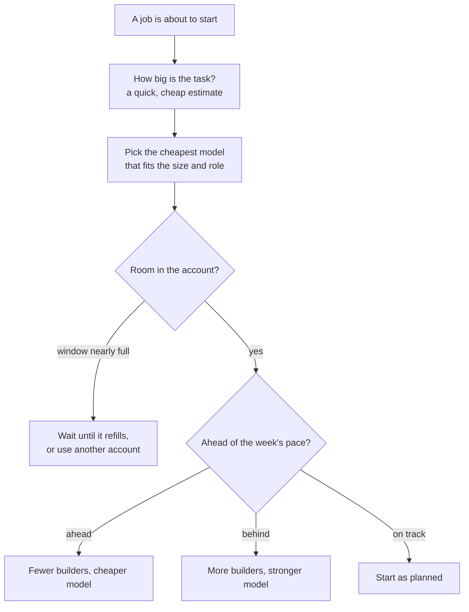

# Accounts and costs

Intakt's agents run on AI models you pay for. This page explains the kinds of accounts it can use, how it decides how much to spend, and how to give it more or less room. Intakt is still being built, so this describes the decided design ([details](../design/05-architecture/06-budget-and-model-planner.md)).

## Kinds of accounts

You can give Intakt any mix of these, per AI company, and it treats them as one pool:

| Kind | How you pay | What Intakt watches |
|---|---|---|
| **Subscription** (for example a Claude or ChatGPT plan) | a flat monthly price with usage allowances | the five-hour and weekly windows, as the company measures them |
| **API key** (personal or company) | per token used | a monthly or daily spending cap that you set |
| **Cloud sessions** (where a company offers them) | usually per use | the same caps, and where each job ran |

If a subscription can bill **overage** (extra usage past its allowance), Intakt asks at setup, treats the account like an API key past the limit, and applies your spending cap. Some companies' terms restrict automated use of consumer plans; Intakt says which plans its terms allow, next to each login.

You can add more than one account of the same kind from the same company, for example two subscriptions. Intakt watches each one separately and puts them in the order you choose.

## How it decides what to spend

- **The right model for the job:** a small docs fix doesn't need the strongest model. Intakt names models by tier (`strong`, `standard`, `light`) and your config maps each tier to a company's model. A task can ask for a tier with a `model:` label.
- **Moving up when it struggles:** if the same check keeps failing or a reviewer keeps finding the same problem, the next attempt gets a stronger model.
- **Measured, not guessed:** whether a job may start depends on the account's measured use, not on Intakt's estimate. A running job is never stopped just because the window is nearly full or the estimate was too low. Three things end it: it makes no progress for a set number of steps (no new content and no change in which tests fail), it reaches a ceiling of a few times its allowance, or the task reaches its total across all its attempts. The last two catch a runaway the progress check misses, on a subscription too. A stopped build keeps its commits, so the next attempt or the maintainer starts from them. On an account that bills overage past the subscription, the guards that are lenient on a subscription turn strict: with no fresh usage reading, nothing new starts, a call already running past the ceiling is not let finish, and your spending cap applies.
- **Spending headroom:** if a window will refill with room to spare, Intakt uses it: stronger models, more builders in parallel.
- **Falling back:** when one account is out, work moves to the next account from the same company, then to another company; a reviewer from another company stands in and the usual one catches up later. The dashboard shows each switch.

## Several projects on one install

Each project gets a **share** of the week, for example 70% and 30%. A project with nothing to build lends its share to the others; when it has work again, it goes first until it has caught up. A share of 0 means no new builds for that project; its open pull requests are still fixed, updated and merged.

## Where the money goes, and how to spend less

The dashboard shows the cost of every job, every task and every project, and where it went: building, reviewing, checks, retries.

What costs the most is **repeating work**: a task built three times because it was unclear, or reviewed again because it waited too long. Intakt avoids that on its own (short descriptions and reviews, no repeat reviews of unchanged work, holds instead of retries, pausing the builders when reviews fall behind). The biggest saving you control is [writing clear tasks](writing-a-good-task.md).

## Giving it more or less room

| You want | Do this |
|---|---|
| more throughput | add an account, or a bigger plan; allow more build slots |
| a hard ceiling | set a spending cap on API keys, or limit build slots |
| focus on one project | raise its share, or set the others to 0 |
| cheaper runs | map the tiers to cheaper models, or label routine tasks `model:light` |
