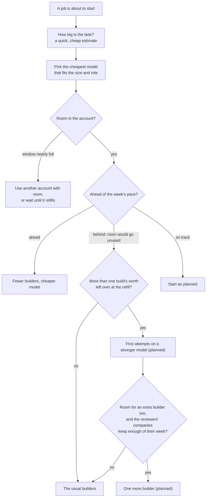

# Accounts and costs

Intakt's agents run on AI models you pay for. This page explains the kinds of accounts it can use, how it decides how much to spend, and how to give it more or less room. Intakt is still being built, so this describes the decided design ([details](../design/05-architecture/06-budget-and-model-planner.md)).

## Kinds of accounts

You can give Intakt any mix of these, per AI company, and it treats them as one pool:

| Kind | How you pay | What Intakt watches |
|---|---|---|
| **Subscription** (for example a Claude or ChatGPT plan) | a flat monthly price with usage allowances | the five-hour and weekly windows, as the company measures them |
| **API key** (personal or company) | per token used | what it spent this day and week; a weekly spending cap only if you set one, otherwise it can spend until the balance runs out (planned) |
| **Cloud sessions** (where a company offers them) | usually per use | the same spending and optional caps, and where each job ran |

This part is planned, not built yet ([details](../design/05-architecture/06-budget-and-model-planner.md#order-of-use)). An API key is used only after your subscriptions: when none of them has room left. You don't have to set a cap. You can set a weekly one for one account or for the whole install; without one, the money on the account is the limit. If the AI company says the balance is gone or a payment failed, Intakt stops using that account, shows why on the board, and tells you once, because only you can top it up.

Planned as well: if a subscription can bill **overage** (extra usage past its allowance), Intakt asks at setup, treats the account like an API key past the limit, and applies your spending cap if you set one. Some companies' terms restrict automated use of consumer plans; Intakt says which plans its terms allow, next to each account.

You can add more than one account of the same kind from the same company, for example two subscriptions. Intakt watches each one separately, and all of them work at the same time (see [every account works at once](#every-account-works-at-once), planned).

For a subscription, Intakt doesn't use the login you sign in with yourself. Where the AI company offers one, it uses a **long-lived token**: a key you create once for that account with the company's own tool (for Claude, `claude setup-token`) and paste into Intakt. It lets Intakt's agents use that subscription without your password or your personal session, and you can revoke it at any time. Where a company has no such token, Intakt keeps that account's login to itself and lends it to each job read-only.

A reviewer can run on a Claude or Codex subscription too; what it can and cannot do is explained in [why the AI can't wreck your project](why-the-ai-cant-wreck-your-project.md#a-reviewer-on-a-claude-or-codex-subscription). What a Codex reviewer used is written down under the account it ran on, once per review.

## How it decides what to spend

- **The right model for the job:** a small docs fix doesn't need the strongest model. Intakt names models by tier (`strong`, `standard`, `light`) and your config maps each tier to a company's model. A task can ask for a tier with a `model:` label.
- **Moving up when it struggles:** if the same check keeps failing or a reviewer keeps finding the same problem, the next attempt gets a stronger model.
- **Measured, not guessed:** whether a job may start depends on the account's measured use, not on Intakt's estimate. A running job is never stopped just because the window is nearly full or the estimate was too low. Three things end it: it makes no progress for a set number of steps (no new content and no change in which tests fail), it reaches a ceiling of a few times its allowance, or the task reaches its total across all its attempts. The last two catch a runaway the progress check misses, on a subscription too. A stopped build keeps its commits, so the next attempt or the maintainer starts from them. On an account that bills overage past the subscription, the guards that are lenient on a subscription turn strict: with no fresh usage reading, nothing new starts, a call already running past the ceiling is not let finish, and (planned) your spending cap applies if you set one.
- **Why an account can show an old reading (planned):** now and then the AI company's latest answer about an account's use is missing or unusable. Intakt then shows the last good reading together with the time it was taken, so a "100% used" that is hours old, from before the window refilled, is plainly marked as old. If an answer simply leaves out a window, Intakt takes that window as not used yet, because the company leaves out windows that saw no use lately. An answer with no window at all counts as no reading.
- **Spending room that would go to waste (planned):** Intakt starts an extra builder only while your accounts together would still have more than one build's worth of the week left over when they refill, and no other AI company that reviews the work is about to use up its own week. While there is such room left over, a task's first attempt gets a stronger model, unless its label asks for a tier (a few tasks picked at random start on a cheaper model instead, so Intakt can see what the stronger one gains), and when the room left over is not enough for both, the extra builder gives way first.
- **What is spent first (planned):** subscription credit that is about to expire or can only pay for certain work, while it can; then your subscriptions, within Intakt's share of them; then paid usage (overage or API keys, even their credit that is about to expire), up to your cap if you set one, otherwise until the balance runs out. This order and the optional cap are planned, not built yet. Among accounts at the same step, the room that refills soonest is used first. When nothing is allowed, work waits and the board says why.
- **Falling back:** when one account is out, work moves to another account that has room. A build moves to whichever account the usual order picks next, from any company (planned: room that refills soonest first, and nothing paid while a subscription still has room). Reviews are the exception: a reviewer stays with its company, its paid accounts too, and only when all of them are out does a reviewer from another company take its place as a substitute (the usual one is owed a catch-up review). The substitute is the first one you listed for that reviewer's tier that has an account with room, in your order. Planned: preferring a company not yet reviewing the same change, even if this means a paid account while another company's subscription has room (with only two companies, it comes from the other reviewer's company, and the change can still merge, protected files included), and making the change wait for you when a Security engineer session would need a substitute. The dashboard shows each switch.

## Every account works at once

This part is planned, not built yet ([details](../design/05-architecture/06-budget-and-model-planner.md#a-limit-never-loses-work)). Every account you add is used, at the same time, unless you leave an account or a model out. Intakt doesn't use one account until it is empty and only then the next: a job can run on each account at once, so a second subscription never sits idle while the first is nearly full.

- **Room that is about to refill is used first.** An account whose allowance refills in an hour is used before one that refills in four days, because room left unused at a refill is lost. Paid usage still comes only after the subscriptions with room have been used.
- **How many jobs run follows the room.** More room across your accounts means more jobs, up to what the machine's memory, the checks and the reviews can take, so extra builders don't just wait in line. Builders beyond what the machine runs comfortably get a low share of its processors: they mostly use processor time that the reviews and the other builders leave free, and when the machine is fully busy they get only a small share, so they slow the others down only a little.
- **At a limit, nothing is lost.** If a job reaches an account's limit, it stops at a safe point. Its work is saved on its branch, its conversation is kept, and a short note says what is done and what is left. Another account picks it up right away from that note; it doesn't wait for the first account to refill. A build can move to another company's account, and the change of model is written on the task.
- **Reviews stay with their company.** A review that is cut off before the reviewer starts answering starts again on another account of the same company. If none has room, the stand-in rules above apply. A half-written answer cannot be picked up again, so a review whose answer breaks off while it is being written is asked once more, from the start, without streaming the answer. If that answer breaks off too, the review ends blocked, with the reason on the review and a note of what the answer held before it broke off, to help find out why. When a limit or a temporary error is what broke the answer off, the review ends blocked at once, without the second try. Both tries count toward the costs.

You add, order and remove accounts in the dashboard's [admin area](a-tour-of-the-dashboard.md#steering-budgets-and-pauses). Billing stays with the AI company: Intakt keeps only whether an account bills past its plan, its own cap below the company's limit if you set one, and a link to the company's billing page. Planned: the board shows what paid accounts spent this day and this week, next to how much of your subscriptions is used.

## The former shadow mode

Intakt used to have a **shadow mode**, for trying it alongside your process without writing anything to the forge. It is gone: a project is either live (the default) or a reviewer for the loop (below). If your configuration still says `mode: shadow` for a project, or still has a `shadow_ceilings` list under `budget`, change or take it out: Intakt no longer knows these settings and won't start while they are there ([details](../user/README.md#project-mode)).

## Reviewer for the loop: Intakt's review takes a reviewer's place

If a build loop already builds and merges a project (as the build loop that developed Intakt does for Intakt), you can set the project to **reviewer-for-loop mode** (`mode: reviewer-for-loop` in its configuration). Intakt then reviews each new head of the loop's pull requests with its whole panel, in place of the loop's own Claude reviewer, and its verdicts count. The only thing Intakt writes in this mode is its verdict on each head it reviewed: a check mark named `intakt/review` on that commit (passed for approve, failed for changes, an error when it could not review) and one comment on the pull request that lists the findings to fix and ends with the verdict in a short block the loop reads. The check mark and the comment always agree: an approval that still lists a serious finding (P1) is published as a request for changes, because the loop would read it that way, and if posting fails halfway, the retry finds the comment it already posted instead of adding a second one. It never merges, pushes, labels or approves anything; the loop keeps doing that as before. To go back, switch the loop to its own Claude reviewer again ([details](../user/README.md#reviewer-for-loop-mode)).

The pull requests Intakt opened itself are handed over to it: the loop leaves them, and Intakt's review of them counts in any mode. Intakt posts the same check mark and comment on them. When Intakt approves one that changes a protected file (a check, CI settings, agent instructions), it does not approve it on its own: the check mark stays waiting, and a second comment says the change waits for you and lists every protected file (a very long list goes on in further comments). Merging these pull requests through Intakt is planned ([details](../user/running.md#pull-requests-handed-to-intakt)).

## Several projects on one install

Each project gets a **share** of the week, for example 70% and 30%. A project with nothing to build lends its share to the others; when it has work again, it goes first until it has caught up. A share of 0 pauses the project: once a running job finishes, nothing is built or reviewed for it, not even its open pull requests. Its work waits and carries on when you raise the share again.

## Where the money goes, and how to spend less

The dashboard shows the cost of every job, every task and every project, and where it went: building, reviewing, checks, retries. You give Intakt the price of each model in its settings; a review from the command line and the dashboard's review page both show what a round's model calls cost, the same figure on both, and when a model has no price, or a provider did not report a call's input tokens, the cost says unknown instead of a guess. A reviewer whose answer Intakt cannot read, also one that is still looking up files when it reaches its limit of 30 rounds, is asked once more from the start with more room for its answer, so the longest reviews can cost about twice as much as usual. The two other second tries count toward the costs too: a reviewer asked once more because its AI company could not be reached, and one that asked for changes, or said it was blocked, without naming a problem and gets one more chance to name them or approve ([details](the-engine-room.md#reviewers-substitutes-and-catch-ups)). The dashboard's cost views for a job, a task and a project are planned.

What costs the most is **repeating work**: a task built three times because it was unclear, or reviewed again because it waited too long. Intakt avoids that on its own (short descriptions and reviews, no repeat reviews of unchanged work, holds instead of retries, pausing the builders when reviews fall behind). The biggest saving you control is [writing clear tasks](writing-a-good-task.md).

## The smallest setup

With one account, a second reviewer from another company is not possible, and a second review of every change by the same company would double the review cost in the same time window. So Intakt starts with one builder and one reviewer. Only changes to protected files, security-relevant changes and large changes get a second review, by another model of the same company; other changes get one, because there is no second company to ask. It also splits big tasks earlier, because redoing a big change is where the money goes. This is planned, not built yet. Setup details are in [setting up Intakt](setting-up-intakt.md#the-smallest-setup).

To grow, add an account; Intakt picks it up on its own at the next start, and you can raise the build slots further (see the table below). A second account of another company also lets the second reviewer come back.

## Giving it more or less room

| You want | Do this |
|---|---|
| more throughput | add an account, or a bigger plan; allow more build slots |
| a hard ceiling | keep only as much money on an API key as Intakt may spend, since the balance is the limit; planned: an optional weekly spending cap. Fewer build slots slow spending down but do not cap it |
| focus on one project | raise its share, or set the others to 0 |
| cheaper runs | map the tiers to cheaper models, or label routine tasks `model:light` |
| more or less for a while | raise or lower a ceiling, or pause, in the [admin area](a-tour-of-the-dashboard.md#steering-budgets-and-pauses); each change ends by itself |
