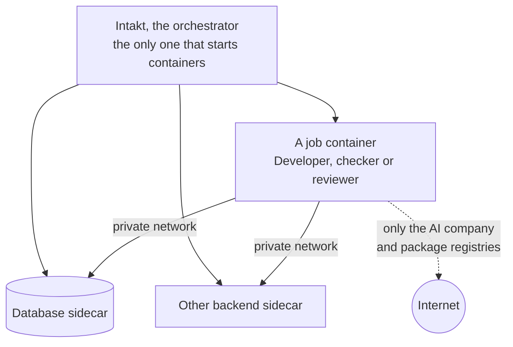

# Containers and services: where the work runs

Every Developer, checker and reviewer works inside a **container**: a sealed, throwaway box with exactly the tools your project needs. This page explains where those boxes come from, how reviewers test against a real database or another backend, and why the AI agents can't start boxes of their own. Intakt is still being built, so this describes the decided design ([details](../design/05-architecture/12-new-and-existing-projects.md)).

## The picture

- **Intakt itself** runs as one container and is the only thing allowed to start other containers.
- **A job** (one build, one check, one review) gets a fresh container from the project's image, and it is thrown away afterwards.
- **Sidecars** are extra containers your project needs to run its tests (a database, a cache, another service), started next to the job on a private network that only that job can reach.

## Where the project's image comes from

The image is the box's contents: the language, the tools, the package managers, plus the AI companies' command-line tools. Intakt takes it from the first of these that exists:

| Source | Example |
|---|---|
| your **devcontainer** | `.devcontainer/devcontainer.json` |
| your **Dockerfile** | `Dockerfile` |
| an image **Intakt generates** | from what it reads in `composer.json`: the PHP version, the PHP extensions, Composer, and the AI companies' tools at fixed versions |

Intakt can build such an image (the `intakt:job:build-image` command), but no job runs in one yet. For a review, Intakt can also add the AI companies' tools to your own Dockerfile or devcontainer image (the `--kind=review` option), because a reviewer needs them and your image may not have them. A job never gets another PHP than the one `composer.json` asks for: without a PHP version there, no image is built at all, and after every build Intakt asks the image's PHP for its version and extensions and refuses an image that does not match.

Planned, not built yet: a compose file and an image you supply as sources, images for other languages (`package.json`, ...), and building once per version of the project, cached, and rebuilt when the files they come from change.

## A check before every job

This part is built. The check before a push is built to run in a job container, but it has not yet run on a live container engine, and no build or review runs in one yet. Before a job starts its real work, it checks that its box works as promised: it writes a small file into the folder it hands its results back in and into its scratch area and reads it back, makes sure it can read every input it was given, and tries each internet address it is allowed to reach. If something does not work (for example a folder that was not mounted properly), the job does not stop: it carries on in a reduced mode, says so at the top of its log, and Intakt writes each failed check and its reason into its ledger. When the output folder itself is broken, the ledger gets a single `output` failure, and the input and egress reasons appear only in the log. So a broken folder is named at the start instead of making the job fail halfway for no clear reason.

## When a job runs out of memory

The first part is built: every job has a memory limit of its own, and when that limit stops a job, Intakt records `oom` as the reason the job ended. The rest of this section (a limit per command inside a job, the language's own memory limit, the comment on the task, the hand-over and the card on the dashboard) is planned, not built yet. The check before a push is built to run in a job container but has not yet run on a live container engine, and no build or review runs in one yet ([details](../design/04-constraints.md#security-model)).

Every job has a memory limit, so a test that eats memory without end can't slow down the rest of the machine. Inside the job, each command the AI runs has a limit of its own, so a runaway test is stopped alone: the AI is told which process was stopped and can fix it in the same session. Your language also gets a **memory limit** for the programs a job starts. By default it is 512 MB, or twice what your project's check needed when Intakt first ran it, whichever is larger, so you don't have to set anything. A limit your project already sets (for example in its test settings) wins.

If a whole job still runs out of memory, you see one comment on the task naming the process and the step, and the next try is told about it. If the same task runs out of memory a second time, it goes to the Maintainer instead of trying again; it only reaches you if the agent can't sort it out. On the dashboard this shows as status on the card, not as something waiting on you, and the project's card shows the limit in use. To raise the limit, set it in the project's settings file in your repository, or in your project's own test settings.

On some machines (some desktop container setups), a command can't get a limit of its own. Setup tells you once; there, a runaway command ends the whole job, and the rest works the same.

## Services your tests need

Most projects need more than themselves to test: a database, a cache, sometimes another backend such as an auth service. Each one can be provided in one of three ways:

| Way | What runs | Good for |
|---|---|---|
| **Bundled** (the default) | a sidecar container, a fresh copy for every job | anything that runs in a container: MySQL, PostgreSQL, Redis, your own other services |
| **External** | jobs connect to something already running, such as a staging server | services too heavy for a container, or a shared environment you already maintain |
| **Stub** | a stand-in generated from the service's API description | third-party APIs |

Intakt finds them in your project's config, your `compose.yaml`, the services your CI starts, and the `*_URL` and `*_HOST` settings in `.env.example`, and asks you to confirm. A bundled service can be seeded (migrations, fixtures, a database dump) before the tests run, and Intakt waits until it reports healthy rather than guessing with a timer.

## Can reviewers use them?

Planned, not built yet: today a reviewer reads the change and runs nothing. Once built, a review job gets the same sidecars as the check job, so a reviewer can:
- run the project's tests against a **real database**;
- start **the changed application itself** in its box and call it, to see that it boots and answers;
- (planned) write a small test of its own for an edge case and run it there.

Each review gets its own fresh copies, so reviews running at the same time never see each other's data.

## Why the AI can't start containers itself

Being able to start containers means being able to do almost anything to the machine Intakt runs on. So **no job ever gets that ability**: no Developer or reviewer can start, stop or change a container. Only Intakt starts the sidecars your project declares, with memory and CPU limits.

If a reviewer needs something that isn't there (another service, a different database version), the fix is to add it to the project's setup, not to let the reviewer fetch it. That change goes through review like any other, so you decide what your project's tests may run.

## External services and their credentials

- **Credentials stay with Intakt** and are handed only to the kinds of job you allow: by default check and review jobs, not builds, because a build runs code an AI just wrote. Low-privilege, test-only credentials are recommended.
- **Sharing is your responsibility:** jobs running at the same time hit the same external server, so tests should use their own namespace or only read. Each job gets a unique id (`INTAKT_JOB_ID`) to make that easy.

## Projects that depend on each other

When Intakt builds several projects that depend on each other, a task in one can wait for a task in another ("Waits for billing#12"), and a dependency that is also an Intakt project reuses that project's image as its sidecar. When a dependency's main moves on, the projects that use it re-run their checks against the new version.
