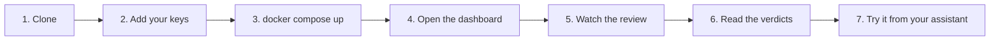

# A demo walkthrough

A guided first run: start Intakt with a sample project, watch it review a change with deliberate mistakes, and see what each part of the screen means. Intakt is still being built: this walkthrough follows the demo the plan builds (milestone M5, tasks T23 and T24 in [the plan](../plan.md)). The commands are below; the timings are recorded in the [README](../../README.md#timed-run) once the owner has timed a run.

## What you need

- Docker (or Podman).
- One AI provider key; two keys from different companies show the full two-company review panel.
- About five minutes.

## The path

1. **Clone** the repository.
2. **Add your keys:** copy `.env.dist` to `.env.local` and fill in one or two provider keys, plus two secrets (any long random text; `openssl rand -hex 32` makes one).
3. **Start it:** `docker compose up`. The first start sets up a **sample project**: a small codebase with a base version and a pull request that contains deliberate, findable problems, and a panel of two reviewers. With one key both reviewers come from that company; with two keys, from two companies. Later starts keep what the first one set up.
4. **Open the dashboard** in your browser, at `http://localhost:7781`. It opens on the list of reviews.
5. **Watch the review:** for now you start it yourself, with the command the start printed at the end of its log (`docker compose exec intakt php bin/console intakt:review sample-change ...`); Intakt starting it on its own is still planned. The sample pull request moves into **In review**. Open its card to see the reviewers working live: the files they read, the small tests they run.
6. **Read the verdicts:** each reviewer's verdict appears with its findings (P1, P2, P3), and the judge step's list of what to fix now. Compare the findings with the deliberate problems in the sample: the demo is designed so the reviewers find them.
7. **Try it from your AI assistant:** connect your assistant to Intakt's MCP server and ask it to start a review of the sample branch, then read the verdicts and the list of things to fix ([how](using-intakt-from-your-assistant.md)).

## What to point out in a demo

| Moment | What it shows |
|---|---|
| two reviewers from different companies on one change | no single company's blind spot decides |
| a reviewer running its own small test | evidence, not opinion |
| the judge step dropping a nitpick | reviews stay focused and cheap |
| a finding with file and line | answers as typed objects, not free text |
| the cost on the card | every call metered, against the week's allowance |
| the MCP call from your assistant | Intakt as a tool other agents can use |

## After the demo

- Point Intakt at a project of your own: [setting up Intakt](setting-up-intakt.md).
- Write your first real task: [writing a good task](writing-a-good-task.md).
- Stop the demo with `docker compose down`; add `-v` to remove its data too.
