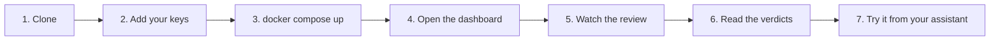
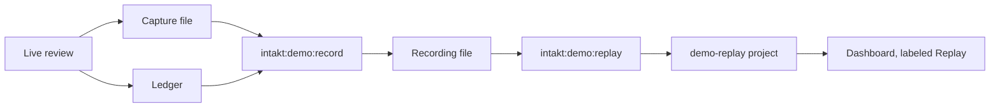

# A demo walkthrough

A guided first run: start Intakt with a sample project, watch it review a change with deliberate mistakes, and see what each part of the screen means. Intakt is still being built: this walkthrough follows the demo the plan builds (milestone M5, tasks T23 and T24 in [the plan](../plan.md)). The commands are below; the timing from the start to the verdict is added to the [README](../../README.md#timed-run) once it is measured.

## What you need

- Docker (or Podman).
- One AI provider key, or a Hugging Face token instead (with only the permission "Make calls to Inference Providers"); two keys from different companies show the full two-company review panel. The reviews' calls are billed to whoever owns the key or the token. Without either, you can still watch a recorded review: see [Playing back a recorded review](#playing-back-a-recorded-review).
- About five minutes.

## The path

1. **Clone** the repository.
2. **Add your keys (optional):** copy `.env.dist` to `.env.local` and fill in one or two provider keys (or `HF_TOKEN`, a Hugging Face token). No secrets are needed: the first start makes them and keeps them in the data volume. The demo starts without this file, but a review needs a key. Instead of the file, you can paste one Anthropic or OpenAI key or one Hugging Face token into step 1 of the dashboard's `/setup` page, then restart Intakt to use it.
3. **Start it:** `docker compose up -d --wait`, which returns once the dashboard can be opened. The first start sets up a **sample project**: a small codebase with a base version and a pull request that contains deliberate, findable problems, and a panel of two reviewers. With one key both reviewers come from that company; with two keys, from two companies. With only a Hugging Face token, both reviewers go through Hugging Face but run on models from two different AI labs. Without a key the start still opens the dashboard and sets up the codebase only; the panel is set up by the first start after you add a key. Each start also sets up a separate **demo project**, `demo-replay`, for playing back recorded reviews: it stays empty until you play a recording into it with `docker compose exec intakt php bin/console intakt:demo:replay <recording> --factor=10`, which writes the recorded review's ledger events into it and sends its live updates to the open page at the recorded pace (here ten times as fast), and anything in it is labeled a replay and never counts as a verdict. The review page says how fast each played-back round ran, next to its replay label: "Played 10 times as fast as recorded" means the real review took ten times as long. Later starts keep what was set up.
4. **Open the dashboard** in your browser, at `http://localhost:7781`. Until a review has run, it opens on the **first-run page**, which shows what is set up and offers two ways to see a review: **Watch a recorded review**, with no key (its **Play the demo run** button plays the recorded tour described below; the shipped recording is ready on first start, and the page says why it cannot play if `.env.local` empties `INTAKT_DEMO_RECORDING` or points it at a missing file), or **Run it live with your key**: paste one provider key or Hugging Face token and run the demo review. Once a review has run, a desktop browser opens on the board, and a phone opens on Waiting on you, or on the newest review once a review has finished (the played recording or a live review run with a key) and nothing else runs or waits (`http://localhost:7781/?board=1` is the board on any device).
5. **Watch the review:** with a key in place (in `.env.local`, or pasted on the first-run page and Intakt restarted), press "Start the first review" on the first-run page. It starts the review of the sample pull request and opens its live review page, where you see the reviewers working as they read the change. From the terminal, `docker compose exec intakt php bin/console intakt:demo` runs the same review with the sample's values built in and, at the end, prints the outcome, the list of things to fix, the address of the review in the dashboard and the line that connects your assistant; `docker compose exec intakt php bin/console intakt:sample:show /app/var/data/sample-repository` prints the full `intakt:review` line instead (if Intakt was started without a key, it names the keys to set instead). Intakt starting it on its own is still planned. On the board, the sample pull request is in **In review** while it runs.
6. **Read the verdicts:** each reviewer's verdict appears with its findings (P1, P2, P3), and the judge step's list of what to fix now. Compare the findings with the deliberate problems in the sample: the demo is designed so the reviewers find them.
7. **Try it from your AI assistant:** connect your assistant to Intakt's MCP server (step 4 of the first-run page and the `intakt:demo` and `intakt:sample:show` commands in step 5 show the one line that does it; the commands fill in the token made for you, and the page shows the command that prints it) and install the `intakt-review` skill from the `skills/intakt-review` folder (copy the folder into your assistant's skills folder), then, in the repository folder, say "intakt review the demo": your assistant starts a review of the sample branch with the sample's values, fixes only what the list of things to fix names (inside Intakt's container, where the sample lives), reviews again and stops by clear rules with a short report. Without the skill, ask it to start a review of the sample branch, with the same values as the review command (project `sample`, branch `sample-change` against `main`, the folder `/app/var/data/sample-repository` and the task after `--task=`), then read the verdicts and the list of things to fix ([how](using-intakt-from-your-assistant.md)).

## Playing back a recorded review

A replay shows a review that already happened, without calling any AI, so it needs no key. The easiest way is the dashboard's `/demo` page (`http://localhost:7781/demo`): its **Play the demo run** button plays the recording that `INTAKT_DEMO_RECORDING` names one and a half times as fast as it happened, and takes you to the review as it fills. Out of the box that is the real review of the sample change Intakt ships, at `/app/fixtures/demo/sample-change-review.json` in the container, so there is nothing to set up; to play another recording, name it in `.env.local`. While it plays, a caption bar at the bottom of every page says which stage the review is in, with a link to the review. The shipped review has one round, so the caption walks through the change arriving, the reviewers reading it, the first findings, the judge weighing them, and the round judged with its list of what to fix, then closes itself. Dots show how far the tour is, and each stage outlines the part of the review page it talks about. On a computer you can pause the caption (a phone shows no Pause button), and on any screen you can close it for the rest of the browser tab. The first-run page (`/setup`) offers the same button in its **Watch a recorded review** choice. From the console, `docker compose exec intakt php bin/console intakt:demo:replay <recording> --factor=10` plays a recording into the `demo-replay` project, the **replay project** each start sets up, and the open dashboard shows it arriving at the recorded pace (here ten times as fast). Use it when a live review would take too long or you have no key at hand. To clear the replays away, `docker compose exec intakt php bin/console intakt:demo:remove` deletes the replay project and everything played into it, and nothing else; the next start (or `intakt:demo:create`) sets up an empty one again, and until then a replay is refused.

Its reviews never count. The reviewers in a recording judged some change at another time, not the change on the card, so their verdicts say nothing about it. That is why every replayed round carries a **Replay** label in the dashboard, and its decision is always blocked, with the reason that a replay never counts as a verdict.

### Recording a review of your own

A recording is made from a live review, in three steps:

1. Before the review, set `INTAKT_LIVE_CAPTURE` to the name of a file. While the review runs, every live update the dashboard shows is also written to that file. Set it empty again once you have recorded, because the file keeps growing while it is set; the compose demo needs `docker compose up -d` to pick up the change ([details](../user/README.md#recording-a-review-for-the-demo)).
2. After the review, `docker compose exec intakt php bin/console intakt:demo:record <project> <change> <recording>` reads that file and the project's ledger and writes one recording file holding the review's events and its live updates.
3. Play the recording back as described above, with `intakt:demo:replay` or the `/demo` page.

## What to point out in a demo

| Moment | What it shows |
|---|---|
| two reviewers from different companies on one change | no single company's blind spot decides |
| the judge step dropping a nitpick | reviews stay focused and cheap |
| a finding with file and line | answers as typed objects, not free text |
| the cost on the card | every call metered, against the week's allowance |
| the MCP call from your assistant | Intakt as a tool other agents can use |

## After the demo

- Point Intakt at a project of your own: [setting up Intakt](setting-up-intakt.md).
- Write your first real task: [writing a good task](writing-a-good-task.md).
- See how good the reviewers are: the review bench gives them eight small changes, five with a hidden mistake and three without, and counts what they caught and what they flagged by error. It uses your paid models, so it runs only when you start it: `docker compose exec intakt php bin/console intakt:bench --project=sample`. What it is in plain words: [the review bench guide](review-bench.md); what it costs and how to read it: [the review bench](../user/README.md#the-review-bench).
- Stop the demo with `docker compose down`; add `-v` to remove its data too.
