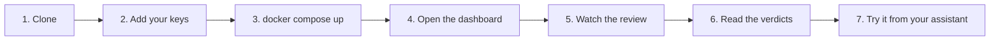

# A demo walkthrough

A guided first run: start Intakt with a sample project, watch it review a change with deliberate mistakes, and see what each part of the screen means. Intakt is still being built: this walkthrough follows the demo the plan builds (milestone M5, tasks T23 and T24 in [the plan](../plan.md)). The commands are below; the measured timings are in the [README](../../README.md#timed-run).

## What you need

- Docker (or Podman).
- One AI provider key, or a Hugging Face token instead (with only the permission "Make calls to Inference Providers"); two keys from different companies show the full two-company review panel. The reviews' calls are billed to whoever owns the key or the token.
- About five minutes.

## The path

1. **Clone** the repository.
2. **Add your keys:** copy `.env.dist` to `.env.local` and fill in one or two provider keys (or `HF_TOKEN`, a Hugging Face token). No secrets are needed: the first start makes them and keeps them in the data volume. The demo starts without this file, but a review needs a key.
3. **Start it:** `docker compose up -d --wait`, which returns once the dashboard can be opened. The first start sets up a **sample project**: a small codebase with a base version and a pull request that contains deliberate, findable problems, and a panel of two reviewers. With one key both reviewers come from that company; with two keys, from two companies. With only a Hugging Face token, both reviewers go through Hugging Face but run on models from two different makers. Without a key the start still opens the dashboard and sets up the codebase only; the panel is set up by the first start after you add a key. Each start also sets up a separate **demo project**, `demo-replay`, for playing back recorded reviews: it stays empty until you play a recording into it with `docker compose exec intakt php bin/console intakt:demo:replay <recording> --factor=10`, which writes the recorded review's ledger events into it and sends its live updates to the open page at the recorded pace (here ten times as fast), and anything in it is labeled a replay and never counts as a verdict. Later starts keep what was set up.
4. **Open the dashboard** in your browser, at `http://localhost:7781`. It opens on the board.
5. **Watch the review:** for now you start it yourself, with the review command, which the start no longer prints: run `docker compose exec intakt php bin/console intakt:sample:show /app/var/data/sample-repository` in the repository folder and run the `intakt:review` line it prints. The shorter way is `docker compose exec intakt php bin/console intakt:demo`, which runs the same review with the sample's values built in and, at the end, prints the outcome, the list of things to fix, the address of the review in the dashboard and the line that connects your assistant. Intakt starting it on its own is still planned. The sample pull request moves into **In review**. Open its card to see the reviewers working live as they read the change.
6. **Read the verdicts:** each reviewer's verdict appears with its findings (P1, P2, P3), and the judge step's list of what to fix now. Compare the findings with the deliberate problems in the sample: the demo is designed so the reviewers find them.
7. **Try it from your AI assistant:** connect your assistant to Intakt's MCP server (the `intakt:sample:show` and `intakt:demo` commands in step 5 print the one line that does it, with a token made for you) and install the `intakt-review` skill from the `skills/intakt-review` folder (copy the folder into your assistant's skills folder), then, in the repository folder, say "intakt review the demo": your assistant starts a review of the sample branch with the sample's values, fixes only what the list of things to fix names (inside Intakt's container, where the sample lives), reviews again and stops by clear rules with a short report. Without the skill, ask it to start a review of the sample branch, with the same values as the review command (project `sample`, branch `sample-change` against `main`, the folder `/app/var/data/sample-repository` and the task after `--task=`), then read the verdicts and the list of things to fix ([how](using-intakt-from-your-assistant.md)).

## What to point out in a demo

| Moment | What it shows |
|---|---|
| two reviewers from different companies on one change | no single company's blind spot decides |
| the judge step dropping a nitpick | reviews stay focused and cheap |
| a finding with file and line | answers as typed objects, not free text |
| the cost on the card | every call metered, against the week's allowance |
| the MCP call from your assistant | Intakt as a tool other agents can use |

## After the demo

- Point Intakt at a project of your own: [setting up Intakt](setting-up-intakt.md).
- Write your first real task: [writing a good task](writing-a-good-task.md).
- See how good the reviewers are: the review bench gives them eight small changes, five with a hidden mistake and three without, and counts what they caught and what they flagged by error. It uses your paid models, so it runs only when you start it: `docker compose exec intakt php bin/console intakt:bench --project=sample`. What it costs and how to read it: [the review bench](../user/README.md#the-review-bench).
- Stop the demo with `docker compose down`; add `-v` to remove its data too.
