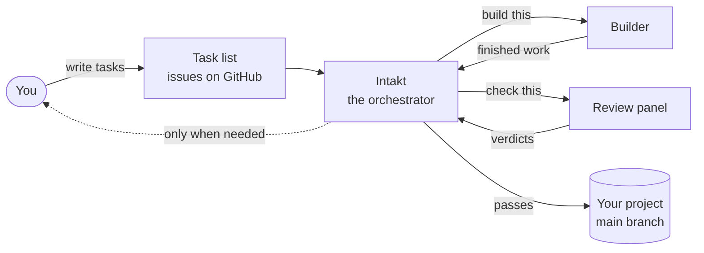
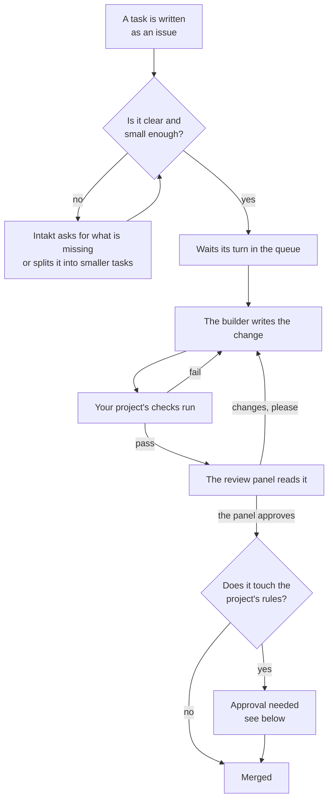
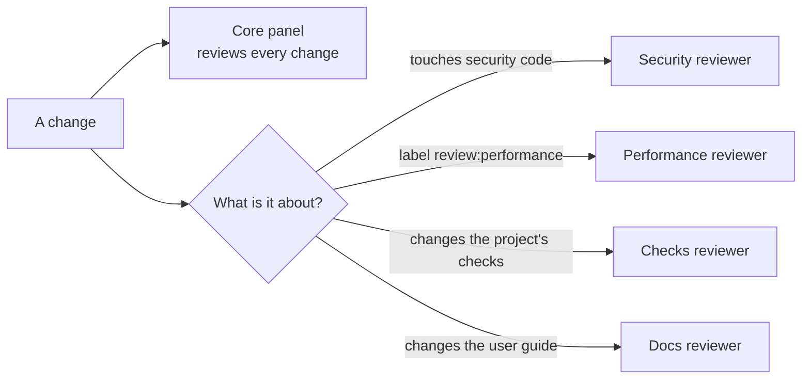
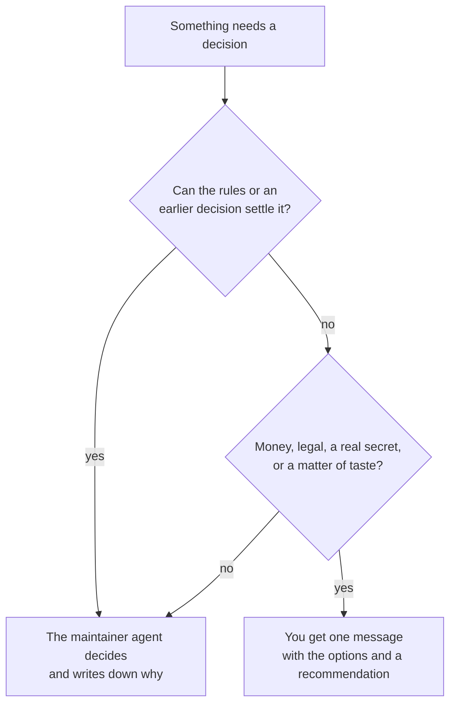
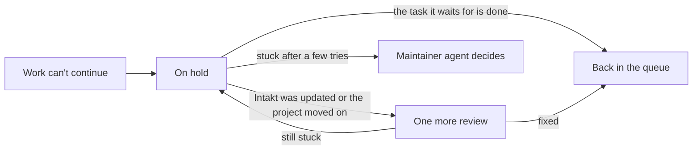
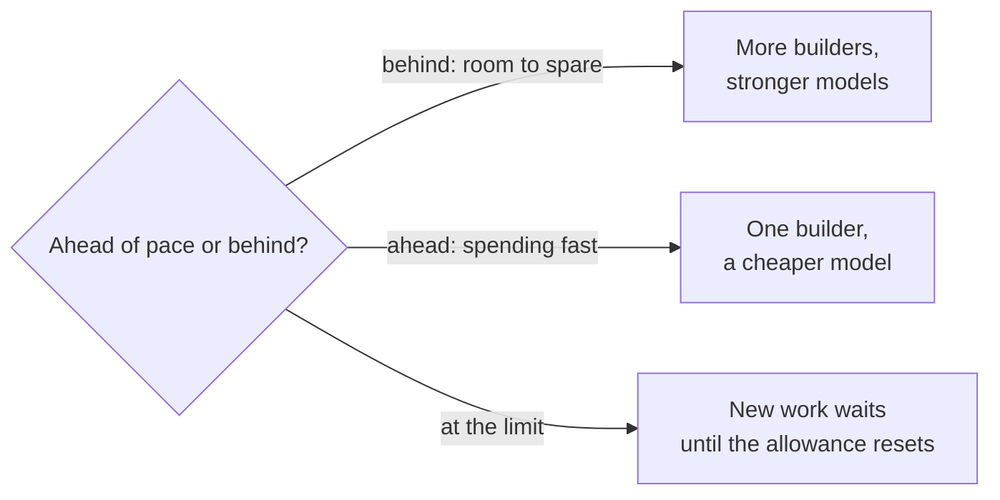

# How Intakt works, in plain words

This page explains Intakt without assuming you know how it is built. If you want the full detail, the [design](../design/README.md) is the authority; this page is the friendly tour. Intakt is still being built, so this describes how it is designed to work.

## The idea in one sentence

You write down what you want as a list of tasks, and Intakt has AI agents build each task, has other AI agents check the work, and only adds the work to your project when it passes.

Think of it as a small software team that works around the clock:

| Role | Who plays it | What it does |
|---|---|---|
| **You (the owner)** | a person | decide what gets built and settle the few questions only a person can |
| **The orchestrator** | Intakt itself | runs everything: picks the next task, starts the workers, keeps score, merges |
| **Builder** | an AI agent | writes the code for one task |
| **Reviewers** | a panel of AI agents you configure (by default two, from different companies) | check the builder's work, independently of each other, each with its own focus |
| **Checks** | your project's own tests and rules | catch mistakes no one has to argue about |
| **Maintainer agent** | an AI agent working for the orchestrator | sorts out anything that gets stuck, so it rarely reaches you |

## The life of one task

Every task goes through the same steps. Most of them happen without anyone watching.

In words:
1. **A task is written.** You, or Intakt with you, describe one piece of work: what should happen, and how to tell it is done.
2. **Intakt checks the task.** Is it clear? Is it small enough to build and review in one go? If not, it asks or splits it before any work is paid for.
3. **It waits its turn.** Urgent tasks go first, then the rest by milestone and age.
4. **The builder writes the change** in a sealed-off workspace: it can't reach your accounts, your keys or the internet beyond what it needs.
5. **The checks run.** Your project's own tests and rules either pass or they don't. A failure goes straight back to the builder.
6. **The review panel reads it.** You choose the panel: how many reviewers, which AI companies, and what each one focuses on (security, the framework's conventions, tests, documentation), with its own checklist and test recipes. By default it is two reviewers from two different companies, so one company's blind spot doesn't decide. A fixed core panel reviews every change; specialists join when the change calls for them (see below). Reviewers can also run small experiments to test the change.
7. **It is merged** into your project, or sent back with the reviewers' notes, and the builder tries again.

## Which reviewers look at a change

Every change gets the same **core panel**. On top of that, **specialist reviewers** join when the change calls for them, each with its own checklist:

What brings in a specialist:
- **the files the change touches**, for example security code;
- **a label on the task**, such as `review:security`, set by you or the maintainer agent;
- **the kind or size of the task**, for example changes to the project's checks, or a very large change;
- **the task's own wording**: when Intakt reads the task before building it, it can recommend a specialist (for example "parses user input" calls for the security reviewer).

A specialist can be **blocking** (it must approve, like the core panel) or **advisory** (its notes become small follow-up tasks), and it judges only its own area, so a docs reviewer never blocks a change over performance. These rules only ever add reviewers: nothing can make the core panel smaller, and the rules themselves are protected, so a change can't switch off the reviewer that would catch it.

## What needs you, and what doesn't

The goal is that you are asked only when a person really has to decide. Everything else Intakt and its maintainer agent decide themselves.

**Changes to the project's rules** (the checks that judge the code, the CI setup, the instructions for the agents) get extra care, because a loop that could loosen its own rules could talk itself into anything:

| The change... | Who approves it |
|---|---|
| only adds to the rules (for a check: a new check, its registration and its tests, with a mechanical proof that nothing existing changed), and every reviewer agrees (at least two, from different companies) | Intakt approves it itself, and lists it on the dashboard for a week (planned: until this is built, every rule change goes to you) |
| edits or removes an existing check, its tests or its settings | you |
| removes, relaxes or skips a check | you |
| touches the CI setup, the list of protected files, or the rules for what Intakt may approve | always you |

You never approve something whose checks are failing: Intakt asks you only once the checks are green and the review panel has approved.

## When something gets stuck

A task can stall for a reason the builder can't fix, for example it needs another task first, or a change to Intakt itself. Instead of trying again and again (which costs money and fixes nothing), Intakt puts it **on hold** and lets it go again on its own when the reason is gone.

## Spending wisely

AI agents cost money, usually as a subscription with a weekly allowance. Intakt watches how much of the week's allowance is used against how much of the week has passed:

It also avoids waste on purpose: it keeps descriptions and reviews short, doesn't review the same unchanged work twice, and stops building ahead when too much finished work is still waiting for review, because that work goes stale while it waits.

## Keeping you in the picture

- **The dashboard** shows what is being built, what is in review, what is on hold, and a "Waiting on you" column with only the things that truly need a person, each with the exact click or comment to make.
- **Notifications** go to your phone only for those things, once each: every card in "Waiting on you" was sent to you, and nothing is sent without a card ([how alerts work](a-tour-of-the-dashboard.md#alerts-and-notifications)).
- **What Intakt approved by itself** is listed on the dashboard for a week, so you can spot a wrong call without anything ever waiting on you or notifying you.

## Words you will see

| Word | Meaning |
|---|---|
| **Task / issue** | one piece of work; on GitHub it is an issue |
| **Pull request (PR)** | the builder's finished change, waiting to be merged |
| **Main** | the official version of your project |
| **Merge** | adding a pull request's change to main |
| **Checks / CI** | the automatic tests that run on every change |
| **Review** | a reviewer's verdict: approve, or changes needed with a list of findings |
| **Protected files** | the project's rules: the checks that judge the code, the CI setup, the agents' instructions |
| **Hold** | a pause that lifts by itself when its reason is gone |
| **Priority** | `urgent`, `high`, `normal` or `low`, set as a label on the task |

For every step in detail, see [the journey of a task](the-journey-of-a-task.md).
For the words behind the machinery (lanes, queues, locks, cycles, budgets, draining), see [the engine room](the-engine-room.md).
