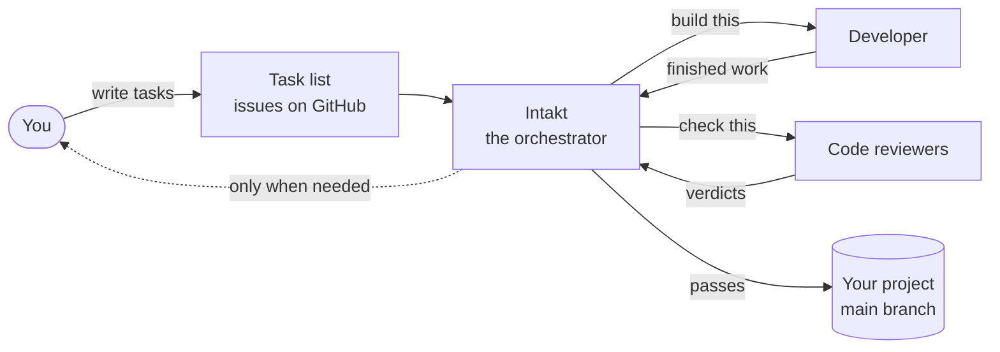
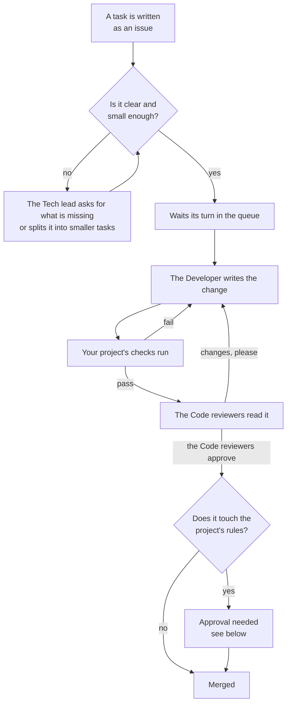
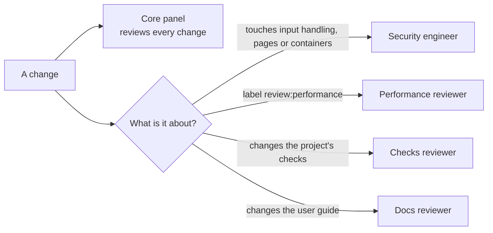
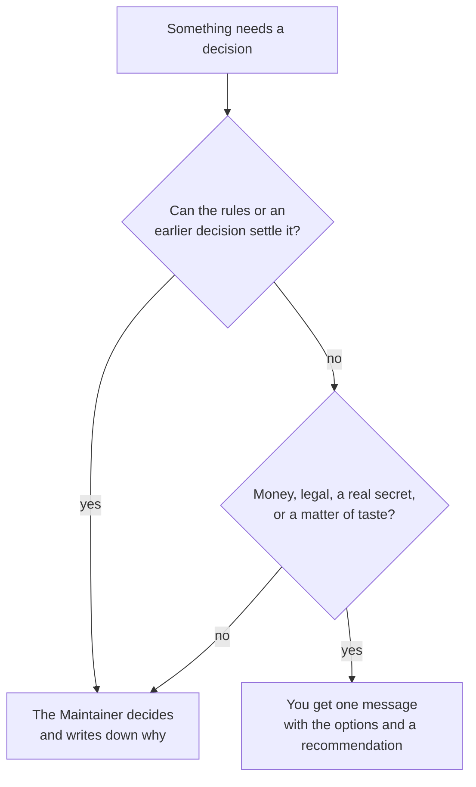
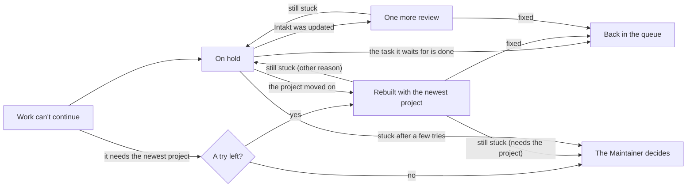
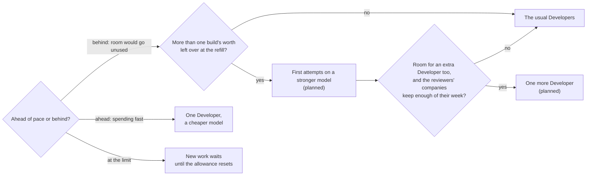

# How Intakt works, in plain words

This page explains Intakt without assuming you know how it is built. If you want the full detail, the [design](../design/README.md) is the authority; this page is the friendly tour. Intakt is still being built, so this describes how it is designed to work.

## The idea in one sentence

You write down what you want as a list of tasks, and Intakt has AI agents build each task, has other AI agents check the work, and only adds the work to your project when it passes.

Think of it as a small software team that works around the clock:

| Role | Who plays it | What it does |
|---|---|---|
| **You (the Product owner)** | a person | decide what gets built and settle the few questions only a person can |
| **Tech lead** | an AI agent | checks that a task is ready to build (the [Definition of Ready](writing-a-good-task.md#definition-of-ready)), and sizes, splits and plans it |
| **Developer** | an AI agent | writes the code for one task, and runs a self-check before handing it back (planned: checking it against the [Definition of Done](writing-a-good-task.md#definition-of-done)) |
| **Code reviewers** | a panel of AI agents you configure (by default two, from different companies when available) | check the Developer's work, independently of each other, each with its own focus; a last judge step sorts what they found |
| **Maintainer** | an AI agent working for the orchestrator | sorts out anything that gets stuck, so it rarely reaches you, and looks at speed and quality every week (planned) |
| **Designer** (planned, optional) | an AI agent that joins only for a task that changes your project's screens | before the build, it adds to the plan what a screen needs (every state, the wording, the layout on phone, tablet and desktop, use with a screen reader). It judges in three steps: automatic checks (for example contrast, text that overflows, a screen that changed by accident) stop a merge like any check; a score for how easy each screen is to use, which must point at the part of the screenshot it means, and a low score is a review finding like any other reviewer's, never a failed check; and for choices that are a matter of taste, it shows you two versions side by side, in random order, without saying which it prefers. The dashboard shows how often it picked what you picked; while it rarely matches, it asks you. The browser and checking tools are opt-in per project, and without them those steps do not run instead of passing. The one exception is the tool that reads the text in screenshots to make sure no password or key shows in them: with it off, no screenshot is shown to the Designer, and a build that adds or changes a saved reference screenshot is sent back instead of skipped |
| **Security engineer** (planned, optional) | an AI agent | reviews security in the code, the pages and the containers, and, as the penetration tester, tries to get around a change to the project's rules before it is approved (see [safety](why-the-ai-cant-wreck-your-project.md)) |
| **AI engineer** (planned, optional) | an AI agent that reports once a week and looks at the worst-scored tasks once a day | looks at where model tokens go and how the agents work, and tries better prompts, skills or model choices as experiments against the old ones. After every merge, Intakt scores how that task went (how often checks and tests ran, repeated runs, wordiness, rounds and send-backs) without any AI, and shows the scorecard on the dashboard and on the pull request within a minute (the pull request comment waits only in the rare hour when the forge refuses every call, and is posted as soon as it allows calls again). Intakt keeps a change by itself only on numbers it records itself, not on what an agent's own log says. On a subscription account the token counts come from the agent's own log, so there Intakt can still undo a change by itself but asks the owner before keeping one. Once a day the AI engineer reads the worst few of these in depth and proposes changes, citing what happened. Intakt itself, not the AI engineer, compares the numbers: it keeps a change only if it improves what it aimed at (fewer tokens, fewer check runs or less check CPU per merged task) without more tokens, send-backs, escaped defects or broken main, and undoes it otherwise. It decides only after enough merged tasks on each side, so one unlucky task never decides. The AI engineer never loosens checks or reviews to save work, and cannot change its own settings (how often it reviews, how many tasks it reads), which have defaults that need no setup. A change to a prompt goes through the same checks and approval as any change to protected files, so it cannot drop a safety rule |
| **Test engineer** (planned, optional) | an AI agent that audits the tests on a schedule | a new project starts without it. It looks at how long the tests take, which ones repeat each other and whether the CI runs are slow, and files a task for each finding; a person with write access labels a task before it is built. It never changes a test itself, and a task that removes a test must name the test that still proves the same thing, so nothing the tests prove is lost |

A new project starts with the smallest team: the Tech lead, the Developer, the Code reviewers and the Maintainer. The Designer, the Security engineer and the AI engineer are optional, off until you turn one on for the project, and so is every tool they need (security scanners, accessibility and page-quality tools); the setup wizard that proposes this team is planned ([the starting team](../design/05-architecture/11-setup.md#the-starting-team)). The Test engineer is optional in the same way.

The team works with machinery that keeps its technical names:

| Part | What it does |
|---|---|
| **The orchestrator** | Intakt itself: runs everything, picks the next task, starts the workers, keeps score, merges |
| **The scheduler** | runs the timed jobs: today the regular look for pull requests to review; planned: deadlines, the weekly cleanup and the other recurring jobs |
| **The watchdog** (planned) | keeps watching main and raises the alarm if its history was ever rewritten |
| **The checks** | your project's own tests and rules (`bin/check` in Intakt itself): they catch mistakes no one has to argue about |
| **The dashboard** | the page where you see everything and act ([tour](a-tour-of-the-dashboard.md)) |

## The life of one task

Every task goes through the same steps. Most of them happen without anyone watching.

In words:
1. **A task is written.** You, or Intakt with you, describe one piece of work: what should happen, and how to tell it is done.
2. **The Tech lead checks the task** against the [Definition of Ready](writing-a-good-task.md#definition-of-ready). Is it clear? Is it small enough to build and review in one go? If not, it asks or splits it before any work is paid for.
3. **It waits its turn.** *(Planned:)* Intakt does not yet take tasks from the queue on its own. In the designed order, urgent tasks go first, then open pull requests (see [the engine room](the-engine-room.md#queues-who-is-next)), then the rest milestone by milestone: the milestone due soonest first, milestones due on the same day (or with no due date) sharing one turn, and priority deciding within that turn; among tasks of the same priority and stage, the one other tasks are waiting on goes first, then the older task. A follow-up from a reviewer's nice-to-have note waits for the next stage unless it fixes something that blocked the original or no later stage is open. That is the default; you can list it for the weekly review to tune within limits you set.
4. **The Developer writes the change** in a sealed-off workspace: it can't reach your accounts, your keys or the internet beyond what it needs. Before it hands the change back, it runs a [self-check](the-journey-of-a-task.md#2-building) (no merge commits, nothing that looks like a key, a description that is not too long). Planned: it also checks the change against the [Definition of Done](writing-a-good-task.md#definition-of-done).
5. **The checks run.** Your project's own tests and rules either pass or they don't. A failure goes straight back to the Developer.
6. **The Code reviewers read it.** You choose the panel: how many reviewers, which AI companies, and what each one focuses on (security, the framework's conventions, tests, documentation), with its own checklist and test recipes. By default it is two reviewers from two different companies when you have both, so one company's blind spot doesn't decide; with one account it is one reviewer, plus a second model of the same company for protected, security-relevant and large changes (planned: not built yet). A fixed core panel reviews every change; specialists join when the change calls for them (see below). Reviewers can also run small experiments to test the change.
7. **It is merged** into your project, or sent back with the reviewers' notes, and the Developer tries again.

## Which reviewers look at a change

Every change gets the same **core panel**. On top of that, **specialist reviewers** join when the change calls for them, each with its own checklist:

What brings in a specialist:
- **the files the change touches**, for example code that handles outside input, the pages and scripts, or the container setup, which bring in the Security engineer with the checklist for that area (planned, see [Checking the security of what is built](why-the-ai-cant-wreck-your-project.md#checking-the-security-of-what-is-built));
- **a label on the task**, such as `review:security`, set by you or the Maintainer;
- **the kind or size of the task**, for example changes to the project's checks, or a very large change;
- **the task's own wording**: when the Tech lead reads the task before it is built, it can recommend a specialist (for example "parses user input" calls for the Security engineer).

A specialist can be **blocking** (it must approve, like the core panel) or **advisory** (its notes become small follow-up tasks), and it judges only its own area, so a docs reviewer never blocks a change over performance. These rules only ever add reviewers: nothing can make the core panel smaller, and the rules themselves are protected, so a change can't switch off the reviewer that would catch it.

## What needs you, and what doesn't

The goal is that you are asked only when a person really has to decide. Everything else Intakt and its Maintainer decide themselves.

**Changes to the project's rules** (the checks that judge the code, the CI setup, the instructions for the agents) get extra care (planned: until this is built, every rule change goes to you), because a loop that could loosen its own rules could talk itself into anything:

| The change... | Who approves it |
|---|---|
| passes the mechanical checks, the Security engineer's security review and penetration test, and every reviewer with a blocking vote classes it as tightening or neutral on the current head (this includes new checks, edited tests of a check with the proof that it got no weaker, and the start-up scripts; a CI edit or a change to the agents' instructions that no check covers still comes to you) | Intakt approves it itself, and lists it on the dashboard for a week (only once automatic approval is switched on for the project; until then it still comes to you, with Intakt's answer) |
| changes how Intakt approves (the list of protected files, the limits, the checks that apply them, the Security engineer's instructions, the known bad changes), or touches secrets and permissions (how secrets are kept or scanned, a workflow that reads a secret, more workflow permissions, new triggers, other machines) | always you |
| fails a check, the security review or penetration test finds a way around it, or a reviewer with a blocking vote classes it as loosening or gives it no class on the current head | you |

If either Security engineer session cannot run, the decision waits, whichever row applies and whether or not automatic approval is on, until it runs. The known bad changes Intakt tries on a schedule resume after an outage too, and each must still reach you, or automatic approval turns off (before it is switched on, it stays off).

You never approve a merge whose checks are failing: Intakt asks you to approve the merge only once the checks are green and the Code reviewers have approved. (Planned:) A decision only you can make, such as a new package from an outside company, is asked as soon as it shows up, so you can answer while the checks are still being fixed.

## Updates from a dependency bot

A dependency bot is a helper on GitHub (such as Dependabot) that opens pull requests to update the packages your project uses. Intakt handles these updates on their own path, not as tasks (planned: not built yet):
- **No label needed.** Intakt picks up the bot's pull requests by itself. It may only change the package list, the files that pin the exact package versions, and the lines of your CI setup that pin the versions of the CI's own building blocks (GitHub calls them actions); a pull request that changes anything else gets one comment and is left alone.
- **Checked like any change.** Your project's checks and the Code reviewers look at it as usual, but the Developer never edits it. When the update falls behind your project's latest version, the bot brings it up to date itself.
- **You approve it once.** No person asked for this change, so your approval is always needed before it merges, once the checks are green and every reviewer agrees. Your answer carries forward to a newer version of the bot's pull request only when it updates the same packages and its full set of file changes (including any CI action pins) stays exactly the same; if either differs, you are asked again.
- **A failing check becomes an urgent task.** If the update breaks a check, Intakt writes one urgent task to fix it, and looks at the update again once that fix is merged.
- **It lands through GitHub's own merge button.** Intakt merges it the way you would by hand, so GitHub shows it as merged and the bot keeps the credit, and Intakt records the merge as its own.

Intakt also suggests telling the bot to wait a few days before offering a brand-new release (security fixes excepted), so a bad release is usually caught by others first. You cannot hand such a pull request to the Developer with `take-over`; see [steering Intakt](steering-intakt.md#taking-an-item-over-by-hand-and-giving-it-back).

## When something gets stuck

A task can stall for a reason the Developer can't fix, for example it needs another task first, or a change to Intakt itself. Instead of trying again and again (which costs money and fixes nothing), Intakt puts it **on hold** and lets it go again on its own when the reason is gone.

(Planned: none of this paragraph is built yet; until the hold task is built, a held task gets one more review.) A task never waits for its own pull request: if the Developer names it as the thing to wait for, Intakt does not hold the task but hands it over with the Developer's reason. When a task waits for a pull request, Intakt looks up the task that pull request belongs to, and (planned) lets the waiting task start only once that pull request is really merged, not when its task is merely closed. When the project moves on, a held task is rebuilt with the newest project rather than reviewed again unchanged, since only a rebuild can change it. When a change clashes with the newest project only in the project's shared lists (files that many changes each add a line to), Intakt (planned) joins both sides itself and checks the result. Any other change that clashes with the newest project, a clash in the shared lists that Intakt cannot join safely or whose joined result fails the checks, or a change that needs something from the newest project, does not go on hold at all: it is rebuilt from the newest project once if the task has a try left, and goes straight to the Maintainer if it has none or if the rebuild still leaves it stuck. It is never reviewed again unchanged, not even after Intakt was updated. A task handed over to the Maintainer a second time, for any reason, is split, or goes to you when it cannot be. When a hand-over is about failed checks and Intakt's safety check of the workflow files does not clear the change, it says only how many checks failed, never their names, because the change itself wrote those names.

Holds are for reasons outside the change. If a change grows too big while it is being fixed, Intakt does not send it back to the Developer, who cannot split it, and does not hold it either: the Maintainer splits it into smaller tasks (planned: until this is built, you split it). A change that is big only because it moves documentation text from one page to others is not split: a check confirms the text moved unchanged, and reviewers read only the rest (also planned).

Splitting is not only for tasks. When you, the owner, or the Maintainer opens a pull request that is too big to review, the Maintainer splits it too, and nobody has to add `take-over`: you and the Maintainer are trusted, so building from that change is safe (planned, like the rest of this paragraph; until it is built, you split it). The Maintainer first writes down its plan, so an interrupted split picks up where it stopped and no piece is made twice. Each piece is a task that names the original branch and the exact commit it copies from, copies its share of that change, writes nothing new, stays small enough to review, and says which piece must merge first when one builds on another. Where possible, a piece keeps whole files together instead of cutting a file in two. When every piece has its own pull request, open or already merged, Intakt checks that the pieces together give exactly the original change, nothing missing and nothing added, and that each piece still carries exactly its assigned share, and only then closes the original pull request with a comment naming the pieces. A piece whose pull request was closed without merging counts as missing, so the original stays open; if a piece closes without merging after the original was closed, Intakt reopens the original. Intakt never rewrites or deletes the original branch. Open issues that name the original pull request are changed to name the pieces, and the issue's history shows that edit as the Maintainer's. A too-big pull request from anyone else is not split: it gets one comment saying it is too big and asking its author to split it. A person with write access can add `take-over`, and then it is split the same way.

A finished pull request is never kept waiting for a much bigger task. If only one part of it needs that task (say, a screenshot of a screen not built yet), that part becomes its own follow-up task, and the rest is reviewed and merged now.

## A weekly look at speed and quality (planned)

Besides sorting out stuck work, the Maintainer looks at the whole loop once a week, and sooner when a milestone falls behind or a number moves too far. Intakt first counts, without any AI: how long tasks take at each step, how often work is sent back and why, how often a build slot sat empty and why, how long things waited, how many tasks came in and went out, what one finished task costs, which checks fail only in CI (the second, independent run of the checks), and for each milestone whether it will be done by its date. Next to speed it counts quality: fixes to code that was merged recently, changes taken back, a broken main, problems a later review found, and bugs filed against merged tasks. A bug report only counts once someone allowed to change the repository has confirmed it on the forge against a merged task, and only if they were already allowed when Intakt first saw the confirmation and are still allowed when Intakt counts it, so a stranger's report does not move the numbers. Once a month it also looks at whether the code is getting harder to change. The Maintainer reads these numbers and, for each thing it finds, says the cause, what to change and how to tell whether it helped.

It changes nothing itself. It may ask to try another value for a setting you put on its list, only within the limits you set, for example how follow-up tasks are sorted. Intakt runs that as a trial with a date to look at it again, one trial per setting at a time, and takes it back by itself when any one of the quality numbers gets worse than in the four weeks before by more than the margin you set, even if the others got better. If you change that setting or its limits, or take it off your list, while a trial runs, the trial ends and is not taken back. A value a trial chose stays only while the setting is on your list and within your limits; otherwise your own value comes back. A value you set yourself always stays. Everything else it finds becomes a task, with the cause, the change and how to check it written in, marked as the agent's words for the Developers to read as data. A finding that looks like it holds a password or key, or that Intakt could not check for one, is not filed at all, and the dashboard shows that one was left out. Which AI model does what, and the instructions the agents get, are not its to look after. It never makes the reviews or checks easier, never changes who approves what, never lowers the limits you set, and never gives itself more power. When a milestone will miss its date, Intakt itself puts up one card for you to decide: drop some work, move the date, or add capacity, with the Maintainer's advice on it. If that advice looks like it holds a password or key, or Intakt could not check it for one, the advice is left off: the card stays open with its forecast, and the dashboard shows that the advice is missing. Lines inside the agent's words that would make a task wait for another or replace another have no effect: Intakt only follows such lines when they stand outside the marked text.

## Spending wisely

AI agents cost money, usually as a subscription with a weekly allowance. Intakt watches how much of the week's allowance is used against how much of the week has passed:

It also avoids waste on purpose: it keeps descriptions and reviews short, doesn't review the same unchanged work twice, and stops building ahead when too much finished work is still waiting for review, because that work goes stale while it waits.

## Keeping you in the picture

- **The dashboard** shows what is being built, what is in review, what is on hold, and a Waiting on you page that today lists the outages of AI accounts Intakt can no longer read, each with what to do. The board's Waiting on you column, with a card for everything that truly needs a person, is planned.
- **Notifications** (planned) will go to your phone only for those things, once each: every card in the "Waiting on you" column will have been sent to you, and nothing will be sent without a card ([how alerts work](a-tour-of-the-dashboard.md#alerts-and-notifications)).
- **What Intakt approved by itself** is listed on the dashboard for a week, so you can spot a wrong call without anything ever waiting on you or notifying you.

## Words you will see

| Word | Meaning |
|---|---|
| **Task / issue** | one piece of work; on GitHub it is an issue |
| **Pull request (PR)** | the Developer's finished change, waiting to be merged |
| **Main** | the official version of your project |
| **Merge** | adding a pull request's change to main |
| **Checks / CI** | the automatic tests that run on every change |
| **Review** | a reviewer's verdict: approve, or changes needed with a list of findings; blocked (held for a person) only when Intakt holds the review back, and a reviewer that answers blocked with findings is recorded as changes, but a changes answer votes for changes only when one of its findings is on the list to fix (with only small points the judge set aside it counts as approving; otherwise, for example when every finding quoted code the change does not hold, so all were dropped, it counts as blocked and can still hold the round back), unless it names a finding like one of Intakt's own failures, which counts as an answer that could not be read |
| **Protected files** | the project's rules: the checks that judge the code, the CI setup, the agents' instructions |
| **Hold** | a pause that lifts by itself when its reason is gone |
| **Priority** | `urgent`, `high`, `normal` or `low`, set as a label on the task |

For every step in detail, see [the journey of a task](the-journey-of-a-task.md).
For the words behind the machinery (lanes, queues, locks, cycles, budgets, draining), see [the engine room](the-engine-room.md).
