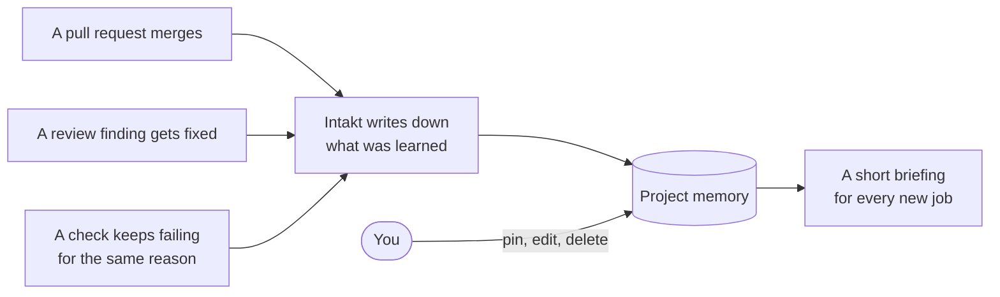
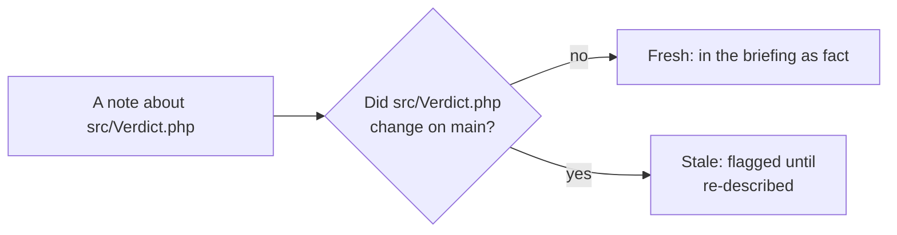

# Project memory: what Intakt remembers

Every Developer and reviewer starts with a fresh, empty box. So how does the tenth Developer know what the first nine learned? Through the **project memory**: a short notebook Intakt keeps for each project and hands to every job. Intakt is still being built: the notebook itself (notes tied to files, looked up within a size limit, read-only for reviewers) exists, a finished review writes the fixed findings into it, and every reviewer is handed the notes for the files it reviews; Developers are not handed it yet. This describes the decided design ([details](../design/05-architecture/10-shared-project-memory.md)).

## How it works

- **Only Intakt writes it**, and only from things that really happened: a merged change's summary, a review finding that was fixed, a check that failed twice for the same cause. A Developer or reviewer can't write to it, so no AI can plant something misleading there.
- **Every job reads it** as a short briefing at the start: what the project is, what is in flight, recent decisions, and the known pitfalls for the files it is about to touch. The briefing has a size limit, so it stays cheap.
- **You can curate it** on the dashboard: pin what matters, edit what is wrong, delete what is no longer true.

## Notes that go out of date

The same goes for a **settled finding**: a review point the judge or a second, stronger review rejected, kept with the reason, so reviewers do not raise it again. It is remembered with a fingerprint of the file it points at. Each reviewer of a change touching that file sees it under "already settled, do not raise again unless this code changed", as long as the file is the same. Once the file changes it stops counting as settled. A reviewer can still raise it, but must say why the reason no longer holds. Deleting one from the dashboard comes with a later part.

A note like "the verdict parser refuses empty lists because ..." is only true while that code stays the same. So each note that explains code remembers **which files it describes**. When one of those files changes on main, the note is marked **stale**: the briefing says so, and the dashboard shows it, until a later job describes the code again. No job reads an outdated explanation as fact.

## Remembering past mistakes

Fixed review findings are also kept in a searchable store: once every reviewer of a round is in, each finding a reviewer marked as fixed is written there with its cause (a round that finishes after a newer round of the same change writes nothing, because the newer round's view of the findings wins). When a new change touches the same files (a renamed file counts under its old name too), the reviewers are reminded what went wrong there before, so the same mistake is caught faster the second time. The reminder is short, is shown as notes to check rather than rules to follow, and never changes the reviewer's own instructions.
