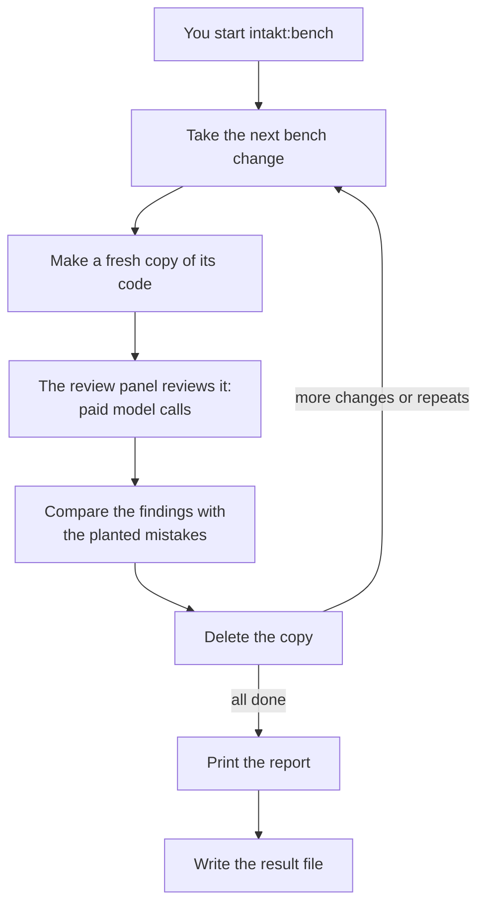

# The review bench

The review bench measures how good your reviewers are. It hands them small changes where Intakt already knows the answer, and counts what they caught and what they flagged by mistake. This page explains it in plain words; the exact commands and every figure of the report are in [the user guide](../reference/user-manual.md#the-review-bench).

## What the bench is

The sample project that comes with Intakt holds eight small changes for the bench. Five of them have a mistake planted on purpose, and three have none. Intakt keeps a list of where each planted mistake is, so after a review it can check, reviewer by reviewer:

- which planted mistakes the reviewer **caught**, and which it **missed**;
- which problems it reported on a change that has none (a **false alarm**);
- how many tokens and how much time it used.

A reviewer that failed for a reason that has nothing to do with it (the AI company could not answer, or a tool broke) is shown with that reason, and its misses are not held against it.

## Both commands call your paid models

Each review of a bench change is a real review by your project's review panel: every reviewer reads the change once, and the judge (the step that merges the reviewers' findings into one list and sorts the small ones, see the [glossary](glossary.md)) is asked when the reviewers found something. Those calls are billed to your keys or token, like any review. That is why the bench never runs by itself: nothing in Intakt's checks or in CI starts it, only you do. Start Intakt's workers first, as for any review.

## Two commands

| Command | What it reviews | What you get |
|---|---|---|
| `intakt:bench:review <change> --project=<project>` | one bench change, once | the figures for that change, printed on the screen |
| `intakt:bench --project=<project>` | all eight changes, one after the other | a report on the screen and one result file |

`intakt:bench:review` is the quick look: it names one change (for example `free-shipping`) and prints, for each reviewer, what it caught and missed, its false alarms, its tokens and time, and the judge's list of what to fix. It writes no file.

`intakt:bench` is the full run. Add `--repeat=3` to review every change three times, each time from a fresh copy of the code, to see whether the answers vary: the same reviewer can catch a mistake once and miss it the next time. More repeats tell you more and cost more: on the demo panel of two reviewers, `--repeat=3` makes 24 rounds (eight changes, three times each), so 48 reviews by a reviewer and up to 24 calls of the judge.

## What the report and the result file hold

The report starts with what went wrong and why: every missed mistake (the reviewer missed it, or the bench's own expectation cannot hold), every false alarm, and every run where a reviewer failed. Then come the figures for each run, whether the repeats of a change agreed, and the totals for each reviewer and model: mistakes found out of those planted, false alarms, and tokens.

Each of those problems names one of three causes, so you know what to fix:

- **reviewer**: the reviewer missed a planted mistake, or raised a false alarm. This is what the bench measures.
- **bench**: the bench's own record of where a mistake sits cannot hold, so the miss points at the bench, not at the reviewer.
- **harness failure**: the run itself failed (the AI company or a tool did not answer), so it says nothing about the reviewer. Such a run is left out of the mistakes, false alarms and agreement, though its tokens still count.

The **result file** is one file under `var/bench/` in the install, named after the moment of the run, and the command prints where it is. It holds everything the report is made from: the Intakt version, fingerprints of the review instructions and of the bench changes (so you can tell whether two runs measured the same thing), and for every change and run the decision, the judge's list of what to fix and, per reviewer, its model, what it caught and missed, its false alarms and other findings, any failure, and its tokens and time. With docker compose the file sits inside the container, so copy it out before you remove the container ([how](../reference/user-manual.md#the-review-bench)).

Intakt prints no price for a bench run. Multiplying the reported tokens by your AI company's prices estimates only what the reviewers cost: the report counts reviewer tokens, not the judge's, so the judge's calls cost extra. Your AI company's usage page shows the whole bill.
