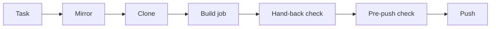

# Running one task

Until Intakt picks tasks by itself (the build lane is planned), you can hand it one task yourself: one open GitHub issue of a project. The command takes the issue from its text to a pushed pull request:

```
php bin/console intakt:build:task <project> <issue number> --remote=<remote> --branch=<branch> --directory=<folder> --image=<image>
```

`<remote>` is where the project's code lives, `<branch>` the branch the work goes on, `<folder>` a new folder for the work (it must not exist yet) and `<image>` the project's job image, the container the Developer works in. The exact rules for each are in the [user guide](../reference/user-manual.md#building-one-task).

## Before you build: is the task ready?

You can ask Intakt first whether a task is ready and how big it is:

```
php bin/console intakt:build:size <project> <issue number>
```

1. Intakt checks that the issue is one it may work on: it carries the project's eligibility label, and the people who wrote it and labeled it can write to the repository.
2. A model reads the task once and answers whether it says what changes, how to tell it is done, and that it is one change. It also guesses the size: `small`, `medium`, `large`, or `split` (too big for one build).
3. If something is missing, Intakt parks the task and posts one comment on the issue naming what to add. Edit the issue, then run the command again.

The command prints `outcome ready`, `outcome parked`, `outcome invalid` (the answer was unusable, nothing happened) or `outcome already_sized` (the same text was sized before). Splitting a task that is too big is planned.

## The steps

The command runs seven steps, always in this order:



1. **Task:** it reads the issue from GitHub. A pull request of that number is no task.
2. **Mirror:** it updates Intakt's own copy of the project's code.
3. **Clone:** it makes a fresh copy for the work in `<folder>`.
4. **Build job:** the Developer works on the issue in a container of its own and hands back its commits and the pull request text.
5. **Hand-back check:** Intakt checks what came back: only new commits on the task's branch, nothing that rewrites history, no secrets.
6. **Pre-push check:** it runs the project's checks on the work once more, in a fresh container, merged with the latest main. For a `bug` task, once those checks pass and only when the work adds, changes or renames a test, it then also tries to run those tests twice, once on the code as it was before the fix and once on the fixed code, and records how both runs ended (a run that cannot start has no result): a real regression test fails before the fix and passes after it. If the work adds no test, or its new test already passes before the fix, the test proves nothing: the step fails with that reason and nothing is pushed, the same as when a check is red.
7. **Push:** it signs the commits with its own key, pushes the branch and opens (or updates) the pull request.

## Where it stops

The command stops at the first step that fails. It prints the steps that passed, then the step that failed and why, and runs nothing after it. Nothing is retried: fix the cause and run the command again.

One check comes before every step: when the project has a `github` entry, `--remote` must be that GitHub repository's `https://github.com/<owner>/<name>` address. If it names anything else, the command stops before the first step: it prints why, reports no step, writes nothing to the ledger and exits with an error. Later, the push step also fails, with nothing pushed, when the mirror's git settings would send that address somewhere else (a `url.<base>.insteadOf` or `pushInsteadOf` rewrite, or a remote section named exactly like the address).

- A step fails when, for example, GitHub cannot list the issues, the issue is not open, the Developer made no commit, the hand-back check refuses what came back, the checks fail, or the branch conflicts with main (then nothing is pushed).
- When the Developer ends with a question instead of a change, the task stops at the build job: Intakt stores the question, runs no later step and the command still ends without an error.
- When the task is labeled `bug` and misses one of its four parts (When, Today, Expected, Must keep working), the task also stops at the build job, after the clone and before the Developer runs: Intakt stores a question naming the missing parts, runs no later step and the command ends without an error ([writing a bug task](writing-a-good-task.md#writing-a-bug-task)).
- When every step passes, the pull request is open and the command ends after the push.

## Finding the steps in the ledger

Every step writes one line to the **ledger**, Intakt's permanent record, with the project, the issue number, the step and whether it `passed`, `failed` (with the reason) or, for a parked task, `asked`. A parked task adds one more line, `task_parked`. The issue's text and the question are never in it. To read it, run:

```
php bin/console intakt:ledger:events
```

Each line shows when it was written, its id, its kind and its details; the step lines are the ones of kind `build_step_ended`. The push writes a few lines of its own just before its step line (`push_intended`, `branch_pushed` or `push_refused`, `change_intended`, `change_opened`).

You don't have to read the ledger to see where a task is: `php bin/console intakt:status` shows the last step of each task (for a task parked on a question, `build_job` as `asked`), and the dashboard's page for the task (`/tasks/<project>/<issue number>`) shows every step of its latest run, the run whose `task` step was recorded last, even while an older run of the same task is still writing steps ([a tour of the dashboard](a-tour-of-the-dashboard.md)). Steps recorded by an older Intakt carry no run id, so for those the page starts a new run at each `task` step, at a step that comes after a failed one and at a step that does not come later than the one before: it never shows a step twice or a step after a failed one, but two runs of that time that overlapped can still look like one.
