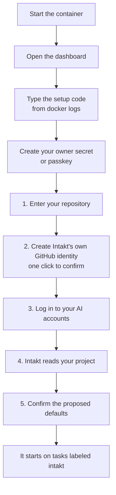
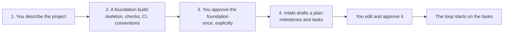

# Setting up Intakt

This page explains what happens when you install Intakt, and what changes when you add it to a project you already have or start a new one. Intakt is still being built, so this describes the decided design ([setup](../design/05-architecture/11-setup.md), [new and existing projects](../design/05-architecture/12-new-and-existing-projects.md)).

## Installing

Intakt is one container, and Docker or Podman is all you need: the image ships everything else ([requirements](../architecture/requirements.md)). You start it, open the dashboard, and a wizard does the rest:

First, the dashboard asks for a one-time **setup code**: run `docker logs intakt` on the computer Intakt runs on and copy it from there, which proves the install is yours. Then Intakt creates your **owner secret** (shown once) or registers a passkey; only you can change its settings or press a card's buttons with it ([steering budgets and pauses](a-tour-of-the-dashboard.md#steering-budgets-and-pauses)). Then:

1. **Your repository:** paste its address; Intakt detects GitHub or Gitea.
2. **Its own identity:** Intakt creates a GitHub App that acts as itself, never as you, so its comments and your approvals can always be told apart. It is installed only on the repositories you choose, with the narrowest permissions. You confirm once; you never hand Intakt a personal token.
3. **AI accounts:** log in to each subscription, or paste an API key ([accounts and costs](accounts-and-costs.md)).
4. **Reading the project:** see below.
5. **Defaults:** one builder, at most two finished changes waiting for review, the label `intakt`. Everything ends up in one config file you can edit later.

## Adding Intakt to a project you already have

Intakt looks at what your project already uses, says how sure it is, and asks you to confirm each item:

| It looks at | To learn |
|---|---|
| package files (`composer.json`, `package.json`, `go.mod`, ...) | the languages and tools, and their versions |
| a devcontainer, `Dockerfile` or compose file | the environment to build in, used as it is |
| your CI setup | the commands CI already runs, and the services tests need (databases, caches) |
| task runners (`Makefile`, scripts, `bin/check`) | the one command that checks everything |
| agent instructions (`AGENTS.md`, `CONTRIBUTING.md`, ...) | your conventions, passed to every builder and protected from changes |

Then it **runs your checks once on main**. If main is already failing, it tells you and doesn't start building, because no change could pass. A project without tests isn't an error: Intakt proposes a minimal check, and optionally a first task "add a check command and CI".

## Starting a new project

An empty repository starts with a foundation before any features:

The checks the foundation creates become **protected**: you approve them once, and from then on no builder can weaken them ([why](why-the-ai-cant-wreck-your-project.md)).

## Updating

New versions install themselves safely: Intakt stops starting new jobs, lets the running ones finish, swaps in the new version, checks it starts and works, and resumes. If anything fails, it rolls back and tells you ([draining](the-engine-room.md#draining-and-updates)).
