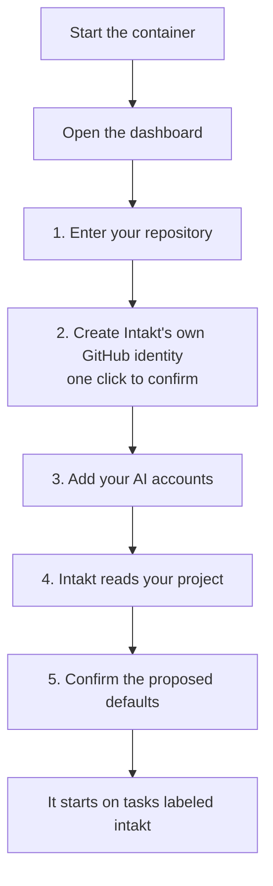
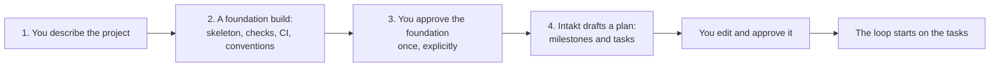

# Setting up Intakt

This page explains what happens when you install Intakt, and what changes when you add it to a project you already have or start a new one. Intakt is still being built, so this describes the decided design ([setup](../design/05-architecture/11-setup.md), [new and existing projects](../design/05-architecture/12-new-and-existing-projects.md)).

## Installing

Intakt is one container, and Docker or Podman is all you need: the image ships everything else ([requirements](../architecture/requirements.md)). Once the wizard is built, you start the container, open the dashboard, and the wizard does the rest.

The wizard is planned, not built yet. For now you create the GitHub App yourself and give Intakt its identity through three environment variables: `GITHUB_APP_ID`, `GITHUB_APP_INSTALLATION_ID` and `GITHUB_APP_PRIVATE_KEY` ([the user guide](../reference/user-manual.md) explains each). The planned flow:

There is no login, password or setup code: by default the dashboard's port is published on the computer's loopback address only, so only someone at the computer Intakt runs on can open it, and whoever can open it can use it; publish it on another address and anyone who reaches that address can use it too ([steering budgets and pauses](a-tour-of-the-dashboard.md#steering-budgets-and-pauses)). The wizard goes straight to:

1. **Your repository:** paste its address; Intakt detects GitHub or Gitea.
2. **Its own identity:** Intakt creates a GitHub App that acts as itself, never as you, so its comments and your approvals can always be told apart. It is installed only on the repositories you choose, with the narrowest permissions. You confirm once; you never hand Intakt a personal token. Before its first call to GitHub, Intakt reads the App's installation back and refuses to go on if its permissions or repositories differ from what you configured, naming the difference.
3. **AI accounts:** for each subscription, paste its long-lived token (Intakt shows the command that creates it) or log in where the AI company has no such token; or paste an API key. You can add more than one account per company ([accounts and costs](accounts-and-costs.md)).
4. **Reading the project:** see below.
5. **Defaults:** one Developer, at most two finished changes waiting for review, the label `intakt`. Everything ends up in one config file you can edit later.

A new project starts with the smallest team: the Tech lead, the Developer, the Code reviewers and the Maintainer, nothing more. The Designer, the Security engineer and the AI engineer are opt-in per project, off until you turn one on, and so is every tool they need (security scanners, accessibility and page-quality tools, a scan of the running app); the wizard proposes none of them (planned, [details](../design/05-architecture/11-setup.md#the-starting-team)). Without the Security engineer, every change to the project's protected files comes to you.

## When something does not work

Run `docker compose exec intakt php bin/console intakt:doctor` first, even when the dashboard does not start. It checks the install without changing anything and prints one line per check: `pass:` or `FAIL:` with what to do next. It ends with a non-zero exit code when any check fails, so a script can use it. Today it checks the live-update service and the GitHub App credential ([what each means](../user/08-when-something-goes-wrong.md#the-doctor-says-fail)).

## Adding Intakt to a project you already have

Intakt looks at what your project already uses, says how sure it is, and asks you to confirm each item:

| It looks at | To learn |
|---|---|
| package files (`composer.json`, `package.json`, `go.mod`, ...) | the languages and tools, and their versions |
| a devcontainer, `Dockerfile` or compose file | the environment to build in, used as it is |
| your CI setup | the commands CI already runs, and the services tests need (databases, caches) |
| task runners (`Makefile`, scripts, `bin/check`) | the one command that checks everything |
| agent instructions (`AGENTS.md`, `CONTRIBUTING.md`, ...) | your conventions, passed to every Developer and protected from changes |

Then it **runs your checks once on main**. If main is already failing, it tells you and doesn't start building, because no change could pass. A project without tests isn't an error: Intakt proposes a minimal check, and optionally a first task "add a check command and CI".

## Starting a new project

An empty repository starts with a foundation before any features:

The checks the foundation creates become **protected**: you approve them once, and from then on no Developer can weaken them ([why](why-the-ai-cant-wreck-your-project.md)).

## The smallest setup

One subscription and one modest machine is enough. This part is planned, not built yet. Intakt looks at what the install has each time it starts work, and with one account it runs one Developer and one reviewer. It does not run two builds at once, because one build can need about 5 GB of memory. A change to protected files, a security-relevant change or a large change gets a second review by another model of the same vendor; a change that only touches docs or tests gets one review, because there is no second company to ask. Tasks that would be big are split earlier, because redoing a large change costs the most.

Intakt works out how many Developers and reviewers fit each time it starts work, so adding an account or memory is picked up on its own; a second account from another company brings back the second reviewer from that company. Only if you want more than that default do you raise the numbers yourself. See [accounts and costs](accounts-and-costs.md#the-smallest-setup).

## Updating

New versions install themselves safely (planned): in a normal update, Intakt checks the new version beside the old one while work goes on, tries it on one build slot first, then moves the other slots over at once. In a normal update, a running job finishes on the version it started on, so no slot waits, and new work stops only for one restart of a few seconds. Only a version that says it needs a drain makes work wait: one that changes how jobs talk to Intakt or how they are kept apart lets the running jobs finish, restarts, and only then checks itself and tries one slot (going back to the old version if that fails), and one that changes stored data so the old version could not read it pauses all work. Updates that are not urgent wait for the update windows you set; an urgent one (a security fix, or a fix for something that stops work) and a version you pick yourself install right away. If anything fails, it rolls back and tells you; only when such a data-changing update fails after work has resumed can it not go back, so work pauses until a newer version fixes it ([draining](the-engine-room.md#draining-and-updates)).
