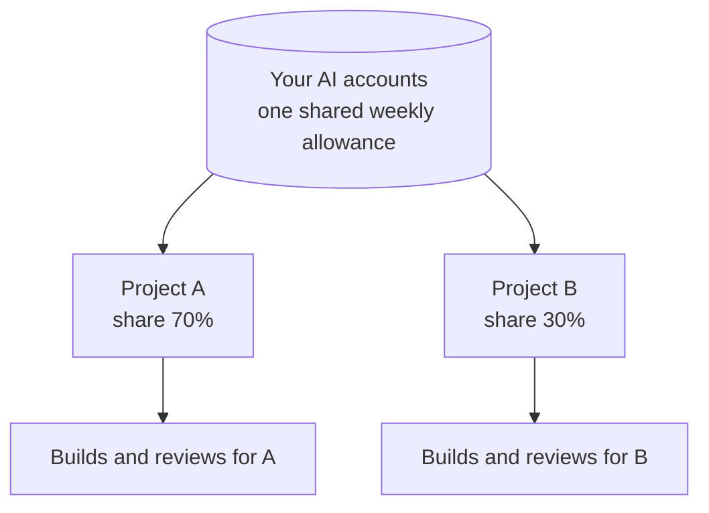
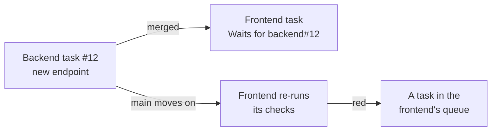

# Several projects on one install

One Intakt install can run the loop for several projects at once, sharing the same AI accounts. This page explains how it divides the work, how you see it, and what happens when projects depend on each other. Intakt is still being built, so this describes the decided design ([budget](../design/05-architecture/06-budget-and-model-planner.md), [projects](../design/05-architecture/12-new-and-existing-projects.md), [dashboard](../design/05-architecture/13-dashboard.md)).

## One pool of accounts, a share per project

- **Shares:** each project gets a share of the week, for example 70% and 30%. When a build slot comes free, the project furthest behind its share goes first.
- **Nothing is wasted:** a project with nothing to build lends its share to the others. When it has work again, it goes first until it has caught up.
- **Urgent beats shares:** an `urgent` task in any project gets the next free slot first.
- **A share of 0** pauses the project. Nothing new is built or reviewed for it, open pull requests included, so it spends none of the allowance. A job already running finishes. Its work waits where it is and carries on when you raise the share again.
- **Reviews aren't rationed by share** (except a share of 0, which pauses them): the review lane takes turns between projects, so no project's finished work waits on another's.

## Seeing all of them

On the dashboard every card and lane carries its project, and a filter shows one project or all. The outages on the Waiting on you page belong to an AI account rather than a project: they show "All projects" and stay visible whichever project is picked. Each project has a summary card:
- its share of the week against what it actually spent;
- whether it is paused or halted, and why;
- what it is working on right now.

The AI accounts, and the builders and reviewers using them, are shown **once** for the whole install, each with the project and task it is working on, so you never see the same reviewer counted twice.

*(Planned:)* The **New task** box at the top of the dashboard always asks which project the work is for (the filter's project, if it shows one), and words that describe work for two projects become two drafts, one per project ([starting a task from the dashboard](a-tour-of-the-dashboard.md#starting-a-task-from-the-dashboard)).

## Each project keeps to itself

- Each project has its **own** tasks, queue, settings, checks, protected files and project memory.
- Each project's jobs run in containers built from **that** project's image, and a job for one project can never read or change another project's files ([containers](containers-and-services.md)).
- Approvals are per project: approving something in one never counts in another.

## Projects that depend on each other

Sometimes one project needs a change in another first, for example a frontend that waits for a new endpoint in its backend:
- A task can wait for a task in another project: `Waits for billing#12`. It isn't started until that one is merged.
- A project that depends on another Intakt project can run it as a **sidecar** in its checks and reviews, built from that project's own image at a pinned version, usually its latest main.
- When a dependency's main moves on, the projects that use it **re-run their checks** against the new version. If one turns red, it gets a task in its own queue.

