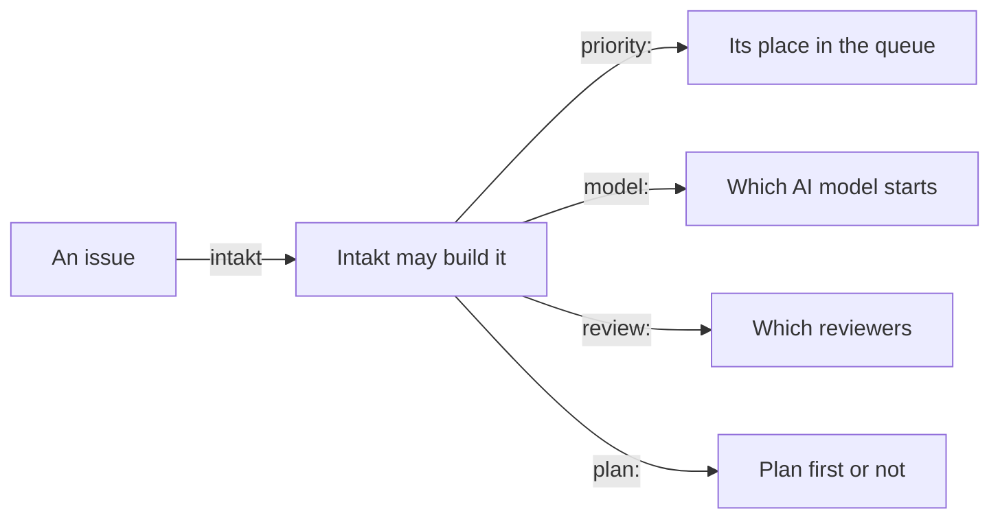

# Steering Intakt

You steer Intakt from GitHub (labels and comments on issues and pull requests, from any device) or from the dashboard. This page lists every way to tell it what you want. Intakt is still being built, so this describes the decided design ([labels](../design/05-architecture/04-labels.md), [questions and steering](../design/05-architecture/05-questions-and-steering.md)).

**Who can steer:** only people with write access to the repository. A label or comment from anyone else is ignored, whatever it says.

## Labels on a task

| Label | What it does |
|---|---|
| `intakt` | Intakt may build this task |
| `idea` | for discussion only: Intakt never builds or plans it, even if `intakt` is also set |
| `priority:urgent`, `high`, `normal`, `low` | its place in the queue; no label means `normal`. An urgent task may start even when the builders are paused for review |
| `class:core`, `feature`, `tooling`, `process` | what kind of work it is; Intakt proposes one when it is missing |
| `model:strong`, `standard`, `light` | the AI model it starts on; Intakt can still move it up if it struggles |
| `plan:required`, `plan:skip` | the builder writes a plan for your approval first, or skips it |
| `review:full` | the full review panel on every round, even for small changes |
| `review:<role>` | adds a specialist reviewer, for example `review:security` |
| `keep` | on a closed pull request: don't delete its branch |

To park an idea, label the issue `idea`; to turn it into work, remove `idea` and add `intakt`.

Intakt also writes `status:` labels (`queued`, `building`, `in-review`, `waiting-on-you`, ...) so the issue list shows where each task stands. Those are for reading only: changing one does nothing, and Intakt puts it back.

## Checking which reviewers a change would get

You can ask Intakt which reviewers a change would get, before any review runs and without spending anything on a model. Run `php bin/console intakt:review:panel <project> --lines=300 --path=src/Foo.php`, adding `--label=review:full` to see the full panel. It lists the reviewers and the rule for agreeing. Extra reviewers for big or sensitive changes come from the rules in your configuration file. For now you type the size, paths and labels in yourself: Intakt does not yet read them from a pull request.

## Lines in the task text

| Line | What it does |
|---|---|
| `Waits for #12` | don't start until #12 is done |
| `Source: <branch>@<sha>` | build from an earlier piece of work (for a task split from a bigger change) |

## Answering a question

When a builder needs a decision the task doesn't cover, it doesn't guess: it posts a question on the issue with the choices and its recommendation, and the builder moves on to other work. Answer on the issue, from any device. Your answer is written into the task as a decision, and the task starts again from there.

## Changing course

- **On a task in flight:** comment on the issue with the new instruction. The task restarts with it (a limited number of times, so it can't loop).
- **Sending work back:** on the pull request, request changes in a review (or comment `changes <sha>`); your notes go to the builder as findings, ahead of the reviewers'.
- **From the dashboard:** open the task's card to **stop** the job running now, **continue** it, or **send it back with a note**.

## Approving

When something needs you, the dashboard's "Waiting on you" column says exactly what to do. You are asked only about a version that has passed review and CI; one that reviewers sent back reaches you again once its fix has passed, as a new version to approve. The approvals are:

| What | How |
|---|---|
| merge a protected change | on the pull request: an approving review, or a comment `approve <sha>` naming that exact version |
| a plan, when plan approval is on | approve the plan comment on the issue |
| a CI change that could reach more than a throwaway machine | the approval named in the request, before it is pushed |

An approval always names one exact version. If the change itself is pushed again, Intakt asks again; a clean update from main that leaves the change identical keeps your approval.

## Pausing and priorities across projects

- **Pause** a project or the whole install from the dashboard's [admin area](a-tour-of-the-dashboard.md#pausing): running jobs finish, nothing new starts. Every pause ends at a time you choose, or when you resume.
- **Shares:** with several projects, each gets a share of the week's AI allowance. Setting a project's share to 0 stops new builds for it; its open pull requests are still finished (fixed, updated and merged).
