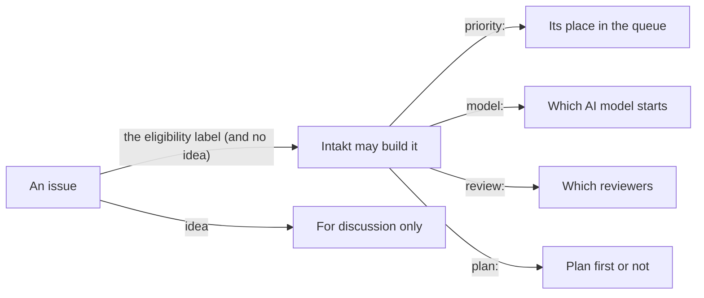

# Steering Intakt

You steer Intakt from GitHub (labels and comments on issues and pull requests, from any device) or from the dashboard. This page lists every way to tell it what you want. Intakt is still being built, so this describes the decided design ([labels](../design/05-architecture/04-labels.md), [questions and steering](../design/05-architecture/05-questions-and-steering.md)).

**Who can steer:** only people with write access to the repository. A label or comment from anyone else is ignored, whatever it says. Bot accounts never steer, even with write access, except Intakt's own and that of its maintainer agent, and those two only while they have write access themselves. How the maintainers of Intakt's own repository handle an issue or pull request from someone without write access today is in the [contributor guide](../../CONTRIBUTING.md#how-your-issue-or-pull-request-is-handled).

## Labels on a task

| Label | What it does |
|---|---|
| the project's eligibility label (`intakt` by default) | Intakt may build this task |
| `idea` | for discussion only: Intakt never builds or plans it, even if the eligibility label is also set |
| `priority:urgent`, `high`, `normal`, `low` | its place in the queue; no label means `normal`. An urgent task may start even when the builders are paused for review |
| `class:core`, `feature`, `tooling`, `process` | what kind of work it is; Intakt proposes one when it is missing |
| `model:strong`, `standard`, `light` | the AI model it starts on; Intakt can still move it up if it struggles |
| `plan:required`, `plan:skip` | the builder writes a plan for your approval first, or skips it |
| `review:full` | the full review panel on every round, even for small changes |
| `review:<role>` | adds a specialist reviewer, for example `review:security` |
| `keep` | on a closed pull request: don't delete its branch |
| `hands-off` | you work on this issue or pull request yourself: Intakt stays off it |
| `take-over` | Intakt works on an issue or pull request it did not create |

To park an idea, label the issue `idea`; to turn it into work, remove `idea` and add the project's eligibility label (`intakt` unless the project names another).

Intakt also writes `status:` labels, so the list shows where each item stands. These are for reading only. On a pull request it reviews, this part is built: `status:in-review` while the review runs, then `status:waiting-on-you` once its verdict is on the pull request. Change or remove one, and within about a minute Intakt puts it back and leaves one comment saying so. The labels for tasks (`queued`, `building`, ...) are still planned.

## Taking an item over by hand and giving it back

Every issue or pull request has one driver: Intakt or you. Two labels switch it (planned, like the rest of this page; only people with write access count, and Intakt never adds or removes them itself):
- **To work on an item yourself,** add `hands-off`. This works on any issue or pull request, Intakt's own included, and beats every other label, even `urgent`. Intakt starts nothing on it. If a job is running, it stops at its next step, nothing it did after the label is published, and its unpushed work is saved rather than lost. Everything Intakt already knew about the item is kept. The rest of the project keeps going.
- **To give it back,** remove `hands-off`. Intakt takes the item as it now stands, tells the builder what was committed by hand (to build on, not undo), and has every reviewer look at the whole thing once. Your hand-made commits do not use up a round of the review limit. A dependency bot's pull request (an automatic update of the packages your project uses) is the exception: removing `hands-off` from it gives the builder nothing to work on. It simply goes back to the usual way such updates are handled: the bot itself brings it up to date, you approve it, and a failing check becomes a task of its own ([how](how-intakt-works.md#updates-from-a-dependency-bot)).
- **To hand Intakt something it did not create,** add `take-over` to the issue or pull request. A pull request someone else opened gets its review findings fixed by the builder, then is reviewed and merged like Intakt's own. (Planned, like the rest of this flow: today Intakt refuses to push to a branch with an open pull request someone else opened, the check `refuseForeignChange`, so take-over will need its own way past that check.) If it comes from a fork Intakt cannot push to and is small enough to review, Intakt makes a new pull request that links the original, keeps each original author as a co-author, and leaves one comment on the original. Two kinds of pull request are not taken over. One that changes the protected rules: Intakt says so once, naming the files, and leaves it to you. And a dependency bot's: Intakt says so once, and the pull request stays on the usual way for bot updates (the bot keeps it up to date, you approve it, a failing check becomes a task of its own), so the builder never edits it. A pull request someone else opened that is too big to review is not split until you add `take-over`; until then it gets one comment asking its author to split it. Your own too-big pull requests, and the maintainer agent's, are split without the label ([how](how-intakt-works.md#when-something-gets-stuck)). An issue written by someone without write access becomes a task the same way; its text is still treated as information, never as orders, and if it is edited afterwards you add the label again.

Until `take-over` is built, outside work is handled this way ([contributor guide](../../CONTRIBUTING.md#how-your-issue-or-pull-request-is-handled)):
- An issue from someone without write access is not built as it stands. A maintainer opens a task of their own from it, with the issue's text copied between `<!-- external -->` and `<!-- /external -->`.
- A pull request from someone without write access, in a repository Intakt watches, is reviewed once CI on its head is green, with no label needed. When that repository's CI skips its jobs on a fork's pull request, as Intakt's own CI does, the skipped jobs count as green, so the review follows the approved run. The review only reads it (its code is never started), and a maintainer merges it by hand.

Until a dashboard button exists, the labels are the control.

## Checking which reviewers a change would get

You can ask Intakt which reviewers a change would get, before any review runs and without spending anything on a model. Run `php bin/console intakt:review:panel <project> --lines=300 --path=src/Foo.php`, adding `--label=review:full` to see the full panel. It lists the reviewers and the rule for agreeing. Extra reviewers for big or sensitive changes come from the rules in your configuration file. For now you type the size, paths and labels in yourself: Intakt does not yet read them from a pull request.

## Checking which model tier a build would get

You can also ask which tier (strong, standard or light) a build would start on, without spending anything on a model. Run `php bin/console intakt:build:tier <project> --label=model:light --path=config/gates/phpstan.neon`. It prints the tier and the reason: `default`, `label` or `sensitive-path` (`setback` and `confirmed-escalation` come from `--setback` and `--change`). A sensitive path beats a `model:` label: a build that touches one of the paths your project lists as sensitive gets the strong tier whatever the label says. The full order is in [which tier a build runs on](../user/README.md#which-tier-a-build-runs-on).

Today only a task's first build starts on the chosen tier, picked from its labels. Rebuilding a sent-back change on the chosen tier is still planned.

## Lines in the task text

| Line | What it does |
|---|---|
| `Waits for #12` | don't start until #12 is done; a line inside an `<!-- external -->` block (text copied from outside) never counts (planned) |
| `Source: <branch>@<sha>` | build from an earlier piece of work (for a task split from a bigger change); counts only from someone with write access, and only when that commit is on that branch; a line inside an `<!-- external -->` block (text copied from outside) never counts |

## Answering a question

When a builder needs a decision the task doesn't cover, it doesn't guess: it ends its build with a question, the choices and its recommendation, and Intakt checks that the question is well formed. Today that question is only shown by `intakt:build:run`. (Planned:) Intakt posts it on the issue and moves on to other work. Answer on the issue, from any device. Your answer is written into the task as a decision, and the task starts again from there.

## Changing course

- **On a task in flight:** comment on the issue with the new instruction. The task restarts with it (a limited number of times, so it can't loop).
- **Sending work back:** on the pull request, request changes in a review (or comment `changes <sha>`); your notes go to the builder as findings, ahead of the reviewers'.
- **From the dashboard:** open the task's card to **stop** the job running now, **continue** it, or **send it back with a note**.
- **New work from the dashboard** *(planned)*: describe it in plain words in the **New task** box and pick the project; you approve the draft before it becomes an issue ([starting a task from the dashboard](a-tour-of-the-dashboard.md#starting-a-task-from-the-dashboard)).

## Approving

When something needs you, the dashboard's "Waiting on you" column says exactly what to do. You are asked only about a version that has passed review and CI; one that reviewers sent back reaches you again once its fix has passed, as a new version to approve. (Planned:) A decision only you can make, such as a new package from an outside company, is asked as soon as it shows up instead, and your answer holds for later versions that leave that part unchanged. The approvals are:

| What | How |
|---|---|
| merge a protected change | on the pull request: an approving review, or a comment `approve <sha>` naming that exact version |
| a plan, when plan approval is on | approve the plan comment on the issue |
| a CI change that could reach more than a throwaway machine | on the task's issue, where Intakt shows the whole change (an ordinary image file whose contents match its format, a PNG, JPEG or GIF, appears by its size and the ids of its two versions, not by its contents): a comment `approve <sha>` naming that exact version, before it is pushed (the command that holds such a change and asks you, `intakt:forge:push-approval`, is built, but `intakt:build:task`, which already pushes builds, does not ask it yet) |

An approval always names one exact version. If the change itself is pushed again, Intakt asks again (planned: an early answer about a package or a protected file carries over to later versions while that part stays unchanged, so the merge does not ask about it again; likewise, once you approved a merge because the change hit a limit such as secrets, a fix that leaves the same files hitting the same limits exactly as you approved them does not ask you again). For a merge, a clean update from main that leaves the change identical keeps your approval; for a CI change before its push, every new commit (an update from main too) needs a new approval, and allowing the push never approves the merge.

## Pausing and priorities across projects

- **Pause** a project or the whole install from the dashboard's [admin area](a-tour-of-the-dashboard.md#pausing): running jobs finish, nothing new starts. Every pause ends at a time you choose, or when you resume.
- **Shares:** with several projects, each gets a share of the week's AI allowance. Setting a project's share to 0 pauses it like the Pause button: running jobs finish, then no builds and no reviews, open pull requests included, until you raise it again.

## Labels on a reviewed pull request

On GitHub, two labels steer a review. `review:full` asks for the full panel of reviewers, and `model:<tier>` (`strong`, `standard` or `light`) sets the tier the reviewers start on. A panel that needs one strong reviewer keeps that reviewer strong. A reviewer also keeps its configured tier when your project maps the labeled tier to another provider than the reviewer's, or to no model, so a label never moves a reviewer to another provider. Only labels a person with write access applied, and still on the pull request, count. If Intakt cannot read the labels, none counts and the review runs on the configured panel. A review keeps the labels it started with.

When two values of one family (two `model:` labels, say) are present, the one applied last wins, and Intakt removes the other with a comment. If the pull request changed after Intakt listed it, Intakt removes nothing this time, so a label you just applied again stays. If you apply it again in the very moment of the removal, it is removed anyway (GitHub cannot remove a label only if it is unchanged); the comment then asks you to apply it once more, and that value counts. A `model:` label that names no tier steers nothing and never pushes out a valid one. This holds for the one-value families `priority:`, `class:`, `model:` and `plan:`; Intakt never removes `review:` labels or labels of your own, such as `area:docs`.
